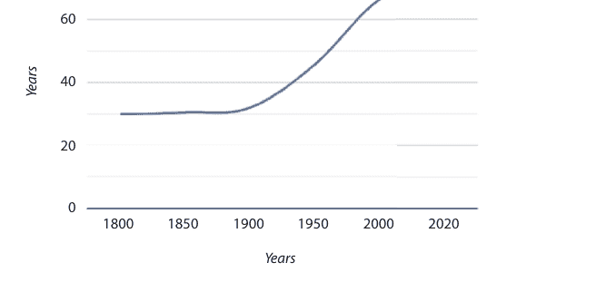
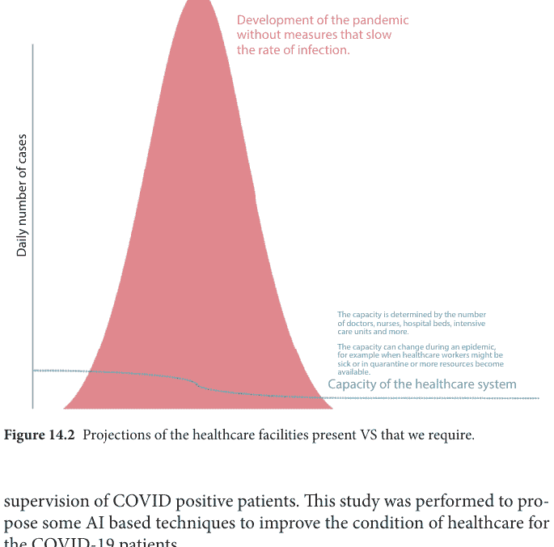
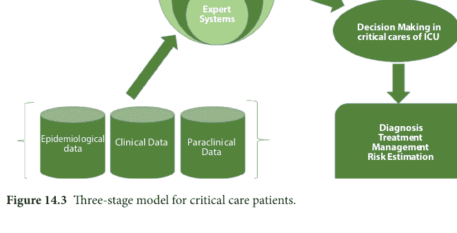

# 利用人工智能帮助 COVID-19 患者

Ayush Hans

Department of Computer Engineering, Indian Institute of Information Technology, Sonepat, Kurukshetra, Haryana, India

**摘要**
COVID-19 是一种由 SARS-CoV-2 病毒引起的传染病。SARS-CoV-2 感染正如野火般在全球蔓延。2020 年 3 月，世界卫生组织将其宣布为全球大流行。截至撰写时，已有超过 1400 万人检测呈阳性。全球感染人数迅速增长，为抗击这种疾病付出了巨大努力。COVID-19 爆发带来的主要挑战是对医疗行业进行有效管理。对 COVID-19 患者进行有效监督以减少进一步传播的威胁，是医疗行业最具挑战性的工作之一。本研究主要关注发现新的并在现有基于人工智能的模型上进行构建，以改善医疗设施，促进 COVID-19 患者的更好康复。

经过有选择的研究，提出了许多与人工智能相关的医疗行业解决方案。这包括人工智能在重症监护中应用的三阶段模型，包括输入、处理和输出阶段。输入阶段包括用于预处理的数据。处理阶段包括各种人工智能技术、机器学习算法、深度学习算法用于创建模型。输出阶段包括决策部分。这涉及患者的治疗、疾病诊断、风险分析、估计和管理。医疗行业为击败 COVID-19 所做的所有努力都可以通过基于人工智能的解决方案得到支持，这将增强治愈 COVID-19 患者的过程，尤其是重症监护室中症状危重的患者。

**关键词：** 人工智能（AI），COVID-19，重症监护，大流行，医疗保健

#### 14.1 引言

自人类诞生以来，人类经历了大量大流行。大流行是指在全球范围内发生或影响世界大部分人口的流行病。根据世界卫生组织，大流行是指一种新疾病在全球范围内的传播，而流行病是指局限于一个地区、城市或国家的疾病。大流行被认为会跨越国界传播，甚至可能在全球范围内传播。此类大流行的主要原因可能是引入某种新的细菌或病毒株或其亚型，该病原体很容易传入人体并在人与人之间传播。人类历史上一些最致命的大流行是由一种名为耶尔森菌的单细菌引起的，俗称鼠疫。

我们过去记录了许多大流行。其中一些已知的大流行包括：

- 查士丁尼瘟疫（公元540年）：估计造成超过4000万人死亡（约占当时世界人口的一半）[1]。
- 黑死病（1347年）：同一种鼠疫在约800年后再次出现，在3-4年内杀死了约2亿人[2]。
- 天花（15世纪）：它在近3个世纪里一直是持续的错误来源，据信在其高峰期每三人中就有一人因此死亡。它消灭了美国和墨西哥等北美国家的90%原住民。后来在1980年，世界卫生组织宣布天花完全被根除[3]。
- 霍乱（19世纪早期）：这是一种水源性疾病，据信起源于印度并传播到世界各地，在一个世纪里杀死了无数人[4]。
- 流感（19世纪早期至中期）：这种疾病几乎同时在全球出现，造成超过7000万人死亡。

所有这些大流行都因缺乏足够的医疗设施而对世界人口产生了巨大影响。诊断延迟是这些疾病非常致命并成为大流行的主要原因之一。但随着新技术的出现和多年来医疗设施的改善，似乎人类已经宣布在微生物面前取得胜利，如图14.1所示。这得益于疫苗、药物、抗体、更好的治疗方法和先进技术，这些都是在过去几十年中开发的。

这是一种非常危险的自满，因为微生物从未消失，它们只是暂时看不见，现在又重新出现。自21世纪初以来，我们见证了许多对公共卫生产生影响的病原体。其中一些值得注意的包括埃博拉病毒、HIV、寨卡病毒等，它们要么是新的且危害较小的病毒，要么是我们过去已经遇到过的病毒。

2019年，一种名为冠状病毒的老病毒重新出现。这是一种影响人类呼吸道的病毒。冠状病毒已知会引起多种疾病，其中包括SARS（严重急性呼吸综合征）、MERS（中东呼吸综合征）以及最近的新型冠状病毒肺炎（COVID-19）。

COVID-19（冠状病毒的简称）于2019年12月首次在中国的武汉被发现。世界卫生组织（WHO）于2020年3月11日将其宣布为全球大流行。截至撰写时，确诊病例为21,450,473例，死亡805,587例，康复病例为12,34,808例。这些病例在世界各地的分布情况见图14.1。该病毒的死亡率（MR）和病例数主要取决于几个重要因素[5]。但其中最重要的是对危重患者的护理。正如研究表明，鼻腔是COVID病毒的初始入侵点。

图14.1 随着医疗卫生部门的进步，预期寿命的增加。

因此，这种病毒最突出的挑战之一是对需要急性或重症呼吸护理并有大量既往病史的COVID-19患者进行适当治疗[6, 7]。

这类治疗之所以成为可能，是因为本世纪技术进步。计算机的出现是医疗卫生领域的一大推动力。接下来在医疗卫生领域开启新阶段的巨大推动力是万维网的引入。正是因为WWW，高水平的专业知识才得以到达最偏远的地区，而现在计算机或电子设备已成为医疗行业必不可少的一部分。

但即使有了这种进步，在病例数量迅速增加的情况下，如图14.2所示，医疗设施在这段时间内也不堪重负。因此出现的主要问题是，世界各地的医疗机构如何利用人工智能管理COVID-19患者的重症监护？

在过去几年中，人工智能（AI）已成为医疗保健的必需品。这是因为它带来的好处，如临床工作流程自动化、减少诊断错误、疾病早期检测等[8]。但在医生需要长时间轮班并需要极高精度的情况下，人工智能的作用需要具有创新性。对这些医疗机构患者重症监护和临床决策过程的任何轻微干扰都会使所有相关人员暴露于COVID风险中[9]。

本文的主要目的是评估机器学习（ML）和人工智能（AI）技术在治疗和

图14.1 COVID病例在世界各地的分布。

Figure 14.2 Projections of the healthcare facilities present VS that we require.

对 COVID 阳性患者的监督。本研究旨在提出一些基于 AI 的技术，以改善 COVID-19 患者的医疗状况。

#### 14.2 Method

为撰写本文而采用的搜索策略基于以下路径：

- **Search Topic** 为“History of pandemics,” “How can Artificial Intelligence help the healthcare sector during COVID times,” “Use of AI in respiratory disease detection,” 和 “Use of AI for critical care patients.”
- **Search Engines** 使用了 Google、Google Scholar、PubMed 以及其他有用数据库。
- **Search Terms** 为 AI、COVID-19、pandemics、healthcare sector 和 respiratory diseases。

搜索完成后，使用了一些基于 AI 的技术，并建立了一个包含输入阶段、处理阶段和输出阶段的三阶段模型。该模型基于此前在该领域进行的研究方法 [10, 11–16]。

#### 14.3 Results

根据输入、处理和输出的三阶段模型/流程，列出了在疫情期间可能有用的主要人工智能应用清单。该模型的主要目标是改善对危重 COVID-19 患者的监督和医疗。上述所有阶段都进一步细分为子类别，如图 14.3 和表 14.1 所示。

Figure 14.3 Three-stage model for critical care patients.

Table 14.1 Three-stage model of application of AI for patients in critical care.

| Input | Process | Output |
| --- | --- | --- |
| Paraclinical Data Clinical data Epidemiological data | Machine Learning Artificial Intelligence Deep Learning Expert Systems | Decision Making Diagnosis Risk Estimate Treatment Management |

此外，COVID-19 后医疗行业中可能出现的一些主要进步/创新也在末尾进行了提及。

#### 14.4 Discussion

##### 14.4.1 What is the Use of AI in Healthcare?

对于医疗保健而言，AI 被认为是一组计算机化应用，它借助各种算法和软件模仿人类认知来处理复杂的医学信息和数据。AI 的主要目标是对用于疾病预防、诊断或治疗的技术之间的联系进行详细分析并呈现结果 [17]。这些人工智能程序的应用可在医疗程序中看到，例如治疗方案开发、诊断流程、患者监测、药物开发等。

##### 14.4.2 How to Use AI for Critical Care Units

鉴于医疗保健行业在人工智能帮助下取得的上述进步，我们可以说，完全有可能开发一个人工智能模型，根据患者的既往健康记录预测患者是否具有更高的健康风险 [18]。此外，提供具备自动化对全球各地不同患者在 COVID 等大流行病中涉及的风险进行分类的能力的软件服务，被认为是对此问题的可行解决方案 [19]。此外，由于病例增加导致实验室检测频率降低也是一个重要问题。

在人工智能的帮助下，我们可以以更高的准确性预测全球实验室进行的检测，并精确估计可能的原因。此外，还开发了各种监测系统，可以监测呼吸道感染的出现 [20]。

###### 14.4.2.1 Input Stage

可归类于输入阶段的所有项目在此简要总结。几乎所有有症状的患者都可以在临床检测之前根据其 COVID 的体征和症状被标记。这是一个早期报警系统，可以借助 AI 创建。事实上，在临床检测中发现 COVID 阳性患者需要相当长的时间，而且由于每个设施可用的空间不足，前往设施也会使患者因处于其他高风险患者附近而面临更高风险。此外，数据挖掘方法可用于流行病学数据的预测。

在此方法的基础上，即使在医疗行业发现它们之前，也可标记大流行病。这将是一个有益的选择，因为它可以挽救可能与其接触的其他人。此外，通过手机联系，如印度 Arogya Setu 应用中使用的方式、数据挖掘方法、社交媒体数据、航空交通地图等多种可能方式，还可以定义热点地区以及未来不久将成为新兴震中地的其他地方。

另一种可发挥作用的方法是利用 AI 辅助技术来定义病毒在社区中传播的模式，并在爆发即将到来时提前告知对患者健康最可能的影响。以实例说明，通过手机找到活跃病例，中国的 COVID-19 爆发得到了有效控制 [21]。这是一种基于 AI 的方法，对社区产生了效果。AI 还可以通过根据每个人的遗传和生理特征识别潜在和最易感人群来促进个性化医疗。所有这些方法都将导致治疗和诊断的发现；这些也是输出的一部分。

###### 14.4.2.2 Process Stage

可归类于处理阶段的所有项目在此简要总结。深度学习在 COVID-19 与各种不同疾病的鉴别诊断中可能是一个非常有用的工具。 along with this, variations in genetics of severe, mild or even asymptomatic patients of COVID-19 can be used and machine learning analysis can be performed on them to predict potential patients in the future.

这种方法将基于考虑这些患者抵御潜在 COVID-19 感染的能力。研究表明，危重患者可借助 AI 进行监测，尤其侧重于深度学习和无处不在的传感。替代方法包括利用 AI 改善受 COVID 影响的患者的风险沟通策略，根据其位置和时间。

###### 14.4.2.3 Output Stage

可归类于输出阶段的所有项目在此简要总结。关于输出阶段，以下项目可简述如下。COVID-19 是一种全身性疾病，其最致命的并发症影响肺部。然而，在开始治疗之前，必须对患者进行确诊。这依赖于患者的既往记录、体格检查记录和其他临床数据。其中最敏感的一项仍然是胸部 CT 扫描 [22, 23]。

在此基础上，我们可以加入 CRISPR 在 COVID-19 检测中的作用，提高诊断速度和检测准确性。针对需要重症监护的患者的 AI 系统还可以分析实验室检测在 COVID 及相关疾病诊断中的有效性，从而提高其效率。根据过往经验，基于 AI 的方法将有助于改善 COVID-19 患者的治疗方法。

危重患者可能面临的一个挑战是缺乏对接受持续气管切开术和机械通气的危重患者进行早期检测和更好管理的适当方法和模型。在此，提出了一种可能的解决方案，即使用 AI。人工智能还开辟了基于随机森林等算法来管理和预测患者困难气道的途径。

在当前时期，COVID-19 疫苗的生产对全球各地的医疗系统来说是一个挑战。在这些时期，人工智能挺身而出，提出了一种新的疫苗学工具，该工具将医疗保健与机器学习集成；这已成为该领域的主要候选者之一。受体内模型影响的另一种疫苗生产模式也被认为在该领域有用。这些再次依赖于人工智能、数据库以及体内工具。

决策过程中的困难一直是我们在讨论 COVID 患者时出现的主要方面。人工智能及其相关模型和算法可能在实现更好的决策方面非常有效。该过程始于风险估计。随后是对数据集的诊断、医疗和生存趋势的预测，然后对所涉及的风险进行分类，并根据指定的各种类别进行分类，然后根据提供的数据集预测风险。最后，我们根据形成的模型预测生存百分比。

在本次大流行期间，另一个重要问题是床位分配的管理；人工智能可以帮助我们以成本效益的方式完成这项任务。除了上述重要性之外，人工智能还可以用于个人医疗保健问题的保护。这可以通过使用各种人工智能算法和模型来实现，其中包括硅基筛选、隔离区内的移动调查等[24]。

管理入住医院/医疗中心的 COVID 阳性患者并不是一个新挑战，因为它只是一个旧问题的新的模式，该问题甚至在本次大流行之前就已存在。通常，入住医疗中心的患者会同时接受多种疗法，这可能是由于他们的健康状况。有时，固定的指南缺失，这鼓励医生/医疗从业者根据其获得的知识、普遍信念以及主要是经验做出一些决定。但所有这些都可以通过人工智能的出现得以解决，因为它具有处理大量数据、对其建立模型并分析正确选择的能力，从而避免错误做法。

最后，人工智能和基于人工智能的方法将使为每个个体患者以良好的有效性和可靠性回答困难问题变得更加可能。这正是研究重点转向人工智能在呼吸系统疾病领域以及 COVID 患者管理中的主要原因。这主要是因为人工智能可以帮助为这些问题创建有效的解决方案。许多医疗专业人员使用异构和复杂的大型数据集进行决策。如果人工智能在该领域得到有效和高效的使用，它可以显著降低数据集的复杂性，将这些数据转化为更有用和更相关信息[25–27]。

此外，人工智能以其在呼吸道传染病以及某些严重阻塞性肺病的确定中发挥决定性作用而闻名。尽管如此，我们仍需要更大规模的研究和有力的证据来验证人工智能的发现。我们还需要证明人工智能被医疗部门接受，因为在该行业中，这些方法中哪怕是微小的错误也可能证明是致命的。

换个角度来看，医学上的轻微错误总是代价高昂的，并且可以通过人工智能、大数据以及各种机器学习算法和模型更有效地预防。人工智能在决策中的作用尤其具有很大的兴趣，尤其是在缺乏足够数据或实物证据时。

根据一项研究，人工智能有潜力将医疗治疗费用减少约 50%，并将医疗错误减少约 35%[28]。根据世界卫生组织，错误诊断和医疗错误是全球死亡的主要原因之一，约 10% 的住院会因医疗错误而导致问题，约 0.3% 的入院因这些医疗错误而导致死亡。因此，鉴于当前情况，人工智能无可争议地是医疗机构消除这些错误并使医疗更安全、更高效的最有效前进方式[29]。

深度学习算法和模型现在在生物信息学和分类中被广泛使用。这也被认为是对传染病分析的非常有影响力的工具。另一个提供出色结果的案例是使用 ANN（人工神经网络）创建模型来根据呼吸系统问题对患者进行分类[30]。

该技术可进一步用于监测医疗领域的各种趋势，这将使以下方面在日常实践中成为可能：

- 面部识别
- 面部检测
- 面部动作单元检测
- 姿势识别
- 声压级检测
- 到访频率检测
- 光照水平检测

使用基于人工智能的决策引擎高效管理入住医疗机构的 COVID-19 患者将为医疗从业者提供帮助。设计该论证引擎需要准确和全面的数据。这意味着对 COVID 易感患者的记录收集和存储已被视为建立模型的最重要因素。此外，针对 COVID 患者的疾病登记系统需要存在。

目前，世界大多数国家的医疗部门都专注于控制大流行并妥善治疗受影响的患者。另一个关注点是生产和制造合适的疫苗，而且要尽可能快地完成。除了上述内容外，还应关注更快地实施完整的、更快速的感染者登记系统。世界各地为击败 COVID-19 所做的努力可以通过引入使用人工智能模型的决策系统而得到有效帮助。这将有助于更轻松、更好地管理 COVID 患者。

COVID-19 不仅会对人们的生活方式产生短期影响，而且会对社会在心理和经济上产生长期而持久的影响。每个国家都因 COVID-19 而遭受了不同的经济打击。这可以从每个国家的 GDP（国内生产总值）来看，该指标在 2020 年第一季度急剧下降[31]。如果不是数十年，至少需要数年时间才能弥补这些损失。

尽管如此，COVID-19 也带来了积极的一面。这次大流行导致公众更愿意接受并采取公共卫生信息。资料还声称世界许多主要城市的空气污染显著减少（20–30%）[32]。

此外，在这些时期全球医疗行业所做的改进将有助于从长远来看改善医疗设施。也许最突出的变化是远程医疗服务和技术的大规模采用，这些技术需要使用视频通话将患者与紧急和预防护理中心连接起来，而无需他们离开家。这些远程医疗服务有可能将医疗服务大幅扩展到偏远地区，那里的医疗服务可能有限或不存在。它也有可能让其他医生或医疗工作者在当地设施不堪重负时处理患者筛查和护理后随访。

此外，大流行强调了医疗提供者向前看并为危机做好准备的重要性。如果 COVID-19 病例激增未得到控制，它有可能使医院不堪重负，同时造成药品和设备短缺。这就是为什么这些医疗专业人员想出了预测未来 COVID-19 病例出现位置和严重程度的新颖创新方法的原因。医疗行业在预测和限制未来任何大流行方面的这一技术进步可能至关重要。

#### 14.5 结论

全球医疗行业为击败 COVID-19 所做的所有努力都可以通过纳入基于人工智能的决策系统而获得真正的益处。这不仅有助于提高 COVID-19 检测率，还将有助于创建一种系统，以更高的效率和便利性管理患者，尤其是在本次大流行期间的重症监护患者。

### 致谢

作者谨向 Mr. Saddam 在使此项工作成为可能方面所做的努力表示感谢，并感谢印度库鲁克谢特拉国立技术学院提供的帮助和支持。

### 参考文献

- 1. Paules, C.I., Marston, H.D., Fauci, A.S., Coronavirus Infections-More Than Just the Common Cold. JAMA, 323, 8, 707–708, 2020.
- 2. Zhu, N., Zhang, D., Wang, W., Li, X., Yang, B., Song, J. et al., A Novel Coronavirus from Patients with Pneumonia in China, 2019. N. Engl. J. Med., 382, 8, 727–33, 2020.
- 3. Wu, F., Zhao, S., Yu, B., Chen, Y.M., Wang, W., Song, Z.G. et al., A new coronavirus associated with human respiratory disease in China. Nature, 579, 7798, 265–9, 2020.
- 4. Hui, D.S., IA, E., Madani, T.A., Ntoumi, F., Kock, R., Dar, O. et al., The continuing 2019-nCoV epidemic threat of novel coronaviruses to global health—The latest 2019 novel coronavirus outbreak in Wuhan, China. Int. J. Infect. Dis., 91, 264–6, 2020.
- 5. Takian, A., Raoofi, A., Kazempour-Ardebili, S., COVID-19 battle during the toughest sanctions against Iran. Lancet, 1035–1036, 1, 2020.
- 6. Namendys-Silva, S.A., Respiratory support for patients with COVID-19 infection. Lancet Respir. Med., 8, 4, 18, 2020.
- 7. Zhang, D.H., Wu, K.L., Zhang, X., Deng, S.Q., Peng, B., In silico screening of Chinese herbal medicines with the potential to directly inhibit 2019 novel coronavirus. J. Integr. Med., 18, 2, 152–8, 2020.
- 8. Alimadadi, A., Aryal, S., Manandhar, I., Munroe, P.B., Joe, B., Cheng, X., Artificial Intelligence and Machine Learning to Fight COVID-19. Physiol. Genomics, 52, 4, 200–202, 2020.
- 9. Keuning, B.E., Kaufmann, T., Wiersema, R., Granholm, A., Pettilä, V., Møller, M. et al., Mortality prediction models in the adult critically ill: A scoping review. Acta Anaesthesiol. Scand., 64, 4, 424–42, 2020.
- 10. Rao, A. and Vazquez, J., Identification of COVID-19 Can be Quicker through Artificial Intelligence framework using a Mobile PhoneBased Survey in the Populations when Cities/Towns Are Under Quarantine. Infect. Control Hosp. Epidemiol., 41, 7, 826–830, 2020.
- 11. Alexis Ruiz, A., Wyszynska, P.K., Laudanski, K., Narrative Review of Decision-Making Processes in Critical Care. Anesth. Analg., 128, 5, 962–70, 2019.
- 12. Gutierrez, G., Artificial Intelligence in the Intensive Care Unit. Crit. Care, 24, 1, 101, 2020.

+   13. Chapalain, X. and Huet, O., 人工智能（AI）是否已步入重症监护病房（ICU）和手术室（OR）？ *Anaesth. Crit. Care Pain Med.*, 38, 4, 337–8, 2019.
+   14. Mathur, P. and Burns, M.L., 重症监护中的人工智能。 *Int. Anesthesiol. Clin.*, 57, 2, 89–102, 2019.
+   15. Mupparapu, M., Wu, C.W., Chen, Y.C., 人工智能、机器学习、神经网络和深度学习：新型牙科诊断的未来概念。 *Quintessence Int.*, 49, 9, 687–8, 2018.
+   16. Bini, S.A., 人工智能、机器学习、深度学习和认知计算：这些术语的含义是什么以及它们将如何影响医疗保健？ *J. Arthroplasty*, 33, 8, 2358–61, 2018.
+   17. Lin, E. and Tsai, S.J., 神经网络中的机器学习。 *Adv. Exp. Med. Biol.*, 1192, 127–37, 2019.
+   18. Cosgriff, C.V., Celi, L.A., Stone, D.J., 重症监护，重症数据。 *Biomed. Eng. Comput. Biol.*, 10, 1179597219856564, 2019.
+   19. Ghassemi, M., Celi, L.A., Stone, D.J., 综述：重症监护中的数据革命。 *Crit. Care*, 19, 118, 2015.
+   20. Hashimoto, D.A., Witkowski, E., Gao, L., Meireles, O., Rosman, G., 麻醉学中的人工智能：当前技术、临床应用和局限性。 *Anesthesiology*, 132, 2, 379–94, 2020.
+   21. Pino Pena, I., Cheplygina, V., Paschaloudi, S., Vuust, M., Carl, J., Weinreich, U.M. *et al.*, 使用弱标记的HRCT肺部图像进行自动肺气肿检测。 *PLoS One*, 13, 10, e0205397, 2018.
+   22. Badnjevic, A., Gurbeta, L., Custovic, E., 一种专家诊断系统，用于在临床环境中自动识别哮喘和慢性阻塞性肺疾病。 *Sci. Rep.*, 8, 1, 11645, 2018.
+   23. Tuite, A.R., Bogoch, I.I., Sherbo, R., Watts, A., Fisman, D., Khan, K., 新型冠状病毒病2019（COVID-19）负担的估计以及从伊朗传播感染的国际潜力。 *Ann. Intern. Med.*, 172, 10, 699–701, 2020.
+   24. Robson, B., 计算机与病毒性疾病。关于设计合成疫苗和针对SARS-CoV-2（2019-nCoV，COVID-19）冠状病毒的预防性肽拟抗剂的初步生物信息学研究。 *Comput. Biol. Med.*, 119, 103670, 2020.
+   25. Cismondi, F, Celi, L.A., Fialho, A.S., Vieira, S.M., Reti, S.R., Sousa, J.M. *et al.*, 利用人工智能减少ICU中不必要的实验室检测。 *Int. J. Med. Inform.*, 82, 5, 345–58, 2013.
+   26. Bogoch, I.I., Watts, A., Thomas-Bachli, A., Huber, C., Kraemer, M.U.G., Khan, K., 新型冠状病毒从中国全球传播的潜力。 *J. Travel. Med.*, 27, 2, 1195–1982, 2020.
+   27. Husnayain, A., Fuad, A., Su, E.C., 感染性疾病风险沟通中谷歌搜索趋势的应用：以台湾COVID-19疫情为例。 *Int. J. Infect. Dis.*, 95, 221–223, 2020.
+   28. Santosh, K.C., 人工智能驱动的冠状病毒爆发工具：需要在多维/多模态数据上进行主动学习和跨人群训练/测试模型。 J. Med. Syst., 44, 5, 93, 2020.
+   29. Fraser, C., Donnelly, C.A., Cauchemez, S., Hanage, W.P., Van Kerkhove, M.D., Hollingsworth, T.D. et al., 一种甲型流感H1N1毒株的大流行潜力：早期发现。 Science, 324, 5934, 1557–61, 2009.
+   30. Tarnok, A., 机器学习、COVID-19（2019-nCoV）和多组学。 Cytometry A, 97, 3, 215–6, 2020.
+   31. Alan, C., Lee, COVID-19与数字物理治疗师实践和远程医疗的推进, Phys. Therapy, 100, 7, 1054–1057, 2020.
+   32. Nelson, B., COVID-19的积极影响, BMJ (Clinical research ed.), 369, m1775, 2020.
