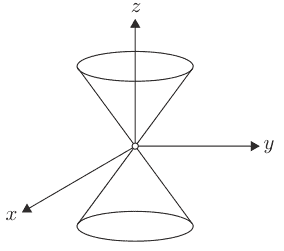
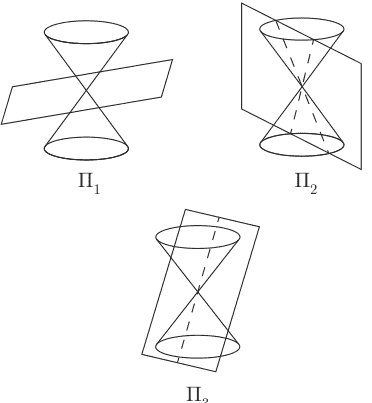

## 第 4 章

## 数量积空间

## 4.1 数量积空间

我们现在开始研究一种将占据我们整本书的其余部分的类型向量空间。

设 $V$ 为向量空间，$\mathfrak{g}: V \times V \longrightarrow \mathbb{R}$ 为双线性函数。我们称 $\mathfrak{g}$ 为 $V$ 上的数量积，并称对 $(V,\mathfrak{g})$ 为数量积空间，如果 $\mathfrak{g}$ 在 $V$ 上对称且非退化。回顾第 3.1 节，$\mathfrak{g}$ 在 $V$ 上对称如果对所有向量 $v,w$ 在 $V$ 中 $\langle v,w\rangle = \langle w,v\rangle$；且 $\mathfrak{g}$ 在 $V$ 上非退化如果对所有向量 $v$ 在 $V$ 中，$\langle v,w\rangle = 0$ 对所有向量 $w$ 在 $V$ 中成立蕴含 $v=0$。

设 $(V,\mathfrak{g})$ 确实为数量积空间。由 $\mathfrak{g}$ 的对称性可知，对所有 $V$ 的基 $\mathcal{H}$，$\mathfrak{g}_{\mathcal{H}}$ 是对称矩阵。对应于 $\mathfrak{g}$ 的范数是函数

$$\|\cdot\|: V \longrightarrow \mathbb{R}$$

定义为

$$\|v\| = \sqrt{|\langle v,v\rangle|} = \sqrt{|\mathfrak{g}(v)|} \tag{4.1.1}$$

对 $V$ 中所有向量 $v$ 成立，其中 $\mathfrak{g}$ 为对应于 $\mathfrak{g}$ 的二次函数。在 (4.1.1) 中取绝对值是必要的，因为数量积可能取负值。我们称 $\|v\|$ 为 $v$ 的范数。注意 $\|v\|=0$ 当且仅当 $v=0$ 或 $v$ 为类光；且 $\|v\|=1$ 当且仅当 $v$ 为单位向量。回顾定理 3.3.3，由于 $\mathfrak{g}$ 在 $V$ 上非退化，平坦映射 $F$ 是线性同构，故其逆，尖锐映射 $S$，存在且也是线性同构。

**例 4.1.1 ($\mathbb{R}^m$).** 对整数 $0\leq \nu \leq m$，设

$$\mathfrak{g}: \mathbb{R}^m \times \mathbb{R}^m \longrightarrow \mathbb{R}$$


设 𝔰 为由

𝔰((x¹,...,xᵐ),(y¹,...,yᵐ)) = ⟨(x¹,...,xᵐ),(y¹,...,yᵐ)⟩ = { Σᵢ=1ᵐ xⁱ yⁱ if ν = 0; Σᵢ=1ᵐ⁻ν xⁱ yⁱ − Σᵢ=m−ν+1ᵐ xⁱ yⁱ if 1 ≤ ν ≤ m − 1; − Σᵢ=1ᵐ xⁱ yⁱ if ν = m. }

给出的函数。

显然，𝔰 是双线性的且对称的。设 (e₁,...,eₘ) 为 ℝᵐ 的标准基，且设 v = (a¹,...,aᵐ) 是 ℝᵐ 中的一个向量，使得对 ℝᵐ 中所有向量 w 都有 ⟨v,w⟩ = 0。则特别地，0 = ⟨v,eᵢ⟩ = ±aⁱ 对每个 i 成立，故 v = 0。因此，𝔰 是非退化的。这表明 𝔰 是 ℝᵐ 上的一个数量积。数量积空间 (ℝᵐ,𝔰) 称为半欧几里得 (m,ν)-空间。我们通常用 ℝᵥᵐ 表示 (ℝᵐ,𝔰)，并写 ℝᵥᵐ = (ℝᵐ,𝔰)。

我们注意到 ℝᵐ 上是否存在数量积与基的存在与否无关。因此，ℝᵥᵐ 的标准基定义为 ℝᵐ 的标准基。

## 定理 4.1.2. 若 (V,g) 是一个数量积空间且 U 是 V 的子空间，则：
- (a) dim(U⊥) = dim(U⁰)。
- (b) dim(V) = dim(U) + dim(U⊥)。
- (c) U⊥⊥ = U。

证明. (a): 我们有 U⊥ = {v ∈ V : ⟨v,u⟩ = 0 对所有 u ∈ U} = {v ∈ V : F(v) ∈ U⁰} = F⁻¹(U⁰) = S(U⁰) = im(S|U⁰)，故 dim(U⊥) = rank(S|U⁰)。

由于 S : V* ⟶ V 是一个线性同构，所以 S|U⁰ : U⁰ ⟶ S(U⁰) 也是线性同构。于是定理 1.1.14 给出 rank(S|U⁰) = dim(U⁰)。结果得证。

(b): 这由定理 1.1.1 和部分 (a) 得出。

(c): 若 u 是 U 中的向量，则 ⟨u,v⟩ = 0 对 U⊥ 中所有向量 v 成立，故 u 在 U⊥⊥ 中。因此，U ⊆ U⊥⊥。利用部分 (b) 两次得到 dim(U) + dim(U⊥) = dim(V) = dim(U⊥) + dim(U⊥⊥)，所以 dim(U) = dim(U⊥⊥)。结果现在由定理 1.1.7(b) 得出。

## 定理 4.1.3.

若 $(V,\mathfrak{g})$ 是一个数量积空间且 $U$ 是 $V$ 的子空间，则以下等价：
- (a) $\mathfrak{g}$ 在 $U$ 上非退化。
- (b) $U\cap U^\perp=\{0\}$。
- (c) $V=U\oplus U^\perp$。
- (d) $\mathfrak{g}$ 在 $U^\perp$ 上非退化。

**证明.** (a) $\Leftrightarrow$ (b): 我们有

$\mathfrak{g}$ 在 $U$ 上非退化
$\Leftrightarrow\quad v$ 在 $U$ 中，且 $\langle v,w\rangle=0$ 对所有 $w$ 在 $U$ 中蕴含 $v=0$
$\Leftrightarrow\quad v$ 在 $U$ 中，且 $v$ 在 $U^\perp$ 中蕴含 $v=0$
$\Leftrightarrow\quad U\cap U^\perp=\{0\}$。

(b) $\Rightarrow$ (c): 由

$\dim(V)=\dim(U)+\dim(U^\perp) \qquad\text{[Th 4.1.2(b)]}$
$\qquad=\dim(U+U^\perp)+\dim(U\cap U^\perp) \qquad\text{[Th 1.1.15]}$

以及 $U\cap U^\perp=\{0\}$ 可得 $\dim(V)=\dim(U+U^\perp)$，然后由定理 1.1.7(b) 得 $V=U+U^\perp$。由定理 1.1.7，$U+U^\perp=U\oplus U^\perp$，故 $V=U\oplus U^\perp$。

(c) $\Rightarrow$ (b): 这由定理 1.1.7 得出。
(c) $\Leftrightarrow$ (d): 这由 (a) $\Leftrightarrow$ (c) 和定理 4.1.2(c) 得出。

继续使用定理 4.1.3 的记号，设 $\mathfrak{g}$ 在 $U$ 上非退化，此时 $V=U\oplus U^\perp$。仅在此设定下，我们称 $U^\perp$（先前称为关于 $\mathfrak{g}$ 在 $V$ 中 $U$ 的 perp）为 $U$ 的**正交补（在 $V$ 中关于 $\mathfrak{g}$）**。由定理 4.1.2(c) 可知 $U$ 是 $U^\perp$ 在 $V$ 中关于 $\mathfrak{g}$ 的正交补。因此，$U$ 与 $U^\perp$ 在 $V$ 中关于 $\mathfrak{g}$ 互为正交补。为了说明，设 $v\ne0$。易证 $\mathbb{R}^{m-\nu}\times\{0\}^{\nu}$ 和 $\{0\}^{m-\nu}\times\mathbb{R}^{\nu}$ 是 $\mathbb{R}^m$ 在 $\mathfrak{g}$ 关于 $\mathfrak{g}$ 的正交补。于是定理 4.1.3 给出

$\mathbb{R}^m_\nu=(\mathbb{R}^{m-\nu}\times\{0\}^{\nu})\oplus(\{0\}^{m-\nu}\times\mathbb{R}^{\nu}).$ \tag{4.1.2}

在做明显的识别并稍作滥用记号后，这可以简洁地表示为 $\mathbb{R}^m_\nu=\mathbb{R}^{m-\nu}\oplus\mathbb{R}^{\nu}$。

## 定理 4.1.4.

若 $(V,\mathfrak{g})$ 是一个数量积空间且 $U$ 是 $\mathfrak{g}$ 在其上非退化的 $V$ 的子空间，则 $V$ 中每个向量 $v$ 都能唯一地表示为

$v=P_U(v)+P_{U^\perp}(v)$,

其中 $P_U(v)$ 是 $U$ 中的向量且 $P_{U^\perp}(v)$ 是 $U^\perp$ 中的向量。

**证明.** 这由定理 4.1.3 得出。

在定理 4.1.4 的记号中，**正交投影**到 $U$ 上是线性映射

$$\mathcal{P}_U: V \longrightarrow U$$

由赋值

$$v \longmapsto \mathcal{P}_U(v)$$

定义。

更一般地，对于 $V$ 的子集 $S$，令我们定义

$$\mathcal{P}_U(S)=\{\mathcal{P}_U(s):s\in S\}.$$

当 $S$ 由单个向量组成时，例如 $v$，我们记

$$\mathcal{P}_U(\{v\}) \quad \text{为} \quad \mathcal{P}_U(v).$$

## 定理 4.1.5.

若 $(V,\mathfrak{g})$ 是一个数量积空间且 $v,w$ 是 $V$ 中的向量使得 $\langle v,v\rangle\neq 0$，则

$$\mathcal{P}_{\mathbb{R}v}(w)=\frac{\langle v,w\rangle}{\langle v,v\rangle}v.$$

*证明.* 由于 $\langle v,v\rangle\neq 0$，$\mathfrak{g}$ 在 $\mathbb{R}v$ 上非退化，所以定理 4.1.4 适用。于是 $\mathcal{P}_{\mathbb{R}v}(w)=cv$ 且 $w=cv+\mathcal{P}_{(\mathbb{R}v)^\perp}(w)$ 对某个实数 $c$ 成立。则

$$\langle v,w\rangle=\langle v,cv+\mathcal{P}_{(\mathbb{R}v)^\perp}(w)\rangle=c\langle v,v\rangle,$$

所以 $c=\langle v,w\rangle/\langle v,v\rangle$。

与 (4.1.2) 相关的观察是 $\mathfrak{g}$ 在 $\mathbb{R}^{m-\nu}\times\{0\}^{\nu}$ 上正定，在 $\{0\}^{m-\nu}\times\mathbb{R}^{\nu}$ 上负定。下一个结果表明这是更一般现象的一个特例。

## 定理 4.1.6 (Sylvester 的惯性定律)。

若 $(V,\mathfrak{g})$ 是一个数量积空间，则：
- (a) 存在 $V$ 的子空间 $V^+$ 和 $V^-$ 使得 $V=V^+\oplus V^-$，且 $\mathfrak{g}$ 在 $V^+$ 上正定，在 $V^-$ 上负定。
- (b) 维数 $\dim(V^+)$ 和 $\dim(V^-)$ 由 $\mathfrak{g}$ 唯一确定，意义如下：若 $W^+$ 和 $W^-$ 是 $V$ 的子空间使得 $V=W^+\oplus W^-$，且 $\mathfrak{g}$ 在 $W^+$ 上正定，在 $W^-$ 上负定，则 $\dim(V^+)=\dim(W^+)$ 且 $\dim(V^-)=\dim(W^-)$。

*证明.* (a): 若 $\mathfrak{g}=0$，结果是平凡的，故假设并非如此。由定理 3.2.4(b)，存在 $V$ 中非零向量 $v$ 使得要么 $\langle v,v\rangle>0$ 要么 $\langle v,v\rangle<0$。设 $\langle v,v\rangle>0$；当 $\langle v,v\rangle<0$ 时的论证类似。则 $\mathbb{R}v$ 是 $V$ 的非零子空间，且 $\mathfrak{g}$ 在其上正定。设 $V^+$ 是 $V$ 的（不一定唯一的）子空间，其维数在 $\mathfrak{g}$ 正定的子空间中最大，且设 $V^-=(V^+)^\perp$。则 $\mathfrak{g}$ 在 $V^+$ 上非退化，所以定理 4.1.3 给出

$$V=V^+\oplus V^- \tag{4.1.3}$$

且

$$V^+ \cap V^- = \{0\}. \tag{4.1.4}$$ 

我们断言 g 在 $V^-$ 上负半定。设为反证，设 $V^-$ 中存在非零向量 $v^-$ 使得 $\langle v^-, v^-\rangle > 0$，并考虑 $V$ 的子空间 $V^+ + \mathbb{R}v^-$。由于 $\mathbb{R}v^- \subseteq V^-$，由 (4.1.3) 可得

$$V^+ + \mathbb{R}v^- = V^+ \oplus \mathbb{R}v^- . \tag{4.1.5}$$ 

设 $v^+ + a v^-$ 是 $V^+ + \mathbb{R}v^-$ 中的向量。则

$$\langle v^+ + a v^-, v^+ + a v^-\rangle = \langle v^+, v^+\rangle + a^2\langle v^-, v^-\rangle \ge 0,$$

且

$$\begin{aligned}
\langle v^+ + a v^-, v^+ + a v^-\rangle &= 0 \\
\Leftrightarrow \quad \langle v^+, v^+\rangle &= 0 \text{ 且 } a^2\langle v^-, v^-\rangle = 0 \\
\Leftrightarrow \quad v^+ &= 0 \text{ 且 } a = 0 \\
\Leftrightarrow \quad v^+ + a v^- &= 0.
\end{aligned}\tag{[4.1.5]}$$ 

这表明 g 在 $V^+ + \mathbb{R}v^-$ 上正定。由 $V^+$ 的极大性可得 $V^+ + \mathbb{R}v^- = V^+$，所以 $v^-$ 在 $V^+$ 中，这与 (4.1.4) 矛盾。这证明了断言。

我们现在断言 g 在 $V^-$ 上负定。设 $w^-$ 是 $V^-$ 中的向量使得 $\langle w^-, w^-\rangle = 0$。由于 g 在 $V^-$ 上负半定，定理 3.2.6 适用。于是 $\langle w^-, v^-\rangle^2 \le \langle w^-, w^-\rangle\langle v^-, v^-\rangle = 0$ 对 $V^-$ 中所有向量 $v^-$ 成立，故 $\langle w^-, v^-\rangle = 0$ 对 $V^-$ 中所有向量 $v^-$ 成立。由于 $w^-$ 在 $V^- = (V^+)^\perp$ 中，$\langle w^-, v^+\rangle = 0$ 对 $V^+$ 中所有向量 $v^+$ 成立。由 (4.1.3) 可知 $V = V^+ + V^-$，所以 $\langle w^-, v\rangle = 0$ 对 $V$ 中所有向量 $v$ 成立。由于 g 非退化，$w^- = 0$。于是 g 在 $V^-$ 上负定。这证明了断言。

(b): 设 $V^+ \cap W^-$ 中存在非零向量 $v$。由假设，g 在 $V^+$ 上正定，所以 $\langle v, v\rangle > 0$。也由假设，g 在 $W^-$ 上负定，故 $\langle v, v\rangle < 0$，矛盾。因此，$V^+ \cap W^- = \{0\}$。由定理 1.1.17 可得 $V^+ + W^- = V^+ \oplus W^-$，然后由定理 1.1.18 可得

$$\dim(V^+) + \dim(W^-) = \dim(V^+ + W^-) \le \dim(V).$$

由定理 1.1.18 和 (4.1.3)，

$$\dim(V^+) + \dim(V^-) = \dim(V).$$

由此可得 $\dim(W^-) \le \dim(V^-)$。类似地，由于 g 在 $W^+$ 上正定且在 $V^-$ 上负定，我们有 $\dim(V^-) \le \dim(W^-)$。于是 $\dim(V^-) = \dim(W^-)$。相应的论证表明 $\dim(V^+) = \dim(W^+)$。


## 4.2 正交基

设 $(V,\mathfrak{g})$ 为维数为 $m$ 的数量积空间，$v, w$ 为 $V$ 中的向量。回顾第 3.1 节，若 $\langle v, w\rangle = 0$ 则称 $v$ 与 $w$ 正交。由于 $\mathfrak{g}$ 是对称的，$v$ 与 $w$ 正交当且仅当 $w$ 与 $v$ 正交。对于整数 $k \ge 2$，$V$ 中 $k$ 个不同的非零向量 $(v_1,\dots,v_k)$ 被称为正交 $k$-元组，如果当 $i \ne j = 1,\dots,k$ 时 $v_i$ 与 $v_j$ 正交。这允许 $v_i$ 与自身正交的可能性；即 $v_i$ 可能是光状向量，对于一个或多个 $1 \le i \le m$。如果正交 $k$-元组 $(v_1,\dots,v_k)$ 由单位向量组成，则称其为标准正交 $k$-元组，此时排除了光状向量。当正交 $m$-元组是 $V$ 的基时，称其为正交基。由定理 4.2.3 可知，标准正交 $m$-元组必然是 $V$ 的基，称为标准正交基。因此，若 $(e_1,\dots,e_m)$ 是 $V$ 的标准正交基，则根据定义，$e_1,\dots,e_m$ 各自为单位向量，所以 $\langle e_i,e_j\rangle = \pm \delta_{ij}$ 对于 $i,j = 1,\dots,m$，其中 $\delta_{ij}$ 为克罗内克 delta。特别地，$\mathbb{R}_\mathfrak{g}^m$ 的标准基是标准正交的。

标准正交基在计算上很方便。事实证明数量积空间总是具有一个，如我们现在所示。

### 定理 4.2.1. 每个非零数量积空间都包含一个单位向量。

证明. 这由定理 3.2.4(b) 和定理 3.3.4 可得。

### 定理 4.2.2. 若 $(V,\mathfrak{g})$ 为维数为 $m$ 的数量积空间且 $1 \le k \le m-1$ 为整数，则 $V$ 中任意标准正交 $k$-元组都可以延拓为 $V$ 中的标准正交 $(k+1)$-元组。

证明. 设 $\mathcal{E} = (e_1,\dots,e_k)$ 为 $V$ 中标准正交 $k$-元组。则 $\mathcal{E}$ 是子空间 $U = \mathbb{R}e_1 + \cdots + \mathbb{R}e_k$ 的标准正交基。由定理 1.1.16，$U = \mathbb{R}e_1 \oplus \cdots \oplus \mathbb{R}e_k$。由于 $(\mathfrak{g}|_U)_{\mathcal{E}}$，即 $\mathfrak{g}|_U$ 关于 $\mathcal{E}$ 的矩阵，是对角矩阵且每个对角元为 $1$ 或 $-1$，$(\mathfrak{g}|_U)_{\mathcal{E}}$ 可逆。由定理 3.3.3 可知 $\mathfrak{g}$ 在 $U$ 上非退化，进而由定理 4.1.3 可知 $\mathfrak{g}$ 在 $U^\perp$ 上非退化。因此，$(U^\perp,\mathfrak{g}|_{U^\perp})$ 是一个非零数量积空间。由定理 4.2.1，$U^\perp$ 包含一个单位向量 $e_{k+1}$。则 $(e_1,\dots,e_{k+1})$ 是 $V$ 中所求的标准正交 $(k+1)$-元组。

### 定理 4.2.3. 若 $(V,\mathfrak{g})$ 为数量积空间且 $(e_1,\dots,e_k)$ 为 $V$ 中标准正交 $k$-元组，则 $e_1,\dots,e_k$ 线性无关。

证明. 若 $\sum_i a_i e_i = 0$，则

$$0 = \left\langle e_i, \sum_j a_j e_j \right\rangle = \sum_j a_j \langle e_i, e_j \rangle = a_i \langle e_i, e_i \rangle = \pm a_i,$$

故 $a_i = 0$ 对于 $i = 1,\dots,m$。

### 定理 4.2.4. 每个非零数量积空间都有一个标准正交基。

证明. 设 $(V,\mathfrak{g})$ 为维数 $m \ge 1$ 的数量积空间。由定理 4.2.1，$V$ 包含一个单位向量。归纳地应用定理 4.2.2，我们构造 $V$ 中一个标准正交 $m$-元组。由定理 4.2.3 可知这是一个标准正交基。

为方便起见，我们限制关注满足一定条件的标准正交基。

**在整个讨论中，所有标准正交基 $(e_1,\dots,e_m)$ 都假定是有序的，使得 $\langle e_1,e_1\rangle,\dots,\langle e_m,e_m\rangle$ 中所有 +1 位于所有 -1 之前。**

举例说明，设 $\mathcal{E} = (e_1,\dots,e_{m-2},e_{m-1},e_m)$ 为 $\mathbb{R}_\nu^m$ 的标准基，$\mathcal{F} = (e_1,\dots,e_{m-2},e_m,e_{m-1})$。则 $\mathcal{E}$ 和 $\mathcal{F}$ 都是 $\mathbb{R}_\nu^m$ 的标准正交基。由于 $\langle e_1,e_1\rangle = \cdots = \langle e_{m-1}\rangle = 1$ 且 $\langle e_m,e_m\rangle = -1$，我们看到 $\mathcal{E}$ 满足上述约定但 $\mathcal{F}$ 不满足。

设 $(V,\mathfrak{g})$ 为数量积空间，且 $V = V^+ \oplus V^-$ 为定理 4.1.6(a) 给出的类型直和。$\mathfrak{g}$ 的指标，也称为 $V$ 的指标，定义为

$$\operatorname{ind}(\mathfrak{g}) = \dim(V^-).$$

我们经常用

$$\operatorname{ind}(\mathfrak{g})\quad\text{表示为}\quad\nu.$$

根据定理 4.1.6(b)，$\operatorname{ind}(\mathfrak{g})$ 与直和的选择无关。以 $\mathbb{R}_\nu^m = (\mathbb{R}^m,\mathfrak{s})$ 为例，我们由 (4.1.2) 可知 $\operatorname{ind}(\mathfrak{s}) = \nu$。

设 $\mathcal{E} = (e_1,\dots,e_m)$ 为 $V$ 的标准正交基。$\mathfrak{g}$ 的符号，也称为 $V$ 的符号，定义为 $m$-元组

$$\bigl(\langle e_1,e_1\rangle,\dots,\langle e_m,e_m\rangle\bigr).$$

鉴于上述关于标准正交基的约定，$\mathfrak{g}$ 的符号在前 $m-\nu$ 个位置有 +1，在剩余 $\nu$ 个位置有 -1。设我们记

$$\langle e_i,e_i\rangle\quad\text{为}\quad\varepsilon_i$$

对于 $i = 1,\dots,m$。则

$$\langle e_i,e_j\rangle = \varepsilon_i\delta_{ij}\tag{4.2.1}$$

对于 $i,j = 1,\dots,m$，其中 $\delta_{ij}$ 为克罗内克 delta。在此记号下，$\mathfrak{g}$ 的符号为

$$(\varepsilon_1,\dots,\varepsilon_m).$$

我们注意到

$$\mathfrak{g}_{\mathcal{E}} = \operatorname{diag}(\varepsilon_1,\dots,\varepsilon_m),\tag{4.2.2}$$

故

$$\det(\mathfrak{g}_{\mathcal{E}}) = \varepsilon_1\cdots\varepsilon_m = (-1)^\nu.\tag{4.2.3}$$

以下是上述恒等的推广。

### 定理 4.2.5. 设 $(V, \mathfrak{g})$ 为符号为 $(\varepsilon_1, \dots, \varepsilon_m)$ 且指标为 $\nu$ 的数量积空间。设 $\mathcal{E}$ 和 $\mathcal{H}$ 为 $V$ 的基，$\mathcal{E}$ 为标准正交基，且 $A : V \longrightarrow V$ 为由 $A(\mathcal{E}) = \mathcal{H}$ 定义的线性同构。则

$\det(\mathfrak{g}_\mathcal{H}) = \varepsilon_1\cdots\varepsilon_m \det(A)^2 = (-1)^\nu \det(A)^2$。

证明. 我们有

$\mathfrak{g}_\mathcal{H} = ([id_V]^\mathcal{E}_{A(\mathcal{E})})^\top \mathfrak{g}_\mathcal{E} [id_V]^\mathcal{E}_{A(\mathcal{E})}$ [Th 3.1.3] $= ([A]^\mathcal{E}_\mathcal{E})^\top \mathfrak{g}_\mathcal{E} [A]^\mathcal{E}_\mathcal{E}$, [Th 2.2.5(a)]

故 $\det(\mathfrak{g}_\mathcal{H}) = \det(\mathfrak{g}_\mathcal{E}) \det(A)^2$。结果现在由 (4.2.3) 可得。

### 定理 4.2.6. 设 $(V,\mathfrak{g})$ 为数量积空间，且 $U$ 为 $V$ 的子空间。若 $\mathfrak{g}$ 在 $U$ 上非退化，则

$\operatorname{ind}(\mathfrak{g}) = \operatorname{ind}(\mathfrak{g}|_U) + \operatorname{ind}(\mathfrak{g}|_{U^\perp})$。

注. 由定理 4.1.3，$\mathfrak{g}$ 在 $U^\perp$ 上非退化。因此，$(U, \mathfrak{g}|_U)$ 和 $(U^\perp, \mathfrak{g}|_{U^\perp})$ 都是数量积空间，故断言有意义。

证明. 设 $\dim(V) = m$ 且 $\dim(U) = k$。我们由定理 4.1.3 有 $V = U \oplus U^\perp$，然后由定理 1.1.18 有 $\dim(U^\perp) = m - k$。设 $(f_1, \dots, f_k)$ 和 $(f_{k+1}, \dots, f_m)$ 分别为 $U$ 和 $U^\perp$ 的标准正交基，且 $e_1, \dots, e_m$ 为 $f_1, \dots, f_m$ 的一个重排，使得 $(e_1, \dots, e_m)$ 为满足上述符号排序约定的 $V$ 的标准正交基。显然，$(e_1, \dots, e_m)$ 中 -1 的个数等于 $(f_1, \dots, f_k)$ 中 -1 的个数加上 $(f_{k+1}, \dots, f_m)$ 中 -1 的个数。结果得证。

### 定理 4.2.7. 设 $(V,\mathfrak{g})$ 为符号为 $(\varepsilon_1, \dots, \varepsilon_m)$ 的数量积空间，$(e_1, \dots, e_m)$ 为 $V$ 的标准正交基，且 $v$ 为 $V$ 中的向量。则

$v = \sum_i \varepsilon_i \langle v, e_i \rangle e_i$。

证明. 设 $v = \sum_j a^j e_j$。则 $\langle v, e_i \rangle = \langle \sum_j a^j e_j, e_i \rangle = \sum_j a^j \langle e_j, e_i \rangle = \varepsilon_i a^i$，故 $a^i = \varepsilon_i \langle v, e_i \rangle$ 对于 $i = 1, \dots, m$。

### 定理 4.2.8. 设 $(V,\mathfrak{g})$ 为符号为 $(\varepsilon_1, \dots, \varepsilon_m)$ 的数量积空间，$(e_1, \dots, e_m)$ 为 $V$ 的标准正交基，且 $v, w$ 为 $V$ 中的向量，其中 $v = \sum_i a^i e_i$ 且 $w = \sum_j b^j e_j$。则

$\langle v, w \rangle = \sum_i \varepsilon_i a^i b^i$。

## 4.3 伴随

*证明.* 我们有

$$\langle v,w\rangle=\left\langle\sum_i a^i e_i,\sum_j b^j e_j\right\rangle=\sum_{ij}a^i b^j\langle e_i,e_j\rangle=\sum_i\varepsilon_i a^i b^i.$$

## 4.3 伴随

我们先前定义了矩阵对称的含义。在本节中，我们引入一种线性映射，在某些情况下具有相关的对称性质（见定理 4.6.10）。

设 $(V,\mathfrak g)$ 和 $(W,\mathfrak h)$ 为数量积空间，且 $A:V\to W$ 为线性映射。我们定义映射

$$A^\dagger:W\longrightarrow V,$$

称为 $A$ 的**伴随**，由

$$A^\dagger=S\circ A^*\circ\mathcal F,$$  (4.3.1)

给出，其中 $S$ 和 $\mathcal F$ 分别对应于 $\mathfrak g$ 和 $\mathfrak h$ 的锐映射和平映射，且 $A^*$ 为由 $A$ 诱导的拉回。设我们记

$$(A^\dagger)^\dagger\quad\text{为}\quad A^{\dagger\dagger}.$$

### 定理 4.3.1. 在上述设定下：
(a) $A^\dagger$ 是唯一的线性映射，使得

$$\langle A(v),w\rangle=\langle v,A^\dagger(w)\rangle$$

对所有 $V$ 中的向量 $v$ 和 $W$ 中的向量 $w$ 成立。

(b) 若 $V=W$，则 $\det(A^\dagger)=\det(A)$。

证明. (a): 我们有

$$A^\dagger=S\circ A^*\circ\mathcal F$$
$$\Longleftrightarrow\quad A^*\circ\mathcal F=F\circ A^\dagger$$
$$\Longleftrightarrow\quad (A^*\circ\mathcal F)(w)=(F\circ A^\dagger)(w)\ \text{对所有 }w\text{ 在 }W\text{ 中}$$
$$\Longleftrightarrow\quad A^*(\mathcal F(w))(v)=F(A^\dagger(w))(v)\ \text{对所有 }v\text{ 在 }V\text{ 中和 }w\text{ 在 }W\text{ 中}$$
$$\Longleftrightarrow\quad \mathcal F(w)(A(v))=F(A^\dagger(w))(v)\ \text{对所有 }v\text{ 在 }V\text{ 中和 }w\text{ 在 }W\text{ 中}$$
$$\Longleftrightarrow\quad \langle w,A(v)\rangle=\langle A^\dagger(w),v\rangle\ \text{对所有 }v\text{ 在 }V\text{ 中和 }w\text{ 在 }W\text{ 中}$$
$$\Longleftrightarrow\quad \langle A(v),w\rangle=\langle v,A^\dagger(w)\rangle\ \text{对所有 }v\text{ 在 }V\text{ 中和 }w\text{ 在 }W\text{ 中}.$$

这表明 $A^\dagger$ 具有所需性质，同时也表明它由该性质唯一确定。
(b): 当 $\mathcal F=F$ 时，我们有 $S=F^{-1}$，故结果由定理 2.4.5 和 (4.3.1) 可得。


伴随算子对基本代数结构表现良好。

### 定理 4.3.2

若 \((V,\mathfrak{g})\) 是一个数量积空间且 \(A, B : V \longrightarrow V\) 是线性映射，则：

- (a) \((A + B)^{\dagger} = A^{\dagger} + B^{\dagger}\)。
- (b) \((A \circ B)^{\dagger} = B^{\dagger} \circ A^{\dagger}\)。
- (c) \(A^{\dagger\dagger} = A\)。
- (d) 若 \(A\) 是线性同构，则 \((A^{-1})^{\dagger} = (A^{\dagger})^{-1}\)。
- (e) \(A\) 是线性同构当且仅当 \(A^{\dagger}\) 是线性同构。

*Proof.* 我们有 \(A^{\dagger} = \mathsf{S} \circ A^{*} \circ \mathsf{F}\) 且 \(B^{\dagger} = \mathsf{S} \circ B^{*} \circ \mathsf{F}\)。

(a): 由定理 1.3.1(a)，

\[
(A + B)^{\dagger} = \mathsf{S} \circ (A + B)^{*} \circ \mathsf{F} = \mathsf{S} \circ (A^{*} + B^{*}) \circ \mathsf{F}
= (\mathsf{S} \circ A^{*} \circ \mathsf{F}) + (\mathsf{S} \circ B^{*} \circ \mathsf{F}) = A^{\dagger} + B^{\dagger}.
\]

(b): 由定理 1.3.1(b)，

\[
(A \circ B)^{\dagger} = \mathsf{S} \circ (A \circ B)^{*} \circ \mathsf{F} = \mathsf{S} \circ (B^{*} \circ A^{*}) \circ \mathsf{F}
= (\mathsf{S} \circ B^{*} \circ \mathsf{F}) \circ (\mathsf{S} \circ A^{*} \circ \mathsf{F}) = B^{\dagger} \circ A^{\dagger}.
\]

(c): 由定理 1.3.1(c) 和定理 3.3.5，

\[
A^{\dagger\dagger} = \mathsf{S} \circ (A^{\dagger})^{*} \circ \mathsf{F} = \mathsf{S} \circ (\mathsf{S} \circ A^{*} \circ \mathsf{F})^{*} \circ \mathsf{F}
= \mathsf{S} \circ (\mathsf{F}^{*} \circ A^{**} \circ \mathsf{S}^{*}) \circ \mathsf{F} = A.
\]

(d): 由定理 1.3.1(d)，

\[
(A^{-1})^{\dagger} = \mathsf{S} \circ (A^{-1})^{*} \circ \mathsf{F} = \mathsf{F}^{-1} \circ (A^{*})^{-1} \circ \mathsf{S}^{-1}
= (\mathsf{S} \circ A^{*} \circ \mathsf{F})^{-1} = (A^{\dagger})^{-1}.
\]

(e): 由于 \(A^{\dagger} = \mathsf{S} \circ A^{*} \circ \mathsf{F}\)，且 \(\mathsf{F}\) 与 \(\mathsf{S}\) 都是同构，故结果成立。

对于数量积空间 \((V,\mathfrak{g})\)，我们称线性映射 \(A : V \longrightarrow V\) 为自伴的，如果 \(A = A^{\dagger}\)。根据定理 4.3.1(a)，该条件等价于

\[
\langle A(v), w \rangle = \langle v, A(w) \rangle
\]

对 \(V\) 中所有向量 \(v, w\) 成立。

### 定理 4.3.3

设 \((V,\mathfrak{g})\) 为数量积空间，\(A : V \longrightarrow V\) 为线性映射，且 \(\mathcal{H}\) 为 \(V\) 的一个基。则

\[
[A^{\dagger}]_{\mathcal{H}} = \mathfrak{g}_{\mathcal{H}}^{-1} [A]_{\mathcal{H}}^{\mathsf{T}} \mathfrak{g}_{\mathcal{H}}.
\]

*Remark.* 由定理 3.3.3 可知 \(\mathfrak{g}_{\mathcal{H}}\) 的逆存在，故断言有意义。

*Proof.* 设 \(\mathcal{H} = (h_1, \dots, h_m)\)，且 \([A] = [A]_{\mathcal{H}}^{\mathcal{H}} = [a_i^j]\) 以及 \([A^{\dagger}] = [A^{\dagger}]_{\mathcal{H}}^{\mathcal{H}} = [b_j^i]\)。我们有

\[
[\langle A(h_i), h_j \rangle] = [\langle h_i, A^{\dagger}(h_j) \rangle].
\]

由定理 2.1.6(b)、(2.2.2) 和 (2.2.3)，

\[
\begin{aligned}
\langle A(h_i), h_j \rangle
&= \left\langle \sum_k a_i^k h_k, h_j \right\rangle
= \sum_k a_i^k \langle h_k, h_j \rangle
= \sum_k a_i^k g_{kj} \\
&= ([A]_{(i)})^{\mathsf{T}} (\mathfrak{g}_{\mathcal{H}})_{(j)}
= ([A]^{\mathsf{T}})^{(i)} (\mathfrak{g}_{\mathcal{H}})_{(j)},
\end{aligned}
\]

故

\[
[\langle A(h_i), h_j \rangle] = [A]^{\mathsf{T}} \mathfrak{g}_{\mathcal{H}}.
\]

另一方面，

\[
\begin{aligned}
\langle h_i, A^{\dagger}(h_j) \rangle
&= \left\langle h_i, \sum_k b_j^k h_k \right\rangle
= \sum_k b_j^k \langle h_i, h_k \rangle
= \sum_k g_{ik} b_j^k \\
&= (\mathfrak{g}_{\mathcal{H}})^{(i)} [A^{\dagger}]_{(j)},
\end{aligned}
\]

所以

\[
[\langle h_i, A^{\dagger}(h_j) \rangle] = \mathfrak{g}_{\mathcal{H}} [A^{\dagger}].
\]

综合上述恒等式得 \([A]^{\mathsf{T}} \mathfrak{g}_{\mathcal{H}} = \mathfrak{g}_{\mathcal{H}} [A^{\dagger}]\)，由此可得结果。

### 定理 4.3.4

设 \((V, \mathfrak{g})\) 和 \((W, \mathfrak{h})\) 为数量积空间，且 \(A : V \longrightarrow W\) 为线性映射。则：

- (a) \(\operatorname{rank}(A^{\dagger}) = \operatorname{rank}(A)\)。
- (b) 若 \(\dim(V) = \dim(W)\)，则 \(\operatorname{null}(A^{\dagger}) = \operatorname{null}(A)\)。
- (c) \(\ker(A^{\dagger}) = \operatorname{im}(A)^{\perp}\)。
- (d) \(\operatorname{im}(A^{\dagger}) = \ker(A)^{\perp}\)。

*Proof.* 证明模仿定理 1.4.3 的证明。

(c): 我们有

\[
\begin{aligned}
w \in \ker(A^{\dagger})
&\iff A^{\dagger}(w) = 0 \\
&\iff \langle A^{\dagger}(w), v \rangle = 0 \text{ 对所有 } v \in V
&& [\mathfrak{h} \text{ 是非退化的}] \\
&\iff \langle w, A(v) \rangle = 0 \text{ 对所有 } v \in V
&& [\text{Th 4.3.1(a)}] \\
&\iff w \in \operatorname{im}(A)^{\perp}.
\end{aligned}
\]

(d): 由定理 4.3.2(c) 和部分 (c) 可得

\[
\ker(A) = \ker(A^{\dagger\dagger}) = \operatorname{im}(A^{\dagger})^{\perp},
\]

然后由定理 4.1.2(c) 可得

\[
\ker(A)^{\perp} = \operatorname{im}(A^{\dagger})^{\perp\perp} = \operatorname{im}(A^{\dagger}).
\]

(a): 我们有

\[
\begin{aligned}
\operatorname{rank}(A^{\dagger})
&= \dim(\operatorname{im}(A^{\dagger})) \\
&= \dim(\ker(A)^{\perp}) && [\text{部分 (d)}] \\
&= \dim(V) - \dim(\ker(A)) && [\text{Th 4.1.2(b)}] \\
&= \operatorname{rank}(A). && [\text{Th 1.1.11}]
\end{aligned}
\]

(b): 我们有

\[
\begin{aligned}
\operatorname{rank}(A^{\dagger}) + \operatorname{null}(A^{\dagger})
&= \dim(W) && [\text{Th 1.1.11}] \\
&= \dim(V) && [\text{假设}] \\
&= \operatorname{rank}(A) + \operatorname{null}(A). && [\text{Th 1.1.11}]
\end{aligned}
\]

由部分 (a) 即得结果。

设 \((V,\mathfrak{g})\) 为数量积空间，\(A : V \longrightarrow V\) 为线性映射，且 \(U\) 为 \(\mathfrak{g}\) 在其上非退化的 \(V\) 的子空间。下表左侧总结了关于零化子与拉回的若干结果，而右侧则对应地给出关于正交补与伴随的结果。零化子与正交补之间，以及拉回与伴随之间的对应关系是显而易见的，它展示了 \(U^0\) 与 \(U^{\perp}\) 所起的相似作用。

| Annihilators and pullbacks | Perps and adjoints |
|---|---|
| \(\dim(V) = \dim(U) + \dim(U^0)\) | \(\dim(V) = \dim(U) + \dim(U^{\perp})\) |
| \(U^{00} = U\) | \(U^{\perp\perp} = U\) |
| \(A^{**} = A\) | \(A^{\dagger\dagger} = A\) |
| \(\operatorname{rank}(A^*) = \operatorname{rank}(A)\) | \(\operatorname{rank}(A^{\dagger}) = \operatorname{rank}(A)\) |
| \(\operatorname{null}(A^*) = \operatorname{null}(A)\) | \(\operatorname{null}(A^{\dagger}) = \operatorname{null}(A)\) |
| \(\ker(A^*) = \operatorname{im}(A)^0\) | \(\ker(A^{\dagger}) = \operatorname{im}(A)^{\perp}\) |
| \(\operatorname{im}(A^*) = \ker(A)^0\) | \(\operatorname{im}(A^{\dagger}) = \ker(A)^{\perp}\) |

## 4.4 线性等距

线性映射是指保持向量空间线性结构的映射。在数量积空间中，还有数量积这一额外结构。本节引入一类同时保持数量积的线性映射。

设 \((V,\mathfrak{g})\) 和 \((W,\mathfrak{h})\) 为数量积空间，且 \(A : V \longrightarrow W\) 为线性映射。我们称 \(A\) 为线性等距（或正交变换），如果

\[
\langle A(v), A(w) \rangle = \langle v, w \rangle
\]

对 \(V\) 中所有向量 \(v, w\) 成立。

### 定理 4.4.1

若 \((V,\mathfrak{g})\) 和 \((W,\mathfrak{h})\) 为具有相同维数的数量积空间，且 \(A : V \longrightarrow W\) 为线性等距，则：

- (a) \(A\) 是线性同构。
- (b) \(A\) 将 \(V\) 的每一个标准正交基映射为 \(W\) 的标准正交基。

*Proof.* (a): 设 \(v\) 为 \(\ker(A)\) 中的向量。则 \(\langle v,w \rangle = \langle A(v), A(w) \rangle = 0\) 对 \(V\) 中所有向量 \(w\) 成立。由于 \(\mathfrak{g}\) 是非退化的，故 \(v = 0\)。于是 \(\ker(A) = \{0\}\)。由定理 1.1.12 和定理 1.1.14，\(A\) 是线性同构。

(b): 设 \(\mathcal{E} = (e_1, \ldots, e_m)\) 为 \(V\) 的一个标准正交基。由定理 1.1.13(a) 和部分 (a)，\(A(\mathcal{E})\) 是 \(W\) 的一个基。由于 \(A\) 是线性等距，\(\langle A(e_i), A(e_j) \rangle = \langle e_i, e_j \rangle\) 对 \(i,j = 1, \ldots, m\) 成立。于是 \(A(\mathcal{E})\) 是 \(W\) 的一个标准正交基。

### 定理 4.4.2

设 \((V,\mathfrak{g})\) 为数量积空间，且 \(A : V \longrightarrow V\) 为线性映射。则以下条件等价：

- (a) \(A\) 是线性等距。
- (b) \(A\) 是线性同构且 \(A^{\dagger} = A^{-1}\)。
- (c) 对某个（从而对每一个）基 \(\mathcal{H}\)，

\[
\mathfrak{g}_{\mathcal{H}} = [A]_{\mathcal{H}}^{\mathsf{T}} \mathfrak{g}_{\mathcal{H}} [A]_{\mathcal{H}}.
\]

*Proof.* (a) \(\Rightarrow\) (b): 由定理 4.4.1(a)，\(A\) 是线性同构。设 \(v,w\) 为 \(V\) 中的向量。则

\[
\langle v,w \rangle = \langle A(v), A(w) \rangle = \langle A^{\dagger}(A(v)), w \rangle,
\]

故

\[
0 = \langle A^{\dagger}(A(v)) - v, w \rangle = \langle ((A^{\dagger} \circ A) - \operatorname{id}_V)(v), w \rangle.
\]

由于 \(\mathfrak{g}\) 是非退化的且 \(w\) 任意，故 \(((A^{\dagger} \circ A) - \operatorname{id}_V)(v) = 0\) 对所有 \(v \in V\) 成立。即 \(A^{\dagger} \circ A = \operatorname{id}_V\)，故 \(A^{\dagger} = A^{-1}\)。

(b) \(\Rightarrow\) (c): 由于 \(A^{\dagger} = A^{-1}\)，由定理 2.2.5(b) 可得

\[
[A^{\dagger}]_{\mathcal{H}} = [A^{-1}]_{\mathcal{H}} = ([A]_{\mathcal{H}})^{-1}.
\]

结果现在由定理 4.3.3 得出。

(c) \(\Rightarrow\) (a): 对 \(V\) 中的向量 \(v,w\)，我们有

\[
\begin{aligned}
\langle A(v), A(w) \rangle
&= ([A(v)]_{\mathcal{H}})^{\mathsf{T}} \mathfrak{g}_{\mathcal{H}} [A(w)]_{\mathcal{H}}
&& [\mathrm{Th\ 3.1.2(a)}] \\
&= ([A]_{\mathcal{H}} [v]_{\mathcal{H}})^{\mathsf{T}} \mathfrak{g}_{\mathcal{H}} [A]_{\mathcal{H}} [w]_{\mathcal{H}}
&& [\mathrm{Th\ 2.2.4}] \\
&= ([v]_{\mathcal{H}})^{\mathsf{T}} [A]_{\mathcal{H}}^{\mathsf{T}} \mathfrak{g}_{\mathcal{H}} [A]_{\mathcal{H}} [w]_{\mathcal{H}} \\
&= ([v]_{\mathcal{H}})^{\mathsf{T}} \mathfrak{g}_{\mathcal{H}} [w]_{\mathcal{H}} \\
&= \langle v,w \rangle
&& [\mathrm{Th\ 3.1.2(a)}].
\end{aligned}
\]

### 定理 4.4.3

若 \((V,\mathfrak{g})\) 为数量积空间且 \(A : V \longrightarrow V\) 为线性等距，则 \(\det(A) = \pm 1\)。


*证明.* 设 \(\mathcal{H}\) 是 \(V\) 的一组基。由定理4.4.2，我们有 \(\det(g_{\mathcal{H}})=\det(g_{\mathcal{H}})\det(A)^2\)，由定理3.3.3，有 \(\det(g_{\mathcal{H}})\ne 0\)。因此，\(\det(A)^2=1\)，结论得证。

线性等距映射之所以特别重要，是因为它们“保持范数”，如下述结果所示。

**定理4.4.4.**

设 \((V,\mathfrak{q})\) 是一个标量积空间，设 \(A:V\longrightarrow V\) 是一个线性映射。则：

- (a) 若 \(A\) 是线性等距映射，则对所有向量 \(v \in V\)，有 \(\|A(v)\|=\|v\|\)。
- (b) 若对所有向量 \(v \in V\) 都有 \(\|A(v)\|=\|v\|\)，且 \(A\) 将类空（相应地，类时、类光）向量映射到类空（相应地，类时、类光）向量，则 \(A\) 是线性等距映射。

*证明.* (a)：我们有

\[
\|A(v)\|=\sqrt{\langle A(v),A(v)\rangle}=\sqrt{\langle v,v\rangle}=\|v\|.
\]

(b)：由于 \(\|A(v)\|=\|v\|\) 等价于 \(\langle A(v),A(v)\rangle=\langle v,v\rangle\)，关于 \(A\) 映射向量方式的假设给出 \(\langle A(v),A(v)\rangle=\langle v,v\rangle\)。

**定理4.4.5.**

设 \((V,\mathfrak{q})\) 是一个标量积空间，设 \(A:V\longrightarrow V\) 是一个线性映射。则 \(A\) 是线性等距映射当且仅当 \(A^{\dagger}\) 是线性等距映射。

*证明.* (\(\Rightarrow\))：由定理4.4.2，\(A\) 是一个线性同构且 \(A^{\dagger}=A^{-1}\)。对 \(V\) 中的向量 \(v,w\)，我们有

\[
\begin{aligned}
\langle A^{\dagger}(v),A^{\dagger}(w)\rangle &= \langle v,A^{\dagger}(A^{\dagger}(w))\rangle && [\mathrm{Th}\ 4.3.1(a)]\\
&= \langle v,A\circ A^{\dagger}(w)\rangle && [\mathrm{Th}\ 4.3.2(c)]\\
&= \langle v,w\rangle.
\end{aligned}
\]

(\(\Leftarrow\))：这可由定理4.3.2(c)和(\(\Rightarrow\))推出。

设 \((V,\mathfrak{q})\) 是一个维数为 \(m\)、指数为 \(\nu\) 的标量积空间，设 \(\mathcal{E}\) 是 \(V\) 的一个标准正交基，设 \(A:V\longrightarrow V\) 是一个线性等距映射。为简化记号，我们将 \([A]_{\mathcal{E}}^{\mathcal{E}}\) 记为 \([A]\)，并对其他矩阵采用类似的缩写。考虑 \([A]\) 的如下分块：

\[
[A]=\begin{bmatrix}
[A_1^1] &[A_2^1]\\
[A_1^2] &[A_2^2]
\end{bmatrix},\tag{4.4.1}
\]

其中子矩阵的维数如下：

- \([A_1^1]\quad (m-\nu)\times(m-\nu)\)
- \([A_2^1]\quad (m-\nu)\times\nu\)
- \([A_1^2]\quad \nu\times(m-\nu)\)
- \([A_2^2]\quad \nu\times\nu\)。

\[
\begin{bmatrix}
([A^1_1])^\mathsf{T} & -([A^2_1])^\mathsf{T} \\
-([A^1_2])^\mathsf{T} & ([A^2_2])^\mathsf{T}
\end{bmatrix}
\begin{bmatrix}
[A^1_1] & [A^1_2] \\
[A^2_1] & [A^2_2]
\end{bmatrix}
=
\begin{bmatrix}
I_{m-\nu} & O_{(m-\nu)\times\nu} \\
O_{\nu\times(m-\nu)} & I_\nu
\end{bmatrix},
\]
因此

\[
([A^1_1])^\mathsf{T}[A^1_1]-([A^2_1])^\mathsf{T}[A^2_1]=I_{m-\nu}
\]

\[
([A^1_1])^\mathsf{T}[A^1_2]-([A^2_1])^\mathsf{T}[A^2_2]=O_{(m-\nu)\times\nu}
\]

\[
-([A^1_2])^\mathsf{T}[A^1_1]+([A^2_2])^\mathsf{T}[A^2_1]=O_{\nu\times(m-\nu)}
\]

\[
-([A^1_2])^\mathsf{T}[A^1_2]+([A^2_2])^\mathsf{T}[A^2_2]=I_\nu.
\tag{4.4.4}
\]

- (a)：这由(4.4.3)的第一个恒等式得出。
- (b)：这由(4.4.3)的第二个或第三个恒等式得出。
- (c)：这由(4.4.3)的第四个恒等式得出。
- (d)：这由(4.4.4)的第一个恒等式得出。
- (e)：这由(4.4.4)的第二个或第三个恒等式得出。
- (f)：这由(4.4.4)的第四个恒等式得出。

## 4.5 对偶标量积空间

本节中，我们证明向量空间上的标量积在其对偶空间上诱导出相应的标量积。

设 \((V,\mathfrak{g})\) 是一个标量积空间，设 \(V^*\) 是其对偶空间，设 \(F\) 和 \(S\) 是对应于 \(\mathfrak{g}\) 的平坦映射和尖锐映射。我们定义函数

\[
\mathfrak{g}^* = \langle\cdot,\cdot\rangle^* : V^*\times V^*\to\mathbb{R}
\]

如下：

\[
\langle\eta,\zeta\rangle^* = \langle\eta^S,\zeta^S\rangle
\tag{4.5.1}
\]

对 \(V^*\) 中的所有余向量 \(\eta,\zeta\) 成立。根据(3.3.1)，\(\langle\eta^S,\zeta^S\rangle=(\eta^S)^F(\zeta^S)=\eta(\zeta^S)\)，因此

\[
\langle\eta,\zeta\rangle^* = \eta(\zeta^S).
\tag{4.5.2}
\]

**定理4.5.1.** *在上述设定下，\((V^*,\mathfrak{g}^*)\) 是一个标量积空间，称为对应于 \((V,\mathfrak{g})\) 的对偶标量积空间。*

*证明.* 显然，\(\mathfrak{g}^*\) 是双线性的且对称的。设 \(\eta\) 是 \(V^*\) 中的一个余向量，使得对所有余向量 \(\zeta \in V^*\)，都有 \(\langle\eta,\zeta\rangle^*=0\)，即 \(\langle\eta^S,\zeta^S\rangle=0\)。由于 \(S\) 是满射，当 \(\zeta\) 遍历 \(V^*\) 时，\(\zeta^S\) 遍历 \(V\)。因为 \(\mathfrak{g}\) 是非退化的，所以 \(\eta^S=0\)；又由于 \(S\) 是单射，由定理1.1.12，\(\eta=0\)。因此，\(\mathfrak{g}^*\) 是非退化的。

设 \(\mathcal{F}\) 和 \(\mathcal{S}\) 分别为对应于 \(\mathfrak{g}^*\) 的平坦映射和尖锐映射。由等同 \(V^{**}=V\)，我们有

\[
\mathcal{F}: V^* \longrightarrow V \quad \text{and} \quad \mathcal{S}: V \longrightarrow V^*.
\]

也许更明显的记号选择是用 \(\mathrm{F}^*\) 代替 \(\mathcal{F}\)，用 \(\mathrm{S}^*\) 代替 \(\mathcal{S}\)。然而，回顾定理3.3.5，这会把我们现在用 \(\mathcal{F}\) 和 \(\mathcal{S}\) 表示的对象与 \(\mathrm{F}\) 的拉回和 \(\mathrm{S}\) 的拉回混淆。

**定理4.5.2.** 若 \((V,\mathfrak{g})\) 是一个标量积空间，且 \(\mathrm{F}\) 和 \(\mathrm{S}\) 是对应于 \(\mathfrak{g}\) 的平坦映射和尖锐映射，则：

- (a) \(\mathcal{F}=\mathrm{S}\)。
- (b) \(\mathcal{S}=\mathrm{F}\)。

*证明.* (a)：对于 \(V^*\) 中的余向量 \(\eta,\zeta\)，我们有

\[
\begin{aligned}
\eta^{\mathcal{F}}(\zeta)&=\langle\eta,\zeta\rangle^* \quad [(3.3.1)]\\
&=\langle\eta^{\mathrm{S}},\zeta^{\mathrm{S}}\rangle \quad [(4.5.1)]\\
&=\langle\zeta^{\mathrm{S}},\eta^{\mathrm{S}}\rangle\\
&=(\zeta^{\mathrm{S}})^{\mathrm{F}}(\eta^{\mathrm{S}}) \quad [(3.3.1)]\\
&=\zeta(\eta^{\mathrm{S}})\\
&=\eta^{\mathrm{S}}(\zeta). \quad [(1.2.3)]
\end{aligned}
\]

由于 \(\eta\) 和 \(\zeta\) 是任意的，所以 \(\mathcal{F}=\mathrm{S}\)。

(b)：我们有

\[
\begin{aligned}
\mathcal{S}&=\mathcal{F}^{-1} \quad [(3.3.5)]\\
&=\mathrm{S}^{-1} \quad [\text{part (a)}]\\
&=\mathrm{F}. \quad [(3.3.5)]
\end{aligned}
\]

**定理4.5.3.** 设 \((V,\mathfrak{g})\) 是一个标量积空间，设 \(\mathcal{H}=(h_1,\dots,h_m)\) 是 \(V\) 的一组基，设 \(\Theta=(\theta^1,\dots,\theta^m)\) 是其对偶基，设 \(\mathfrak{g}_{\mathcal{H}}^{-1}=[\mathfrak{g}^{ij}]\)。则：

- (a) 对 \(j=1,\dots,m\)，\(\theta^{j\mathrm{S}}=\sum_i \mathfrak{g}^{ij} h_i\)。
- (b) \([\mathrm{S}]_{\Theta}^{\mathcal{H}}=\mathfrak{g}_{\Theta}^*=\mathfrak{g}_{\mathcal{H}}^{-1}\)。

*证明.* (b)：由于标量积是对称的，其关于给定基的矩阵也是对称的。因此，定理3.3.1(b)中的转置可以省略。于是我们有

\[
\begin{aligned}
\mathfrak{g}_{\Theta}^{*} &= [\mathcal{F}]_{\Theta}^{\mathcal{H}} && \text{[Th 3.3.1(b)]}\\
&= [\mathrm{S}]_{\Theta}^{\mathcal{H}} && \text{[Th 4.5.2(a)]}\\
&= [\mathrm{F}^{-1}]_{\Theta}^{\mathcal{H}}\\
&= \left([\mathrm{F}]_{\mathcal{H}}^{\Theta}\right)^{-1} && \text{[Th 2.2.5(b)]}\\
&= \mathfrak{g}_{\mathcal{H}}^{-1}. && \text{[Th 3.3.1(b)]}
\end{aligned}
\]

(a)：这由(2.2.2)、(2.2.3)以及(b)部分得出。

**定理4.5.4（指标提升）。**

设 \((V,g)\) 是一个标量积空间，设 \(\mathcal{H}=(h_1,\ldots,h_m)\) 是 \(V\) 的一组基，设 \(\Theta=(\theta^1,\ldots,\theta^m)\) 是其对偶基。设 \(g_{\mathcal{H}}^{-1}=[g^{ij}]\)，设 \(\eta\) 是 \(V^*\) 中的一个余向量，且

\[
\eta=\sum_i a_i\theta^i.
\tag{4.5.3}
\]

则

\[
\eta^{\mathrm{S}}=\sum_i a^i h_i,
\]

其中

\[
a^i=\sum_j g^{ij}a_j.
\tag{4.5.4}
\]

对 \(i=1,\ldots,m\) 成立。更简洁地表示为：

\[
[\eta^{\mathrm{S}}]_{\mathcal{H}}=g_{\mathcal{H}}^{-1}[\eta]_{\Theta}.
\]

*证明.* 这可由定理3.3.2和定理4.5.2(a)推出，但单独演算细节是有启发性的。设 \(\zeta\) 是 \(V^*\) 中的一个余向量，并注意到 \(g_{\Theta}^{*}=\left[\langle\theta^i,\theta^j\rangle^*\right]\)。则

\[
\begin{aligned}
\eta^{\mathrm{S}}(\zeta) &= \eta^{\mathcal{F}}(\zeta) && \text{[Th 4.5.2(a)]}\\
&=\langle\eta,\zeta\rangle^* && \text{[(3.3.1)]}\\
&=\langle\zeta,\eta\rangle^*\\
&=\left\langle\sum_i\zeta(h_i)\theta^i,\sum_j a_j\theta^j\right\rangle^* && \text{[Th 1.2.1(e)]}\\
&=\sum_{ij}\zeta(h_i)a_j\langle\theta^i,\theta^j\rangle^*\\
&=\sum_{ij}g^{ij}a_jh_i(\zeta) && \text{[(1.2.3), Th 4.5.3(b)]}\\
&=\left(\sum_i\left[\sum_jg^{ij}a_j\right]h_i\right)(\zeta)\\
&=\left(\sum_i a^ih_i\right)(\zeta).
\end{aligned}
\]


由于ζ是任意的，η^♯ = Σ_i a^i h_i。为了直接证明简洁版本：

[η^♯]_ℋ = [S(η)]_ℋ = [S]_Θ^ℋ [η]_Θ   [Th 2.2.4] = 𝔤_ℋ^{-1} [η]_Θ .   [Th 4.5.3]

从(4.5.3)和(4.5.4)我们可以看出，为什么取η的sharp（升映射）得到η^♯在经典文献中被称为通过𝔤提升指标。因此，flat映射𝔽和sharp映射S分别降低和提升指标。在数学文献中，这些映射被生动地称为音乐同构。

标量积空间与其对偶标量积空间在降映射和升映射下是同构的。本节其余结果表明，其他熟悉的结构之间也存在密切的联系。

## 定理 4.5.5. 设(V,𝔤)是具有符号(ε₁,…,ε_m)的标量积空间，设(e₁,…,e_m)是V的标准正交基，并设(ξ¹,…,ξ^m)是其对偶基。则对于i = 1,…,m：

- (a) e_i^𝔽 = ε_i ξ^i.
- (b) ξ^i♯ = ε_i e_i.

证明. (a)：这由定理3.3.1(a)得出。
(b)：这由定理4.5.3(a)或由(a)部分得出。

## 定理 4.5.6. 设(V,𝔤)是一个标量积空间，设ℰ是V的一个标准正交基，并设Ξ是其对偶基。则：

- (a) Ξ是(V*, 𝔤*)的一个标准正交基。
- (b) (V,𝔤)和(V*,𝔤*)具有相同的符号。

证明. 设V的符号为(ε₁,…,ε_m)，并设ℰ = (e₁,…,e_m)，Ξ = (ξ¹,…,ξ^m)。由(4.5.1)和定理4.5.5(b)，⟨ξ^i, ξ^j⟩* = ⟨ξ^i♯, ξ^j♯⟩ = ε_i ε_j ⟨e_i, e_j⟩ = { ε_i 若i = j，0 若i ≠ j }，因此对于i, j = 1,…,m，⟨ξ^i, ξ^j⟩* = ⟨e_i, e_j⟩。结论得证。

## 4.6 内积空间

在相当详细地讨论了标量积空间的特征之后，我们现在专门讨论在线性代数入门中通常作为重点的那类标量积空间。

设V是一个向量空间，设𝔤是V上的一个双线性函数。如果𝔤在V上对称且正定，则称𝔤是V上的一个内积，并称对(V,𝔤)是一个内积空间。回忆第3.1节，如果对于V中所有向量v,w有⟨v,w⟩ = ⟨w,v⟩，则称𝔤在V上对称；如果对于V中所有非零向量v有⟨v,v⟩ > 0，则称𝔤在V上正定。

假设$(V,\mathfrak{g})$实际上是一个内积空间。如果$v$是$V$中的一个向量，使得对于$V$中的所有向量$w$都有$\langle v,w\rangle = 0$，则$\langle v,v\rangle = 0$，因此$v = 0$。从而$\mathfrak{g}$在$V$上非退化，这表明$(V,\mathfrak{g})$自动是一个标量积空间。在当前背景下，由(4.1.1)给出的与$\mathfrak{g}$对应的范数简化为函数

```
||·|| : V → ℝ
```

定义为

```
||v|| = √⟨v,v⟩ = √q(v)    (4.6.1)
```

对于$V$中的所有向量$v$。由于内积空间是标量积空间的一种类型，第4.2节中给出的正交、正交$k$-元组、正交基、标准正交、标准正交$k$-元组和标准正交基的定义在这里也适用。设$(e_1,...,e_m)$是$V$的一个标准正交基。由于$\mathfrak{g}$是一个内积，对于$i = 1,...,m$有$\langle e_i,e_i\rangle = 1$。因此，ind$(\mathfrak{g}) = 0$，且$\mathfrak{g}$的符号是$m$个$+1$组成的$m$-元组。

内积正定这一事实以根本性的方式将其与标量积空间区分开来。例如，在内积空间中，只有零向量与自身正交；等价地，只有零向量的范数为零。也许最重要的是，在内积空间中，内积在每个子空间上都是正定的（因此是非退化的）。因此，将内积空间的任何子空间与内积的相应限制配对，就得到一个内积空间。

## 例 4.6.1 (ℝ₀ᵐ). 继续例4.1.1，设ν = 0。在这种情况下，我们将𝔰记作𝔢。则

```
𝔢 : ℝᵐ × ℝᵐ → ℝ
```

由

```
𝔢((x¹,...,xᵐ),(y¹,...,yᵐ)) = x¹y¹ + ⋯ + xᵐyᵐ.
```

给出。我们称

```
ℝ₀ᵐ = (ℝᵐ,𝔢)
```

为欧几里得m-空间，并称𝔢为欧几里得内积。容易证明𝔢确实是ℝᵐ上的一个内积。按照例4.1.1，ℝ₀ᵐ的标准基就是ℝᵐ的标准基。与𝔢对应的范数由

```
||(x¹,...,xᵐ)|| = √((x¹)² + ⋯ + (xᵐ)²)
```

给出，称为欧几里得范数。读者可能熟悉||·||作为ℝᵐ中“长度”的度量，这一概念将在第9.3节进一步探讨。◇

## 定理 4.6.2. 设(V,𝔤)是指标为ν的标量积空间。则𝔤是内积当且仅当ν = 0。

证明. (⇒)：这由上述评述得出。
(⇐)：设$(e_1,\dots,e_m)$是$V$的一个标准正交基，设$v$是$V$中的一个向量，且$v = \sum_i a^i e_i$。由于$\nu = 0$，

$\langle v, v \rangle = \left\langle \sum_i a^i e_i, \sum_j a^j e_j \right\rangle = \sum_{ij} \langle e_i, e_j \rangle a^i a^j = \sum_i (a^i)^2,$

因此$\langle v, v \rangle \ge 0$，等号成立当且仅当每个$a^i = 0$，即当且仅当$v = 0$。

## 定理 4.6.3. 如果$(V,\mathfrak{g})$是一个内积空间，且$\mathcal{H}$是$V$的一个基，则$\det(\mathfrak{g}_{\mathcal{H}}) > 0$。

证明. 由定理4.2.5和定理4.6.2，我们有$\det(\mathfrak{g}_{\mathcal{H}}) = \det(A)^2 \ge 0$。由定理3.3.3，$\det(\mathfrak{g}_{\mathcal{H}}) \ne 0$。

我们在定理3.2.6中遇到过柯西-施瓦茨不等式的一个版本，其证明较为复杂。对于内积空间，我们可以用更少的力气得到更强的结果。

## 定理 4.6.4（柯西-施瓦茨不等式）。如果$(V,\mathfrak{g})$是一个内积空间，且$v, w$是$V$中的向量，则

$\langle v, w \rangle^2 \le \langle v, v \rangle \langle w, w \rangle,$
(4.6.2)

等号成立当且仅当$v, w$线性相关。

证明. 如果$v = 0$或$w = 0$，则结论是平凡的，因此假设$v, w \ne 0$。由于

$\langle w, w \rangle \bigl(\langle v, v \rangle \langle w, w \rangle - \langle v, w \rangle^2\bigr)$
$= \bigl\langle \langle w, w \rangle v - \langle v, w \rangle w, \langle w, w \rangle v - \langle v, w \rangle w \bigr\rangle \ge 0,$
(4.6.3)

我们有
$\langle v, v \rangle \langle w, w \rangle - \langle v, w \rangle^2 \ge 0,$
由此得出(4.6.2)。如果(4.6.2)中等号成立，则(4.6.3)中等号成立，即

$\bigl\langle \langle w, w \rangle v - \langle v, w \rangle w, \langle w, w \rangle v - \langle v, w \rangle w \bigr\rangle = 0,$

因此$\langle w, w \rangle v - \langle v, w \rangle w = 0$，所以$v, w$线性相关。反之，如果$w = c v$对于某个非零实数$c$成立，则
$\langle v, v \rangle \langle w, w \rangle = \langle v, w/c \rangle \langle c v, w \rangle = \langle v, w \rangle^2.$

## 定理 4.6.5（三角不等式）。如果$(V,\mathfrak{g})$是一个内积空间，且$v, w$是$V$中的向量，则

$\|v + w\| \le \|v\| + \|w\|,$

等号成立当且仅当$v, w$线性相关。

**证明。** 由定理4.6.4，

\[
\langle v,w\rangle \le |\langle v,w\rangle|=\sqrt{\langle v,w\rangle^2}\le \sqrt{\langle v,v\rangle}\sqrt{\langle w,w\rangle}=\|v\|\,\|w\|,
\]

因此

\[
\begin{aligned}
\|v+w\|^2&=\langle v+w,v+w\rangle\\
&=\langle v,v\rangle+2\langle v,w\rangle+\langle w,w\rangle\\
&\le \|v\|^2+2\|v\|\|w\|+\|w\|^2=(\|v\|+\|w\|)^2.
\end{aligned}
\]

所以$\|v+w\|\le \|v\|+\|w\|$。等号成立当且仅当$\langle v,w\rangle=\|v\|\|w\|$，这等价于$\langle v,w\rangle\ge 0$和$\langle v,w\rangle^2=\langle v,v\rangle\langle w,w\rangle$，而由定理4.6.4，这又等价于$v,w$线性相关。

几何而言，三角不等式有如下直观解释：在内积空间中，沿矩形场地对角线行走比“绕角落”更短。正如我们将在第4.8节看到的，这一常见观察结果关键取决于内积的性质。

## 例 4.6.6 $(\mathbb{R}_0^m)$。对于$\mathbb{R}_0^m$中的向量$(x^1,\ldots,x^m)$和$(y^1,\ldots,y^m)$，柯西-施瓦茨不等式和三角不等式分别变为

\[
\left(\sum_i x^i y^i\right)^2\le \left(\sum_i (x^i)^2\right)\left(\sum_i (y^i)^2\right)
\]

和

\[
\sqrt{\sum_i (x^i+y^i)^2}\le \sqrt{\sum_i (x^i)^2}+\sqrt{\sum_i (y^i)^2},
\]

。

## 定理 4.6.7（毕达哥拉斯定理）。

如果$(V,g)$是一个内积空间，且$U$是$V$的一个子空间，则

\[
\|v\|^2=\|P_U(v)\|^2+\|P_{U^\perp}(v)\|^2,
\]

其中$P_U$和$P_{U^\perp}$是第4.1节定义的正交投影映射。

**证明。** 由定理4.1.4，

\[
\begin{aligned}
\|v\|^2&=\langle P_U(v)+P_{U^\perp}(v),P_U(v)+P_{U^\perp}(v)\rangle\\
&=\langle P_U(v),P_U(v)\rangle+\langle P_{U^\perp}(v),P_{U^\perp}(v)\rangle\\
&=\|P_U(v)\|^2+\|P_{U^\perp}(v)\|^2.
\end{aligned}
\]

下一个结果是**定理4.2.3**的内积空间对应版本。

## 定理 4.6.8.

如果$(V,g)$是一个内积空间，且$(e_1,\ldots,e_k)$是$V$中向量组成的一个正交（但不一定是标准正交）$k$-元组，则$e_1,\ldots,e_k$线性无关。


# 4.6 内积空间

**证明。** 若 $\sum_i a_i e_i=0$，则

$$0=\left\langle e_i,\sum_j a_j e_j\right\rangle=\sum_j a_j\langle e_i,e_j\rangle=a_i\langle e_i,e_i\rangle.$$

根据定义，$e_i$ 非零，故 $\langle e_i,e_i\rangle\ne 0$，所以 $a_i=0$ 对 $i=1,\ldots,m$。

定理 4.2.4 保证了每个数量积空间都存在标准正交基，但并未提供构造的显式机制。在内积空间中，存在一种逐步算法来产生所需的基。

## 定理 4.6.9 （Gram–Schmidt 正交化过程）。

设 $(V,\mathbf g)$ 为内积空间，且 $\mathcal H=(h_1,\ldots,h_m)$ 为 $V$ 的基。按顺序计算，令

$$f_1=h_1$$

$$f_2=h_2-\frac{\langle h_2,f_1\rangle}{\langle f_1,f_1\rangle}f_1$$

$$f_3=h_3-\frac{\langle h_3,f_1\rangle}{\langle f_1,f_1\rangle}f_1-\frac{\langle h_3,f_2\rangle}{\langle f_2,f_2\rangle}f_2$$

$$\vdots$$

$$f_m=h_m-\frac{\langle h_m,f_1\rangle}{\langle f_1,f_1\rangle}f_1-\frac{\langle h_m,f_2\rangle}{\langle f_2,f_2\rangle}f_2-\cdots-\frac{\langle h_m,f_{m-1}\rangle}{\langle f_{m-1},f_{m-1}\rangle}f_{m-1}.$$

**则：**

- (a) $\mathcal F=(f_1,\ldots,f_m)$ 是 $V$ 的正交基。
- (b) $\mathcal E=(f_1/\|f_1\|,\ldots,f_m/\|f_m\|)$ 是 $V$ 的标准正交基。

**证明。** 顺序过程的前三步如下，其中我们反复使用了定理 4.1.4。

*步骤 1.* 令 $f_1=h_1$。根据定义，$f_1$ 非零。

*步骤 2.* 令 $f_2=\mathcal P_{(\mathbb R f_1)^\perp}(h_2)$。则 $h_2=a^1f_1+f_2$ 对某个实数 $a^1$ 成立，故

$$\langle h_2,f_1\rangle=\langle a^1f_1+f_2,f_1\rangle=a^1\langle f_1,f_1\rangle,$$

所以

$$a^1=\frac{\langle h_2,f_1\rangle}{\langle f_1,f_1\rangle}.$$

于是，

$$f_2=h_2-\frac{\langle h_2,f_1\rangle}{\langle f_1,f_1\rangle}f_1.$$

由于 $h_2$ 不在 $\mathbb R f_1=\mathbb R h_1$ 中，故 $f_2$ 非零。

*步骤 3.* 令 $f_3=\mathcal P_{(\mathbb R f_1+\mathbb R f_2)^\perp}(h_3)$。则 $h_3=b^1f_1+b^2f_2+f_3$ 对某个实数 $b^1,b^2$ 成立，故

$$\langle h_3,f_1\rangle=\langle b^1f_1+b^2f_2+f_3,f_1\rangle=b^1\langle f_1,f_1\rangle$$

且

$\langle h_3,f_2\rangle=\langle b^1f_1+b^2f_2+f_3,f_2\rangle=b^2\langle f_2,f_2\rangle,$

所以

$b^1=\dfrac{\langle h_3,f_1\rangle}{\langle f_1,f_1\rangle}\quad\text{and}\quad b^2=\dfrac{\langle h_3,f_2\rangle}{\langle f_2,f_2\rangle}.$

于是，

$f_3=h_3-\dfrac{\langle h_3,f_1\rangle}{\langle f_1,f_1\rangle}f_1-\dfrac{\langle h_3,f_2\rangle}{\langle f_2,f_2\rangle}f_2.$

由于 $h_3$ 不在 $\mathbb{R}f_1\oplus\mathbb{R}f_2=\mathbb{R}h_1\oplus\mathbb{R}h_2$ 中，故 $f_3$ 非零。

以此类推，经过 $m$ 步后我们得到 $\mathcal{F}=(f_1,\ldots,f_m)$。显然，由构造可知，$\mathcal{F}$ 是 $V$ 的正交基，且 $\mathcal{E}$ 是 $V$ 的标准正交基。

借助定理 4.6.9，我们现在能够给出定理 4.2.4 的另一种证明。设 $(V,\mathfrak{g})$ 为维数为 $m$ 且指标 $\nu\ne0$ 的数量积空间。由定理 4.1.6(a) 可知存在 $V$ 的子空间 $V^+$ 和 $V^-$ 使得 $V=V^+\oplus V^-$，且 $\mathfrak{g}$ 在 $V^+$ 上为内积，$-\mathfrak{g}$ 在 $V^-$ 上为内积。根据定理 4.6.9，$V^+$ 具有基 $(e_1,\ldots,e_{m-\nu})$，其关于内积 $\mathfrak{g}|_{V^+}$ 标准正交。类似地，$V^-$ 具有基 $(e_{m-\nu+1},\ldots,e_m)$，其关于内积 $-\mathfrak{g}|_{V^-}$ 标准正交。则 $(e_1,\ldots,e_{m-\nu},e_{m-\nu+1},\ldots,e_m)$ 是 $V$ 的基，其关于数量积 $\mathfrak{g}$ 标准正交（除非需要重新排序以符合签名中符号出现的约定）。

在第 4.3 节中提到线性映射的伴随具有一种类似于矩阵对称性的对称性质。下一个结果的第 (b) 部分证实了这一观察。

## 定理 4.6.10. 设 $(V,\mathfrak{g})$ 为内积空间，$A:V\longrightarrow V$ 为线性映射，且 $\mathcal{E}$ 为 $V$ 的标准正交基。则：

- (a) $[A^\dagger]_{\mathcal{E}}=[A]_{\mathcal{E}}^{\mathsf{T}}$。
- (b) 若 $A$ 为自伴，则 $[A]_{\mathcal{E}}$ 为对称矩阵。

*证明。* (a)：由于 $g_{\mathcal{E}}$ 为单位矩阵，结果由定理 4.3.3 得出。

(b)：由第 (a) 部分得出。

## 定理 4.6.11. 若 $(V,\mathfrak{g})$ 和 $(W,\mathfrak{h})$ 为具有相同维数的内积空间且 $A:V\longrightarrow W$ 为线性映射，则以下等价：

- (a) $A$ 为线性等距。
- (b) $A$ 将 $V$ 的某个标准正交基映射为 $W$ 的标准正交基。
- (c) $A$ 将 $V$ 的每个标准正交基映射为 $W$ 的标准正交基。

*证明。* (a) $\Rightarrow$ (c)：这由定理 4.4.1(b) 得出。

(c) $\Rightarrow$ (b)：显而易见。

(b) $\Rightarrow$ (a)：设 $\mathcal{E}=(e_1,\ldots,e_m)$ 为 $V$ 的标准正交基使得 $A(\mathcal{E})$ 为 $W$ 的标准正交基。由于 $V$ 和 $W$ 为内积空间，

它们的签名均为 (+1,...,+1)。设 v, w 为 $V$ 中的向量，其中 v = Σ_i a^i e_i 且 w = Σ_j b^j e_j，故 A(v) = Σ_i a^i A(e_i) 且 A(w) = Σ_j b^j A(e_j)。由定理 4.2.8，

```
⟨A(v), A(w)⟩ = Σ_i a^i b^i = ⟨v, w⟩.
```

## 定理 4.6.12. 若 $(V, g)$ 为内积空间且 $A : V ⟶ V$ 为线性映射，则以下等价：

- (a) $A$ 为线性等距。
- (b) $A$ 将 $V$ 的某个标准正交基映射为 $V$ 的标准正交基。
- (c) $A$ 将 $V$ 的每个标准正交基映射为 $V$ 的标准正交基。
- (d) ‖A(v)‖ = ‖v‖ 对所有 $V$ 中的向量 v 成立。
- (e) 对每个 $V$ 的标准正交基 $\mathcal{E}$，矩阵 $[A]_{\mathcal{E}}^{\mathcal{E}}$ 在第 2.4 节定义的正交群 $O(m)$ 中。

证明。 (a) ⇔ (b) ⇔ (c)：这只是将 $W = V$ 代入定理 4.6.11。

(a) ⇔ (d)：这由定理 4.4.4 得出。

(c) ⇔ (e)：设 $\mathcal{E} = (e₁, …, e_m)$，并注意到 $\mathfrak{g}_\mathcal{E} = I_m$。则

```
⟨A(e_i), A(e_j)⟩ = ([A(e_i)]_ℰ)^T [A(e_j)]_ℰ [Th 3.1.2(a)]
= ([A]_ℰ^ℰ [e_i]_ℰ)^T ([A]_ℰ^ℰ [e_j]_ℰ) [Th 2.2.4]
= (([A]_ℰ^ℰ)_(i))^T ([A]_ℰ^ℰ)_(j)
= (([A]_ℰ^ℰ)^T)_(i) ([A]_ℰ^ℰ)_(j), [Th 2.1.6(b)]
```

故

```
[⟨A(e_i), A(e_j)⟩] = ([A]_ℰ^ℰ)^T [A]_ℰ^ℰ.
```

可得

```
A(ℰ) is orthonormal
⇔ [⟨A(e_i), A(e_j)⟩] = I_m
⇔ ([A]_ℰ^ℰ)^T [A]_ℰ^ℰ = I_m
⇔ [A]_ℰ^ℰ is in O(m).
```

## 4.7 特征值和特征向量

设 $P$ 为 $Mat_{m×m}$ 中的矩阵，且 $x$ 为“不定元”。$P$ 的特征多项式定义为

```
char_P(x) = det(x I_m − P).
```

## 定理 4.7.1. 若 $P$ 和 $Q$ 为 $Mat_{m×m}$ 中的矩阵，且 $Q$ 可逆，则

```
char_{Q^{-1} P Q}(x) = char_P(x).
```

证明。我们有

$$xI_m - Q^{-1}PQ = Q^{-1}(xI_m - P)Q,$$

故 $\det(xI_m - Q^{-1}PQ) = \det(xI_m - P)$。

设 $V$ 为维数为 $m$ 的向量空间，且 $A : V \longrightarrow V$ 为线性映射。我们称实数 $\kappa$ 为 $\boldsymbol{A}$ 的特征值，如果存在 $V$ 中非零向量 $v$ 使得 $A(v) = \kappa v$，或等价地，$(\kappa \,\mathrm{id}_V - A)(v) = 0$。在这种情况下，$v$ 称为对应于 $\kappa$ 的 $\boldsymbol{A}$ 的特征向量。由于 $A(c v) = c \kappa v$ 对所有实数 $c$ 成立，若 $A$ 对应于 $\kappa$ 存在一个特征向量，则存在无穷多个。

设 $\mathcal{H}$ 为 $V$ 的基。$\boldsymbol{A}$ 的特征多项式记为 $\mathrm{char}_A(x)$ 并定义为 $[A]_{\mathcal{H}}^{\mathcal{H}}$ 的特征多项式：

$$\mathrm{char}_A(x) = \det\left(xI_m - [A]_{\mathcal{H}}^{\mathcal{H}}\right).$$

我们注意到

$$\mathrm{char}_A(0) = (-1)^m \det(A). \tag{4.7.1}$$

## 定理 4.7.2. 在上述设定下，$\mathrm{char}_A(x)$ 与基的选择无关。

证明。设 $\mathcal{F}$ 为另一基。由定理 2.2.6，

$$xI_m - [A]_{\mathcal{F}}^{\mathcal{F}} = [x \,\mathrm{id}_V - A]_{\mathcal{F}}^{\mathcal{F}}$$

$$= \left([\mathrm{id}_V]_{\mathcal{F}}^{\mathcal{H}}\right)^{-1} [x \,\mathrm{id}_V - A]_{\mathcal{H}}^{\mathcal{H}} [\mathrm{id}_V]_{\mathcal{F}}^{\mathcal{H}}.$$

结果现在由定理 4.7.1 得出。

## 定理 4.7.3. 设 $V$ 为向量空间，$A : V \longrightarrow V$ 为线性映射，且 $\kappa$ 为实数。则以下等价：

- (a) $\kappa$ 为 $A$ 的特征值。
- (b) $\det(\kappa \,\mathrm{id}_V - A) = 0$。
- (c) $\mathrm{char}_A(\kappa) = 0$。

证明。设 $\mathcal{H}$ 为 $V$ 的基。我们有

$\kappa$ 为 $A$ 的特征值
$\iff$ $(\kappa \,\mathrm{id}_V - A)(v) = 0$ 对某个 $V$ 中非零向量 $v$ 成立
$\iff$ $\ker(\kappa \,\mathrm{id}_V - A) \neq \{0\}$
$\iff$ $\kappa \,\mathrm{id}_V - A$ 不是线性同构
$\iff$ $\det(\kappa \,\mathrm{id}_V - A) = 0$
$\iff$ $\det\left([\kappa \,\mathrm{id}_V - A]_{\mathcal{H}}^{\mathcal{H}}\right) = 0$
$\iff$ $\det\left(\kappa I_m - [A]_{\mathcal{H}}^{\mathcal{H}}\right) = 0$
$\iff$ $\mathrm{char}_A(\kappa) = 0,$


其中第三个等价性由定理 1.1.12 和定理 1.1.14 推出，第四个等价性由定理 2.5.3 推出。

设 $V$ 是一个维数为 $m$ 的向量空间，设 $A:V\to V$ 是一个线性映射。容易证明 $\operatorname{char}_A(x)$ 是一个次数为 $m$、系数为实数的多项式。根据代数基本定理，$\operatorname{char}_A(x)$ 在复数域中有 $m$ 个（不一定互不相同）根。在没有进一步假设的情况下，并不能保证其中任何一个是实数。以下我们关注 $m=2$ 的情形。

## 定理 4.7.4.
设 $(V,g)$ 是一个 2 维内积空间，设 $A:V\to V$ 是一个自伴线性映射。则 $A$ 有两个实特征值，并且它们相等当且仅当 $A=c\operatorname{Id}_V$ 对某个实数 $c$ 成立。

*证明.* 设 $\mathcal E$ 是 $V$ 的一个标准正交基。根据定理 4.6.10(b)，$[A]_{\mathcal E}^{\mathcal E}$ 是对称的，所以

$$[A]_{\mathcal E}^{\mathcal E}=\begin{bmatrix}a&b\\b&c\end{bmatrix}$$

其中 $a$, $b$ 和 $c$ 为某些实数。则

$$\operatorname{char}_A(x)=\det\begin{pmatrix}x-a&-b\\-b&x-c\end{pmatrix}=x^2-(a+c)x+ac-b^2.$$

由求根公式，$\operatorname{char}_A(x)$ 的两个根为

$$\frac{a+c\pm\sqrt{(a-c)^2+4b^2}}{2}.$$

由于 $(a-c)^2+4b^2\ge 0$，两个根都是实数。它们相等当且仅当 $(a-c)^2+4b^2=0$，这等价于 $a=c$ 且 $b=0$；即 $[A]_{\mathcal E}^{\mathcal E}=cI_2$。

## 定理 4.7.5.
设 $(V,g)$ 是一个 2 维内积空间，设 $A:V\to V$ 是一个自伴线性映射，设 $\kappa_1,\kappa_2$ 为 $A$ 的（实数但不一定互不相同）特征值。则

$$\det(A)=\kappa_1\kappa_2.$$

*证明.* 由于 $\kappa_1$ 和 $\kappa_2$ 是 $\operatorname{char}_A(x)$ 的根，我们由多项式理论得到

$$\operatorname{char}_A(x)=(x-\kappa_1)(x-\kappa_2),$$

故 $\operatorname{char}_A(0)=\kappa_1\kappa_2$。另一方面，(4.7.1) 给出 $\operatorname{char}_A(0)=\det(A)$。

## 定理 4.7.6 (欧拉旋转定理)。
设 $(V,g)$ 是一个奇数维内积空间，设 $A:V\to V$ 是一个线性等距映射。若 $\det(A)=1$，则 $1$ 是 $A$ 的特征值。

*注.* 回顾定理 4.4.3 可知 $\det(A)=\pm1$，因此该断言是有意义的。

**证明.** 设 $\dim(V)=m$，设 $\mathcal E$ 是 $V$ 的一个标准正交基。根据定理 4.6.12，矩阵 $[A]_{\mathcal E}$ 在 $O(m)$ 中，所以 $([A]_{\mathcal E})^{\mathsf T}[A]_{\mathcal E}=I_m$。则

\[
\left([\operatorname{id}_V-A]_{\mathcal E}\right)^{\mathsf T}
=\left(I_m-[A]_{\mathcal E}\right)^{\mathsf T}
=\left(-[A]_{\mathcal E}\right)^{\mathsf T}\left(I_m-[A]_{\mathcal E}\right)
=\left(-[A]_{\mathcal E}\right)\left([\operatorname{id}_V-A]_{\mathcal E}\right),
\]

故

\[
\det(\operatorname{id}_V-A)=(-1)^m\det(A)\det(\operatorname{id}_V-A)=-\det(\operatorname{id}_V-A),
\]

所以 $\det(\operatorname{id}_V-A)=0$。根据定理 4.7.3，$\kappa=1$ 是 $A$ 的特征值。

根据定理 4.6.12，内积空间上的线性等距映射“保持范数”，并且正如我们在第 9.3 节中将看到的，这意味着它也“保持距离”。这样的线性等距映射被称为关于原点的“刚体运动”。定理 4.7.10 有一个解释，与这些观察非常契合。假设 1 是 $A$ 的特征值，对应的特征向量为 $v$。则 $A(cv)=cv$ 对所有实数 $c$ 成立，所以 $A$ 固定子空间 $\mathbb Rv$。因此，$A$ 的作用是对原点进行刚性旋转，以 $\mathbb Rv$ 作为“旋转轴”。

## 4.8 洛伦兹向量空间

洛伦兹向量空间在狭义相对论中起着核心作用，并由此在广义相对论中也起作用。洛伦兹向量空间的几何比内积空间的几何复杂得多。正如我们将看到的，翻译成物理术语，其含义对我们的欧几里得直觉来说可能是惊人的。

设 $(V,g)$ 是一个非零标量积空间。我们称 $g$ 为 **洛伦兹标量积**，并称对 $(V,g)$ 为 **洛伦兹向量空间**，如果 $\operatorname{ind}(g)=1$。根据我们的符号约定，$g$ 的符号因此为 $(+1,\ldots,+1,-1)$。回顾第 3.1 节中，向量 $v$ 在 $V$ 中为：

- **类空** 若 $v=0$ 或 $\langle v,v\rangle>0$。
- **类时** 若 $\langle v,v\rangle<0$。
- **类光** 若 $v\ne0$ 且 $\langle v,v\rangle=0$。

因此，根据定义，$e_1,\ldots,e_{m-1}$ 是类空的而 $e_m$ 是类时的。这里采用的符号约定并不是文献中唯一的约定。例如，一些作者取符号为 $(-1,+1,\ldots,+1)$。选择一种方法而非另一种方法可能导致表达式中负号的数量和位置不同，但不影响实质。

设 $U$ 是 $V$ 的一个非零子空间。若 $g$ 在 $U$ 上非退化，则根据定理 4.2.6，

\[
\operatorname{ind}(g|_U)+\operatorname{ind}(g|_{U^\perp})=1.
\]

因此，ind(g|_U) 等于 0 或 1。我们称 $U$ 为：

- **类空** 若 $g$ 在 $U$ 上非退化且 ind(g|_U) = 0；即 $g$ 在 $U$ 上是内积。
- **类时** 若 $g$ 在 $U$ 上非退化且 ind(g|_U) = 1；即 $g$ 在 $U$ 上是洛伦兹标量积。 (4.8.1)
- **类光** 若 $g$ 在 $U$ 上退化。

显然，$V$ 的每个子空间都是类空、类时或类光的。根据约定，$V$ 的零子空间被视为类空。我们由 (4.8.1) 看到，与内积的情况不同，$V$ 上的洛伦兹标量积可能在 $U$ 上退化，因此在 $U$ 上不是标量积（更不用说洛伦兹标量积了）。回顾第 3.1 节，$V$ 的光集为

Λ = { v ∈ V : ⟨v, v⟩ = 0 } \ {0}.

在当前背景下，我们将 Λ 称为 $V$ 的光锥，原因将在不久后变得清楚。

## 例 4.8.1 (ℝ₁^m)。继续例 4.1.1，设 ν = 1。在此情形下，我们用 m 表示 s。则

m : ℝ^m × ℝ^m ⟶ ℝ

是函数

m((x¹, …, x^m), (y¹, …, y^m)) = Σ_{i=1}^{m-1} x^i y^i − x^m y^m.

我们称

ℝ₁^m = (ℝ^m, m)

为闵可夫斯基 m-空间，并称 m 为闵可夫斯基标量积。ℝ₁^m 的标准基与 ℝ₀^m（和 ℝ^m）的标准基相同。对应于 m 的范数由

‖(x¹, …, x^m)‖ = √| Σ_{i=1}^{m-1} (x^i)² − (x^m)² | ,

给出，且 ℝ₁^m 的光锥记为 Λ_m。在 ℝ₁³ 中，例如，我们有

‖(x, y, z)‖ = √|x² + y² − z²|

且

Λ₃ = { (x, y, z) ∈ ℝ₁³ : x² + y² − z² = 0 } \ { (0,0,0) }.

见图 4.8.1。在几何上，Λ₃ 是去掉顶点的一对锥的并集。稍作解析几何可知，$\mathbb{R}^3_1$ 中类时向量的集合是 $\Lambda_3$ 的“内部”，而 $\mathbb{R}^3_1$ 中类空向量的集合是 $\Lambda_3$ 的“外部”。



$\mathbb{R}^3_1$ 的任意 2 维子空间可由通过原点的一个平面 $\Pi$ 表示。这恰好有三种可能性，如图 4.8.2 所示，其中虚线表示交点。$\Pi_1$ 不与 $\Lambda_3$ 相交：它是类空的且只包含类空向量。$\Pi_2$ 与 $\Lambda_3$ 相交于一对直线（去掉原点）：它是类时的且包含类空、类时和类光向量。$\Pi_3$ 与 $\Lambda_3$ 相交于一条直线（去掉原点）：它是类光的且包含类空和类光向量，但不包含类时向量。我们观察到，根据这一分析，$\mathbb{R}^3_1$ 的每个 2 维子空间都包含类空向量。



在下面的结果序列中，我们证明例 4.8.1 中对 ℝ₁³ 的 2 维子空间的特征更一般地成立。

## 定理 4.8.2. 设 $(V,𝔤)$ 是一个洛伦兹向量空间，设 $v$ 是 $V$ 中的一个向量。则 $v$ 是类空（分别、类时、类光）向量当且仅当 ℝv 是类空（分别、类时、类光）子空间。

证明. ℝv 中的每个向量都形如 $cv$，其中 $c$ 为实数，所以我们有 ⟨cv, cv⟩ = c²⟨v, v⟩。结论由此得出。

## 定理 4.8.3. 设 $(V,𝔤)$ 是一个洛伦兹向量空间，设 $U$ 是 $V$ 的一个子空间。则 $U$ 是类空的当且仅当它完全由类空向量组成。

证明. 我们有

- U 是类空的
- ⇔ 𝔤 在 U 上是内积 [(4.8.1)]
- ⇔ 𝔤 在所有 $u$ 在 $U$ 中的 ℝu 上是内积
- ⇔ 所有 $u$ 在 $U$ 中的 ℝu 是类空的 [(4.8.1)]
- ⇔ 所有 $u$ 在 $U$ 中的 $u$ 是类空的。 [Th 4.8.2]

## 定理 4.8.4. 设 $(V,𝔤)$ 是一个洛伦兹向量空间，设 $U$ 是 $V$ 的一个子空间。则：
(a) U 是类空的当且仅当 U⊥ 是类时的。
(b) U 是类时的当且仅当 U⊥ 是类空的。
(c) U 是类光的当且仅当 U⊥ 是类光的。

证明. (a)(⇒): 由于 U 是类空的，𝔤 在 U 上非退化且 ind(𝔤|U)=0。由定理 4.1.3 可知 𝔤 在 U⊥ 上非退化，然后由定理 4.2.6 可知 1 = ind(𝔤) = ind(𝔤|U⊥)。因此，U⊥ 是类时的。
(b)(⇒): 证明与 (a)(⇒) 给出的证明类似。
(c)(⇒): 我们观察到 U⊥ 不是类时的；若是，则由定理 4.1.2(c) 和 (b)(⇒)，U 将是类空的，这与 U 的假设矛盾。另一方面，U⊥ 不是类空的；若是，则由定理 4.1.2(c) 和 (a)(⇒)，U 将是类时的，这再次与 U 的假设矛盾。因此，U⊥ 是类光的。
(a)(⇐): 这由定理 4.1.2(c) 和 (b)(⇒) 推出。
(b)(⇐): 这由定理 4.1.2(c) 和 (a)(⇒) 推出。
(c)(⇐): 这由定理 4.1.2(c) 和 (c)(⇒) 推出。

## 定理 4.8.5. 若 $(V,𝔤)$ 是一个洛伦兹向量空间且 $v$ 是 $V$ 中的一个类时向量，则 V = (ℝv)⊥ ⊕ ℝv，其中 (ℝv)⊥ 是类空的且 ℝv 是类时的。因此，每个向量 w 在 V 中可以唯一地表示为形式


证明。因为 v 是类时的，由定理 4.8.2 可知 ℝv 是类时的，进而由定理 4.8.4(b) 可知 (ℝv)⊥ 是类空的。因此，𝔤 在 (ℝv)⊥ 上是非退化的。由定理 4.1.2(c) 和定理 4.1.3 得 V = (ℝv)⊥ ⊕ ℝv。

在定理 4.8.5 的记号下，由于 (ℝv)⊥ 是类空的而 ℝv 是类时的，可知 𝔤 在 (ℝv)⊥ 上是正定的，在 ℝv 上是负定的。因此，V = (ℝv)⊥ ⊕ ℝv 是定理 4.1.6(a) 所给类型的直和。

## 定理 4.8.6. 设 (V,𝔤) 是一个洛伦兹向量空间，且 v, w 是 V 中的类光向量。则 v 和 w 正交当且仅当它们线性相关。

证明。 (⇒): 设 (e₁, …, eₘ) 是 V 的一个标准正交基。则 eₘ 是类时的，故由定理 4.8.5 可知 v 和 w 可表示为

v = v̄ + a eₘ      且      w = w̄ + b eₘ,    (4.8.2)

其中 v̄, w̄ 是 (ℝ eₘ)⊥ 中的（类空）向量，a, b 是实数。则

0 = ⟨v, v⟩ = ⟨v̄, v̄⟩ − a²
0 = ⟨w, w⟩ = ⟨w̄, w̄⟩ − b²
0 = ⟨v, w⟩ = ⟨v̄, w̄⟩ − ab,

故

a² = ⟨v̄, v̄⟩      b² = ⟨w̄, w̄⟩      ab = ⟨v̄, w̄⟩,    (4.8.3)

于是

⟨v̄, w̄⟩² = ⟨v̄, v̄⟩⟨w̄, w̄⟩.    (4.8.4)

由于 eₘ 是类时的，由定理 4.8.2 可知 ℝ eₘ 是类时的，进而由定理 4.8.4(b) 可知 (ℝ eₘ)⊥ 是类空的。因此，𝔤 是 (ℝ eₘ)⊥ 上的内积。由定理 4.6.4 和 (4.8.4) 可知

v̄ = c w̄    (4.8.5)

对某个实数 c。则 (4.8.5) 与 (4.8.3) 中的第二、第三个恒等式给出 ab = b² c。我们有 b ≠ 0；否则 w = w̄，其中 w 是类光的而 w̄ 是类空的，这是一个矛盾。因此，

a = b c.    (4.8.6)

结合 (4.8.2)、(4.8.5) 和 (4.8.6) 得 v = c w。
(⇐): 若 v, w 线性相关，则 w = c v 对某个实数 c，故 ⟨v, w⟩ = c⟨v, v⟩ = 0。

## 定理 4.8.7. 若 (V,𝔤) 是洛伦兹向量空间且 U 是 V 的维数 m ≥ 2 的子空间，则以下等价：
- (a) U 是类时的。
- (b) U 包含两个线性无关的类光向量。
- (c) $U$ 包含一个类时向量。

**证明.** (a) ⇒ (b): 根据假设，$U$ 是类时的，故 $\mathbf{g}$ 是 $U$ 上的（洛伦兹）标量积。由定理 4.2.4，存在 $U$ 的标准正交基 $(e_1,\ldots,e_k)$。则 $e_1$ 是类空单位向量，$e_k$ 是类时单位向量，且 $e_1$ 与 $e_k$ 正交。可知

$\langle e_1+e_k,e_1+e_k\rangle=0\qquad\text{and}\qquad\langle e_1-e_k,e_1-e_k\rangle=0,$

故 $e_1+e_k$ 与 $e_1-e_k$ 是类光的。设

$0=a(e_1+e_k)+b(e_1-e_k)=(a+b)e_1+(a-b)e_k$

对某些实数 $a,b$。由于 $e_1,e_k$ 线性无关，我们有 $a=b=0$。因此，$e_1+e_k,e_1-e_k$ 线性无关。

(b) ⇒ (c): 根据假设，$U$ 包含两个线性无关的类光向量 $v$ 和 $w$。则

$\langle v+w,v+w\rangle=2\langle v,w\rangle\qquad\text{and}\qquad\langle v-w,v-w\rangle=-2\langle v,w\rangle.$

由定理 4.8.6 可知 $\langle v,w\rangle\ne0$，故 $v+w$ 或 $v-w$ 是类时的。

(c) ⇒ (a): 根据假设，$U$ 包含一个类时向量 $v$。由定理 4.8.2 可知 $\mathbb{R}v$ 是类时的，进而由定理 4.8.4(b) 可知 $(\mathbb{R}v)^\perp$ 是类空的。由于 $\mathbb{R}v\subset U$，我们有 $U^\perp\subset(\mathbb{R}v)^\perp$，进而由定理 4.8.3 可知 $U^\perp$ 是类空的。由定理 4.1.2(c) 和定理 4.8.4(a)，$U=U^{\perp\perp}$ 是类时的。

## 定理 4.8.8.

若 $(V,\mathbf{g})$ 是洛伦兹向量空间且 $U$ 是 $V$ 的子空间，则以下等价：
- (a) $U$ 是类光的。
- (b) $U$ 包含一个类光向量但不包含类时向量。
- (c) $U\cap\Lambda=\mathbb{R}v\setminus\{0\}$ 对某个 $U$ 中的类光向量 $v$。

**证明.** 若 $V$ 是 1 维的，结果是平凡的，故设 $\dim(V)\ge2$。

(a) ⇒ (b): 根据假设，$U$ 是类光的。则 $\sigma$ 在 $U$ 上退化，故存在 $U$ 中非零向量 $v$ 使得对所有 $U$ 中的向量 $w$ 有 $\langle v,w\rangle=0$。特别地，$\langle v,v\rangle=0$，故 $v$ 是类光的。此外，$U$ 不包含类时向量；若包含，则由定理 4.8.7，$U$ 将是类时的，这与 $U$ 的假设矛盾。

(b) ⇒ (c): 根据假设，$U$ 包含一个类光向量 $v$。则 $U\cap\Lambda$ 不包含与 $v$ 线性无关的类光向量；否则，由定理 4.8.7，$U$ 将包含一个类时向量，这与 $U$ 的假设矛盾。因此，$U\cap\Lambda=\mathbb{R}v\setminus\{0\}$。

(c) ⇒ (a): 根据假设，$U\cap\Lambda=\mathbb{R}v\setminus\{0\}$ 对某个 $U$ 中的类光向量 $v$。由定理 4.8.3 可知 $U$ 不是类空的。由于 $U\cap\Lambda$ 包含在 $V$ 的 1 维子空间 $\mathbb{R}v$ 中，它不包含两个线性无关的（类光）向量。由定理 4.8.7，$U$ 不是类时的。因此，$U$ 是类光的。

## 定理 4.8.9. 若 (V,𝔤) 是洛伦兹向量空间且 U 是 V 的维数 m ≥ 2 的子空间，则 U 包含一个非零类空向量。

证明。需考虑三种情况。

情况 1. U 是类空的。
由定理 4.8.3，U 中任意非零向量都是类空的。

情况 2. U 是类时的。
设 dim(V) = m。根据定理 4.8.7，U 包含一个类时向量 v。由于类时向量是非零的，dim(ℝv) = 1，故定理 4.1.2(b) 给出 dim((ℝv)⊥) = m − 1。由假设，dim(U) ≥ 2。由定理 1.1.15 得

```
m ≥ dim((ℝv)⊥ + U)
= dim((ℝv)⊥) + dim(U) − dim((ℝv)⊥ ∩ U)
≥ m + 1 − dim((ℝv)⊥ ∩ U),
```

故 dim((ℝv)⊥ ∩ U) ≥ 1。因此，(ℝv)⊥ ∩ U 不是零子空间。由定理 4.8.2 可知 ℝv 是类时的，进而由定理 4.8.4(b) 可知 (ℝv)⊥ 是类空的。由定理 4.8.3，(ℝv)⊥ ∩ U 中任意非零向量都是类空的。

情况 3. U 是类光的。
由定理 4.8.8，U 包含一个类光向量 v。设 w 是 U\ℝv 中的向量。需考虑三种情况：w 是类空的、类时的或类光的。若 w 是类空的，则我们已完成。设 w 不是类空的。由定理 4.8.8，w 不能是类时的，故它是类光的。由定理 1.1.2 可知 v, w 线性无关，进而由定理 4.8.6 可知它们不正交。因此，

```
⟨v + w, v + w⟩ = 2⟨v, w⟩ ≠ 0,
```

故 U 中的向量 v + w 非零且不是类光的。由定理 4.8.8，v + w 不能是类时的，故它是类空的。

下表总结了上述关于洛伦兹向量空间的一些发现。可以看出，例 4.8.1 中对 ℝ₁³ 的 2 维子空间所做的观察一般适用于洛伦兹向量空间。

| 子空间的类型 (维数 ≥ 2) | 子空间中的向量类型 (排除零向量) | | |
| | 类空 | 类时 | 类光 |
| 类空 | yes | no | no |
| 类时 | yes | yes | yes |
| 类光 | yes | no | yes |

再次看图 4.8.2，我们分别利用定理 4.8.3、定理 4.8.7 和定理 4.8.8 确认 $\Pi_1$ 是类空的，$\Pi_2$ 是类时的，且 $\Pi_3$ 是类光的。

我们用又一个版本的柯西-施瓦茨不等式结束本节。它被称为“反向”，因为不等号的方向不同。这提醒我们洛伦兹向量空间与内积空间相比行为迥异。

## 定理 4.8.10 (反向柯西-施瓦茨不等式)。

*若 $(V,g)$ 是洛伦兹向量空间且 $v,w$ 是类时向量，则*

\[\langle v,w\rangle^2 \ge \langle v,v\rangle\langle w,w\rangle,\]

*当且仅当 $v,w$ 线性相关时取等号。*

*证明.* 由于 $v$ 是类时的，由定理 4.8.2 可知 $\mathbb{R}v$ 是类时的，进而由定理 4.8.4(b) 可知 $(\mathbb{R}v)^\perp$ 是类空的。因此，$g$ 是 $(\mathbb{R}v)^\perp$ 上的内积。由定理 4.8.5，$w=\overline{w}+cv$，其中 $\overline{w}$ 是 $(\mathbb{R}v)^\perp$ 中的（类空）向量，$c$ 是实数。则

\[\langle v,w\rangle=c\langle v,v\rangle \qquad\text{and}\qquad \langle w,w\rangle=\langle\overline{w},\overline{w}\rangle+c^2\langle v,v\rangle,\]

故
\[
\langle v,w\rangle^2=c^2\langle v,v\rangle^2
=\langle v,v\rangle\bigl(\langle w,w\rangle-\langle\overline{w},\overline{w}\rangle\bigr)
=\langle v,v\rangle\langle w,w\rangle-\langle v,v\rangle\langle\overline{w},\overline{w}\rangle.
\]

由于 $v$ 和 $w$ 是类时的，$\langle v,v\rangle\langle w,w\rangle>0$，并且因为 $v$ 是类时而 $\overline{w}$ 是类空，$\langle v,v\rangle\langle\overline{w},\overline{w}\rangle\le 0$。可知 $\langle v,w\rangle^2\ge\langle v,v\rangle\langle w,w\rangle$，当且仅当 $\langle\overline{w},\overline{w}\rangle=0$ 时取等号。由于 $g$ 是 $(\mathbb{R}v)^\perp$ 上的内积，$\langle\overline{w},\overline{w}\rangle=0$ 当且仅当 $\overline{w}=0$，这等价于 $w=cv$，进而等价于 $v$ 和 $w$ 线性相关。

## 4.9 时间锥

设 $(V,g)$ 是洛伦兹向量空间。$V$ 的 **时间锥** 用 $\mathcal{T}$ 表示，定义为 $V$ 中类时向量的集合：

\[\mathcal{T}=\{v\in V:\langle v,v\rangle<0\}.\]

在 $\mathbb{R}^m_1$ 中，时间锥用 $\mathcal{T}_m$ 表示。例如，

\[\mathcal{T}_3=\{(x,y,z)\in\mathbb{R}^3_1:x^2+y^2-z^2<0\}.\]

回顾例 4.8.1，$\mathbb{R}^3_1$ 的光锥为

\[\Lambda_3=\{(x,y,z)\in\mathbb{R}^3_1:x^2+y^2-z^2=0\}\setminus\{(0,0,0)\}.\]

因此，$\mathcal{T}_3$ 在 $\Lambda_3$ 的“内部”。


## 定理 4.9.1.

设 \((V,g)\) 为洛伦兹向量空间。若 \(v\) 是 \(V\) 中的类时向量且 \(w\) 是 \(V\) 中的类时或类光向量，则 \(\langle v,w\rangle \ne 0\)。

*证明.* 由于 \(v\) 是类时的，由定理 4.8.2 可知 \(\mathbb{R}v\) 是类时的，进而由定理 4.8.4(b) 可知 \((\mathbb{R}v)^\perp\) 是类空的。由于 \(w\) 不是类空的，由定理 4.8.3 可知它不在 \((\mathbb{R}v)^\perp\) 中，故 \(\langle v,w\rangle \ne 0\)。

设 \((V,g)\) 为洛伦兹向量空间，且 \(v,w\) 为 \(V\) 中的类时向量。由定理 4.9.1 可知要么 \(\langle v,w\rangle<0\) 要么 \(\langle v,w\rangle>0\)。令我们写

$$v\sim w \qquad\text{if}\qquad \langle v,w\rangle<0.$$

## 定理 4.9.2.

在上述设定下，\(\sim\) 是 \(\mathcal{T}\) 上的等价关系。

*证明.* 显然，\(\sim\) 是自反的和对称的。只需证明 \(\sim\) 是传递的；即，若 \(u,v,w\) 是 \(\mathcal{T}\) 中的向量且 \(\langle u,v\rangle<0\) 且 \(\langle u,w\rangle<0\)，则 \(\langle v,w\rangle<0\)。不失一般性，设 \(u\) 为（类时）单位向量。由定理 4.8.5，

$$v=\bar v+au \qquad\text{and}\qquad w=\bar w+bu,$$

其中 \(\bar v,\bar w\) 是 \((\mathbb{R}u)^\perp\) 中的（类空）向量且 \(a,b\) 为实数。可得

$$\langle u,v\rangle=-a \qquad \langle u,w\rangle=-b \tag{4.9.1}$$

$$\langle v,w\rangle=\langle\bar v,\bar w\rangle-ab \tag{4.9.2}$$

$$\langle v,v\rangle=\langle\bar v,\bar v\rangle-a^2 \qquad \langle w,w\rangle=\langle\bar w,\bar w\rangle-b^2. \tag{4.9.3}$$

根据假设，\(\langle v,v\rangle<0\) 且 \(\langle w,w\rangle<0\)。由于 \(\bar v\) 和 \(\bar w\) 是类空的，我们有 \(\langle\bar v,\bar v\rangle\ge0\) 且 \(\langle\bar w,\bar w\rangle\ge0\)。由 (4.9.3) 可得

$$0\le\langle\bar v,\bar v\rangle<a^2 \qquad\text{and}\qquad 0\le\langle\bar w,\bar w\rangle<b^2,$$

故

$$(ab)^2>\langle\bar v,\bar v\rangle\langle\bar w,\bar w\rangle\ge0. \tag{4.9.4}$$

根据假设，\(\langle u,v\rangle<0\) 且 \(\langle u,w\rangle<0\)，所以 \(\langle u,v\rangle\langle u,w\rangle>0\)。则由 (4.9.1) 得

$$ab>0. \tag{4.9.5}$$

由于 \(u\) 是类时的，由定理 4.8.2 可知 \(\mathbb{R}u\) 是类时的，进而由定理 4.8.4(b) 可知 \((\mathbb{R}u)^\perp\) 是类空的。于是，\(g\) 是 \((\mathbb{R}u)^\perp\) 上的内积。由定理 4.6.4，

$$\langle\bar v,\bar v\rangle\langle\bar w,\bar w\rangle\ge\langle\bar v,\bar w\rangle^2. \tag{4.9.6}$$

由 (4.9.4) 和 (4.9.6) 可得 \((ab)^2>\langle\bar v,\bar w\rangle^2\)，进而由 (4.9.5) 得

$$ab>|\langle\bar v,\bar w\rangle|. \tag{4.9.7}$$

最后，由 (4.9.2) 和 (4.9.7) 得

$$\langle v,w\rangle=\langle\bar v,\bar w\rangle-ab\le|\langle\bar v,\bar w\rangle|-ab<0.$$

设 \((V,g)\) 为洛伦兹向量空间，且 \(\mathcal{T}\) 为其时间锥。显然 \(\sim\) 将 \(\mathcal{T}\) 分成两个等价类，我们分别记为 \(\mathcal{T}^+\) 和 \(\mathcal{T}^-\)。我们任意将 \(\mathcal{T}^+\) 标记为 **未来时间锥**，\(\mathcal{T}^-\) 标记为 **过去时间锥**。\(\mathcal{T}^+\) 中的向量称为 **未来指向** 的，而 \(\mathcal{T}^-\) 中的称为 **过去指向** 的。在 \(\mathbb{R}^m_1\) 中，未来时间锥和过去时间锥分别记为 \(\mathcal{T}_m^+\) 和 \(\mathcal{T}_m^-\)。

继续上述例子，我们注意到 \((0,0,1)\) 是 \(\mathcal{T}_3\) 中的一个向量。对于 \(\mathcal{T}_3\) 中的向量 \((x,y,z)\)，我们有

\[
(x,y,z) \sim (0,0,1)
\]
\[
\Leftrightarrow\quad \langle (x,y,z),(0,0,1)\rangle < 0
\]
\[
\Leftrightarrow\quad -z < 0
\]
\[
\Leftrightarrow\quad z > 0.
\]

类似地，\((x,y,z) \sim (0,0,-1)\) 当且仅当 \(z < 0\)。于是，\(\mathcal{T}_3^+\) 要么是

\[
\{(x,y,z) \in \mathcal{T}_3 : z > 0\}\quad\text{or}\quad\{(x,y,z) \in \mathcal{T}_3 : z < 0\},
\]

但具体是哪一个是选择的问题。

下一结果的 (a) 部分表明时间锥的名称是恰当的。

## 定理 4.9.3.

*若 \((V,g)\) 为洛伦兹向量空间，则：*

- (a) \(\mathcal{T}^+\) 和 \(\mathcal{T}^-\) 是锥形的。
- (b) \(\mathcal{T}^- = -\mathcal{T}^+\)。

*证明.* (a)：设 \(v,w\) 为 \(\mathcal{T}^+\) 中的向量，且 \(c > 0\) 为实数。由定义，\(\langle v,v\rangle,\langle w,w\rangle,\langle v,w\rangle < 0\)。我们有 \(\langle cv,cv\rangle < 0\) 且 \(\langle cv,v\rangle < 0\)，故 \(cv\) 在 \(\mathcal{T}\) 中且 \(cv \sim v\)。由定理 4.9.2，\(cv\) 在 \(\mathcal{T}^+\) 中。我们也有 \(\langle v+w,v+w\rangle < 0\) 且 \(\langle v+w,v\rangle < 0\)，所以 \(v+w\) 在 \(\mathcal{T}\) 中且 \(v+w \sim v\)。再次由定理 4.9.2，\(v+w\) 在 \(\mathcal{T}^+\) 中。于是，\(\mathcal{T}^+\) 是锥形的。类似的论证表明 \(\mathcal{T}^-\) 也是如此。

(b)：设 \(v\) 为 \(\mathcal{T}^+\) 中的向量。则 \(\langle -v,-v\rangle < 0\)，故 \(-v\) 在 \(\mathcal{T}\) 中。此外，\(-v\) 不在 \(\mathcal{T}^+\) 中；若它在，则由于 \(v\) 在 \(\mathcal{T}^+\) 中，我们将有 \(v \sim -v\)，即 \(\langle v,-v\rangle < 0\)，故 \(\langle v,v\rangle > 0\)，这与 \(v\) 的假设矛盾。可得 \(-v\) 在 \(\mathcal{T}^-\) 中，所以 \(v\) 在 \(-\mathcal{T}^-\) 中。则 \(\mathcal{T}^+ \subseteq -\mathcal{T}^-\)，故 \(-\mathcal{T}^+ \subseteq \mathcal{T}^-\)。类似的论证表明 \(\mathcal{T}^- \subseteq -\mathcal{T}^+\)。于是，\(\mathcal{T}^- = -\mathcal{T}^+\)。

设 \((V,g)\) 为洛伦兹向量空间，\(v,w\) 为 \(V\) 中的类时向量，且 \(u\) 为 \(V\) 中的类光向量。由定理 4.9.1 可知 \(\langle u,v\rangle,\langle u,w\rangle \neq 0\)，所以 \(\langle u,v\rangle\) 和 \(\langle u,w\rangle\) 要么同号要么异号。

## 定理 4.9.4.

*在上述设定下，\(\langle u,v\rangle\) 和 \(\langle u,w\rangle\) 同号当且仅当 \(v \sim w\)。*

*证明.* \((\Leftarrow)\)：根据假设，\(v \sim w\)，所以要么 \(v,w\) 都在 \(\mathcal{T}^+\) 中，要么 \(v,w\) 都在 \(\mathcal{T}^-\) 中。假设前者，并设为反证，\(\langle u,v\rangle\) 和 \(\langle u,w\rangle\) 异号，设 \(\langle u,v\rangle < 0\) 且 \(\langle u,w\rangle > 0\)。注意到 \(-\langle u,v\rangle/\langle u,w\rangle > 0\)，并令 \(\widetilde{w} = -\left(\langle u, v\rangle / \langle u, w\rangle\right) w\)。由定理 4.9.3(a)，\(v + \widetilde{w}\) 在 \(\mathcal{T}^+\) 中。由定理 4.8.2 可知 \(\mathbb{R}(v + \widetilde{w})\) 是类时的，进而由定理 4.8.4(b) 可知 \(\mathbb{R}(v + \widetilde{w})^\perp\) 是类空的。由于 \(\langle u, v\rangle = -\langle u, \widetilde{w}\rangle\)，故 \(\langle u, v + \widetilde{w}\rangle = 0\)，我们看到 \(u\) 在 \(\mathbb{R}(v + \widetilde{w})^\perp\) 中。由定理 4.8.3，\(u\) 是类空的，这与 \(u\) 的假设矛盾。于是，\(\langle u, v\rangle\) 和 \(\langle u, w\rangle\) 同号。当 \(v, w\) 在 \(\mathcal{T}^-\) 中的证明类似。

\((\Rightarrow)\)：我们证明逻辑等价的断言：若 \(v \not\sim w\)，则 \(\langle u, v\rangle\) 和 \(\langle u, w\rangle\) 异号。由于 \(v \not\sim w\)，要么 \(v\) 在 \(\mathcal{T}^+\) 中且 \(w\) 在 \(\mathcal{T}^-\) 中，要么 \(v\) 在 \(\mathcal{T}^-\) 中且 \(w\) 在 \(\mathcal{T}^+\) 中。假设前者。由定理 4.9.3(b)，\(-w\) 在 \(\mathcal{T}^+\) 中，故 \(v \sim -w\)。由 \((\Leftarrow)\) 可知 \(\langle u, v\rangle\) 和 \(\langle u, -w\rangle\) 同号，故 \(\langle u, v\rangle\) 和 \(\langle u, w\rangle\) 异号。当 \(v\) 在 \(\mathcal{T}^-\) 且 \(w\) 在 \(\mathcal{T}^+\) 中的证明类似。

定理 4.9.4 提供了一种将光锥进行划分的机制，该划分与时间锥的时间结构一致。设 \((V,g)\) 为洛伦兹向量空间，且 \(u\) 为 \(V\) 中的类光向量。我们称 \(u\) 为 **未来指向** 的，如果 \(\langle u, v\rangle < 0\) 对某个（从而每一个）\(\mathcal{T}^+\) 中的向量 \(v\) 成立，且称 \(u\) 为 **过去指向** 的，如果 \(\langle u, w\rangle < 0\) 对某个（从而每一个）\(\mathcal{T}^-\) 中的向量 \(w\) 成立。**未来光锥** 记为 \(\Lambda^+\) 并定义为未来指向的类光向量的集合：

\[
\Lambda^+ = \{ u \in \Lambda : \langle u, v\rangle < 0 \text{ for some (hence every) } v \in \mathcal{T}^+ \}.
\]

类似地，**过去光锥** 记为 \(\Lambda^-\) 并定义为过去指向的类光向量的集合：

\[
\Lambda^- = \{ u \in \Lambda : \langle u, w\rangle < 0 \text{ for some (hence every) } w \in \mathcal{T}^- \}.
\]

\(\mathbb{R}^m_1\) 中的未来和过去光锥分别记为 \(\Lambda_m^+\) 和 \(\Lambda_m^-\)。

## 定理 4.9.5.

设 \((V,g)\) 为洛伦兹向量空间，\(A : V \longrightarrow V\) 为线性等距映射，且 \(v\) 为 \(V\) 中的向量。则 \(v\) 是类空的（resp.，类时的，类光的）当且仅当 \(A(v)\) 是类空的（resp.，类时的，类光的）。

*证明.* 显而易见。

## 定理 4.9.6.

设 \((V,g)\) 为洛伦兹向量空间，且 \(A : V \longrightarrow V\) 为线性等距映射。则要么 \(A(\mathcal{T}^+) = \mathcal{T}^+\)（等价地，\(A(\mathcal{T}^-) = \mathcal{T}^-\)），此时 \(A\) 称为 **类时正** 的，或 \(A(\mathcal{T}^+) = \mathcal{T}^-\)（等价地，\(A(\mathcal{T}^-) = \mathcal{T}^+\)），此时 \(A\) 称为 **非类时正** 的。

*证明.* 由定理 4.9.5 可知 \(A(\mathcal{T}) = \mathcal{T}\)。

设 \(v, w\) 为 \(\mathcal{T}^+\) 中的向量。则 \(\langle A(v), A(w)\rangle = \langle v, w\rangle < 0\)，所以要么 \(A(v), A(w)\) 在 \(\mathcal{T}^+\) 中，要么 \(A(v), A(w)\) 在 \(\mathcal{T}^-\) 中。由于 \(v, w\) 任意，可得要么 \(A(\mathcal{T}^+) \subseteq \mathcal{T}^+\) 要么 \(A(\mathcal{T}^+) \subseteq \mathcal{T}^-\)。假设 \(A(\mathcal{T}^+) \subseteq \mathcal{T}^+\)。由于 \(A^{-1}\) 是线性等距映射，上述论证表明要么 \(A^{-1}(\mathcal{T}^+) \subseteq \mathcal{T}^+\) 要么 \(A^{-1}(\mathcal{T}^+) \subseteq \mathcal{T}^-\)，等价地，要么 \(\mathcal{T}^+ \subseteq A(\mathcal{T}^+)\) 要么 \(\mathcal{T}^+ \subseteq A(\mathcal{T}^-)\)。若 \(\mathcal{T}^+ \subseteq A(\mathcal{T}^+)\)，则由于 \(A(\mathcal{T}^+) \subseteq \mathcal{T}^+\)，我们有 \(A(\mathcal{T}^+) = \mathcal{T}^+\)。在另一


另一方面，若 \(\mathcal{T}^+ \subseteq A(\mathcal{T}^-)\)，则定理4.9.3(b)给出 \(\mathcal{T}^+ \subseteq -A(\mathcal{T}^+)\)，从而 \(\mathcal{T}^- = -\mathcal{T}^+ \subseteq A(\mathcal{T}^+) \subseteq \mathcal{T}^+\)，矛盾。因此，\(A(\mathcal{T}^+) = \mathcal{T}^+\)。现在假设 \(A(\mathcal{T}^+) \subseteq \mathcal{T}^-\)。类似于刚才的论证表明 \(A(\mathcal{T}^+) = \mathcal{T}^-\)。

令 \(v, w\) 为 \(\mathcal{T}^-\) 中的向量。类似于刚才的论证表明，要么 \(A(\mathcal{T}^-) = \mathcal{T}^-\)，要么 \(A(\mathcal{T}^-) = \mathcal{T}^+\)。

设 \((V, \mathfrak{g})\) 为洛伦兹向量空间，并设 \((e_1,\dots,e_m)\) 为 \(V\) 的一组标准正交基。由于 \(e_m\) 是类时的，它必属于 \(\mathcal{T}^+\) 或 \(\mathcal{T}^-\)。\(V\) 中时间锥的标记是任意的，因此我们可以自由采用以下约定。

**给定洛伦兹向量空间中的一组标准正交基 \((e_1,\dots,e_m)\)，\(\mathcal{T}^+\) 是包含 \(e_m\) 的时间锥。**

因此，
\[
\mathcal{T}^+ = \{v \in \mathcal{T} : \langle v, e_m\rangle < 0\} \tag{4.9.8}
\]
且
\[
\Lambda^+ = \{u \in \Lambda : \langle u, e_m\rangle < 0\},
\]
这里我们注意到 \(e_m\) 属于 \(\mathcal{T}^+\)。需要强调的是，\(\mathcal{T}^+\) 和 \(\Lambda^+\) 依赖于标准正交基的选择。特别地，如果我们决定使用标准正交基 \((e_1,\dots,-e_m)\) 而不是 \((e_1,\dots,e_m)\)，那么“未来”和“过去”就互换了。

**定理4.9.7.** 在上述设定下，设 \(v\) 为 \(\mathcal{T}\) 中的向量，且 \(v = \sum_i a^i e_i\)。则 \(v\) 属于 \(\mathcal{T}^+\) 当且仅当 \(a^m > 0\)。

*证明.* 我们有
\[
\langle v, e_m\rangle = \left\langle \sum_i a^i e_i, e_m\right\rangle = \langle e_m, e_m\rangle a^m = -a^m,
\]
由此结论成立。

继续前面的例子，我们选择 \(\mathbb{R}^3_1\) 的标准基 \((e_1,e_2,e_3)\)。根据上述约定，\(e_3 = (0,0,1)\) 是一个未来方向向量，因此 \(\mathcal{T}_3^+ = \{(x,y,z) \in \mathcal{T}_3 : z > 0\}\) 且 \(\Lambda_3^+ = \{(x,y,z) \in \Lambda_3 : z > 0\}\)。

我们以或许最能说明洛伦兹向量空间几何与内积空间几何之间差异的例子来结束本节。我们在与定理4.6.5相关的讨论中观察到，在内积空间中，斜穿矩形场地比绕角走更短。下一个结果表明，相比之下，在洛伦兹向量空间中，当矩形场地由等价的类时向量确定时，情况正好相反。
