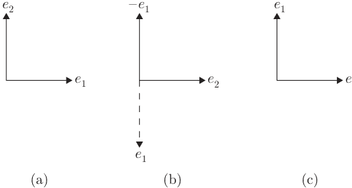

## 第8章

## 定向

定向与“侧向性”有关。这个概念在直觉上显而易见，但要将其以数学上严格的方式表述却出乎意料地困难。在第8.1节中，我们基于具体例子作一些观察，然后给出 $\mathbb{R}^m$ 定向的初步定义。在第8.2节中，利用我们最近掌握的多重向量知识，这些想法将发展成为一个适用于任意向量空间的计算框架。

### 8.1 $\mathbb{R}^m$ 的定向

设 $\mathcal{H}=(h_1,\ldots,h_m)$ 是 $\mathbb{R}^m$ 的一个基。$\mathbb{R}^m$ 中每一个点对应一个由该点关于 $\mathcal{H}$ 的分量组成的 $m$ 元实数组。当 $m=1,2,3$ 时，我们可以将这个 $m$ 元组绘制在轴标签为 $h_1,\ldots,h_m$ 的直角坐标系中。我们利用这种方法的几何直观来引出定向的定义。

考虑 $\mathbb{R}^2$ 的基 $\mathcal{E}=(e_1,e_2)$、$(e_2,-e_1)$ 和 $(e_2,e_1)$，其中 $\mathcal{E}$ 是标准基。在图 8.1.1(a)–(c) 中，这些基被描绘为直角坐标系的坐标轴。图 8.1.1(a) 中的构型，我们称之为 $\mathbb{R}^2$ 的标准构型，被认为具有**逆时针定向**，因为将 $e_1$ 转到 $e_2$ 的 90° 旋转是逆时针方向的。图 8.1.1(b) 中的构型也被认为具有逆时针定向，因为其坐标轴可以绕原点刚性旋转，得到与图 8.1.1(a) 相同的构型。另一方面，图 8.1.1(c) 中的构型被认为具有**顺时针定向**，因为其坐标轴不能以这种方式刚性旋转（等价地，将 $e_1$ 转到 $e_2$ 的 90° 旋转是顺时针方向的）。这些观察结果总结在表 8.1.1 的前三列中。

现在考虑 $\mathbb{R}^3$ 的基 $\mathcal{E}=(e_1,e_2,e_3)$、$(e_2,-e_1,e_3)$ 和 $(e_2,e_1,e_3)$，其中 $\mathcal{E}$ 是标准基。在图 8.1.2(a)–(c) 中，这些基被描绘

**图 8.1.1.** $\mathbb{R}^2$ 中的定向

| 图 | $\mathcal{H}$ | 定向 | $[\operatorname{id}_{\mathbb{R}^2}]_{\mathcal{E}}^{\mathcal{H}}$ | $\det([\operatorname{id}_{\mathbb{R}^2}]_{\mathcal{E}}^{\mathcal{H}})$ |
|---|---|---|---|---|
| 8.1.1(a) | $(e_1,e_2)$ | 逆时针 | $\begin{bmatrix}1&0\\0&1\end{bmatrix}$ | $1$ |
| 8.1.1(b) | $(e_2,-e_1)$ | 逆时针 | $\begin{bmatrix}0&1\\-1&0\end{bmatrix}$ | $1$ |
| 8.1.1(c) | $(e_2,e_1)$ | 顺时针 | $\begin{bmatrix}0&1\\1&0\end{bmatrix}$ | $-1$ |

**表 8.1.1.** $\mathbb{R}^2$ 中的定向

为直角坐标系的坐标轴。图 8.1.2(a) 中的构型，我们称之为 $\mathbb{R}^3$ 的标准构型，被认为具有**右手定向**，因为你可以用右手握住正 $e_3$ 轴，拇指指向正 $e_3$ 轴方向，其余手指绕 $e_3$ 轴相对于 $e_1e_2$ 平面逆时针弯曲。图 8.1.2(b) 中的构型也被认为具有右手定向，因为其坐标轴可以刚性旋转，得到与图 8.1.2(a) 相同的构型。另一方面，图 8.1.2(c) 中的构型被认为具有**左手定向**，因为它不能以这种方式刚性旋转（等价地，你可以用左手握住正 $e_3$ 轴，拇指指向正 $e_3$ 轴方向，其余手指绕 $e_3$ 轴相对于 $e_1e_2$ 平面顺时针弯曲）。这些观察结果总结在表 8.1.2 的前三列中。

在表中，我们还给出了将标准基 $\mathcal{E}$ 变为基 $\mathcal{H}$ 的基变换矩阵及其行列式的值。关键观察结果是，对于这些例子，定向保持不变当且仅当 $\det\left([\operatorname{id}_{\mathbb{R}^m}]_{\mathcal{E}}^{\mathcal{H}}\right)>0$。特别地，$\mathcal{E}$ 具有标准定向。

### 8.2 向量空间的定向

在第 8.1 节中，我们通过将 $\mathbb{R}^m$ 的基与标准基进行比较，定义了它具有一定定向的含义。这种定向方法在 $\mathbb{R}^m$ 中有效，因为存在一个明显的参考基选择，而对于任意向量空间，情况可能并非如此。

设 $V$ 是维数为 $m$ 的向量空间，并设 $\mathcal{H}$ 和 $\mathcal{F}$ 是 $V$ 的基。由定理 2.4.12 可知 $\det([\operatorname{id}_V]_{\mathcal{H}}^{\mathcal{F}})\neq 0$。我们称 $\mathcal{H}$ 和 $\mathcal{F}$ 是**一致的**，并记作 $\mathcal{H}\sim\mathcal{F}$，如果

\[\det\left([\operatorname{id}_V]_{\mathcal{H}}^{\mathcal{F}}\right)>0.\]

利用定理 2.2.2(c) 和定理 2.2.5(b)，可以容易地证明 $\sim$ 是 $V$ 的基集合上的一个等价关系，并且恰好有两个等价类。每个等价类都称为 **$V$ 的一个定向**。含给定基 $\mathcal{H}$ 的等价类记作 $[\mathcal{H}]$。设 $\mathcal{H}=(h_1,h_2,\ldots,h_m)$，并设

\[-\mathcal{H}=(-h_1,h_2,\ldots,h_m).\]

显然，$-\mathcal{H}$ 是 $V$ 的一个基，且 $\det([\operatorname{id}_V]_{\mathcal{H}}^{-\mathcal{H}})=-1$，因此 $\mathcal{H}$ 与 $-\mathcal{H}$ 不一致。我们称定向 $[-\mathcal{H}]$ 为 $[\mathcal{H}]$ 的**相反定向**。于是，对于 $V$ 的任意基 $\mathcal{H}$，$V$ 的两个定向为 $[\mathcal{H}]$ 和 $[-\mathcal{H}]$。例如，$\mathbb{R}^m$ 的两个定向是 $[\mathcal{E}]$ 和 $[-\mathcal{E}]$，其中 $\mathcal{E}$ 是 $\mathbb{R}^m$ 的标准基。我们将 $[\mathcal{E}]$ 称为 $\mathbb{R}^m$ 的标准定向。按照这一术语，$\mathcal{E}$ 是处于标准定向中的一个基，这与第 8.1 节中称 $\mathcal{E}$ 具有标准定向略有不同。推广采用这种语言是方便的：对于任何向量空间，处于一个定向中的基称为具有该定向。

一旦选定了 $V$ 的一个定向 $\mathcal{O}$，二元组 $(V,\mathcal{O})$ 就称为一个**定向向量空间**，并称 $V$ 具有定向 $\mathcal{O}$。另一个定向记作 $-\mathcal{O}$，称为 **$\mathcal{O}$ 的相反定向**。如果 $V$ 的一个基在 $\mathcal{O}$ 中，则称它是**正定向的（关于 $\mathcal{O}$）**。我们通常会认为这样说更方便，例如“$\mathcal{H}$ 是 $V$ 中关于 $\mathcal{O}$ 正定向的基”，而不是更简洁的“$\mathcal{H}$ 在 $\mathcal{O}$ 中”。尽管惯例或具体情况往往会影响赋予给定向量空间的定向，但必须强调的是，归根结底这是一个选择问题。$\mathcal{O}$ 或 $-\mathcal{O}$ 作为 $V$ 的定向，并没有内在属性使其中之一比另一个更可取。话虽如此，对于 $\mathbb{R}^m$ 的情况，我们采用以下约定。

## 8.2 向量空间的方向

**在整个章节中，** \(\mathbb{R}^m\) 假定具有标准方向。

我们现在用多向量给出方向的一个等价方法。设 \(V\) 是一个维数为 \(m\) 的向量空间。在本上下文中，\(\Lambda^m(V)\) 中的一个非零多向量称为 \(V\) 上的 **方向多向量**。例如，设 \((h_1,\ldots,h_m)\) 是 \(V\) 的一个基，\((\theta^1,\ldots,\theta^m)\) 是其对偶基。由定理 7.2.9，\(\theta^1\wedge\cdots\wedge\theta^m(h_1,\ldots,h_m)=1\)，所以 \(\theta^1\wedge\cdots\wedge\theta^m\) 是 \(V\) 上的一个方向多向量。更一般地，我们有以下结果。

### 定理 8.2.1.

设 \(V\) 是一个维数为 \(m\) 的向量空间，\(\varpi\) 是 \(\Lambda^m(V)\) 中的一个多向量。那么 \(\varpi\) 是方向多向量当且仅当 \(\varpi(h_1,\ldots,h_m)\neq 0\) 对某个（从而对每一个）基 \((h_1,\ldots,h_m)\) 成立。

**证明.** 设 \(\mathcal{H}=(h_1,\ldots,h_m)\) 是 \(V\) 的一个基，\((\theta^1,\ldots,\theta^m)\) 是其对偶基。我们由定理 7.2.13(b) 得到

\[
\varpi=\varpi(h_1,\ldots,h_m)\,\theta^1\wedge\cdots\wedge\theta^m.
\]

因此，\(\varpi\) 非零当且仅当 \(\varpi(h_1,\ldots,h_m)\neq 0\)。设 \(\mathcal{F}=(f_1,\ldots,f_m)\) 是 \(V\) 的另一个基。由定理 7.3.3(b)，

\[
\varpi(h_1,\ldots,h_m)=\det\left([\operatorname{id}_V]_{\mathcal{H}}^{\mathcal{F}}\right)\varpi(f_1,\ldots,f_m),
\]

并且由定理 2.4.12，\(\det([\operatorname{id}_V]_{\mathcal{H}}^{\mathcal{F}})\neq 0\)。因此，\(\varpi(h_1,\ldots,h_m)\neq 0\) 当且仅当 \(\varpi(f_1,\ldots,f_m)\neq 0\)。结果得证。

### 定理 8.2.2.

设 \(V\) 是一个向量空间，\(\mathcal{H}=(h_1,\ldots,h_m)\) 和 \(\mathcal{F}=(f_1,\ldots,f_m)\) 是 \(V\) 的基，\((\theta^1,\ldots,\theta^m)\) 是对应于 \(\mathcal{H}\) 的对偶基。那么以下等价：

- (a) \(\mathcal{H}\) 和 \(\mathcal{F}\) 是相容的。
- (b) \(\theta^1\wedge\cdots\wedge\theta^m(f_1,\ldots,f_m)>0\)。
- (c) 对某个（从而对每一个）\(V\) 上的方向多向量 \(\varpi\)，\(\varpi(h_1,\ldots,h_m)\) 与 \(\varpi(f_1,\ldots,f_m)\) 具有相同的符号。

**注.** 由定理 8.2.1，我们有 \(\varpi(h_1,\ldots,h_m),\varpi(f_1,\ldots,f_m)\neq 0\)，所以部分 (c) 中的断言是有意义的。

**证明.** (a) \(\Longleftrightarrow\) (b)：由定理 7.2.9 和定理 7.3.3(b)，

\[
\det\left([\operatorname{id}_V]_{\mathcal{H}}^{\mathcal{F}}\right)\theta^1\wedge\cdots\wedge\theta^m(f_1,\ldots,f_m)=\theta^1\wedge\cdots\wedge\theta^m(h_1,\ldots,h_m)=1.
\]

结果得证。

(a) \(\Longleftrightarrow\) (c)：由定理 7.3.3(b)，

\[
\varpi(h_1,\ldots,h_m)=\det\left([\operatorname{id}_V]_{\mathcal{H}}^{\mathcal{F}}\right)\varpi(f_1,\ldots,f_m),
\]

并且由定理 2.4.12，\(\det([\operatorname{id}_V]_{\mathcal{H}}^{\mathcal{F}})\neq 0\)。结果得证。

### 定理 8.2.3.

设 \(V\) 是一个向量空间，\(\varpi\) 是 \(V\) 上的一个方向多向量，\(\mathfrak{D}\) 是满足 \(\varpi(h_1,\ldots,h_m)>0\) 的基 \((h_1,\ldots,h_m)\) 的集合。那么 \(\mathfrak{D}\) 是 \(V\) 的一个方向，称为由 \(\varpi\) **诱导的方向**。

**证明.** 设 \(\mathcal{H}=(h_1,\ldots,h_m)\) 和 \(\mathcal{F}=(f_1,\ldots,f_m)\) 是 \(V\) 的基，且 \(\varpi(h_1,\ldots,h_m)>0\)。那么

- \(\mathcal{F}\) 在 \(\mathfrak{D}\) 中
- \(\Leftrightarrow \varpi(f_1,\ldots,f_m)>0\)
- \(\Leftrightarrow \varpi(h_1,\ldots,h_m)\) 与 \(\varpi(f_1,\ldots,f_m)\) 具有相同的符号
- \(\Leftrightarrow \mathcal{H}\) 与 \(\mathcal{F}\) 相容，

其中最后的等价由定理 8.2.2 得到。因此，\(\mathfrak{D}\) 是与 \(\mathcal{H}\) 相容的 \(V\) 的基的集合；即 \(\mathfrak{D}=[\mathcal{H}]\)。

### 例 8.2.4 (\(\mathbb{R}^m\))。

设 \(\mathcal{E}=(e_1,\ldots,e_m)\) 是 \(\mathbb{R}^m\) 的标准基，\((\xi^1,\ldots,\xi^m)\) 是其对偶基，\(\Omega=\xi^1\wedge\cdots\wedge\xi^m\)。由定理 7.2.9 可知 \(\Omega(e_1,\ldots,e_m)=1\)，所以 \(\Omega\) 是 \(\mathbb{R}^m\) 上的一个方向多向量，且 \(\mathcal{E}\) 在由 \(\Omega\) 诱导的 \(\mathbb{R}^m\) 的方向中。因此，\(\Omega\) 诱导出 \(\mathbb{R}^m\) 的标准方向。

设 \(V\) 是一个向量空间，\(\varpi\) 和 \(\vartheta\) 是 \(V\) 上的方向多向量。由定理 7.2.12(d) 和定理 8.2.1，\(\varpi\) 张成 \(\Lambda^m(V)\)（\(\vartheta\) 亦然）。于是 \(\varpi=c\vartheta\) 对某个非零实数 \(c\) 成立。我们称 \(\varpi\) 与 \(\vartheta\) 相容，并记作 \(\varpi\sim\vartheta\)，如果 \(c>0\)。容易证明 \(\sim\) 是 \(V\) 上方向多向量集合上的一个等价关系，并且恰好有两个等价类。包含 \(\varpi\) 的等价类记作 \([\varpi]\)。根据定义，\([\varpi]\) 包含所有与 \(\varpi\) 相容的 \(V\) 上的多向量。显然，\(\varpi\) 与 \(-\varpi\) 不相容。因此，对任意 \(V\) 上的方向多向量 \(\varpi\)，方向多向量的等价类为 \([\varpi]\) 和 \([-\varpi]\)。

设 \(\mathcal{H}\) 是 \(V\) 的一个基。显然，同一等价类中的方向多向量诱导出相同的方向，而不同等价类中的方向多向量诱导出相反的方向。因此我们有一个双射

\[
\iota : \{[\varpi], [-\varpi]\} \longrightarrow \{[\mathcal{H}], [-\mathcal{H}]\}
\]

它把 \([\varpi]\) 和 \([-\varpi]\) 分别赋给由 \(\varpi\) 和 \(-\varpi\) 诱导的方向。这表明我们可以用 \(V\) 的基（的等价类）或 \(V\) 上的方向多向量（的等价类）来指定方向。对于计算而言，后一种方法通常更方便。

### 定理 8.2.5（子空间的诱导方向）。

设 \((V,\mathfrak{D})\) 是一个维数 \(m\ge 2\) 的定向向量空间，\(U\) 是 \(V\) 的一个 \((m-1)\) 维子空间，\(v\) 是 \(V\setminus U\) 中的一个向量。那么：

- (a) 存在唯一的 \(U\) 的方向 \(\mathcal{D}_U\)，称为由 \(v\) **诱导的方向**，使得 \((h_1,\ldots,h_{m-1})\) 是相对于 \(\mathcal{D}_U\) 正向的 \(U\) 的基当且仅当 \((v,h_1,\ldots,h_{m-1})\) 是相对于 \(\mathcal{D}\) 正向的 \(V\) 的基。
- (b) 如果 \(\varpi\) 是诱导 \(\mathcal{D}\) 的 \(V\) 上的方向多向量，则 \(\iota_v(\varpi)|_U\) 是诱导 \(\mathcal{D}_U\) 的 \(U\) 上的方向多向量。
- (c) \(\mathcal{D}_U\) 与诱导 \(\mathcal{D}\) 的 \(V\) 上方向多向量的选择无关。

**证明.** (a), (b)：设 \((h_1,\ldots,h_{m-1})\) 是 \(U\) 中 \((m-1)\) 个向量。因为 \(v\) 在 \(V\setminus U\) 中，由定理 1.1.2，\((h_1,\ldots,h_{m-1})\) 是 \(U\) 的基当且仅当 \((v,h_1,\ldots,h_{m-1})\) 是 \(V\) 的基。假设 \((h_1,\ldots,h_{m-1})\) 确实是 \(U\) 的基。显然 \(\iota_v(\varpi)|_U\) 是 \(\Lambda^{m-1}(U)\) 中的一个多向量。由定义，

\[
\iota_v(\varpi)|_U(h_1,\ldots,h_{m-1})=\varpi(v,h_1,\ldots,h_{m-1}). \tag{8.2.2}
\]

我们由定理 8.2.1 得到 \(\varpi(v,h_1,\ldots,h_{m-1})\ne 0\)，然后由 (8.2.2) 得到 \(\iota_v(\varpi)|_U(h_1,\ldots,h_{m-1})\ne 0\)。这表明 \(\iota_v(\varpi)|_U\) 是非零的，因而是 \(U\) 上的方向多向量。设 \(\mathcal{D}_U\) 是由 \(\iota_v(\varpi)|_U\) 诱导的 \(U\) 的方向。由 (8.2.2) 和定理 8.2.3 可知，\((h_1,\ldots,h_{m-1})\) 相对于 \(\mathcal{D}_U\) 正向当且仅当 \((v,h_1,\ldots,h_{m-1})\) 相对于 \(\mathcal{D}\) 正向。因此，\(\mathcal{D}_U\) 具有所需性质。唯一性由（几乎是显然的）观察可知，向量空间的方向由它包含的基决定。

(c)：这由部分 (a) 可得。

需要说明的是，与定理 8.2.5 的部分 (c) 相反，\(U\) 上诱导的方向与 \(V\setminus U\) 中向量的选择无关。特别地，如果 \(v\) 诱导出 \(\mathcal{D}_U\)，则 \(-v\) 诱导出 \(-\mathcal{D}_U\)。

### 定理 8.2.6.

设 \((V,\mathcal{D})\) 和 \((\widetilde V,\widetilde{\mathcal{D}})\) 是定向向量空间，\(A:V\longrightarrow\widetilde V\) 是一个线性同构，且 \(A(\mathcal{D})=\{A(\mathcal{H}):\mathcal{H}\in\mathcal{D}\}\)。那么要么 \(A(\mathcal{D})=\widetilde{\mathcal{D}}\)，此时 \(A\) 称为 **保向** 的，要么 \(A(\mathcal{D})=-\widetilde{\mathcal{D}}\)，此时 \(A\) 称为 **反向** 的。

**证明.** 设 \(\mathcal{H}\) 和 \(\mathcal{F}\) 是 \(\mathcal{D}\) 中的基，注意到由定理 1.1.13(a)，\(A(\mathcal{H})\) 和 \(A(\mathcal{F})\) 是 \(\widetilde V\) 的基。设 \([\operatorname{id}_V]_{\mathcal{H}}^{\mathcal{F}}=[a^i_j]\)。我们由 (2.2.6) 和 (2.2.7) 得到 \(h_j=\sum_i a^i_j f_i\)，于是 \(A(h_j)=\sum_i a^i_j A(f_i)\)，所以 \([\operatorname{id}_{A(\mathcal{H})}^{A(\mathcal{F})}]=[\operatorname{id}_{\mathcal{H}}^{\mathcal{F}}]\)。根据定义，\(\mathcal{H}\) 与 \(\mathcal{F}\) 相容，因此 \(A(\mathcal{H})\) 与 \(A(\mathcal{F})\) 也是相容的。因此，要么 \(A(\mathcal{H})\) 与 \(A(\mathcal{F})\) 在 \(\widetilde{\mathcal{D}}\) 中，要么它们在 \(-\widetilde{\mathcal{D}}\) 中。因为 \(\mathcal{H}\) 与 \(\mathcal{F}\) 是任意的，要么 \(A(\mathcal{D})\subseteq\widetilde{\mathcal{D}}\) 要么 \(A(\mathcal{D})\subseteq-\widetilde{\mathcal{D}}\)。由定理 1.1.9，\(A^{-1}\) 是线性同构，所以类似的论证表明要么 \(A^{-1}(\widetilde{\mathcal{D}})\subseteq\mathcal{D}\) 要么 \(A^{-1}(\widetilde{\mathcal{D}})\subseteq-\mathcal{D}\)，于是要么 \(\widetilde{\mathcal{D}}\subseteq A(\mathcal{D})\) 要么 \(\widetilde{\mathcal{D}}\subseteq A(-\mathcal{D})\)。容易用 (8.2.1) 证明对 \(\mathcal{D}\) 中的任意基 \(\mathcal{H}\) 都有 \(A(-\mathcal{H})=-A(\mathcal{H})\)，所以要么 \(\widetilde{\mathcal{D}}\subseteq A(\mathcal{D})\) 要么 \(-\widetilde{\mathcal{D}}\subseteq A(\mathcal{D})\)。结果得证。

## 定理 8.2.7. 若 $(V,\mathfrak{O})$ 和 $(\widetilde{V},\widetilde{\mathfrak{O}})$ 为定向向量空间且 $A : V \longrightarrow \widetilde{V}$ 为线性同构，则以下条件等价：

- (a) $A$ 为保定向的。
- (b) $\det\left([A]_{\mathcal{H}}^{\widetilde{\mathcal{H}}}\right) > 0$ 对某个（从而每个）$\mathfrak{O}$ 中的基 $\mathcal{H}$ 以及某个（从而每个）$\widetilde{\mathfrak{O}}$ 中的基 $\widetilde{\mathcal{H}}$ 成立。
- (c) $A^*(\widetilde{\varpi})$ 为 $V$ 上的定向多余向量，它对某个（从而每个）诱导 $\widetilde{\mathfrak{O}}$ 的 $\widetilde{V}$ 上的定向多余向量 $\widetilde{\varpi}$ 诱导 $\mathfrak{O}$。

注. 易证由于 $A$ 为线性同构，$A^*(\widetilde{\varpi})$ 为 $V$ 上的定向多余向量，故部分 (c) 中的断言是有意义的。

证明. (a) $\Leftrightarrow$ (b): 我们有

$A$ 为保定向的
$\Leftrightarrow$ $A(\mathcal{H})$ 与 $\widetilde{\mathcal{H}}$ 对某个（从而每个）$\mathfrak{O}$ 中的 $\mathcal{H}$ 和 $\widetilde{\mathfrak{O}}$ 中的 $\widetilde{\mathcal{H}}$ 相容
$\Leftrightarrow$ $\det\left([\mathrm{id}_{\widetilde{V}}]_{A(\mathcal{H})}^{\widetilde{\mathcal{H}}}\right) > 0$ 对某个（从而每个）$\mathfrak{O}$ 中的 $\mathcal{H}$ 和 $\widetilde{\mathfrak{O}}$ 中的 $\widetilde{\mathcal{H}}$ 成立
$\Leftrightarrow$ $\det\left([A]_{\mathcal{H}}^{\widetilde{\mathcal{H}}}\right) > 0$ 对某个（从而每个）$\mathfrak{O}$ 中的 $\mathcal{H}$ 和 $\widetilde{\mathfrak{O}}$ 中的 $\widetilde{\mathcal{H}}$ 成立，

其中第一个等价由定理 8.2.6 可得，最后一个等价由定理 2.2.5(a) 可得。

(b) $\Leftrightarrow$ (c): 设 $\mathcal{H} = (h_1,\dots,h_m)$ 和 $\widetilde{\mathcal{H}} = (\widetilde{h}_1,\dots,\widetilde{h}_m)$ 分别为 $\mathfrak{O}$ 和 $\widetilde{\mathfrak{O}}$ 中的基，且设 $\widetilde{\varpi}$ 为诱导 $\widetilde{\mathfrak{O}}$ 的定向多余向量。我们由定理 7.3.3(b) 可得

$A^*(\widetilde{\varpi})(h_1,\dots,h_m) = \det\left([A]_{\mathcal{H}}^{\widetilde{\mathcal{H}}}\right)\,\widetilde{\varpi}(\widetilde{h}_1,\dots,\widetilde{h}_m).$

由定理 8.2.3，$\widetilde{\varpi}(\widetilde{h}_1,\dots,\widetilde{h}_m) > 0$，故

$A^*(\widetilde{\varpi})$ 诱导 $\mathfrak{O}$
$\Leftrightarrow$ $A^*(\widetilde{\varpi})(h_1,\dots,h_m) > 0$ 对某个（从而每个）$\mathfrak{O}$ 中的 $\mathcal{H}$ 成立
$\Leftrightarrow$ $\det\left([A]_{\mathcal{H}}^{\widetilde{\mathcal{H}}}\right)\,\widetilde{\varpi}(\widetilde{h}_1,\dots,\widetilde{h}_m) > 0$ 对某个（从而每个）$\mathfrak{O}$ 中的 $\mathcal{H}$ 和 $\widetilde{\mathfrak{O}}$ 中的 $\widetilde{\mathcal{H}}$ 成立
$\Leftrightarrow$ $\det\left([A]_{\mathcal{H}}^{\widetilde{\mathcal{H}}}\right) > 0$ 对某个（从而每个）$\mathfrak{O}$ 中的 $\mathcal{H}$ 和 $\widetilde{\mathfrak{O}}$ 中的 $\widetilde{\mathcal{H}}$ 成立，

其中第一个等价由定理 8.2.3 可得。

## 定理 8.2.8. 设 $(V,\mathfrak{O})$ 为定向向量空间，且 $A : V \longrightarrow V$ 为线性同构。则 $A$ 为保定向的当且仅当 $\det(A) > 0$。

证明. 在定理 8.2.7 中取 $(V,\mathfrak{O}) = (\widetilde{V},\widetilde{\mathfrak{O}})$ 且 $\mathcal{H} = \widetilde{\mathcal{H}}$ 即得结果。

## 8.3 数量积空间的定向

在第 8.2 节中，我们考虑了向量空间的定向。现在我们将我们的覆盖扩展到数量积空间。

## 定理 8.3.1. 设 $(V,\mathfrak{g})$ 为指标为 $\nu$ 的数量积空间，设 $\mathcal{E} = (e_1,\dots,e_m)$ 和 $\mathcal{H} = (h_1,\dots,h_m)$ 为 $V$ 的基，其中 $\mathcal{E}$ 正交归一，且设 $(\xi^1,\dots,\xi^m)$ 和 $(\theta^1,\dots,\theta^m)$ 为相应的对偶基。则：

(a)

$\det(\mathfrak{g}_{\mathcal{H}}) = (-1)^\nu (\det([id_V]_{\mathcal{H}}^{\mathcal{E}}))^2$.

(b)

$\xi^1 \wedge \cdots \wedge \xi^m = \pm\sqrt{|\det(\mathfrak{g}_{\mathcal{H}})|}\ \theta^1 \wedge \cdots \wedge \theta^m,$

其中若 $\mathcal{E}$ 与 $\mathcal{H}$ 相容则取正号，若不相容则取负号。

(c) 若 $\mathcal{H}$ 正交归一，则

$\xi^1 \wedge \cdots \wedge \xi^m = \pm\theta^1 \wedge \cdots \wedge \theta^m,$

其中符号的选取如部分 (b) 所述。

证明. (a): 我们由定理 3.1.3 可得

$\mathfrak{g}_{\mathcal{H}} = ([id_V]_{\mathcal{H}}^{\mathcal{E}})^T \mathfrak{g}_{\mathcal{E}} [id_V]_{\mathcal{H}}^{\mathcal{E}},$

且由 (4.2.3) 可得 $\det(\mathfrak{g}_{\mathcal{E}}) = (-1)^\nu$。结果随之可得。

(b): 由定理 7.3.3(a)，

$\xi^1 \wedge \cdots \wedge \xi^m = \det([id_V]_{\mathcal{H}}^{\mathcal{E}})\ \theta^1 \wedge \cdots \wedge \theta^m,$

且由部分 (a)，$|\det(\mathfrak{g}_{\mathcal{H}})| = (\det([id_V]_{\mathcal{H}}^{\mathcal{E}}))^2$，故

$\det([id_V]_{\mathcal{H}}^{\mathcal{E}}) = \pm\sqrt{|\det(\mathfrak{g}_{\mathcal{H}})|},$

其中若 $\mathcal{H}$ 与 $\mathcal{E}$ 相容则取正号，若不相容则取负号。结果随之可得。

(c): 这由 (4.2.3) 和部分 (b) 可得。

## 定理 8.3.2. 设 $(V,\mathfrak{g})$ 为数量积空间，设 $\mathcal{E} = (e_1,\dots,e_m)$ 和 $\mathcal{F} = (f_1,\dots,f_m)$ 为 $V$ 的正交归一基，且设 $\varpi$ 为 $V$ 上的定向多余向量。则

$\varpi(e_1,\dots,e_m) = \pm\varpi(f_1,\dots,f_m),$

其中若 $\mathcal{E}$ 与 $\mathcal{F}$ 相容则取正号，若不相容则取负号。

**证明.** 设 $(\xi^1,\ldots,\xi^m)$ 和 $(\varphi^1,\ldots,\varphi^m)$ 分别为对应于 $\mathcal E$ 和 $\mathcal F$ 的对偶基。我们有

$$\varpi(e_1,\ldots,e_m)\,\xi^1\wedge\cdots\wedge\xi^m$$

$$=\varpi(f_1,\ldots,f_m)\,\varphi^1\wedge\cdots\wedge\varphi^m \qquad [\mathrm{Thm\ 7.2.13(b)}]$$

$$=\pm\varpi(f_1,\ldots,f_m)\,\xi^1\wedge\cdots\wedge\xi^m, \qquad [\mathrm{Thm\ 8.3.1(c)}]$$

其中若 $\mathcal E$ 与 $\mathcal F$ 相容则取正号，若不相容则取负号。于是定理 7.2.9 给出结果。

## 定理 8.3.3.

*设 $(V,g)$ 为数量积空间，设 $\mathcal E=(e_1,\ldots,e_m)$ 和 $\mathcal F$ 为 $V$ 的正交归一基，且设 $(\varphi^1,\ldots,\varphi^m)$ 为对应于 $\mathcal F$ 的对偶基。则：*

$$\det\left([\operatorname{id}_V]_{\mathcal E}^{\mathcal F}\right)=\varphi^1\wedge\cdots\wedge\varphi^m(e_1,\ldots,e_m)=\pm1,$$

其中若 $\mathcal E$ 与 $\mathcal F$ 相容则取正号，若不相容则取负号。

**证明.** 第一个等式由定理 7.2.11 可得。取 $\varpi=\varphi^1\wedge\cdots\wedge\varphi^m$ 于定理 8.3.2 中并利用定理 7.2.9 即得第二个等式。

## 定理 8.3.4 (体积多余向量的存在性)。

*若 $(V,g,\mathcal D)$ 为定向数量积空间，则存在唯一的 $V$ 上的定向多余向量 $\Omega_V$，称为* **体积多余向量** *，使得：(i) $\Omega_V$ 诱导 $\mathcal D$，且 (ii) 若 $(e_1,\ldots,e_m)$ 为相对于 $\mathcal D$ 正定向的 $V$ 的正交归一基，则 $\Omega_V(e_1,\ldots,e_m)=1$。事实上，若 $(f_1,\ldots,f_m)$ 为相对于 $\mathcal D$ 正定向的 $V$ 的任意正交归一基且 $(\varphi^1,\ldots,\varphi^m)$ 为其对偶基，则 $\Omega_V=\varphi^1\wedge\cdots\wedge\varphi^m$。*

**证明.** *存在性.* 由定理 7.2.9，$\varphi^1\wedge\cdots\wedge\varphi^m(f_1,\ldots,f_m)=1$，故 $\varphi^1\wedge\cdots\wedge\varphi^m$ 为 $V$ 上的定向多余向量。于是 $\varphi^1\wedge\cdots\wedge\varphi^m$ 诱导 $V$ 的一个定向，其可能有两种，分别是 $\mathcal D$ 和 $-\mathcal D$。由于 $(f_1,\ldots,f_m)$ 相对于 $\mathcal D$ 正定向且 $\varphi^1\wedge\cdots\wedge\varphi^m(f_1,\ldots,f_m)>0$，由定理 8.2.3，$\varphi^1\wedge\cdots\wedge\varphi^m$ 诱导 $\mathcal D$。由于 $(e_1,\ldots,e_m)$ 相对于 $\mathcal D$ 正定向，它们是相容的。由定理 8.3.3 可得 $\varphi^1\wedge\cdots\wedge\varphi^m(e_1,\ldots,e_m)=1$。

*唯一性.* 设 $\varpi$ 为 $V$ 上的定向多余向量使得 $\varpi(f_1,\ldots,f_m)=1$。由定理 7.2.13(b) 可得

$$\varpi=\varpi(f_1,\ldots,f_m)\,\varphi^1\wedge\cdots\wedge\varphi^m=\varphi^1\wedge\cdots\wedge\varphi^m.$$

## 定理 8.3.5 (体积多余向量的表达式)。

*设 $(V,g,\mathcal D)$ 为定向数量积空间，设 $\mathcal H$ 为相对于 $\mathcal D$ 正定向的 $V$ 的基，且设 $(\theta^1,\ldots,\theta^m)$ 为其对偶基。则*

$$\Omega_V=\sqrt{|\det(g_{\mathcal H})|}\,\theta^1\wedge\cdots\wedge\theta^m.$$

证明。设 $(e_1,\dots,e_m)$ 是 $V$ 的一个关于 $\mathfrak{O}$ 为正定向的标准正交基，并设 $(\xi^1,\dots,\xi^m)$ 是它的对偶基。由于 $(e_1,\dots,e_m)$ 和 $\mathcal{H}$ 都是正定向的，所以它们是相容的。结果由定理 8.3.1(b) 和定理 8.3.4 得出。

设 $(V,\mathfrak{g},\mathfrak{O})$ 是一个维数 $m \ge 2$ 的定向标量积空间，并设 $\Omega_V$ 是其体积多重余向量。由定理 8.3.4，$\Omega_V$ 诱导出 $\mathfrak{O}$。设 $U$ 是 $V$ 的一个维数为 $m-1$ 的子空间，且 $\mathfrak{g}$ 在 $U$ 上非退化。由定理 4.1.2(b) 得 $U^\perp$ 是 $V$ 的 1 维子空间，由定理 4.1.3 得 $V = U \oplus U^\perp$。设 $u$ 是 $U^\perp$ 中的单位向量，则 $\mathbb{R}u = U^\perp$，从而 $V = U \oplus \mathbb{R}u$。因为 $\mathfrak{g}$ 在 $U$ 上非退化，所以 $\mathfrak{g}|_U$ 是 $U$ 上的一个标量积。由定理 8.2.5 的 (a) 和 (b) 部分，$i_u(\Omega_V)|_U$ 是 $U$ 上的一个定向多重余向量，它诱导出 $U$ 的某个定向，记为 $\mathfrak{O}_U$。因此，$(U,\mathfrak{g}|_U,\mathfrak{O}_U)$ 是维数 $m-1$ 的定向标量积空间。设 $\Omega_U$ 是其体积多重余向量。问题在于：定向多重余向量 $i_u(\Omega_V)|_U$ 与 $\Omega_U$ 是否相关？如下一个结果所示，它们是同一个对象。

## 定理 8.3.6。在上述设定下：

(a)
$i_u(\Omega_V)|_U = \Omega_U.$

(b) 更一般地，若 $v$ 是 $V$ 中的向量，$\epsilon$ 是 $\langle u,u\rangle$ 的符号，则

$i_v(\Omega_V)|_U = \epsilon\langle u,v\rangle\Omega_U.$

证明。(a)：设 $(e_1,\dots,e_{m-1})$ 是 $U$ 的一个关于 $\mathfrak{O}_U$ 为正定向的标准正交基。由定理 8.2.5(a) 得，$(u,e_1,\dots,e_{m-1})$ 是 $V$ 的一个关于 $\mathfrak{O}$ 为正定向的标准正交基，再由定理 8.3.4（应用于 $V$）得 $\Omega_V(u,e_1,\dots,e_{m-1}) = 1$。根据定义，

$i_u(\Omega_V)|_U(e_1,\dots,e_{m-1}) = \Omega_V(u,e_1,\dots,e_{m-1})$，

因此 $i_u(\Omega_V)|_U(e_1,\dots,e_{m-1}) = 1$。现在，由定理 8.3.4（应用于 $U$）给出的 $\Omega_U$ 的唯一性，即可得结果。

(b)：因为 $V = U \oplus \mathbb{R}u$，所以 $v = (v - \bar{v}) + \bar{v}$，其中 $v - \bar{v}$ 和 $\bar{v}$ 分别是 $U$ 和 $\mathbb{R}u$ 中的（唯一）向量。由定理 7.4.1(a)，

$i_v(\Omega_V)|_U = i_{v - \bar{v}}(\Omega_V)|_U + i_{\bar{v}}(\Omega_V)|_U. \quad (8.3.1)$

由于 $w_1,\ldots,w_{m-1}$ 是任意的，

$$i_{v-\bar v}(\Omega_V)|_U=0.$$

对于第二项，由定理 4.1.5 得

$$\bar v=\mathcal P_{\mathop{\rm Rm}(U)}(v)=\epsilon\langle v,u\rangle u,$$

再由定理 7.4.1(b) 和 (a) 部分得

$$i_{\bar v}(\Omega_V)|_U=\epsilon\langle v,u\rangle i_u(\Omega_V)|_U=\epsilon\langle v,u\rangle\Omega_U.$$

将 (8.3.2) 和 (8.3.3) 代入 (8.3.1)，即得结果。

## 8.4 向量积

本节我们将 $\mathbb R^3$ 中众所周知的向量积推广到任意标量积空间。

设 $(V,g)$ 是符号差为 $(\epsilon_1,\ldots,\epsilon_m)$ 的标量积空间，$\mathcal E=(e_1,\ldots,e_m)$ 是 $V$ 的一个标准正交基，$v_1,\ldots,v_{m-1}$ 是 $V$ 中的向量。$v_1,\ldots,v_{m-1}$（按该顺序）关于 $\mathcal E$ 的**向量积**（或叉积）定义为

$$v_1\times\cdots\times v_{m-1}=\sum_{i=1}^{m}\epsilon_i(-1)^{i-1}\det\left(\left[\, [v_1]_{\mathcal E}\ \cdots\ [v_{m-1}]_{\mathcal E}\,\right]^{(i)c}\right)e_i.$$

其中 $(i)^c$ 是多重指标

$$(i)^c=(1,\ldots,\hat{i},\ldots,m).$$

显然，给定向量的向量积取决于它们被取出的顺序以及标准正交基的选取。

> 在本章中，$V$ 上的向量积 $\times$ 是关于 $V$ 的给定标准正交基 $\mathcal E$ 计算的。

> 在全文，$\mathbb R^m_\nu$ 上的向量积 $\times$ 是关于 $\mathbb R^m_\nu$ 的标准基计算的。

我们可以如下得到 (8.4.1) 的一个计算上方便的替代形式。令

$$v_j=\sum_i a_j^i e_i$$

其中 $j=1,\ldots,m-1$，于是由 (2.2.3)，

$$\left[\,[v_1]_{\mathcal E}\ \cdots\ [v_{m-1}]_{\mathcal E}\,\right]=\begin{bmatrix}a_1^1&\cdots&a_{m-1}^1\\ \vdots&\ddots&\vdots\\ a_1^m&\cdots&a_{m-1}^m\end{bmatrix}.$$

则 (8.4.1) 可以表示为如下形式恒等式

v₁ × ⋯ × vₘ₋₁ = det( ⎛⎜⎝ ε₁e₁ a¹₁ ⋯ a¹ₘ₋₁ ⋮ ⋮ ⋱ ⋮ εₘeₘ aᵐ₁ ⋯ aᵐₘ₋₁ ⎞⎟⎠ ), (8.4.3)

只要我们将这个“行列式”沿第一列展开。

当 $m = 2$ 时，即使 (8.4.1) 和 (8.4.3) 左端的记号简化为单个向量，右端仍然可以计算。设 $v = a^1e_1 + a^2e_2$。则 $v$ 的“向量积”为

det( ⎛⎜⎝ ε₁e₁ a¹ ε₂e₂ a² ⎞⎟⎠ ) = ε₁a²e₁ − ε₂a¹e₂.

在上下文有意义的情况下，这个量与 $m \ge 3$ 时的向量积具有相同的性质。

### 例 8.4.1（ℝ₀² 和 ℝ₀³ 上的向量积）。

设 (e₁, e₂) 是 ℝ₀² 的标准基，并设 (a¹, a²) 是 ℝ₀² 中的向量。则 (a¹, a²) 的“向量积”为 (a², −a¹)。

再设 (e₁, e₂, e₃) 是 ℝ₀³ 的标准基，并设 v = (a¹, a², a³) 和 w = (b¹, b², b³) 是 ℝ₀³ 中的向量。则

[v]ℰ = ⎡a¹⎤   以及   [w]ℰ = ⎡b¹⎤
          ⎢a²⎥             ⎢b²⎥
          ⎣a³⎦             ⎣b³⎦

因此

v × w = det( ⎛⎜⎝ e₁ a¹ b¹ e₂ a² b² e₃ a³ b³ ⎞⎟⎠ ) = (det(⎡a² b²⎤), −det(⎡a¹ b¹⎤), det(⎡a¹ b¹⎤)) = (a²b³ − a³b², a³b¹ − a¹b³, a¹b² − a²b¹).

特别地，

e₁ × e₂ = e₃,      e₁ × e₃ = −e₂,      以及      e₂ × e₃ = e₁.

### 例 8.4.2（ℝ₁² 和 ℝ₁³ 上的向量积）。

设 (e₁, e₂) 是 ℝ₁² 的标准基，并设 (a¹, a²) 是 ℝ₁² 中的向量。则 (a¹, a²) 的“向量积”为 (a², a¹)。

再设 (e₁, e₂, e₃) 是 ℝ₁³ 的标准基，并设 v = (a¹, a², a³) 和 w = (b¹, b², b³) 是 ℝ₁³ 中的向量。则

[v]ℰ = ⎡a¹⎤   以及   [w]ℰ = ⎡b¹⎤
          ⎢a²⎥             ⎢b²⎥
          ⎣a³⎦             ⎣b³⎦

因此

v × w = det( ⎛⎜⎝ e1 a1 b1 e2 a2 b2 −e3 a3 b3 ⎞⎟⎠ ) = ( det( [a2 b2; a3 b3] ), −det( [a1 b1; a3 b3] ), −det( [a1 b1; a2 b2] ) ) = (a2 b3 − a3 b2, a3 b1 − a1 b3, a2 b1 − a1 b2).

特别地，

e1 × e2 = −e3,      e1 × e3 = −e2,      以及      e2 × e3 = e1.

向量积具有许多有趣的代数性质，其中若干（不足为奇地）用行列式和楔积表示。

## 定理 8.4.3。设 (V,g) 是维数 m ≥ 2 的标量积空间，ℰ 是 V 的一个标准正交基，v1,...,vm−1,w 是 V 中的向量，c 是实数。则对 i,j = 1,...,m−1：

- (a) ⟨vi, v1 × ⋯ × vm−1⟩ = 0.
- (b) v1 × ⋯ × c vi × ⋯ × vm−1 = c(v1 × ⋯ × vi × ⋯ × vm−1).
- (c) v1 × ⋯ × (c vi + w) × ⋯ × vm−1 = c(v1 × ⋯ × vi × ⋯ × vm−1) + v1 × ⋯ × w × ⋯ × vm−1.
- (d) v1 × ⋯ × vi × ⋯ × vj × ⋯ × vm−1 = −(v1 × ⋯ × vj × ⋯ × vi × ⋯ × vm−1).
- (e) 若 vi = vj，则 v1 × ⋯ × vi × ⋯ × vj × ⋯ × vm−1 = 0.

证明。(a)：由 (8.4.1) 和 (8.4.2)，

⟨vi, v1 × ⋯ × vm−1⟩ = ⟨∑j ai j ej, ∑k εk (−1)k−1 det( [ [v1]ℰ … [vi]ℰ … [vm−1]ℰ ]^(k)c ) ek ⟩ = ∑jk ai j ⟨ej, ek⟩ εk (−1)k−1 det( [ [v1]ℰ … [vi]ℰ … [vm−1]ℰ ]^(k)c ) = ∑j (−1)j−1 ai j det( [ [v1]ℰ … [vi]ℰ … [vm−1]ℰ ]^(j)c ) = det( [ [vi]ℰ [v1]ℰ … [vi]ℰ … ] ).

由于 [[v_i]_E  [v_1]_E … [v_i]_E … [v_{m-1}]_E] 的（至少）两列相等，由定理 2.4.2 可知其行列式等于 0。

(b)–(d)：直接可证。

根据定理 8.4.3(b)，我们去掉括号，并将 $c(v_1 \times \cdots \times v_i \times \cdots \times v_{m-1})$ 记作 $c v_1 \times \cdots \times v_i \times \cdots \times v_{m-1}$。

下一个结果是考虑向量积的主要原因。

## 定理 8.4.4。设 (V,g) 是维数 m ≥ 2 的标量积空间，E 是 V 的一个标准正交基，v_1,…,v_{m-1} 是 V 中的向量，U 是由 v_1,…,v_{m-1} 张成的 V 的子空间。则 v_1 × ⋯ × v_{m-1} 是 U^⊥ 中的向量。

证明。这可由定理 8.4.3(a) 得出。

乍一看，定理 8.4.4 似乎承诺得比它实际给出的更多。为了使结果真正有意义，我们需要 v_1 × ⋯ × v_{m-1} 是非零向量，且 U^⊥ 是 V 的 1 维子空间。这些条件可以通过进一步的假设来满足：参见定理 8.4.8 和定理 8.4.10(a)。

前面曾指出，向量积取决于取用向量的顺序以及标准正交基的选取。根据定理 8.4.3(d)，改变向量的顺序最多影响所得向量积的符号。鉴于 (8.4.1)，人们可能预期，相对于不同的标准正交基进行计算会对结果产生重大影响。正如定理 8.4.4 所示，情况不一定如此：无论选择何种标准正交基，向量积总是在组成它的向量所张成的子空间的正交补中。事实上，后面的一些结果也具有这一特点：参见定理 8.4.5、定理 8.4.6、定理 8.4.8 和定理 8.4.9。

## 定理 8.4.5。设 (V,g) 是维数 m ≥ 2 且指标为 ν 的标量积空间。设 E 是 V 的一个标准正交基，$(\xi^1,\ldots,\xi^m)$ 是它的对偶基，令 u, v_1,\ldots,v_{m-1} 是 V 中的向量。则：

证明。设 ℰ = (e₁, …, eₘ)，且 V 的符号为 (ε₁, …, εₘ)。

(a)：设 u = Σᵢ bⁱ eᵢ，于是 [u]ℰ = [b¹ … bᵐ]ᵀ。我们由定理 2.4.6 和 (8.4.1) 得

⟨u, v₁ × ⋯ × vₘ₋₁⟩
= ⟨ Σᵢ bⁱ eᵢ, Σⱼ εⱼ (−1)ʲ⁻¹ det( [[v₁]ℰ … [vₘ₋₁]ℰ]⁽ʲ⁾ᶜ ) eⱼ ⟩
= Σᵢⱼ bⁱ ⟨eᵢ, eⱼ⟩ εⱼ (−1)ʲ⁻¹ det( [[v₁]ℰ … [vₘ₋₁]ℰ]⁽ʲ⁾ᶜ )
= Σᵢ (−1)ⁱ⁻¹ bⁱ det( [[v₁]ℰ … [vₘ₋₁]ℰ]⁽ⁱ⁾ᶜ )
= det( [[u]ℰ [v₁]ℰ … [vₘ₋₁]ℰ] ),

这证明了第一个等式。由定理 1.2.1(d)，u = Σᵢ ξⁱ(u) eᵢ，故

[u]ℰ = [ξ¹(u) … ξᵐ(u)]ᵀ,

[v₁]ℰ, …, [vₘ₋₁]ℰ 有相应的表达式。于是定理 7.2.8 给出

ξ¹ ∧ ⋯ ∧ ξᵐ(u, v₁, …, vₘ₋₁) = det( [ ξ¹(u) ξ¹(v₁) … ξ¹(vₘ₋₁) ; ⋮ ⋮ ⋱ ⋮ ; ξᵐ(u) ξᵐ(v₁) … ξᵐ(vₘ₋₁) ] )
= det( [[u]ℰ [v₁]ℰ … [vₘ₋₁]ℰ] ),

这证明了第二个等式。

(b)：设

P = [[u]ℰ [v₁]ℰ … [vₘ₋₁]ℰ],

并注意到 𝔮ℰ = diag(ε₁, …, εₘ)。于是

det( [ ⟨u,u⟩ ⟨u,v₁⟩ … ⟨u,vₘ₋₁⟩ ; ⟨v₁,u⟩ ⟨v₁,v₁⟩ … ⟨v₁,vₘ₋₁⟩ ; ⋮ ⋮ ⋱ ⋮ ; ⟨vₘ₋₁,u⟩ ⟨vₘ₋₁,v₁⟩ … ⟨vₘ₋₁,vₘ₋₁⟩ ] )
= det(Pᵀ 𝔮ℰ P) [Th 3.1.2(b)]
= det(𝔮ℰ) det(P)²
= (−1)ᵛ det(P)² [(4.2.3)]
= (−1)ᵛ ⟨u, v₁ × ⋯ × vₘ₋₁⟩². [part (a)]

## 定理 8.4.6。设 (V, 𝔤) 为维数 m ≥ 2 且指标为 ν 的数量积空间，设 ℰ 为 V 的标准正交基，且 v₁, …, vₘ₋₁, w₁, …, wₘ₋₁ 为 V 中的向量。则：

由于 [[v_j]ℰ [v₂]ℰ … [vₘ₋₁]ℰ] 在 (至少) 两个位置含有 [v_j]ℰ，故由定理 2.4.2 可知 det([[v_j]ℰ [v₂]ℰ … [vₘ₋₁]ℰ]^{(i)^c}) = 0 对 j = 2, …, m − 1 成立。于是，

det([[v₁]ℰ [v₂]ℰ … [vₘ₋₁]ℰ]^{(i)^c}) = 0

对 i = 1, …, m 成立。由 (8.4.1) 可知 v₁ × ⋯ × vₘ₋₁ = 0。

(⇐)：由于 span({v₁, …, vₘ₋₁}) 的维数至多为 m − 1，故存在向量 v₀ ∈ V \ span({v₁, …, vₘ₋₁})。于是

⟨v₀, v₁ × ⋯ × vₘ₋₁⟩ = 0
⇔ det([[v₀]ℰ [v₁]ℰ … [vₘ₋₁]ℰ]) = 0 [Th 8.4.5(a)]
⇔ [v₀]ℰ, [v₁]ℰ, …, [vₘ₋₁]ℰ 线性相关 [Th 2.4.9]
⇔ v₀, v₁, …, vₘ₋₁ 线性相关 [Th 2.2.1]
⇔ v₁, …, vₘ₋₁ 线性相关。 [Th 1.1.2]

因此，若 v₁ × ⋯ × vₘ₋₁ = 0，则 v₁, …, vₘ₋₁ 线性相关。

向量在向量空间中是否线性无关或线性相关与是否存在数量积无关。这意味着在定理 8.4.8 中，线性无关性可使用任意方便的数量积和标准正交基来检验。

## 定理 8.4.9。设 (V, g) 为维数 m ≥ 2 的数量积空间，设 ℰ 为 V 的标准正交基，设 U 为 V 的维数为 m − 1 的子空间，且 (u₁, …, uₘ₋₁) 为 U 的基。则 g 在 U 上非退化当且仅当 ||u₁ × ⋯ × uₘ₋₁|| ≠ 0。

证明。g|_U 关于 (u₁, …, uₘ₋₁) 的矩阵为 [⟨u_i, u_j⟩]，于是

- g 在 U 上非退化
- ⇔ g|_U 在 U 上非退化 [按定义]
- ⇔ det([⟨u_i, u_j⟩]) ≠ 0 [Th 3.3.3]
- ⇔ ⟨u₁ × ⋯ × uₘ₋₁, u₁ × ⋯ × uₘ₋₁⟩ ≠ 0 [Th 8.4.6(a)]
- ⇔ ||u₁ × ⋯ × uₘ₋₁|| ≠ 0.

## 定理 8.4.10。设 (V, g) 为维数 m ≥ 2 的数量积空间，且 ℰ 为 V 的标准正交基。设 U 为 V 的维数为 m − 1 且 g 在其上非退化的子空间，设 (u₁, …, uₘ₋₁) 为 U 的基，且 ε 为 ⟨u₁ × ⋯ × uₘ₋₁, u₁ × ⋯ × uₘ₋₁⟩ 的符号，于是

ε = ⟨ u₁ × ⋯ × uₘ₋₁ / ||u₁ × ⋯ × uₘ₋₁|| , u₁ × ⋯ × uₘ₋₁ / ||u₁ × ⋯ × uₘ₋₁|| ⟩ . (8.4.5)

则：

- (a) $U^\perp = \mathbb{R}(u_1 \times \cdots \times u_{m-1})$ 是 $V$ 的 1 维子空间。

- (b) $(\epsilon u_1 \times \cdots \times u_{m-1}, u_1, \ldots, u_{m-1})$ 是与 $\mathcal{E}$ 相容的 $V$ 的基。

- (c) 若 $(u_1, \ldots, u_{m-1})$ 是 $U$ 的标准正交基，则 $(\epsilon u_1 \times \cdots \times u_{m-1}, u_1, \ldots, u_{m-1})$ 是 $V$ 的标准正交基。

*注。* 由定理 8.4.9，$\langle u_1 \times \cdots \times u_{m-1}, u_1 \times \cdots \times u_{m-1} \rangle \neq 0$，故 ε 有定义且 (8.4.5) 中的分母非零。

*证明。* (a)：由定理 4.1.2(b) 可知 $U^\perp$ 是 $V$ 的 1 维子空间，由定理 8.4.3(a) 可知 $u_1 \times \cdots \times u_{m-1}$ 在 $U^\perp$ 中，且由定理 8.4.8 可知 $u_1 \times \cdots \times u_{m-1} \neq 0$。结论得证。

(b)：由定理 4.1.3，$V = U \oplus U^\perp$。由于 $(u_1, \ldots, u_{m-1})$ 是 $U$ 的基，由定理 1.1.2 和 (a) 可知 $\mathcal{U} = (\epsilon u_1 \times \cdots \times u_{m-1}, u_1, \ldots, u_{m-1})$ 是 $V$ 的基。我们由 (2.2.7) 和定理 8.4.5(a) 得

$\det\big([\mathrm{id}_V]^\mathcal{E}_\mathcal{U}\big) = \det\big([\epsilon u_1 \times \cdots \times u_{m-1}]_\mathcal{E}\ [u_1]_\mathcal{E}\ \cdots\ [u_{m-1}]_\mathcal{E}\big)$

$= \epsilon \langle u_1 \times \cdots \times u_{m-1}, u_1 \times \cdots \times u_{m-1} \rangle$

$= |\langle u_1 \times \cdots \times u_{m-1}, u_1 \times \cdots \times u_{m-1} \rangle| > 0,$

故 $\mathcal{U}$ 与 $\mathcal{E}$ 相容。

(c)：由于 $(u_1, \ldots, u_{m-1})$ 正交，由定理 8.4.6(b) 可知 $||\epsilon u_1 \times \cdots \times u_{m-1}|| = 1$，故 $\epsilon u_1 \times \cdots \times u_{m-1}$ 为单位向量。由定理 8.4.3(a)，$\langle \epsilon u_1 \times \cdots \times u_{m-1}, u_j \rangle = 0$ 对 $j = 1, \ldots, m-1$ 成立。结论得证。$\square$

## 定理 8.4.11。设 $(V, \mathfrak{g})$ 为维数 $m \ge 2$ 的数量积空间，设 $\mathcal{E}$ 为 $V$ 的标准正交基，设 $U$ 为 $V$ 的维数为 $m-1$ 且 $\mathfrak{g}$ 在其上非退化的子空间，且 $\mathcal{U} = (u_1, \ldots, u_{m-1})$ 和 $\mathcal{V} = (v_1, \ldots, v_{m-1})$ 为 $U$ 的基。则：

- (a)

$u_1 \times \cdots \times u_{m-1} = \det\big([\mathrm{id}_U]^\mathcal{V}_\mathcal{U}\big)\, v_1 \times \cdots \times v_{m-1}.$

- (b)

$\frac{u_1 \times \cdots \times u_{m-1}}{||u_1 \times \cdots \times u_{m-1}||} = \pm \frac{v_1 \times \cdots \times v_{m-1}}{||v_1 \times \cdots \times v_{m-1}||},$

其中正号（负号）是在 $\mathcal{U}$ 和 $\mathcal{V}$ 相容（不相容）时选取。

*注。* 由定理 8.4.9，(b) 部分的分母非零。

*证明。* (a)：设 $P = [\mathrm{id}_U]^\mathcal{V}_\mathcal{U}$ 且设 $A : U \longrightarrow U$ 为线性同构，定义为 $A(\mathcal{U}) = \mathcal{V}$。由定理 8.4.7，

$v_1 \times \cdots \times v_{m-1} = \det(A)\, u_1 \times \cdots \times u_{m-1},$

故 det(A) = det(P)^{-1}。结论得证。

(b)：由定理 2.4.12 和定理 8.4.9 可知 det(P)、||u₁ × ⋯ × uₘ₋₁|| 和 ||v₁ × ⋯ × vₘ₋₁|| 均非零。于是 (a) 给出

u₁ × ⋯ × uₘ₋₁ / ||u₁ × ⋯ × uₘ₋₁|| = det(P)/|det(P)| · v₁ × ⋯ × vₘ₋₁ / ||v₁ × ⋯ × vₘ₋₁|| = sgn(det(P)) · v₁ × ⋯ × vₘ₋₁ / ||v₁ × ⋯ × vₘ₋₁||.

## 定理 8.4.12。设 (V, g) 为维数 m ≥ 2 的数量积空间，设 ℰ = (e₁, …, e_m) 和 ℱ 为 V 的标准正交基，且 ⊠ 表示对应于 ℱ 的向量积运算。则

e₁ ⊠ ⋯ ⊠ ê_i ⊠ ⋯ ⊠ e_m = ε_i (−1)^{i−1} det([id_V]_ℰ^ℱ) e_i

对 i = 1, …, m 成立，其中 ^ 表示省略该表达式。

证明。设 U_i 为由 e₁, …, ê_i, …, e_m 张成的 V 的子空间。由于 g 在 ℝe_i 上非退化，由定理 4.1.3 可知 V = ℝe_i ⊕ (ℝe_i)⊥ 且 g 在 (ℝe_i)⊥ 上非退化。按定义，每个 e₁, …, ê_i, …, e_m 都与 e_i 正交，故 U_i ⊆ (ℝe_i)⊥。由定理 1.1.18，

m = dim(V) = dim(ℝe_i) + dim((ℝe_i)⊥) = 1 + dim((ℝe_i)⊥),

故 dim((ℝe_i)⊥) = m − 1 = dim(U_i)。

由定理 1.1.7(b)，U_i = (ℝe_i)⊥，故 g 在 U_i 上非退化。由定理 4.1.2(c) 和定理 8.4.10(a) 可知 ℝe_i = U_i⊥ = ℝ(e₁ ⊠ ⋯ ⊠ ê_i ⊠ ⋯ ⊠ e_m)，

故 e₁ ⊠ ⋯ ⊠ ê_i ⊠ ⋯ ⊠ e_m = c_i e_i 对某个实数 c_i 成立。我们有

c_i ε_i = ⟨e_i, c_i e_i⟩ = ⟨e_i, e₁ ⊠ ⋯ ⊠ ê_i ⊠ ⋯ ⊠ e_m⟩ = det([[e_i]_ℱ [e₁]_ℱ … [ê_i]_ℱ … [e_m]_ℱ]) [Th 8.4.5(a)] = (−1)^{i−1} det([[e₁]_ℱ … [e_i]_ℱ … [e_m]_ℱ]) [Th 8.4.3(d)] = (−1)^{i−1} det([id_V]_ℰ^ℱ), [(2.2.7)]

故 c_i = ε_i (−1)^{i−1} det([id_V]_ℰ^ℱ)。

结论得证。

## 定理 8.4.13. 设 $(V,\mathfrak{g})$ 是维数为 $m \geq 2$ 的标量积空间，设 $\mathcal{E}$ 和 $\mathcal{F}$ 是 $V$ 的标准正交基，并设 $\times$ 和 $\boxtimes$ 表示相应的向量积运算。设 $U$ 是 $V$ 的维数为 $m-1$ 的子空间，且 $\mathfrak{g}$ 在 $U$ 上非退化，并设 $(u_1,\dots,u_{m-1})$ 是 $U$ 的一组基。则：

(a)
$$u_1 \boxtimes \cdots \boxtimes u_{m-1} = \det\big([\mathrm{id}_V]_{\mathcal{E}}^{\mathcal{F}}\big)\, u_1 \times \cdots \times u_{m-1}.$$

(b)
$$\frac{u_1 \boxtimes \cdots \boxtimes u_{m-1}}{\|u_1 \boxtimes \cdots \boxtimes u_{m-1}\|}= \pm \frac{u_1 \times \cdots \times u_{m-1}}{\|u_1 \times \cdots \times u_{m-1}\|},$$
其中，若 $\mathcal{E}$ 和 $\mathcal{F}$ 一致（不一致），则取正（负）号。

注记. 由定理 8.4.9，(b) 部分中的分母均非零。

证明. (a)：设 $\mathcal{E} = (e_1,\dots,e_m)$，并设
$$P = [\mathrm{id}_V]_{\mathcal{E}}^{\mathcal{F}} = \big[[e_1]_{\mathcal{F}}\,\cdots\,[e_m]_{\mathcal{F}}\big],$$
其中第二个等式来自 (2.2.7)。设
$$Q = \big[[u_1]_{\mathcal{E}}\,\cdots\,[u_{m-1}]_{\mathcal{E}}\big],$$
并设
$$R_i = \big(P^{(i)^c}\big)^{\mathsf{T}}$$
对 $i=1,\dots,m$。由定理 2.1.6(b)，
$$R_i^{(j)^c} = \big(P_{(j)^c}^{(i)^c}\big)^{\mathsf{T}}$$
对 $j=1,\dots,m$。由 (2.2.5) 可得
$$\big[[u_1]_{\mathcal{F}}\,\cdots\,[u_{m-1}]_{\mathcal{F}}\big] = [\mathrm{id}_V]_{\mathcal{E}}^{\mathcal{F}}\big[[u_1]_{\mathcal{E}}\,\cdots\,[u_{m-1}]_{\mathcal{E}}\big] = PQ,$$
再由定理 2.1.6(c) 可得
$$\big[[u_1]_{\mathcal{F}}\,\cdots\,[u_{m-1}]_{\mathcal{F}}\big]^{(i)^c} = P^{(i)^c}Q.$$

于是 (8.4.1) 给出
$$u_1 \boxtimes \cdots \boxtimes u_{m-1} = \sum_i \varepsilon_i (-1)^{i-1} \det\Big(\big[[u_1]_{\mathcal{F}}\,\cdots\,[u_{m-1}]_{\mathcal{F}}\big]^{(i)^c}\Big) e_i$$
$$= \sum_i \varepsilon_i (-1)^{i-1} \det\big(P^{(i)^c}Q\big) e_i.$$

由定理 2.4.10(a)，

$$\det(P^{(i)c}Q)=\det(R_i^TQ)=\sum_j\det(R_i^{(j)c})\det(Q^{(j)c})$$

$$=\sum_j\det\left(P_{(j)}^{(i)c}\right)\det\left(Q^{(j)c}\right).$$

我们有

$$P_{(j)}^{(i)c}=\left(\left[e_1\right]_F\ \cdots\ \left[e_m\right]_F\right)_{(j)c}^{(i)c}$$

$$=\left(\left[e_1\right]_F\ \cdots\ \widehat{\left[e_j\right]_F}\ \cdots\ \left[e_m\right]_F\right)^{(i)c},$$

其中 $\widehat{\phantom{x}}$ 表示省略了一个表达式。上述三个恒等式合起来给出

$$u_1\boxtimes\cdots\boxtimes u_{m-1}$$

$$=\sum_i\varepsilon_i(-1)^{i-1}\left(\sum_j\det\left(P_{(j)}^{(i)c}\right)\det\left(Q^{(j)c}\right)\right)e_i$$

$$=\sum_j\det\left(Q^{(j)c}\right)\left(\sum_i\varepsilon_i(-1)^{i-1}\det\left(\left[\left[e_1\right]_F\ \cdots\ \widehat{\left[e_j\right]_F}\ \cdots\ \left[e_m\right]_F\right]^{(i)c}\right)e_i\right)$$

$$=\sum_j\det\left(Q^{(j)c}\right)e_1\boxtimes\cdots\boxtimes\widehat{e_j}\boxtimes\cdots\boxtimes e_m,$$

其中最后一个等式来自 (8.4.1)。由定理 8.4.12，

$$e_1\boxtimes\cdots\boxtimes\widehat{e_j}\boxtimes\cdots\boxtimes e_m=\varepsilon_j(-1)^{j-1}\det(P)e_j$$

对 $j=1,\ldots,m$。因此，

$$u_1\boxtimes\cdots\boxtimes u_{m-1}=\det(P)\sum_j\varepsilon_j(-1)^{j-1}\det\left(Q^{(j)c}\right)e_j$$

$$=\det(P)\sum_j\varepsilon_j(-1)^{j-1}\det\left(\left[\left[u_1\right]_E\ \cdots\ \left[u_{m-1}\right]_E\right]^{(j)c}\right)e_j$$

$$=\det(P)u_1\times\cdots\times u_{m-1},$$

其中最后一个等式来自 (8.4.1)。

(b)：由定理 8.4.12 和定理 8.4.9，我们得到 $\det(P)$、$\|u_1\times\cdots\times u_{m-1}\|$ 和 $\|u_1\boxtimes\cdots\boxtimes u_{m-1}\|$ 均非零。于是定理 8.3.3 和 (a) 部分给出

$$\frac{u_1\boxtimes\cdots\boxtimes u_{m-1}}{\|u_1\boxtimes\cdots\boxtimes u_{m-1}\|}=\frac{\det(P)}{|\det(P)|}\frac{u_1\times\cdots\times u_{m-1}}{\|u_1\times\cdots\times u_{m-1}\|}$$

$$=\operatorname{sgn}(\det(P))\frac{u_1\times\cdots\times u_{m-1}}{\|u_1\times\cdots\times u_{m-1}\|}.$$

## 8.4 向量积

## 8.5 霍奇星算子

在本节中，我们定义一个映射，它为给定的多向量指派另一个“互补”的多向量。由此产生的方法进一步丰富了我们对多向量进行计算的技术储备。

### 定理 8.5.1. 设 $(V,g,\mathcal{Q})$ 是维数为 $m$ 的定向标量积空间，设 $\Omega_V$ 是其体积多向量，并设 $\eta$ 是 $\Lambda^s(V)$ 中的一个多向量，其中 $s\le m$。则存在唯一的 $\Lambda^{m-s}(V)$ 中的多向量 $\star(\eta)$，使得

$$\eta\wedge\zeta=\langle\star(\eta),\zeta\rangle^\Lambda\Omega_V$$

对所有 $\Lambda^{m-s}(V)$ 中的多向量 $\zeta$ 成立，其中 $\langle\cdot,\cdot\rangle^\Lambda$ 是第 7.5 节中定义的标量积。

**证明.** *存在性.* 由定理 7.2.12(d)，$(\Omega_V)$ 是 $\Lambda^m(V)$ 的一组基，因此

$$\eta\wedge\zeta=f_\eta(\zeta)\,\Omega_V$$

对某个实数 $f_\eta(\zeta)$ 成立。映射 $\zeta\mapsto f_\eta(\zeta)$ 定义了一个函数 $f_\eta:\Lambda^{m-s}(V)\to\mathbb{R}$。显然，$f_\eta$ 是线性的，所以 $f_\eta$ 是 $\Lambda^{m-s}(V)^*$ 中的一个多向量。回顾第 7.5 节末尾引入的平坦映射和尖锐映射：

$$F^\Lambda:\Lambda^{m-s}(V)\longrightarrow\Lambda^{m-s}(V)^*\qquad\text{and}\qquad S^\Lambda:\Lambda^{m-s}(V)^*\longrightarrow\Lambda^{m-s}(V).$$

我们定义 $\star(\eta)=(f_\eta)^{S^\Lambda}$。则 $\star(\eta)$ 是 $\Lambda^{m-s}(V)$ 中的一个多向量，且 $f_\eta=(\star(\eta))^{F^\Lambda}$。根据 (7.5.12)，$f_\eta(\zeta)=\langle\star(\eta),\zeta\rangle^\Lambda$，所以

$$\eta\wedge\zeta=\langle\star(\eta),\zeta\rangle^\Lambda\Omega_V \tag{8.5.1}$$

对所有 $\Lambda^{m-s}(V)$ 中的多向量 $\zeta$ 成立。因此，$\star(\eta)$ 满足所要求的性质。

*唯一性.* 假设 $\zeta$ 是 $\Lambda^{m-s}(V)$ 中满足指定性质的一个多向量；即

$$\eta\wedge\zeta=\langle\xi,\zeta\rangle^\Lambda\Omega_V \tag{8.5.2}$$

对所有 $\Lambda^{m-s}(V)$ 中的多向量 $\zeta$ 成立。由于 $(\Omega_V)$ 是 $\Lambda^m(V)$ 的一组基，由 (8.5.1) 和 (8.5.2) 可得 $\langle\xi,\zeta\rangle^\Lambda=\langle\star(\eta),\zeta\rangle^\Lambda$，从而 $\langle\xi-\star(\eta),\zeta\rangle^\Lambda=0$。因为 $\zeta$ 是任意的，且由定理 7.5.3(a)，$\langle\cdot,\cdot\rangle^\Lambda$ 是非退化的，所以 $\xi-\star(\eta)=0$。

**霍奇星算子** 是如下线性映射族

$$\star:\Lambda^s(V)\longrightarrow\Lambda^{m-s}(V)$$

对 $s\le m$ 由映射

$$\eta\longmapsto\star(\eta)$$

对所有 $\Lambda^s(V)$ 中的多向量 $\eta$ 定义。我们记

$$\star\circ\star\qquad\text{by}\qquad\star^2.$$

### 定理 8.5.2. 设 $(V,\mathfrak{g},\mathfrak{O})$ 是定向标量积空间，设 $(e_1,\dots,e_m)$ 是 $V$ 的关于 $\mathfrak{O}$ 正定向的标准正交基，设 $(\xi^1,\dots,\xi^m)$ 是其对偶基，并设 $I$ 是 $\mathcal{I}_{s,m}$ 中的一个多重指标。则

$\star(\xi^I) = \operatorname{sgn}(\sigma_{(I,I^c)})\langle\xi^{I^c},\xi^{I^c}\rangle^{\Lambda}\xi^{I^c}$,

其中 $\sigma_{(I,I^c)}$ 是第 B.2 节中定义的置换。

证明. 由定理 7.5.3(b) 可知 $(\xi^I : I \in \mathcal{I}_{s,m})$ 是 $(\Lambda^s(V),\mathfrak{g}^{\Lambda})$ 的标准正交基，再由定理 4.2.7 可得

$\star(\xi^I) = \sum_{J \in \mathcal{I}_{m-s,m}} \langle\xi^J,\xi^J\rangle^{\Lambda}\langle\star(\xi^I),\xi^J\rangle^{\Lambda}\xi^J. \quad (8.5.3)$

根据定理 8.5.1，

$\langle\star(\xi^I),\xi^J\rangle^{\Lambda}\Omega_V = \xi^I \wedge \xi^J.$

对于 $J = I^c$，我们有

$\xi^I \wedge \xi^{I^c} = \operatorname{sgn}(\sigma_{(I,I^c)})\xi^1 \wedge \cdots \wedge \xi^m \quad [\text{Th 7.2.10}]$

$= \operatorname{sgn}(\sigma_{(I,I^c)})\Omega_V, \quad [\text{Th 8.3.4}]$

因此 $\langle\star(\xi^I),\xi^{I^c}\rangle^{\Lambda}\Omega_V = \operatorname{sgn}(\sigma_{(I,I^c)})\Omega_V.$

由于 $(\Omega_V)$ 是 $\Lambda^m(V)$ 的一组基，$\langle\star(\xi^I),\xi^{I^c}\rangle^{\Lambda} = \operatorname{sgn}(\sigma_{(I,I^c)}).$

另一方面，对于 $J \neq I^c$，由定理 7.2.6 可得 $\xi^I \wedge \xi^J = 0.$ 总之，$\langle\star(\xi^I),\xi^J\rangle^{\Lambda} = \begin{cases}\operatorname{sgn}(\sigma_{(I,I^c)}) & \text{if } J = I^c \\ 0 & \text{if } J \neq I^c.\end{cases}$

代入 (8.5.3) 即得结果。

定理 8.5.2 提供了在 $\Lambda^s(V)$ 的标准正交基上使用 $\star$ 进行计算的方法。然后通过 $\star$ 的线性性将计算推广到整个 $\Lambda^s(V)$。

### 定理 8.5.3. 设 $(V,\mathfrak{g},\mathfrak{O})$ 是维数为 $m$、指标为 $\nu$ 的定向标量积空间，设 $\Omega_V$ 是其体积多重余向量，并设 $\eta,\zeta$ 是 $\Lambda^s(V)$ 中的多重余向量。则：

- (a) $\star(1) = (-1)^{\nu}\Omega_V$。
- (b) $\star(\Omega_V) = 1$。
- (c) $\star^2(\eta) = (-1)^{s(m-s)+\nu}\eta$。
- (d) $\eta \wedge \star(\zeta) = (-1)^{\nu}\langle\eta,\zeta\rangle^{\Lambda}\Omega_V$。

证明. (b): 回顾 (7.1.3) 中 Λ⁰(V) = ℝ。 由于 1 和 ⋆(Ω_V) 都在 Λ⁰(V) 中，根据定理 8.5.1，

Ω_V = Ω_V ∧ 1 = ⟨⋆(Ω_V), 1⟩^∧ Ω_V = ⋆(Ω_V) Ω_V,

故 ⋆(Ω_V) = 1。

(c): 我们有
⋆²(ξ^I) = ⋆(⋆(ξ^I))
= ⋆(sgn(σ_(I,I^c))⟨ξ^{I^c}, ξ^{I^c}⟩^∧ ξ^{I^c})   [Th 8.5.2]
= sgn(σ_(I,I^c))⟨ξ^{I^c}, ξ^{I^c}⟩^∧ ⋆(ξ^{I^c})
= sgn(σ_(I,I^c))⟨ξ^{I^c}, ξ^{I^c}⟩^∧ sgn(σ_(I^c,I))⟨ξ^I, ξ^I⟩^∧ ξ^I   [Th 8.5.2]
= (−1)^{s(m−s)+ν} ξ^I.   [Th 7.5.2, Th B:2.5]

由于 ξ^I 张成 Λ^s(V)，⋆ 的线性性可得 η 的结果。

(a): 我们有
⋆(1) = ⋆²(Ω_V)      [部分 (b)]
= (−1)^ν Ω_V.      [部分 (c), s = m]

(d): 我们有
η ∧ ⋆(ζ) = (−1)^{s(m−s)} ⋆(ζ) ∧ η      [Th 7.2.3(a)]
= (−1)^{s(m−s)} ⋆²(ζ), η⟩^∧ Ω_V      [Th 8.5.1]
= (−1)^{s(m−s)} (−1)^{s(m−s)+ν}⟨ζ, η⟩^∧ Ω_V      [部分 (c)]
= (−1)^ν⟨η, ζ⟩^∧ Ω_V.

## 示例 8.5.4 (ℝ₀³ 上的 Hodge 星)。 设 ℰ 为 ℝ₀³ 的标准基，(ξ¹, ξ², ξ³) 为其对偶基。 利用定理 7.5.2 和定理 8.5.2，我们得到以下表格：

| I | ξ^I | ⋆(ξ^I) | I^c | sgn(σ_(I,I^c)) | ⟨ξ^{I^c}, ξ^{I^c}⟩^∧ |
|---|---|---|---|---|---|
| (1) | ξ¹ | ξ² ∧ ξ³ | (2,3) | 1 | 1 |
| (2) | ξ² | −ξ¹ ∧ ξ³ | (1,3) | −1 | 1 |
| (3) | ξ³ | ξ¹ ∧ ξ² | (1,2) | 1 | 1 |

| I | ξ^I | ⋆(ξ^I) | I^c | sgn(σ_(I,I^c)) | ⟨ξ^{I^c}, ξ^{I^c}⟩^∧ |
|---|---|---|---|---|---|
| (1,2) | ξ¹ ∧ ξ² | ξ³ | (3) | 1 | 1 |
| (1,3) | ξ¹ ∧ ξ³ | −ξ² | (2) | −1 | 1 |
| (2,3) | ξ² ∧ ξ³ | ξ¹ | (1) | 1 | 1 |

## 示例 8.5.5 (ℝ³₁ 上的 Hodge 星)。

设 ℰ 为 ℝ³₁ 的标准基，(ξ¹, ξ², ξ³) 为其对偶基。 利用定理 7.5.2 和定理 8.5.2，我们得到以下表格：

| I | ξ^I | ⋆(ξ^I) | I^c | sgn(σ_(I,I^c)) | ⟨ξ^{I^c}, ξ^{I^c}⟩^∧ |
|---|---|---|---|---|---|
| (1) | ξ¹ | −ξ² ∧ ξ³ | (2,3) | 1 | −1 |
| (2) | ξ² | ξ¹ ∧ ξ³ | (1,3) | −1 | −1 |
| (3) | ξ³ | ξ¹ ∧ ξ² | (1,2) | 1 | 1 |

| I | ξ^I | ⋆(ξ^I) | I^c | sgn(σ_(I,I^c)) | ⟨ξ^{I^c}, ξ^{I^c}⟩^∧ |
|---|---|---|---|---|---|
| (1,2) | ξ¹ ∧ ξ² | −ξ³ | (3) | 1 | −1 |
| (1,3) | ξ¹ ∧ ξ³ | −ξ² | (2) | −1 | 1 |
| (2,3) | ξ² ∧ ξ³ | ξ¹ | (1) | 1 | 1 |

## 示例 8.5.6 (ℝ⁴₁ 上的 Hodge 星)。

设 ℰ 为 ℝ⁴₁ 的标准基，(ξ¹, ξ², ξ³, ξ⁴) 为其对偶基。 利用定理 7.5.2 和定理 8.5.2，我们得到以下表格：

| I | ξ^I | ⋆(ξ^I) | I^c | sgn(σ_(I,I^c)) | ⟨ξ^{I^c}, ξ^{I^c}⟩^∧ |
|---|---|---|---|---|---|
| (1) | ξ¹ | −ξ² ∧ ξ³ ∧ ξ⁴ | (2,3,4) | 1 | −1 |
| (2) | ξ² | ξ¹ ∧ ξ³ ∧ ξ⁴ | (1,3,4) | −1 | −1 |
| (3) | ξ³ | −ξ¹ ∧ ξ² ∧ ξ⁴ | (1,2,4) | 1 | −1 |
| (4) | ξ⁴ | −ξ¹ ∧ ξ² ∧ ξ³ | (1,2,3) | −1 | 1 |

| I | ξ^I | ⋆(ξ^I) | I^c | sgn(σ_(I,I^c)) | ⟨ξ^{I^c}, ξ^{I^c}⟩^∧ |
|---|---|---|---|---|---|
| (1,2) | ξ¹ ∧ ξ² | −ξ³ ∧ ξ⁴ | (3,4) | 1 | −1 |
| (1,3) | ξ¹ ∧ ξ³ | ξ² ∧ ξ⁴ | (2,4) | −1 | −1 |
| (1,4) | ξ¹ ∧ ξ⁴ | ξ² ∧ ξ³ | (2,3) | 1 | 1 |
| (2,3) | ξ² ∧ ξ³ | −ξ¹ ∧ ξ⁴ | (1,4) | 1 | −1 |
| (2,4) | ξ² ∧ ξ⁴ | −ξ¹ ∧ ξ³ | (1,3) | −1 | 1 |
| (3,4) | ξ³ ∧ ξ⁴ | ξ¹ ∧ ξ² | (1,2) | 1 | 1 |
