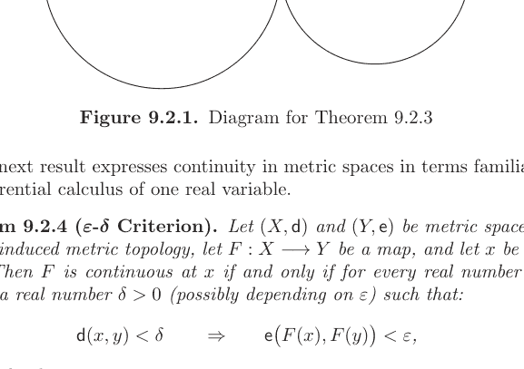

## 第 9 章

## 拓扑

### 9.1 拓扑

在概述了线性代数和多线性代数之后，我们现在将注意力转向拓扑学。 这是数学的一个庞大领域，出于必要性，这里呈现的覆盖是高度选择性的。 对初学者来说，拓扑可能令人望而生畏地抽象。 拓扑的一个最佳例子（也是下面许多内容的动机）是 ℝ^m 上的欧几里得拓扑，在第 9.4 节中简要介绍，并在第 9.2 节和第 9.3 节的准备材料之前介绍。 对拓扑学的新读者可能会发现先浏览这些章节是有帮助的，以便对下面讨论的方向有一个大致的了解。

集合 X 上的拓扑 𝒯 是 X 的子集的集合，使得：

+   [T1] ∅ 和 X 在 𝒯 中。
+   [T2] 𝒯 中元素的任意子集的并集在 𝒯 中。
+   [T3] 𝒯 中元素的任意有限子集的交集在 𝒯 中。

对 (X,𝒯) 称为拓扑空间，𝒯 的每个元素称为 𝒯 中的开集或简称为 𝒯 中开。 X 的每个元素称为 X 中的点。 𝒯 中包含 X 中给定点 x 的任何开集称为 X 中 x 的邻域。 我们说 X 的子集 K 是 𝒯 中的闭集或简称为 𝒯 中闭，如果 X\K 是 X 中的开集。 采用 X 作为拓扑空间的简写是很方便的，其中 𝒯 从上下文中理解。 相应地，如果 U 是 𝒯 中的开集且 K 是 𝒯 中的闭集，我们说 U 是 X 中的开集或简称为 X 中开，且 K 是 X 中的闭集或简称为 X 中闭。

定理 9.1.1. 如果 X 是拓扑空间，则以下在 X 中是闭集：

+   (a) ∅ 和 ℝ^m。
+   (b) *X 中任意闭集族的交集。*
+   (c) *X 中任意有限闭集族的并集。*

*证明.* (a): 显而易见。

(b): 设 {$K_\alpha : \alpha \in A$} 是 X 中闭集的族，设 $K = \bigcap_{\alpha \in A} K_\alpha$。 由于每个 $X \setminus K_\alpha$ 在 X 中开且根据定理 A.1(d)，

$X \setminus K = \bigcup_{\alpha \in A} (X \setminus K_\alpha)$,

可得 $X \setminus K$ 在 X 中开。 因此，$K = X \setminus (X \setminus K)$ 在 X 中闭。

(c): 设 {$K_i : i = 1, \dots, m$} 是 X 中有限闭集族，设 $K = \bigcup_{i=1}^n K_i$。 由于每个 $X \setminus K_i$ 在 X 中开且根据定理 A.1(c)，

$X \setminus K = \bigcap_{i=1}^m (X \setminus K_i)$,

可得 $X \setminus K$ 在 X 中开。 因此，$K = X \setminus (X \setminus K)$ 在 X 中闭。

设 X 是拓扑空间，S 是 X 的子集。 **S 在 X 中的内部** 用 $\operatorname{int}_X(S)$ 表示，定义为包含在 S 中的 X 中所有开集的并集。 **S 在 X 中的外部** 用 $\operatorname{ext}_X(S)$ 表示，定义为包含在 $X \setminus S$ 中的 X 中所有开集的并集。 **S 在 X 中的边界** 用 $\operatorname{bd}_X(S)$ 表示，定义为 X 中既不在 $\operatorname{int}_X(S)$ 中也不在 $\operatorname{ext}_X(S)$ 中的所有点的集合。 于是，X 是不相交并

$X = \operatorname{int}_X(S) \cup \operatorname{ext}_X(S) \cup \operatorname{bd}_X(S)$。

**S 在 X 中的闭包** 用 $\operatorname{cl}_X(S)$ 表示，定义为包含 S 的 X 中所有闭集的交集。

以下是关于内部、外部、边界和闭包的一些基本事实。

### **定理 9.1.2.** *如果 X 是拓扑空间且 S 是 X 的子集，则：*

+   (a) $\operatorname{int}_X(S)$ *是包含在 S 中的 X 中最大的开集。*
+   (b) $\operatorname{ext}_X(S)$ *是包含在 $X \setminus S$ 中的 X 中最大的开集。*
+   (c) $\operatorname{cl}_X(S)$ *是包含 S 的 X 中最小的闭集。*
+   (d) $\operatorname{bd}_X(S)$ *是 X 中的闭集。*
+   (e) $S$ *在 X 中闭当且仅当 $S = \operatorname{cl}_X(S)$。*
+   (f) $\operatorname{bd}_X(S)$ *是 X 中满足每个邻域与 S 和 $X \setminus S$ 相交的点 $x$ 的集合。*
+   (g) $\operatorname{cl}_X(S)$ *是 X 中满足每个邻域与 S 相交的点 $x$ 的集合。*

*证明.* (a)–(c): 显而易见。

(d): 由于 $\operatorname{int}_X(S)$ 和 $\operatorname{ext}_X(S)$ 在 X 中开，

$\operatorname{bd}_X(S) = X \setminus [\operatorname{int}_X(S) \cup \operatorname{ext}_X(S)]$

在 X 中闭。

$(e)(\Rightarrow)$: 由于 S 在 X 中闭，包含 S 的 X 中所有闭集的交集就是 S。

$(e)(\Leftarrow)$: 这由部分 (c) 可得。

$(f)$: 我们证明逻辑上等价的断言：

$(f')$ X 中的点 $x$ 不在 $\operatorname{bd}_X(S)$ 中的充要条件是它在 $M$ 中有一个邻域，该邻域不与 S 或 $X\setminus S$ 相交。

$(f')(\Rightarrow)$: 由于 $x$ 不在 $\operatorname{bd}_X(S)$ 中，它在 $\operatorname{int}_X(S)$ 或 $\operatorname{ext}_X(S)$ 中。 如果 $x$ 在 $\operatorname{int}_X(S)$ 中，则它包含在 $M$ 中一个开集 $U$ 中，该开集是 $S$ 的子集。 于是，$U$ 是 $x$ 的一个邻域，它不与 $X\setminus S$ 相交。 当 $x$ 在 $\operatorname{ext}_X(S)$ 中时的论证类似。

$(f')(\Leftarrow)$: 设 $U$ 是 X 中 $x$ 的一个邻域。 如果 $U$ 不与 S 相交，则 $U$ 是 $X\setminus S$ 中的开集，故 $U\subseteq\operatorname{ext}_X(S)$。 于是，$x$ 在 $\operatorname{ext}_X(S)$ 中，它与 $\operatorname{bd}_X(S)$ 不相交。 当 $U$ 不与 $X\setminus S$ 相交时的论证类似。

$(g)$: 部分 (f) 的证明类似。

与其处理 X 中所有开集，不如经常方便地使用一个更小的集合，其中包含“开性”的基本信息。 X 的 **基** 是 X 的子集的集合 $\mathcal B$，每个称为 **基元素**，使得：

+   [B1] $X=\bigcup_{B\in\mathcal B}B$。
+   
+   [B2] 如果 $B_1,B_2$ 是 $\mathcal B$ 中的基元素且 $x$ 是 $B_1\cap B_2$ 中的点，则 $\mathcal B$ 中存在基元素 $B$ 包含 $x$ 使得 $B\subseteq B_1\cap B_2$。

**定理 9.1.3.** *如果 X 是集合且 $\mathcal B$ 是 X 的基，则由 $\mathcal B$ 中基元素的并集组成的集合 $\mathcal T_{\mathcal B}$ 是 X 上的拓扑，称为由 $\mathcal B$ 生成的拓扑。*

*证明.* 我们需要证明 [T1]–[T3] 得到满足。 显然 $\varnothing$ 在 $\mathcal T_{\mathcal B}$ 中是空真成立的，且根据 [B1]，$X$ 也是如此。 于是，[T1] 得到满足。 显然，[T2] 得到满足。 对于 [T3]，设 $B_1,B_2$ 是 $\mathcal B$ 中的基元素。 我们断言 $B_1\cap B_2$ 在 $\mathcal T_{\mathcal B}$ 中。 这在 $B_1\cap B_2=\varnothing$ 时显然成立，故假设并非如此。 根据 [B2]，对于 $B_1\cap B_2$ 中的每个 $x$，存在 $\mathcal B$ 中的基元素 $B_x$ 使得 $x$ 在 $B_x$ 中且 $B_x\subseteq B_1\cap B_2$。 可得 $B_1\cap B_2=\bigcup_{x\in B_1\cap B_2}B_x$，故 $B_1\cap B_2$ 在 $\mathcal T_{\mathcal B}$ 中。 这证明了断言。 设 $U_1$ 和 $U_2$ 是 $\mathcal T_{\mathcal B}$ 的元素，其中 $U_1=\bigcup_{\alpha_1\in A_1}B_{\alpha_1}$ 且 $U_2=\bigcup_{\alpha_2\in A_2}B_{\alpha_2}$。 根据定理 A.1(a)，

$$U_1\cap U_2=\left(\bigcup_{\alpha_1\in A_1}B_{\alpha_1}\right)\cap\left(\bigcup_{\alpha_2\in A_2}B_{\alpha_2}\right)=\bigcup_{\alpha_1\in A_1,\,\alpha_2\in A_2}(B_{\alpha_1}\cap B_{\alpha_2}).$$

由于每个 $B_{\alpha_1}\cap B_{\alpha_2}$ 在 $\mathcal T_{\mathcal B}$ 中，故 $U_1\cap U_2$ 也是如此。 使用归纳论证，可以很容易地证明 $\mathcal T_{\mathcal B}$ 中任意有限子族的交集在 $\mathcal T_{\mathcal B}$ 中。 于是，[T3] 得到满足。

**定理 9.1.4 (子空间拓扑)。** *如果 $(X,\mathcal T)$ 是拓扑空间且 S 是 X 的子集，则*

$$\mathcal T_S=\{U\cap S:U\in\mathcal T\}$$


证明。 (a) ⇒ (b)：设 x 是 F⁻¹(V) 中的一点。由于 F 在 x 处连续且 V 是 Y 中 F(x) 的邻域，F⁻¹(V) 包含 X 中 x 的邻域 Uₓ。于是 F⁻¹(V) = ⋃ₓ∈U Uₓ 在 X 中是开集。

(b) ⇒ (a)：设 x 是 X 中的一点，且 V 是 Y 中 F(x) 的邻域。由于 V 在 Y 中是开集，F⁻¹(V) 在 X 中是开集，因此是 X 中 x 的邻域。

(b) ⇒ (c)：我们有
K 在 Y 中是闭集
⇒ Y\K 在 Y 中是开集
⇒ F⁻¹(Y\K) = X\F⁻¹(K) 在 X 中是开集
⇒ X\[X\F⁻¹(K)] = F⁻¹(K) 在 X 中是闭集，

其中第二个蕴含由定理 A.3(e) 推出。

(c) ⇒ (b)：我们有
V 在 Y 中是开集
⇒ Y\V 在 Y 中是闭集
⇒ F⁻¹(Y\V) = X\F⁻¹(V) 在 X 中是闭集
⇒ X\[X\F⁻¹(V)] = F⁻¹(V) 在 X 中是开集，

其中第二个蕴含由定理 A.3(e) 推出。

## 定理 9.1.8. 设 X、Y 和 Z 为拓扑空间，且 F : X ⟶ Y 和 G : Y ⟶ Z 为映射。若 F 和 G 连续，则 G ∘ F 也连续。

证明。设 V 是 Z 中的开集。由于 G 连续，根据定理 9.1.7，G⁻¹(V) 在 Y 中是开集，而由于 F 连续，再次根据定理 9.1.7，F⁻¹(G⁻¹(V)) = (G ∘ F)⁻¹(V) 在 X 中是开集。结果现在由定理 9.1.7 推出。

## 定理 9.1.9. 设 X 和 Y 为拓扑空间，F : X ⟶ Y 为映射，且 ℬ 是生成 Y 拓扑的基。若对 ℬ 中每个基元素 B，F⁻¹(B) 在 X 中是开集，则 F 连续。

证明。设 V 是 Y 中的开集。根据定理 9.1.3，V 可表示为 V = ⋃ₐ∈ₐ Bₐ 的基元素的并，且然后定理 A.3(b) 给出 F⁻¹(V) = ⋃ₐ∈ₐ F⁻¹(Bₐ)。根据假设，每个 F⁻¹(Bₐ) 在 X 中是开集，因此 F⁻¹(V) 也是开集。结果现在由定理 9.1.7 推出。

## 定理 9.1.10. 设 X₁, …, Xₘ 为拓扑空间，且假设 X₁ × ⋯ × Xₘ 具有乘积拓扑。定义映射 𝒫ᵢ : X₁ × ⋯ × Xₘ ⟶ Xᵢ，称为 X₁ × ⋯ × Xₘ 上的第 i 个投影映射，由

𝒫ᵢ(x₁, …, xᵢ, …, xₘ) = xᵢ

对所有 (x₁, …, xₘ) 在 X₁ × ⋯ × Xₘ 中成立，i = 1, …, m。则每个 𝒫ᵢ 都是连续的。

## 9.1 拓扑

设 $X$ 和 $Y$ 为拓扑空间，$F:X\to Y$ 为映射，且 $S$ 为 $X$ 的子集（拓扑子空间）。我们说 $F$ 在 $S$ 上**连续**，如果限制映射 $F|_S:S\to Y$ 在 $S$ 上连续。

### 定理 9.1.13. *在上述设定下，若 $F$ 连续，则 $F|_S$ 也连续。*

*证明.* 设 $V$ 为 $Y$ 中的开集。由于 $F$ 连续，根据定理 9.1.7，$F^{-1}(V)$ 在 $X$ 中是开集，故 $F^{-1}(V)\cap S=(F|_S)^{-1}(V)$ 在 $S$ 中是开集。结果现在由定理 9.1.7 推出。

设 $X$ 和 $Y$ 为拓扑空间，且 $F:X\to Y$ 为连续映射。我们说 $F$ 是**同胚**，且 $X$ 和 $Y$ 是**同胚**，如果 $F$ 是双射且 $F^{-1}$ 连续。下一个结果表明同胚是一个保持拓扑结构（与线性同构保持线性结构的方式非常相似）的映射。

### 定理 9.1.14. *设 $X$ 和 $Y$ 为拓扑空间，且 $F:X\to Y$ 为双射映射。则以下等价：*

(a) $F$ 是同胚。

(b) $U$ 在 $X$ 中是开集当且仅当 $F(U)$ 在 $Y$ 中是开集。

(c) $K$ 在 $X$ 中是闭集当且仅当 $F(K)$ 在 $Y$ 中是闭集。

*证明.* 这由定理 9.1.7 推出。

我们说拓扑空间 $X$ 是**不连通**的，如果存在不相交的非空开集 $U$ 和 $V$ 在 $X$ 中使得 $X=U\cup V$。在这种情况下，$U$ 和 $V$ 称为**分离** $X$。如果 $X$ 不是不连通的，我们说它是**连通**的。$X$ 的子集 $S$ 称为在 $X$ 中**不连通（连通）**或简单地**不连通（连通）**，如果它作为 $X$ 的拓扑子空间是不连通（连通）的。我们说 $X$ 的子集 $C$ 是 $X$ 的**连通分支**，如果它在 $X$ 中是连通集且是极大的，即 $C$ 不真包含于 $X$ 中的任何其他连通集中。

下一个结果给出了拓扑空间的子集在该拓扑空间中不连通的等价条件。

### 定理 9.1.15. *设 $X$ 为拓扑空间，且 $S$ 为 $X$ 的子集。则：*

(a) $S$ 在 $X$ 中不连通当且仅当存在 $X$ 中的非空开集 $U$ 和 $V$ 使得 (i) $(U\cap V)\cap S=\varnothing$，(ii) $S\subset (U\cup V)$，且 (iii) $U\cap S\ne\varnothing$ 且 $V\cap S\ne\varnothing$。

(b) $S$ 在 $X$ 中连通当且仅当对所有 $X$ 中的非空开集 $U$ 和 $V$ 使得 $(U\cap V)\cap S=\varnothing$ 且 $S\subset (U\cup V)$，要么 $S\subset U$ 要么 $S\subset V$。

*证明.* 设 $U$ 和 $V$ 为 $X$ 中的开集。则

$$(U\cap V)\cap S=\varnothing \quad\Longleftrightarrow\quad (U\cap S)\cap(V\cap S)=\varnothing,$$

且由定理 A.1(a)，

$$S\subset (U\cup V) \quad\Longleftrightarrow\quad S=(U\cup V)\cap S=(U\cap S)\cup(V\cap S).$$

(a): 根据定义，$S$ 不连通当且仅当存在 $S$ 中的开集 $U'$ 和 $V'$ 使得 (i) $U'\cap V'=\varnothing$，(ii) $S=U'\cup V'$，且 (iii) $U'\neq\varnothing$ 且 $V'\neq\varnothing$。由于任何这样的 $U'$ 和 $V'$ 均可表示为 $U'=U\cap S$ 和 $V'=V\cap S$，其中 $U$ 和 $V$ 为 $X$ 中的开集，结果由 (9.1.1) 和 (9.1.2) 推出。

(b): 我们由第 (a) 部分得到 $S$ 在 $X$ 中连通当且仅当对所有 $X$ 中的非空开集 $U$ 和 $V$ 使得 $(U\cap V)\cap S=\varnothing$ 且 $S\subset (U\cup V)$，要么 $U\cap S=\varnothing$ 要么 $V\cap S=\varnothing$，这进而由 (9.1.1) 和 (9.1.2) 等价于第 (b) 部分的陈述。

## 定理 9.1.16.

设 $X$ 为拓扑空间，且 $\{S_\alpha:\alpha\in A\}$ 为 $X$ 中在 $X$ 中连通的子集的集合。若 $\bigcap_{\alpha\in A}S_\alpha$ 非空，则 $\bigcup_{\alpha\in A}S_\alpha$ 在 $X$ 中连通。

**证明.** 设 $S=\bigcup_{\alpha\in A}S_\alpha$，且 $U$ 和 $V$ 为 $X$ 中的非空开集使得 $(U\cap V)\cap S=\varnothing$ 且 $S\subset (U\cup V)$。则 $(U\cap V)\cap S_\alpha=\varnothing$ 且 $S_\alpha\subset (U\cup V)$ 对所有 $\alpha\in A$ 成立。由于每个 $S_\alpha$ 在 $X$ 中连通，我们由定理 9.1.15(b) 得到对所有 $\alpha\in A$ 要么 $S_\alpha\subset U$ 要么 $S_\alpha\subset V$。根据假设，存在点 $x$ 在 $\bigcap_{\alpha\in A}S_\alpha\subset (U\cup V)$ 中。设不失一般性 $x$ 在 $U$ 中，故 $U\cap S_\alpha\neq\varnothing$ 对所有 $\alpha$ 成立。若对某个 $\alpha$ 有 $S_\alpha\subset V$，则 $(U\cap V)\cap S_\alpha=\varnothing$ 简化为 $U\cap S_\alpha=\varnothing$，这是矛盾的。于是可推出 $S_\alpha\subset U$ 对所有 $\alpha\in A$ 成立，故 $S\subset U$。再次由定理 9.1.15(b)，$S$ 在 $X$ 中连通。

## 定理 9.1.17.

拓扑空间的不同的连通分支构成拓扑空间的一个划分。

**证明.** 设 $X$ 为拓扑空间，且 $x$ 为 $X$ 中的点。显然，$\{x\}$ 在 $X$ 中连通。设 $C$ 为包含 $x$ 的 $X$ 中所有连通子集的并集。由定理 9.1.16，$C$ 在 $X$ 中连通，且显然是 $X$ 的一个连通分支。于是 $X$ 有一个或多个连通分支，其并集等于 $X$。剩下要证明不同的连通分支是互不相交的。我们证明逻辑等价的断言：如果连通分支不相交，则它们相等。设 $C$ 和 $D$ 为不相交的连通分支。由定理 9.1.16，$C\cup D$ 在 $X$ 中连通。于是由极大性可得 $C=C\cup D=D$。

## 定理 9.1.18.

设 $X$ 和 $Y$ 为拓扑空间，且 $F:X\longrightarrow Y$ 为连续映射。若 $X$ 连通，则 $F(X)$ 在 $Y$ 中连通。

**证明.** 我们证明逻辑等价的断言：如果 $F(X)$ 在 $Y$ 中不连通，则 $X$ 不连通。由定理 9.1.15(a)，存在 $Y$ 中的非空开集 $U$ 和 $V$ 使得 (i) $(U\cap V)\cap F(X)=\varnothing$，(ii) $F(X)\subset (U\cup V)$，且 (iii) $U\cap F(X)\neq\varnothing$ 且 $V\cap F(X)\neq\varnothing$。由定理 9.1.7 及定理 A.3 的 (b) 和 (c) 部分可得 $F^{-1}(U)$ 和 $F^{-1}(V)$ 是 $X$ 中不相交的非空开集使得 $X=F^{-1}(U)\cup F^{-1}(V)$。于是 $X$ 不连通。

## 定理 9.1.19 (介值定理)。

设 $X$ 为连通拓扑空间，且 $f:X\longrightarrow\mathbb{R}$ 为连续函数。若 $x_1,x_2$ 为 $X$ 中的点且 $c$ 为实数使得 $f(x_1)<c<f(x_2)$，则存在 $X$ 中的点 $x_0$ 使得 $f(x_0)=c$。


**证明.** 考虑集合 $S_1=f(X)\cap(-\infty,c)$ 和 $S_2=f(X)\cap(c,+\infty)$。显然 $S_1$ 和 $S_2$ 是不相交且非空的。由于 $(-\infty,c)$ 和 $(c,+\infty)$ 在 $\mathbb{R}$ 中是开集，$S_1$ 和 $S_2$ 在 $f(X)$ 中是开的。假设不存在点 $x_0$ 在 $X$ 中使得 $f(x_0)=c$。则 $f(X)=S_1\cup S_2$。于是，$f(X)$ 在 $\mathbb{R}$ 中是不连通的，这与定理 9.1.18 矛盾。◻

## 定理 9.1.20.

*若 $X$ 是一个连通拓扑空间且 $f:X\to\mathbb{R}$ 是一个处处非零的连续函数，则 $f$ 要么严格为正，要么严格为负。*

**证明.** 设 $x_1$ 和 $x_2$ 是 $X$ 中不同的点。由于 $f$ 处处非零，$f(x_1),f(x_2)\ne0$。若 $f(x_1)>0$，则 $f(x_2)>0$；否则，由定理 9.1.19，存在点 $x_0$ 在 $X$ 中使得 $f(x_0)=0$，这与 $f$ 的处处非零假设矛盾。类似地，若 $f(x_1)<0$，则 $f(x_2)<0$。由于 $x_1$ 和 $x_2$ 是任意的，结果得证。◻

设 $X$ 是一个拓扑空间，且 $\mathcal{U}=\{U_\alpha:\alpha\in A\}$ 是 $X$ 中一族开集。我们称 $\mathcal{U}$ 是 $X$ 的一个**开覆盖**，如果 $X=\bigcup_{\alpha\in A}U_\alpha$。$\mathcal{U}$ 的一个子族如果也是 $X$ 的开覆盖，则称其为 $\mathcal{U}$ 的一个**子覆盖**。若子覆盖是有限集，则称为**有限子覆盖**。我们称 $X$ 为**紧**拓扑空间，如果 $X$ 的每一个开覆盖都有有限子覆盖。$X$ 的子集 $S$ 称为 $X$ 中的**紧集**或简称为 $X$ 中**紧**，如果它作为拓扑子空间是紧的。

## 定理 9.1.21.

*设 $X$ 和 $Y$ 为拓扑空间，且 $F:X\to Y$ 为连续映射。若 $X$ 紧，则 $F(X)$ 在 $Y$ 中紧。*

**证明.** 设 $\mathcal{V}$ 是 $F(X)$ 的一个开覆盖。则 $\mathcal{V}=\{V_\alpha\cap F(X):\alpha\in A\}$，其中每个 $V_\alpha$ 是 $Y$ 中的开集。由定理 A.1(a)，

$$F(X)=\left(\bigcup_{\alpha\in A}V_\alpha\right)\cap F(X)=\bigcup_{\alpha\in A}[V_\alpha\cap F(X)],$$

且由定理 A.3(b)，

$$X=F^{-1}(F(X))=\bigcup_{\alpha\in A}F^{-1}(V_\alpha\cap F(X))=\bigcup_{\alpha\in A}F^{-1}(V_\alpha).$$

由定理 9.1.7 可知 $\{F^{-1}(V_\alpha):\alpha\in A\}$ 是 $X$ 的一个开覆盖。由于 $X$ 紧，存在有限子覆盖 $\{F^{-1}(V_i):i=1,\ldots,k\}$，于是

$$X=\bigcup_iF^{-1}(V_i).$$

由定理 A.3 的 (a) 和 (d) 部分，

$$F(X)=\bigcup_iF(F^{-1}(V_i))=\bigcup_i[V_i\cap F(X)].$$

于是，$\{V_i\cap F(X):i=1,\ldots,k\}$ 是 $\mathcal{V}$ 的一个有限子覆盖。◻

设 X 为拓扑空间，且 f : X ⟶ ℝ 为函数。我们称 f 在 X 上有界或简称为有界，如果存在实数 c > 0 使得对所有点 x ∈ X 都有 |f(x)| < c。设 S 为 ℝ 的非空子集。元素 s1 ∈ S 称为 S 中的最小元素，如果对所有 s ∈ S 都有 s1 ≤ s。类似地，元素 s2 ∈ S 称为 S 中的最大元素，如果对所有 s ∈ S 都有 s ≤ s2。若 S 有最小元素 s1 和最大元素 s2，则对所有 s ∈ S 都有 s1 ≤ s ≤ s2。考虑开集族 𝒰 = {(-∞, s) ∩ S : s ∈ S} 在 S 中。若 S 有最大元素 s2，则 s2 不在 ∪_{s∈S}(-∞, s) 中，所以 𝒰 不是 S 在 ℝ 中的开覆盖。另一方面，若 S 没有最大元素，则 𝒰 是 S 在 ℝ 中的开覆盖。

## 定理 9.1.22 (极值定理). 若 X 是紧拓扑空间且 f : X ⟶ ℝ 是连续函数，则：

- (a) 存在点 x1 和 x2 在 X 中使得对所有 x ∈ X 都有 f(x1) ≤ f(x) ≤ f(x2)。
- (b) f 有界。

证明. (a): 该断言等价于：存在点 x1 和 x2 在 X 中使得 f(x1) 是 f(X) 中的最小元素，且 f(x2) 是 f(X) 中的最大元素。假设为矛盾，设 f(X) 没有最大元素。根据上述说明，{(-∞, f(x)) ∩ f(X) : x ∈ X} 是 f(X) 的一个开覆盖。由于 X 紧且 f 连续，由定理 9.1.21，f(X) 在 ℝ 中紧。于是存在有限子覆盖 {(-∞, f(xi)) ∩ f(X) : i = 1, …, m}，其中不失一般性假设 f(x1) < ⋯ < f(xm)。由定理 A.1(a)，f(X) = ⋃_{i=1}^m [(-∞, f(xi)) ∩ f(X)] = [⋃_{i=1}^m (-∞, f(xi))] ∩ f(X) = (-∞, f(xm)) ∩ f(X)，故 f(X) ⊆ (-∞, f(xm))。由于 f(xm) ∈ f(X) 但不在 (-∞, f(xm)) 中，我们得到矛盾。于是 f(X) 有最大元素。证明 f(X) 有最小元素是类似的。(b): 这由 (a) 得出。

设 X 为拓扑空间，且 f : X ⟶ ℝ 为函数。f 的支集记为 supp(f) 并定义为 f 非零点集在 X 中的闭包：supp(f) = cl_X({x ∈ X : f(x) ≠ 0})。于是，supp(f) 是包含 f 非零点的最小闭集。我们称 f 有紧支集，如果 supp(f) 在 X 中紧。给定 X 的子集 S，我们称 f 的支集在 S 中，如果 supp(f) ⊆ S。

证明. 对开球而言，这由定义可知。设 \overline{B}_r(x) 为 X 中的闭球，且 y 为 X\setminus\overline{B}_r(x) 中的点，于是 d(x,y) > r。设 s = d(x,y) − r，且 z 为 B_s(y) 中的点，这意味着 d(y,z) < s。见图 9.2.1。由 [D2] 和 [D3]，

```
r + s = d(x,y) ≤ d(x,z) + d(z,y) < d(x,z) + s,
```

故 d(x,z) > r，所以 z 在 X\setminus\overline{B}_r(x) 中。于是 B_s(y) ⊆ X\setminus\overline{B}_r(x)。可知 X\setminus\overline{B}_r(x) 是基元素的一个并集。由定理 9.1.3 和定理 9.2.2，X\setminus\overline{B}_r(x) 对由 d 诱导的度量拓扑是开的，故 \overline{B}_r(x) = X\setminus[X\setminus\overline{B}_r(x)] 对该拓扑是闭的。



## 图 9.2.1. 定理 9.2.3 的示意图

下一个结果用与一元实值微积分中熟悉的术语表达了度量空间中的连续性。

## 定理 9.2.4 (ε-δ 准则). 设 (X,d) 和 (Y,e) 为度量空间，各自具有其诱导的度量拓扑，设 F : X ⟶ Y 为映射，且 x 为 X 中的点。则 F 在 x 处连续当且仅当对每个实数 ε > 0，存在实数 δ > 0 (可能依赖于 ε) 使得：

```
d(x,y) < δ    ⇒    e(F(x),F(y)) < ε,
```

或等价地，

```
y is in B_δ(x)    ⇒    F(y) is in B_ε(F(x)),
```

或等价地，

```
B_δ(x) ⊆ F^{-1}(B_ε(F(x))).
```

证明. 三个条件的等价性是显然的。让我们使用最后一个。

(⇒): 由于 $F$ 在 $x$ 处连续且 $B_{\varepsilon}(F(x))$ 是 $Y$ 中 $F(x)$ 的一个邻域，根据定义，存在 $X$ 中 $x$ 的邻域 $U$ 使得 $F(U)\subset B_{\varepsilon}(F(x))$。由定理 9.1.3 和定理 9.2.2，存在开球 $B_{\delta}(x)$ 使得

\[
B_{\delta}(x)\subset U\subset F^{-1}(B_{\varepsilon}(F(x))).
\]

(⇐): 设 $V$ 为 $Y$ 中 $F(x)$ 的邻域。我们由定理 9.1.3 和定理 9.2.2 得到存在开球 $B_{\varepsilon}(F(x))$ 使得 $B_{\varepsilon}(F(x))\subset V$。根据假设，存在开球 $B_{\delta}(x)$ 使得 $B_{\delta}(x)\subset F^{-1}(B_{\varepsilon}(F(x)))$。于是，$B_{\delta}(x)$ 是 $X$ 中 $x$ 的邻域使得 $F(B_{\delta}(x))\subset V$。

## 9.3 范数向量空间

设 $V$ 为向量空间。函数

\[
\|\cdot\|: V\longrightarrow \mathbb{R}
\]

称为 $V$ 上的**范数**，如果对所有向量 $v,w$ 在 $V$ 中及所有实数 $c$：

- [N1] $\|v\|\ge 0$，且 $\|v\|=0$ 当且仅当 $v=0$。
- [N2] $\|cv\|=|c|\|v\|$。
- [N3] $\|v+w\|\le \|v\|+\|w\|$。 (三角等式)

**范数向量空间**是二元组 $(V,\|\cdot\|)$，由向量空间 $V$ 和 $V$ 上的范数 $\|\cdot\|$ 组成。

**定理 9.3.1.** 若 $(V,g)$ 为内积空间且 $\|\cdot\|$ 为由 $\|v\|=\sqrt{\langle v,v\rangle}$ 对所有 $v\in V$ 定义的范数，则 $(V,\|\cdot\|)$ 为范数向量空间。

*证明.* 利用定理 4.6.5 和内积的基本性质，容易证明 [N1]–[N3] 成立。

定理 9.3.1 证明了我们在第 4.6 节中使用“范数”一词的合理性 (以及在第 4.1 节中较小程度上使用的合理性)。

**定理 9.3.2.** 若 $(V,\|\cdot\|)$ 为范数向量空间且 $d:V\times V\longrightarrow\mathbb{R}$ 为由 $d(v,w)=\|v-w\|$ 对所有向量 $v,w\in V$ 定义的函数，则 $(V,d)$ 为度量空间。

*证明.* 容易证明第 9.2 节中条件 [D1]–[D3] 成立。

## 9.4 $\mathbb{R}^m$ 上的欧几里得拓扑

让我们把第 9.1–9.3 节的结果用于构造一系列“空间”，从内积空间 $\mathbb{R}^m=(\mathbb{R}^m,e)$ 开始，如例 4.6.1 中定义。我们首先应用定理 9.3.1 于 $(\mathbb{R}^m,e)$ 并得到范数向量空间 $(\mathbb{R}^m,\|\cdot\|)$，其中

\[
\|\cdot\|:\mathbb{R}^m\times\mathbb{R}^m\longrightarrow\mathbb{R}
\]


