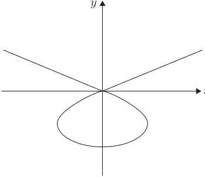
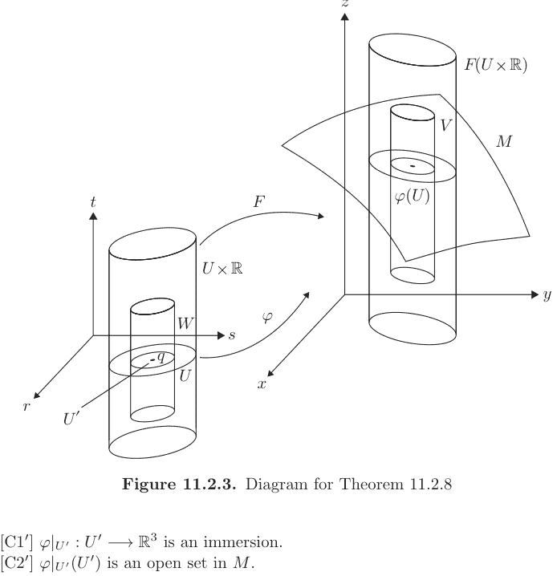
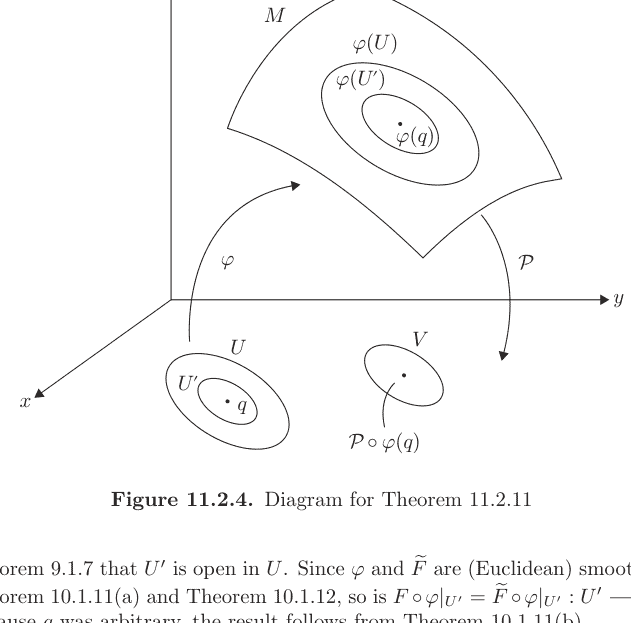
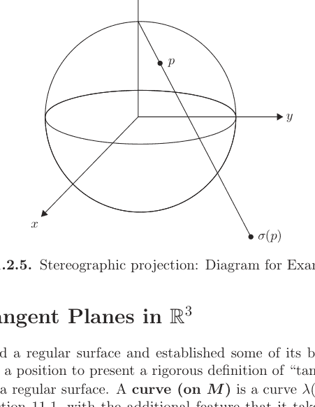
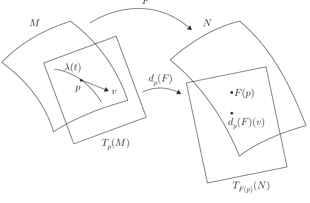
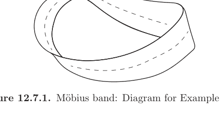
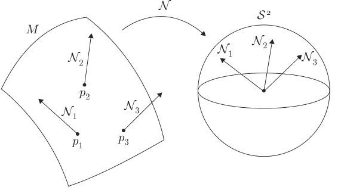
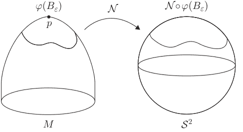

## 第 10 章

## \(\mathbb{R}^m\) 中的分析

### 10.1 导数

本节回顾一个或多个实变量的微分学中的一些关键结果。在大多数情况下不提供证明。

设 \(U\) 是 \(\mathbb{R}^m\) 中的开集，\(F: U \to \mathbb{R}^n\) 是一个映射，\(p\) 是 \(U\) 中的一点。如果存在线性映射 \(L_p: \mathbb{R}^m \to \mathbb{R}^n\)，使得

\[
\lim_{\lVert v\rVert\to 0}\frac{\lVert F(p+v)-F(p)-L_p(v)\rVert}{\lVert v\rVert}=0.
\]

则称 \(F\) 在 \(p\) 处可微。

可以证明，如果这样的映射存在，则它是唯一的。我们称这个映射为 **\(F\) 在 \(p\) 处的微分**，并自此将其记为

\[
d_p(F): \mathbb{R}^m \longrightarrow \mathbb{R}^n.
\]

在文献中，\(F\) 在 \(p\) 处的微分也被称为 \(F\) 在 \(p\) 处的导数或 \(F\) 在 \(p\) 处的全导数，并有多种记号，如 \(dF_p\)、\(DF(p)\)、\(D_p(F)\) 或 \(F'(p)\)。我们特意在记号 \(d_p(F)\) 中加入括号，以便为将 \(d_p\) 视为一种映射作铺垫。

通常将 \(d_p(F)\) 刻画为 \(F\) 在 \(p\) 附近的“线性近似”。为了获得更几何的解释，我们定义 **\(F\) 的图像** 为

\[
\operatorname{graph}(F)=\{(p,F(p))\in\mathbb{R}^{m+n}:p\in U\}.
\]

我们可以将向量空间 \(d_p(F)(\mathbb{R}^m)\) 视为 \(\operatorname{graph}(F)\) 在 \(F(p)\) 处的“切空间”。这是单变量或双变量实变量微分学中熟悉的切线和切平面的推广。

如果 \(F\) 在 \(U\) 中的每一点 \(p\) 处都可微，则称 \(F\) **（在 \(U\) 上）可微**。为了说明连续性与可微性之间的区别，考虑

因此，\(d_p(f)(v)\) 正是 \(f\) 在 \(p\) 处沿方向 \(v\) 的方向导数，这是两个或多个实变量微分学中熟知的概念。

**定理 10.1.3.** 设 \(U\) 是 \(\mathbb{R}^m\) 中的开集，\(p\) 是 \(U\) 中的一点，\(c\) 是一个实数。如果函数 \(f,g:U\to\mathbb{R}\) 在 \(p\) 处可微，则：

- (a) \(d_p(cf+g)=c\,d_p(f)+d_p(g)\)。
- (b) \(d_p(fg)=f(p)d_p(g)+g(p)d_p(f)\)。

**证明.** 对于 \(\mathbb{R}^m\) 中的向量 \(v=(a^1,\ldots,a^m)\)，由定理 10.1.2 和偏导数的性质可得

\[
\begin{aligned}
d_p(cf+g)(v)
&=\sum_i a^i\frac{\partial(cf+g)}{\partial x^i}(p)\\
&=\sum_i a^i\left[c\frac{\partial f}{\partial x^i}(p)+\frac{\partial g}{\partial x^i}(p)\right]\\
&=c\sum_i a^i\frac{\partial f}{\partial x^i}(p)+\sum_i a^i\frac{\partial g}{\partial x^i}(p)\\
&=c\,d_p(f)(v)+d_p(g)(v)\\
&=(c\,d_p(f)+d_p(g))(v).
\end{aligned}
\]

以及

\[
\begin{aligned}
d_p(fg)(v)
&=\sum_i a^i\frac{\partial(fg)}{\partial x^i}(p)\\
&=\sum_i a^i\left[f(p)\frac{\partial g}{\partial x^i}(p)+g(p)\frac{\partial f}{\partial x^i}(p)\right]\\
&=f(p)\sum_i a^i\frac{\partial g}{\partial x^i}(p)+g(p)\sum_i a^i\frac{\partial f}{\partial x^i}(p)\\
&=f(p)d_p(g)(v)+g(p)d_p(f)(v)\\
&=(f(p)d_p(g)+g(p)d_p(f))(v).
\end{aligned}
\]

由于 \(v\) 是任意的，结论成立。

设 \(U\) 是 \(\mathbb{R}^m\) 中的开集，\(f:U\to\mathbb{R}\) 是一个函数，并假设对于 \(i=1,\ldots,m\)，\((\partial f/\partial x^i)(p)\) 对所有 \(p\in U\) 都存在。**\(f\) 关于 \(x^i\) 的偏导数** 是函数

\[
\frac{\partial f}{\partial x^i}:U\longrightarrow\mathbb{R}
\]

由如下对应定义

\[
p\longmapsto\frac{\partial f}{\partial x^i}(p)
\]

对所有 \(p\in U\) 成立。现在假设对于 \(i,j=1,\ldots,m\)，\((\partial/\partial x^i)(\partial f/\partial x^j)(p)\) 对所有 \(p\in U\) 都存在。**\(f\) 关于 \(x^i\) 和 \(x^j\) 的二阶偏导数** 是函数

\[
\frac{\partial^2f}{\partial x^i\partial x^j}:U\longrightarrow\mathbb{R}
\]

由如下对应定义

\[
p\longmapsto\frac{\partial^2f}{\partial x^i\partial x^j}(p)
\]

对所有 \(p\in U\) 以及所有 \(i,j=1,\ldots,m\) 成立，其中我们将

\[
\frac{\partial}{\partial x^i}\left(\frac{\partial f}{\partial x^j}\right)(p)
\quad\text{记为}\quad
\frac{\partial^2 f}{\partial x^i \partial x^j}(p).
\]

以显然的方式迭代，即可得到 \(f\) 的高阶偏导数。对于 \(k \ge 2\)，\(f\) 的 \(k\) 阶偏导数记为

\[
\frac{\partial^k f}{\partial x^{i_1} \partial x^{i_2} \cdots \partial x^{i_k}},
\]

其中整数 \(1 \le i_1, i_2, \ldots, i_k \le m\) 不必互不相同。

用 \(C^0(U)\) 表示在 \(U\) 上连续的函数 \(f:U\longrightarrow\mathbb{R}\) 的集合。对于 \(k\ge1\)，定义 \(C^k(U)\) 为所有 \(\le k\) 阶偏导数在 \(U\) 上存在且连续的函数 \(f:U\longrightarrow\mathbb{R}\) 的集合。

**定理 10.1.4（函数的可微性判别准则）. ** 如果 \(U\) 是 \(\mathbb{R}^m\) 中的开集，且 \(f\) 是 \(C^1(U)\) 中的函数，即对于 \(i=1,\dots,m\)，\(\partial f/\partial x^i\) 在 \(U\) 上存在且连续，则 \(f\) 在 \(U\) 上可微。

由定理 10.1.1、定理 10.1.2 和定理 10.1.4，我们得到如下结果，它概括了 \(\mathbb{R}^m\) 中开集上函数的连续性与可微性之间的关系。

**定理 10.1.5.** 设 \(U\) 是 \(\mathbb{R}^m\) 中的开集，\(f:U\longrightarrow\mathbb{R}\) 是一个函数。则：

- (a) 如果 \(f\) 在 \(U\) 上可微，则 \(f\) 在 \(U\) 上连续，并且对于 \(i=1,\dots,m\)，\(\partial f/\partial x^i\) 在 \(U\) 上存在。
- (b) 如果对于 \(i=1,\dots,m\)，\(\partial f/\partial x^i\) 在 \(U\) 上存在且连续，则 \(f\) 在 \(U\) 上可微。

**定理 10.1.6（混合偏导数的相等性）. ** 设 \(U\) 是 \(\mathbb{R}^m\) 中的开集，\(f\) 是 \(C^r(U)\) 中的函数，其中 \(r\ge1\)，并设 \(1\le k\le r\) 是整数。则 \(f\) 的 \(k\) 阶混合偏导数与微分顺序无关。也就是说，如果 \(1\le i_1,i_2,\ldots,i_k\le m\) 是不必互不相同的整数，且 \(j_1,j_2,\ldots,j_k\) 是这些整数按某种顺序的排列，则

\[
\frac{\partial^k f}{\partial x^{i_1}\partial x^{i_2}\cdots\partial x^{i_k}}
=
\frac{\partial^k f}{\partial x^{j_1}\partial x^{j_2}\cdots\partial x^{j_k}}.
\]

设 \(U\) 是 \(\mathbb{R}^m\) 中的开集，\(f:U\longrightarrow\mathbb{R}\) 是一个函数。如果 \(f\) 对所有 \(k\ge0\) 都属于 \(C^k(U)\)，则称 \(f\)（在 \(U\) 上）（欧几里得）光滑。\(U\) 上光滑函数的集合记为 \(C^\infty(U)\)。由定理 10.1.5，\(C^\infty(U)\) 是 \(U\) 上具有所有阶偏导数的函数 \(f\) 的集合。有时也称光滑函数是“无限可微”的。

我们通过如下方式定义运算，使 \(C^\infty(U)\) 同时成为一个向量空间和一个环：对于 \(C^\infty(U)\) 中的所有函数 \(f,g\) 和所有实数 \(c\)，令

\[
(f+g)(p)=f(p)+g(p),
\]

当 \(m=n\) 时，行列式 \(\det(J_F(p))\) 称为 \(F\) 在 \(p\) 处的**雅可比行列式**。设 \(1\le i_1<\cdots<i_s\le m\) 和 \(1\le j_1<\cdots<j_s\le n\) 是整数，其中 \(1\le s\le\min(m,n)\)。利用多重指标记号，\(J_F(p)\) 中由第 \(i_1,\ldots,i_s\) 行与第 \(j_1,\ldots,j_s\) 列按顺序相交所构成的子矩阵为

\[
J_F(p)^{(i_1,\ldots,i_s)}_{(j_1,\ldots,j_s)}=
\begin{pmatrix}
\frac{\partial F^{i_1}}{\partial x^{j_1}}(p) & \cdots & \frac{\partial F^{i_1}}{\partial x^{j_s}}(p)\\
\vdots & \ddots & \vdots\\
\frac{\partial F^{i_s}}{\partial x^{j_1}}(p) & \cdots & \frac{\partial F^{i_s}}{\partial x^{j_s}}(p)
\end{pmatrix}
\]

在文献中，上述矩阵通常记为

\[
\frac{\partial(F^{i_1},\ldots,F^{i_s})}{\partial(x^{j_1},\ldots,x^{j_s})}(p).
\]

**定理 10.1.10（经典链式法则）. ** 设 \(U\) 和 \(V\) 分别是 \(\mathbb{R}^m\) 和 \(\mathbb{R}^n\) 中的开集，\(F:U\longrightarrow\mathbb{R}^n\) 和 \(G:V\longrightarrow\mathbb{R}^k\) 是满足 \(F(U)\subseteq V\) 的映射，\(p\) 是 \(U\) 中的一点。如果 \(F\) 在 \(p\) 处可微，且 \(G\) 在 \(F(p)\) 处可微，则 \(G\circ F\) 在 \(p\) 处可微，且

\[
J_{G\circ F}(p)=J_G(F(p))\,J_F(p).
\]

等价地，设 \(F=(F^1,\ldots,F^n)\)，\(G=(G^1,\ldots,G^k)\)，并设 \((x^1,\ldots,x^m)\) 和 \((y^1,\ldots,y^n)\) 分别是 \(\mathbb{R}^m\) 和 \(\mathbb{R}^n\) 上的坐标。则

\[
\frac{\partial(G^i\circ F)}{\partial x^j}(p)
=
\sum_{l=1}^n
\frac{\partial G^i}{\partial y^l}(F(p))\,
\frac{\partial F^l}{\partial x^j}(p)
\tag{10.1.4}
\]

对于 \(i=1,\dots,k\) 和 \(j=1,\dots,m\)。

**证明.** 设 \(\mathcal{E},\mathcal{F}\) 和 \(\mathcal{G}\) 分别是 \(\mathbb{R}^m,\mathbb{R}^n\) 和 \(\mathbb{R}^k\) 的标准基。\(G\) 在 \(F(p)\) 处的雅可比矩阵是 \(k\times n\) 矩阵

\[
J_G(F(p))=
\begin{pmatrix}
\frac{\partial G^1}{\partial y^1}(F(p)) & \cdots & \frac{\partial G^1}{\partial y^n}(F(p))\\
\vdots & \ddots & \vdots\\
\frac{\partial G^k}{\partial y^1}(F(p)) & \cdots & \frac{\partial G^k}{\partial y^n}(F(p))
\end{pmatrix}
\tag{10.1.5}
\]

我们有

\[
\begin{aligned}
[J_{G\circ F}(p)]^{\mathcal{G}}_{\mathcal{E}}
&= [d_p(G\circ F)]^{\mathcal{G}}_{\mathcal{E}} && \text{(10.1.3)}\\
&= [d_{F(p)}(G)\circ d_p(F)]^{\mathcal{G}}_{\mathcal{E}} && \text{(定理 10.1.9)}\\
&= [d_{F(p)}(G)]^{\mathcal{G}}_{\mathcal{F}}\,[d_p(F)]^{\mathcal{F}}_{\mathcal{E}} && \text{(定理 2.2.2(c))}\\
&= J_G(F(p))\,J_F(p) && \text{(10.1.3)}\\
&= \left[\sum_l \frac{\partial G^i}{\partial y^l}(F(p))\,
\frac{\partial F^l}{\partial x^j}(p)\right].
\end{aligned}
\]


为了赋予 (10.1.4) 更传统的形式，我们沿用上述记号，设 $(z^1,\dots,z^k)$ 是 $\mathbb{R}^k$ 上的标准坐标，并将
$$
G^i \circ F(p) = G^i\left(F^1(p),\dots,F^n(p)\right)
$$
换成
$$
z^i = z^i\left(y^1(x^1,\dots,x^m),\dots,y^n(x^1,\dots,x^m)\right).
$$
于是 (10.1.4) 可以表示为
$$
\frac{\partial z^i}{\partial x^j} = \sum_{l=1}^n \frac{\partial z^i}{\partial y^l}\frac{\partial y^l}{\partial x^j}.
$$

设 $U$ 是 $\mathbb{R}^m$ 中的一个开集，并设 $F = (F^1,\dots,F^n) : U \longrightarrow \mathbb{R}^n$ 是一个映射。若函数 $F^i$ 对 $i = 1,\dots,n$ 都是光滑的，则称 $F$（在 $U$ 上）是光滑的。光滑映射将是本书其余部分的重点。

下面这个结果说明光滑性归根结底是一种局部现象，我们将会经常使用它，但通常不加引用。

### 定理 10.1.11.

设 $U$ 是 $\mathbb{R}^m$ 中的一个开集，并设 $F : U \longrightarrow \mathbb{R}^n$ 是一个映射。则：

- (a) 若 $F$ 光滑，且 $U'$ 是 $U$ 中的一个开集，则 $F|_{U'}$ 光滑。
- (b) 反之，若 $U$ 中每一点 $p$ 都有一个邻域 $U' \subseteq U$，使得 $F|_{U'}$ 光滑，则 $F$ 光滑。

### 定理 10.1.12.

设 $U$ 和 $V$ 分别是 $\mathbb{R}^m$ 和 $\mathbb{R}^n$ 中的开集，并设 $F : U \longrightarrow \mathbb{R}^n$ 与 $G : V \longrightarrow \mathbb{R}^k$ 是映射，且 $F(U) \subseteq V$。若 $F$ 和 $G$ 光滑，则 $G \circ F$ 也光滑。

$\mathbb{R}^m$ 中的一条（参数化）曲线是一个映射 $\lambda : I \longrightarrow \mathbb{R}^m$，其中 $I$ 是 $\mathbb{R}$ 中的一个区间，可以是开的、闭的、半开的或半闭的，并且不排除 $I$ 为无限区间的可能。我们将重点讨论 $I$ 为有限开区间的情形，通常记为 $(a,b)$。我们不必单独说明曲线的自变量（通常记为 $t$，有时记为 $u$），而是将其直接纳入 $\lambda$ 的记号中，如 $\lambda(t) : (a,b) \longrightarrow \mathbb{R}^m$。设 $\lambda = (\lambda^1,\dots,\lambda^m)$。按定义，$\lambda$ 在 $(a,b)$ 上光滑当且仅当 $\lambda^i$ 对 $i = 1,\dots,m$ 都光滑。

假设 $\lambda$ 确实是光滑的。$\lambda$ 的（欧氏）速度和 $\lambda$ 的（欧氏）加速度分别是光滑曲线
$$
\frac{d\lambda}{dt}(t) : (a,b) \longrightarrow \mathbb{R}^m
\quad \text{与} \quad
\frac{d^2\lambda}{dt^2}(t) : (a,b) \longrightarrow \mathbb{R}^m,
$$
即
$$
\frac{d\lambda}{dt}(t) = \left(\frac{d\lambda^1}{dt}(t),\dots,\frac{d\lambda^m}{dt}(t)\right)
$$
且
$$
\frac{d^2\lambda}{dt^2}(t) = \left(\frac{d^2\lambda^1}{dt^2}(t),\dots,\frac{d^2\lambda^m}{dt^2}(t)\right)
$$
对所有 $t \in (a,b)$ 成立。

### 定理 10.1.13.

设 $U$ 是 $\mathbb{R}^m$ 中的一个开集，$p$ 是 $U$ 中的一点，$v$ 是 $\mathbb{R}^m$ 中的一个向量。则存在实数 $\varepsilon > 0$ 和一条光滑曲线 $\lambda(t):(-\varepsilon,\varepsilon)\longrightarrow U$，使得 $\lambda(0)=p$ 且 $(d\lambda/dt)(0)=v$。

**证明：** 定义光滑曲线 $\lambda(t):(-\varepsilon,\varepsilon)\longrightarrow U$ 为 $\lambda(t)=p+tv$，其中 $\varepsilon$ 取得足够小，使得 $\lambda((-\varepsilon,\varepsilon))\subset U$。显然，$\lambda$ 具有所需性质。

下一个结果是后续讨论“向量”和“切空间”的关键。

### 定理 10.1.14.

设 $U$ 是 $\mathbb{R}^m$ 中的一个开集，$F:U\longrightarrow\mathbb{R}^n$ 是一个映射，$p$ 是 $U$ 中的一点，$v$ 是 $\mathbb{R}^m$ 中的一个向量。则：

- (a) 若 $F$ 在 $p$ 处可微，则

$$
d_p(F)(v)=\frac{d(F\circ\lambda)}{dt}(t_0),
$$

其中 $\lambda(t):(a,b)\longrightarrow U$ 是任意满足 $\lambda(t_0)=p$ 且 $(d\lambda/dt)(t_0)=v$ 的光滑曲线，$t_0$ 是 $(a,b)$ 中的某一点（如定理 10.1.13 所保证）。

- (b) 若 $\psi(t):(a,b)\longrightarrow U$ 是一条光滑曲线，则

$$
d_{\psi(t)}(F)\left(\frac{d\psi}{dt}(t)\right)=\frac{d(F\circ\psi)}{dt}(t)
$$

对所有 $t \in (a,b)$ 成立。

**证明： (a)：** 设 $v=(a^1,\ldots,a^m)$，$\lambda=(\lambda^1,\ldots,\lambda^m)$，$F=(F^1,\ldots,F^n)$。则 $F\circ\lambda=(F^1\circ\lambda,\ldots,F^n\circ\lambda)$，所以

$$
\frac{d(F\circ\lambda)}{dt}(t_0)=\left(\frac{d(F^1\circ\lambda)}{dt}(t_0),\ldots,\frac{d(F^n\circ\lambda)}{dt}(t_0)\right).
$$

我们有

$$
\frac{d(F^j\circ\lambda)}{dt}(t_0)
=\sum_i\frac{\partial F^j}{\partial x^i}(\lambda(t_0))\frac{d\lambda^i}{dt}(t_0)
\quad[\text{Thm. 10.1.10}]
$$
$$
=\sum_i a^i\frac{\partial F^j}{\partial x^i}(p)
=d_p(F^j)(v)
\quad[\text{Thm. 10.1.2}]
$$

对 $j=1,\ldots,n$ 成立。因此，

$$
\frac{d(F\circ\lambda)}{dt}(t_0)=\left(d_p(F^1)(v),\ldots,d_p(F^n)(v)\right)=d_p(F)(v),
$$

其中最后一个等式由定理 10.1.8(b) 得出。

(b)：这由 (a) 部分直接得出。

并非所有我们感兴趣的映射的定义域都是开集。因此，我们需要一个“推广”的光滑性定义来处理定义在未必是开集的集合上的映射。设 $S$ 是 $\mathbb{R}^m$ 的任意子集，并设 $F:S\to\mathbb{R}^n$ 是一个映射。若对 $S$ 中每一点 $p$，都存在 $p$ 在 $\mathbb{R}^m$ 中的一个邻域 $\mathcal{U}$ 以及一个（欧氏）光滑映射 $\widetilde F:\mathcal{U}\to\mathbb{R}^n$，使得 $F$ 与 $\widetilde F$ 在 $S\cap\mathcal{U}$ 上一致，即 $F|_{S\cap\mathcal{U}}=\widetilde F|_{S\cap\mathcal{U}}$，则称 $F$ 在 $S$ 上是（推广）光滑的。尽管在上述定义中 $\mathcal{U}$ 和 $\widetilde F$ 都可能取决于 $p$，下一个结果表明这种依赖性是可以避免的。

### 定理 10.1.15.

设 $S$ 是 $\mathbb{R}^m$ 的一个子集，并设 $F:S\to\mathbb{R}^n$ 是一个映射。则 $F$ 是（推广）光滑的，当且仅当存在 $\mathbb{R}^m$ 中包含 $S$ 的一个开集 $\mathcal{U}$ 以及一个（欧氏）光滑映射 $\widetilde F:\mathcal{U}\to\mathbb{R}^n$，使得 $F$ 与 $\widetilde F$ 在 $S$ 上一致，即 $F=\widetilde F|_S$。

例如，曲线 $\lambda(t):[a,b]\to\mathbb{R}^m$ 是光滑的，当且仅当存在包含 $[a,b]$ 的区间 $(\widetilde a,\widetilde b)$ 以及一条光滑曲线 $\widetilde\lambda(t):(\widetilde a,\widetilde b)\to\mathbb{R}^m$，使得 $\lambda=\widetilde\lambda|_{[a,b]}$。

### 定理 10.1.16.

设 $S$ 是 $\mathbb{R}^m$ 的一个子集，并设 $F:S\to\mathbb{R}^n$ 是一个映射。若 $F$ 是（推广）光滑的，则它是连续的。

### 定理 10.1.17.

设 $S$ 和 $T$ 分别是 $\mathbb{R}^m$ 和 $\mathbb{R}^n$ 的子集，并设 $F:S\to\mathbb{R}^n$ 与 $G:T\to\mathbb{R}^k$ 是映射，且 $F(S)\subseteq T$。若 $F$ 和 $G$ 是（推广）光滑的，则 $G\circ F$ 也是（推广）光滑的。

## 10.2 浸入与微分同胚

设 $U$ 是 $\mathbb{R}^m$ 中的一个开集，$F:U\to\mathbb{R}^n$ 是一个光滑映射，其中 $m\le n$，$p$ 是 $U$ 中的一点。由于 $F$ 在 $U$ 上光滑，从而在 $p$ 处可微，由第 10.1 节的注记可知，$d_p(F)(\mathbb{R}^m)$ 可以被看作 $F$ 的图像在 $F(p)$ 处的“切空间”。若微分映射 $d_p(F):\mathbb{R}^m\to\mathbb{R}^n$ 是单射，则称 $F$ 在 $p$ 处是浸入；若 $F$ 在 $U$ 中每一点 $p$ 处都是浸入，则称 $F$（在 $U$ 上）是浸入。

下面的结果给出了刻画浸入的其他等价方式。

### 定理 10.2.1.

设 $U$ 是 $\mathbb{R}^m$ 中的一个开集，$F:U\to\mathbb{R}^n$ 是一个光滑映射，其中 $m\le n$，$p$ 是 $U$ 中的一点。则下列条件等价：

- (a) $F$ 在 $p$ 处是浸入。
- (b) $d_p(F)(\mathbb{R}^m)$ 是 $m$ 维的。
- (c) $J_F(p)$ 的秩为 $m$。

若 $m=n$，则下列每个条件都与上述条件等价：

- (d) $d_p(F)$ 是线性同构。
- (e) $\det(J_F(p))\ne 0$。

**证明：** (a) 与 (b) 的等价性由定理 1.1.12 得出，(b) 与 (c) 的等价性由 (10.1.3) 得出。(d) 与 (e) 的等价性由定理 2.5.3 得出。当 $m=n$ 时，(c) 与 (e) 的等价性由定理 2.4.8 得出。

设 $U$ 是 $\mathbb{R}^m$ 中的一个开集，并设 $F,G:U\to\mathbb{R}^m$ 是光滑映射，$p$ 是 $U$ 中的一点，这里注意 $F$ 和 $G$ 的定义域和陪域都是 $\mathbb{R}^m$ 的子集。若 $F(U)$ 在 $\mathbb{R}^m$ 中是开的，$F:U\to F(U)$ 是双射，且 $F^{-1}:F(U)\to\mathbb{R}^m$ 光滑，则称 $F:U\to F(U)$ 是一个**微分同胚**，并称 $U$ 与 $F(U)$ 是**微分同胚的**。若存在 $p$ 在 $\mathbb{R}^m$ 中的邻域 $U'\subset U$ 以及 $G(p)$ 在 $\mathbb{R}^m$ 中的邻域 $V$，使得 $G|_{U'}:U'\to V$ 是一个微分同胚，则称 $G$ 在 $p$ 处是一个**在 $p$ 处的局部微分同胚**。若 $G$ 在 $U$ 中每一点 $p$ 处都是局部微分同胚，则称 $G$（在 $U$ 上）是一个**（在 $U$ 上的）局部微分同胚**。显然，每个微分同胚都是局部微分同胚。

利用第 10.1 节中给出的光滑性的推广定义，可以直接得到上述定义的“推广”版本。

### 例 10.2.2.

设 $D=\{(x,y)\in\mathbb{R}^2:\sqrt{x^2+y^2}<1\}$ 是 $\mathbb{R}^2$ 中的单位开圆盘，并回忆第 9.4 节中的映射 $F:D\to\mathbb{R}^2$，其定义为

$$
F(x,y)=\frac{1}{\sqrt{1-x^2-y^2}}(x,y).
$$

可以证明 $F$ 是一个微分同胚。因此，$D$ 与整个 $\mathbb{R}^2$ 微分同胚。

### 定理 10.2.3（逆映射定理）.

设 $U$ 是 $\mathbb{R}^m$ 中的一个开集，$F:U\to\mathbb{R}^m$ 是一个光滑映射，$p$ 是 $U$ 中的一点。则 $F$ 在 $p$ 处是局部微分同胚，当且仅当它在 $p$ 处是浸入。因此，$F$ 在 $U$ 上是局部微分同胚，当且仅当它在 $U$ 上是浸入。

逆映射定理（也称为反函数定理）强调了“光滑性”与“切空间”之间的密切联系。它是分析学中最重要的结果之一，我们将会反复引用它。

### 定理 10.2.4.

设 $f(t):(a,b)\to(c,d)$ 是一个光滑函数。则：

- (a) 若 $f$ 是一个微分同胚，则 $df/dt$ 处处非零。
- (b) 若 $df/dt$ 处处非零，则 $f$ 要么严格递增，要么严格递减。
- (c) 若 $f$ 是一个微分同胚，则它要么严格递增，要么严格递减。

**证明：** (a)：由于 $f^{-1}\circ f(t)=t$，由定理 10.1.10，

$$
\frac{df^{-1}}{dt}(f(t))\frac{df}{dt}(t)=1
$$

对所有 $t \in (a,b)$ 成立。结论得证。

(b)：对 $(a,b)$ 中的一点 $t_2$，有 $(df/dt)(t_2)\ne0$。假设 $(df/dt)(t_2)>0$。由于 $f$ 光滑，$df/dt$ 也光滑，因此，由定理 10.1.1，$df/dt$ 是


连续。若存在点 $t_1\in(a,b)$ 使得 $(df/dt)(t_1)<0$，则由定理 9.1.19，存在点 $t_0\in(c,d)$ 使得 $(df/dt)(t_0)=0$，这与 $df/dt$ 处处非零的假设矛盾。因此，对所有 $t\in(a,b)$ 有 $(df/dt)(t)>0$；即 $f$ 严格递增。类似地，若 $(df/dt)(t_2)<0$，则 $f$ 严格递减。

$(c)$：这由（a）和（b）部分得出。

## 10.3 欧几里得导数与向量场

设 $U$ 是 $\mathbb{R}^m$ 中的开集，$X:U\to\mathbb{R}^m$ 是一个映射，这里我们注意到 $X$ 的定义域和陪域都是 $\mathbb{R}^m$ 的子集。在当前语境下，我们把 $X$ 称为**（$U$ 上的）向量场**。为了突出向量场的形式并将其与其他类型的映射区分开来，我们记

$X(p)\quad\text{用}\quad X_p$

表示，对所有 $p\in U$。我们说 $X$ 在 $p$ 处**为零**，若 $X_p=(0,\ldots,0)$；在 $p$ 处**非零**，若 $X_p\ne(0,\ldots,0)$；并且**在 $U$ 上处处非零**，若它在每个 $p\in U$ 处都非零。

我们用 $\mathfrak{X}(U)$ 表示 $U$ 上光滑向量场的集合。通过如下定义运算，我们使 $\mathfrak{X}(U)$ 同时成为 $\mathbb{R}$ 上的向量空间和 $C^\infty(U)$ 上的模：对所有向量场 $X,Y\in\mathfrak{X}(U)$、所有函数 $f\in C^\infty(U)$ 以及所有实数 $c$，令

$(X+Y)_p=X_p+Y_p,$

$cX_p=cX_p,$

以及

$(fX)_p=f(p)X_p$

对所有 $p\in U$ 成立。设

$X=(\alpha^1,\ldots,\alpha^m)\quad\text{且}\quad Y=(\beta^1,\ldots,\beta^m),$

其中 $\alpha^i,\beta^j$ 是 $C^\infty(U)$ 中的函数，$i,j=1,\ldots,m$。则

$(X+Y)_p=(\alpha^1(p)+\beta^1(p),\ldots,\alpha^m(p)+\beta^m(p))$

且

$(fX)_p=(f(p)\alpha^1(p),\ldots,f(p)\alpha^m(p)).$

$\alpha^i$ 称为 **$X$ 的分量**。设 $E_i$ 是由下式定义的 $\mathfrak{X}(U)$ 中的（常值）向量场：

$E_i=(0,\ldots,1,\ldots,0),$

其中对于 $i=1,\ldots,m$，第 $i$ 个位置为 1，其余位置为 0。

**关于 $X$ 的欧几里得导数**由两个映射组成，都记为 $D_X$。第一个是

$D_X:C^\infty(U)\longrightarrow C^\infty(U)$

由下式定义

$$D_X(f)(p)=d_p(f)(X_p)$$  (10.3.2)

对所有函数 $f\in C^\infty(U)$ 及所有 $p\in U$ 成立。第二个是

$$D_X:\mathfrak{X}(U)\longrightarrow\mathfrak{X}(U)$$

由下式定义

$$D_X(Y)_p=d_p(Y)(X_p)$$  (10.3.3)

对所有向量场 $Y\in\mathfrak{X}(U)$ 及所有 $p\in U$ 成立。由定理 10.1.14（a）可知，（10.3.2）和（10.3.3）可分别表示为

$$D_X(f)(p)=\frac{d(f\circ\lambda)}{dt}(t_0)$$

和

$$D_X(Y)_p=\frac{d(Y\circ\lambda)}{dt}(t_0),$$

其中 $\lambda(t):(a,b)\longrightarrow U$ 是任意光滑曲线，满足 $\lambda(t_0)=p$ 且 $(d\lambda/dt)(t_0)=X_p$（对某个 $t_0\in(a,b)$）。这样的光滑曲线的存在性由定理 10.1.13 保证。

显然，$f$ 和 $Y$ 关于 $X$ 的欧几里得导数在 $p$ 处的取值，与 $f$ 和 $Y$ 在 $p$ 处的微分作用于 $X_p$ 所得结果具有相同的数学内容。它们之间的差异，如果有的话，不过是记号的改变，用以强调 $X$ 在欧几里得导数中的作用。

对于 $\mathfrak{X}(U)$ 中的向量场 $X,Y$，定义函数

$$\langle X,Y\rangle:U\longrightarrow\mathbb{R}$$

且 $\langle X,Y\rangle\in C^\infty(U)$，通过赋值

$$p\longmapsto\langle X_p,Y_p\rangle$$

对所有 $p\in U$ 成立。

关于 $X$ 的欧几里得导数满足若干基本代数性质，这些性质的不同版本稍后会在多种场景中再次出现。

### 定理 10.3.1.

设 $U$ 是 $\mathbb{R}^m$ 中的开集，$X,Y,Z\in\mathfrak{X}(U)$ 是向量场，$f\in C^\infty(U)$ 是函数。则：

- (a) $D_{X+Y}(Z)=D_X(Z)+D_Y(Z)$.
- (b) $D_{fX}(Y)=fD_X(Y)$.
- (c) $D_X(Y+Z)=D_X(Y)+D_X(Z)$.
- (d) $D_X(fY)=D_X(f)Y+fD_X(Y)$.
- (e) $D_X(\langle Y,Z\rangle)=\langle D_X(Y),Z\rangle+\langle Y,D_X(Z)\rangle$.

*证明.* 利用定理 10.1.3 和定理 10.1.8(b) 即得结论。

### 定理 10.3.2.

设 $U$ 是 $\mathbb{R}^m$ 中的开集，$f\in C^\infty(U)$ 是函数，$X,Y\in\mathfrak{X}(U)$ 是向量场，且
\[
X=(\alpha^1,\ldots,\alpha^m) \qquad\text{且}\qquad Y=(\beta^1,\ldots,\beta^m).
\]
则：

- (a)

$$D_X(f)=\sum_i \alpha^i\frac{\partial f}{\partial x^i}.$$

- (b)

$$D_X(D_Y(f))=\sum_{ij}\left(\alpha^i\frac{\partial\beta^j}{\partial x^i}\frac{\partial f}{\partial x^j}+\alpha^i\beta^j\frac{\partial^2f}{\partial x^i\partial x^j}\right).$$

**证明.** (a)：对于 $p\in U$，我们有
\[
D_X(f)(p)=d_p(f)(X_p)
=d_p(f)(\alpha^1(p),\ldots,\alpha^m(p))
=\sum_i\alpha^i(p)\frac{\partial f}{\partial x^i}(p).
\]
由于 $p$ 是任意的，结论得证。

(b)：由 (a) 部分，
\[
D_X(D_Y(f))=D_X\left(\sum_j\beta^j\frac{\partial f}{\partial x^j}\right)=\sum_i\alpha^i\frac{\partial}{\partial x^i}\left(\sum_j\beta^j\frac{\partial f}{\partial x^j}\right)
\]
\[
=\sum_{ij}\alpha^i\frac{\partial}{\partial x^i}\left(\beta^j\frac{\partial f}{\partial x^j}\right)=\sum_{ij}\left(\alpha^i\frac{\partial\beta^j}{\partial x^i}\frac{\partial f}{\partial x^j}+\alpha^i\beta^j\frac{\partial^2f}{\partial x^i\partial x^j}\right).\quad\square
\]

### 定理 10.3.3.

设 $U$ 是 $\mathbb{R}^m$ 中的开集，$X,Y,Z\in\mathfrak{X}(U)$ 是向量场，且
\[
X=(\alpha^1,\ldots,\alpha^m),\qquad Y=(\beta^1,\ldots,\beta^m),\qquad Z=(\gamma^1,\ldots,\gamma^m).
\]
则：

- (a)

$$D_X(Y)=\sum_j\left(\sum_i\alpha^i\frac{\partial\beta^j}{\partial x^i}\right)E_j.$$

- (b)

$$D_X(D_Y(Z))=\sum_k\left[\sum_{ij}\left(\alpha^i\frac{\partial\beta^j}{\partial x^i}\frac{\partial\gamma^k}{\partial x^j}+\alpha^i\beta^j\frac{\partial^2\gamma^k}{\partial x^i\partial x^j}\right)\right]E_k.$$

- (c)

$$D_{D_X(Y)}(Z)=\sum_k\left(\sum_{ij}\alpha^i\frac{\partial\beta^j}{\partial x^i}\frac{\partial\gamma^k}{\partial x^j}\right)E_k.$$

证明。我们将反复使用定理 10.3.1 和定理 10.3.2。设 $f\in C^{\infty}(U)$，并注意到

$$D_X(E_i)=0\quad\text{且}\quad D_{E_i}(f)=\frac{\partial f}{\partial x^i}$$

对 $i=1,\dots,m$ 成立。

(a)：我们有

$$D_X(Y)=D_{\sum_i\alpha^i E_i}\left(\sum_j\beta^j E_j\right)=\sum_{ij}\alpha^i D_{E_i}(\beta^j E_j)$$ $$=\sum_{ij}\alpha^i\left[D_{E_i}(\beta^j)E_j+\beta^j D_{E_i}(E_j)\right]$$ $$=\sum_{ij}\alpha^i\frac{\partial\beta^j}{\partial x^i}E_j=\sum_j\left(\sum_i\alpha^i\frac{\partial\beta^j}{\partial x^i}\right)E_j.$$

(b)：由 (a) 部分，

$$D_Y(Z)=\sum_k\left(\sum_j\beta^j\frac{\partial\gamma^k}{\partial x^j}\right)E_k,$$

因此

$$D_X(D_Y(Z))=D_{\sum_i\alpha^i E_i}\left(\sum_{jk}\beta^j\frac{\partial\gamma^k}{\partial x^j}E_k\right)=\sum_{ijk}\alpha^i D_{E_i}\left(\beta^j\frac{\partial\gamma^k}{\partial x^j}E_k\right)$$ $$=\sum_{ijk}\alpha^i\left[D_{E_i}(\beta^j)\frac{\partial\gamma^k}{\partial x^j}E_k+\beta^j D_{E_i}\left(\frac{\partial\gamma^k}{\partial x^j}\right)E_k+\beta^j\frac{\partial\gamma^k}{\partial x^j}D_{E_i}(E_k)\right]$$ $$=\sum_{ijk}\alpha^i\left(\frac{\partial\beta^j}{\partial x^i}\frac{\partial\gamma^k}{\partial x^j}E_k+\beta^j\frac{\partial^2\gamma^k}{\partial x^i\partial x^j}E_k\right)$$ $$=\sum_k\left[\left(\sum_{ij}\alpha^i\frac{\partial\beta^j}{\partial x^i}\frac{\partial\gamma^k}{\partial x^j}\right)+\sum_{ij}\alpha^i\beta^j\frac{\partial^2\gamma^k}{\partial x^i\partial x^j}\right]E_k.$$

(c)：由 (a) 部分，

$$D_{D_X(Y)}(Z)=D_{\sum_{ij}\alpha^i(\partial\beta^j/\partial x^i)E_j}\left(\sum_k\gamma^k E_k\right)$$ $$=\sum_{ijk}\left(\alpha^i\frac{\partial\beta^j}{\partial x^i}\right)D_{E_j}(\gamma^k E_k)$$ $$=\sum_{ijk}\left(\alpha^i\frac{\partial\beta^j}{\partial x^i}\right)\left[D_{E_j}(\gamma^k)E_k+\gamma^k D_{E_i}(E_k)\right]$$ $$=\sum_{ijk}\alpha^i\frac{\partial\beta^j}{\partial x^i}\frac{\partial\gamma^k}{\partial x^j}E_k=\sum_k\left(\sum_{ij}\alpha^i\frac{\partial\beta^j}{\partial x^i}\frac{\partial\gamma^k}{\partial x^j}\right)E_k.$$

设 $U$ 是 $\mathbb{R}^m$ 中的开集，$X,Y\in\mathfrak{X}(U)$ 是向量场。**关于 $X$ 和 $Y$ 的二阶欧几里得导数**由两个映射组成，都记为 $D^2_{X,Y}$。第一个是

$$D^2_{X,Y}:C^\infty(U)\longrightarrow C^\infty(U)$$

由下式定义

$$D^2_{X,Y}(f)=D_X(D_Y(f))-D_{D_X(Y)}(f)$$

对所有函数 $f\in C^\infty(U)$ 成立。第二个是

$$D^2_{X,Y}(Z):\mathfrak{X}(U)\longrightarrow\mathfrak{X}(U)$$

由下式定义

$$D^2_{X,Y}(Z)=D_X(D_Y(Z))-D_{D_X(Y)}(Z)$$

对所有向量场 $Z\in\mathfrak{X}(U)$ 成立。

**定理 10.3.4.** 设 $U$ 是 $\mathbb{R}^m$ 中的开集，$X,Y,Z\in\mathfrak{X}(U)$ 是向量场，且

$$X=(\alpha^1,\ldots,\alpha^m),\qquad Y=(\beta^1,\ldots,\beta^m),\qquad \text{且}\qquad Z=(\gamma^1,\ldots,\gamma^m).$$

则

- (a) $$D^2_{X,Y}(Z)=\sum_k\left(\sum_{ij}\alpha^i\beta^j\frac{\partial^2\gamma^k}{\partial x^i\partial x^j}\right)E_k.$$
- (b) $$D^2_{Y,X}(Z)=D^2_{X,Y}(Z).$$

*证明.* (a)：这由定理 10.3.3(b) 和定理 10.3.3(c) 得出。  
(b)：这由定理 10.1.6 和 (a) 部分得出。

## 10.4 李括号

设 $U$ 是 $\mathbb{R}^m$ 中的开集。**李括号**是映射

$$[\cdot,\cdot]:\mathfrak{X}(U)\times\mathfrak{X}(U)\longrightarrow\mathfrak{X}(U)$$

由下式定义

$$[X,Y]=D_X(Y)-D_Y(X)$$

对所有向量场 $X,Y\in\mathfrak{X}(U)$ 成立。我们称 $[X,Y]$ 为 **$X$ 与 $Y$ 的李括号**。

**定理 10.4.1.** 设 $U$ 是 $\mathbb{R}^m$ 中的开集，$X,Y\in\mathfrak{X}(U)$ 是向量场，且

$$X=(\alpha^1,\ldots,\alpha^m)\qquad\text{且}\qquad Y=(\beta^1,\ldots,\beta^m).$$

则

$$[X,Y]=\sum_j\left\{\sum_i\left(\alpha^i\frac{\partial\beta^j}{\partial x^i}-\beta^i\frac{\partial\alpha^j}{\partial x^i}\right)\right\}E_j.$$


证明。由定理 10.3.3(a)，

$$D_X(Y)=\sum_{j}\left(\sum_{i}\alpha^{i}\frac{\partial\beta^{j}}{\partial x^{i}}\right)E_{j}\qquad\text{and}\qquad D_Y(X)=\sum_{j}\left(\sum_{i}\beta^{i}\frac{\partial\alpha^{j}}{\partial x^{i}}\right)E_{j},$$

由此可得结果。

## 定理 10.4.2. 设 $U$ 是 $\mathbb{R}^m$ 中的一个开集，设 $X,Y,Z$ 是 $\mathfrak{X}(U)$ 中的向量场，且 $f,g$ 是 $C^{\infty}(U)$ 中的函数。则：

- (a) $[Y,X]=-[X,Y]$。
- (b) $[X+Y,Z]=[X,Z]+[Y,Z]$。
- (c) $[X,Y+Z]=[X,Y]+[X,Z]$。
- (d) $[fX,gY]=fg[X,Y]+fD_X(g)Y-gD_Y(f)X$。
- (e) $[X,[Y,Z]]+[Y,[Z,X]]+[Z,[X,Y]]=(0,\dots,0).\qquad\text{(Jacobi's identity)}$
- (f) $[E_i,E_j]=(0,\dots,0)$ 对于 $i,j=1,\dots,m$。

证明。 (a)：显而易见。

(b), (c)：这由定理 10.3.1 的部分 (a) 和 (c) 可得。

(d)：设

$$X=(\alpha^1,\dots,\alpha^m),\qquad Y=(\beta^1,\dots,\beta^m),\qquad\text{and}\qquad Z=(\gamma^1,\dots,\gamma^m),$$

使得 $fX=(f\alpha^1,\dots,f\alpha^m)$ 且 $gY=(g\beta^1,\dots,g\beta^m)$。由定理 10.3.2 和定理 10.4.1，

$$[fX,gY]=\sum_{j}\left\{\sum_{i}\left(f\alpha^{i}\frac{\partial(g\beta^{j})}{\partial x^{i}}-g\beta^{i}\frac{\partial(f\alpha^{j})}{\partial x^{i}}\right)\right\}E_{j}$$

对于 $j,k=1,\dots,m$。我们有

$[X,[Y,Z]]=[\sum_i\alpha^iE_i,[\sum_j\beta^jE_j,\sum_k\gamma^kE_k]]=\sum_{ijk}[\alpha^iE_i,[\beta^jE_j,\gamma^kE_k]]=\sum_{ijk}[\alpha^iE_i,\beta^j\frac{\partial\gamma^k}{\partial x^j}E_k-\gamma^k\frac{\partial\beta^j}{\partial x^k}E_j]=\sum_{ijk}^{(1)}[\alpha^iE_i,\beta^j\frac{\partial\gamma^k}{\partial x^j}E_k]-\sum_{ijk}^{(2)}[\alpha^iE_i,\gamma^k\frac{\partial\beta^j}{\partial x^k}E_j],\quad(10.4.1)$

其中求和按后续引用编号。我们也有

$[\alpha^iE_i,\beta^j\frac{\partial\gamma^k}{\partial x^j}E_k]=\alpha^i\beta^j[E_i,E_k]+\alpha^iD_{E_i}(\beta^j\frac{\partial\gamma^k}{\partial x^j})E_k-\beta^j\frac{\partial\gamma^k}{\partial x^j}D_{E_k}(\alpha^i)E_i=\alpha^i\frac{\partial}{\partial x^i}(\beta^j\frac{\partial\gamma^k}{\partial x^j})E_k-\beta^j\frac{\partial\gamma^k}{\partial x^j}\frac{\partial\alpha^i}{\partial x^k}E_i=\alpha^i\frac{\partial\beta^j}{\partial x^i}\frac{\partial\gamma^k}{\partial x^j}E_k+\alpha^i\beta^j\frac{\partial^2\gamma^k}{\partial x^i\partial x^j}E_k-\beta^j\frac{\partial\gamma^k}{\partial x^j}\frac{\partial\alpha^i}{\partial x^k}E_i,$

故

$\sum_{ijk}^{(1)}[\alpha^iE_i,\beta^j\frac{\partial\gamma^k}{\partial x^j}E_k]=\sum_{ijk}\alpha^i\beta^j\frac{\partial^2\gamma^k}{\partial x^i\partial x^j}E_k+\sum_{ijk}\alpha^i\frac{\partial\beta^j}{\partial x^i}\frac{\partial\gamma^k}{\partial x^j}E_k-\sum_{ijk}\beta^j\frac{\partial\gamma^k}{\partial x^j}\frac{\partial\alpha^i}{\partial x^k}E_i=\sum_{ijk}\alpha^i\beta^j\frac{\partial^2\gamma^k}{\partial x^i\partial x^j}E_k+\sum_{ijk}\alpha^i\frac{\partial\beta^j}{\partial x^i}\frac{\partial\gamma^k}{\partial x^j}E_k-\sum_{ijk}\beta^i\frac{\partial\gamma^j}{\partial x^i}\frac{\partial\alpha^k}{\partial x^j}E_k=\sum_k\{\sum_{ij}(\alpha^i\beta^j\frac{\partial^2\gamma^k}{\partial x^i\partial x^j}+\alpha^i\frac{\partial\beta^j}{\partial x^i}\frac{\partial\gamma^k}{\partial x^j}-\frac{\partial\alpha^k}{\partial x^j}\beta^i\frac{\partial\gamma^j}{\partial x^i})\}E_k,\quad(10.4.2)$

将 $(\alpha,\beta,\gamma)$ 在 $\sum^{(1)}$ 中替换为 $(\alpha,\gamma,\beta)$ 得

$\sum_{ijk}^{(2)}[\alpha^iE_i,\gamma^j\frac{\partial\beta^k}{\partial x^j}E_k]=\sum_k\{\sum_{ij}(\alpha^i\gamma^j\frac{\partial^2\beta^k}{\partial x^i\partial x^j}+\alpha^i\frac{\partial\gamma^j}{\partial x^i}\frac{\partial\beta^k}{\partial x^j}-\frac{\partial\alpha^k}{\partial x^j}\gamma^i\frac{\partial\beta^j}{\partial x^i})\}E_k,$

所以

$\sum_{ijk}^{(2)}[\alpha^iE_i,\gamma^k\frac{\partial\beta^j}{\partial x^k}E_j]=\sum_k\{\sum_{ij}(\alpha^i\gamma^j\frac{\partial^2\beta^k}{\partial x^i\partial x^j}+\alpha^i\frac{\partial\gamma^j}{\partial x^i}\frac{\partial\beta^k}{\partial x^j}-\frac{\partial\alpha^k}{\partial x^j}\gamma^i\frac{\partial\beta^j}{\partial x^i})\}E_k\quad(10.4.3)=\sum_k\{\sum_{ij}(\alpha^i\frac{\partial^2\beta^k}{\partial x^i\partial x^j}\gamma^j+\alpha^i\frac{\partial\beta^k}{\partial x^j}\frac{\partial\gamma^j}{\partial x^i}-\frac{\partial\alpha^k}{\partial x^j}\frac{\partial\beta^j}{\partial x^i}\gamma^i)\}E_k.$

由 $(10.4.1)$–$(10.4.3)$ 可得 $[X,[Y,Z]]$ 的第 $k$ 个分量为 $[X,[Y,Z]]^k=\sum_{ij}^{(3)}(\alpha^i\beta^j\frac{\partial^2\gamma^k}{\partial x^i\partial x^j}+\alpha^i\frac{\partial\beta^j}{\partial x^i}\frac{\partial\gamma^k}{\partial x^j}-\frac{\partial\alpha^k}{\partial x^j}\beta^i\frac{\partial\gamma^j}{\partial x^i}-\alpha^i\frac{\partial^2\beta^k}{\partial x^i\partial x^j}\gamma^j-\alpha^i\frac{\partial\beta^k}{\partial x^j}\frac{\partial\gamma^j}{\partial x^i}+\frac{\partial\alpha^k}{\partial x^j}\frac{\partial\beta^j}{\partial x^i}\gamma^i).\quad(10.4.4)$

将 $(\alpha,\beta,\gamma)$ 在 $\sum^{(3)}$ 中替换为 $(\beta,\gamma,\alpha)$ 得 $[Y,[Z,X]]^k=\sum_{ij}(\beta^i\gamma^j\frac{\partial^2\alpha^k}{\partial x^i\partial x^j}+\beta^i\frac{\partial\gamma^j}{\partial x^i}\frac{\partial\alpha^k}{\partial x^j}-\frac{\partial\beta^k}{\partial x^j}\gamma^i\frac{\partial\alpha^j}{\partial x^i}-\beta^i\frac{\partial^2\gamma^k}{\partial x^i\partial x^j}\alpha^j-\beta^i\frac{\partial\gamma^k}{\partial x^j}\frac{\partial\alpha^j}{\partial x^i}+\frac{\partial\beta^k}{\partial x^j}\frac{\partial\gamma^j}{\partial x^i}\alpha^i)=\sum_{ij}(\frac{\partial^2\alpha^k}{\partial x^i\partial x^j}\beta^i\gamma^j+\frac{\partial\alpha^k}{\partial x^j}\beta^i\frac{\partial\gamma^j}{\partial x^i}-\frac{\partial\alpha^j}{\partial x^i}\frac{\partial\beta^k}{\partial x^j}\gamma^i-\alpha^j\beta^i\frac{\partial^2\gamma^k}{\partial x^i\partial x^j}-\frac{\partial\alpha^j}{\partial x^i}\beta^i\frac{\partial\gamma^k}{\partial x^j}+\alpha^i\frac{\partial\beta^k}{\partial x^j}\frac{\partial\gamma^j}{\partial x^i}).\quad(10.4.5)$

将 $(\alpha,\beta,\gamma)$ 在 $\sum^{(3)}$ 中替换为 $(\gamma,\alpha,\beta)$ 得 $[Z,[X,Y]]^k=\sum_{ij}(\gamma^i\alpha^j\frac{\partial^2\beta^k}{\partial x^i\partial x^j}+\gamma^i\frac{\partial\alpha^j}{\partial x^i}\frac{\partial\beta^k}{\partial x^j}-\frac{\partial\gamma^k}{\partial x^j}\alpha^i\frac{\partial\beta^j}{\partial x^i}-\gamma^i\frac{\partial^2\alpha^k}{\partial x^i\partial x^j}\beta^j-\gamma^i\frac{\partial\alpha^k}{\partial x^j}\frac{\partial\beta^j}{\partial x^i}+\frac{\partial\gamma^k}{\partial x^j}\frac{\partial\alpha^j}{\partial x^i}\beta^i)=\sum_{ij}(\alpha^j\frac{\partial^2\beta^k}{\partial x^i\partial x^j}\gamma^i+\frac{\partial\alpha^j}{\partial x^i}\frac{\partial\beta^k}{\partial x^j}\gamma^i-\alpha^i\frac{\partial\beta^j}{\partial x^i}\frac{\partial\gamma^k}{\partial x^j}-\frac{\partial^2\alpha^k}{\partial x^i\partial x^j}\beta^j\gamma^i-\frac{\partial\alpha^k}{\partial x^j}\frac{\partial\beta^j}{\partial x^i}\gamma^i+\frac{\partial\alpha^j}{\partial x^i}\beta^i\frac{\partial\gamma^k}{\partial x^j}).\quad(10.4.6)$

合并 $(10.4.4)$–$(10.4.6)$ 并利用定理 10.1.6 得结果。

## 定理 10.4.3. 若 $U$ 是 $\mathbb{R}^m$ 中的一个开集且 $X,Y,Z$ 是 $\mathfrak{X}(U)$ 中的向量场，则：

$D_{D_X(Y)}(Z)-D_{D_Y(X)}(Z)=D_{[X,Y]}(Z)=D_X(D_Y(Z))-D_Y(D_X(Z)).$

证明。设

$X=(\alpha^1,\dots,\alpha^m),\quad Y=(\beta^1,\dots,\beta^m),\quad\text{and}\quad Z=(\gamma^1,\dots,\gamma^m).$

(a)：由定理 10.3.3(c)，

$D_{D_X(Y)}(Z)=\sum_k(\sum_{ij}\alpha^i\frac{\partial\beta^j}{\partial x^i})\frac{\partial\gamma^k}{\partial x^j}E_k$

且

$D_{D_Y(X)}(Z)=\sum_k(\sum_{ij}\beta^i\frac{\partial\alpha^j}{\partial x^i})\frac{\partial\gamma^k}{\partial x^j}E_k,$

故

$D_{D_X(Y)}(Z)-D_{D_Y(X)}(Z)=\sum_{kj}\{\sum_i(\alpha^i\frac{\partial\beta^j}{\partial x^i}-\beta^i\frac{\partial\alpha^j}{\partial x^i})\frac{\partial\gamma^k}{\partial x^j}\}E_k=\sum_k(\sum_j[X,Y]^j\frac{\partial\gamma^k}{\partial x^j})E_k\quad[\text{Th 10.4.1}]=D_{[X,Y]}(Z),\quad[\text{Th 10.3.3(a)}]$

这证明了第一个等式。

由定理 10.3.3(b) 可知 $D_X(D_Y(Z))$ 的第 $k$ 个分量为

$(D_X(D_Y(Z)))^k=\sum_{ij}(\alpha^i\frac{\partial\beta^j}{\partial x^i}\frac{\partial\gamma^k}{\partial x^j}+\alpha^i\beta^j\frac{\partial^2\gamma^k}{\partial x^i\partial x^j}).\quad(10.4.7)$

将 $(\alpha,\beta,\gamma)$ 替换为 $(\beta,\alpha,\gamma)$ 在前述恒等式中得

$(D_Y(D_X(Z)))^k=\sum_{ij}(\beta^i\frac{\partial\alpha^j}{\partial x^i}\frac{\partial\gamma^k}{\partial x^j}+\beta^i\alpha^j\frac{\partial^2\gamma^k}{\partial x^i\partial x^j}).\quad(10.4.8)$

$D_X(D_Y(Z))-D_Y(D_X(Z))$ 与 $D_{[X,Y]}(Z)$ 的第 $k$ 个分量相等：

$$
\begin{aligned}
\left(D_X(D_Y(Z))-D_Y(D_X(Z))\right)^k
&=\sum_{ij}\left(\alpha^i\frac{\partial\beta^j}{\partial x^i}\frac{\partial\gamma^k}{\partial x^j}-\beta^i\frac{\partial\alpha^j}{\partial x^i}\frac{\partial\gamma^k}{\partial x^j}\right)\\
&=\sum_j\left\{\sum_i\left(\alpha^i\frac{\partial\beta^j}{\partial x^i}-\beta^i\frac{\partial\alpha^j}{\partial x^i}\right)\right\}\frac{\partial\gamma^k}{\partial x^j}\\
&=\sum_j[X,Y]^j\frac{\partial\gamma^k}{\partial x^j}\\
&=\left(D_{[X,Y]}(Z)\right)^k,
\end{aligned}
$$

这证明了第二个等式。

## 10.5 积分

在第 10.1–10.4 节讨论了导数之后，我们现在简要地将注意力转向积分。

设 $[a_i,b_i]$ 是 $\mathbb{R}$ 中的闭区间，其中 $a_i\le b_i$ 对于 $i=1,\ldots,m$。集合

$$C=[a_1,b_1]\times\cdots\times[a_m,b_m]$$

称为 $\mathbb{R}^m$ 中的一个 **闭胞**。$C$ 的 **含量** 定义为

$$\operatorname{cont}(C)=(b_1-a_1)\cdots(b_m-a_m).$$

我们注意到 $\operatorname{cont}(C)=0$ 当且仅当存在某个 $1\le i\le m$ 使得 $a_i=b_i$。当 $m=1,2,3$ 时，“含量”分别称为“长度”、“面积”、“体积”。例如，考虑 $\mathbb{R}$ 的子集 $[0,1]$ 和 $\mathbb{R}^2$ 的“几何等价”子集 $[0,1]\times[0,1]$。则 $[0,1]$ 的长度为 $1$，而 $[0,1]\times[0,1]$ 的面积为 $1$。$\mathbb{R}^m$ 的子集 $S$ 称为具有 **含量零**，如果对于每一个实数 $\epsilon>0$，存在有限个闭胞的集合 $\{C_i:1=1,\ldots,k\}$ 使得 $S\subseteq\bigcup_{i=1}^k C_i$ 且 $\sum_{i=1}^k\operatorname{cont}(C_i)<\epsilon$。例如，$[0,1]\times[0,1]$ 具有含量零。

设 $C$ 是 $\mathbb{R}^m$ 中的一个闭胞，且 $f:C\to\mathbb{R}$ 是一个有界函数。我们说 $\mathbb{R}^m$ 中闭胞的有限集合 $\{C_i:i=1,\ldots,k\}$ 是 $C$ 的一个 **划分**，如果每个 $C_i$ 是 $C$ 的子集，$C_i$ 仅在它们的边界上相交，且 $C=\bigcup_{i=1}^k C_i$。例如，$\{[0,1]\times[0,1],[1,2]\times[0,1]\}$ 是 $[0,2]\times[0,1]$ 的一个划分。给定 $C_i$ 中的点 $p_i$ 对于 $i=1,\ldots,k$，和 $\sum_i f(p_i)\operatorname{cont}(C_i)$ 是我们直观认为的“$f$ 图形下方含量”的一个近似。对于 $C$ 的每个划分的选择和 $p_i$ 的每个选择，我们得到一个相应的和。采用与一元实变积分演算中类似的方法，其中使用内接和外接矩形来近似一元实值函数图形下的面积，我们定义 $f$ 在 $C$ 上的下积分和上积分，分别记为 $\int_C f$ 和 $\overline{\int_C} f$，为上述近似和的极限。可以证明由于 $f$ 有界，$\int_C f$ 和 $\overline{\int_C} f$ 都是有限的。我们说 $f$ 是 **(Riemann) 可积的** 如果 $\int_C f$ 和 $\overline{\int_C} f$ 相等。在这种情况下，它们的共同值，称为 $f$ 在 $C$ 上的 **(Riemann) 积分**，记为

$$\int_C f\,dx^1\cdots dx^m \qquad\text{or}\qquad \int_C f(x^1,\ldots,x^m)\,dx^1\cdots dx^m.$$

我们需要能够对比闭胞更宽松的集合上的函数进行积分。设 $S$ 是 $\mathbb{R}^m$ 中的有界集，且 $f:S\to\mathbb{R}$ 是有界函数。由于 $S$ 有界，存在包含 $S$ 的闭胞 $C$。设我们定义函数 $f_C:C\to\mathbb{R}$ 为

$$f_C(p)=\begin{cases}f(p)&\text{if }p\in S,\\0&\text{if }p\in C\setminus S.\end{cases}$$

我们说 $f$ 是 **(Riemann) 可积的** 如果 $f_C$ 可积。在这种情况下，$f$ 在 $S$ 上的 **(Riemann) 积分** 记为 $\int_S f\,dx^1\cdots dx^m$ 并定义为

$$\int_S f\,dx^1\cdots dx^m=\int_C f_C\,dx^1\cdots dx^m. \tag{10.5.2}$$

可以证明 $f$ 的可积性以及 $\int_S f\,dx^1\cdots dx^m$ 的值与包含 $S$ 的闭胞的选择无关。

我们现在引入 $\mathbb{R}^m$ 中一类有界集，在其上某类函数总是可积的。$\mathbb{R}^m$ 的子集 $D$ 称为一个 **积分域**，如果它是 有界的 且其在 $\mathbb{R}^m$ 中的边界具有含量零。例如，$\mathbb{R}^m$ 中的闭胞是一个积分域。

**定理 10.5.1 (可积性准则).** 如果 $D$ 是 $\mathbb{R}^m$ 中的一个积分域且 $f:D\to\mathbb{R}$ 是有界连续函数，则 $f$ 是可积的。

**定理 10.5.2.** 设 $D$ 是 $\mathbb{R}^m$ 中的一个积分域，设 $f,g:D\to\mathbb{R}$ 是有界连续函数，且 $c$ 是实数。则 $cf+g$ 是可积的且

$$\int_D(cf+g)\,dx^1\cdots dx^m=c\int_D f\,dx^1\cdots dx^m+\int_D g\,dx^1\cdots dx^m.$$

设 $U$ 是 $\mathbb{R}^m$ 中的一个开集，且 $f:U\to\mathbb{R}$ 是一个具有紧支集的连续函数；即 $\operatorname{supp}(f)$ 在 $U$ 中是紧的。由定理 9.2.2，$U$ 是 $\mathbb{R}^m$ 中一族开球的并。利用定理 9.1.5，可以很容易地证明由于 $\operatorname{supp}(f)$ 在 $U$ 中是紧的，它包含于开球的有限子族的并 $D$ 中。因此，$\operatorname{supp}(f)\subseteq D\subseteq U$。此外，还可以证明 $D$ 是一个积分域。


\(f\) 在 \(U\) 上的（黎曼）积分记为 \(\int_U f\,dx^1\cdots dx^m\)，并由下式定义：

\[
\int_U f\,dx^1\cdots dx^m=\int_D f\,dx^1\cdots dx^m,
\tag{10.5.3}
\]

其中右端由 (10.5.2) 给出。由定理 9.1.13，\(f\) 在 \(D\) 上连续；由定理 9.1.22(b)，\(f\) 在 \(\operatorname{supp}(f)\) 上有界，因此在 \(D\) 上有界。由定理 10.5.1 可知该积分存在。可以证明，积分的值不依赖于包含 \(\operatorname{supp}(f)\) 的积分区域的选择。

### 定理 10.5.3（变量替换）

设 \(U\) 和 \(V\) 是 \(\mathbb{R}^m\) 中的开集，设 \(F:U\to V\) 是一个微分同胚，并设 \(f:V\to\mathbb{R}\) 是一个具有紧支集的连续函数。则

\[
\int_V f\,dx^1\cdots dx^m=\int_U(f\circ F)|\det(J_F)|\,dx^1\cdots dx^m,
\]

其中 \(J_F\) 是 \(F\) 的 Jacobi 矩阵。

### 定理 10.5.4（累次积分）

若 \(C=[a^1,b^1]\times\cdots\times[a^m,b^m]\) 是 \(\mathbb{R}^m\) 中的一个闭胞腔，且 \(f:C\to\mathbb{R}\) 是连续函数，则

\[
\int_C f=\int_{a^m}^{b^m}\left\{\cdots\left[\int_{a^2}^{b^2}\left(\int_{a^1}^{b^1}f(x^1,\ldots,x^m)\,dx^1\right)dx^2\right]\cdots\right\}dx^m.
\]

此外，\(\int_C f\) 的值不依赖于变量积分的顺序。

### 定理 10.5.5（积分号下求导）

设 \(U\) 是 \(\mathbb{R}^m\) 中的开集，并设

\[
f:U\times[a,b]\to\mathbb{R}
\]

是连续函数，使得 \(\partial f/\partial x^i\) 存在且在 \(U\times[a,b]\) 上连续，其中 \(i=1,\ldots,m\)。定义函数 \(F:U\to\mathbb{R}\) 为

\[
F(x^1,\ldots,x^m)=\int_a^b f(x^1,\ldots,x^m,t)\,dt
\]

对 \(U\) 中所有的 \((x^1,\ldots,x^m)\) 成立。则 \(F\in C^1(U)\)，且

\[
\frac{\partial F}{\partial x^i}(x^1,\ldots,x^m)=\int_a^b\frac{\partial f}{\partial x^i}(x^1,\ldots,x^m,t)\,dt
\]

其中 \(i=1,\ldots,m\)。

设 \(D\) 是 \(\mathbb{R}^m\) 中的一个积分区域。显然，恒取值 \(1\) 的函数 \(1_D:D\to\mathbb{R}\) 是连续且有界的，因此定理 10.5.1 适用。\(D\) 的**容度**定义为

\[
\operatorname{cont}(D)=\int_D 1_D\,dx^1\cdots dx^m.
\tag{10.5.4}
\]

可以证明，当 \(D\) 是 \(\mathbb{R}^m\) 中的闭胞腔时，由 (10.5.1) 和 (10.5.4) 给出的 \(\operatorname{cont}(D)\) 的定义一致。

### 定理 10.6.2

在上述设定下，以下命题等价：

- (a) \(\operatorname{curl}(F)=0\)。
- (b) \(F=\operatorname{grad}(f)\)，其中 \(f\in C^\infty(U)\)。
- (c) 对 \(U\) 中任意闭路径 \(P\)，线积分 \(\int_P F\cdot ds\) 等于 \(0\)。

### 定理 10.6.3

在上述设定下，以下命题等价：

- (a) \(\operatorname{div}(F)=0\)。
- (b) \(F=\operatorname{curl}(G)\)，其中 \(G:U\to\mathbb{R}^3\) 是某个光滑映射。

### 定理 11.1.1

设 \(\lambda:(a,b)\to\mathbb{R}^3\) 是一条光滑曲线，并设 \(g:(c,d)\to(a,b)\) 是一个微分同胚。则 \(\lambda\) 是正则的当且仅当 \(\lambda\circ g\) 是正则的。

**证明。** 由定理 10.1.10，

\[
\frac{d(\lambda\circ g)}{du}(u)=\frac{dg}{du}(u)\frac{d\lambda}{dt}(g(u)),
\]

并由定理 10.2.4(a)，\(dg/du\) 处处非零。由于 \(g\) 是双射，当 \(u\) 在 \((c,d)\) 中变化时，\(g(u)\) 在 \((a,b)\) 中变化。因此，\(d\lambda/dt\) 处处非零当且仅当 \(d(\lambda\circ g)/du\) 处处非零。

定理 11.1.1 可用于在光滑曲线的集合上定义一个等价关系如下：对于两条这样的曲线 \(\lambda\) 和 \(\psi\)，若 \(\psi\) 是 \(\lambda\) 的光滑重新参数化，则记 \(\lambda\sim\psi\)。这里不再深入探讨这一想法，但它说明了一个要点：我们的关注点应当是“曲线”的内在性质，例如它是否正则，而不是某一特定参数化的具体细节。

## 11.2 \(\mathbb{R}^3\) 中的正则曲面

本节当前的直接目标是定义我们暂时称之为“光滑曲面”的对象。对于“光滑”对一个几何对象意味着什么，我们都有一种直观的认识。例如，球面显然具有这一性质，但立方体则不然。难点在于把这种直觉转化为严格的数学语言。球面之所以具有“光滑性”，一个特征就是能够在它的每一个点处附着一个唯一的“切平面”，而这对立方体来说是不可能的。

设 \(U\) 是 \(\mathbb{R}^2\) 中的开集，\(\varphi:U\to\mathbb{R}^3\) 是一个光滑映射。在当前语境下，我们称 \(\varphi\) 为一个参数化曲面。\(\varphi\) 在 \(U\) 中一点 \(q\) 处的微分映射为 \(d_q(\varphi):\mathbb{R}^2\to\mathbb{R}^3\)。由定理 10.2.1 可得，若 \(\varphi\) 在 \(q\) 处是浸入，则 \(d_q(\varphi)(\mathbb{R}^2)\) 是一个 2 维向量空间，我们可以把它看作 \(\varphi\) 的图像在 \(\varphi(q)\) 处的“切平面”。这表明，“光滑曲面”可以被合理地定义为参数化曲面的像，只需后者额外具有浸入这一性质。在探讨这一概念之前，我们需要建立 \(\mathbb{R}^2\) 和 \(\mathbb{R}^3\) 中坐标的记号。

在本章及下一章中，\(\mathbb{R}^2\) 上的坐标记作 \((r^1,r^2)\) 或 \((r,s)\)，\(\mathbb{R}^3\) 上的坐标记作 \((x^1,x^2,x^3)\) 或 \((x,y,z)\)。

有时，特别是在例子中，我们把 \(\mathbb{R}^2\) 等同于 \(\mathbb{R}^3\) 中的 \(xy\) 平面。在这种设定下，\(\mathbb{R}^2\) 上的坐标记作 \((x,y)\)。

设 \(U\) 是 \(\mathbb{R}^2\) 中的开集，并设 \(\varphi=(\varphi^1,\varphi^2,\varphi^3):U\to\mathbb{R}^3\) 是一个参数化曲面。由于 \(\varphi\) 是光滑的，按定义，\(\varphi^1\)、\(\varphi^2\) 和 \(\varphi^3\) 也是光滑的。对 \(U\) 中的每个 \(q\)，有

\[
\varphi(q)=(\varphi^1(q),\varphi^2(q),\varphi^3(q)),
\]

因此

\[
\frac{\partial\varphi}{\partial r^i}(q)=\left(\frac{\partial\varphi^1}{\partial r^i}(q),\frac{\partial\varphi^2}{\partial r^i}(q),\frac{\partial\varphi^3}{\partial r^i}(q)\right)
\tag{11.2.1}
\]

其中 \(i=1,2\)。为简洁起见，我们把 \(\frac{\partial\varphi}{\partial r^i}(q)\) 记作 \(H_i|_q\)。

### 定理 11.2.1

设 \(\varphi:U\to\mathbb{R}^3\) 是一个参数化曲面，设 \(q\) 是 \(U\) 中的一点，并设 \((e_1,e_2)\) 是 \(\mathbb{R}^2\) 的标准基。则：

- (a) 对 \(i=1,2\)，\(d_q(\varphi)(e_i)=H_i|_q\)。
- (b) \(d_q(\varphi)(\mathbb{R}^2)=\operatorname{span}\{H_1|_q,H_2|_q\}\)。

**证明。** 对 \(\mathbb{R}^2\) 中的向量 \(v=(a^1,a^2)\)，有

\[
d_q(\varphi)(v)=\bigl(d_q(\varphi^1)(v),d_q(\varphi^2)(v),d_q(\varphi^3)(v)\bigr)
\quad [\text{定理 10.1.8(b)}]
\]

\[
=\left(\sum_i a^i\frac{\partial\varphi^1}{\partial r^i}(q),\sum_i a^i\frac{\partial\varphi^2}{\partial r^i}(q),\sum_i a^i\frac{\partial\varphi^3}{\partial r^i}(q)\right)
\quad [\text{定理 10.1.2}]
\]

\[
=\sum_i a^i\left(\frac{\partial\varphi^1}{\partial r^i}(q),\frac{\partial\varphi^2}{\partial r^i}(q),\frac{\partial\varphi^3}{\partial r^i}(q)\right)
=\sum_i a^i H_i|_q,
\]

由此即得结论。

### 定理 11.2.2

若 \(\varphi:U\to\mathbb{R}^3\) 是一个参数化曲面，且 \(q\) 是 \(U\) 中的一点，则以下命题等价：

- (a) \(\varphi\) 在 \(q\) 处是浸入。
- (b) \(d_q(\varphi)(\mathbb{R}^2)\) 是 2 维的。
- (c) \(J_\varphi(q)\) 的秩为 2。
- (d) \(H_1|_q\) 与 \(H_2|_q\) 线性无关。
- (e) \(H_1|_q\times H_2|_q\neq(0,0,0)\)。

**注记。** 正如在定理 8.4.8 的相关讨论中指出的，我们可以任意选用内积和标准正交基来计算 (e) 中的向量积。在当前情境下，使用欧几里得内积和标准基较为方便。换言之，计算将在 \(\mathbb{R}^3_0\) 中进行。

**证明。**

(a) ⇔ (b) ⇔ (c)：这由定理 10.2.1 可得。

(c) ⇔ (d)：由 (10.1.2) 有

\[
J_\varphi(q)=
\begin{bmatrix}
\frac{\partial\varphi^1}{\partial r^1}(q) & \frac{\partial\varphi^1}{\partial r^2}(q)\\[2mm]
\frac{\partial\varphi^2}{\partial r^1}(q) & \frac{\partial\varphi^2}{\partial r^2}(q)\\[2mm]
\frac{\partial\varphi^3}{\partial r^1}(q) & \frac{\partial\varphi^3}{\partial r^2}(q)
\end{bmatrix},
\]

且相应的向量积为

\[
(3r^2-1,2r,0)\times(0,0,1)=(2r,-3r^2+1,0),
\]

它永远不会等于 \((0,0,0)\)。由定理 11.2.2，\(\varphi\) 是一个浸入。自交部分由

\[
\varphi(1,s)=(0,0,s)=\varphi(-1,s)
\]

参数化，其中 \(s\) 取遍所有实数。由定理 11.2.1(b) 有

\[
d_{(1,s)}(\varphi)(\mathbb{R}^2)=\operatorname{span}\{(2,2,0),(0,0,1)\}
\]

以及

\[
d_{(-1,s)}(\varphi)(\mathbb{R}^2)=\operatorname{span}\{(2,-2,0),(0,0,1)\}.
\]

这表明，在自交线上每个点处，存在两个“切平面”的候选对象。



**图 11.2.2.** 例 11.2.4 的图示。

前述例子的要点是：\(\varphi\) 是浸入对于 \(\varphi(U)\) 是“光滑的”是必要的，但不充分。至少，我们还需要加上 \(\varphi(U)\) 不自交这一要求；等价地，即要求 \(\varphi\) 是单射。进一步的例子（这里不再展示）揭示了把“光滑曲面”定义为某种参数化曲面的像所固有的其他不足。

现在我们换一种方法来处理这个问题，可以粗略地描述如下：一个“光滑曲面”被定义为 \(\mathbb{R}^3\) 的一个拓扑子空间，它可以被一族参数化曲面以分片方式覆盖，使得这些片“彼此良好拼接”。我们需要把这一切精确化。

设 \(M\) 是 \(\mathbb{R}^3\) 的一个拓扑子空间。\(M\) 上的一个**坐标卡（chart）**是二元组 \((U,\varphi)\)，其中 \(U\) 是 \(\mathbb{R}^2\) 中的开集，\(\varphi:U\to\mathbb{R}^3\) 是一个参数化曲面，并且满足：


+   [C1] φ : U ⟶ ℝ³ 是浸入。
+   [C2] φ(U) 是 M 中的开集。
+   [C3] φ : U ⟶ φ(U) 是同胚。

条件 [C1] 已详细讨论过。条件 [C2] 和 [C3] 远非直观，但我们至少可以说关于 [C3]，它保证 φ 是单射，从而避免了上面讨论的自相交问题。

当需要在 (U, φ) 中明确 φ 的分量时，我们使用记号 (U, φ = (φⁱ)) 或 (U, φ = (φ¹, φ², φ³))。我们称 U 为该图的坐标域，并称 φ 为其坐标映射。对于 φ(U) 中的每一点 p，(U, φ) 称为 p 处的图。当 φ(U) = M 时，我们称 (U, φ) 为 M 上的覆盖图，且 M 被 (U, φ) 覆盖。两个图 (U, φ) 和 (Ũ, φ̃) 在 M 上被称为重叠，如果 V = φ(U) ∩ φ̃(Ũ) 非空。在这种情况下，映射

φ̃⁻¹ ∘ φ|φ⁻¹(V) : φ⁻¹(V) ⟶ φ̃⁻¹(V)

称为过渡映射。为简便起见，我们通常记

φ̃⁻¹ ∘ φ|φ⁻¹(V) 为 φ̃⁻¹ ∘ φ。

M 的一个图册是 𝔄 = {(Uα, φα) : α ∈ A} 的集合，其中 (Uα, φα) 是 M 上的图，且 φα(Uα) 构成 M 的一个开覆盖；即

M = ⋃_{α ∈ A} φα(Uα)。

我们现在可以把对“光滑曲面”的初步描述替换为一个确定的描述。正则曲面（在 ℝ³ 中）是一个对 (M, 𝔄)，其中 M 是 ℝ³ 的拓扑子空间，𝔄 是 M 的一个图册。该定义的显著特征是，它对构成图册的图的选取除了其坐标域覆盖 M 外没有其他要求。我们通常采用简写，称 M 为正则曲面，𝔄 由上下文理解。

## Example 11.2.5 (Chart). 设 M 为正则曲面，且 (U, φ) 为 M 上的图。则 φ(U) 为正则曲面且 (U, φ) 为覆盖图。◇

## 在此之后，任何正则曲面上的图都视为正则曲面。

## Example 11.2.6 (𝕊²). 单位球面（以原点为中心）为

𝕊² = {(x, y, z) ∈ ℝ³ : x² + y² + z² = 1}。

回想

D = {(r, s) ∈ ℝ² : r² + s² < 1}

是单位开圆盘。以下我们将 ℝ² 视为 ℝ³ 中的 xy 平面。设我们定义函数 φ₁, …, φ₆ : D ⟶ ℝ³ 为：

```
φ₁(x, y) = (x, y, √1 − x² − y²)
φ₂(x, y) = (x, y, −√1 − x² − y²)
φ₃(x, y) = (x, √1 − x² − y², y)
φ₄(x, y) = (x, −√1 − x² − y², y)
φ₅(x, y) = (√1 − x² − y², x, y)
φ₆(x, y) = (−√1 − x² − y², x, y).
```

可以证明 (D, φ₁), …, (D, φ₆) 是 S² 上的图，且 S² = φ¹(D) ∪ ⋯ ∪ φ⁶(D)。因此，{(D, φ₁), …, (D, φ₆)} 是 S² 的一个图册，故 S² 是正则曲面。

## Theorem 11.2.7. 正则曲面不是 ℝ³ 中的开集。

Proof. 设 M 为正则曲面，且 (U, φ) 为 M 上的图。根据 [C2]，φ(U) 在 M 中是开的。由定义，存在 ℝ³ 中的开集 𝒰 使得 φ(U) = M ∩ 𝒰。由此可知 M 在 ℝ³ 中不是开的；若它是开的，则 φ(U) 将在 ℝ³ 中开，且然后定理 9.4.1 和 [C3] 将导致矛盾。

定理 11.2.7 的一个推论是，为了研究以正则曲面为定义域的函数或映射是否光滑，我们需要依赖第 10.1 节末尾所述的扩展光滑性。下述结果就是一个重要例子。

## Theorem 11.2.8 (Smoothness of Inverse Coordinate Map). 若 M 为正则曲面且 (U, φ) 为 M 上的图，则 φ⁻¹ : φ(U) ⟶ U 是（扩展）光滑的。

Proof. 设 φ = (φ¹, φ², φ³)，且 q 为 U 中的一点。根据 [C2]，存在 φ(q) 在 ℝ³ 中的邻域 𝒱 使得 φ(U) = M ∩ 𝒱。由 [C1] 和定理 11.2.2 可知 J_φ(q) 的秩为 2。若必要则重新标记 ℝ³ 中的坐标，我们由定理 2.3.2 和定理 2.4.8 得到 det(J_φ(q)^(1,2)) ≠ 0。定义光滑映射 F : U × ℝ ⟶ ℝ³ 为

```
F(r, s, t) = φ(r, s) + (0, 0, t) = (φ¹(r, s), φ²(r, s), φ³(r, s) + t),
```

使得 F(r, s, 0) = φ(r, s) 对所有 (r, s) ∈ U 成立。在几何上，F 可视为将 U 上的“无限圆柱”的“水平切片”发送到 φ(U) 上的“无限圆柱”的“水平切片”。特别地，F 发送

U × {(0, 0, 0)} 到 φ(U)。见图 11.2.3。 由于 φ 光滑，故 F 也光滑。我们有

$$J_F(q,0)=\begin{bmatrix}\dfrac{\partial \varphi^1}{\partial r}(q)&\dfrac{\partial \varphi^1}{\partial s}(q)&0\\[4pt]\dfrac{\partial \varphi^2}{\partial r}(q)&\dfrac{\partial \varphi^2}{\partial s}(q)&0\\[4pt]\dfrac{\partial \varphi^3}{\partial r}(q)&\dfrac{\partial \varphi^3}{\partial s}(q)&1\end{bmatrix},$$

故 det($J_F(q,0)$) ≠ 0。由定理 10.2.1 和定理 10.2.3，存在 (q,0) 在 ℝ³ 中的邻域 $W \subset U \times \mathbb{R}$ 和 φ(q) 在 ℝ³ 中的邻域 $V$ 使得 $F|_W : W \to V$ 是微分同胚。由于 $V$ 和 $\mathcal V$ 都是 ℝ³ 中的开集，故 $V \cap \mathcal V$ 是 ℝ³ 中的开集，故 $V \cap \mathcal V$ 是 φ(q) 的邻域。若必要则用 $V \cap \mathcal V$ 替换 $V$，并用 $(F|_W)^{-1}(V \cap \mathcal V)$ 替换 $W$，我们不失一般性地假设 $W \subseteq U \times \mathbb{R}$。以类似方式，我们不失一般性地假设 $W$ 是 rs 平面上 q 的邻域 $U' \subseteq U$ 上的“有限圆柱”。由此可知 $V \cap M$ 是 M 中 φ(q) 的邻域且 φ(U') = V ∩ M。设 $\mathcal P : \mathbb{R}^3 \to \mathbb{R}^2$ 为投影映射，定义为 $\mathcal P(x,y,z)=(x,y)$。由于 $\mathcal P$ 和 $(F|_W)^{-1}$ 光滑，由定理 10.1.12，$\mathcal P \circ (F|_W)^{-1}:V\to U'$ 也光滑。我们有

$$\mathcal P\circ(F|_W)^{-1}(\varphi(r,s))=\mathcal P\circ(F|_W)^{-1}(F(r,s,0))=\mathcal P(r,s,0)=(r,s)$$

对所有 $(r,s)$ ∈ $U'$ 成立，故 $\mathcal P\circ(F|_W)^{-1}|_{\varphi(U')}=\varphi^{-1}|_{\varphi(U')}$。因此，$\mathcal P\circ(F|_W)^{-1}$ 是 ℝ³ 中 φ(q) 的邻域上的光滑映射，其在 M 中 φ(q) 的邻域上限制为 φ⁻¹。由于 q 是任意的，结果得证。

## **Theorem 11.2.9.**

*若 $M$ 为正则曲面，且 $(U,\varphi)$ 和 $(\widetilde U,\widetilde\varphi)$ 为 $M$ 上的重叠图，则过渡映射*

$$\widetilde\varphi^{-1}\circ\varphi:\varphi^{-1}(V)\longrightarrow\widetilde\varphi^{-1}(V)$$

*是（欧几里得）微分同胚，其中 $V=\varphi(U)\cap\widetilde\varphi(\widetilde U)$。*

*Proof.* 我们由 [C3] 得到 $\widetilde\varphi^{-1}\circ\varphi$ 是双射。由定义，$\varphi$ 是（欧几里得）光滑的，且根据定理 11.2.8，$\widetilde\varphi^{-1}$ 是（扩展）光滑的。由定理 10.1.17 可知 $\widetilde\varphi^{-1}\circ\varphi$ 是（欧几里得）光滑的。类似地，$\varphi^{-1}\circ\widetilde\varphi=(\widetilde\varphi^{-1}\circ\varphi)^{-1}$ 也是光滑的。

## **Theorem 11.2.10.**

*设 $M$ 为正则曲面，且 $(U,\varphi)$ 为 $M$ 上的图。若 $U'$ 为 $U$ 中的开集，则 $(U',\varphi|_{U'})$ 为 $M$ 上的图。*

*Proof.* 由于 $(U,\varphi)$ 为 $M$ 上的图，我们有 [C1]–[C3] 可用。$U'$ 在 $U$ 中开，且 $U$ 在 $\mathbb{R}^2$ 中开，由定理 9.1.5，$U'$ 在 $\mathbb{R}^2$ 中开。根据定理 10.1.11(a)，$\varphi|_{U'}$ 光滑。因此，$\varphi|_{U'}:U'\to\mathbb{R}^3$ 是参数化曲面。为了证明 $(U',\varphi|_{U'})$ 为 $M$ 上的图，我们需要证明：



# Figure 11.2.3. Diagram for Theorem 11.2.8

[C1'] φ|U' : U' → ℝ³ 是浸入。

[C2'] φ|U'(U') 是 M 中的开集。

[C3'] φ|U' : U' → φ|U'(U') 是同胚。

证明如下：

[C1']: 这由 [C1] 得出。

[C2']: 由于 U' 在 U 中开，由 [C3] 和定理 9.1.14 可知 φ(U') 在 φ(U) 中开。根据 [C2]，φ(U) 在 M 中开。由定理 9.1.5，φ|U'(U') = φ(U') 在 M 中开。

[C3']: 设 U'' 为 U' 的子集。由假设，U' 在 U 中开，且根据 [C3]，φ : U → φ(U) 是同胚。因此我们由定理 9.1.14 得到 U'' 在 U' 中开当且仅当 φ|U'(U'') = φ(U'') 在 φ|U'(U') = φ(U') 中开。结果现在由定理 9.1.14 得出。

由定义，正则曲面是参数化曲面像的拼贴。下述结果表明，我们可以用光滑函数的图代替参数化曲面的像。

## Theorem 11.2.11. 若 M 为正则曲面且 p 为 M 中的点，则存在 p 处的图 (V, ψ) 和 C^∞(V) 中的函数 f 使得 ψ(V) = graph(f)，


其中

\[\text{graph}(f) = \{ (x,y,f(x,y)) \in \mathbb{R}^3 : (x,y) \in V \}\]

且 \mathbb{R}^2 与 \mathbb{R}^3 中的 xy 平面等同。

证明。设 $(U, \varphi = (\varphi^1, \varphi^2, \varphi^3))$ 为 $p$ 处的坐标图，且 $q = \varphi^{-1}(p)$。由 [C1] 及定理 11.2.2 可知 $J_{\varphi}(q)$ 的秩为 2。若必要，可重新标记 $\mathbb{R}^3$ 中的坐标，由定理 2.3.2 及定理 2.4.8 可得 $\det(J_{\varphi}(q)^{(1,2)}) \neq 0$。考虑投影映射 $\mathcal{P} : \mathbb{R}^3 \longrightarrow \mathbb{R}^2$ 定义为 $\mathcal{P}(x,y,z) = (x,y)$。见图 11.2.4。由于 $\varphi$ 与 $\mathcal{P}$ 均光滑，由定理 10.1.12 可知 $\mathcal{P} \circ \varphi : U \longrightarrow \mathbb{R}^2$ 亦光滑。雅可比矩阵为

\[ J_{\mathcal{P}\circ\varphi}(q) = J_{\varphi}(q)^{(1,2)} = \begin{bmatrix} \dfrac{\partial \varphi^1}{\partial x}(q) & \dfrac{\partial \varphi^1}{\partial y}(q) \\ \dfrac{\partial \varphi^2}{\partial x}(q) & \dfrac{\partial \varphi^2}{\partial y}(q) \end{bmatrix}, \]

故 $\det(J_{\mathcal{P}\circ\varphi}(q)) \neq 0$。由定理 10.2.1 及定理 10.2.3，存在 $q$ 在 $\mathbb{R}^2$ 中的邻域 $U' \subseteq U$ 及 $\mathcal{P} \circ \varphi(q)$ 在 $\mathbb{R}^2$ 中的邻域 $V$，使得 $\mathcal{P} \circ \varphi|_{U'} : U' \longrightarrow V$ 为微分同胚。由于 $(\mathcal{P} \circ \varphi|_{U'})^{-1} : V \longrightarrow U'$ 为微分同胚，故光滑，由定理 10.1.12 可知 $\psi = \varphi \circ (\mathcal{P} \circ \varphi|_{U'})^{-1} : V \longrightarrow M$ 光滑。于是 $(V, \psi)$ 为 $M$ 上的坐标图。由于 $\varphi$ 光滑，由定义可知 $\varphi^3$ 亦光滑，因此由定理 10.1.12 可知

\[ f = \varphi^3 \circ (\mathcal{P} \circ \varphi|_{U'})^{-1} : V \longrightarrow \mathbb{R}. \]

则

\[ \begin{aligned}
\psi(V) &= \varphi \circ (\mathcal{P} \circ \varphi|_{U'})^{-1}(V) \\
&= \{ (\varphi^1 \circ (\mathcal{P} \circ \varphi|_{U'})^{-1}(x,y), \varphi^2 \circ (\mathcal{P} \circ \varphi|_{U'})^{-1}(x,y), \\
&\quad \varphi^3 \circ (\mathcal{P} \circ \varphi|_{U'})^{-1}(x,y) : (x,y) \in V \} \\
&= \{ (x,y,f(x,y)) : (x,y) \in V \} = \text{graph}(f).
\end{aligned} \]

## 定理 11.2.12. 若 $M$ 为正则曲面且 $F : M \longrightarrow \mathbb{R}^n$ 为映射，其中 $n \ge 1$，则以下等价：

- (a) $F$ 为（扩张）光滑。
- (b) 对 $M$ 中每一点 $p$，存在 $p$ 处的坐标图 $(U,\varphi)$ 使得映射 $F \circ \varphi : U \longrightarrow \mathbb{R}^n$ 为（欧氏）光滑。
- (c) 对 $M$ 上每个坐标图 $(U,\varphi)$，映射 $F \circ \varphi : U \longrightarrow \mathbb{R}^n$ 均为（欧氏）光滑。

证明。 (a)$\Rightarrow$(c)：设 $q$ 为 $U$ 中一点。由假设，存在 $\varphi(q)$ 在 $\mathbb{R}^3$ 中的邻域 $\mathcal{U}$ 及（欧氏）光滑映射 $\widetilde{F} : \mathcal{U} \longrightarrow \mathbb{R}^n$，使得 $F$ 与 $\widetilde{F}$ 在 $M \cap \mathcal{U}$ 上一致。根据 [C2]，$\varphi(U)$ 在 $M$ 中开。由于 $M \cap \mathcal{U}$ 在 $M$ 中开，故 $\varphi(U) \cap \mathcal{U} = \varphi(U) \cap (M \cap \mathcal{U})$ 在 $\varphi(U)$ 中开。令 $U' = \varphi^{-1}(\varphi(U) \cap \mathcal{U})$ 且注意到 $q$ 在 $U'$ 中。由 [C3] 及



## 图 11.2.4. 定理 11.2.11 的示意图

定理 9.1.7 可知 $U'$ 在 $U$ 中开。由于 $\varphi$ 与 $\widetilde{F}$ 均为（欧氏）光滑，由定理 10.1.11(a) 及定理 10.1.12 可知 $F\circ\varphi|_{U'} = \widetilde{F}\circ\varphi|_{U'} : U' \longrightarrow \mathbb{R}^n$ 亦光滑。由于 $q$ 任意，由定理 10.1.11(b) 可得结论。

- (c)$\Rightarrow$(b)：显然。
- (b)$\Rightarrow$(a)：由定理 10.1.17 及定理 11.2.8 可知

```
F|φ(U) = (F ∘ φ) ∘ φ⁻¹ : φ(U) ⟶ ℝⁿ
```

为（扩张）光滑。由定义，存在 $p$ 在 $\mathbb{R}^3$ 中的邻域 $\mathcal{U}$ 及（欧氏）光滑映射 $F̃|_{φ(U)} : \mathcal{U} \longrightarrow \mathbb{R}^n$，使得 $F|_{φ(U)}$ 与 $F̃|_{φ(U)}$ 在 $φ(U)∩\mathcal{U}$ 上一致。则 $F$ 与 $F|_{φ(U)}$ 在 $φ(U)∩\mathcal{U}$ 上一致。由于 $p$ 任意，由此可得结论。

定理 11.2.12 表明，正则曲面上坐标图的存在使得我们可以用为欧氏光滑性发展的方法来回答关于正则曲面上映射的扩张光滑性的问题。

本节以单位球面上一个与例 11.2.6 中构造的坐标图截然不同的坐标图的例子作结。

## 例 11.2.13（立体投影）。

考虑集合 $\Sigma^2 = \mathcal{S}^2\{(0,0,1)\}$，即去掉“北极”的单位球。我们定义映射 $\sigma : \Sigma^2 \longrightarrow \mathbb{R}^2$，称为立体投影，如下。对于

每个 $(x,y,z)$ 在 $\Sigma^2$ 中，令 $\sigma(x,y,z) = (r,s)$ 为直线通过 $(0,0,1)$ 与 $(x,y,z)$ 与 $xy$ 平面的交点，其中我们将后者等同于 $\mathbb{R}^2$。见图 11.2.5。则

$(x,y,z) - (0,0,1) = c[(r,s,0) - (0,0,1)]$

对某个实数 $c$ 成立，故 $x = cr$，$y = cs$，且 $z = 1 - c$。由此可得

$1 = x^2 + y^2 + z^2 = c^2 r^2 + c^2 s^2 + (1 - c)^2$,

所以

$c = 1 - z = \frac{2}{r^2 + s^2 + 1}.$

于是，

$\sigma(x,y,z) = (r,s) = \frac{1}{1 - z}(x,y)$ \hfill (11.2.2)

对所有 $(x,y,z)$ 在 $\Sigma^2$ 成立。由图 11.2.5 可见 $\sigma$ 为双射。令 $\varphi = \sigma^{-1}$。则 $\varphi(\mathbb{R}^2) = \Sigma^2$ 且

$\varphi(r,s) = (x,y,z) = \frac{1}{r^2 + s^2 + 1}(2r, 2s, r^2 + s^2 - 1)$ \hfill (11.2.3)

对所有 $(r,s)$ 在 $\mathbb{R}^2$ 成立。

我们断言 $(\mathbb{R}^2, \varphi)$ 为 $\mathcal{S}^2$ 上的坐标图。易证 $\varphi : \mathbb{R}^2 \longrightarrow \mathbb{R}^3$ 为参数化曲面。我们需要证明：

- [C1] $\varphi : \mathbb{R}^2 \longrightarrow \mathbb{R}^3$ 为浸入。
- [C2] $\Sigma^2$ 为 $\mathcal{S}^2$ 中的开集。
- [C3] $\varphi : \mathbb{R}^2 \longrightarrow \Sigma^2$ 为同胚。

证明如下：

[C1]：雅可比矩阵为

$J_{\varphi}(r,s) = \frac{2}{(r^2 + s^2 + 1)^2} \begin{bmatrix} -r^2 + s^2 + 1 & -2rs \\ -2rs & r^2 - s^2 + 1 \\ 2r & 2s \end{bmatrix}$,

对应的向量积为

$\frac{4}{(r^2 + s^2 + 1)^4}(-r^2 + s^2 + 1, -2rs, 2r) \times (-2rs, r^2 - s^2 + 1, 2s)$

$= \frac{4}{(r^2 + s^2 + 1)^4}(-2r(r^2 + s^2 + 1), -2s(r^2 + s^2 + 1), -(r^2 + s^2)^2 + 1)$,

其永不等于 $(0,0,0)$。由定理 11.2.2，$\varphi$ 为浸入。

[C2]：由于 $\mathbb{R}^3 \setminus \{(0,0,1)\}$ 在 $\mathbb{R}^3$ 中开，故 $\Sigma^2 = \mathcal{S}^2 \cap [\mathbb{R}^3 \setminus \{(0,0,1)\}]$ 在 $\mathcal{S}^2$ 中开。

[C3]：我们上面已观察到 $\varphi$ 为双射，且由 (11.2.2) 与 (11.2.3) 的形式可知 $\varphi$ 与 $\varphi^{-1}$ 均连续。

这证明了断言。



## 图 11.2.5. 立体投影：例 11.2.13 的示意图

## 11.3 $\mathbb{R}^3$ 中的切平面

在定义了正则曲面并建立了其一些基本性质之后，我们现在能够给出“切平面”的严格定义。

设 $M$ 为正则曲面。曲线（在 $M$ 上）为曲线 $\lambda(t) : I \longrightarrow M$ 如第 11.1 节所定义，且额外要求其取值在 $M$ 中。设 $p$ 为 $M$ 中一点。我们称 $\mathbb{R}^3$ 中的向量 $v$ 为 $M$ 在 $p$ 处的切向量，如果存在光滑曲线 $\lambda(t) : (a, b) \longrightarrow M$ 使得 $\lambda(t_0) = p$ 且 $(d\lambda/dt)(t_0) = v$ 对某个 $t_0$ 在 $(a, b)$ 中成立。$M$ 在 $p$ 处的切平面记为 $T_p(M)$ 并定义为所有此类切向量的集合：

```
Tₚ(M) = { dλ/dt (t₀) : λ(t) : (a, b) ⟶ M is smooth, λ(t₀) = p, t₀ ∈ (a, b) }.
```

## 定理 11.3.1. 设 $M$ 为正则曲面，$p$ 为 $M$ 中一点，$(U, \varphi)$ 为 $p$ 处的坐标图，且 $q = \varphi^{-1}(p)$。则：

- (a) $T_p(M)$ 为 $\mathbb{R}^3$ 的 2 维子空间。
- (b) $(H_1|_q, H_2|_q)$ 为 $T_p(M)$ 的基，称为对应于 $(U, \varphi)$ 的坐标基。
- (c) $T_p(M) = d_q(\varphi)(\mathbb{R}^2)$。
- (d) $d_q(\varphi) : \mathbb{R}^2 \longrightarrow T_p(M)$ 为线性同构。

证明。 (a), (b)：我们断言 $T_p(M) = \text{span}(\{H_1|_q, H_2|_q\})$。

(⊆)：设 $v$ 为 $T_p(M)$ 中的向量。由定义，存在光滑曲线 $\lambda(t) : (a, b) \longrightarrow M$ 使得 $\lambda(t_0) = p$ 且 $(d\lambda/dt)(t_0) = v$ 对某个 $t_0$ 在 $(a, b)$ 中成立。若不失一般性，设 $\lambda((a, b)) \subset \varphi(U)$。由此可得


定理 10.1.17 和定理 11.2.8 表明映射

\[ \mu = (\mu^1, \mu^2) = \varphi^{-1} \circ \lambda : (a,b) \longrightarrow U \]

是光滑的。由定理 10.1.10，

\[ v = \frac{d\lambda}{dt}(t_0) = \frac{d(\varphi \circ \mu)}{dt}(t_0) = \sum_i \frac{d\mu^i}{dt}(t_0) H_i|_q, \]

所以 $v$ 在 $H_1|_q$ 和 $H_2|_q$ 的张成空间中。因此，$T_p(M) \subseteq \operatorname{span}\{H_1|_q, H_2|_q\}$。

$(\supseteq)$：设 $(e_1,e_2)$ 为 $\mathbb{R}^2$ 的标准基。对给定的 $1 \le i \le 2$，我们定义光滑映射

\[ \zeta = (\zeta^1,\zeta^2) : (-\varepsilon,\varepsilon) \longrightarrow U \]

为 $\zeta(t)=q+t e_i$，其中 $\varepsilon>0$ 选得足够小使得 $(q-\varepsilon e_i,q+\varepsilon e_i)\subset U$。考虑光滑曲线 $\lambda(t):(-\varepsilon,\varepsilon)\longrightarrow M$ 定义为 $\lambda=\varphi\circ\zeta$，并注意到 $\lambda(0)=\varphi(q)$。由定理 10.1.10，

\[ \frac{d\lambda}{dt}(0)=\frac{d(\varphi\circ\zeta)}{dt}(0)=\sum_j \frac{d\zeta^j}{dt}(0)H_j|_q = H_i|_q, \qquad (11.3.1) \]

所以 $H_i|_q$ 在 $T_p(M)$ 中，$i=1,2$。因此，$\operatorname{span}\{H_1|_q, H_2|_q\}\subseteq T_p(M)$。

这证明了断言。我们由第 11.2 节的 [C1] 和定理 11.2.2 得到 $H_1|_q$ 和 $H_2|_q$ 线性无关。结果得证。

(c)：这由定理 11.2.1(b) 和部分 (b) 得出。

(d)：我们由部分 (c) 得到 $d_q(\varphi):\mathbb{R}^2\longrightarrow T_p(M)$ 是良定义的，且由第 11.2 节的 [C1] 得到它是单射。结果现在由部分 (a) 和定理 1.1.14 得出。

在定理 11.3.1 的记号中，令我们记

\[ (H_1, H_2) \quad \text{by} \quad \mathcal{H}, \]

和

\[ (H_1|_q, H_2|_q) \quad \text{by} \quad \mathcal{H}_q. \]

我们称 $\mathcal{H}$ 为对应于 $(U,\varphi)$ 的坐标标架。尽管有把 $T_p(M)$ 视为在点 $p$ 处“切”于 $M$ 的倾向，由定理 11.3.1(a)，$T_p(M)$ 是 $\mathbb{R}^3$ 的一个子空间。作为子空间，$T_p(M)$ 经过 $\mathbb{R}^3$ 的原点 $(0,0,0)$。在几何术语中，是 $T_p(M)+p$，即 $T_p(M)$ 由 $p$ 平移后，才是切于 $p$ 处的 $M$。话虽如此，在图中把切平面标记为 $T_p(M)$ 而非 $T_p(M)+p$ 是方便的。

## 例 11.3.2 ($\mathcal{S}^2$)。

继续例 11.2.6，考虑图表 $(D,\varphi_1)$，其中 $\varphi_1(x,y)=(x,y,\sqrt{1-x^2-y^2})$。相应的坐标标架由

\[ \left(\frac{\partial\varphi_1}{\partial x}(x,y),\frac{\partial\varphi_1}{\partial y}(x,y)\right)=\left(\left(1,0,-\frac{x}{\sqrt{1-x^2-y^2}}\right),\left(0,1,-\frac{y}{\sqrt{1-x^2-y^2}}\right)\right). \]

例如，在 $\varphi_1(0,0)=(0,0,1)$ 处，坐标基是 $((1,0,0),(0,1,0))$，它张成 $\mathbb{R}^3$ 中的 $xy$-平面。

### 定理 11.3.3 (坐标基变换)。

设 $M$ 为正则曲面，$p$ 为 $M$ 中的点，$(U,\varphi)$ 和 $(\widetilde U,\widetilde\varphi)$ 为 $p$ 处的图表，且 $\mathcal H$ 和 $\widetilde{\mathcal H}$ 为相应的坐标标架。则

$$[\operatorname{id}_{T_p(M)}]_{\mathcal H_q}^{\widetilde{\mathcal H}_{\widetilde q}}=J_{\widetilde\varphi^{-1}\circ\varphi}(q),$$

其中 $q=\varphi^{-1}(p)$ 且 $\widetilde q=\widetilde\varphi^{-1}(p)$。

**证明。** 设 $\mathcal H=(H_1,H_2)$ 且 $\widetilde{\mathcal H}=(\widetilde H_1,\widetilde H_2)$，且 $(r^1,r^2)$ 和 $(\widetilde r^1,\widetilde r^2)$ 分别为 $U$ 和 $\widetilde U$ 上的坐标。由定理 11.2.9， transition map $F=(F^1,F^2)=\widetilde\varphi^{-1}\circ\varphi$ 是微分同胚，因而光滑。由定理 10.1.10 可得

$$H_{\widetilde j\mid q}=\frac{\partial\varphi}{\partial r^j}(q)=\frac{\partial(\widetilde\varphi\circ F)}{\partial r^j}(q)=\sum_i\frac{\partial F^i}{\partial r^j}(q)\widetilde H_{i\mid\widetilde q},$$

然后由 (2.2.6)、(2.2.7) 和 (10.1.2) 可得

$$[\operatorname{id}_{T_p(M)}]_{\mathcal H_q}^{\widetilde{\mathcal H}_{\widetilde q}}=\left[\frac{\partial F^i}{\partial r^j}(q)\right]=J_{\widetilde\varphi^{-1}\circ\varphi}(q).$$

### 例 11.3.4 (极坐标)。

$\mathbb R^3$ 中的 $xy$-平面，这里记为 $\operatorname{Pln}$，显然是一个正则曲面。考虑 $\mathbb R^2$ 中的开集

$$U=\{(\rho,\phi)\in\mathbb R^2:\rho>0,\ 0<\phi<2\pi\}$$

并定义映射 $\varphi:U\to\mathbb R^3$ 为

$$\varphi(\rho,\phi)=(\rho\cos(\phi),\rho\sin(\phi),0)$$

对所有 $(\rho,\phi)$ 在 $U$ 中。$\varphi$ 的像为去掉非负 $x$-轴的 $\operatorname{Pln}$。易证 $(U,\varphi)$ 是 $\operatorname{Pln}$ 上的一个图表，我们称之为 **极坐标**。

$\operatorname{Pln}$ 上的一个覆盖图表由 $(\widetilde U=\mathbb R^2,\widetilde\varphi)$ 给出，其中 $\widetilde\varphi:\mathbb R^2\to\operatorname{Pln}$ 定义为 $\widetilde\varphi(x,y)=(x,y,0)$。对应于 $(U,\varphi)$ 和 $(\widetilde U,\widetilde\varphi)$ 的坐标标架由

$$\mathcal H_{(\rho,\phi)}=\left(\frac{\partial\varphi}{\partial\rho}(\rho,\phi),\frac{\partial\varphi}{\partial\phi}(\rho,\phi)\right)=\big((\cos(\phi),\sin(\phi),0),(-\rho\sin(\phi),\rho\cos(\phi),0)\big)$$

和

$$\widetilde{\mathcal H}_{(x,y)}=\left(\frac{\partial\widetilde\varphi}{\partial x}(x,y),\frac{\partial\widetilde\varphi}{\partial y}(x,y)\right)=((1,0,0),(0,1,0)),$$

分别给出。 transition map $\widetilde\varphi^{-1}\circ\varphi:U\to\widetilde U$ 定义为

$$\widetilde\varphi^{-1}\circ\varphi(\rho,\phi)=(\rho\cos(\phi),\rho\sin(\phi)).$$

经典地，$x$ 和 $y$ 被视为 $\rho$ 和 $\phi$ 的函数，并表示为

$$x(\rho,\phi)=\rho\cos(\phi)\qquad\text{and}\qquad y(\rho,\phi)=\rho\sin(\phi).$$

## 正则曲面中的开集。

正如我们现在所示，正则曲面中的开集本身就是一个正则曲面。

## 定理 11.4.1 (开集)。设 $M$ 为正则曲面，$V$ 为 $M$ 中的开集，并把 $V$ 视为 $\mathbb{R}^3$ 的拓扑子空间。则：

- (a) $V$ 是正则曲面。
- (b) 对所有点 $p$ 在 $V$ 中，$T_p(V) = T_p(M)$。

证明。 (a)：设 $p$ 为 $V$ 中的点，且 $(U, \varphi)$ 为 $M$ 上在 $p$ 处的图表。我们有第 11.2 节的性质 [C1]–[C3] 可用。根据 [C2]，$\varphi(U)$ 在 $M$ 中是开的，因此 $\varphi(U) \cap V$ 也是开的。由 [C3] 和定理 9.1.14 可得 $U′ = \varphi^{-1}(V \cap \varphi(U))$ 在 $U$ 中是开的。由定理 11.2.10，$(U′, \varphi|U′)$ 是在 $p$ 处的图表使得 $\varphi|U′(U′) \subseteq V$。由于 $p$ 是任意的，结果得证。
(b)：设 $v$ 为 $T_p(V)$ 中的向量，且 $\lambda(t) : (a, b) \longrightarrow V$ 为光滑曲线使得 $\lambda(t₀) = p$ 且 $(d\lambda/dt)(t₀) = v$ 对某个 $t₀$ 在 $(a, b)$ 中。 由于 $V \subseteq M$，同一光滑曲线表明 $v$ 也是 $T_p(M)$ 中的向量。因此，$T_p(V) \subseteq T_p(M)$。由定理 11.3.1(a)，$T_p(V)$ 和 $T_p(M)$ 都是 2 维的，然后定理 1.1.7(b) 给出 $T_p(V) = T_p(M)$。

## 在此之后，正则曲面中的任何开集都被视为正则曲面。

## 函数的图像。

根据定理 11.2.11，正则曲面被函数的图像所覆盖。我们现在孤立地考虑函数的图像。设 $U$ 为 $\mathbb{R}^2$ 中的开集，且 $f$ 为 $C^\infty(U)$ 中的函数。回顾定理 11.2.11，

graph(f) = { (x, y, f(x, y)) ∈ ℝ³ : (x, y) ∈ U },

其中我们把 $\mathbb{R}^2$ 识别为 $\mathbb{R}^3$ 中的 $xy$-平面。定义映射 $\varphi : U ⟶ ℝ³$ 为

φ(x, y) = (x, y, f(x, y))

对所有 $(x, y)$ 在 $U$ 中，我们看到 graph(f) 是 $\varphi$ 的像；即

graph(f) = φ(U)。

## 定理 11.4.2 (函数图像)。在上述设定下，graph(f)，视为 $\mathbb{R}^3$ 的拓扑子空间，是正则曲面，且 $(U, φ)$ 是 graph(f) 上的覆盖图表。

证明。显然，φ : U ⟶ ℝ³ 是参数化曲面。我们需要证明：

- [C1] φ : U ⟶ ℝ³ 是浸入。
- [C2] φ(U) 在 graph(f) 中是开集。
- [C3] φ : U ⟶ φ(U) 是同胚。

证明如下：

[C1]：雅可比矩阵为

| 1 | 0 |
| 0 | 1 |
| ∂f/∂x (x,y) | ∂f/∂y (x,y) |

相应的向量积为

```
(1,0,∂f/∂x(x,y)) × (1,0,∂f/∂y(x,y)) = (-∂f/∂x(x,y), -∂f/∂y(x,y),1)
```

它永不等于 $(0,0,0)$。由定理 11.2.2，φ 是浸入。

[C2]：这由 φ(U) = graph(f) 得出。

[C3]：显然，φ 是双射的。由于 φ 是光滑的，由定理 10.1.7 它是连续的。设 P: ℝ³ ⟶ ℝ² 为投影映射定义为 P(x,y,z) = (x,y)，其中我们把 ℝ² 识别为 ℝ³ 中的 $xy$-平面。由于 P 是连续的且 φ⁻¹|graph(f) = P|graph(f)，结果得证。

因此，$(U,φ)$ 是 graph(f) 上的图表，且由于 φ(U) = graph(f)，它是覆盖图表。

## 旋转曲面。

设 ρ(t), h(t) : (a,b) ⟶ ℝ 为光滑函数使得：

- [R1] ρ 在 $(a,b)$ 上严格为正。
- [R2] h 在 $(a,b)$ 上严格递增或严格递减。

我们称 ρ 和 h 分别为半径函数和高度函数。在此之后，方便地用上点表示 ρ 和 h 关于 $t$ 的导数。考虑光滑曲线 σ(t) : (a,b) ⟶ ℝ³ 定义为

```
σ(t) = (ρ(t),0,h(t))
```

对所有 $t$ 在 $(a,b)$ 中。我们观察到 [R2] 等价于 ḣ 在 $(a,b)$ 上严格为正或严格为负，由此可得 σ 是正则曲线。设

```
U = (a,b) × (-π,π)
```

并考虑光滑映射 φ : U ⟶ ℝ³ 定义为

```
φ(t,φ) = (ρ(t)cos(φ), ρ(t)sin(φ), h(t))
```

对应于 σ 的旋转曲面记为 rev(σ) 并定义为 φ 的像：

```
rev(σ) = φ(U)
```

因此，rev(σ) 是通过绕 $z$-轴旋转 σ 的像得到的。注意在定义 $U$ 时选择了 $(-π,π)$ 而非例如 $[-π,π)$ 或 $[0,2π)$，以确保 $U$ 是 $\mathbb{R}^2$ 中的开集。因此，旋转曲面并不完全绕 $z$-轴转一圈。


## 11.4 \(\mathbb{R}^3\) 中正则曲面的类型

对于 \((a,b)\) 中给定的点 \(t\)，我们定义一条光滑曲线

$$\varphi_t(\phi):(-\pi,\pi)\longrightarrow\mathbb{R},$$

称其为对应于 \(t\) 的**纬线曲线**，由下式给出：

$$\varphi_t(\phi)=\varphi(t,\phi).$$

类似地，对于 \((-\pi,\pi)\) 中给定的点 \(\phi\)，我们定义一条光滑曲线

$$\varphi_\phi(t):(a,b)\longrightarrow\mathbb{R},$$

称其为对应于 \(\phi\) 的**经线曲线**，由下式给出：

$$\varphi_\phi(t)=\varphi(t,\phi).$$

由

$$\varphi_t(\phi)=\rho(t)(\cos(\phi),\sin(\phi),0)+(0,0,h(t)),$$

可以看出，\(\varphi_t\) 的像（除一个缺失点外）是半径为 \(\rho(t)\) 的圆，圆心在 \(z\) 轴上，且位于与 \(xy\)-平面平行、高度为 \(h(t)\) 的平面内。

**定理 11.4.3（旋转曲面）。** *在上述设定下，\(\operatorname{rev}(\sigma)\) 作为 \(\mathbb{R}^3\) 的拓扑子空间，是一个正则曲面，且 \((U,\varphi)\) 是 \(\operatorname{rev}(\sigma)\) 上的一个覆盖坐标卡。*

*证明.* 由于 \(\rho\) 和 \(h\) 光滑，根据定义，\(\varphi\) 也光滑。因此，\(\varphi:U\longrightarrow\mathbb{R}^3\) 是一个参数化曲面。我们需要证明：

+   [C1] \(\varphi:U\longrightarrow\mathbb{R}^3\) 是一个浸入。
+   
+   [C2] \(\varphi(U)\) 是 \(\operatorname{rev}(\sigma)\) 中的开集。
+   
+   [C3] \(\varphi:U\longrightarrow\varphi(U)\) 是一个同胚。

证明如下：

[C1]：雅可比矩阵为

$$J_\varphi(t,\phi)=\begin{bmatrix}\dot{\rho}(t)\cos(\phi)&-\rho(t)\sin(\phi)\\\dot{\rho}(t)\sin(\phi)&\rho(t)\cos(\phi)\\\dot{h}(t)&0\end{bmatrix},$$

相应的向量积为

$$(\dot{\rho}(t)\cos(\phi),\dot{\rho}(t)\sin(\phi),\dot{h}(t))\times(-\rho(t)\sin(\phi),\rho(t)\cos(\phi),0)$$
$$=\rho(t)(-\dot{h}(t)\cos(\phi),-\dot{h}(t)\sin(\phi),\dot{\rho}(t)),$$

它永远不会等于 \((0,0,0)\)；因为若它等于零，则将前述向量与自身取欧几里得内积可得

$$0=\rho(t)^2\left([-\dot{h}(t)\cos(\phi)]^2+[-\dot{h}(t)\sin(\phi)]^2+\dot{\rho}(t)^2\right)=\rho(t)^2[\dot{h}(t)^2+\dot{\rho}(t)^2]$$

## 11.5  **\(\mathbb{R}^3\) 中正则曲面上的函数**

**定理 11.5.1（函数的光滑性判据）。** *若 \(M\) 是一个正则曲面，且 \(f:M\to\mathbb{R}\) 是一个函数，则下列条件等价：*

(a) \(f\) *是（广义）光滑的。*

(b) *对每一点* \(p\in M\)，*在* \(M\) *上* \(p\) *处有一个坐标卡* \((U,\varphi)\)，*使得函数* \(f\circ\varphi:U\to\mathbb{R}\) *是（欧几里得）光滑的。*

(c) *对* \(M\) *上的每个坐标卡* \((U,\varphi)\)，*函数* \(f\circ\varphi:U\to\mathbb{R}\) *是（欧几里得）光滑的。*

*证明.* 在定理 11.2.12 中令 \(n=1\)、\(F=f\) 即得结果。

设 \(M\) 是一个正则曲面。\(M\) 上光滑函数的集合记为 \(C^\infty(M)\)。我们通过如下定义的运算使 \(C^\infty(M)\) 同时成为 \(\mathbb{R}\) 上的向量空间和一个环：对于 \(C^\infty(M)\) 中的所有函数 \(f,g\) 和所有实数 \(c\)，定义

\[(f+g)(p)=f(p)+g(p),\]
\[(fg)(p)=f(p)g(p),\]
以及
\[(cf)(p)=cf(p).\]

对所有 \(p\in M\) 成立。该环的单位元是常值函数 \(1_M\)，它将 \(M\) 中的所有点映射到实数 1。

设 \(f\) 是 \(C^\infty(M)\) 中的一个函数，并设 \(p\) 是 \(M\) 中的一点。\(f\) **在 \(p\) 处的微分**是映射

\[d_p(f):T_p(M)\longrightarrow\mathbb{R}\]

定义为

\[d_p(f)(v)=\frac{d(f\circ\lambda)}{dt}(t_0) \tag{11.5.1}\]

对于 \(T_p(M)\) 中的所有向量 \(v\)，其中 \(\lambda(t):(a,b)\to M\) 是任意光滑曲线，且对某个 \(t_0\in(a,b)\) 有 \(\lambda(t_0)=p\) 和 \((d\lambda/dt)(t_0)=v\)。

**定理 11.5.2.** *设 \(M\) 是一个正则曲面，\(f\) 是 \(C^\infty(M)\) 中的一个函数，\(p\) 是 \(M\) 中的一点，\(v\) 是 \(T_p(M)\) 中的一个向量。则：*

(a) \(d_p(f)(v)\) *与用来表示* \(v\) *的光滑曲线的选取无关。*

(b) \(d_p(f)\) *是线性的。*

*证明.* 设 \((U,\varphi)\) 是 \(p\) 处的一个坐标卡，并设 \(\lambda(t):(a,b)\to M\) 是一条光滑曲线，使得对某个 \(t_0\in(a,b)\) 有 \(\lambda(t_0)=p\) 和 \((d\lambda/dt)(t_0)=v\)。不失一般性，假设 \(\lambda((a,b))\subset\varphi(U)\)，并令 \(q=\varphi^{-1}(p)\)。由定理 10.1.17 和定理 11.2.8 可知，映射

\[\mu=(\mu^1,\mu^2)=\varphi^{-1}\circ\lambda:(a,b)\longrightarrow U\]

是（欧几里得）光滑的，且由定理 10.1.9 可知

\[v=\frac{d\lambda}{dt}(t_0)=\frac{d(\varphi\circ\mu)}{dt}(t_0)=d_q(\varphi)\left(\frac{d\mu}{dt}(t_0)\right).\]

由定理 11.3.1(d)，$d_q(\varphi)$ 是可逆的，所以

$$\frac{d\mu}{dt}(t_0)=d_q(\varphi)^{-1}(v).$$

于是

$$\begin{aligned}
d_p(f)(v)&=\frac{d(f\circ\lambda)}{dt}(t_0)\\
&=\frac{d(f\circ\varphi\circ\mu)}{dt}(t_0)\\
&=d_{\mu(t_0)}(f\circ\varphi)\left(\frac{d\mu}{dt}(t_0)\right)\\
&=d_q(f\circ\varphi)\circ d_q(\varphi)^{-1}(v).
\end{aligned}$$

上述恒等式是有意义的，因为我们有映射 $d_q(\varphi)^{-1}:T_p(M)\longrightarrow\mathbb{R}^2$ 和 $d_q(f\circ\varphi):\mathbb{R}^2\longrightarrow\mathbb{R}$，因此 $d_p(f):T_p(M)\longrightarrow\mathbb{R}$。

(a)：这由 (11.5.3) 得出。

(b)：由于 $v$ 是任意的，由 (11.5.3) 可得

$$d_p(f)=d_q(f\circ\varphi)\circ d_q(\varphi)^{-1}.$$

因此，$d_p(f)$ 是线性映射的复合，所以它也是线性的。

下一个结果是定理 10.1.3 的对应结论。

**定理 11.5.3.**

设 $M$ 是一个正则曲面，$f,g$ 是 $C^\infty(M)$ 中的函数，$p$ 是 $M$ 中的一点，$c$ 是一个实数。则：

(a) $d_p(cf+g)=c\,d_p(f)+d_p(g)$。

(b) $d_p(fg)=f(p)\,d_p(g)+g(p)\,d_p(f)$。

*证明.* 设 $v$ 是 $T_p(M)$ 中的一个向量，并设 $\lambda(t):(a,b)\longrightarrow M$ 是一条光滑曲线，使得对某个 $t_0\in(a,b)$ 有 $\lambda(t_0)=p$ 和 $(d\lambda/dt)(t_0)=v$。则

$$\begin{aligned}
d_p(cf+g)(v)&=\frac{d((cf+g)\circ\lambda)}{dt}(t_0)\\
&=\frac{d((cf\circ\lambda)+(g\circ\lambda))}{dt}(t_0)\\
&=c\frac{d(f\circ\lambda)}{dt}(t_0)+\frac{d(g\circ\lambda)}{dt}(t_0)\\
&=c\,d_p(f)(v)+d_p(g)(v)\\
&=(c\,d_p(f)+d_p(g))(v).
\end{aligned}$$

由第 11.2 节可知，φ(U) 在 M 中是开的，因此存在 ℝ³ 中的开集 𝒱，使得 φ(U) = M ∩ 𝒱。于是

M ∩ (𝒰 ∩ 𝒱) = (M ∩ 𝒱) ∩ 𝒰 = φ(U) ∩ 𝒰，

所以 F 与 F|φ(U) 在 M ∩ (𝒰 ∩ 𝒱) 上一致，其中我们注意到 𝒰 ∩ 𝒱 在 ℝ³ 中是开的。由于 p 是任意的，结论成立。

# 定理 11.6.2. 设 M、N 和 P 是正则曲面，F : M ⟶ N 和 G : N ⟶ P 是映射。若 F 和 G 是（广义）光滑的，则 G ∘ F 也是（广义）光滑的。

证明。设 p 是 M 中的一点。由定理 11.6.1，在 M 上 p 处有一个坐标卡 (U, φ)，在 N 上 F(p) 处有一个坐标卡 (V₁, ψ₁)，使得 ψ₁⁻¹ ∘ F ∘ φ 是（欧几里得）光滑的。同理，在 N 上 F(p) 处有一个坐标卡 (V₂, ψ₂)，在 G(F(p)) 处有一个坐标卡 (W, μ)，使得 μ⁻¹ ∘ G ∘ ψ₂ 是（欧几里得）光滑的。由定理 11.2.9，ψ₂⁻¹ ∘ ψ₁ 是（欧几里得）光滑的。由定理 10.1.12 可知，

μ⁻¹ ∘ (G ∘ F) ∘ φ = (μ⁻¹ ∘ G ∘ ψ₂) ∘ (ψ₂⁻¹ ∘ ψ₁) ∘ (ψ₁⁻¹ ∘ F ∘ φ)

是（欧几里得）光滑的。由于 p 是任意的，结论由定理 11.6.1 得出。

设 M 和 N 是正则曲面，F : M ⟶ N 是一个光滑映射，p 是 M 中的一点。F 在 p 处的微分是映射

dₚ(F) : Tₚ(M) ⟶ T_F(p)(N)

定义为

dₚ(F)(v) = d(F ∘ λ)/dt (t₀)   (11.6.1)

对于 Tₚ(M) 中的所有向量 v，其中 λ(t) : (a, b) ⟶ M 是任意光滑曲线，使得对某个 t₀ ∈ (a, b) 有 λ(t₀) = p 且 (dλ/dt)(t₀) = v。见图 11.6.1。

# 定理 11.6.3. 在上述设定下：

+   (a) dₚ(F)(v) 与用于表示 v 的光滑曲线的选取无关。
+   (b) dₚ(F) 是线性的。

证明。该证明与定理 11.5.2 的证明类似。设 (U, φ) 是 M 在 p 处的坐标卡，设 (V, ψ) 是 N 在 F(p) 处的坐标卡，并设 λ(t) : (a, b) ⟶ M 是一条光滑曲线，使得对某个 t₀ ∈ (a, b) 有 λ(t₀) = p 且 (dλ/dt)(t₀) = v。不失一般性，假设 λ((a, b)) ⊂ φ(U)，并令 q = φ(p)。由定理 10.1.17 和定理 11.2.8 可知，映射

μ = (μ¹, μ²) = φ⁻¹ ∘ λ : (a, b) ⟶ U

是（欧几里得）光滑的，并且由定理 10.1.9 可知

v = dλ/dt (t₀) = d(φ ∘ μ)/dt (t₀) = d_q(φ) ( dμ/dt (t₀) )。




**图 11.6.1.** 微分映射

由定理 11.3.1(d) 可知，$d_q(\varphi)$ 可逆，所以

$$\frac{d\mu}{dt}(t_0)=d_q(\varphi)^{-1}(v).$$

我们由定理 11.6.1 可知 $G=\psi^{-1}\circ F\circ\varphi$ 是（欧几里得）光滑的，然后由定理 10.1.12 可知

$$F\circ\lambda=F\circ\varphi\circ\mu=\psi\circ G\circ\mu.$$

于是

$$\begin{aligned}
d_p(F)(v)&=\frac{d(F\circ\lambda)}{dt}(t_0)\\
&=\frac{d(\psi\circ G\circ\mu)}{dt}(t_0)\\
&=d_{\mu(t_0)}(\psi\circ G)\left(\frac{d\mu}{dt}(t_0)\right)\\
&=d_q(\psi\circ G)\circ d_q(\varphi)^{-1}(v).
\end{aligned}$$

(a): 这由 (11.6.3) 可得。

(b): 由于 $v$ 是任意的，我们由 (11.6.3) 可知

$$d_p(F)=d_q(\psi\circ G)\circ d_q(\varphi)^{-1}.$$

因此，$d_p(F)$ 是线性映射的复合，所以它也是线性的。

# **定理 11.6.4 (链式法则).** 设 $M$, $N$ 和 $P$ 为正则曲面，设 $F:M\to N$ 和 $G:N\to P$ 为光滑映射，且 $p$ 为 $M$ 中的点。则

$$d_p(G\circ F)=d_{F(p)}(G)\circ d_p(F).$$

是光滑的。由定理 10.1.10，

$$\frac{\partial(F\circ\varphi)}{\partial r^j}(q)=\frac{\partial(\widetilde{\varphi}\circ G)}{\partial r^j}(q)=\sum_i\frac{\partial G^i}{\partial r^j}(q)\widetilde{H}_i|_{\widetilde q}. \tag{11.6.6}$$

我们有

$$\begin{aligned}
d_p(F)(H_j|_q)&=\frac{d(F\circ\lambda)}{dt}(0) &&[(11.6.1),\ (11.6.4)]\\
&=\frac{\partial(F\circ\varphi)}{\partial r^j}(q) &&[(11.6.5)]\\
&=\sum_i\frac{\partial G^i}{\partial r^j}(q)\widetilde H_i|_{\widetilde q} &&[(11.6.6)]
\end{aligned}$$

于是 (2.2.2)、(2.2.3) 和 (10.1.2) 给出

$$[d_p(F)]^{\widetilde H_{\widetilde q}}_{H_q}=\left[\frac{\partial G^i}{\partial r^j}(q)\right]=\mathcal J_{\widetilde\varphi^{-1}\circ F\circ\varphi}(q).$$

# ### 11.7 $\mathbb R^3$ 中正则曲面上的向量场

设 $M$ 为正则曲面，设 $V:M\longrightarrow\mathbb R^3$ 为映射，且 $p$ 为 $M$ 中的点。在本上下文中，我们称 $V$ 为沿 $M$ 的**向量场**。我们称 $V$ 在 $p$ 处**消失**如果 $V_p=(0,0,0)$，在 $p$ 处**非消失**如果 $V_p\ne(0,0,0)$，并且在 $M$ 上**处处非消失**如果它在 $M$ 中每个 $p$ 处都非消失。

设 $\mathfrak X_{\mathbb R^3}(M)$ 表示沿 $M$ 的光滑向量场的集合。则 $\mathfrak X_{\mathbb R^3}(M)$ 只是从 $M$ 到 $\mathbb R^3$ 的（延拓）光滑映射的集合。以与第 10.3 节类似的方式定义 $\mathfrak X_{\mathbb R^3}(M)$ 上的运算，$\mathfrak X_{\mathbb R^3}(M)$ 是 $\mathbb R$ 上的向量空间且是 $C^\infty(M)$ 上的模。我们称沿 $M$ 的向量场 $X:M\to\mathbb R^3$ 为 $M$ 上的**（切）向量场**如果对所有 $p\in M$ 都有 $X_p$ 在 $T_p(M)$ 中。$M$ 上的光滑向量场的集合记为 $\mathfrak X(M)$。显然，$\mathfrak X(M)\subset\mathfrak X_{\mathbb R^3}(M)$。事实上，$\mathfrak X(M)$ 是 $\mathfrak X_{\mathbb R^3}(M)$ 的向量子空间和 $C^\infty(M)$-子模。作为例子，对于具有覆盖坐标图的正则曲面，对应的坐标标架的每个分量都是切向量场。

**定理 11.7.1 (向量场的光滑性准则).** 若 $M$ 为正则曲面且 $V:M\longrightarrow\mathbb R^3$ 为沿 $M$ 的向量场，则以下等价：

(a) $V$ 是（延拓）光滑的。

(b) 对 $M$ 中每一点 $p$，存在 $M$ 在 $p$ 处的图 $(U,\varphi)$ 使得映射 $V\circ\varphi:U\longrightarrow\mathbb R^3$ 是（欧几里得）光滑的。

(c) 对 $M$ 上的每个图 $(U,\varphi)$，映射 $V\circ\varphi:U\longrightarrow\mathbb R^3$ 是（欧几里得）光滑的。

*证明.* 将 $n=3$ 且 $F=V$ 代入定理 11.2.12 即得结果。

# 11.7 $\mathbb{R}^3$ 中沿正则曲面的向量场

设 $M$ 为正则曲面，设 $V$ 为 $\mathfrak{X}_{\mathbb{R}^3}(M)$ 中的向量场，且 $p$ 为 $M$ 中的点。$V$ 在 $p$ 处的微分是映射

\[d_p(V):T_p(M)\longrightarrow \mathbb{R}^3\]

定义为

\[d_p(V)(v)=\left.\frac{d(V\circ\lambda)}{dt}\right|_{t_0}\tag{11.7.1}\]

对所有 $v\in T_p(M)$，其中 $\lambda(t):(a,b)\longrightarrow M$ 是任意光滑曲线使得 $\lambda(t_0)=p$ 且 $(d\lambda/dt)(t_0)=v$ 对某个 $t_0\in(a,b)$ 成立。注意这不是 (11.6.1) 的特例，因为 $\mathbb{R}^3$ 不是正则曲面。

**定理 11.7.2.** *在上述设定下，若* $V=(\alpha^1,\alpha^2,\alpha^3)$，*则*

\[d_p(V)(v)=\bigl(d_p(\alpha^1)(v),d_p(\alpha^2)(v),d_p(\alpha^3)(v)\bigr).\]

*证明.* 由于 $V\circ\lambda=(\alpha^1\circ\lambda,\alpha^2\circ\lambda,\alpha^3\circ\lambda)$，我们有

\[d_p(V)(v)=\left.\frac{d(V\circ\lambda)}{dt}\right|_{t_0}\]

\[=\left(\left.\frac{d(\alpha^1\circ\lambda)}{dt}\right|_{t_0},\left.\frac{d(\alpha^2\circ\lambda)}{dt}\right|_{t_0},\left.\frac{d(\alpha^3\circ\lambda)}{dt}\right|_{t_0}\right)\]

\[=\bigl(d_p(\alpha^1)(v),d_p(\alpha^2)(v),d_p(\alpha^3)(v)\bigr).\]

**定理 11.7.3.** *在上述设定下：*  
(a) $d_p(V)(v)$ 与用于表达 $v$ 的光滑曲线的选取无关。  
(b) $d_p(V)$ 是线性的。

*证明.* 鉴于定理 11.7.2，结果由将定理 11.5.2 应用于 $d_p(V)(v)$ 的每个分量可得。

and in the latter case,

g^{-1}(a) = d,      g^{-1}(b) = c,      and      \frac{dg}{du}(u) = -\left|\frac{dg}{du}(u)\right|.

Either way,

\int_{g^{-1}(a)}^{g^{-1}(b)} \left\|\frac{d\lambda}{dt}(g(u))\right\| \frac{dg}{du}(u) du = \int_{d}^{c} \left\|\frac{d\lambda}{dt}(g(u))\right\| \left|\frac{dg}{du}(u)\right| du = \int_{c}^{d} \left\|\frac{d(\lambda \circ g)}{du}(u)\right\| du = L(\lambda \circ g).

The result follows.

# 12.2 $\mathbb{R}^3_{\nu}$ 中的正则曲面

正则曲面按定义是 $\mathbb{R}^3$ 的子集。我们现在将正则曲面视为 $\mathbb{R}^3_{\nu}$ 的子集，其中 $\nu$ 未指定。$\mathbb{R}^3_{\nu}$ 上的标量积由

\langle\cdot,\cdot\rangle = \begin{cases} \mathfrak{e} & \text{if } \nu = 0 \\ \mathfrak{m} & \text{if } \nu = 1, \end{cases}

给出，其中 $\mathfrak{e}$ 和 $\mathfrak{m}$ 分别是欧几里得内积和闵可夫斯基标量积。

设 $M$ 为正则曲面，且 $p$ 为 $M$ 中的点。我们通过将 $\mathbb{R}^3_{\nu}$ 上的标量积限制到 $T_p(M) \times T_p(M)$ 得到 $ \mathcal{T}^0_2(T_p(M))$ 中的对称张量 $\mathfrak{g}_p$：

\mathfrak{g}_p = \begin{cases} \mathfrak{e}|_{T_p(M)} & \text{if } \nu = 0 \\ \mathfrak{m}|_{T_p(M)} & \text{if } \nu = 1. \end{cases} \quad (12.2.1)

为简便起见，我们通常用

\mathfrak{g}_p(\cdot,\cdot) \quad \text{记为} \quad \langle\cdot,\cdot\rangle.

记号 $\langle\cdot,\cdot\rangle$ 指 $\mathbb{R}^3_{\nu}$ 上的标量积还是张量 $\mathfrak{g}_p$ 将由上下文明确。

$M$ 上的第一基本形式是记为 $\mathfrak{g}$ 且由赋值 $p \longmapsto \mathfrak{g}_p$ 对所有 $p\in M$ 定义的映射。在文献中，$\mathfrak{g}$ 常记为 $I$。对 $\mathfrak{X}(M)$ 中的向量场 $X,Y$，我们定义函数

\mathfrak{g}(X,Y) = \langle X,Y\rangle : M \longrightarrow \mathbb{R}

在 $C^{\infty}(M)$ 中由赋值

p \longmapsto \mathfrak{g}_p(X_p,Y_p) = \langle X_p,Y_p\rangle

给出

# ## 定理 12.2.1.

*在上述设定下，若* $V$ *满足* [V2]，*则：*

+   (a) $V$ 在 $M$ 上处处非消失；即对所有 $p\in M$ 有 $V_p \ne (0,0,0)$。
+   
+   (b) $\|V\|$ 在 $M$ 上处处非消失；即对所有 $p\in M$ 有 $\|V_p\| \ne 0$。
+   
+   (c) $V/\|V\|$ 是沿 $M$ 的单位向量场，且若 $V$ 在 $M$ 上光滑，则 $V/\|V\|$ 亦光滑。
+   
+   (d) 若 $\nu \ne 0$，则部分 (a) 的逆命题成立：$V$ 满足 [V2] 当且仅当 $V$ 处处非消失。

*证明.* (a), (b), (d): 显而易见。

(c): 第一个断言由部分 (b) 可得。对于第二个断言，由于 $V$ 满足 [V2]，要么 $\langle V,V\rangle=\langle V,V\rangle$ 在 $M$ 上成立，要么 $\langle V,V\rangle=-\langle V,V\rangle$ 在 $M$ 上成立。由于 $V$ 在 $M$ 上光滑，故 $\langle V,V\rangle$ 亦光滑，因此 $\|V\|=\sqrt{|\langle V,V\rangle|}$ 亦光滑。于是 $V/\|V\|$ 光滑。

我们现在证明性质 [G1]–[G2] 和 [V1]–[V2] 密切相关。为叙述方便起见，以下大部分结果均对任意 $\nu$ 给出。然而，$\nu=0$ 的情形本质上是平凡的；$\nu=1$ 的情形才是主要关注的对象。

# ## 定理 12.2.2.

*设* $M$ *为正则曲面，设* $g$ *为* $M$ *上的第一基本形式，且* $p$ *为* $M$ *中* $g_p$ *非退化的点。则：*

+   (a) 在 $p$ 处恰有两个单位法向量。
+   
+   (b) 若 $v$ 为 $p$ 处的单位法向量，则

$$T_p(M)^\perp=\mathbb{R}v \qquad\text{and}\qquad \langle v,v\rangle=(-1)^{\nu-\operatorname{ind}(g_p)}.$$

*证明.* 由定理 4.1.3 可知 $\mathbb{R}^3_\nu=T_p(M)\oplus T_p(M)^\perp$，然后由定理 1.1.18 可知 $T_p(M)^\perp$ 为 1 维的。因此，$T_p(M)^\perp=\mathbb{R}v$，其中 $v$ 为 $T_p(M)^\perp$ 中的两个单位向量之一，另一个为 $-v$。设 $(e_1,e_2)$ 为 $T_p(M)$ 的标准正交基。则 $(e_1,e_2,v)$ 为 $\mathbb{R}^3_\nu$ 的标准正交基。两次使用 (4.2.3) 得到

$$(-1)^\nu=\langle e_1,e_1\rangle\langle e_2,e_2\rangle\langle v,v\rangle=(-1)^{\operatorname{ind}(g_p)}\langle v,v\rangle.$$

# ## 定理 12.2.3.

*设* $M$ *为正则曲面，且* $g$ *为第一基本形式。则：*

+   (a) $g$ 满足 [G1] 当且仅当存在沿 $M$ 满足 [V1] 的单位法向量场 $V$。
+   
+   (b) 若 $V$ 和 $\widetilde V$ 为沿 $M$ 满足 [V1] 的单位法向量场，则对所有 $p\in M$ 有 $\langle V_p,V_p\rangle=\langle\widetilde V_p,\widetilde V_p\rangle$。

*证明.* (a) (⇒): 这由定理 12.2.2 的部分 (a) 和 (b) 可得。

(a) (⇐): 设 $p$ 为 $M$ 中的点。若 $v$ 为 $T_p(M)\cap T_p(M)^\perp$ 中的向量，则 $\langle v,v\rangle=0$。由于 $T_p(M)^\perp=\mathbb{R}V_p$，我们有 $v=cV_p$ 对某个实数 $c$ 成立。则

$$0=\langle cV_p,cV_p\rangle=c^2\langle V_p,V_p\rangle=\pm c^2,$$

故 $c=0$。因此，$T_p(M)\cap T_p(M)^\perp=\{0\}$。由定理 4.1.3，$g_p$ 在 $T_p(M)$ 上非退化。由于 $p$ 任意，结果得证。


(b): 设 p 是 M 中的一点。 由于 ℝV_p = T_p(M)⊥ = ℝṼ_p，我们有 Ṽ_p = c V_p 对某个实数 c。 然后 ±1 = ⟨Ṽ_p, Ṽ_p⟩ = c²⟨V_p, V_p⟩ = ±c²，故 c = ±1。 从而，⟨Ṽ_p, Ṽ_p⟩ = ⟨±V_p, ±V_p⟩ = ⟨V_p, V_p⟩。 由于 p 是任意的，结果得证。

## 定理 12.2.4. 设 M 是一个正则曲面，V 是沿 M 的单位法向量场，且 𝔤 是 M 上的第一基本形式满足 [G1]。 则 𝔤 满足 [G2] 当且仅当 V 满足 [V2]。

证明。 由于 V 是沿 M 的单位向量场，[V2] 等价于：⟨V_p, V_p⟩ = 1 对所有 p∈M 成立，或 ⟨V_p, V_p⟩ = −1 对所有 p∈M 成立。 根据定理 12.2.2(b)，(−1)^{ν−ind(𝔤_p)} = ⟨V_p, V_p⟩。 结果得证。

设 M 是一个正则曲面，且 𝔤 是 M 上的第一基本形式。 当 𝔤 为度量时，称对 (M, 𝔤) 为 ℝ³_ν 中的正则曲面。 在这种情况下，我们将 𝔤 的那些与 p 无关的 𝔤_p 的性质归于 𝔤。 相应地，𝔤 被称为双线性的、对称的、非退化的，等等。 ind(𝔤_p) 的共同值记为 ind(𝔤) 并称为 𝔤 的指标或 M 的指标。

下面的结果表明，我们本可以使用性质 [V1] 和 [V2] 而不是 [G1] 和 [G2] 来定义 ℝ³_ν 中的正则曲面。

## 定理 12.2.5. 设 M 是一个正则曲面。 则 (M, 𝔤) 是 ℝ³_ν 中的正则曲面当且仅当存在沿 M 的单位法向量场满足 [V1] 和 [V2]。

证明。 这由定理 12.2.3(a) 和定理 12.2.4 推出。

## 定理 12.2.6. 设 M 是一个正则曲面，且 𝔤 是 M 上的第一基本形式。 设 (U, φ) 是 M 上的一个坐标图，(H₁, H₂) 是相应的坐标标架，且利用例 11.2.5 将 φ(U) 视为正则曲面。 则 (φ(U), 𝔤|_{φ(U)}) 是 ℝ³_ν 中的正则曲面当且仅当 ⟨H₁|_q × H₂|_q, H₁|_q × H₂|_q⟩ 对所有 q∈U 均为正，或对所有 q∈U 均为负，其中向量积是相对于 ℝ³_ν 的标准基计算的。

定理 8.4.8 和定理 11.4.1(b) 表明 $H_1|_{\varphi^{-1}(p)} \times H_2|_{\varphi^{-1}(p)} = c_p W_p$ 对某个非零实数 $c_p$ 成立，故

$$\langle H_1|_{\varphi^{-1}(p)} \times H_2|_{\varphi^{-1}(p)}, H_1|_{\varphi^{-1}(p)} \times H_2|_{\varphi^{-1}(p)} \rangle = c_p^2 \langle W_p, W_p \rangle$$

对所有 $p$ 在 $\varphi(U)$ 中成立。 由于 $W$ 满足 [V2]，性质 (*) 得到满足。

(⇐): 我们由性质 (*) 得到 $||H_1|_{\varphi^{-1}(p)} \times H_2|_{\varphi^{-1}(p)}|| \neq 0$ 对所有 $p$ 在 $\varphi(U)$ 中成立。 设 $(V,\mathfrak{g}) = \mathbb{R}^3_{\nu}$，$U = T_p(M)$，且 $(u_1,u_2) = (H_1|_{\varphi^{-1}(p)}, H_2|_{\varphi^{-1}(p)})$ 在定理 8.4.9 中，并利用定理 11.4.1(b)，可知对所有 $p$ 在 $\varphi(U)$ 中，$(\mathfrak{g}|_{\varphi(U)})|_p$ 在 $T_p(\varphi(U))$ 上非退化当且仅当 $||H_1|_{\varphi^{-1}(p)} \times H_2|_{\varphi^{-1}(p)}|| \neq 0$。 从而，$\mathfrak{g}|_{\varphi(U)}$ 满足 [G1]。 对 $\varphi(U)$ 中的给定点 $p$，考虑向量

$$V_p = \frac{H_1|_{\varphi^{-1}(p)} \times H_2|_{\varphi^{-1}(p)}}{||H_1|_{\varphi^{-1}(p)} \times H_2|_{\varphi^{-1}(p)}||}.$$

我们由定理 8.4.8 得到 $V_p \neq (0,0,0)$，且由定理 8.4.4 和定理 11.4.1(b) 得到 $V_p$ 在 $T_p(\varphi(U))^{\perp}$ 中。 从而，映射 $p \longmapsto V_p$ 定义了沿 $\varphi(U)$ 的单位法向量场 $V$。 由性质 (*) 可知 $V$ 满足 [V2]。 根据定理 12.2.4，$\mathfrak{g}|_{\varphi(U)}$ 满足 [G2]。

## 定理 12.2.7 (开集)。 若 $(M,\mathfrak{g})$ 是 ℝ³_ν 中的正则曲面且 $W$ 是 $M$ 中的开集，则 $(W,\mathfrak{g}|_W)$ 是 ℝ³_ν 中的正则曲面。 特别地，若 $(U,\varphi)$ 是 $M$ 上的一个坐标图，则 $(\varphi(U),\mathfrak{g}|_{\varphi(U)})$ 是 ℝ³_ν 中的正则曲面。

证明。 根据定理 11.4.1，$W$ 是正则曲面且 $T_p(W) = T_p(M)$ 对所有 $p\in W$ 成立。 可知 $(\mathfrak{g}|_W)|_p$ 在 $T_p(W)$ 上非退化且 $\operatorname{ind}(\mathfrak{g}_p) = \operatorname{ind}((\mathfrak{g}|_W)_p)$ 对所有 $p\in W$ 成立。 从而，$\mathfrak{g}|_W$ 满足 [G1] 和 [G2]，这证明了第一个断言。 根据第 11.2 节的 [C2]，$\varphi(U)$ 是 $M$ 中的开集，所以第二个断言由第一个推出。

## 定理 12.2.8 (函数的图像)。 在定理 11.4.2 的记号下，graph$(f)$ 是 ℝ³_ν 中的正则曲面当且仅当

$$\left(\frac{\partial f}{\partial x}(x,y)\right)^2 + \left(\frac{\partial f}{\partial y}(x,y)\right)^2 - 1$$

对所有 $(x,y)$ 在 $U$ 中均为正，或对所有 $(x,y)$ 在 $U$ 中均为负。

证明。 如与定理 12.2.6 相关的评述中所指出的，$\nu = 0$ 的情形是直接的，故设 $\nu = 1$。 我们由例 11.2.5 得到 graph$(f)$ 是正则曲面，由定理 11.4.2 得到 $(U,\varphi)$ 是覆盖坐标图，且由定理 12.10.2 的部分 (b) 的证明得到

$$\langle H_1|_{(x,y)} \times H_2|_{(x,y)}, H_1|_{(x,y)} \times H_2|_{(x,y)} \rangle = \left(\frac{\partial f}{\partial x}(x,y)\right)^2 + \left(\frac{\partial f}{\partial y}(x,y)\right)^2 - 1.$$

结果现在由定理 12.2.6 推出。

## 定理 12.2.9 (旋转曲面)。 在定理 11.4.3 的记号下，rev(σ) 是 ℝ³_ν 中的正则曲面当且仅当 ḣ(t)² − ρ̇(t)² 对所有 t 在 (a,b) 中均为正，或对所有 t 在 (a,b) 中均为负。

证明。 如与定理 12.2.6 相关的评述中所指出的，$\nu = 0$ 的情形是直接的，故设 $\nu = 1$。 我们由例 11.2.5 得到 rev(σ) 是正则曲面，由定理 11.4.3 得到 $(U, φ)$ 是覆盖坐标图，且由定理 12.10.4 的部分 (b) 的证明得到

```
⟨H₁|_(t,φ) × H₂|_(t,φ), H₁|_(t,φ) × H₂|_(t,φ)⟩ = ρ(t)²[ḣ(t)² − ρ̇(t)²].
```

根据定义，ρ(t) 对所有 t 在 (a,b) 中均为正，故非零。 结果现在由定理 12.2.6 推出。

设 𝒰 是 ℝ³_ν 中的开集，且 f 是 C^∞(𝒰) 中的函数。 f 的梯度 (在 ℝ³_ν 中) 是映射

Grad(f) : 𝒰 ⟶ ℝ³

定义为

Grad(f)_p = (∂f/∂x (p), ∂f/∂y (p), (−1)^ν ∂f/∂z (p))

对所有 p∈𝒰，其中我们注意到 (−1)^ν 的存在。 当 ν = 0 时，上式简化为 (11.4.3)，此时，Grad(f)_p = grad(f)_p。

## 定理 12.2.10 (函数的水平集)。 在上述设定下，设 c 是 f(𝒰) 中的实数，且 M = f⁻¹(c)。 则：

- (a) 若 Grad(f) 在 M 上处处非零，则 M 是正则曲面。
- (b) 若 Grad(f) 满足 [V2]，则 (M,𝔤) 是 ℝ³_ν 中的正则曲面且 Grad(f)/‖Grad(f)‖ 是 𝔛_{ℝ³_ν}(M) 中的单位法向量场。

注。 我们由定理 12.2.1(d) 得到当 ν = 0 时，(a) 和 (b) 中的假设是等价的。

证明。 为简便起见，设 V = Grad(f)。
(a): 由于 V 在 M 上处处非零，故 grad(f) 也是。 根据定理 11.4.4，M 是正则曲面。
(b): 设 p 是 M 中的一点，且 v 是 T_p(M) 中的向量。 根据定义，存在光滑曲线 λ = (λ¹,λ²,λ³) : (a,b) ⟶ M 使得 λ(t₀) = p 且 (dλ/dt)(t₀) = v 对某个 t₀∈(a,b)。 由于 f ∘ λ(t) = c 对所有 t∈(a,b)，根据定理 10.1.10，

```
0 = d/dt (f ∘ λ)(t₀) = Σ_i ∂f/∂x^i (p) dλ^i/dt (t₀)
= ⟨(∂f/∂x¹(p), ∂f/∂x²(p), (−1)^ν ∂f/∂x³(p)); (dλ¹/dt(t₀), dλ²/dt(t₀), dλ³/dt(t₀))⟩
= ⟨V_p, v⟩.
```

由于 $p$ 和 $v$ 是任意的，可知 $V$ 是沿 $M$ 的法向量场且 $T_p(M)\subseteq (\mathbb{R}V_p)^\perp$ 对所有 $p\in M$ 成立。 我们由定理 12.2.1 的部分 (a) 和 (c) 得到 $V$ 在 $M$ 上处处非零且 $W=V/\|V\|$ 是沿 $M$ 的单位法向量场。 由于 $f$ 光滑，故 $V$ 也是，由定理 12.2.1(c)，$W$ 也是；即 $W$ 是 $\mathfrak{X}_{\mathbb{R}^3_\nu}(M)$ 中的向量场。 显然，$W$ 满足 [V2]。 由于 $T_p(M)\subseteq (\mathbb{R}V_p)^\perp=(\mathbb{R}W_p)^\perp$，且根据定理 11.3.1(a)，$T_p(M)$ 是 2 维的，可知 $(\mathbb{R}W_p)^\perp$ 是 2 维或 3 维的。 后一种可能性被排除，因为此时 $(\mathbb{R}W_p)^\perp=\mathbb{R}^3_\nu$，故 $\langle W_p,W_p\rangle=0$，这与 $W$ 满足 [V2] 的事实矛盾。 从而，$(\mathbb{R}W_p)^\perp$ 是 2 维的，所以 $T_p(M)=(\mathbb{R}W_p)^\perp$。 根据定理 4.1.2(c)，$T_p(M)=(\mathbb{R}V_p)^\perp$ 对所有 $p\in M$ 成立；即 $W$ 满足 [V1]。 由部分 (a) 和定理 12.2.5 可知 $(M,g)$ 是 ℝ³_ν 中的正则曲面。

设 $(M,g)$ 是 ℝ³_ν 中的正则曲面。 我们由定理 12.2.5 得到存在沿 $M$ 的 (不一定光滑的) 单位法向量场 $V$ 满足 [V1] 和 [V2]。 如定理 12.2.4 的证明中所指出的，由于 $V$ 是单位向量场，[V2] 等价于：$\langle V_p,V_p\rangle=1$ 对所有 $p\in M$ 成立，或 $\langle V_p,V_p\rangle=-1$ 对所有 $p\in M$ 成立。 $\langle V_p,V_p\rangle$ 的共同值记为 $\epsilon_M$ 并称为 $M$ 的符号。 从而，

$$\epsilon_M=\langle V_p,V_p\rangle$$

对所有 $p\in M$ 成立。 根据定理 12.2.3(b)，$\epsilon_M$ 与沿 $M$ 满足 [V1] 和 [V2] 的单位法向量场的选取无关。 我们由定理 12.2.2(b) 得到

$$\epsilon_M=(-1)^{\nu-\operatorname{ind}(g)}.$$

一种方便的确定 $\operatorname{ind}(g)$ 的方法，避免构造正交基，是利用 (12.2.3) 求出 $\epsilon_M$，然后利用 (12.2.4) 计算 $\operatorname{ind}(g)$。 $\nu$、$\operatorname{ind}(g)$ 和 $\epsilon_M$ 之间的关系如下：

| ν | ind(g) | ε_M |
|---:|---:|---:|
| 0 | 0 | 1 |
| 1 | 1 | 1 |
| 1 | 0 | -1 |

## 定理 12.2.11.

*设 $(M,g)$ 是 ℝ³_ν 中的正则曲面，$(U,\varphi)$ 是 $M$ 上的一个坐标图，$(H_1,H_2)$ 是相应的坐标标架，且利用例 11.2.5 将 $\varphi(U)$ 视为正则曲面。 定义映射 $G:U\longrightarrow\mathbb{R}^3_\nu$，称为对应于 $(U,\varphi)$ 的坐标单位法向量场，由*

$$G_q=\epsilon_M\frac{H_1|_q\times H_2|_q}{\|H_1|_q\times H_2|_q\|}$$

*对所有 $q\in U$ 成立，其中向量积是相对于 ℝ³_ν 的标准基计算的。 则：*


+   (a) $G$ 是光滑的。
+   
+   (b) $\epsilon M = \langle G_q, G_q\rangle$ 对所有 $q$ 在 $U$ 中成立。
+   
+   (c) $G\circ\varphi^{-1}$ 是 $\mathbb{R}^3_\nu(\varphi(U))$ 中的单位法向量场。

**证明.** (a), (c): 由定理 12.2.7，$(\varphi(U),g|_{\varphi(U)})$ 是 $\mathbb{R}^3$ 中的正则曲面，所以 $g|_{\varphi(U)}$ 满足 [G1] 和 [G2]。令 $(V,g)=\mathbb{R}^3_\nu$，$U=T_p(M)$，且 $(u_1,u_2)=(H_1|_{\varphi^{-1}(p)},H_2|_{\varphi^{-1}(p)})$ 在定理 8.4.9 中，并利用定理 11.4.1(b)，由 [G1] 可得 $\|H_1|_{\varphi^{-1}(p)}\times H_2|_{\varphi^{-1}(p)}\|\ne 0$ 对所有 $p$ 在 $\varphi(U)$ 中成立。利用类似的推理，由定理 8.4.8，$H_1|_{\varphi^{-1}(p)}\times H_2|_{\varphi^{-1}(p)}\ne (0,0,0)$，并且由定理 8.4.4 和定理 11.4.1(b)，$H_1|_{\varphi^{-1}(p)}\times H_2|_{\varphi^{-1}(p)}$ 在所有 $p$ 在 $\varphi(U)$ 中属于 $T_p(\varphi(U))^\perp$。由此可得 $G\circ\varphi^{-1}$ 是沿 $\varphi(U)$ 的单位法向量场。我们由 [G2] 和定理 12.2.4 得到 $G\circ\varphi^{-1}$ 满足 [V2]。由于 $H_1$ 和 $H_2$ 在 $U$ 上光滑，由定理 10.1.17 和定理 11.2.8，$H_1\circ\varphi^{-1}\times H_2\circ\varphi^{-1}$ 在 $\varphi(U)$ 上光滑，因此，由定理 12.2.1(c)，$G\circ\varphi^{-1}$ 也是光滑的。我们随后由定理 10.1.17 得到 $G=(G\circ\varphi^{-1})\circ\varphi$ 在 $U$ 上光滑。

(b): 这由 (12.2.3) 和部分 (c) 得出。

继续定理 12.2.11 的设定，我们注意到，对 $M$ 上每个图表存在一个单位法光滑向量场，并不保证沿 $M$ 存在一个单位法光滑向量场。原因在于，对不同图表对应的单位法向量场可能在它们坐标域像的重叠上不一致。在第 12.7 节，我们对 $M$ 施加额外的结构来解决此问题。

现在让我们把注意力转向 $\mathbb{R}^3_\nu$ 中一类特殊的正则曲面。回顾第 3.1 节，对应于 $\mathbb{R}^3_\nu$ 的二次函数 $q$ 由 $q(\cdot)=\langle\cdot,\cdot\rangle$ 给出。我们考虑 $q$ 的三个水平集，其中第一个我们之前见过。对 $\nu=0$，**单位球面**为

$$S^2=\{p\in\mathbb{R}^3_0:q(p)=1\}=q^{-1}(1). \tag{12.2.6}$$

对 $\nu=1$，我们定义 **伪球面** 为

$$P^2=\{p\in\mathbb{R}^3_1:q(p)=1\}=q^{-1}(1), \tag{12.2.7}$$

以及 **双曲空间** 为

$$H^2=\{p\in\mathbb{R}^3_1:q(p)=-1\}=q^{-1}(-1). \tag{12.2.8}$$

因此，$S^2$ 是 $\mathbb{R}^3_0$ 中（类空）单位向量的集合，$P^2$ 是 $\mathbb{R}^3_1$ 中类空单位向量的集合，而 $H^2$ 是 $\mathbb{R}^3_1$ 中类时单位向量的集合。合起来，$S^2$、$P^2$ 和 $H^2$ 被称为 $\mathbb{R}^3_\nu$ 中的 **超二次曲面** 并统称为 $Q^2$。我们有以下表格：

| $Q^2$ | $\nu$ | 向量类型 |
|---|---|---:|---|
| $S^2$ | 0 | 类空 |
| $P^2$ | 1 | 类空 |
| $H^2$ | 1 | 类时 |

## 定理 12.2.12（超二次曲面）。设 $q$ 为对应于 $\mathbb{R}^3_\nu$ 的二次函数，设 $Q^2$ 为 $\mathbb{R}^3_\nu$ 中的超二次曲面，且 $p$ 为 $Q^2$ 中的一点。则：

+   (a) $Q^2$ 是 $\mathbb{R}^3_\nu$ 中的正则曲面；即 $S^2$ 是 $\mathbb{R}^3_0$ 中的正则曲面，且 $P^2$ 和 $H^2$ 是 $\mathbb{R}^3_1$ 中的正则曲面。

+   (b)

Grad(q)_p / ||Grad(q)_p|| = p.

+   (c) $p$ 是 $T_p(Q^2)^\perp$ 中的单位向量，其中第一个 $p$ 被视为 $\mathbb{R}^3_\nu$ 中的向量，第二个 $p$ 被视为 $Q^2$ 中的点。

+   (d) 超二次曲面具有以下特征：

| $Q^2$ | $\nu$ | 向量类型 | ind(g) | $\epsilon_{Q^2}$ |
|---|---|---|---|---|
| $S^2$ | 0 | 类空 | 0 | 1 |
| $P^2$ | 1 | 类空 | 1 | 1 |
| $H^2$ | 1 | 类时 | 0 | -1 |

证明. 设 $p = (x, y, z)$，为简便起见，令 $V = Grad(q)$。由于 $(1, 1, (-1)^\nu)$ 是 $\mathbb{R}^3_\nu$ 的符号，由定理 4.2.8，$q(x, y, z) = x^2 + y^2 + (-1)^\nu z^2$，故 $V_{(x,y,z)} = 2(x, y, z)$；即

V_p = 2p, (12.2.10)

所以

⟨V_p, V_p⟩ = 4⟨p, p⟩ = 4 q(p). (12.2.11)

(b): 如 (12.2.6)–(12.2.8) 所评论的那样，每个 $p$ 在 $Q^2$ 中都是单位向量。则 (12.2.11) 给出

||V_p|| = √|4⟨p, p⟩| = 2.

结果现在由 (12.2.10) 得出。

(a), (c): 我们由 (12.2.6)–(12.2.8) 得到 $Q^2$ 是 $q$ 的水平集，且由 (12.2.11) 得到 $V$ 满足 [V2]。由定理 12.2.10(b) 和部分 (b) 可得 $Q^2$ 是 $\mathbb{R}^3_\nu$ 中的正则曲面且 $p$ 是 $p$ 处的单位法向量。

(d): 第两列和第三列的条目直接来自 (12.2.9)。由 (12.2.3) 和部分 (c) 可得 $\epsilon_{Q^2} = \langle p, p\rangle$，所以第五列的条目由第三列的条目得出。利用 (12.2.4)，第四列的条目由第二列和第五列的条目得出 [见 (12.2.5)]。

有趣的是观察到，根据定理 12.2.12 部分 (d) 中的表格，$H^2$ 的指标为 0。因此，对每个 $p$ 在 $H^2$ 中，切平面 $T_p(H^2)$ 是一个内积空间，尽管 $T_p(H^2)$ 是洛伦兹向量空间 $\mathbb{R}^3_1$ 的子空间。

## 例 12.2.13（$\mathcal{S}^2$）。

在例 11.2.6 中以及再次在例 11.4.5 中已证明 $\mathcal{S}^2$ 是一个正则曲面。由定理 12.2.12(a)，$\mathcal{S}^2$ 是 $\mathbb{R}^3_0$ 中的正则曲面。

我们用一些后面会用到的定义来结束本节。设 $(M, \mathfrak{g})$ 是 $\mathbb{R}^3_\nu$ 中的正则曲面，设 $(U, \varphi)$ 是 $M$ 上的一个图表，且 $\mathcal{H} = (H_1, H_2)$ 为相应的坐标标架。我们定义 $C^\infty(U)$ 中的函数 $\mathfrak{g}_{ij}$ 为

```
𝔤ᵢⱼ(q) = ⟨Hᵢ|q, Hⱼ|q⟩
```

对所有 $q$ 在 $U$ 中，$i, j = 1, 2$。$\mathfrak{g}$ 关于 $\mathcal{H}$ 的矩阵记为 $\mathfrak{g}_{\mathcal{H}}$ 并定义为

```
𝔤_ℋ(q) = [ 𝔤₁₁(q)  𝔤₁₂(q) ; 𝔤₂₁(q)  𝔤₂₂(q) ]
```

对所有 $q$ 在 $U$ 中。令 $p = \varphi(q)$，我们回顾第 3.1 节，$\mathfrak{g}_p$ 关于 $\mathcal{H}_q$ 的矩阵为 $(\mathfrak{g}_p)_{\mathcal{H}_q} = [\mathfrak{g}_{ij}(q)]$。因此，作为记号，

```
𝔤_ℋ(q) = (𝔤_p)_ℋ_q.
```

$\mathfrak{g}$ 关于 $\mathcal{H}$ 的逆矩阵记为 $\mathfrak{g}_{\mathcal{H}}^{-1}$ 并定义为

```
𝔤_ℋ⁻¹(q) = 𝔤_ℋ(q)⁻¹
```

对所有 $q$ 在 $U$ 中。通常用上标表示 $\mathfrak{g}_{\mathcal{H}}(q)^{-1}$ 的条目：

```
𝔤_ℋ⁻¹(q) = [ 𝔤₁₁(q)  𝔤₁₂(q) ; 𝔤₂₁(q)  𝔤₂₂(q) ]⁻¹ = [ 𝔤¹¹(q)  𝔤¹²(q) ; 𝔤²¹(q)  𝔤²²(q) ].
```

映射 $q \mapsto \mathfrak{g}^{ij}(q)$ 定义了 $C^\infty(U)$ 中的函数 $\mathfrak{g}^{ij}$，$i, j = 1, 2$。由于 $[\mathfrak{g}_{ij}]$ 和 $[\mathfrak{g}^{ij}]$ 都是对称矩阵，函数 $\mathfrak{g}_{ij}$ 和 $\mathfrak{g}^{ij}$ 在 $i, j$ 上对称。

## 12.3 $\mathbb{R}^3_\nu$ 中的诱导欧几里得导数

设 $M$ 为正则曲面，且 $X$ 为 $\mathfrak{X}(M)$ 中的向量场。关于 $X$ 的诱导欧几里得导数由两个映射组成，均记为 $D_X$。第一个是

```
D_X : C^∞(M) ⟶ C^∞(M)
```

定义为

```
D_X(f)(p) = d_p(f)(X_p)   (12.3.1)
```

对所有函数 $f$ 在 $C^\infty(M)$ 中和所有 $p$ 在 $M$ 中。第二个是

```
D_X : 𝔛_ℝ³(M) ⟶ 𝔛_ℝ³(M)
```

定义为

```
D_X(V)_p = d_p(V)(X_p)   (12.3.2)
```

对所有向量场 $V$ 在 $\mathfrak{X}_{\mathbb{R}^3_\nu}(M)$ 中和所有 $p$ 在 $M$ 中。（从上下文中将清楚 $D_X$ 的记号是指关于 $X$ 的诱导欧几里得导数而不是第 10.3 节中讨论的关于 $X$ 的欧几里得导数。）

我们由 (11.5.1) 和 (11.7.1) 得到 $D_X(f)(p)$ 和 $D_X(V)_p$ 可以表示为

$$D_X(f)(p)=\frac{d(f\circ\lambda)}{dt}(t_0)$$  (12.3.3)

和

$$D_X(V)_p=\frac{d(V\circ\lambda)}{dt}(t_0),$$  (12.3.4)

其中 $\lambda(t):(a,b)\longrightarrow M$ 是任意光滑曲线使得 $\lambda(t_0)=p$ 且 $(d\lambda/dt)(t_0)=X_p$。设 $V=(\alpha^1,\alpha^2,\alpha^3)$。由定理 11.7.2 和 (12.3.2) 可得 $D_X(V)_p$ 也可以表示为

$$D_X(V)_p=\bigl(d_p(\alpha^1)(X_p),d_p(\alpha^2)(X_p),d_p(\alpha^3)(X_p)\bigr).$$  (12.3.5)

遵循 (12.2.2)，对向量场 $V,W$ 在 $\mathfrak{X}_{\mathbb{R}^3_\nu}(M)$ 中，我们定义函数

$$\langle V,W\rangle:M\longrightarrow\mathbb{R}$$

在 $C^\infty(M)$ 中，通过赋值

$$p\longmapsto\langle V_p,W_p\rangle$$

对所有 $p$ 在 $M$ 中。

下一个结果是定理 10.3.1 的对应物。

## **定理 12.3.1。**

设 $M$ 为正则曲面，设 $X,Y$ 和 $V,W$ 分别为 $\mathfrak{X}(M)$ 和 $\mathfrak{X}_{\mathbb{R}^3_\nu}(M)$ 中的向量场，且 $f$ 为 $C^\infty(M)$ 中的函数。则：

+   (a) $D_{X+Y}(V)=D_X(V)+D_Y(V)$。
+   
+   (b) $D_{fX}(V)=fD_X(V)$。
+   
+   (c) $D_X(V+W)=D_X(V)+D_X(W)$。
+   
+   (d) $D_X(fV)=D_X(f)V+fD_X(V)$。
+   
+   (e) $D_X(\langle V,W\rangle)=\langle D_X(V),W\rangle+\langle V,D_X(W)\rangle$。

**证明.** (a)–(d): 利用定理 11.5.3 和定理 11.7.2 得到结果。

(e): 设 $p$ 为 $M$ 中的一点，且 $\lambda(t):(a,b)\longrightarrow M$ 为光滑曲线使得 $\lambda(t_0)=p$ 且 $(d\lambda/dt)(t_0)=X_p$ 对某个 $t_0$ 在 $(a,b)$ 中成立。另设 $(\epsilon_1,\epsilon_2,\epsilon_3)=(1,1,(-1)^\nu)$ 为 $\mathbb{R}^3_\nu$ 的符号，且 $V=(\alpha^1,\alpha^2,\alpha^3)$ 和 $W=(\beta^1,\beta^2,\beta^3)$。由定理 4.2.8，

$$\langle V,W\rangle\circ\lambda=\langle V\circ\lambda,W\circ\lambda\rangle=\sum_i\epsilon_i(\alpha^i\circ\lambda)(\beta^i\circ\lambda),$$


因此

\[
D_X(\langle V,W\rangle)_p = \frac{d(\langle V,W\rangle \circ \lambda)}{dt}(t_0)
= \sum_i \varepsilon_i \left[ \frac{d(\alpha^i \circ \lambda)}{dt}(t_0) (\beta^i \circ \lambda)(t_0) + (\alpha^i \circ \lambda)(t_0) \frac{d(\beta^i \circ \lambda)}{dt}(t_0) \right]
= \left\langle \frac{d(V \circ \lambda)}{dt}(t_0), W \circ \lambda(t_0) \right\rangle + \left\langle V \circ \lambda(t_0), \frac{d(W \circ \lambda)}{dt}(t_0) \right\rangle
= \langle D_X(V)_p, W_p \rangle + \langle V_p, D_X(W)_p \rangle,
\]

其中第一个等式由(12.3.3)得出，第三个等式由定理4.2.8得出，最后一个等式由(12.3.4)得出。由于 \(p\) 是任意的，结论成立。

根据定义，若 \(V\) 是 \(\mathfrak{X}_{\mathbb{R}^3_\nu}(M)\) 中的向量场，则 \(D_X(V)\) 是 \(\mathfrak{X}_{\mathbb{R}^3_\nu}(M)\) 中的向量场。特别地，若 \(Y\) 是 \(\mathfrak{X}(M) \subset \mathfrak{X}_{\mathbb{R}^3_\nu}(M)\) 中的向量场，则 \(D_X(Y)\) 是 \(\mathfrak{X}_{\mathbb{R}^3_\nu}(M)\) 中的向量场。然而，如下例所示，\(D_X(Y)\) 可能不是 \(\mathfrak{X}(M)\) 中的向量场。换言之，即使对所有 \(M\) 中的 \(p\)，\(Y_p\) 是 \(T_p(M)\) 中的向量，对 \(D_X(Y)_p\) 却未必如此。

### 例 12.3.2（半球面）

继续例 11.2.6 和例 11.3.2，由例 11.2.5 可知

\[
\varphi_1(D) = \{(x, y, \sqrt{1 - x^2 - y^2}) : (x, y) \in D\}
\]

是一个正则曲面。那么 \((D, \varphi_1)\) 是 \(\varphi_1(D)\) 上的一个覆盖图，并且

\[
X = \left(1, 0, -\frac{x}{\sqrt{1 - x^2 - y^2}}\right),
\]

它是与 \((D, \varphi_1)\) 对应的坐标标架中的第一个向量场，是 \(\varphi_1(D)\) 上的切向量场。因此，\(X_{(x,y)}\) 属于 \(T_{p(x,y)}(\varphi_1(D))\)，其中 \(p(x,y) = (x, y, \sqrt{1 - x^2 - y^2})\)。考虑光滑曲线 \(\lambda(t) : (-1,1) \longrightarrow \varphi_1(D)\)，由 \(\lambda(t) = (t, 0, \sqrt{1 - t^2})\) 给出，其像是 \(\varphi_1(D)\) 与 \(\mathbb{R}^3_\nu\) 中 \(xz\)-平面的交集。我们有

\[
X_{\lambda(t)} = \left(1, 0, -\frac{t}{\sqrt{1 - t^2}}\right).
\]

设 \((M,\mathbf{g})\) 是 \(\mathbb{R}^3_\nu\) 中的正则曲面，设 \((U,\varphi)\) 是 \(M\) 上的图，并设 \(\mathcal{H}=(H_1,H_2)\) 和 \(G\) 为相应的坐标标架和坐标单位法向量场。沿用之前对向量值映射的记号，我们记

\[
\frac{\partial H_i}{\partial r^j}(q)\qquad\text{为}\qquad\left.\frac{\partial H_i}{\partial r^j}\right|_q
\]

对所有 \(U\) 中的 \(q\) 以及 \(i,j=1,2\)。由定理 8.4.10(b) 和定理 12.2.11 可知 \((G_q,H_1|_q,H_2|_q)\) 是 \(\mathbb{R}^3_\nu\) 的一组基。那么 \(\partial H_i/\partial r^j\) 可以表示为

\[
\frac{\partial H_i}{\partial r^j}=\sum_k\Gamma_{ij}^k H_k+\vartheta_{ij}G,\qquad(12.3.6)
\]

其中 \(\Gamma_{ij}^k\) 称为克里斯托费尔符号，并且 \(\vartheta_{ij}\) 是 \(U\) 上唯一确定的函数，\(i,j,k=1,2.\)

### 定理 12.3.3

在上述设定下，对 \(i,j,k=1,2\)：

- (a) \(\Gamma_{ij}^k\) 和 \(\vartheta_{ij}\) 是 \(C^\infty(U)\) 中的函数。
- (b)
  \[
  \Gamma_{ij}^k=\frac12\sum_l\mathfrak{g}^{kl}\left(\frac{\partial\mathfrak{g}_{jl}}{\partial r^i}+\frac{\partial\mathfrak{g}_{il}}{\partial r^j}-\frac{\partial\mathfrak{g}_{ij}}{\partial r^l}\right).
  \]
- (c)
  \[
  \vartheta_{ij}=\epsilon_M\left\langle\frac{\partial H_i}{\partial r^j},G\right\rangle.
  \]
- (d) \(\Gamma_{ij}^k\) 和 \(\vartheta_{ij}\) 关于 \(i,j\) 对称；即
  \[
  \Gamma_{ij}^k=\Gamma_{ji}^k\qquad\text{且}\qquad\vartheta_{ij}=\vartheta_{ji}.
  \]

**证明。**

(b)：由(12.3.6)可知

\[
\left\langle\frac{\partial H_i}{\partial r^j},H_k\right\rangle
=\left\langle\sum_n\Gamma_{ij}^n H_n+\vartheta_{ij}G,H_k\right\rangle
=\sum_n\Gamma_{ij}^n\langle H_k,H_n\rangle
=\sum_n\mathfrak{g}_{kn}\Gamma_{ij}^n,
\]

再由 \(\mathfrak{g}_{ij}=\langle H_i,H_j\rangle\) 可得

\[
\frac{\partial\mathfrak{g}_{ij}}{\partial r^k}
=\left\langle\frac{\partial H_i}{\partial r^k},H_j\right\rangle
+\left\langle H_i,\frac{\partial H_j}{\partial r^k}\right\rangle
=\sum_n\left(\mathfrak{g}_{jn}\Gamma_{ik}^n+\mathfrak{g}_{in}\Gamma_{jk}^n\right).\qquad(12.3.7)
\]

因此，

\[
\frac{\partial\mathfrak{g}_{jl}}{\partial r^i}
=\sum_n\left(\mathfrak{g}_{ln}\Gamma_{ij}^n+\mathfrak{g}_{jn}\Gamma_{il}^n\right)
\]

\[
\frac{\partial\mathfrak{g}_{il}}{\partial r^j}
=\sum_n\left(\mathfrak{g}_{ln}\Gamma_{ij}^n+\mathfrak{g}_{in}\Gamma_{jl}^n\right)
\]

\[
\frac{\partial\mathfrak{g}_{ij}}{\partial r^l}
=\sum_n\left(\mathfrak{g}_{jn}\Gamma_{il}^n+\mathfrak{g}_{in}\Gamma_{jl}^n\right),
\]

因此

\[
\frac12\left(\frac{\partial\mathfrak{g}_{jl}}{\partial r^i}
+\frac{\partial\mathfrak{g}_{il}}{\partial r^j}
-\frac{\partial\mathfrak{g}_{ij}}{\partial r^l}\right)
=\sum_n\mathfrak{g}_{ln}\Gamma_{ij}^n.
\]

将上述恒等式两边乘以 \(\mathfrak{g}^{kl}\) 并对 \(l\) 求和，得到

\[
\frac12\sum_l\mathfrak{g}^{kl}\left(\frac{\partial\mathfrak{g}_{jl}}{\partial r^i}
+\frac{\partial\mathfrak{g}_{il}}{\partial r^j}
-\frac{\partial\mathfrak{g}_{ij}}{\partial r^l}\right)
=\sum_l\mathfrak{g}^{kl}\left(\sum_n\mathfrak{g}_{ln}\Gamma_{ij}^n\right)
=\sum_n\left(\sum_l\mathfrak{g}^{kl}\mathfrak{g}_{ln}\right)\Gamma_{ij}^n
=\sum_n\delta_n^k\Gamma_{ij}^n
=\Gamma_{ij}^k.
\]

(c)：由定理 12.2.11(b) 和(12.3.6)可得

\[
\left\langle\frac{\partial H_i}{\partial r^j},G\right\rangle
=\left\langle\sum_k\Gamma_{ij}^k H_k+\vartheta_{ij}G,G\right\rangle
=\sum_k\Gamma_{ij}^k\langle H_k,G\rangle+\vartheta_{ij}\langle G,G\rangle
=\epsilon_M\vartheta_{ij}.
\]

(a)：这由部分(b)和(c)得出。

(d)：\(\Gamma_{ij}^k\) 的对称性由部分(b)和 \(\mathfrak{g}_{ij}\) 的对称性得出。由定理 10.1.6 和(11.2.1)可得

\[
\frac{\partial H_i}{\partial r^j}=\frac{\partial H_j}{\partial r^i}.
\]

\(\vartheta_{ij}\) 的对称性现在由部分(c)得出。

我们将频繁使用定理 12.3.3(d)所给出的克里斯托费尔符号的对称性，通常不再注明。如果一个量的定义仅依赖于度量，则称该量是 \(\mathbb{R}^3_\nu\) 中正则曲面几何的内禀量。据此，定理 12.3.3(b)表明克里斯托费尔符号是内禀的。

我们稍后将看到，克里斯托费尔符号与 \(\mathbb{R}^3_\nu\) 中正则曲面的“曲率”密切相关。特别地，当所有克里斯托费尔符号恒为常数 0 时，曲面是“平坦的”。例如，考虑第 13.1 节中讨论的 \(\mathbb{R}^3_0\) 中的 \(xy\)-平面 Pln。由于 \(\mathfrak{g}_H=I_2\)，由定理 12.3.3(b)可知每个 \(\Gamma_{ij}^k=0\)。因此，毫不奇怪，Pln 是“平坦的”。

设 \((M,\mathfrak{g})\) 是 \(\mathbb{R}^3_\nu\) 中的正则曲面，设 \(X\) 是 \(M\) 上的（不一定光滑的）向量场。设 \((U,\varphi)\) 是 \(M\) 上的图，并设 \((H_1,H_2)\) 为相应的坐标标架。那么 \(X\circ\varphi\) 可以表示为

\[
X\circ\varphi=\sum_i\alpha^iH_i,\qquad(12.3.8)
\]

其中 \(\alpha^i\) 是 \(U\) 上唯一确定的函数，称为 \(X\) 关于 \((U,\varphi)\) 的分量。(12.3.8)的右端称为 \(X\) 关于 \((U,\varphi)\) 的局部坐标表示。我们引入记号

\[
\alpha^i_{;j}=\frac{\partial\alpha^i}{\partial r^j}+\sum_k\alpha^k\Gamma_{jk}^i\qquad(12.3.9)
\]

其中 \(i,j=1,2\)。

### 定理 12.3.4

在上述设定下，若 \(X\) 属于 \(\mathfrak{X}(M)\)，则对 \(i=1,2\)，\(\alpha^i\) 是 \(C^\infty(U)\) 中的函数。

**证明。** 我们有

\[
\langle X\circ\varphi,H_k\rangle
=\left\langle\sum_j\alpha^jH_j,H_k\right\rangle
=\sum_j\alpha^j\langle H_j,H_k\rangle
=\sum_j\alpha^j\mathfrak{g}_{jk},
\]

因此

\[
\sum_k\mathfrak{g}^{ik}\langle X\circ\varphi,H_k\rangle
=\sum_k\mathfrak{g}^{ik}\left(\sum_j\alpha^j\mathfrak{g}_{jk}\right)
=\sum_j\alpha^j\left(\sum_k\mathfrak{g}^{ik}\mathfrak{g}_{kj}\right)
=\sum_j\alpha^j\delta^i_j
=\alpha^i.
\]

根据假设，\(X\) 是光滑的。由定理 11.7.1 可知 \(X\circ\varphi\) 是光滑的，因此 \(\alpha^i\) 也是光滑的。

### 定理 12.3.5

设 \((M,\mathfrak{g})\) 是 \(\mathbb{R}^3_\nu\) 中的正则曲面，设 \((U,\varphi)\) 是 \(M\) 上的图，并设 \((H_1,H_2)\) 为相应的坐标标架。设 \(X,Y\) 是 \(\mathfrak{X}(M)\) 中的向量场，且在局部坐标下，

\[
X\circ\varphi=\sum_i\alpha^iH_i\qquad\text{且}\qquad Y\circ\varphi=\sum_j\beta^jH_j.
\]

那么，对 \(i,j=1,2\)：

- (a)
  \[
  D_{H_i\circ\varphi^{-1}}(H_j\circ\varphi^{-1})\circ\varphi
  =\sum_k\Gamma_{ij}^kH_k+\vartheta_{ij}G.
  \]
- (b)
  \[
  D_{H_i\circ\varphi^{-1}}(Y)\circ\varphi
  =\sum_j\beta^j_{;i}H_j+\left(\sum_j\beta^j\vartheta_{ij}\right)G.
  \]
- (c)
  \[
  D_X(Y)\circ\varphi
  =\sum_j\left(\sum_i\alpha^i\beta^j_{;i}\right)H_j
  +\left(\sum_{ij}\alpha^i\beta^j\vartheta_{ij}\right)G.
  \]

**证明。** 在以下证明中反复使用定理 12.3.1。

(a)：设 \(p\) 是 \(\varphi(U)\) 中的一点，设 \(q=\varphi^{-1}(p)\)，并设 \((e_1,e_2)\) 是 \(\mathbb{R}^2\) 的标准基。对于给定的 \(1\le i\le 2\)，我们定义一个光滑映射

\[
\zeta=(\zeta^1,\zeta^2):(-\varepsilon,\varepsilon)\longrightarrow U
\]

由 \(\zeta(t)=q+te_i\) 给出，其中选择 \(\varepsilon>0\) 足够小，使得 \((q-\varepsilon e_i,q+\varepsilon e_i)\subset U\)。考虑由 \(\lambda=\varphi\circ\zeta\) 定义的光滑曲线 \(\lambda(t):(-\varepsilon,\varepsilon)\longrightarrow M\)，并观察到 \(\lambda(0)=\varphi(q)=p\)。由定理 10.1.10，

\[
\frac{d\lambda}{dt}(0)
=\frac{d(\varphi\circ\zeta)}{dt}(0)
=\sum_k\frac{d\zeta^k}{dt}(0)H_k\big|_q
=H_i\big|_q.
\]

且

\[
\frac{d(H_j\circ\zeta)}{dt}(0)
=\sum_k\frac{d\zeta^k}{dt}(0)\left.\frac{\partial H_j}{\partial r^k}\right|_q
=\left.\frac{\partial H_j}{\partial r^i}\right|_q.
\]

由定理 10.1.17 和定理 11.2.8 可知 \(H_j\circ\varphi^{-1}\) 是光滑的。我们有

\[
D_{H_i\circ\varphi^{-1}}(H_j\circ\varphi^{-1})\big|_p
=\frac{d(H_j\circ\varphi^{-1}\circ\lambda)}{dt}(0)
=\frac{d(H_j\circ\zeta)}{dt}(0)
=\left.\frac{\partial H_j}{\partial r^i}\right|_q
=\sum_k\Gamma_{ij}^k(q)H_k\big|_q+\vartheta_{ij}(q)G_q
=\left.\left(\sum_k\Gamma_{ij}^kH_k+\vartheta_{ij}G\right)\right|_{\varphi^{-1}(p)}
=\left.\left(\left[\sum_k\Gamma_{ij}^kH_k+\vartheta_{ij}G\right]\circ\varphi^{-1}\right)\right|_p.
\]

由于 \(p\) 是任意的，

\[
D_{H_i\circ\varphi^{-1}}(H_j\circ\varphi^{-1})
=\left(\sum_k\Gamma_{ij}^kH_k+\vartheta_{ij}G\right)\circ\varphi^{-1},
\]

由此结论成立。

(b)：如同部分(a)那样论证可得

\[
\frac{d(\beta^j\circ\zeta)}{dt}(0)=\frac{\partial\beta^j}{\partial r^i}(q).
\]


由定理 10.1.17 和定理 11.2.8 可知，$\beta^j \circ \varphi^{-1}$ 是光滑的。我们有

$D_{H_i \circ \varphi^{-1}}(\beta^j \circ \varphi^{-1})(p) = \frac{d(\beta^j \circ \varphi^{-1} \circ \lambda)}{dt}(0) \quad [(12.3.3)]$
$= \frac{d(\beta^j \circ \zeta)}{dt}(0)$
$= \frac{\partial \beta^j}{\partial r^i}(q) \quad [(12.3.12)]$
$= \frac{\partial \beta^j}{\partial r^i}(\varphi^{-1}(p)) = \left(\frac{\partial \beta^j}{\partial r^i} \circ \varphi^{-1}\right)(p).$

由于 $p$ 是任意的，

$D_{H_i \circ \varphi^{-1}}(\beta^j \circ \varphi^{-1}) = \frac{\partial \beta^j}{\partial r^i} \circ \varphi^{-1}. \qquad (12.3.13)$

于是

$D_{H_i \circ \varphi^{-1}}(Y) = D_{H_i \circ \varphi^{-1}}\left(\left[\sum_j \beta^j H_j\right] \circ \varphi^{-1}\right)$
$= D_{H_i \circ \varphi^{-1}}\left(\sum_j (\beta^j \circ \varphi^{-1})(H_j \circ \varphi^{-1})\right)$
$= \sum_j D_{H_i \circ \varphi^{-1}}\left((\beta^j \circ \varphi^{-1})(H_j \circ \varphi^{-1})\right)$
$= \sum_j \left[D_{H_i \circ \varphi^{-1}}(\beta^j \circ \varphi^{-1})(H_j \circ \varphi^{-1}) + (\beta^j \circ \varphi^{-1}) D_{H_i \circ \varphi^{-1}}(H_j \circ \varphi^{-1})\right]$
$= \sum_j \left(\frac{\partial \beta^j}{\partial r^i} \circ \varphi^{-1}\right)(H_j \circ \varphi^{-1}) + \sum_j (\beta^j \circ \varphi^{-1})\left[\left(\sum_k \Gamma^k_{ij} H_k + \vartheta_{ij} G\right) \circ \varphi^{-1}\right]$
$= \left[\sum_j \frac{\partial \beta^j}{\partial r^i} H_j + \sum_j \beta^j \left(\sum_k \Gamma^k_{ij} H_k + \vartheta_{ij} G\right)\right] \circ \varphi^{-1}, $

其中第五个等号由 (12.3.13) 和第 (a) 部分得到。因此，

$$D_{H_i\circ\varphi^{-1}}(Y)\circ\varphi=\sum_j\frac{\partial\beta^j}{\partial r^i}H_j+\sum_j\beta^j\left(\sum_k\Gamma^k_{ij}H_k+\vartheta_{ij}G\right)$$
$$=\sum_j\frac{\partial\beta^j}{\partial r^i}H_j+\sum_k\beta^k\left(\sum_j\Gamma^j_{ik}H_j+\vartheta_{ik}G\right)$$
$$=\sum_j\left(\frac{\partial\beta^j}{\partial r^i}+\sum_k\beta^k\Gamma^j_{ik}\right)H_j+\left(\sum_k\beta^k\vartheta_{ik}\right)G$$
$$=\sum_j\beta^j_{;i}H_j+\left(\sum_j\beta^j\vartheta_{ij}\right)G. \tag{12.3.9}$$

(c)：我们有
$$D_X(Y)=D_{\sum_i(\alpha^i\circ\varphi^{-1})(H_i\circ\varphi^{-1})}(Y)=\sum_i(\alpha^i\circ\varphi^{-1})D_{H_i\circ\varphi^{-1}}(Y)$$
$$=\left(\sum_i\alpha^i[D_{H_i\circ\varphi^{-1}}(Y)\circ\varphi]\right)\circ\varphi^{-1},$$
因此
$$D_X(Y)\circ\varphi=\sum_i\alpha^i[D_{H_i\circ\varphi^{-1}}(Y)\circ\varphi]$$
$$=\sum_i\alpha^i\left[\sum_j\beta^j_{;i}H_j+\left(\sum_j\beta^j\vartheta_{ij}\right)G\right]$$
$$=\sum_j\left(\sum_i\alpha^i\beta^j_{;i}\right)H_j+\left(\sum_{ij}\alpha^i\beta^j\vartheta_{ij}\right)G.$$

## 12.4 $\mathbb{R}^3_\nu$ 中正则曲面上的协变导数

设 $(M,g)$ 是 $\mathbb{R}^3_\nu$ 中的正则曲面，并设 $X,Y$ 是 $\mathfrak{X}(M)$ 中的向量场。正如结合示例 12.3.2 所述，尽管向量场 $D_X(Y)$ 属于 $\mathfrak{X}_{\mathbb{R}^3_\nu}(M)$，但它不一定属于 $\mathfrak{X}(M)$。换言之，即使对所有 $p\in M$，$Y_p$ 都是 $T_p(M)$ 中的向量，$D_X(Y)_p$ 却未必如此。我们需要一种“导数”的定义，把 $\mathfrak{X}(M)$ 中的向量场映到 $\mathfrak{X}(M)$ 中的向量场，从而避免这个问题。我们的做法是实用性的：通过消去与 $M$ 不相切的部分，来修改第 12.3 节讨论的诱导欧几里得导数。

对 $M$ 中的每一点 $p$，按定义 $g_p$ 在 $\mathbb{R}^3_\nu$ 的子空间 $T_p(M)$ 上非退化。由定理 4.1.3 可知，$\mathbb{R}^3_\nu$ 是直和 $\mathbb{R}^3_\nu=T_p(M)\oplus T_p(M)^\perp$。为简洁起见，我们将投影映射 $\mathcal{P}_{T_p(M)}$ 和 $\mathcal{P}_{T_p(M)}^\perp$ 分别记为 $\tan_p$ 和 $\operatorname{nor}_p$，于是

tan_p : ℝ³_ν ⟶ T_p(M)      and      nor_p : ℝ³_ν ⟶ T_p(M)⊥.

关于 $X$ 的协变导数由两个映射组成，二者都记作 $\nabla_X$。第一个是

∇_X : C^∞(M) ⟶ C^∞(M)

由

∇_X(f)(p) = d_p(f)(X_p)      (12.4.1)

定义，其中 $f$ 是 $C^\infty(M)$ 中的任意函数，$p$ 是 $M$ 中的任意一点。第二个是

∇_X : 𝔛(M) ⟶ 𝔛(M)

由

∇_X(Y)_p = tan_p(D_X(Y)_p)      (12.4.2)

定义，其中 $Y$ 是 $\mathfrak{X}(M)$ 中的任意向量场，$p$ 是 $M$ 中的任意一点，而 $D_X(Y)_p$ 由 (12.3.2) 给出。注意，在协变导数的定义中，所有向量场都位于 $\mathfrak{X}(M)$ 中。这与第 12.3 节中诱导欧几里得导数的定义形成对比，后者的定义中还出现了 $\mathfrak{X}_{\mathbb{R}^3_\nu}(M)$ 中的向量场。

对于 $\mathfrak{X}(M)$ 中的向量场 $X,Y$，我们通过如下赋值定义一个 $C^\infty(M)$ 中的函数 $\langle X,Y\rangle:M\longrightarrow\mathbb{R}$：

p ↦ ⟨X_p, Y_p⟩

对所有 $p\in M$ 成立。

### 定理 12.4.1. 设 $(M,g)$ 是 $\mathbb{R}^3_\nu$ 中的正则曲面，$X,Y,Z$ 是 $\mathfrak{X}(M)$ 中的向量场，$f$ 是 $C^\infty(M)$ 中的函数。则：

+   (a) $\nabla_{X+Y}(Z)=\nabla_X(Z)+\nabla_Y(Z)$.
+   (b) $\nabla_{fX}(Y)=f\nabla_X(Y)$.
+   (c) $\nabla_X(Y+Z)=\nabla_X(Y)+\nabla_X(Z)$.
+   (d) $\nabla_X(fY)=\nabla_X(f)Y+f\nabla_X(Z)$.
+   (e) $\nabla_X(\langle Y,Z\rangle)=\langle\nabla_X(Y),Z\rangle+\langle Y,\nabla_X(Z)\rangle$.

证明。(a)–(d)：这由定理 12.3.1 的 (a)–(d) 部分得到。

(e)：设 $p$ 是 $M$ 中的一点。我们有

∇_X(⟨Y, Z⟩)(p) = D_X(⟨Y, Z⟩)(p)      [(12.3.1), (12.4.1)]
= ⟨D_X(Y)_p, Z_p⟩ + ⟨Y_p, D_X(Z)_p⟩.      [Th 12.3.1(e)]

我们还有

D_X(Y)_p = tan_p(D_X(Y)_p) + nor_p(D_X(Y)_p)      [Th 4.1.4]
= ∇_X(Y)_p + nor_p(D_X(Y)_p),      [(12.4.2)]

其中

γ_{i;j}^l = ∂γ^l/∂r^j + Σ_n γ^n Γ^l_{jn}. (12.4.8)

我们寻求 (12.4.7) 第二行中两项的另一些表达式。

由 (12.4.5) 可得

∂μ^l/∂r^i = Σ_j ∂β^j/∂r^i γ_{i;j}^l + Σ_j β^j ∂γ_{i;j}^l/∂r^i, (12.4.9)

并由 (12.4.8) 可得

Σ_j ∂β^j/∂r^i γ_{i;j}^l = Σ_j ∂β^j/∂r^i ∂γ^l/∂r^j + Σ_{jn} ∂β^j/∂r^i γ^n Γ^l_{jn} (12.4.10)

以及

∂γ_{i;j}^l/∂r^i = ∂²γ^l/∂r^i∂r^j + Σ_n ∂γ^n/∂r^i Γ^l_{jn} + Σ_n γ^n ∂Γ^l_{jn}/∂r^i. (12.4.11)

于是由 (12.4.11) 可得

Σ_j β^j ∂γ_{i;j}^l/∂r^i = Σ_j β^j ∂²γ^l/∂r^i∂r^j + Σ_{jn} β^j ∂γ^n/∂r^i Γ^l_{jn} + Σ_{jn} β^j γ^n ∂Γ^l_{jn}/∂r^i. (12.4.12)

结合 (12.4.9)、(12.4.10) 和 (12.4.12) 得出

∂μ^l/∂r^i = Σ_j ∂β^j/∂r^i ∂γ^l/∂r^j + Σ_{jn} ∂β^j/∂r^i γ^n Γ^l_{jn} + Σ_j β^j ∂²γ^l/∂r^i∂r^j + Σ_{jn} β^j ∂γ^n/∂r^i Γ^l_{jn} + Σ_{jn} β^j γ^n ∂Γ^l_{jn}/∂r^i, (12.4.13)

这就是 (12.4.7) 第二行中第一项所需的表达式。由 (12.4.8) 可得

Σ_{jk} β^j γ_{i;j}^k Γ^l_{ik} = Σ_{jk} β^j (∂γ^k/∂r^j + Σ_n γ^n Γ^k_{jn}) Γ^l_{ik} = Σ_{jk} β^j ∂γ^k/∂r^j Γ^l_{ik} + Σ_{jkn} β^j γ^n Γ^k_{jn} Γ^l_{ik}, (12.4.14)

这就是 (12.4.7) 第二行中第二项所需的表达式。将 (12.4.13) 和 (12.4.14) 代入 (12.4.7)，得到

```
μ^l_{i;} = Σ_j ∂β^j/∂r^i ∂γ^l/∂r^j + Σ_{jn} ∂β^j/∂r^i γ^n Γ^l_{jn} + Σ_j β^j ∂²γ^l/∂r^i∂r^j + Σ_{jn} β^j ∂γ^n/∂r^i Γ^l_{jn} + Σ_{jn} β^j γ^n ∂Γ^l_{jn}/∂r^i + Σ_{jk} β^j ∂γ^k/∂r^j Γ^l_{ik} + Σ_{jkn} β^j γ^n Γ^k_{jn} Γ^l_{ik}. (12.4.15)
```

由 (12.4.6) 和 (12.4.15) 可知，$\nabla_X(\nabla_Y(Z))\circ\varphi$ 的第 $l$ 个分量为

```
(∇_X(∇_Y(Z)) ∘ φ)^l = Σ_i α^i μ^l_{i;} = Σ_{ij} α^i ∂β^j/∂r^i ∂γ^l/∂r^j + Σ_{ijn} α^i ∂β^j/∂r^i γ^n Γ^l_{jn} + Σ_{ij} α^i β^j ∂²γ^l/∂r^i∂r^j + Σ_{ijn} α^i β^j ∂γ^n/∂r^i Γ^l_{jn} + Σ_{ijn} α^i β^j γ^n ∂Γ^l_{jn}/∂r^i + Σ_{ijk} α^i β^j ∂γ^k/∂r^j Γ^l_{ik} + Σ_{ijkn} α^i β^j γ^n Γ^k_{jn} Γ^l_{ik} (12.4.16) = Σ_{ij}^{(1)} α^i ∂β^j/∂r^i ∂γ^l/∂r^j + Σ_{ijk}^{(2)} α^i ∂β^j/∂r^i γ^k Γ^l_{jk} + Σ_{ij}^{(3)} α^i β^j ∂²γ^l/∂r^i∂r^j + Σ_{ijk}^{(4)} α^i β^j ∂γ^k/∂r^i Γ^l_{jk} + Σ_{ijk}^{(5)} α^i β^j γ^k ∂Γ^l_{jk}/∂r^i + Σ_{ijk}^{(6)} α^i β^j ∂γ^k/∂r^j Γ^l_{ik} + Σ_{ijkn}^{(7)} α^i β^j γ^k Γ^n_{jk} Γ^l_{in},
```

其中求和已被编号以便参考。

## 步骤 2：计算 $\nabla_{\nabla_X(Y)}(Z)$

由定理 12.4.2(c)，

```
∇_X(Y) = Σ_j ( Σ_i (α^i ∘ φ^{-1})(β^j_{i;} ∘ φ^{-1}) ) H_j ∘ φ^{-1},
```

所以

$$\nabla_{\nabla_X(Y)}(Z)=\nabla\sum_j(\Sigma_i(\alpha^i\circ\varphi^{-1})(\beta^j_{;i}\circ\varphi^{-1})H_j\circ\varphi^{-1}(Z))$$

$$=\sum_{ij}(\alpha^i\circ\varphi^{-1})(\beta^j_{;i}\circ\varphi^{-1})\nabla_{H_j\circ\varphi^{-1}}(Z)$$

$$=\sum_{ij}(\alpha^i\circ\varphi^{-1})(\beta^j_{;i}\circ\varphi^{-1})\left(\sum_l(\gamma^l_{;j}\circ\varphi^{-1})H_l\circ\varphi^{-1}\right)$$

$$=\sum_l\left(\sum_{ij}(\alpha^i\circ\varphi^{-1})(\beta^j_{;i}\circ\varphi^{-1})(\gamma^l_{;j}\circ\varphi^{-1})\right)H_l\circ\varphi^{-1}$$

$$=\left(\sum_l\left[\sum_{ij}\alpha^i\beta^j_{;i}\gamma^l_{;j}\right]H_l\right)\circ\varphi^{-1},$$

其中第三个等号由定理 12.4.2(b) 得到。于是

$$\nabla_{\nabla_X(Y)}(Z)\circ\varphi=\sum_l\left(\sum_{ij}\alpha^i\beta^j_{;i}\gamma^l_{;j}\right)H_l,$$ (12.4.17)

其中

$$\beta^j_{;i}=\frac{\partial\beta^j}{\partial r^i}+\sum_k\beta^k\Gamma^j_{ik}\qquad\text{and}\qquad\gamma^l_{;j}=\frac{\partial\gamma^l}{\partial r^j}+\sum_n\gamma^n\Gamma^l_{jn}.$$ (12.4.18)

由 (12.4.17) 和 (12.4.18) 可知，$\nabla_{\nabla_X(Y)}(Z)\circ\varphi$ 的第 $l$ 个分量为

$$(\nabla_{\nabla_X(Y)}(Z)\circ\varphi)^l$$
$$=\sum_{ij}\alpha^i\beta^j_{;i}\gamma^l_{;j}$$
$$=\sum_{ij}\alpha^i\left(\frac{\partial\beta^j}{\partial r^i}+\sum_k\beta^k\Gamma^j_{ik}\right)\left(\frac{\partial\gamma^l}{\partial r^j}+\sum_n\gamma^n\Gamma^l_{jn}\right)$$
$$=\sum_{ij}\alpha^i\frac{\partial\beta^j}{\partial r^i}\frac{\partial\gamma^l}{\partial r^j}+\sum_{ijn}\alpha^i\frac{\partial\beta^j}{\partial r^i}\gamma^n\Gamma^l_{jn}$$
$$+\sum_{ijk}\alpha^i\beta^k\frac{\partial\gamma^l}{\partial r^j}\Gamma^j_{ik}+\sum_{ijkn}\alpha^i\beta^k\gamma^n\Gamma^j_{ik}\Gamma^l_{jn}$$
$$=\sum_{ij}^{(1)}\alpha^i\frac{\partial\beta^j}{\partial r^i}\frac{\partial\gamma^l}{\partial r^j}+\sum_{ijk}^{(2)}\alpha^i\frac{\partial\beta^j}{\partial r^i}\gamma^k\Gamma^l_{jk}$$
$$+\sum_{ijk}^{(8)}\alpha^i\beta^j\frac{\partial\gamma^l}{\partial r^k}\Gamma^k_{ij}+\sum_{ijkn}^{(9)}\alpha^i\beta^j\gamma^k\Gamma^n_{ij}\Gamma^l_{kn}.$$


## 第 3 步：计算 \(\nabla^2_{X,Y}(Z)\)。

根据定义，

\[
\nabla^2_{X,Y}(Z)=\nabla_X(\nabla_Y(Z))-\nabla_{\nabla_X(Y)}(Z).
\]

由 (12.4.16) 和 (12.4.19) 可知，\(\nabla^2_{X,Y}(Z)\circ\varphi\) 的第 \(l\) 个分量为

\[
\begin{aligned}
(\nabla^2_{X,Y}(Z)\circ\varphi)^l
&=\left([\nabla_X(\nabla_Y(Z))-\nabla_{\nabla_X(Y)}(Z)]\circ\varphi\right)^l\\
&=\left(\sum^{(1)}+\sum^{(2)}+\sum^{(3)}+\sum^{(4)}+\sum^{(5)}+\sum^{(6)}+\sum^{(7)}\right)
-\left(\sum^{(1)}+\sum^{(2)}+\sum^{(8)}+\sum^{(9)}\right)\\
&=\sum_{ij}^{(3)}\alpha^i\beta^j\frac{\partial^2\gamma^l}{\partial r^i\partial r^j}+\sum_{ijk}^{(4)}\alpha^i\beta^j\frac{\partial\gamma^k}{\partial r^i}\Gamma^l_{jk}+\sum_{ijk}^{(5)}\alpha^i\beta^j\gamma^k\frac{\partial\Gamma^l_{jk}}{\partial r^i}\\
&\quad+\sum_{ijk}^{(6)}\alpha^i\beta^j\frac{\partial\gamma^k}{\partial r^j}\Gamma^l_{ik}+\sum_{ijkn}^{(7)}\alpha^i\beta^j\gamma^k\Gamma^n_{jk}\Gamma^l_{in}\\
&\quad-\sum_{ijk}^{(8)}\alpha^i\beta^j\frac{\partial\gamma^l}{\partial r^k}\Gamma^k_{ij}-\sum_{ijkn}^{(9)}\alpha^i\beta^j\gamma^k\Gamma^n_{ij}\Gamma^l_{nk}.
\end{aligned}
\]

由于

\[
\sum_{ijk}^{(4)}\alpha^i\beta^j\frac{\partial\gamma^k}{\partial r^i}\Gamma^l_{jk}+\sum_{ijk}^{(6)}\alpha^j\beta^i\frac{\partial\gamma^k}{\partial r^i}\Gamma^l_{jk}=\sum_{ijk}^{(4)+(6)}(\alpha^i\beta^j+\alpha^j\beta^i)\frac{\partial\gamma^k}{\partial r^i}\Gamma^l_{jk}
\tag{12.4.21}
\]

以及

\[
\begin{aligned}
&\sum_{ijk}^{(5)}\alpha^i\beta^j\gamma^k\frac{\partial\Gamma^l_{jk}}{\partial r^i}+\sum_{ijkn}^{(7)}\alpha^i\beta^j\gamma^k\Gamma^n_{jk}\Gamma^l_{in}-\sum_{ijkn}^{(9)}\alpha^i\beta^j\gamma^k\Gamma^n_{ij}\Gamma^l_{kn}\\
&=\sum_{ijk}^{(5)}\alpha^i\beta^j\gamma^k\frac{\partial\Gamma^l_{jk}}{\partial r^i}+\sum_{ijk}^{(7)}\left(\alpha^i\beta^j\gamma^k\sum_n\Gamma^n_{jk}\Gamma^l_{in}\right)-\sum_{ijk}^{(9)}\left(\alpha^i\beta^j\gamma^k\sum_n\Gamma^n_{ij}\Gamma^l_{kn}\right)\\
&=\sum_{ijk}^{(5)+(7)-(9)}\left[\alpha^i\beta^j\gamma^k\left(\frac{\partial\Gamma^l_{jk}}{\partial r^i}+\sum_n(\Gamma^l_{in}\Gamma^n_{jk}-\Gamma^l_{kn}\Gamma^n_{ij})\right)\right].
\end{aligned}
\tag{12.4.22}
\]

因此由 (12.4.20)–(12.4.22) 可得

\[
(\nabla^2_{X,Y}(Z)\circ\varphi)^l
= \sum_{ij}^{(3)}\alpha^i\beta^j\frac{\partial^2\gamma^l}{\partial r^i\partial r^j}
+\sum_{ijk}^{(4)+(6)}(\alpha^i\beta^j+\alpha^j\beta^i)\frac{\partial\gamma^k}{\partial r^i}\Gamma^l_{jk}
-\sum_{ijk}^{(8)}\alpha^i\beta^j\frac{\partial\gamma^l}{\partial r^k}\Gamma^k_{ij}\\
+\sum_{ijk}^{(5)+(7)-(9)}\alpha^i\beta^j\gamma^k\left(\frac{\partial\Gamma^l_{jk}}{\partial r^i}+\sum_n(\Gamma^l_{in}\Gamma^n_{jk}-\Gamma^l_{kn}\Gamma^n_{ij})\right).
\]

(b)：这可由定理 10.1.6 和 (a) 部分得到。

在定理 12.3.3 之后曾指出，与 \(\mathbb{R}^n\) 对应的 Christoffel 符号恒为 0，这与 \(\mathbb{R}^n\) 是“平坦的”有关。我们从定理 12.4.3(b) 看到，在 \(\mathbb{R}^n\) 的情形中，计算二阶协变导数时向量场的次序无关紧要。这让人想起 \(\mathbb{R}^m\) 中的欧几里得情形[见（定理 10.3.4(b)）]。下面的例子表明，对于球面 \(S^2\)，次序是重要的。

### 示例 12.4.4（\(S^2\)）。

在下面的推导中，我们使用第 13.4 节的 Christoffel 符号结果。在定理 12.4.3(a) 中取 \(X=H_1\circ\varphi^{-1}\)、\(Y=H_2\circ\varphi^{-1}\)（于是 \(\alpha^1=\beta^2=1\)，\(\alpha^2=\beta^1=0\)），并令 \(r^1=\theta\)、\(r^2=\phi\)，经过冗长但直接的计算可得

\[
(\nabla^2_{H_1\circ\varphi^{-1},H_2\circ\varphi^{-1}}(Z)-\nabla^2_{H_2\circ\varphi^{-1},H_1\circ\varphi^{-1}}(Z))\circ\varphi
=\sin^2(\theta)\gamma^2H_1-\gamma^1H_2.
\]

由于球面的对称性，上述表达式与 \(\phi\) 无关并不令人意外。

## 12.5 \(\mathbb{R}^3_\nu\) 中曲线上的协变导数

设 \((M,\alpha)\) 是 \(\mathbb{R}^3_\nu\) 中的正则曲面，设 \(\lambda(t):(a,b)\to M\) 是光滑曲线，并设 \(J(t):(a,b)\to\mathbb{R}^3_\nu\) 是一个映射。在当前上下文中，我们将 \(J\) 称为**沿 \(\lambda\) 的向量场**。沿 \(\lambda\) 的光滑向量场的集合记为 \(\mathfrak{X}_{\mathbb{R}^3_\nu}(\lambda)\)。例如，若 \(V\) 是 \(\mathfrak{X}_{\mathbb{R}^3_\nu}(M)\) 中的向量场，则 \(V\circ\lambda\) 是 \(\mathfrak{X}_{\mathbb{R}^3_\nu}(\lambda)\) 中的向量场。如果对所有 \(t\in(a,b)\)，\(J(t)\) 都属于 \(T_{\lambda(t)}(M)\)，则称 \(J\) 是 \(\lambda\) 上的**（切）向量场**。我们用 \(\mathfrak{X}_M(\lambda)\) 表示 \(\lambda\) 上光滑向量场的集合。例如，\(\lambda\) 的速度 \(d\lambda/dt\) 属于 \(\mathfrak{X}_M(\lambda)\)。又如，若 \(X\) 是 \(\mathfrak{X}(M)\) 中的向量场，则 \(X\circ\lambda\) 是 \(\mathfrak{X}_M(\lambda)\) 中的向量场。

对于 \(\mathfrak{X}_M(\lambda)\) 中的向量场 \(J\)，根据定义，对所有 \(t\in(a,b)\)，\(J(t)\) 是 \(T_{\lambda(t)}(M)\) 中的向量。但对 \(dJ/dt\) 来说未必如此。特别地，虽然 \(\lambda\) 的速度属于 \(\mathfrak{X}_M(\lambda)\)，其（欧几里得）加速度却未必属于 \(\mathfrak{X}_M(\lambda)\)。我们需要一个避免这一问题的“导数”定义。我们的应对与第 12.4 节采用的方法类似。

\(\lambda\) 上的**协变导数**由两个映射组成，二者均记作 \(\nabla/dt\)。第一个是

\[
\frac{\nabla}{dt}:C^\infty((a,b))\longrightarrow C^\infty((a,b)).
\]

定义为

\[
\frac{\nabla f}{dt}(t)=\frac{df}{dt}(t)
\]

对所有函数 \(f\in C^\infty((a,b))\) 和所有 \(t\in(a,b)\) 成立。第二个是

\[
\frac{\nabla}{dt}:\mathfrak{X}_M(\lambda)\longrightarrow\mathfrak{X}_M(\lambda)
\]

定义为

\[
\frac{\nabla J}{dt}(t)=\tan_{\lambda(t)}\left(\frac{dJ}{dt}(t)\right)
\]

对所有向量场 \(J\in\mathfrak{X}_M(\lambda)\) 和所有 \(t\in(a,b)\) 成立，其中，沿用第 12.4 节，\(\tan_{\lambda(t)}\) 表示投影映射 \(\mathcal{P}_{T_{\lambda(t)}(M)}\)。

\(\lambda\) 的**（协变）加速度**定义为如下光滑曲线

\[
\frac{\nabla}{dt}\left(\frac{d\lambda}{dt}\right)(t):(a,b)\longrightarrow M.
\]

对于 \(\mathfrak{X}_M(\lambda)\) 中的向量场 \(J,K\)，我们定义一个函数

\[
\langle J,K\rangle:(a,b)\longrightarrow\mathbb{R}
\]

它属于 \(C^\infty((a,b))\)，定义方式为对所有 \(t\in(a,b)\)，

\[
t\longmapsto\langle J(t),K(t)\rangle.
\]

曲线上的协变导数的定义具有一个引人入胜的物理解释。设想一只“虫子”被限制在 \(\mathbb{R}^3\) 中某个给定正则曲面的二维世界里。对这种生物来说，不存在“上”或“下”，只有“在”曲面上的运动。假设这只虫子正匆忙爬行，沿途划出一条光滑曲线。从我们在 \(\mathbb{R}^3\) 中的有利位置出发，并借助一些牛顿力学知识，我们可以断定虫子具有某个速度和不为零的（欧几里得）加速度。无论对我们还是对虫子而言，速度都完全是一种切向现象。另一方面，我们观察到加速度既有切向分量又有法向分量。但对虫子来说并非如此，它对任何此类法向现象都毫无感知。这表明，为了量化我们认为虫子所感受到的加速度，我们应当把注意力限制在切向分量上。实现这一点的方式是向切平面作投影。

### 定理 12.5.1。

设 \((M,g)\) 是 \(\mathbb{R}^3\) 中的正则曲面，设 \(\lambda(t):(a,b)\longrightarrow M\) 是光滑曲线。设 \(J,K\) 是 \(\mathfrak{X}_M(\lambda)\) 中的向量场，设 \(f\) 是 \(C^\infty((a,b))\) 中的函数，并设 \(g(u):(c,d)\longrightarrow(a,b)\) 是一个微分同胚。则对所有 \(t\in(a,b)\) 和所有 \(u\in(c,d)\)：

- (a) \(\displaystyle \frac{\nabla(J+K)}{dt}(t)=\frac{\nabla J}{dt}(t)+\frac{\nabla K}{dt}(t).\)
- (b) \(\displaystyle \frac{\nabla(fJ)}{dt}(t)=\frac{df}{dt}(t)J(t)+f(t)\frac{\nabla J}{dt}(t).\)
- (c) \(\displaystyle \frac{d\langle J,K\rangle}{dt}(t)=\left\langle\frac{\nabla J}{dt}(t),K(t)\right\rangle+\left\langle J(t),\frac{\nabla K}{dt}(t)\right\rangle.\)
- (d) \(\displaystyle \frac{\nabla(J\circ g)}{du}(u)=\frac{dg}{du}(u)\frac{\nabla J}{dt}(g(u)).\)

设 \((M,\mathfrak{g})\) 是 \(\mathbb{R}^3_{\nu}\) 中的正则曲面，设 \((U,\varphi)\) 是 \(M\) 上的一个坐标卡，并设 \((H_1,H_2)\) 和 \(G\) 分别为相应的坐标标架和坐标单位法向量场。设 \(\lambda:(a,b)\longrightarrow M\) 是满足 \(\lambda((a,b))\subset U\) 的光滑曲线，设 \(J\) 是 \(\mathfrak{X}_M(\lambda)\) 中的向量场。由定理 10.1.17 和定理 11.2.8，映射

\[
\mu = \varphi^{-1}\circ\lambda = (\mu^1,\mu^2):(a,b)\longrightarrow U
\tag{12.5.2}
\]

是光滑的。于是 \(J(t)\) 可以表示为

\[
J(t)=\sum_i \alpha^i(t) H_i|_{\mu(t)},
\tag{12.5.3}
\]

其中 \(\alpha^i\) 是 \(C^\infty((a,b))\) 中唯一确定的函数，称为 \(J\) 关于 \((U,\varphi)\) 的分量。称 (12.5.3) 的右端是在局部坐标 \((U,\varphi)\) 下对 \(J\) 的表示。

### 定理 12.5.2。

在上述设定下，对所有 \(t\in(a,b)\)：

- (a) \(\displaystyle \frac{dJ}{dt}(t)=\sum_k\left(\frac{d\alpha^k}{dt}(t)+\sum_{ij}\alpha^i(t)\frac{d\mu^j}{dt}(t)\Gamma^k_{ij}(\mu(t))\right)H_k|_{\mu(t)}+\left(\sum_{ij}\alpha^i(t)\frac{d\mu^j}{dt}(t)\vartheta_{ij}(\mu(t))\right)G_{\mu(t)}.\)
- (b) \(\displaystyle \frac{\nabla J}{dt}(t)=\sum_k\left(\frac{d\alpha^k}{dt}(t)+\sum_{ij}\alpha^i(t)\frac{d\mu^j}{dt}(t)\Gamma^k_{ij}(\mu(t))\right)H_k|_{\mu(t)}.\)
- (c) \(\displaystyle \frac{d^2\lambda}{dt^2}(t)=\sum_k\left(\frac{d^2\mu^k}{dt^2}(t)+\sum_{ij}\frac{d\mu^i}{dt}(t)\frac{d\mu^j}{dt}(t)\Gamma^k_{ij}(\mu(t))\right)H_k|_{\mu(t)}+\left(\sum_{ij}\frac{d\mu^i}{dt}(t)\frac{d\mu^j}{dt}(t)\vartheta_{ij}(\mu(t))\right)G_{\mu(t)}.\)
- (d) \(\displaystyle \left\langle\frac{d\lambda}{dt}(t),\frac{d\lambda}{dt}(t)\right\rangle=\sum_{ij}\frac{d\mu^i}{dt}(t)\frac{d\mu^j}{dt}(t)\mathfrak{g}_{ij}(\mu(t)).\)


**证明.** (a)：由 (12.5.3) 和定理 10.1.10，我们有

\[
\frac{dJ}{dt}(t)=\sum_i\left(\frac{d\alpha^i}{dt}(t)H_i|_{\mu(t)}+\alpha^i(t)\frac{d(H_i\circ\mu)}{dt}(t)\right)
\]

\[
=\sum_i\frac{d\alpha^i}{dt}(t)H_i|_{\mu(t)}+\sum_i\alpha^i(t)\left(\sum_j\frac{d\mu^j}{dt}(t)\frac{\partial H_i}{\partial r^j}\bigg|_{\mu(t)}\right)
\]

\[
=\sum_k\frac{d\alpha^k}{dt}(t)H_k|_{\mu(t)}+\sum_{ij}\alpha^i(t)\frac{d\mu^j}{dt}(t)\frac{\partial H_i}{\partial r^j}\bigg|_{\mu(t)}. \tag{12.5.4}
\]

利用 (12.3.6)，(12.5.4) 最后一行中的第二项可以表示为

\[
\sum_{ij}\alpha^i(t)\frac{d\mu^j}{dt}(t)\frac{\partial H_i}{\partial r^j}\bigg|_{\mu(t)}
\]

\[
=\sum_{ij}\alpha^i(t)\frac{d\mu^j}{dt}(t)\left(\sum_k\Gamma^k_{ij}(\mu(t))H_k|_{\mu(t)}+\vartheta_{ij}(\mu(t))G_{\mu(t)}\right)
\]

\[
=\sum_k\left(\sum_{ij}\alpha^i(t)\frac{d\mu^j}{dt}(t)\Gamma^k_{ij}(\mu(t))\right)H_k|_{\mu(t)}
\]

\[
+\left(\sum_{ij}\alpha^i(t)\frac{d\mu^j}{dt}(t)\vartheta_{ij}(\mu(t))\right)G_{\mu(t)}. \tag{12.5.5}
\]

将 (12.5.4) 和 (12.5.5) 合并即得结果。

- (b)：这可由 (12.5.1) 和 (a) 部分得出。
- (c)：在 (a) 部分中令 \(J=d\Lambda/dt\) 和 \(\alpha^i=d\mu^i/dt\)，即得结果。
- (d)：由定理 10.1.10，

\[
\frac{d\lambda}{dt}(t)=\frac{d(\varphi\circ\mu)}{dt}=\sum_i\frac{d\mu^i}{dt}(t)H_i|_{\mu(t)},
\]

由此得出结果。

## 12.6 \(\mathbb{R}^3_\nu\) 中的李括号

设 \((M,\mathfrak{g})\) 是 \(\mathbb{R}^3_\nu\) 中的正则曲面。**李括号**是映射

\[
[\cdot,\cdot]:\mathfrak{X}(M)\times\mathfrak{X}(M)\longrightarrow\mathfrak{X}(M)
\]

定义为

\[
[X,Y]=\nabla_X(Y)-\nabla_Y(X) \tag{12.6.1}
\]

其中 \(X,Y\) 是 \(\mathfrak{X}(M)\) 中的任意向量场。

### 定理 12.6.1

设 \((M,\mathfrak{g})\) 是 \(\mathbb{R}^3_\nu\) 中的正则曲面，设 \((U,\varphi)\) 是 \(M\) 上的一个坐标卡，设 \(X,Y\) 是 \(\mathfrak{X}(M)\) 中的向量场，且在局部坐标下设

\[
X\circ\varphi=\sum_i\alpha^i H_i \quad\text{且}\quad Y\circ\varphi=\sum_j\beta^j H_j.
\]

则

\[
[X,Y]\circ\varphi=\sum_j\left\{\sum_i\left(\alpha^i\frac{\partial\beta^j}{\partial r^i}-\beta^i\frac{\partial\alpha^j}{\partial r^i}\right)\right\}H_j
\]

\[
=\sum_j\left(\sum_i(\alpha^i\beta^j_{;i}-\beta^i\alpha^j_{;i})\right)H_j.
\]

**证明.** 由定理 12.4.2(c)，

\[
\nabla_X(Y)\circ\varphi=\sum_j\left(\sum_i\alpha^i\beta^j_{;i}\right)H_j
\]

并且

\[
\nabla_Y(X)\circ\varphi=\sum_j\left(\sum_i\beta^i\alpha^j_{;i}\right)H_j,
\]

因此

\[
[X,Y]\circ\varphi=\nabla_X(Y)\circ\varphi-\nabla_Y(X)\circ\varphi
=\sum_j\left(\sum_i(\alpha^i\beta^j_{;i}-\beta^i\alpha^j_{;i})\right)H_j.
\]

由 (12.3.9)，我们有

\[
\sum_i(\alpha^i\beta^j_{;i}-\beta^i\alpha^j_{;i})
=
\sum_i\left\{\alpha^i\left(\frac{\partial\beta^j}{\partial r^i}+\sum_k\beta^k\Gamma^j_{ik}\right)
-\beta^i\left(\frac{\partial\alpha^j}{\partial r^i}+\sum_k\alpha^k\Gamma^j_{ik}\right)\right\}
\]

\[
=
\sum_i\left(\alpha^i\frac{\partial\beta^j}{\partial r^i}-\beta^i\frac{\partial\alpha^j}{\partial r^i}\right)
+\sum_{ik}\alpha^i\beta^k\Gamma^j_{ik}
-\sum_{ik}\alpha^k\beta^i\Gamma^j_{ik}
\]

\[
=
\sum_i\left(\alpha^i\frac{\partial\beta^j}{\partial r^i}-\beta^i\frac{\partial\alpha^j}{\partial r^i}\right),
\]

其中最后一个等号依赖于定理 12.3.3(d)。结论得证。

下一个结果表明，\(\mathbb{R}^3_\nu\) 中正则曲面上的李括号（上面用协变导数表述）也可以用诱导的欧几里得导数来表述。

### 定理 12.6.2

若 \((M,\mathfrak{g})\) 是 \(\mathbb{R}^3_\nu\) 中的正则曲面，且 \(X,Y\) 是 \(\mathfrak{X}(M)\) 中的向量场，则

\[
\nabla_X(Y)-\nabla_Y(X)=D_X(Y)-D_Y(X).
\]

**证明.** 由定理 12.3.5(c)，我们有

\[
D_X(Y)\circ\varphi=\sum_j\left(\sum_i\alpha^i\beta^j_{;i}\right)H_j
+\left(\sum_{ij}\alpha^i\beta^j\vartheta_{ij}\right)G
\]

并且

\[
D_Y(X)\circ\varphi=\sum_j\left(\sum_i\beta^i\alpha^j_{;i}\right)H_j
+\left(\sum_{ij}\beta^i\alpha^j\vartheta_{ij}\right)G.
\]

于是定理 12.3.3(d) 给出

\[
(D_X(Y)-D_Y(X))\circ\varphi
=
\sum_j\left(\sum_i\alpha^i\beta^j_{;i}-\beta^i\alpha^j_{;i}\right)H_j.
\]

现在结论由定理 12.6.1 得出。

下面是与定理 10.4.2 对应的结论。

### 定理 12.6.3

设 \((M,\mathfrak{g})\) 是 \(\mathbb{R}^3_\nu\) 中的正则曲面，设 \(X,Y,Z\) 是 \(\mathfrak{X}(M)\) 中的向量场，并设 \(f,g\) 是 \(C^\infty(M)\) 中的函数。设 \((U,\varphi)\) 是 \(M\) 上的一个坐标卡，并设 \((H_1,H_2)\) 是对应的坐标架。则：

- (a) \([Y,X]=-[X,Y]\)。
- (b) \([X+Y,Z]=[X,Z]+[Y,Z]\)。
- (c) \([X,Y+Z]=[X,Y]+[X,Z]\)。
- (d) \([fX,gY]=fg[X,Y]+f\nabla_X(g)Y-g\nabla_Y(f)X\)。
- (e) \([X,[Y,Z]]+[Y,[Z,X]]+[Z,[X,Y]]=(0,0,0)\)。（雅可比恒等式）
- (f) 对于 \(i,j=1,2\)，\([H_i\circ\varphi^{-1},H_j\circ\varphi^{-1}]=(0,0,0)\)。

**证明.** (a)–(d)：定理 12.4.1 的 (a)–(d) 部分以及 (12.6.1) 即得结论。

(e)：由定理 12.4.1 的 (a) 和 (c) 部分以及 (12.6.1)，我们有

\[
[X,[Y,Z]]
=\nabla_X([Y,Z])-\nabla_{[Y,Z]}(X)
=\nabla_X(\nabla_Y(Z)-\nabla_Z(Y))-\nabla_{\nabla_Y(Z)-\nabla_Z(Y)}(X)
\]
\[
=\nabla_X(\nabla_Y(Z))-\nabla_X(\nabla_Z(Y))-\nabla_{\nabla_Y(Z)}(X)+\nabla_{\nabla_Z(Y)}(X).
\]

同样地，

\[
[Y,[Z,X]]
=\nabla_Y(\nabla_Z(X))-\nabla_Y(\nabla_X(Z))-\nabla_{\nabla_Z(X)}(Y)+\nabla_{\nabla_X(Z)}(Y)
\]

\[
[Z,[X,Y]]
=\nabla_Z(\nabla_X(Y))-\nabla_Z(\nabla_Y(X))-\nabla_{\nabla_X(Y)}(Z)+\nabla_{\nabla_Y(X)}(Z).
\]

将上述恒等式相加并利用 (12.4.4) 可得

\[
[X,[Y,Z]]+[Y,[Z,X]]+[Z,[X,Y]]
\]
\[
=[\nabla^2_{X,Y}(Z)-\nabla^2_{Y,X}(Z)]
+[\nabla^2_{Y,Z}(X)-\nabla^2_{Z,Y}(X)]
+[\nabla^2_{Z,X}(Y)-\nabla^2_{X,Z}(Y)]
\]
\[
=R(X,Y)Z+R(Y,Z)X+R(Z,X)Y=(0,0,0),
\]

其中第二个等号由定理 12.9.1 得到，最后一个等号由定理 12.9.13 得到。

(f)：这可由定理 12.6.1 得出。

## 12.7 \(\mathbb{R}^3_\nu\) 中的定向

在第 12.2 节中，我们将第一基本形式满足某些性质的正则曲面称为 \(\mathbb{R}^3_\nu\) 中的正则曲面。接着，我们证明了基于某类特定单位法向量场存在的等价表述。除了增加几何直观性外，后一种方法还具有计算上的优势。例如，正如 (12.2.4) 的相关讨论所指出的，通常利用其符号间接计算 \(\mathbb{R}^3_\nu\) 中正则曲面的指标更为方便。在本节中，我们探讨 \(\mathbb{R}^3_\nu\) 中正则曲面的定向。基本定义是以图册的形式给出的，但单位法向量场再次发挥了重要作用。在下面的讨论中，我们大量依赖第 8.2 节中关于向量空间定向的讨论。

### 定理 12.7.1

设 \((M,\mathfrak{g})\) 是 \(\mathbb{R}^3_\nu\) 中的正则曲面，设 \((U,\varphi)\) 是 \(M\) 上的一个坐标卡，设 \(\mathcal{H}=(H_1,H_2)\) 和 \(G\) 分别为对应的坐标架和坐标单位法向量场，并设 \(q\) 是 \(U\) 中的一点。则 \((G_q,H_1|_q,H_2|_q)\) 是 \(\mathbb{R}^3_\nu\) 的一个具有标准定向的基。

**证明.** 这可由定理 8.4.10(b) 和定理 12.2.11 得出。

设 \((M,\mathfrak{g})\) 是 \(\mathbb{R}^3_\nu\) 中的正则曲面，并设 \((U,\varphi)\) 和 \((\tilde{U},\tilde{\varphi})\) 是 \(M\) 上重叠的坐标卡。设 \(\mathcal{H}\) 和 \(\tilde{\mathcal{H}}\) 为对应的坐标架，设 \(G\) 和 \(\tilde{G}\) 为对应的坐标单位法向量场。设 \(W=\varphi(U)\cap\tilde{\varphi}(\tilde{U})\)，并设 \(p\) 是 \(W\) 中的一点。回顾第 8.2 节，坐标基 \(\mathcal{H}_{\varphi^{-1}(p)}\) 和 \(\tilde{\mathcal{H}}_{\tilde{\varphi}^{-1}(p)}\) 称为相容的，如果

\[
\det\left([\mathrm{id}_{T_p(M)}]_{\tilde{\mathcal{H}}_{\tilde{\varphi}^{-1}(p)}}^{\mathcal{H}_{\varphi^{-1}(p)}}\right)>0.
\]

若对所有 \(p\in W\)，\(\mathcal{H}_{\varphi^{-1}(p)}\) 和 \(\tilde{\mathcal{H}}_{\tilde{\varphi}^{-1}(p)}\) 相容，则称 \((U,\varphi)\) 和 \((\tilde{U},\tilde{\varphi})\) 是相容的。

### 定理 12.7.2

在上述设定下，\((U,\varphi)\) 和 \((\tilde{U},\tilde{\varphi})\) 相容当且仅当对所有 \(p\in W\)，有 \(G_{\varphi^{-1}(p)}=\tilde{G}_{\tilde{\varphi}^{-1}(p)}\)。

**证明.** 这可由定理 8.4.11(b) 得出。

设 \((M,\mathfrak{g})\) 是 \(\mathbb{R}^3_\nu\) 中的正则曲面。若 \(M\) 的一个图册中任意两个重叠的坐标卡都相容，则称该图册是相容的。若 \(M\) 具有一个相容的图册，则称 \(M\) 是可定向的。假设 \(M\) 确实是可定向的，并设 \(\mathfrak{A}\) 是 \(M\) 的一个相容图册。三元组 \((M,\mathfrak{g},\mathfrak{A})\) 称为 \(\mathbb{R}^3_\nu\) 中的定向正则曲面。设 \(p\) 是 \(M\) 中的一点，设 \((U,\varphi)\) 是 \(\mathfrak{A}\) 中在 \(p\) 处的坐标卡，并设 \(\mathcal{H}\) 是对应的坐标架。令

\[
\mathfrak{O}(p)=[\mathcal{H}_{\varphi^{-1}(p)}],
\]

其中我们回顾第 8.2 节，\([\mathcal{H}_{\varphi^{-1}(p)}]\) 表示与 \(\mathcal{H}_{\varphi^{-1}(p)}\) 相容的 \(T_p(M)\) 的所有基（不仅是坐标基）的等价类。


设 \((\widetilde{U}, \widetilde{\varphi})\) 是 \(\mathfrak{A}\) 中 \(p\) 处的另一个坐标卡，并令 \(\widetilde{\mathcal{H}}\) 为相应的坐标标架。由于 \(\mathfrak{A}\) 是相容的，\((U, \varphi)\) 与 \((\widetilde{U}, \widetilde{\varphi})\) 相容，因此 \([\mathcal{H}_{\varphi^{-1}(p)}] = [\widetilde{\mathcal{H}}_{\widetilde{\varphi}^{-1}(p)}]\)。这表明 \(\mathfrak{O}(p)\) 的定义与在 \(p\) 处代表坐标卡的选择无关。我们将等价类集合

\[
\mathfrak{O} = \{\mathfrak{O}(p) : p \in M\}
\]

称为由 \(\mathfrak{A}\) 诱导的定向，并说 \(M\) 由 \(\mathfrak{A}\) 定向。记号 \((M, \mathfrak{g}, \mathfrak{O})\)（有时也使用 \((M, \mathfrak{g}, \mathfrak{A}, \mathfrak{O})\)）用作 \((M, \mathfrak{g}, \mathfrak{A})\) 的替代。

考虑映射 \(\iota : \mathbb{R}^2 \longrightarrow \mathbb{R}^2\)，其定义为 \(\iota(r^1, r^2) = (-r^1, r^2)\)。由于 \(\iota\) 是微分同胚且 \(\iota^{-1} = \iota\)，\((\iota(U), \varphi \circ \iota)\) 是 \(M\) 上的一个坐标卡，其中为简洁起见，我们将 \(\iota|_{\iota(U)}\) 记作 \(\iota\)。因为

\[
\varphi \circ \iota(r^1, r^2) = (\varphi^1(-r^1, r^2), \varphi^2(-r^1, r^2), \varphi^3(-r^1, r^2)),
\]

相应的坐标标架和坐标单位法向量场分别为

\[
-\mathcal{H} = (-H_1, H_2)
\]

和 \(-G\)。利用定理 11.3.3 容易证明

\[
-\mathfrak{A} = \{(\iota(U), \varphi \circ \iota) : (U, \varphi) \in \mathfrak{A}\}
\]

是 \(M\) 的一个相容图册。由 \(-\mathfrak{A}\) 诱导的 \(M\) 的定向为

\[
-\mathfrak{O} = \{-\mathfrak{O}(p) : p \in M\},
\]

其中

\[
-\mathfrak{O}(p) = [-\mathcal{H}_{\varphi^{-1}(p)}] = [(-H_1|_{\varphi^{-1}(p)}, H_2|_{\varphi^{-1}(p)})].
\]

我们说定向 \(-\mathfrak{O}\) 是 \(\mathfrak{O}\) 的相反定向。

**定理 12.7.3.** 若 \((M, \mathfrak{g}, \mathfrak{A})\) 是 \(\mathbb{R}^3_\nu\) 中的定向正则曲面，则：

- (a) 存在 \(\mathfrak{X}_{\mathbb{R}^3_\nu}(M)\) 中的单位法向量场 \(\mathcal{N}\)，称为高斯映射，使得对 \(\mathfrak{A}\) 中的每个坐标卡 \((U, \varphi)\)，\(\mathcal{N} \circ \varphi\) 都是相应的坐标单位法向量场。
- (b) \(\mathcal{N}\) 满足第 12.2 节的性质 [V1] 和 [V2]。

**注.** 将 \(\mathcal{N}\) 称为“映射”是合理的，因为根据定义，\(\mathfrak{X}_{\mathbb{R}^3_\nu}(M)\) 是映射的集合。

**证明.** (a): 由于 \(\mathfrak{A}\) 是 \(M\) 的相容图册，由定理 12.7.2 可知，只要 \(\mathfrak{A}\) 中两个坐标卡有重叠，相应的坐标单位法向量场就在重叠部分一致。因此，我们可以给 \(M\) 中的每一点 \(p\) 指定一个在 \(p\) 处为单位法向量的向量 \(\mathcal{N}_p\)，并且使得 \(\mathcal{N}_p\) 与从 \(\mathfrak{A}\) 中选取的 \(p\) 处坐标卡的选择无关。更具体地说，给定 \(\mathfrak{A}\) 中的坐标卡 \((U, \varphi)\) 以及相应的坐标单位法向量场 \(G\)，对所有 \(p\in \varphi(U)\)，定义 \(\mathcal{N}_p = G_{\varphi^{-1}(p)}\)。由于 \(G\) 在 \(U\) 上光滑，因此

回顾定理 12.2.12 的证明，我们看到前面的例子依赖于所涉及的梯度满足第 12.2 节的性质 [V2]。更一般地，我们有以下定理 12.2.10(b) 的推广。

**定理 12.7.8（函数的水平集）。** 设 \(U\) 是 \(\mathbb{R}^3_\nu\) 中的开集，\(f\) 是 \(C^\infty(U)\) 中的函数，\(c\) 是 \(f(U)\) 中的实数，且 \(M = f^{-1}(c)\)。若 \(\operatorname{Grad}(f)\) 满足第 12.2 节的性质 [V2]，则 \((M, \mathfrak{g})\) 是 \(\mathbb{R}^3_\nu\) 中的可定向正则曲面。

**证明.** 这可由定理 12.2.10(b) 和定理 12.7.6 推出。

**例 12.7.9（莫比乌斯带）。** 莫比乌斯带是 \(\mathbb{R}^3\) 的如下子集：

\[
\text{Möb} = \{\sigma(t, \varphi) \in \mathbb{R}^3 : (t, \varphi) \in U\},
\]

其中

\[
\sigma(t, \varphi) = ([1 - t \sin(\varphi/2)] \cos(\varphi), [1 - t \sin(\varphi/2)] \sin(\varphi), t \cos(\varphi/2))
\]

且

\[
U = (-1/2, 1/2) \times (-\pi, \pi).
\]

将一条纸带扭转半圈，再把两端粘在一起，就可以得到 Möb 的一个模型。见图 12.7.1。可以证明 Möb 是 \(\mathbb{R}^3_0\) 中的正则曲面，这一点从图中可以直观地看出。然而，\(\mathfrak{X}_{\mathbb{R}^3_0}(\text{Möb})\) 中不包含单位法向量场。这可以通过如下方式看出：在沿纵向平分 Möb 的曲线上（图 12.7.1 中的虚线）选取一个起点，然后将给定的单位法向量（看作箭头）沿该曲线滑动，其基点始终在曲线上，同时保持箭杆与曲面垂直。绕行一整圈后，该单位法向量回到起点，但此时却从带的“另一侧”伸出。这表明沿 Möb 的任何单位法向量场都不是连续的，更不用说光滑了。然而，再绕行一圈则恢复原来的向量。可以说，Möb 只有“一面”。



**图 12.7.1.** 莫比乌斯带：例 12.7.9 的示意图。

## 12.8 \(\mathbb{R}^3_\nu\) 中的高斯曲率

在本节中，我们描述一种度量 \(\mathbb{R}^3_\nu\) 中正则曲面“曲率”的方法。

在第 12.2 节中，作为对 \(\mathbb{R}^3_\nu\) 中超二次曲面 \(Q^2\) 讨论的一部分，我们观察到：\(S^2\) 是 \(\mathbb{R}^3_0\) 中（类空）单位向量的集合，\(P^2\) 是 \(\mathbb{R}^3_1\) 中类空单位向量的集合，而 \(H^2\) 是 \(\mathbb{R}^3_1\) 中类时单位向量的集合。事实上，根据定理 12.2.12(a)，它们不仅仅是集合：\(S^2\) 是 \(\mathbb{R}^3_0\) 中的正则曲面，\(P^2\) 和 \(H^2\) 是 \(\mathbb{R}^3_1\) 中的正则曲面。

设 \((M, \mathfrak{g}, \mathcal{N}, \mathfrak{O})\) 是 \(\mathbb{R}^3_\nu\) 中的定向正则曲面，令 \(\mathcal{N} : M \longrightarrow \mathbb{R}^3_\nu\) 为高斯映射，并令 \(p\) 为 \(M\) 中的一点。由于 \(\mathcal{N}_p\) 是 \(p\) 处的单位法向量，由 (12.2.3) 可得 \(q(\mathcal{N}_p) = \langle \mathcal{N}_p, \mathcal{N}_p \rangle = \epsilon_M\)，其中 \(q\) 是与 \(\mathfrak{g}\) 对应的二次函数。因此，对所有 \(p\in M\)，\(\mathcal{N}_p\) 都在同一个超二次曲面中。将该超二次曲面记为 \(Q^2\)，现在我们就可以说，对所有 \(p\in M\)，\(\mathcal{N}_p\) 都在 \(Q^2\) 中。因此，\(\mathcal{N}\) 可以更精确地表示为

\[
\mathcal{N} : M \longrightarrow Q^2.
\]

图 12.8.1 描绘了 \(S^2\) 的情形，其中 \(\mathcal{N}_i\) 表示 \(\mathcal{N}_{p_i}\)，\(i=1,2,3\)。



**图 12.8.1.** 高斯映射

\(\mathcal{N}\) 在 \(p\) 处的微分为 \(d_p(\mathcal{N}) : T_p(M) \longrightarrow T_{\mathcal{N}_p}(Q^2)\)。根据定义，\(\mathcal{N}_p\) 属于 \(T_p(M)^\perp\)。另一方面，由于 \(\mathcal{N}_p\) 在 \(Q^2\) 中，由定理 12.2.12(c) 可得，\(\mathcal{N}_p\) 也属于 \(T_{\mathcal{N}_p}(Q^2)^\perp\)。由于 \(T_p(M)^\perp\) 与 \(T_{\mathcal{N}_p}(Q^2)^\perp\) 均为一维的，因此 \(T_p(M)^\perp = T_{\mathcal{N}_p}(Q^2)^\perp\)，进而由定理 4.1.2(c) 可得

\[
T_p(M) = T_{\mathcal{N}_p}(Q^2).
\]

因此，我们可以将 \(\mathcal{N}\) 在 \(p\) 处的微分表示为

\[
d_p(\mathcal{N}) : T_p(M) \longrightarrow T_p(M).
\]

因此，\(d_p(\mathcal{N})\) 是从 \(T_p(M)\) 到其自身的线性映射。

对 \(M\) 中的每一点 \(p\)，**\(p\) 处的魏因加滕映射**记为

\[
\mathcal{W}_p : T_p(M) \longrightarrow T_p(M)
\]

并定义为

\[
\mathcal{W}_p = -d_p(\mathcal{N}). \tag{12.8.1}
\]

对于 \(T_p(M)\) 中的所有向量 \(v\)，由 (11.6.1) 可得

\[
\mathcal{W}_p(v) = -\frac{d(\mathcal{N} \circ \lambda)}{dt}(t_0), \tag{12.8.2}
\]

其中 \(\lambda : (a,b) \longrightarrow M\) 是任意光滑曲线，且对某个 \(t_0\in(a,b)\) 满足 \(\lambda(t_0)=p\)、\((d\lambda/dt)(t_0)=v\)。**魏因加滕映射**是线性映射

\[
\mathcal{W} : \mathfrak{X}(M) \longrightarrow \mathfrak{X}(M)
\]

定义为

\[
\mathcal{W}(X)_p = \mathcal{W}_p(X_p) \tag{12.8.3}
\]

对所有向量场 \(X\in\mathfrak{X}(M)\) 和所有 \(p\in M\) 成立。

设 \((U, \varphi)\) 是 \(\mathfrak{A}\) 中的一个坐标卡，令 \(\mathcal{H} = (H_1, H_2)\) 为相应的坐标标架，并令 \(q\) 为 \(U\) 中的一点。向量 \(\mathcal{W}_p(H_j|_q)\) 可以表示为

\[
\mathcal{W}_p(H_j|_q) = \sum_i \mathfrak{w}_j^i(q) H_i|_q, \tag{12.8.4}
\]

其中 \(\mathfrak{w}_j^i\) 是 \(C^\infty(U)\) 中唯一确定的函数。于是由 (2.2.2) 和 (2.2.3) 可得

\[
[\mathcal{W}_p]_{\mathcal{H}_q} = \begin{bmatrix} \mathfrak{w}_1^1(q) & \mathfrak{w}_1^2(q) \\ \mathfrak{w}_2^1(q) & \mathfrak{w}_2^2(q) \end{bmatrix}. \tag{12.8.5}
\]

**定理 12.8.1.** *若 \((M, \mathfrak{g}, \mathfrak{A}, \mathfrak{O})\) 是 \(\mathbb{R}^3_\nu\) 中的定向正则曲面且 \(X\) 是 \(\mathfrak{X}(M)\) 中的向量场，则*

\[
\mathcal{W}(X) = -D_X(\mathcal{N}).
\]

**证明.** 令 \(p\) 为 \(M\) 中的一点，并令 \(\lambda : (a,b) \longrightarrow M\) 为光滑曲线，使得对某个 \(t_0\in(a,b)\)，\(\lambda(t_0)=p\) 且 \((d\lambda/dt)(t_0)=X_p\)。则

\[
\begin{aligned}
-D_X(\mathcal{N})_p
&= -\frac{d(\mathcal{N} \circ \lambda)}{dt}(t_0) \quad [(12.3.4)] \\
&= \mathcal{W}_p(X_p) \quad [(12.8.2)] \\
&= \mathcal{W}(X)_p. \quad [(12.8.3)]
\end{aligned}
\]

由于 \(p\) 是任意的，结论成立。


设 \((M,\mathfrak{g},\mathfrak{A},\mathfrak{D})\) 为 \(\mathbb{R}^3_{\nu}\) 中的一个定向正则曲面，设 \(p\) 为 \(M\) 中的一点。由于 \(\mathfrak{g}_p\) 是双线性的且 \(\mathcal{W}_p\) 是线性的，我们在 \(\mathcal{T}_2^0(T_p(M))\) 中有张量 \(\mathfrak{h}_p\) 定义为

\[
\mathfrak{h}_p(v,w)=\langle\mathcal{W}_p(v),w\rangle\tag{12.8.6}
\]

对所有 \(T_p(M)\) 中的向量 \(v,w\) 成立。**\(M\) 上的第二基本形式** 是记为 \(\mathfrak{h}\) 的映射，由赋值 \(p\longmapsto\mathfrak{h}_p\) 对所有 \(p\in M\) 定义。在文献中，\(\mathfrak{h}\) 常记为 \(II\)。

对 \(\mathfrak{X}(M)\) 中的向量场 \(X,Y\)，我们定义函数

\[
\mathfrak{h}(X,Y)=\langle\mathcal{W}(X),Y\rangle: M\longrightarrow\mathbb{R}
\]

在 \(C^{\infty}(M)\) 中由赋值

\[
p\longmapsto\mathfrak{h}_p(X_p,Y_p)=\langle\mathcal{W}(X)_p,Y_p\rangle\tag{12.8.7}
\]

对所有 \(p\in M\) 定义。

设 \((U,\varphi)\) 为 \(\mathfrak{A}\) 中的一个坐标图，设 \(\mathcal{H}=(H_1,H_2)\) 为相应的坐标标架。我们在 \(C^{\infty}(U)\) 中定义函数 \(\mathfrak{h}_{ij}\) 为

\[
\mathfrak{h}_{ij}(q)=\mathfrak{h}_p(H_i|_q,H_j|_q)\tag{12.8.8}
\]

对所有 \(q\in U\) 且 \(i,j=1,2\) 成立，其中 \(p=\varphi(q)\)。**\(\mathfrak{h}\) 关于 \(\mathcal{H}\) 的矩阵** 记为 \(\mathfrak{h}_{\mathcal{H}}\) 并定义为

\[
\mathfrak{h}_{\mathcal{H}}(q)=
\begin{bmatrix}
\mathfrak{h}_{11}(q)&\mathfrak{h}_{12}(q)\\
\mathfrak{h}_{21}(q)&\mathfrak{h}_{22}(q)
\end{bmatrix}
\]

对所有 \(q\in U\) 成立。

## 定理 12.8.2.

设 \((M,\mathfrak{g},\mathfrak{A},\mathfrak{D})\) 为 \(\mathbb{R}^3_{\nu}\) 中的一个定向正则曲面，设 \(\mathcal{N}\) 为高斯映射，设 \(p\) 为 \(M\) 中的一点。设 \((U,\varphi)\) 为 \(p\) 处的 \(\mathfrak{A}\) 中的一个坐标图，设 \((H_1,H_2)\) 为相应的坐标标架，设 \(q=\varphi^{-1}(p)\)。则：

- (a) \(\mathfrak{h}_{ij}(q)=\left\langle\left.\frac{\partial H_i}{\partial r^j}\right|_q,\mathcal{N}_p\right\rangle=\epsilon_M\vartheta_{ij}(q)\)，其中 \(\vartheta_{ij}\) 由 (12.3.6) 给出。
- (b) \(\mathcal{W}_p\) 关于 \(\mathfrak{g}_p\) 是自伴的；即 \(\langle\mathcal{W}_p(v),w\rangle=\langle v,\mathcal{W}_p(w)\rangle\) 对所有 \(T_p(M)\) 中的向量 \(v,w\) 成立。
- (c) \(\mathfrak{h}_p\) 是一个对称双线性函数。

**证明.** (a): 设 \((e_1,e_2)\) 为 \(\mathbb{R}^2\) 的标准基。对给定的 \(1\le i\le2\)，我们定义光滑映射

\[
\zeta=(\zeta^1,\zeta^2):(-\varepsilon,\varepsilon)\longrightarrow U
\]

为 \(\zeta(t)=q+t e_i\)，其中 \(\varepsilon>0\) 选得足够小使得 \((q-\varepsilon e_i,q+\varepsilon e_i)\subset U\)。考虑光滑曲线 \(\lambda(t):(-\varepsilon,\varepsilon)\longrightarrow M\) 定义为 \(\lambda=\varphi\circ\zeta\)，并注意到 \(\lambda(0)=\varphi(q)=p\)。由定理 10.1.10，

\[
\left.\frac{d\lambda}{dt}\right|_0
=\left.\frac{d(\varphi\circ\zeta)}{dt}\right|_0
=\sum_j\left.\frac{d\zeta^j}{dt}\right|_0 H_j|_q
=H_i|_q.
\]

它还由定理 10.1.10 可得

\[
\left.\frac{d(\mathcal{N}\circ\lambda)}{dt}\right|_0
=\left.\frac{d(\mathcal{N}\circ\varphi\circ\zeta)}{dt}\right|_0
=\sum_j\left.\frac{d\zeta^j}{dt}\right|_0 \left.\frac{\partial(\mathcal{N}\circ\varphi)}{\partial r^j}\right|_q
=\left.\frac{\partial(\mathcal{N}\circ\varphi)}{\partial r^i}\right|_q,
\]

然后由 (12.8.2) 和 (12.8.9) 可得

\[
\mathcal{W}_p(H_i|_q)=-\left.\frac{d(\mathcal{N}\circ\lambda)}{dt}\right|_0
=-\left.\frac{\partial(\mathcal{N}\circ\varphi)}{\partial r^i}\right|_q.
\]

对 \(\langle\mathcal{N}_p,H_j|_q\rangle=0\) 两边关于 \(r^i\) 求偏导数得到

\[
0=
\left\langle\left.\frac{\partial(\mathcal{N}\circ\varphi)}{\partial r^i}\right|_q,H_j|_q\right\rangle
+
\left\langle\mathcal{N}_p,\left.\frac{\partial H_j}{\partial r^i}\right|_q\right\rangle.
\]

我们由定理 10.1.6 和 (11.2.1) 可得

\[
\frac{\partial H_i}{\partial r^j}=\frac{\partial H_j}{\partial r^i},
\]

故

\[
\left\langle-\left.\frac{\partial(\mathcal{N}\circ\varphi)}{\partial r^i}\right|_q,H_j|_q\right\rangle
=
\left\langle\mathcal{N}_p,\left.\frac{\partial H_i}{\partial r^j}\right|_q\right\rangle.
\]

于是

\[
\begin{aligned}
\mathfrak{h}_{ij}(q)
&=\langle\mathcal{W}_p(H_i|_q),H_j|_q\rangle & &[(12.8.6),\ (12.8.8)]\\
&=\left\langle-\left.\frac{\partial(\mathcal{N}\circ\varphi)}{\partial r^i}\right|_q,H_j|_q\right\rangle & &[(12.8.10)]\\
&=\left\langle\left.\frac{\partial H_i}{\partial r^j}\right|_q,\mathcal{N}_p\right\rangle, & &[(12.8.11)]
\end{aligned}
\]

这证明了第一个等式。我们还有

\[
\begin{aligned}
\left\langle\left.\frac{\partial H_i}{\partial r^j}\right|_q,\mathcal{N}_p\right\rangle
&=\left\langle\left.\frac{\partial H_i}{\partial r^j}\right|_q,G_q\right\rangle & &[\text{Th 12.7.3(a)}]\\
&=\epsilon_M\vartheta_{ij}(q), & &[\text{Th 12.3.3(c)}]
\end{aligned}
\]

这证明了第二个等式。

**(b):** 我们有

\[
\begin{aligned}
\langle\mathcal{W}_p(H_i|_q),H_j|_q\rangle
&=\mathfrak{h}_p(H_i|_q,H_j|_q) & &[(12.8.6)]\\
&=\mathfrak{h}_{ij}(q) & &[(12.8.8)]\\
&=\epsilon_M\vartheta_{ij}(q) & &[\text{part (a)}]\\
&=\epsilon_M\vartheta_{ji}(q) & &[\text{Th 12.3.3(d)}]\\
&=\mathfrak{h}_{ji}(q) & &[\text{part (a)}]\\
&=\mathfrak{h}_p(H_j|_q,H_i|_q) & &[(12.8.8)]\\
&=\langle\mathcal{W}_p(H_j|_q),H_i|_q\rangle & &[(12.8.6)]\\
&=\langle H_i|_q,\mathcal{W}_p(H_j|_q)\rangle.
\end{aligned}
\]

结果现在由以下观察可得：\((H_1|_q,H_2|_q)\) 是 \(T_p(M)\) 的基，\(\mathfrak{g}_p\) 是双线性的，且 \(\mathcal{W}_p\) 是线性的。

**(c):** \(\mathfrak{h}_p\) 的双线性性已在与 (12.8.6) 相关的讨论中建立。对 \(T_p(M)\) 中的向量 \(v,w\)，我们有

\[
\begin{aligned}
\mathfrak{h}_p(v,w)
&=\langle\mathcal{W}_p(v),w\rangle & &[(12.8.6)]\\
&=\langle v,\mathcal{W}_p(w)\rangle & &[\text{part (b)}]\\
&=\langle\mathcal{W}_p(w),v\rangle\\
&=\mathfrak{h}_p(w,v). & &[(12.8.6)]
\end{aligned}
\]

由于 \(v\) 和 \(w\) 是任意的，结果得证。

## 定理 12.8.3.

设 \((M,\mathfrak{g},\mathfrak{A},\mathfrak{D})\) 为 \(\mathbb{R}^3_{\nu}\) 中的一个定向正则曲面，设 \(p\) 为 \(M\) 中的一点。设 \((U,\varphi)\) 为 \(p\) 处的 \(\mathfrak{A}\) 中的一个坐标图，设 \(\mathcal{H}\) 为相应的坐标标架，设 \(q=\varphi^{-1}(p)\)。则：

- (a)
\[
\begin{bmatrix}
\mathfrak{h}_{11}(q)&\mathfrak{h}_{12}(q)\\
\mathfrak{h}_{21}(q)&\mathfrak{h}_{22}(q)
\end{bmatrix}
=
\begin{bmatrix}
\mathfrak{g}_{11}(q)&\mathfrak{g}_{12}(q)\\
\mathfrak{g}_{21}(q)&\mathfrak{g}_{22}(q)
\end{bmatrix}
\begin{bmatrix}
\mathfrak{w}_1^1(q)&\mathfrak{w}_2^1(q)\\
\mathfrak{w}_1^2(q)&\mathfrak{w}_2^2(q)
\end{bmatrix}.
\]

- (b)
\[
[\mathcal{W}_p]_{\mathcal{H}_q}^{\mathcal{H}_q}
=
\begin{bmatrix}
\mathfrak{g}^{11}(q)&\mathfrak{g}^{12}(q)\\
\mathfrak{g}^{21}(q)&\mathfrak{g}^{22}(q)
\end{bmatrix}
\begin{bmatrix}
\mathfrak{h}_{11}(q)&\mathfrak{h}_{12}(q)\\
\mathfrak{h}_{21}(q)&\mathfrak{h}_{22}(q)
\end{bmatrix}.
\]

**证明.** (a): 设 \(\mathcal{H}=(H_1,H_2)\)。我们有

\[
\begin{aligned}
\mathfrak{h}_{ij}(q)
&=\langle\mathcal{W}_p(H_i|_q),H_j|_q\rangle & &[(12.8.6),\ (12.8.8)]\\
&=\langle H_i|_q,\mathcal{W}_p(H_j|_q)\rangle & &[\text{Th 12.8.2(b)}]\\
&=\left\langle H_i|_q,\sum_k\mathfrak{w}_j^k(q)H_k|_q\right\rangle & &[(12.8.4)]\\
&=\sum_k\mathfrak{g}_{ik}(q)\mathfrak{w}_j^k(q),
\end{aligned}
\]

由此结果得证。

**(b):** 这由 (12.8.5) 和部分 (a) 可得。

设 \((M,\mathfrak{g},\mathfrak{A},\mathfrak{D})\) 为 \(\mathbb{R}^3_{\nu}\) 中的一个定向正则曲面。高斯曲率是光滑函数

\[
\mathcal{K}: M\longrightarrow\mathbb{R}
\]

定义为

\[
\mathcal{K}(p)=\epsilon_M\det(\mathcal{W}_p)\qquad(12.8.12)
\]

对所有 \(p\in M\) 成立。对此定义的直观令人信服的解释如下给出。目前，我们仅注意到由 (12.8.1)，\(\mathcal{W}_p\) 是关于 \(d_p(\mathcal{N})\) 定义的，而后者与单位法向量场 \(\mathcal{N}\) 在 \(p\) 处的“变化率”相关。在几何上，\(\mathcal{N}\) 的变化率越大，我们期望 \(M\) 在 \(p\) 处的“曲率”越大。

由定理 4.7.4 和定理 12.8.2(b) 可知 \(\mathcal{W}_p\) 有两个（不一定不同）的实特征值，我们记为 \(\kappa_1(p)\) 和 \(\kappa_2(p)\)。

## 定理 12.8.4.

设 \((M,\mathfrak{g},\mathfrak{A},\mathfrak{D})\) 为 \(\mathbb{R}^3_{\nu}\) 中的一个定向正则曲面，设 \(p\) 为 \(M\) 中的一点。设 \((U,\varphi)\) 为 \(p\) 处的 \(\mathfrak{A}\) 中的一个坐标图，设 \(\mathcal{H}\) 为相应的坐标标架，设 \(q=\varphi^{-1}(p)\)。则

\[
\mathcal{K}(p)=\epsilon_M\frac{\det(\mathfrak{h}_{\mathcal{H}}(q))}{\det(\mathfrak{g}_{\mathcal{H}}(q))}=\epsilon_M\,\kappa_1(p)\kappa_2(p).
\]

**证明.** 由定理 4.7.5，

\[
\det(\mathcal{W}_p)=\kappa_1(p)\kappa_2(p),
\]

且由定理 12.8.3(b)，

\[
\det(\mathcal{W}_p)=\frac{\det(\mathfrak{h}_{\mathcal{H}}(q))}{\det(\mathfrak{g}_{\mathcal{H}}(q))}.
\]

结果现在由 (12.8.12) 得证。

下一个结果使用了第 14.6 节中关于“局部微分同胚”的材料和第 19.10 节中关于“面积”的材料。它包含在此处，因为它为 \(\nu=0\) 时高斯曲率的定义提供了合理性。

## 定理 12.8.5.

设 \((M,\mathfrak{g},\mathfrak{A},\mathfrak{D})\) 为 \(\mathbb{R}^3_{0}\) 中的一个定向正则曲面，设 \(\mathcal{N}\) 为高斯映射，设 \(p\) 为 \(M\) 中的一点。设 \((U,\varphi)\) 为 \(p\) 处的 \(\mathfrak{A}\) 中的一个坐标图，设 \(q=\varphi^{-1}(p)\)，设 \(\varepsilon>0\) 为一个足够小的实数使得开圆盘 \(B_{\varepsilon}=B_{\varepsilon}(q)\) 包含于 \(U\) 中。若 \(\mathcal{K}(p)\neq0\)，则

\[
|\mathcal{K}(p)|=\lim_{\varepsilon\to0}\frac{\operatorname{area}(\mathcal{N}\circ\varphi(B_{\varepsilon}))}{\operatorname{area}(\varphi(B_{\varepsilon}))}.
\]

**证明.** 由定理 11.2.10，\((B_{\varepsilon},\varphi|_{B_{\varepsilon}})\) 是 \(M\) 上的一个坐标图。设 \((H_1,H_2)\) 为 \((U,\varphi)\) 对应的坐标标架。由于 \(\mathcal{K}(p)\neq0\)，我们由 (12.8.1) 和 (12.8.12) 可得 \(\det(d_p(\mathcal{N}))\neq0\)，然后由定理 2.5.3 可得 \(d_p(\mathcal{N})\) 是一个线性同构。因此，\(\mathcal{N}\) 在 \(p\) 处是一个浸入。由于 \(M\) 和 \(\mathcal{S}^2\) 都是 2 维的，由定理 14.6.2，\(\mathcal{N}\) 在 \(p\) 处是一个局部微分同胚。若必要，取 \(\varepsilon\) 更小，则 \((B_{\varepsilon},\mathcal{N}\circ\varphi|_{B_{\varepsilon}})\) 是 \(\mathcal{S}^2\) 上的一个坐标图。见图 12.8.2。我们由例 19.10.3 可得

\[
\operatorname{area}(\varphi(B_{\varepsilon}))=\iint_{B_{\varepsilon}}\|H_1\times H_2\|\,dr^1dr^2.
\]

且

\[
\begin{aligned}
\operatorname{area}(\mathcal{N}\circ\varphi(B_{\varepsilon}))
&=\iint_{B_{\varepsilon}}\left\|\frac{\partial(\mathcal{N}\circ\varphi)}{\partial r^1}\times\frac{\partial(\mathcal{N}\circ\varphi)}{\partial r^2}\right\|\,dr^1dr^2\\
&=\iint_{B_{\varepsilon}}\|\mathcal{W}(H_1)\times\mathcal{W}(H_2)\|\,dr^1dr^2 & &[(12.8.10)]\\
&=\iint_{B_{\varepsilon}}|\det(\mathcal{W})|\,\|H_1\times H_2\|\,dr^1dr^2. & &[\text{Th 8.4.7}]
\end{aligned}
\]

可利用定理 10.5.6 证明

\[
\lim_{\varepsilon\to0}\frac{\operatorname{area}(\mathcal{N}\circ\varphi(B_{\varepsilon}))}{\operatorname{area}(\varphi(B_{\varepsilon}))}
=\lim_{\varepsilon\to0}\frac{\iint_{B_{\varepsilon}}|\det(\mathcal{W})|\,\|H_1\times H_2\|\,dr^1dr^2}{\iint_{B_{\varepsilon}}\|H_1\times H_2\|\,dr^1dr^2}
=|\det(\mathcal{W}_p)|=|\mathcal{K}(p)|.
\]



**图 12.8.2.** 定理 12.8.5 的示意图

图 12.8.2 为定理 12.8.5 提供了几何直观。由于如图所示的 \(M\) 在 \(p\) 处高度弯曲，\(\mathcal{N}\circ\varphi(B_{\varepsilon})\) 的面积相应地大于 \(\varphi(B_{\varepsilon})\) 的面积，导致 \(|\mathcal{K}(p)|\) 的值更大。

## 例 12.8.6.

下表总结了 \(\mathbb{R}^3_0\) 和 \(\mathbb{R}^3_1\) 中第 13 章详细描述的正则曲面的高斯曲率。记号在该章的相关部分中解释。有几点观察是必要的。

在 \(\mathbb{R}^3_0\) 中，平板、圆柱和圆锥都具有常数高斯曲率 \(0\)。这对平面来说并不令人惊讶，但对


圆柱和圆锥。原因在于，圆柱和圆锥可以通过对平面（的一部分）进行光滑变形得到，这种变形涉及弯曲但不涉及拉伸。这使得变形后的平面的“内在”几何保持不变，从而保持每一点的高斯曲率。球面具有恒定的正高斯曲率，而曳物面（形状类似喇叭）具有恒定的负高斯曲率。单叶双曲面（双叶双曲面）的高斯曲率为负（正）但不恒定。环面上存在一个高斯曲率为正的区域和一个为负的区域，其间有一个高斯曲率为0的过渡带。

| 节 | ℝ³₀ 中的几何对象 | 高斯曲率 |
|---|---|---|
| 13.1 | 平面 | 0 |
| 13.2 | 圆柱 | 0 |
| 13.2 | 圆锥 | 0 |
| 13.4 | 球面 | 1/R² |
| 13.5 | 曳物面 | −1 |
| 13.6 | 单叶双曲面 | −1/(2x² + 2y² − 1)² |
| 13.7 | 双叶双曲面 | 1/(2x² + 2y² + 1)² |
| 13.8 | 环面 | cos(φ)/[cos(φ) + R] |

在 ℝ³₁ 中，伪球面具有恒定的正高斯曲率，而双曲空间具有恒定的负高斯曲率。有趣的是，单叶双曲面和伪球面是由同一基础曲面定义的。它们高斯曲率的差异完全源于一个位于内积空间 ℝ³₀ 中，另一个位于洛伦兹向量空间 ℝ³₁ 中。类似的说明也适用于双叶双曲面和双曲空间。

| 节 | ℝ³₁ 中的几何对象 | 高斯曲率 |
|---|---|---|
| 13.9 | 伪球面 | 1 |
| 13.10 | 双曲空间 | −1 |

## 12.9 ℝ³_ν 中的黎曼曲率张量

对于 \(\mathbb{R}^3_\nu\) 中的正则曲面 \((M,g)\)，黎曼曲率张量是如下映射

\[
R: \mathfrak{X}(M)^3 \to \mathfrak{X}(M)
\]

定义为

\[
R(X,Y)Z = \nabla_X(\nabla_Y(Z)) - \nabla_Y(\nabla_X(Z)) - \nabla_{[X,Y]}(Z) \tag{12.9.1}
\]

对所有 \(\mathfrak{X}(M)\) 中的向量场 \(X,Y,Z\) 成立；也就是说，

\[
(R(X,Y)Z)_p = (\nabla_X(\nabla_Y(Z)))_p - (\nabla_Y(\nabla_X(Z)))_p - (\nabla_{[X,Y]}(Z))_p
\]

对所有 \(M\) 中的 \(p\) 成立。加上大括号是为了明确前面恒等式中的四项都是在点 \(p\) 处取值的 \(\mathfrak{X}(M)\) 中的向量场，因此是 \(T_p(M)\) 中的向量。由于 \((R(X,Y)Z)_p\) 不是实数，用“张量”一词来描述 \(R\) 有点用词不当。这一矛盾在定理 19.5.5 中得到解决。表达式 \(R_p(X_p,Y_p)Z_p\) 目前没有意义——至少现在还没有。

我们在示例 12.4.4 中给出了一个二阶协变导数 \(\nabla^2_{X,Y}(Z)\) 和 \(\nabla^2_{Y,X}(Z)\) 不相等的例子。下一个结果表明，这两个向量场之差正是 \(R(X,Y)Z\)。

### 定理 12.9.1。

若 \((M,\mathfrak{g})\) 是 \(\mathbb{R}^3_\nu\) 中的正则曲面，则

\[
R(X,Y)Z = \nabla^2_{X,Y}(Z) - \nabla^2_{Y,X}(Z)
\]

对所有 \(\mathfrak{X}(M)\) 中的向量场 \(X,Y,Z\) 成立。

证明。由定理 12.4.1(a) 和 (12.6.1) 可得

\[
\nabla_{[X,Y]}(Z) = \nabla_{\nabla_X(Y)-\nabla_Y(X)}(Z) = \nabla_{\nabla_X(Y)}(Z) - \nabla_{\nabla_Y(X)}(Z).
\]

于是

\[
\begin{aligned}
R(X,Y)Z
&= \nabla_X(\nabla_Y(Z)) - \nabla_Y(\nabla_X(Z)) - \nabla_{[X,Y]}(Z)\\
&= [\nabla_X(\nabla_Y(Z)) - \nabla_{\nabla_X(Y)}(Z)] - [\nabla_Y(\nabla_X(Z)) - \nabla_{\nabla_Y(X)}(Z)]\\
&= \nabla^2_{X,Y}(Z) - \nabla^2_{Y,X}(Z),
\end{aligned}
\]

其中最后一个等号由 (12.4.4) 得到。

为了计算的目的，给出 \(R\) 的局部坐标表达式是有帮助的。

### 定理 12.9.2。

设 \((M,\mathfrak{g})\) 是 \(\mathbb{R}^3_\nu\) 中的正则曲面，设 \(X,Y,Z\) 是 \(\mathfrak{X}(M)\) 中的向量场，并在局部坐标下令

\[
X\circ\varphi = \sum_i \alpha^i H_i, \qquad Y\circ\varphi = \sum_j \beta^j H_j, \qquad Z\circ\varphi = \sum_k \gamma^k H_k.
\]

则

\[
R(X,Y)Z\circ\varphi = \sum_l \left(\sum_{ijk} \alpha^i\beta^j\gamma^k R^l_{ijk}\right) H_l, \tag{12.9.2}
\]

其中

\[
R^l_{ijk} = \frac{\partial\Gamma^l_{jk}}{\partial r^i} - \frac{\partial\Gamma^l_{ik}}{\partial r^j} + \sum_n \left(\Gamma^l_{in}\Gamma^n_{jk} - \Gamma^l_{jn}\Gamma^n_{ik}\right) \tag{12.9.3}
\]

对 \(i,j,k,l=1,2\) 成立。

证明。由 (12.4.20) 可得

\[
\begin{aligned}
(\nabla^2_{X,Y}(Z)\circ\varphi)^l
&= \sum_{ij}^{(3)}\alpha^i\beta^j \frac{\partial^2\gamma^l}{\partial r^i\partial r^j}
+ \sum_{ijk}^{(4)}\alpha^i\beta^j \frac{\partial\gamma^k}{\partial r^i}\Gamma^l_{jk}
+ \sum_{ijk}^{(5)}\alpha^i\beta^j\gamma^k \frac{\partial\Gamma^l_{jk}}{\partial r^i}\\
&\quad + \sum_{ijk}^{(6)}\alpha^i\beta^j \frac{\partial\gamma^k}{\partial r^j}\Gamma^l_{ik}
+ \sum_{ijkn}^{(7)}\alpha^i\beta^j\gamma^k \Gamma^n_{jk}\Gamma^l_{in}
- \sum_{ijk}^{(8)}\alpha^i\beta^j \frac{\partial\gamma^k}{\partial r^k}\Gamma^l_{ij}
- \sum_{ijkn}^{(9)}\alpha^i\beta^j\gamma^k \Gamma^n_{ij}\Gamma^l_{kn}.
\end{aligned}
\]

交换 \(X\) 和 \(Y\) 的角色可得

\[
\begin{aligned}
(\nabla^2_{Y,X}(Z)\circ\varphi)^l
&= \sum_{ij}\alpha^j\beta^i \frac{\partial^2\gamma^l}{\partial r^i\partial r^j}
+ \sum_{ijk}\alpha^j\beta^i \frac{\partial\gamma^k}{\partial r^i}\Gamma^l_{jk}
+ \sum_{ijk}\alpha^j\beta^i\gamma^k \frac{\partial\Gamma^l_{jk}}{\partial r^i}\\
&\quad + \sum_{ijk}\alpha^j\beta^i \frac{\partial\gamma^k}{\partial r^j}\Gamma^l_{ik}
+ \sum_{ijkn}\alpha^j\beta^i\gamma^k \Gamma^n_{jk}\Gamma^l_{in}
- \sum_{ijk}\alpha^j\beta^i \frac{\partial\gamma^k}{\partial r^k}\Gamma^l_{ij}
- \sum_{ijkn}\alpha^j\beta^i\gamma^k \Gamma^n_{ij}\Gamma^l_{kn}\\
&= \sum_{ij}^{(3)}\alpha^i\beta^j \frac{\partial^2\gamma^l}{\partial r^i\partial r^j}
+ \sum_{ijk}^{(6)}\alpha^i\beta^j \frac{\partial\gamma^k}{\partial r^j}\Gamma^l_{ik}
+ \sum_{ijk}^{(10)}\alpha^i\beta^j\gamma^k \frac{\partial\Gamma^l_{ik}}{\partial r^j}
+ \sum_{ijk}^{(4)}\alpha^i\beta^j \frac{\partial\gamma^k}{\partial r^i}\Gamma^l_{jk}\\
&\quad + \sum_{ijkn}^{(11)}\alpha^i\beta^j\gamma^k \Gamma^n_{ik}\Gamma^l_{jn}
- \sum_{ijk}^{(8)}\alpha^i\beta^j \frac{\partial\gamma^k}{\partial r^k}\Gamma^l_{ij}
- \sum_{ijkn}^{(9)}\alpha^i\beta^j\gamma^k \Gamma^n_{ij}\Gamma^l_{kn},
\end{aligned}
\]

其中继续使用了定理 12.4.3 的证明中开始使用的求和编号。由定理 12.9.1 可得，\(R(X,Y)Z\) 的第 \(l\) 个分量为

\[
\begin{aligned}
((\nabla^2_{X,Y}(Z) - \nabla^2_{Y,X}(Z))\circ\varphi)^l
&= \sum_{ijk}^{(5)}\alpha^i\beta^j\gamma^k \frac{\partial\Gamma^l_{jk}}{\partial r^i}
+ \sum_{ijkn}^{(7)}\alpha^i\beta^j\gamma^k \Gamma^n_{jk}\Gamma^l_{in}\\
&\quad - \sum_{ijk}^{(10)}\alpha^i\beta^j\gamma^k \frac{\partial\Gamma^l_{ik}}{\partial r^j}
- \sum_{ijkn}^{(11)}\alpha^i\beta^j\gamma^k \Gamma^n_{ik}\Gamma^l_{jn}\\
&= \sum_{ijk}\alpha^i\beta^j\gamma^k \left(\frac{\partial\Gamma^l_{jk}}{\partial r^i} - \frac{\partial\Gamma^l_{ik}}{\partial r^j} + \sum_n (\Gamma^l_{in}\Gamma^n_{jk} - \Gamma^l_{jn}\Gamma^n_{ik})\right)\\
&= \sum_{ijk}\alpha^i\beta^j\gamma^k R^l_{ijk}.
\end{aligned}
\]

我们在第 12.3 节观察到克里斯托费尔符号是内蕴的。由 (12.9.2) 和 (12.9.3) 可知，黎曼曲率张量也是如此。

### 示例 12.9.3 (S²)。

将第 13.4 节给出的 \(S^2\) 的克里斯托费尔符号值代入 (12.9.3) 可得

\[
R^1_{122} = \sin^2(\theta), \quad R^1_{212} = -\sin^2(\theta), \quad R^2_{121} = -1, \quad R^2_{211} = 1,
\]

其余 \(R^l_{ijk}\) 等于 \(0\)。注意，\(R^l_{ijk}\) 与 \(\varphi\) 无关，这是球面对称性所预期的。

(12.9.2) 的一个显著特点是表达式中不出现分量函数的偏导数。这一关键观察是接下来两个结果的基础。

### 定理 12.9.4。

若 \((M,\mathfrak{g})\) 是 \(\mathbb{R}^3_\nu\) 中的正则曲面，则 \(R\) 在 \(M\) 上逐点确定，其含义如下：对 \(M\) 中所有点 \(p\)，若 \(X,Y,Z\) 和 \(\tilde{X},\tilde{Y},\tilde{Z}\) 是 \(\mathfrak{X}(M)\) 中的向量场，且满足

\[
(X_p,Y_p,Z_p) = (\tilde{X}_p,\tilde{Y}_p,\tilde{Z}_p),
\]

则

\[
(R(X,Y)Z)_p = (R(\tilde{X},\tilde{Y})\tilde{Z})_p.
\]

证明。在局部坐标下，令

\[
X\circ\varphi = \sum_i \alpha^i H_i \quad \text{and} \quad \tilde{X}\circ\varphi = \sum_i \tilde{\alpha}^i H_i.
\]

则 \(X_p = \tilde{X}_p\) 转化为对 \(i=1,2\) 有 \(\alpha^i(p) = \tilde{\alpha}^i(p)\)，另外两个向量场也有相应的恒等式。于是由 (12.9.2) 可得结论。

### 定理 12.9.5。

若 \((M,\mathfrak{g})\) 是 \(\mathbb{R}^3_\nu\) 中的正则曲面，则 \(R\) 是 \(C^\infty(M)\)-多重线性的，其含义如下：对所有 \(\mathfrak{X}(M)\) 中的向量场 \(X,Y,Z,W\) 和所有 \(C^\infty(M)\) 中的函数 \(f\)，

\[
R(fX+W,Y)Z = fR(X,Y)Z + R(W,Y)Z,
\]

对于 \(R\) 的另外两个参数也有相应的恒等式。

证明。这可由与定理 12.9.4 的证明类似的推理得到。

### 定理 12.9.6。

设 \((M,\mathfrak{g},\mathfrak{O})\) 是 \(\mathbb{R}^3_\nu\) 中的定向正则曲面，设 \(\mathcal{N}\) 为高斯映射，设 \(X,Y\) 是 \(\mathfrak{X}(M)\) 中的向量场。则：

(a)

\[
\langle D_X(Y), \mathcal{N}\rangle = \langle \mathcal{W}(X), Y\rangle.
\]

(b)

\[
D_X(Y) = \nabla_X(Y) + \epsilon_M \langle \mathcal{W}(X), Y\rangle \mathcal{N}. \tag{12.9.4}
\]

证明。 (a)：将 \(D_X\) 作用于 \(\langle Y,\mathcal{N}\rangle = 0\) 两边，并利用定理 12.3.1(e)，可得 \(\langle D_X(Y),\mathcal{N}\rangle = \langle -D_X(\mathcal{N}),Y\rangle\)。现在由定理 12.8.1 即得结论。

(b)：设 \(p\) 是 \(M\) 中一点，并回顾第 12.4 节给出的 \(\tan_p\) 和 \(\operatorname{nor}_p\) 的定义。由定理 4.1.4，

\[
D_X(Y)_p = \tan_p(D_X(Y)_p) + \operatorname{nor}_p(D_X(Y)_p),
\]

且由 (12.4.2)，

\[
\tan_p(D_X(Y)_p) = \nabla_X(Y)_p.
\]

由定理 12.7.3(b) 可得 \(T_p(M)^\perp = \mathbb{R}\mathcal{N}_p\)，再由定理 4.1.5 和 (12.2.3) 可得

\[
\operatorname{nor}_p(D_X(Y)_p) = \frac{\langle \mathcal{N}_p, D_X(Y)_p\rangle}{\langle \mathcal{N}_p,\mathcal{N}_p\rangle}\mathcal{N}_p
= \epsilon_M \langle D_X(Y)_p,\mathcal{N}_p\rangle\mathcal{N}_p.
\]

因此，

\[
D_X(Y)_p = \nabla_X(Y)_p + \epsilon_M \langle D_X(Y)_p,\mathcal{N}_p\rangle\mathcal{N}_p.
\]

由于 \(p\) 是任意的，

\[
D_X(Y) = \nabla_X(Y) + \epsilon_M \langle D_X(Y),\mathcal{N}\rangle\mathcal{N}.
\]

现在由 (a) 部即得结论。

### 定理 12.9.7。

若 \((M,\mathfrak{g},\mathfrak{O})\) 是 \(\mathbb{R}^3_\nu\) 中的定向正则曲面，且 \(X,Y,Z\) 是 \(\mathfrak{X}(M)\) 中的向量场，则：

(a)

\[
R(X,Y)Z = \epsilon_M[\mathfrak{h}(Y,Z)\mathcal{W}(X) - \mathfrak{h}(X,Z)\mathcal{W}(Y)].
\]

(b)

\[
\nabla_X(\mathcal{W}(Y)) - \nabla_Y(\mathcal{W}(X)) = \mathcal{W}([X,Y]).
\]

证明。由定理 12.9.6(b)，

\[
D_X(D_Y(Z)) = D_X(\nabla_Y(Z) + \epsilon_M \langle \mathcal{W}(Y),Z\rangle\mathcal{N}) \tag{12.9.5}
\]

\[
= D_X(\nabla_Y(Z)) + \epsilon_M D_X(\langle \mathcal{W}(Y),Z\rangle\mathcal{N})
\]

且

\[
D_X(\nabla_Y(Z)) = \nabla_X(\nabla_Y(Z)) + \epsilon_M \langle \mathcal{W}(X),\nabla_Y(Z)\rangle\mathcal{N}, \tag{12.9.6}
\]

并由定理 12.3.1 的 (d) 和 (e) 部以及定理 12.8.1，

\[
D_X(\langle \mathcal{W}(Y),Z\rangle\mathcal{N})
= D_X(\langle \mathcal{W}(Y),Z\rangle)\mathcal{N} + \langle \mathcal{W}(Y),Z\rangle D_X(\mathcal{N}) \tag{12.9.7}
\]

\[
= [\langle D_X(\mathcal{W}(Y)),Z\rangle + \langle \mathcal{W}(Y),D_X(Z)\rangle]\mathcal{N} - \langle \mathcal{W}(Y),Z\rangle\mathcal{W}(X).
\]


将(12.9.6)和(12.9.7)代入(12.9.5)，得到

$$
\begin{aligned}
D_X(D_Y(Z)) &= \nabla_X(\nabla_Y(Z)) - \epsilon_M\langle\mathcal{W}(Y), Z\rangle\mathcal{W}(X) \\
&\quad + \epsilon_M\big[\langle D_X(\mathcal{W}(Y)), Z\rangle + \langle\mathcal{W}(Y), D_X(Z)\rangle \\
&\quad + \langle\mathcal{W}(X), \nabla_Y(Z)\rangle\big]\mathcal{N}.
\end{aligned} \tag{12.9.8}
$$

又由定理12.9.6(b)，

$$
\begin{aligned}
\langle D_X(\mathcal{W}(Y)), Z\rangle
&= \langle\nabla_X(\mathcal{W}(Y)) + \epsilon_M\langle\mathcal{W}(X), \mathcal{W}(Y)\rangle\mathcal{N}, Z\rangle \\
&= \langle\nabla_X(\mathcal{W}(Y)), Z\rangle + \epsilon_M\langle\mathcal{W}(X), \mathcal{W}(Y)\rangle\langle\mathcal{N}, Z\rangle \\
&= \langle\nabla_X(\mathcal{W}(Y)), Z\rangle.
\end{aligned} \tag{12.9.9}
$$

以及

$$
\begin{aligned}
\langle\mathcal{W}(Y), D_X(Z)\rangle
&= \langle\mathcal{W}(Y), \nabla_X(Z) + \epsilon_M\langle\mathcal{W}(X), Z\rangle\mathcal{N}\rangle \\
&= \langle\mathcal{W}(Y), \nabla_X(Z)\rangle + \epsilon_M\langle\mathcal{W}(X), Z\rangle\langle\mathcal{W}(Y), \mathcal{N}\rangle \\
&= \langle\mathcal{W}(Y), \nabla_X(Z)\rangle.
\end{aligned} \tag{12.9.10}
$$

将(12.9.9)和(12.9.10)代入(12.9.8)，得到

$$
\begin{aligned}
D_X(D_Y(Z)) &= \nabla_X(\nabla_Y(Z)) - \epsilon_M\langle\mathcal{W}(Y), Z\rangle\mathcal{W}(X) \\
&\quad + \epsilon_M\big[\langle\nabla_X(\mathcal{W}(Y)), Z\rangle + \langle\mathcal{W}(Y), \nabla_X(Z)\rangle \\
&\quad + \langle\mathcal{W}(X), \nabla_Y(Z)\rangle\big]\mathcal{N}.
\end{aligned} \tag{12.9.11}
$$

在(12.9.11)中交换\(X\)和\(Y\)的角色，得到

$$
\begin{aligned}
D_Y(D_X(Z)) &= \nabla_Y(\nabla_X(Z)) - \epsilon_M\langle\mathcal{W}(X), Z\rangle\mathcal{W}(Y) \\
&\quad + \epsilon_M\big[\langle\nabla_Y(\mathcal{W}(X)), Z\rangle + \langle\mathcal{W}(X), \nabla_Y(Z)\rangle \\
&\quad + \langle\mathcal{W}(Y), \nabla_X(Z)\rangle\big]\mathcal{N}.
\end{aligned} \tag{12.9.12}
$$

再次利用定理12.9.6(b)，

$$
D_{[X,Y]}(Z) = \nabla_{[X,Y]}(Z) + \epsilon_M\langle\mathcal{W}([X,Y]), Z\rangle\mathcal{N}. \tag{12.9.13}
$$

我们注意到，在当前上下文中，\([X,Y]\)表示\(\nabla_X(Y) - \nabla_Y(X)\)，而不是\(D_X(Y) - D_Y(X)\)。但根据定理12.6.2，这两个向量场是相等的。根据定理10.1.15，在\(\mathbb{R}^3\)中存在包含\(M\)的开集\(U\)，以及\(\mathfrak{X}(U)\)中的向量场\(\tilde{X}, \tilde{Y}, \tilde{Z}\)，它们分别在\(M\)上限制为\(X, Y, Z\)。根据定理10.4.3，

$$
\tilde{D}_{\tilde{X}}(\tilde{D}_{\tilde{Y}}(\tilde{Z}))
- \tilde{D}_{\tilde{Y}}(\tilde{D}_{\tilde{X}}(\tilde{Z}))
- \tilde{D}_{\tilde{D}_{\tilde{X}}(\tilde{Y}) - \tilde{D}_{\tilde{Y}}(\tilde{X})}(\tilde{Z})
= (0,0,0)
$$

在\(U\)上成立，其中\(\tilde{D}\)表示欧几里得导数（见第10.3节）。因此

$$
\begin{aligned}
(0,0,0) &= D_X(D_Y(Z)) - D_Y(D_X(Z)) - D_{D_X(Y)-D_Y(X)}(Z) \\
&= D_X(D_Y(Z)) - D_Y(D_X(Z)) - D_{[X,Y]}(Z).
\end{aligned} \tag{12.9.14}
$$

在\(M\)上成立。将(12.9.11)–(12.9.13)代入(12.9.14)，并利用(12.9.1)，得到

$$
R(X,Y)Z - \epsilon_M[\langle\mathcal{W}(Y),Z\rangle\mathcal{W}(X) - \langle\mathcal{W}(X),Z\rangle\mathcal{W}(Y)]
+ \epsilon_M\langle\nabla_X(\mathcal{W}(Y)) - \nabla_Y(\mathcal{W}(X)) - \mathcal{W}([X,Y]), Z\rangle\mathcal{N} = (0,0,0).
$$

由此可见，上式左端的切向分量和法向分量都等于\((0,0,0)\)，因此

$$
R(X,Y)Z = \epsilon_M[\langle\mathcal{W}(Y),Z\rangle\mathcal{W}(X) - \langle\mathcal{W}(X),Z\rangle\mathcal{W}(Y)] \tag{12.9.15}
$$

并且

$$
\langle\nabla_X(\mathcal{W}(Y)) - \nabla_Y(\mathcal{W}(X)) - \mathcal{W}([X,Y]), Z\rangle = 0. \tag{12.9.16}
$$

由(12.8.7)和(12.9.15)，我们得到

$$
R(X,Y)Z = \epsilon_M[\mathfrak{h}(Y,Z)\mathcal{W}(X) - \mathfrak{h}(X,Z)\mathcal{W}(Y)],
$$

这就证明了(a)部分。由于\(\mathfrak{g}\)是非退化的，且(12.9.16)对\(\mathfrak{X}(M)\)中的所有向量场\(Z\)成立，因此

$$
\nabla_X(\mathcal{W}(Y)) - \nabla_Y(\mathcal{W}(X)) - \mathcal{W}([X,Y]) = (0,0,0),
$$

这就证明了(b)部分。

设\((M,\mathfrak{g})\)是\(\mathbb{R}^3_\nu\)中的正则曲面，并定义映射

$$
\mathcal{R}\colon \mathfrak{X}(M)^4 \longrightarrow C^\infty(M),
$$

也称为黎曼曲率张量，定义为

$$
\mathcal{R}(X,Y,Z,W) = \langle R(X,Y)Z, W\rangle
$$

对所有\(\mathfrak{X}(M)\)中的向量场\(X, Y, Z, W\)成立；即

$$
\mathcal{R}(X,Y,Z,W)(p) = \langle (R(X,Y)Z)_p, W_p\rangle \tag{12.9.17}
$$

对所有\(p\in M\)成立。根据定义，\(\mathcal{R}(X,Y,Z,W)\)是\(C^\infty(M)\)中的函数。由于\(\mathcal{R}(X,Y,Z,W)(p)\)是一个实数，称\(\mathcal{R}\)为“张量”或许是有道理的。我们稍后再讨论这个问题。

### 定理12.9.8.

设\((M,\mathfrak{g})\)是\(\mathbb{R}^3_\nu\)中的正则曲面，设\(X, Y, Z, W\)是\(\mathfrak{X}(M)\)中的向量场，并且在局部坐标下，设

$$
X\circ\varphi=\sum_i \alpha^i H_i,\qquad Y\circ\varphi=\sum_j \beta^j H_j,\qquad Z\circ\varphi=\sum_k \gamma^k H_k,\qquad W\circ\varphi=\sum_l \delta^l H_l.
$$

则

$$
\mathcal{R}(X,Y,Z,W)\circ\varphi = \sum_{i j k l n} \alpha^i \beta^j \gamma^k \delta^l g_{ln} R^n_{ijk}. \tag{12.9.18}
$$

**证明。** 由(12.9.2)我们有

$$
\begin{aligned}
\mathcal{R}(X,Y,Z,W)\circ\varphi
&= \langle R(X,Y)Z\circ\varphi, W\circ\varphi\rangle \\
&= \left\langle\sum_n\left(\sum_{ijk}\alpha^i\beta^j\gamma^kR^n_{ijk}\right)H_n,\sum_l\delta^lH_l\right\rangle \\
&= \sum_{ijkln}\alpha^i\beta^j\gamma^k\delta^l g_{ln}R^n_{ijk}.
\end{aligned}
$$

我们在讨论(12.9.2)和(12.9.3)时已经指出，黎曼曲率张量\(R\)是内蕴的。鉴于(12.9.18)，同样可以说黎曼曲率张量\(\mathcal{R}\)也是内蕴的。正如(12.9.2)的情形，(12.9.18)中不涉及分量函数的偏导数。这一观察是接下来两个结果的基础，它们分别对应定理12.9.4和定理12.9.5，并且证明方法类似。

### 定理12.9.9.

若\((M,g)\)是\(\mathbb{R}^3_\nu\)中的正则曲面，则\(\mathcal{R}\)按如下意义逐点确定：对\(M\)中所有点\(p\)，若\(X,Y,Z,W\)和\(\widetilde X,\widetilde Y,\widetilde Z,\widetilde W\)是\(\mathfrak{X}(M)\)中的向量场，且满足

$$
(X_p,Y_p,Z_p,W_p)=(\widetilde X_p,\widetilde Y_p,\widetilde Z_p,\widetilde W_p),
$$

则

$$
\mathcal{R}(X,Y,Z,W)(p)=\mathcal{R}(\widetilde X,\widetilde Y,\widetilde Z,\widetilde W)(p).
$$

### 定理12.9.10.

若\((M,g)\)是\(\mathbb{R}^3_\nu\)中的正则曲面，则\(\mathcal{R}\)按如下意义是\(C^\infty(M)\)-多重线性的：对\(\mathfrak{X}(M)\)中所有向量场\(X,Y,Z,V,W\)以及\(C^\infty(M)\)中所有函数\(f\)，

$$
\mathcal{R}(fX+W,Y,Z,V)=f\mathcal{R}(X,Y,Z,V)+\mathcal{R}(W,Y,Z,V),
$$

对\(\mathcal{R}\)的其余三个自变量也有相应的恒等式。

设\((M,g)\)是\(\mathbb{R}^3_\nu\)中的正则曲面，设\(p\)是\(M\)中的一点，设\(v\)是\(T_p(M)\)中的一个向量。根据定理15.1.22，存在\(\mathfrak{X}(M)\)中的向量场\(X\)使得\(X_p=v\)。结合定理12.9.4、定理12.9.5、定理12.9.9和定理12.9.10，这使我们能够对\(R\)和\(\mathcal{R}\)给出有趣的解释。我们定义映射

$$
R_p\colon T_p(M)^3\longrightarrow T_p(M)
$$

如下：

$$
R_p(v_1,v_2)v_3=(R(X_1,X_2)X_3)_p, \tag{12.9.19}
$$

并定义映射

$$
\mathcal{R}_p\colon T_p(M)^4\longrightarrow\mathbb{R}
$$

如下：

$$
\mathcal{R}_p(v_1,v_2,v_3,v_4)=\mathcal{R}(X_1,X_2,X_3,X_4)(p)
$$

对所有\(T_p(M)\)中的向量\(v_1,v_2,v_3,v_4\)成立，其中\(X_1,X_2,X_3,X_4\)是\(\mathfrak{X}(M)\)中满足如下条件的任意向量场：

$$
(X_1|_p,X_2|_p,X_3|_p,X_4|_p)=(v_1,v_2,v_3,v_4).
$$

分别根据定理12.9.4和定理12.9.9，\(R_p\)和\(\mathcal{R}_p\)不依赖于向量场的选取，因此上述定义是有意义的。由(12.9.17)及上述恒等式可得

$$
\mathcal{R}_p(v_1,v_2,v_3,v_4)
= \mathcal{R}(X_1,X_2,X_3,X_4)(p)
= \langle (R(X_1,X_2)X_3)_p, X_4|_p\rangle
= \langle R_p(v_1,v_2)v_3, v_4\rangle.
$$

根据定理12.9.10，\(\mathcal{R}_p\)属于\(\mathcal{T}_4^0(T_p(M))\)；根据定理12.9.5，\(R_p\)属于\(\operatorname{Mult}(T_p(M)^3,T_p(M))\)。这就为称\(\mathcal{R}\)为“张量”提供了理由，也在较小程度上为对\(R\)作同样称呼提供了依据。\(\mathcal{T}_4^0(T_p(M))\)中另一个值得关注的张量是由(6.6.7)定义的\(\mathcal{D}_p\)：

$$
\mathcal{D}_p(v_1,v_2,v_3,v_4) = \det\left(\begin{bmatrix}\langle v_1,v_3\rangle & \langle v_1,v_4\rangle \\ \langle v_2,v_3\rangle & \langle v_2,v_4\rangle\end{bmatrix}\right). \tag{12.9.20}
$$

### 定理12.9.11（高斯方程）。

若\((M,g,\mathfrak{O})\)是\(\mathbb{R}^3_\nu\)中的定向正则曲面，且\(X,Y,Z,W\)是\(\mathfrak{X}(M)\)中的向量场，则

$$
\mathcal{R}(X,Y,Z,W) = -\epsilon_M \det\left(\begin{bmatrix}\mathfrak{h}(X,Z) & \mathfrak{h}(X,W) \\ \mathfrak{h}(Y,Z) & \mathfrak{h}(Y,W)\end{bmatrix}\right).
$$

**证明。** 由(12.8.7)和定理12.9.7(a)可得

$$
\begin{aligned}
\mathcal{R}(X,Y,Z,W)
&= \epsilon_M \langle \mathfrak{h}(Y,Z)\mathcal{W}(X) - \mathfrak{h}(X,Z)\mathcal{W}(Y), W\rangle \\
&= \epsilon_M[\mathfrak{h}(Y,Z)\langle\mathcal{W}(X),W\rangle - \mathfrak{h}(X,Z)\langle\mathcal{W}(Y),W\rangle] \\
&= \epsilon_M[\mathfrak{h}(Y,Z)\mathfrak{h}(X,W) - \mathfrak{h}(X,Z)\mathfrak{h}(Y,W)] \\
&= -\epsilon_M \det\left(\begin{bmatrix}\mathfrak{h}(X,Z) & \mathfrak{h}(X,W) \\ \mathfrak{h}(Y,Z) & \mathfrak{h}(Y,W)\end{bmatrix}\right).
\end{aligned}
$$

### 定理12.9.12（黎曼曲率张量的对称性）。

若\((M,g,\mathfrak{O})\)是\(\mathbb{R}^3_\nu\)中的定向正则曲面，且\(X,Y,Z,W\)是\(\mathfrak{X}(M)\)中的向量场，则\(\mathcal{R}\)满足以下对称性：

- [S1] \(\mathcal{R}(X,Y,Z,W) = -\mathcal{R}(Y,X,Z,W).\)
- [S2] \(\mathcal{R}(X,Y,Z,W) = -\mathcal{R}(X,Y,W,Z).\)
- [S3] \(\mathcal{R}(X,Y,Z,W) = \mathcal{R}(Z,W,X,Y).\)

**证明。** 这由定理12.9.11推出。


and from (12.8.8) and Theorem 12.9.11 that

R_p(f1, f2, f2, f1) = -ε_M det( [h_p(f1, f2)  h_p(f1, f1); h_p(f2, f2)  h_p(f2, f1)] ) = ε_M det( [h11(q)  h12(q); h21(q)  h22(q)] ) = ε_M det(h_H(q)).

We also have

D_p(f1, f2, f2, f1) = -det( [g11(q)  g12(q); g21(q)  g22(q)] ) = -det(g_H(q)).

Combining the above identities yields

R_p(h1, h2, h2, h1) / D_p(h1, h2, h2, h1) = -ε_M det(h_H(q)) / det(g_H(q)).

The result now follows from Theorem 12.8.4.

(b): By (4.2.3) and (12.9.20),

D_p(e1, e2, e2, e1) = -⟨e1, e1⟩⟨e2, e2⟩ = (-1)^{ind(g)+1}.

The result now follows from part (a).

As remarked earlier, the Riemann curvature is intrinsic, whether we are dealing with R or R. The Gauss curvature is defined using the Gauss map, which in turn is defined using the second fundamental form. For this reason, it would appear that the Gauss curvature depends on factors that are “external”. However, part (b) of the Theorema Egregium shows that the Gauss curvature is in fact intrinsic, something that is unexpected and indeed “remarkable”. The next result makes the same point using local coordinates.

## Theorem 12.9.15. Let (M, g, A, D) be an oriented regular surface in R^3_ν, and let p be a point in M. Then:

(a)

R_p(v1, v2) v3 = K(p) [⟨v2, v3⟩ v1 - ⟨v1, v3⟩ v2]

for all vectors v1, v2, v3 in T_p(M).

(b) If (U, φ) is a chart in A at p and q = φ^{-1}(p), then, in local coordinates,

R^l_{ijk}(p) = K(p) [g_{jk}(q) δ^l_i - g_{ik}(q) δ^l_j]

for i, j, k, l = 1, 2.

Proof. (a): We recall from Section 6.6 that S(T_p(M)) is the subspace of T^0_4(T_p(M)) consisting of tensors satisfying [S1] and [S2]. By Theorem 6.6.3(a), D_p is such a tensor, and by parts (a) and (b) of Theorem 12.9.12, so is R_p.

It follows from Theorem 6.6.3(b) that \mathcal{R}_p = c\mathcal{D}_p for some real number c. Let (e_1, e_2) be an orthonormal basis for T_p(M). We have

(-1)^{\mathrm{ind}(\mathfrak{g})}\mathcal{K}(p) = \mathcal{R}_p(e_1, e_2, e_2, e_1) [Th 12.9.14(b)]
= c\mathcal{D}_p(e_1, e_2, e_2, e_1)
= -c\langle e_1, e_1\rangle\langle e_2, e_2\rangle [(12.9.20)]
= c(-1)^{\mathrm{ind}(\mathfrak{g})+1}, [(4.2.3)]

hence c = -\mathcal{K}(p), so \mathcal{R}_p = -\mathcal{K}(p)\mathcal{D}_p. Then (12.9.20) gives

\langle R_p(v_1, v_2)v_3, v_4\rangle = \mathcal{K}(p)\left\langle\langle v_2, v_3\rangle v_1 - \langle v_1, v_3\rangle v_2, v_4\right\rangle

for all vectors v_1, v_2, v_3, v_4 in T_p(M). Since \mathfrak{g} is nondegenerate,

R_p(v_1, v_2)v_3 = \mathcal{K}(p)\left[\langle v_2, v_3\rangle v_1 - \langle v_1, v_3\rangle v_2\right]

for all vectors v_1, v_2, v_3 in T_p(M).

(b): Let (H_1, H_2) be the coordinate frame corresponding to (U, \varphi). We have from part (a) that

R_p(H_i|_q, H_j|_q)H_k|_q = \mathcal{K}(p)\left[\langle H_j|_q, H_k|_q\rangle H_i|_q - \langle H_i|_q, H_k|_q\rangle H_j|_q\right]
= \mathcal{K}(p)\left[\mathfrak{g}_{jk}(q)H_i|_q - \mathfrak{g}_{ik}(q)H_j|_q\right].

On the other hand, (12.9.2) and (12.9.19) give

R_p(H_i|_q, H_j|_q)H_k|_q = \sum_l R_{ijk}^l(p)H_l|_q.

It follows that

R_{ijk}^l(p) = \begin{cases}
\mathcal{K}(p)\mathfrak{g}_{jk}(q) & \text{if } l = i\\
-\mathcal{K}(p)\mathfrak{g}_{ik}(q) & \text{if } l = j\\
0 & \text{otherwise}
\end{cases}
= \mathcal{K}(p)\left[\mathfrak{g}_{jk}(q)\delta_i^l - \mathfrak{g}_{ik}(q)\delta_j^l\right]

for i, j, k, l = 1, 2.

## 12.10 Computations for Regular Surfaces in \mathbb{R}_\nu^3

We showed in Theorem 11.4.2 and Theorem 11.4.3 that graphs of surfaces and surfaces of revolution are regular surfaces. In this section, we view them as regular surfaces in \mathbb{R}_\nu^3 and develop specific formulas for computing the coordinate frame, Gauss map, first and second fundamental forms, Gauss curvature, and sign. For surfaces of revolution in \mathbb{R}_0^3, formulas for the Christoffel symbols and eigenvalues are also provided.

## Theorem 12.10.1 (Graph of Function in \mathbb{R}_0^3). Let \nu = 0 and continue with the setup of Theorem 11.4.2. Then:

(a)

$H_1 = \left(1, 0, \frac{\partial f}{\partial x}\right)\qquad H_2 = \left(0, 1, \frac{\partial f}{\partial y}\right).$

(b)

$\mathcal{N} \circ \varphi = \frac{1}{\sqrt{1 + \left(\frac{\partial f}{\partial x}\right)^2 + \left(\frac{\partial f}{\partial y}\right)^2}}\left(-\frac{\partial f}{\partial x}, -\frac{\partial f}{\partial y}, 1\right).$

(c)

$\mathfrak{g}_\mathcal{H} = \begin{bmatrix} 1 + \left(\frac{\partial f}{\partial x}\right)^2 & \frac{\partial f}{\partial x}\frac{\partial f}{\partial y} \\ \frac{\partial f}{\partial x}\frac{\partial f}{\partial y} & 1 + \left(\frac{\partial f}{\partial y}\right)^2 \end{bmatrix}.$

(d)

$\mathfrak{h}_\mathcal{H} = \frac{1}{\sqrt{1 + \left(\frac{\partial f}{\partial x}\right)^2 + \left(\frac{\partial f}{\partial y}\right)^2}} \begin{bmatrix} \frac{\partial^2 f}{\partial x^2} & \frac{\partial^2 f}{\partial x \partial y} \\ \frac{\partial^2 f}{\partial x \partial y} & \frac{\partial^2 f}{\partial y^2} \end{bmatrix}.$

(e)

$\mathcal{K} \circ \varphi = \frac{\frac{\partial^2 f}{\partial x^2}\frac{\partial^2 f}{\partial y^2} - \left(\frac{\partial^2 f}{\partial x \partial y}\right)^2}{\left[1 + \left(\frac{\partial f}{\partial x}\right)^2 + \left(\frac{\partial f}{\partial y}\right)^2\right]^2}.$

(f)

$\epsilon_{\text{graph}(f)} = 1.$

Proof. (a): Straightforward.

(b): This follows from Theorem 12.2.11(c), Theorem 12.7.3(a), part (f), and the computations

$H_1 \times H_2 = \det\left(\begin{bmatrix} e_1 & 1 & 0 \\ e_2 & 0 & 1 \\ e_3 & \frac{\partial f}{\partial x} & \frac{\partial f}{\partial y} \end{bmatrix}\right) = \left(-\frac{\partial f}{\partial x}, -\frac{\partial f}{\partial y}, 1\right)$

and

$\|H_1 \times H_2\| = \sqrt{1 + \left(\frac{\partial f}{\partial x}\right)^2 + \left(\frac{\partial f}{\partial y}\right)^2}.$

(c): Straightforward.

(d): We have, for example,

$$\frac{\partial H_1}{\partial y}=\left(0,0,\frac{\partial^2 f}{\partial x\partial y}\right).$$

By Theorem 12.8.2(a) and part (b),

$$\mathfrak h_{12}=\left\langle\frac{\partial H_1}{\partial y},\mathcal N\circ\varphi\right\rangle=\frac{\frac{\partial^2 f}{\partial x\partial y}}{\sqrt{1+\left(\frac{\partial f}{\partial x}\right)^2+\left(\frac{\partial f}{\partial y}\right)^2}}.$$

(e): By part (c),

$$\det(\mathfrak g_{\mathcal H})=1+\left(\frac{\partial f}{\partial x}\right)^2+\left(\frac{\partial f}{\partial y}\right)^2,$$

and by part (d),

$$\det(\mathfrak h_{\mathcal H})=\frac{\frac{\partial^2 f}{\partial x^2}\frac{\partial^2 f}{\partial y^2}-\left(\frac{\partial^2 f}{\partial x\partial y}\right)^2}{1+\left(\frac{\partial f}{\partial x}\right)^2+\left(\frac{\partial f}{\partial y}\right)^2}.$$

The result now follows from Theorem 12.8.4 and part (f).

(f): This follows from $\nu=0$ and (12.2.5).

## Theorem 12.10.2 (Graph of Function in $\mathbb R^3$). Let $\nu=1$, continue with the setup of Theorem 11.4.2, and suppose $\operatorname{graph}(f)$ is a regular surface in $\mathbb R^3_1$.

Then:

- (a)

$$H_1=\left(1,0,\frac{\partial f}{\partial x}\right),\qquad H_2=\left(0,1,\frac{\partial f}{\partial y}\right).$$

- (b)

$$\mathcal N\circ\varphi=-\epsilon_{\operatorname{graph}(f)}\frac{1}{\sqrt{\left|1-\left(\frac{\partial f}{\partial x}\right)^2-\left(\frac{\partial f}{\partial y}\right)^2\right|}}\left(\frac{\partial f}{\partial x},\frac{\partial f}{\partial y},1\right),$$

where $\epsilon_{\operatorname{graph}(f)}$ is given by part (f).

- (c)

$$\mathfrak g_{\mathcal H}=\begin{bmatrix}1-\left(\frac{\partial f}{\partial x}\right)^2 & -\frac{\partial f}{\partial x}\frac{\partial f}{\partial y}\\-\frac{\partial f}{\partial x}\frac{\partial f}{\partial y} & 1-\left(\frac{\partial f}{\partial y}\right)^2\end{bmatrix}.$$

(d)

$$\mathbf{b}_{\mathcal H}=\epsilon_{\mathrm{graph}(f)}\frac{1}{\sqrt{\left|1-\left(\frac{\partial f}{\partial x}\right)^2-\left(\frac{\partial f}{\partial y}\right)^2\right|}}\begin{bmatrix}\frac{\partial^2 f}{\partial x^2}&\frac{\partial^2 f}{\partial x\partial y}\\\frac{\partial^2 f}{\partial x\partial y}&\frac{\partial^2 f}{\partial y^2}\end{bmatrix}.$$

(e)

$$\mathcal K\circ\varphi=-\frac{\frac{\partial^2 f}{\partial x^2}\frac{\partial^2 f}{\partial y^2}-\left(\frac{\partial^2 f}{\partial x\partial y}\right)^2}{\left[1-\left(\frac{\partial f}{\partial x}\right)^2-\left(\frac{\partial f}{\partial y}\right)^2\right]^2}.$$

(f)

$$\epsilon_{\mathrm{graph}(f)}=-\operatorname{sgn}\left(1-\left(\frac{\partial f}{\partial x}\right)^2-\left(\frac{\partial f}{\partial y}\right)^2\right).$$

**Proof.** (a): Straightforward.

(b): By assumption, $\operatorname{graph}(f)$ is a regular surface in $\mathbb{R}^3_1$. The result follows from Theorem 12.2.11(c), Theorem 12.7.3(a), part (f), and the computations

$$H_1\times H_2=\det\left(\begin{bmatrix}e_1&1&1\\e_2&0&1\\-e_3&\frac{\partial f}{\partial x}&\frac{\partial f}{\partial y}\end{bmatrix}\right)=-\left(\frac{\partial f}{\partial x},\frac{\partial f}{\partial y},1\right)$$

and

$$\|H_1\times H_2\|=\sqrt{\left|1-\left(\frac{\partial f}{\partial x}\right)^2-\left(\frac{\partial f}{\partial y}\right)^2\right|}.$$

(c): Straightforward.

(d): We have, for example,

$$\frac{\partial H_1}{\partial y}=\left(0,0,\frac{\partial^2 f}{\partial x\partial y}\right).$$


根据定理 12.8.2(a) 和 (b) 部分，

h₁₂ = ⟨∂H₁/∂y, N ∘ φ⟩ = ε_graph(f) 1 / √|1 − (∂f/∂x)² − (∂f/∂y)²| ⟨(0,0,∂²f/∂x∂y), −(∂f/∂x, ∂f/∂y,1)⟩ = ε_graph(f) ∂²f/∂x∂y / √|1 − (∂f/∂x)² − (∂f/∂y)²|.

(e): 根据 (c) 部分，

det(g_H) = 1 − (∂f/∂x)² − (∂f/∂y)²，

再由 (d) 部分，

det(h_H) = [∂²f/∂x² ∂²f/∂y² − (∂²f/∂x∂y)²] / |1 − (∂f/∂x)² − (∂f/∂y)²|.

现在由定理 12.8.4 和 (f) 部分即可得到结论。

(f): 我们有

⟨H₁ × H₂, H₁ × H₂⟩ = (∂f/∂x)² + (∂f/∂y)² − 1.

然后由定理 12.2.11(b) 给出

ε_graph(f) = sgn((∂f/∂x)² + (∂f/∂y)² − 1) = −sgn(1 − (∂f/∂x)² − (∂f/∂y)²).

## 定理 12.10.3（ℝ₀³ 中的旋转曲面）. 设 ν = 0，并沿用定理 11.4.3 的设定。此外，用点号表示对 t 的导数；下标 1 和 2 分别对应 t 和 φ；为简洁起见，在记号中省略 t 和 φ（在三角函数的情形中，φ 除外）。则：

(a)

H₁ = (ρ̇ cos(φ), ρ̇ sin(φ), ḣ)    H₂ = (−ρ sin(φ), ρ cos(φ), 0).

(b)
\mathcal{N} \circ \varphi = \frac{1}{\sqrt{\dot{\rho}^2 + \dot{h}^2}} \left(-\dot{h}\cos(\phi), -\dot{h}\sin(\phi), \dot{\rho}\right).

(c)
\mathfrak{g}_{\mathcal{H}} = \begin{bmatrix} \dot{\rho}^2 + \dot{h}^2 & 0 \\ 0 & \rho^2 \end{bmatrix}.

(d)
\mathfrak{h}_{\mathcal{H}} = \frac{1}{\sqrt{\dot{\rho}^2 + \dot{h}^2}} \begin{bmatrix} \dot{\rho}\ddot{h} - \ddot{\rho}\dot{h} & 0 \\ 0 & \rho\dot{h} \end{bmatrix}.

(e)
\mathcal{K} \circ \varphi = \frac{\dot{h}(\rho\ddot{h} - \dot{\rho}\dot{h})}{\rho(\dot{\rho}^2 + \dot{h}^2)^2}.

(f)
\epsilon_{\mathrm{rev}(\sigma)} = 1.

(g)
\Gamma^1_{11} = \frac{\dot{\rho}\ddot{\rho} + \dot{h}\ddot{h}}{\dot{\rho}^2 + \dot{h}^2} \quad \Gamma^1_{12} = \Gamma^1_{21} = 0 \quad \Gamma^1_{22} = -\frac{\rho\dot{\rho}}{\dot{\rho}^2 + \dot{h}^2}
\Gamma^2_{11} = 0 \quad \Gamma^2_{12} = \Gamma^2_{21} = \frac{\dot{\rho}}{\rho} \quad \Gamma^2_{22} = 0.

(h) \mathcal{W} 的特征值为
\kappa_1 = \frac{\dot{\rho}\ddot{h} - \dot{h}\ddot{\rho}}{(\dot{\rho}^2 + \dot{h}^2)^{3/2}} \quad \kappa_2 = \frac{\dot{h}}{\rho\sqrt{\dot{\rho}^2 + \dot{h}^2}},
且 H_1 和 H_2 分别是相应于 \kappa_1 和 \kappa_2 的特征向量。

如果对所有 t ∈ (a,b) 都有 \dot{\rho}^2 + \dot{h}^2 = 1，则：

(b')
\mathcal{N} \circ \varphi = \left(-\dot{h}\cos(\phi), -\dot{h}\sin(\phi), \dot{\rho}\right).

(c')
\mathfrak{g}_{\mathcal{H}} = \begin{bmatrix} 1 & 0 \\ 0 & \rho^2 \end{bmatrix}.

(d')
\mathfrak{h}_{\mathcal{H}} = \begin{bmatrix} \dot{\rho}\ddot{h} - \ddot{\rho}\dot{h} & 0 \\ 0 & \rho\dot{h} \end{bmatrix}.

(e')
\mathcal{K} \circ \varphi = -\frac{\ddot{\rho}}{\rho}.

(g')

Γ¹₁₁ = ρ̈ρ̇ + ḣḧ    Γ¹₁₂ = Γ¹₂₁ = 0    Γ¹₂₂ = −ρρ̇

Γ²₁₁ = 0    Γ²₁₂ = Γ²₂₁ = ρ̇/ρ    Γ²₂₂ = 0.

(h') 𝒲 的特征值为

κ₁ ∘ φ = ρ̈ḣ − ρ̇ḧ    κ₂ ∘ φ = ḣ/ρ.

证明. (a): 直接验证。

(b): 这可从定理 12.2.11(c)、定理 12.7.3(a)、(f) 部分以及如下计算推出

H₁ × H₂ = det⎛⎝[e₁ ρ̇ cos(φ) −ρ sin(φ)]
[e₂ ρ̇ sin(φ) ρ cos(φ)]
[e₃ ḣ 0]⎞⎠ = ρ(−ḣ cos(φ), −ḣ sin(φ), ρ̇)

以及

‖H₁ × H₂‖ = ρ√(ρ̇² + ḣ²)。

(c): 直接验证。

(d): 我们有

∂H₁/∂t = (ρ̈ cos(φ), ρ̈ sin(φ), ḧ)
∂H₁/∂φ = (−ρ̇ sin(φ), ρ̇ cos(φ), 0) = ∂H₂/∂t
∂H₂/∂φ = (−ρ cos(φ), −ρ sin(φ), 0).

根据定理 12.8.2(a) 和 (b) 部分，

𝔥₁₁ = (ρ̈ḣ − ρ̇ḧ)/√(ρ̇² + ḣ²)    𝔥₁₂ = 𝔥₂₁ = 0    𝔥₂₂ = ρḣ/√(ρ̇² + ḣ²).

(e): 根据 (c) 部分，

det(𝔤_ℋ) = ρ²(ρ̇² + ḣ²)，

再由 (d) 部分，

det(𝔥_ℋ) = ρḣ(ρ̈ḣ − ρ̇ḧ)/(ρ̇² + ḣ²).

现在由定理 12.8.4 和 (f) 部分即可得到结论。

(f): 这可由 ν = 0 和 (12.2.5) 推出。

(g): 我们反复使用 (c) 部分。由 (12.3.7)，

∂𝔤_ij/∂t = 𝔤_j1 Γ¹_i1 + 𝔤_i1 Γ¹_j1 + 𝔤_j2 Γ²_i1 + 𝔤_i2 Γ²_j1
∂𝔤_ij/∂φ = 𝔤_j1 Γ¹_i2 + 𝔤_i1 Γ¹_j2 + 𝔤_j2 Γ²_i2 + 𝔤_i2 Γ²_j2

其中 i, j = 1, 2。对于 (i, j; k) = (1, 1; 1)，

2(ρ̈ρ̇ + ḣḣ̇) = ∂g₁₁/∂t = g₁₁Γ¹₁₁ + g₁₁Γ¹₁₁ + g₁₂Γ²₁₁ + g₁₂Γ²₁₁ = 2(ρ̇² + ḣ²)Γ¹₁₁，

因此

Γ¹₁₁ = (ρ̈ρ̇ + ḣḣ̇)/(ρ̇² + ḣ²)。

对于 (i, j; k) = (1, 2; 1)，

0 = ∂g₁₂/∂t = g₂₁Γ¹₁₁ + g₁₁Γ¹₂₁ + g₂₂Γ²₁₁ + g₁₂Γ²₂₁ = (ρ̇² + ḣ²)Γ¹₂₁ + ρ²Γ²₁₁. (12.10.1)

对于 (i, j; k) = (2, 2; 1)，

2ρρ̇ = ∂g₂₂/∂t = g₂₁Γ¹₂₁ + g₂₁Γ¹₂₁ + g₂₂Γ²₂₁ + g₂₂Γ²₂₁ = 2ρ²Γ²₂₁，

因此

Γ²₂₁ = ρ̇/ρ = Γ²₁₂. (12.10.2)

对于 (i, j; k) = (1, 1; 2)，

0 = ∂g₁₁/∂φ = g₁₁Γ¹₁₂ + g₁₁Γ¹₁₂ + g₁₂Γ²₁₂ + g₁₂Γ²₁₂ = 2(ρ̇² + ḣ²)Γ¹₁₂，

因此

Γ¹₁₂ = 0 = Γ¹₂₁. (12.10.3)

对于 (i, j; k) = (1, 2; 2)，

0 = ∂g₁₂/∂φ = g₂₁Γ¹₁₂ + g₁₁Γ¹₂₂ + g₂₂Γ²₁₂ + g₁₂Γ²₂₂ = (ρ̇² + ḣ²)Γ¹₂₂ + ρ²Γ²₁₂. (12.10.4)

对于 (i, j; k) = (2, 2; 2)，

0 = ∂g₂₂/∂φ = g₂₁Γ¹₂₂ + g₂₁Γ¹₂₂ + g₂₂Γ²₂₂ + g₂₂Γ²₂₂ = 2ρ²Γ²₂₂，

因此

Γ²₂₂ = 0。

由 (12.10.1) 和 (12.10.3) 可得

$$\Gamma_{11}^2 = 0,$$

由 (12.10.2) 和 (12.10.4) 可得

$$\Gamma_{22}^1 = -\frac{\rho \dot{\rho}}{\dot{\rho}^2 + \dot{h}^2}.$$

(h): 由 (c) 部分我们有

$$\mathfrak{g}_{\mathcal{H}}^{-1} = \frac{1}{\rho^2(\dot{\rho}^2 + \dot{h}^2)} \begin{bmatrix} \rho^2 & 0 \\ 0 & \dot{\rho}^2 + \dot{h}^2 \end{bmatrix},$$

再由 (d) 部分及定理 12.8.3(b) 可得

$$[\mathcal{W}]_{\mathcal{H}}^{\mathcal{H}} = \mathfrak{g}_{\mathcal{H}}^{-1} \mathfrak{h}_{\mathcal{H}} = \frac{1}{\rho(\dot{\rho}^2 + \dot{h}^2)^{3/2}} \begin{bmatrix} \rho(\ddot{\rho}\dot{h} - \ddot{h}\dot{\rho}) & 0 \\ 0 & \dot{h}(\dot{\rho}^2 + \dot{h}^2) \end{bmatrix}.$$

因此，

$$\mathcal{W}(H_1) = \frac{\ddot{\rho}\dot{h} - \ddot{h}\dot{\rho}}{(\dot{\rho}^2 + \dot{h}^2)^{3/2}} H_1 \qquad \mathcal{W}(H_2) = \frac{\dot{h}}{\rho\sqrt{\dot{\rho}^2 + \dot{h}^2}} H_2,$$

由此即得结论。

(b')–(g'): (b')–(d')、(g') 和 (h') 部分可由 \dot{\rho}^2 + \dot{h}^2 = 1 推出。对于 (e') 部分，将上述恒等式两边对 t 求导得 \ddot{\rho}\dot{\rho} = -\dot{h}\ddot{h}，因此 \dot{h}(\ddot{\rho}\dot{h} - \ddot{h}\dot{\rho}) = -\dot{\rho}。

## 定理 12.10.4（$\mathbb{R}_1^3$ 中的旋转曲面）. *设 $\nu = 1$，沿用定理 11.4.3 的设定，并假设 $\mathrm{rev}(\sigma)$ 是 $\mathbb{R}_1^3$ 中的正则曲面。此外，用点号表示对 $t$ 的导数；下标 1 和 2 分别对应 $t$ 和 $\phi$；为简洁起见，在记号中省略 $t$ 和 $\phi$（在三角函数的情形中，$\phi$ 除外）。则：*

(a)

$$H_1 = (\dot{\rho}\cos(\phi), \dot{\rho}\sin(\phi), \dot{h}) \qquad H_2 = (-\rho\sin(\phi), \rho\cos(\phi), 0).$$

(b)

$$\mathcal{N} \circ \varphi = -\epsilon_{\mathrm{rev}(\sigma)} \frac{1}{\sqrt{|\dot{\rho}^2 - \dot{h}^2|}} (\dot{h}\cos(\phi), \dot{h}\sin(\phi), \dot{\rho}),$$

*其中 $\epsilon_{\mathrm{rev}(\sigma)}$ 由 (f) 部分给出。*

(c)

$$\mathfrak{g}_{\mathcal{H}} = \begin{bmatrix} \dot{\rho}^2 - \dot{h}^2 & 0 \\ 0 & \rho^2 \end{bmatrix}.$$

(d)

$$\mathfrak{h}_{\mathcal{H}} = \epsilon_{\mathrm{rev}(\sigma)} \frac{1}{\sqrt{|\dot{\rho}^2 - \dot{h}^2|}} \begin{bmatrix} \rho\ddot{h} - \ddot{\rho}\dot{h} & 0 \\ 0 & \rho\dot{h} \end{bmatrix}.$$

(e)
\mathcal{K} \circ \varphi = -\frac{\dot{h}(\dot{\rho}\ddot{h} - \ddot{\rho}\dot{h})}{\rho(\rho^{2} - \dot{h}^{2})^{2}}.

(f)
\epsilon_{\mathrm{rev}(\sigma)} = -\mathrm{sgn}(\rho^{2} - \dot{h}^{2}).

如果对所有 $t \in (a,b)$ 都有 $\rho^{2} - \dot{h}^{2} = 1$，则：

(b')
\mathcal{N} \circ \varphi = (\dot{h}\cos(\phi), \dot{h}\sin(\phi), \dot{\rho}).

(c')
\mathfrak{g}_{\mathcal{H}} = \begin{bmatrix} 1 & 0 \\ 0 & \rho^{2} \end{bmatrix}.

(d')
\mathfrak{h}_{\mathcal{H}} = -\begin{bmatrix} \ddot{\rho}\dot{h} - \ddot{\rho}\dot{h} & 0 \\ 0 & \rho\dot{h} \end{bmatrix}.

(e')
\mathcal{K} \circ \varphi = -\frac{\ddot{\rho}}{\rho}.

(f')
\epsilon_{\mathrm{rev}(\sigma)} = -1.

证明. (a): 直接验证。

(b): 根据假设，rev($\sigma$) 是 $\mathbb{R}_{1}^{3}$ 中的正则曲面。该结果可由定理 12.2.11(c)、定理 12.7.3(a)、(f) 部分以及如下计算推出

$H_{1} \times H_{2} = \det\left(\begin{bmatrix} e_{1} & \dot{\rho}\cos(\phi) & -\rho\sin(\phi) \\ e_{2} & \dot{\rho}\sin(\phi) & \rho\cos(\phi) \\ -e_{3} & \dot{h} & 0 \end{bmatrix}\right) = -\rho(\dot{h}\cos(\phi), \dot{h}\sin(\phi), \dot{\rho})$

以及

$\|H_{1} \times H_{2}\| = \rho\sqrt{|\rho^{2} - \dot{h}^{2}|}.$

(c): 直接验证。

(d): 我们有

$\frac{\partial H_{1}}{\partial t} = (\ddot{\rho}\cos(\phi), \ddot{\rho}\sin(\phi), \ddot{h})$ 
$\frac{\partial H_{1}}{\partial \phi} = (-\dot{\rho}\sin(\phi), \dot{\rho}\cos(\phi), 0) = \frac{\partial H_{2}}{\partial t}$ 
$\frac{\partial H_{2}}{\partial \phi} = (-\rho\cos(\phi), -\rho\sin(\phi), 0).$


根据定理 12.8.2(a) 和部分 (b)，

$$b_{11}=\epsilon_{\mathrm{rev}(\sigma)}\frac{\dot{\rho}\dot{h}-\ddot{\rho}h}{\sqrt{|\dot{\rho}^{2}-\dot{h}^{2}|}},\qquad b_{12}=b_{21}=0,\qquad b_{22}=\epsilon_{\mathrm{rev}(\sigma)}\frac{\rho\dot{h}}{\sqrt{|\dot{\rho}^{2}-\dot{h}^{2}|}}.$$

(e): 根据部分 (c)，

$$\det(g_{\mathcal H})=\rho^2(\dot{\rho}^{2}-\dot{h}^{2}),$$

而根据部分 (d)，

$$\det(h_{\mathcal H})=\frac{\rho\dot{h}(\dot{\rho}\ddot{h}-\ddot{\rho}\dot{h})}{|\dot{\rho}^{2}-\dot{h}^{2}|}.$$

结果现在由定理 12.8.4 和部分 (f) 推出。

(f): 我们有

$$\langle H_1\times H_2,H_1\times H_2\rangle=\rho^2(\dot{h}^{2}-\dot{\rho}^{2}).$$

由于 $\rho$ 只有正值，定理 12.2.11(b) 给出

$$\epsilon_{\mathrm{rev}(\sigma)}=\operatorname{sgn}(\dot{h}^{2}-\dot{\rho}^{2})=-\operatorname{sgn}(\dot{\rho}^{2}-\dot{h}^{2}).$$

(b′)–(e′): 部分 (b′)–(d′) 和 (f′) 由 $\dot{\rho}^{2}-\dot{h}^{2}=1$ 推出。对于部分 (e′)，对前述恒等式两边关于 $t$ 求导得到 $\dot{\rho}\ddot{\rho}=\dot{h}\ddot{h}$，从而 $\dot{h}(\dot{\rho}\ddot{h}-\ddot{\rho}\dot{h})=\dot{\rho}$。
