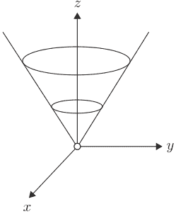
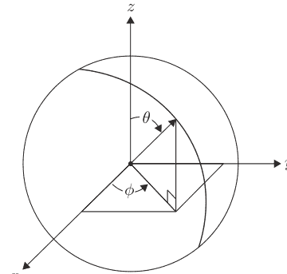
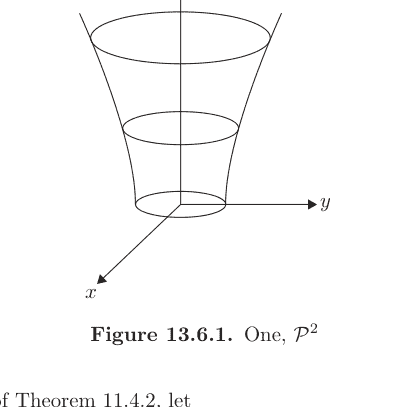
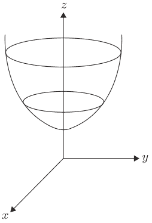
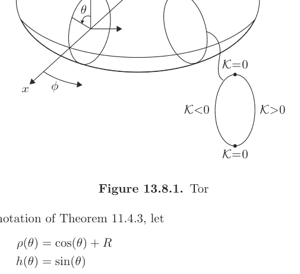

## 第 13 章

## 正则曲面的例子

本章提供了 $\mathbb{R}^3_0$ 和 $\mathbb{R}^3_1$ 中函数的图像以及 $\mathbb{R}^3_1$ 中旋转曲面的具体计算例子。未包含的计算细节基于定理 12.10.1–12.10.4 中出现的公式。在本章中，我们将 $\mathbb{R}^2$ 视为 $\mathbb{R}^3$ 中的 $xy$-平面。参见例 12.8.6 以总结高斯曲率以及相关评论。

每个待考虑的正则曲面都可以参数化为函数的图像或旋转曲面。前一种方法的好处是正则曲面可以字面地作为 $\mathbb{R}^3$ 中的图像描绘。另一方面，当存在对称性时，旋转曲面参数化可以非常揭示性且计算方便。这里所做的参数化选择是 somewhat 任意的。两种计算方法之间存在一个小的区别。将正则曲面参数化为旋转曲面会比将其作为函数的图像参数化时遗漏某些点；更具体地说，采用前一种方法时，经线曲线的部分是“缺失”的。由于我们只对正则曲面的局部性质感兴趣，特别是高斯曲率，因此这不是问题，也不会进一步讨论。

### 13.1 $\mathbb{R}^3_0$ 中的平面

集合

$$\operatorname{Pln}=\{(x,y,z)\in\mathbb{R}^3:z=0\}$$

是 $\mathbb{R}^3$ 中的 $xy$-平面。在定理 11.4.2 的记号中，令

$$f(x,y)=0$$
$$\varphi(x,y)=(x,y,0)$$
$$U=\mathbb{R}^2.$$

根据定理 11.4.2，$\mathrm{PIn}$ 是一个正则曲面且 $(U,\varphi)$ 是一个坐标图。将 $\mathrm{PIn}$ 视为 $\mathbb{R}^3_0$ 中的正则曲面，定理 12.10.1 给出：

$$H_1=(1,0,0) \qquad H_2=(0,1,0)$$
$$\mathcal{N}\circ\varphi=(0,0,1)$$
$$g_{\mathcal{H}}=\begin{bmatrix}1&0\\0&1\end{bmatrix}$$
$$h_{\mathcal{H}}=\begin{bmatrix}0&0\\0&0\end{bmatrix}$$
$$K\circ\varphi=0.$$

### 13.2 $\mathbb{R}^3_0$ 中的圆柱面

集合

$$\mathrm{Cyl}=\{(x,y,z)\in\mathbb{R}^3:x^2+y^2=1,\ z>0\}$$

是立于 $\mathbb{R}^3$ 中 $xy$-平面的无限圆柱面。在定理 11.4.3 的记号中，令

$$\rho(t)=1$$
$$h(t)=t$$
$$\varphi(t,\phi)=(\cos(\phi),\sin(\phi),t)$$
$$U=(0,+\infty)\times(-\pi,\pi).$$

根据定理 11.4.3，$\mathrm{Cyl}$ 是一个正则曲面且 $(U,\varphi)$ 是一个坐标图。将 $\mathrm{Cyl}$ 视为 $\mathbb{R}^3_0$ 中的正则曲面，定理 12.10.3 给出：

$$H_1=(0,0,1) \qquad H_2=(-\sin(\phi),\cos(\phi),0)$$
$$\mathcal{N}\circ\varphi=(-\cos(\phi),-\sin(\phi),0)$$
$$g_{\mathcal{H}}=\begin{bmatrix}1&0\\0&1\end{bmatrix}$$
$$h_{\mathcal{H}}=\begin{bmatrix}0&0\\0&1\end{bmatrix}$$
$$K\circ\varphi=0$$
$$\Gamma^1_{11}=0\quad \Gamma^1_{12}=\Gamma^2_{11}=0\quad \Gamma^1_{22}=0$$
$$\Gamma^2_{11}=0\quad \Gamma^2_{12}=\Gamma^2_{21}=0\quad \Gamma^2_{22}=0$$
$$\kappa_1\circ\varphi=0\qquad \kappa_2\circ\varphi=1.$$

$\mathrm{Cyl}$ 的高斯曲率等于 0 的直观解释在例 12.8.6 中给出。

### 13.3 $\mathbb{R}_0^3$ 中的锥面

集合

$$\operatorname{Con}=\{(x,y,z)\in\mathbb{R}^3:x^2+y^2-z^2=0,\ z>0\}$$

是立于 $\mathbb{R}^3$ 中 $xy$-平面的倒置无限锥面（不含其顶点）。见图 13.3.1。



**图 13.3.1.** Con

在定理 11.4.3 的记号中，令

$$\rho(t)=t$$
$$h(t)=t$$
$$\varphi(t,\phi)=(t\cos(\phi),t\sin(\phi),t)$$
$$U=(0,+\infty)\times(-\pi,\pi).$$

根据定理 11.4.3，Con 是一个正则曲面且 $(U,\varphi)$ 是一个坐标图。如果将顶点 $(0,0,0)$ 包含为 Con 的一部分，则所得集合将不是正则曲面，因为在 $(0,0,0)$ 处存在不止一个切平面。将 Con 视为 $\mathbb{R}_0^3$ 中的正则曲面，定理 12.10.3 给出：

$$H_1=(\cos(\phi),\sin(\phi),1)\qquad H_2=(-t\sin(\phi),t\cos(\phi),0)$$
$$N\circ\varphi=\frac{1}{\sqrt{2}}(-\cos(\phi),-\sin(\phi),1)$$
$$g_H=\begin{bmatrix}2&0\\0&t^2\end{bmatrix}$$
$$b_H=\frac{1}{\sqrt{2}}\begin{bmatrix}0&0\\0&t\end{bmatrix}$$
$$K\circ\varphi=0$$

$$\Gamma^1_{11}=0 \qquad \Gamma^1_{12}=\Gamma^1_{21}=0 \qquad \Gamma^1_{22}=-\frac{t}{2}$$

$$\Gamma^2_{11}=0 \qquad \Gamma^2_{12}=\Gamma^2_{21}=\frac{1}{t} \qquad \Gamma^2_{22}=0$$

$$\kappa_1\circ\varphi=0 \qquad \kappa_2\circ\varphi=\frac{1}{\sqrt{2t}}.$$

Con 的高斯曲率等于 0 的直观解释在例 12.8.6 中给出。

### 13.4 $\mathbb{R}^3_0$ 中的球面

对于实数 $R>0$，集合

$$S_R^2=\{(x,y,z)\in\mathbb{R}^3:x^2+y^2+z^2=R^2\}$$

是中心在原点的半径为 $R$ 的球面。见图 13.4.1。



**图 13.4.1.** $S_R^2$

当 $R=1$ 时，我们用 $S^2$ 代替 $S_1^2$。在定理 11.4.3 的记号中，令

$$\rho(\theta)=R\sin(\theta)$$
$$h(\theta)=R\cos(\theta)$$
$$\varphi(\theta,\phi)=R(\sin(\theta)\cos(\phi),\sin(\theta)\sin(\phi),\cos(\theta))$$
$$U=(0,\pi)\times(-\pi,\pi).$$

根据定理 11.4.3，$S_R^2$ 是一个正则曲面且 $(U,\varphi)$ 是一个坐标图。将 $S_R^2$ 视为 $\mathbb{R}^3_0$ 中的正则曲面，定理 12.10.3 给出：

$$H_1=R(\cos(\theta)\cos(\phi),\cos(\theta)\sin(\phi),-\sin(\theta))$$



# 图 13.6.1. One，$\mathcal{P}^2$

在定理 11.4.2 的记号中，令

```
f(x, y) = \sqrt{x^2 + y^2 - 1}
\varphi(x, y) = (x, y, \sqrt{x^2 + y^2 - 1})
U = \{(x, y) \in \mathbb{R}^2 : x^2 + y^2 > 1\}.
```

根据定理 11.4.2，One 是一个正则曲面且 $(U, \varphi)$ 是一个坐标图。将 One 视为 $\mathbb{R}_0^3$ 中的正则曲面，定理 12.10.1 给出：

```
H_1 = \left(1, 0, \frac{x}{\sqrt{x^2 + y^2 - 1}}\right) \quad H_2 = \left(0, 1, \frac{y}{\sqrt{x^2 + y^2 - 1}}\right)
\mathcal{N} \circ \varphi = \frac{1}{\sqrt{2x^2 + 2y^2 - 1}} \left(-x, -y, \sqrt{x^2 + y^2 - 1}\right)
\mathfrak{g}_\mathcal{H} = \frac{1}{x^2 + y^2 - 1} \begin{bmatrix} 2x^2 + y^2 - 1 & xy \\ xy & x^2 + 2y^2 - 1 \end{bmatrix}
\mathfrak{h}_\mathcal{H} = \frac{1}{(x^2 + y^2 - 1)\sqrt{2x^2 + 2y^2 - 1}} \begin{bmatrix} y^2 - 1 & -xy \\ -xy & x^2 - 1 \end{bmatrix}
\mathcal{K} \circ \varphi = -\frac{1}{(2x^2 + 2y^2 - 1)^2}.
```

我们观察到高斯曲率是非常数且严格为负的。

### 13.7 $\mathbb{R}_0^3$ 中的双叶双曲面

集合

```
Two = \{(x, y, z) \in \mathbb{R}^3 : x^2 + y^2 - z^2 = -1, z > 0\}
```



是双叶双曲面的上叶。见图 13.7.1。在定理 11.4.2 的记号中，令

$$
f(x,y)=\sqrt{x^2+y^2+1}
$$

$$
\varphi(x,y)=(x,y,\sqrt{x^2+y^2+1})
$$

$$
U=\mathbb{R}^2.
$$

根据定理 11.4.2，Two 是一个正则曲面且 $(U,\varphi)$ 是一个坐标图。将 Two 视为 $\mathbb{R}^3_0$ 中的正则曲面，定理 12.10.1 给出：

$$
H_1=\left(1,0,\frac{x}{\sqrt{x^2+y^2+1}}\right)\qquad H_2=\left(0,1,\frac{y}{\sqrt{x^2+y^2+1}}\right)
$$

$$
\mathcal{N}\circ\varphi=\frac{1}{\sqrt{2x^2+2y^2+1}}(-x,-y,\sqrt{x^2+y^2+1})
$$

$$
\mathcal{G}_{\mathcal{H}}=\frac{1}{x^2+y^2+1}\begin{bmatrix}2x^2+y^2+1&xy\\xy&x^2+2y^2+1\end{bmatrix}
$$

$$
\mathcal{h}_{\mathcal{H}}=\frac{1}{(x^2+y^2+1)\sqrt{2x^2+2y^2+1}}\begin{bmatrix}y^2+1&-xy\\-xy&x^2+1\end{bmatrix}
$$

$$
\mathcal{K}\circ\varphi=\frac{1}{(2x^2+2y^2+1)^2}.
$$

我们观察到高斯曲率是非常数且严格为正的。


## 13.8 环面在 ℝ₀³ 中

对于实数 R > 1，集合

Tor = { (x, y, z) ∈ ℝ³ : (√(x² + y²) − R)² + z² = 1, x² + y² ≥ 0 }

是通过绕 z 轴旋转 xz 平面中以 (R, 0, 0) 为中心、半径为 1 的圆得到的环面。见图 13.8.1。



图 13.8.1. Tor

在定理 11.4.3 的记号下，令

ρ(θ) = cos(θ) + R
h(θ) = sin(θ)
φ(θ, φ) = ([cos(θ) + R] cos(φ), [cos(θ) + R] sin(φ), sin(θ))
U = (−π/2, π/2) × (−π, π).

h 的定义域被选为 (−π/2, π/2) 而不是例如 (0, 2π)，以确保第 11.4 节中性质 [R2] 得到满足。这参数化了环面的“外”一半；环面的“内”一半由单独的参数化给出。根据定理 11.4.3 可知 Tor 是一个正则曲面且 (U, φ) 是一个图。将 Tor 视为 ℝ₀³ 中的正则曲面，定理 12.10.3 给出：

H₁ = (−sin(θ) cos(φ), −sin(θ) sin(φ), cos(θ))
H₂ = (−[cos(θ) + R] sin(φ), [cos(θ) + R] cos(φ), 0)

$\mathcal{N}\circ\varphi=-(\cos(\theta)\cos(\phi),\cos(\theta)\sin(\phi),\sin(\theta))$

$g_H=\begin{bmatrix}1&0\\0&[\cos(\theta)+R]^2\end{bmatrix}$

$h_H=\begin{bmatrix}1&0\\0&[\cos(\theta)+R]\cos(\theta)\end{bmatrix}$

$K\circ\varphi=\dfrac{\cos(\theta)}{\cos(\theta)+R}$

$\Gamma^1_{11}=0\qquad \Gamma^1_{12}=\Gamma^1_{21}=0\qquad \Gamma^1_{22}=[\cos(\theta)+R]\sin(\theta)$

$\Gamma^2_{11}=0\qquad \Gamma^2_{12}=\Gamma^2_{21}=-\dfrac{\sin(\theta)}{\cos(\theta)+R}\qquad \Gamma^2_{22}=0$

$\kappa_1\circ\varphi=1\qquad \kappa_2\circ\varphi=\dfrac{\cos(\theta)}{\cos(\theta)+R}$.

如图 13.8.1 所示，高斯曲率在 Tor 的不同点上取正值、负值和零值。

## 13.9 伪球面在 $\mathbb{R}^3_1$

集合

$\mathcal{P}^2=\{(x,y,z)\in\mathbb{R}^3:x^2+y^2-z^2=1,\ z>0\}$

是第 13.6 节中描述的单叶双曲面 的同一上半部分，和之前一样，它是一个正则曲面。由于

$\left(\dfrac{\partial f}{\partial x}(x,y)\right)^2+\left(\dfrac{\partial f}{\partial y}(x,y)\right)^2-1=\dfrac{1}{x^2+y^2+1},$

定理 12.2.8 的条件得到满足。因此，$\mathcal{P}^2$ 是 $\mathbb{R}^3_1$ 中的正则曲面。或者，这直接来自定理 12.2.12(a)。定理 12.10.2 给出：

$H_1=\left(1,0,\dfrac{x}{\sqrt{x^2+y^2-1}}\right)\qquad H_2=\left(0,1,\dfrac{y}{\sqrt{x^2+y^2-1}}\right)$

$\mathcal{N}\circ\varphi=(-x,-y,-\sqrt{x^2+y^2-1})=-\varphi$

$g_H=h_H=\dfrac{1}{x^2+y^2-1}\begin{bmatrix}y^2-1&-xy\\-xy&x^2-1\end{bmatrix}$

$K\circ\varphi=1$

$\epsilon_{\mathcal{P}^2}=1.$

我们注意到 $\epsilon_{\mathcal{P}^2}=1$ 与定理 12.2.12(d) 一致。在 $\mathbb{R}^3_1$ 的背景下，我们称 $\mathcal{P}^2$ 为伪球面。

## 13.10 双曲空间在 ℝ³₁ 中

集合

```
ℋ² = {(x, y, z) ∈ ℝ³ : x² + y² − z² = −1, z > 0}
```

是第 13.7 节中描述的双叶双曲面的同一上片，和之前一样，它是一个正则曲面。由于

```
⎛∂f/∂x(x,y)⎞² + ⎛∂f/∂y(x,y)⎞² − 1 = − 1/(x² + y² − 1)
```

并且根据定义，x² + y² > 1，定理 12.2.8 的条件得到满足。因此，ℋ² 是 ℝ³₁ 中的正则曲面。或者，这直接来自定理 12.2.12(a)。定理 12.10.2 给出：

```
H₁ = (1, 0, x/√(x² + y² + 1))    H₂ = (0, 1, y/√(x² + y² + 1))
```

```
𝒩 ∘ φ = (x, y, √(x² + y² + 1)) = φ
```

```
𝔤_ℋ = 1/(x² + y² + 1) [ y² + 1  −xy ; −xy  x² + 1 ]
```

```
𝔥_ℋ = −𝔤_ℋ
```

```
𝒦 ∘ φ = −1
```

```
ε_ℋ² = −1.
```

我们注意到 ε_ℋ² = −1 与定理 12.2.12(d) 一致。在 ℝ³₁ 的背景下，我们称 ℋ² 为双曲空间。

我们也可以将 ℋ² 参数化为旋转曲面。在定理 11.4.3 的记号下，令

```
ρ(t) = sinh(t)
```

```
h(t) = cosh(t)
```

```
φ(t, φ) = (sinh(t) cos(φ), sinh(t) sin(φ), cosh(t))
```

```
U = (0, +∞) × (−π, π).
```

由众所周知的恒等式 sinh²(t) − cosh²(t) = −1，我们得到 ρ̇(t)² − ḣ(t)² = 1。显然，定理 12.2.9 的条件得到满足，因此我们再次看到 ℋ² 是 ℝ³₁ 中的正则曲面。定理 12.10.4 给出：

```
H₁ = (cosh(t) cos(φ), cosh(t) sin(φ), sinh(t))
```

```
H₂ = (−sinh(t) sin(φ), sinh(t) cos(φ), 0)
```

```
𝒩 ∘ φ = (sinh(t) cos(φ), sinh(t) sin(φ), cosh(t)) = φ
```
