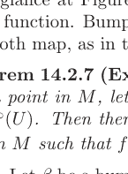
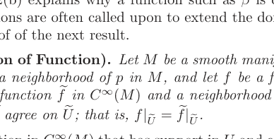

## 第 14 章

## 光滑流形

### 14.1 光滑流形

本章及后续章节中提出的许多定义都是我们在研究曲线和曲面时所遇到的定义的改编。

设 $M$ 为拓扑空间。$M$ 上的一个 **图** 是一个对 $(U,\varphi)$，其中 $U$ 是 $M$ 中的开集且 $\varphi: U \longrightarrow \mathbb{R}^m$ 是一个映射，使得：

- [C1] $\varphi(U)$ 是 $\mathbb{R}^m$ 中的开集。
- [C2] $\varphi: U \longrightarrow \varphi(U)$ 是一个同胚。

我们称 $U$ 为该图的 **坐标域**，称 $\varphi$ 为其 **坐标映射**，称 $m$ 为该图的 **维数**。对于 $U$ 中的每一点 $p$，我们说 $(U,\varphi)$ 是 $p$ 处的 **图**。（注意在正则曲面的定义中，坐标映射是从 $\mathbb{R}^2$ 中的开集到正则曲面中的开集，而现在方向相反。）当 $U=M$ 时，我们说 $(M,\varphi)$ 是 $M$ 上的一个 **覆盖图**，并且 $M$ 被 $(M,\varphi)$ 覆盖。在当前背景下，$\varphi$ 的分量函数记为 $\varphi=(x^1,\ldots,x^m)$ 而不是 $\varphi=(\varphi^1,\ldots,\varphi^m)$，并且被称为 $U$ 上的 **局部坐标**。这种记号的选择专门用于鼓励将点 $p$ 在 $M$ 中与它的局部坐标对应物 $\varphi(p)=(x^1(p),\ldots,x^m(p))$ 在 $\mathbb{R}^m$ 中进行非正式的识别。我们经常用

$(U,\varphi) \quad\text{by}\quad (U,(x^i)) \quad\text{or}\quad (U,\varphi=(x^i)),$

其中 $(x^i)=(x^1,\ldots,x^m)$。$M$ 上的图 $(U,\varphi)$ 和 $(\widetilde{U},\widetilde{\varphi})$ 被称为 **重叠** 如果 $U\cap\widetilde{U}$ 非空。在这种情况下，映射

$\widetilde{\varphi}\circ\varphi^{-1}\big|_{\varphi(U\cap\widetilde{U})}:\varphi(U\cap\widetilde{U})\longrightarrow\widetilde{\varphi}(U\cap\widetilde{U})$


称为转移映射。为简洁起见，我们通常采用如下记法：

\[
\widetilde{\varphi}\circ\varphi^{-1}\big|_{\varphi(U\cap\widetilde U)} \quad\text{记作}\quad \widetilde{\varphi}\circ\varphi^{-1},
\]

并且类似地，当上下文含义清楚时，我们常常（但并非总是）在其他记号中省略“限制”下标。$M$ 的一个图册是 $M$ 上坐标卡的一个集合 $\mathcal A=\{(U_\alpha,\varphi_\alpha):\alpha\in A\}$，使得 $U_\alpha$ 构成 $M$ 的一个开覆盖；即 $M=\bigcup_{\alpha\in A}U_\alpha$。目前并不要求各坐标卡具有相同的维数。

## 拓扑 $m$-流形

是一个二元组 $(M,\mathcal A)$，其中 $M$ 是一个拓扑空间，$\mathcal A$ 是 $M$ 的一个图册，并且满足：

- [T1] $\mathcal A$ 中每个坐标卡都具有维数 $m$。
- [T2] $M$ 的拓扑具有可数基。
- [T3] 对 $M$ 中每一对不同的点 $p_1,p_2$，存在 $M$ 中不相交的开集 $U_1$ 和 $U_2$，使得 $p_1\in U_1$ 且 $p_2\in U_2$。

注意，[T1] 仅涉及图册 $\mathcal A$，而 [T2] 和 [T3] 与 $M$ 的拓扑结构有关。性质 [T2] 和 [T3] 是某些构造所需的技术性条件，此处不再进一步阐述。

**例 14.1.1（$\mathbb R^m$）。** $\mathbb R^m$ 赋予欧几里得拓扑，并配以由单个坐标卡 $(\mathbb R^m,\operatorname{id}_{\mathbb R^m}=(r^1,\ldots,r^m))$ 组成的图册，是一个拓扑 $m$-流形。

**定理 14.1.2.** *设 $M$ 是一个拓扑空间。若 $\mathcal A$ 和 $\mathcal B$ 是 $M$ 的图册，且 $(M,\mathcal A)$ 是拓扑 $m$-流形，$(M,\mathcal B)$ 是拓扑 $n$-流形，则 $m=n$。*

**证明。** 设 $(U,\varphi)$ 和 $(V,\psi)$ 分别是 $\mathcal A$ 和 $\mathcal B$ 中的坐标卡，且 $U\cap V$ 非空。因为 $U\cap V$ 在 $M$ 中是开集，由 [C2] 和定理 9.1.14 可知 $\varphi(U\cap V)$ 在 $\varphi(U)$ 中是开集；再由 [C1] 和定理 9.1.5 可知 $\varphi(U\cap V)$ 在 $\mathbb R^m$ 中是开集。类似的推理表明 $\varphi|_{U\cap V}:U\cap V\to\varphi(U\cap V)$ 是一个同胚。同样，$\psi(U\cap V)$ 在 $\mathbb R^n$ 中是开集，且 $\psi|_{U\cap V}:U\cap V\to\psi(U\cap V)$ 是一个同胚。于是 $\psi^{-1}\circ\varphi|_{\varphi(U\cap V)}:\varphi(U\cap V)\to\psi(U\cap V)$ 是一个同胚。由定理 9.4.1，$m=n$。

设 $(M,\mathcal A)$ 是一个拓扑 $m$-流形。由定理 14.1.2 可知，$m$ 是 $(M,\mathcal A)$ 的一个不变量，我们称之为 **$M$ 的维数**，并记作 $\dim(M)$。

可以证明，拓扑空间的连通分支是该拓扑空间中的闭集。对于拓扑流形，其连通分支还具有额外的性质。

**定理 14.1.3.** *若 $(M,\mathcal A)$ 是一个拓扑流形，则 $M$ 有可数个连通分支，且每个连通分支在 $M$ 中既是开集又是闭集。*

设 $(M, \mathfrak{A})$ 是一个拓扑 $m$-流形，并设 $(U, \varphi)$ 和 $(\widetilde{U}, \widetilde{\varphi})$ 是 $M$ 上相交的坐标卡。如果转移映射 $\widetilde{\varphi} \circ \varphi^{-1}$ 和 $\varphi \circ \widetilde{\varphi}^{-1}$ 是（欧几里得）光滑的，则称 $(U, \varphi)$ 与 $(\widetilde{U}, \widetilde{\varphi})$ **光滑相容**。由于 $(\varphi \circ \widetilde{\varphi}^{-1})^{-1} = \widetilde{\varphi} \circ \varphi^{-1}$，这等价于 $\widetilde{\varphi} \circ \varphi^{-1}$ 或 $\varphi \circ \widetilde{\varphi}^{-1}$ 是（欧几里得）微分同胚。如果 $\mathfrak{A}$ 中任意两个相交的坐标卡都光滑相容，则称图册 $\mathfrak{A}$ 是**光滑的**。$M$ 的光滑图册也称为 $M$ 上的**光滑结构**。回想我们在正则曲面坐标卡的研究中，假设坐标映射是光滑的，其中光滑性是利用 $\mathbb{R}^2$ 中坐标域和外围空间 $\mathbb{R}^3$ 的相关性质来定义的。由于 $M$ 不具备这样的内在性质，我们将定理 11.2.9（一个关于正则曲面转移映射光滑性的结果）转变成拓扑流形光滑性的定义。随着内容的推进，我们将看到这种方法的更多例子：有关“曲面”的定理变成了“流形”的定义。

如果 $\mathfrak{A}$ 是光滑图册，则称拓扑 $m$-流形 $(M, \mathfrak{A})$ 为**光滑 $m$-流形**。为方便起见，我们经常简称为 $M$ 是光滑 $m$-流形，而 $\mathfrak{A}$ 由上下文理解。此外，当不需要指明 $M$ 的维数时，我们将 $(M, \mathfrak{A})$ 或简称为 $M$ 称为**光滑流形**。

$M$ 的光滑图册 $\mathfrak{A}$ 称为**极大**的，如果它不被 $M$ 的任何更大的光滑图册真包含。这意味着，$M$ 上任何与 $\mathfrak{A}$ 中所有坐标卡都光滑相容的坐标卡已经在 $\mathfrak{A}$ 中。可以证明，$M$ 的每个光滑图册都包含在唯一的极大光滑图册中。一个给定的拓扑空间可以有不同的光滑图册，它们生成同一个极大光滑图册。另一方面，一个拓扑空间也可能有不同的光滑图册，它们产生不同的极大光滑图册。因此，我们采用以下约定。

## 全文约定：光滑流形上的任意坐标卡均来自其底层的光滑图册或其相应的极大图册。

## 例 14.1.4（$\mathbb{R}^m$）。

继续例 14.1.1，显然由单个坐标卡 $(\mathbb{R}^m, \mathrm{id}_{\mathbb{R}^m} = (r^1, \dots, r^m))$ 组成的图册是光滑的。因此，$\mathbb{R}^m$ 不仅是拓扑 $m$-流形，还是光滑 $m$-流形。在此上下文中，坐标卡 $(\mathbb{R}^m, \mathrm{id}_{\mathbb{R}^m} = (r^1, \dots, r^m))$ 称为 $\mathbb{R}^m$ 上的**标准坐标**。为方便起见，我们常简称 $(r^1, \dots, r^m)$ 是 $\mathbb{R}^m$ 上的标准坐标。

## 例 14.1.5（正则曲面）。

借助定理 11.2.9 可以证明，正则曲面是光滑 2-流形。

我们在定理 1.1.10 的讨论中已经指出，所有 $m$ 维向量空间都与 $\mathbb{R}^m$（视为向量空间）同构。鉴于例 14.1.4，任何 $m$ 维向量空间都具有由 $\mathbb{R}^m$（现在视为光滑 $m$-流形）诱导的光滑结构，也就不足为奇了。

## 定理 14.1.6（标准光滑结构）。

*若 $V$ 是一个 $m$ 维向量空间，则 $V$ 上存在唯一的拓扑和极大光滑图册，*

称为 $V$ 上的*标准光滑结构*，它使 $V$ 成为光滑 $m$-流形，并且对每个线性同构 $A : V \longrightarrow \mathbb{R}^m$，二元组 $(V, A)$ 是 $V$ 上的一个（覆盖）坐标卡。

回顾定理 9.1.6 和定理 9.1.12 中关于积拓扑的讨论。

## 定理 14.1.7（积流形）。

设 $(M_i, \mathfrak{A}_i)$ 是光滑 $m_i$-流形，对 $i = 1, \dots, k$，设 $(U_i, \varphi_i)$ 是 $\mathfrak{A}_i$ 中的坐标卡，并假设 $M_1 \times \cdots \times M_k$ 具有积拓扑。则：

- (a) $(U_1 \times \cdots \times U_k, \varphi_1 \times \cdots \times \varphi_k)$ 是 $M_1 \times \cdots \times M_k$ 上的一个坐标卡。
- (b) 拓扑空间 $M_1 \times \cdots \times M_k$ 配以由第 (a) 部分定义的坐标卡集合所构成的光滑图册，是一个光滑 $(m_1 + \cdots + m_k)$-流形，称为 $M_1, \dots, M_k$ 的*积流形*。

例如，可以证明 $m$ 个 $\mathbb{R}$ 的积流形正是带有标准光滑结构的 $\mathbb{R}^m$。

## 14.2 函数与映射

设 $M$ 是一个光滑流形，$f : M \longrightarrow \mathbb{R}$ 是一个函数。由于 $M$ 和 $\mathbb{R}$ 都是拓扑空间，我们知道 $f$ 在 $M$ 上**连续**意味着什么。受定理 11.5.1 的启发，如果对 $M$ 中每一点 $p$，存在 $p$ 处的坐标卡 $(U, \varphi)$，使得函数 $f \circ \varphi^{-1} : \varphi(U) \longrightarrow \mathbb{R}$ 是（欧几里得）光滑的，则称 $f$ 在 $M$ 上**光滑**。$M$ 上光滑函数的集合记为 $C^\infty(M)$。我们通过如下方式定义运算，使 $C^\infty(M)$ 同时成为向量空间和环：对所有 $f,g\in C^\infty(M)$ 以及所有实数 $c$，令

$(f + g)(p) = f(p) + g(p)$，
$(fg)(p) = f(p)g(p)$，
以及
$(cf)(p) = c f(p)$

对所有 $p\in M$ 成立。

下一个结果与定理 11.5.1 类似。

## 定理 14.2.1（函数的光滑性判别准则）。

设 $M$ 是一个光滑流形，$f : M \longrightarrow \mathbb{R}$ 是一个函数。则 $f$ 光滑当且仅当对 $M$ 上的每个坐标卡 $(U, \varphi)$，函数 $f \circ \varphi^{-1} : \varphi(U) \longrightarrow \mathbb{R}$ 都是（欧几里得）光滑的。

*证明。* $(\Rightarrow)$：设 $p$ 是 $M$ 中的一点。根据假设，在 $p$ 处存在一个坐标卡 $(\widetilde{U}, \widetilde{\varphi})$，使得 $f \circ \widetilde{\varphi}^{-1} : \varphi(\widetilde{U}) \longrightarrow \mathbb{R}$ 是（欧几里得）光滑的。由于 $\widetilde{\varphi} \circ \varphi^{-1} : \varphi(U \cap \widetilde{U}) \longrightarrow \mathbb{R}^m$ 是转移映射，所以它也是（欧几里得）光滑的。由定理 10.1.12 可得

$f \circ \varphi^{-1} = (f \circ \widetilde{\varphi}^{-1}) \circ (\widetilde{\varphi} \circ \varphi^{-1}) : \varphi(U \cap \widetilde{U}) \longrightarrow \mathbb{R}$


如图 14.2.2(a) 所示，

```
\begin{cases} g(t)=0 & \text{if } t\le 0 \\ 0<g(t)<1 & \text{if } t\in(0,1) \\ g(t)=1 & \text{if } t\ge 1 \end{cases}
```

并且

```
\begin{cases} \beta(t)=0 & \text{if } t\le -b \\ 0<\beta(t)<1 & \text{if } t\in(-b,-a) \\ \beta(t)=1 & \text{if } t\in[-a,a] \\ 0<\beta(t)<1 & \text{if } t\in(a,b) \\ \beta(t)=0 & \text{if } t\ge b, \end{cases}
```

从而 supp(β) = [−b, b]。取 U = ℝ 且 Ũ = (−a, a)，例如，我们发现 β 是在 0 处的 bump 函数。





## 图 14.2.2. 定理 14.2.6 的示意图

对图 14.2.2(b) 的一瞥解释了为什么像 β 这样的函数被称为 bump 函数。bump 函数经常被用来扩展光滑映射的定义域，如下个结果的证明中所做的那样。

## 定理 14.2.7（函数延拓）。设 M 是一个光滑流形，p 是 M 中的一点，U 是 M 中 p 的一个邻域，f 是 C^∞(U) 中的一个函数。则存在一个函数 \tilde{f} ∈ C^∞(M) 和一个邻域 \tilde{U} ⊆ U，它是 M 中 p 的邻域，使得 f 与 \tilde{f} 在 \tilde{U} 上一致；即 f|_{\tilde{U}} = \tilde{f}|_{\tilde{U}}。

证明。设 β 是 C^∞(M) 中在 U 内有支集且在 M 中 p 的邻域 \tilde{U} ⊆ U 上恒等于 1 的 bump 函数。我们定义一个函数 \tilde{f} : M ⟶ ℝ 为

```
\tilde{f}(q)=\begin{cases} \beta(q)f(q) & \text{if } q\in U \\ 0 & \text{if } q\in M\setminus U. \end{cases}
```

由于 β 和 f 在 U 上光滑，故 \tilde{f} 也是光滑的。设 q 是 M\setminus U 中的一点。由于 β 的支集在 U 中，q 在 M\setminus supp(β) 中，而由于 supp(β) 在 M 中是闭集，M\setminus supp(β) 在 M 中是开集。因此，\tilde{f}=0 在 q 的邻域 M\setminus supp(β) 上成立。由于 q 是任意的，\tilde{f} 在 M\setminus U 上光滑。这表明 \tilde{f} 在 M 上光滑。最后，由于 β=1 在 \tilde{U} 上，f 与 \tilde{f} 在 \tilde{U} 上一致。

## 定理 14.2.8（单位分解）。若 M 是一个光滑流形且 𝒰 = {Uα : α ∈ A} 是 M 的一个开覆盖，则存在一个族 {π α ∈ C∞(M) : α ∈ A} 的光滑函数在 M 上，称为关于 𝒰 的 M 上的单位分解，使得：

- (a) 0 ≤ π α(p) ≤ 1 对所有 α ∈ A 和所有 p ∈ M 成立。
- (b) supp(π α) ⊂ Uα 对所有 α ∈ A 成立。
- (c) M 中每一点 p 都有一个邻域 U 在 M 中，它仅与有限多个 α 的 supp(π α) 相交。
- (d) ∑ α∈A π α(p) = 1 对所有 p ∈ M 成立。

尽管远非直观，单位分解对于微分几何中的某些构造是不可或缺的，我们将看到若干这样的应用。基本思想是在给定开覆盖的每个集合上定义所关心的数学对象（例如函数、向量场或积分），然后使用 π α 作为权重形成加权平均，将各个贡献组合成在整个 M 上定义的数学对象。由于部分 (c)，无限级数收敛的问题不存在。

## 14.3 切空间

在第三部分引言中曾提到，发展我们现在所称的光滑流形的理论的一个关键步骤是设法在没有环境空间的情况下定义“切向量”。由微分几何学家创造并在此提供的定义以巧妙的方式解决了这一挑战。用代数术语表述，它在数学上优雅且计算方便。然而，与针对曲面的方法相比，它缺乏直观吸引力，在曲面中，切向量被定义为光滑曲线的导数，可以被视为“箭头”。稍后我们将看到，代数方法导致了与曲面所发展的理论非常相似的理论，从而使代数理论具有一定的几何味道。

在继续之前，我们需要建立一些记号。在第 10 章中，ℝ^m 上的坐标用 (x¹, …, x^m) 或 (y¹, …, y^m) 表示。在第 11 章和第 12 章中，有必要清楚地区分 ℝ² 和 ℝ³ 上的坐标。对于 ℝ²，使用了 (r¹, r²) 或 (r, s) 的记号，对于 ℝ³，则为 (x¹, x², x³) 或 (x, y, z)。在第 13 章中，ℝ² 和 ℝ³ 上的坐标分别用 (x, y) 和 (x, y, z) 表示。前一种选择之所以采用，是因为在函数图像的设定中，ℝ² 被等同于 ℝ³ 中的 xy 平面。这就引出了本章及以后。

从此以后，坐标映射将用 (x¹, …, x^m) 或 (y¹, …, y^m) 表示，标准坐标在 ℝ^m 上除外，后者将用 (r¹, …, r^m) 或 (s¹, …, s^m) 表示。

证明。 (a)：这源于欧几里得偏导数的性质。
(b)：显而易见。

## 定理 14.3.2。设 M 是一个光滑 m-流形，p 是 M 中的一点，v 是 T_p(M) 中的一个向量。则：

- (a) 若 f 和 g 是 C^∞(M) 中的函数且在 M 中 p 的一个邻域上相等，则 v(f) = v(g)。
- (b) 若 h 是 C^∞(M) 中的函数且在 M 中 p 的一个邻域上为常数，则 v(h) = 0。

证明。 (a)：由于 v 是线性的，只需证明若 f 在 p 的邻域 U 上为零，则 v(f) = 0。第一个观察是
v(0_M) = v(0_M + 0_M) = v(0_M) + v(0_M),
故 v(0_M) = 0。设 β 是在 p 处的 bump 函数，其支集在 U 中。由于 f 在 U 上为零且 supp(β) ⊂ U，我们有 β f = 0_M。由 β(p) = 1，f(p) = 0 以及 (14.3.1) 可得
0 = v(β f) = β(p) v(f) + f(p) v(β) = v(f)。

(b)：由部分 (a)，只需考虑 h 在 M 上为常数的情形。我们由 (14.3.1) 得到
v(1_M) = v(1_M 1_M) = 1_M(p) v(1_M) + 1_M(p) v(1_M) = 2 v(1_M),
故 v(1_M) = 0。由于 h = c 1_M 对某个实数 c，
v(h) = v(c 1_M) = c v(1_M) = 0。

下一个结果让人想起定理 11.4.1。

## 定理 14.3.3（开集）。设 (M, 𝔄) 是一个光滑 m-流形，U 是 M 中的一个开集，且
𝔄_U = {(V ∩ U, ψ|_{V∩U}) : (V, ψ) ∈ 𝔄}。

则：

- (a) 𝔄_U 是 U 上的一个光滑图册，故 (U, 𝔄_U) 是具有由 M 诱导的子空间拓扑的 U 上的光滑 m-流形。
- (b) 对所有点 p ∈ U，T_p(U) 可以与 T_p(M) 识别，写成
T_p(U) = T_p(M)。

证明。 (a)：显而易见。
(b)：利用定理 14.3.4(c) 和定理 14.7.3，与定理 11.4.1(b) 的证明中采用的论证类似可得结果。或者，考虑映射 ι : T_p(U) ⟶ T_p(M) 定义为 ι(v)(f) = v(f|_U) 对所有向量 v ∈ T_p(U) 和所有函数 f ∈ C^∞(M)。易证 ι(v) 是 T_p(M) 中的一个向量，故 ι 是良定义的。此外，还可以证明 ι 是线性同构。

另一方面，由定理 10.1.10，

dh/dt(t) = Σ_i r^i ∂g/∂r^i (tr^1, ..., tr^m),

所以

∫_0^1 dh/dt(t) dt = Σ_i ( r^i ∫_0^1 ∂g/∂r^i (tr^1, ..., tr^m) ) dt
= Σ_i r^i g_i(r^1, ..., r^m). (14.3.6)

结合 (14.3.5) 和 (14.3.6) 得到

g(r^1, ..., r^m) = g(0, ..., 0) + Σ_i r^i g_i(r^1, ..., r^m). (14.3.7)

由假设，

(x^1(p), ..., x^m(p)) = φ(p) = (0, ..., 0). (14.3.8)

设 q = φ^{-1}(r^1, ..., r^m)，从而

(x^1(q), ..., x^m(q)) = φ(q) = (r^1, ..., r^m). (14.3.9)

由 (14.3.7)–(14.3.9)，我们得到

g ∘ φ(q) = g ∘ φ(p) + Σ_i x^i(q) (g_i ∘ φ)(q). (14.3.10)

设 f 是 C^∞(M) 中的一个函数。令 g = f ∘ φ^{-1} 且 f_i = g_i ∘ φ 在 (14.3.10) 中得到

f(q) = f(p) + Σ_i x^i(q) f_i(q).

由于 (r^1, ..., r^m)，从而 q，是任意的，

f = f(p) + Σ_i x^i f_i.

对 T_p(M) 中的向量 v，我们有

v(f) = v( f(p) + Σ_i x^i f_i )
= Σ_i v(x^i f_i) [Th 14.3.2(b)]
= Σ_i x^i(p) v(f_i) + Σ_i f_i(p) v(x^i) [(14.3.1)]
= Σ_i f_i(p) v(x^i). [(14.3.8)] (14.3.11)

作为特例，

∂/∂x^i |_p (f) = Σ_j ∂/∂x^i |_p (x^j) f_j(p) [Th 14.3.1(a)] = Σ_j ∂x^j/∂x^i (p) f_j(p) [(14.3.3)] (14.3.12) = f_i(p) [Th 14.3.1(b)]

对 i = 1, …, m。由 (14.3.11) 和 (14.3.12) 可得

v(f) = ( Σ_i v(x^i) ∂/∂x^i |_p ) (f).

由于 f 是任意的，

v = Σ_i v(x^i) ∂/∂x^i |_p .

(a)：由部分 (b) 可知切向量 (∂/∂x^i)|_p 张成 T_p(M)。设

Σ_i a^i ∂/∂x^i |_p = 0

对某些实数 a^i 成立。对上式两边作用于 x^j 并利用定理 14.3.1(b) 得到

0 = Σ_i a^i ∂x^j/∂x^i (p) = a^j

对 j = 1, …, m。因此，(∂/∂x^i)|_p 线性无关。

(c)：这由部分 (a) 可得。

## 定理 14.3.5（坐标基变换）。设 M 是一个光滑 m-流形，p 是 M 中的一点，(U, φ = (x^i)) 和 (Ũ, φ̃ = (x̃^i)) 是在 p 处的图，且 X_p = ((∂/∂x^1)|_p, …, (∂/∂x^m)|_p) 和 X̃_p = ((∂/∂x̃^1)|_p, …, (∂/∂x̃^m)|_p) 是在 p 处的相应坐标基。则：

(a)

∂/∂x^j |_p = Σ_i ∂x̃^i/∂x^j (p) ∂/∂x̃^i |_p = Σ_i ∂(x̃^i ∘ φ^{-1})/∂r^j (φ(p)) ∂/∂x̃^i |_p .


(b)
\[
\left[\mathrm{id}_{T_p(M)}\right]_{\mathcal{X}_p}^{\tilde{\mathcal{X}}_p}
=
\begin{bmatrix}
\frac{\partial \tilde{x}^1}{\partial x^1}(p) & \cdots & \frac{\partial \tilde{x}^1}{\partial x^m}(p)\\
\vdots & \ddots & \vdots\\
\frac{\partial \tilde{x}^m}{\partial x^1}(p) & \cdots & \frac{\partial \tilde{x}^m}{\partial x^m}(p)
\end{bmatrix}
=
\begin{bmatrix}
\frac{\partial (\tilde{x}^1 \circ \varphi^{-1})}{\partial r^1}(\varphi(p)) & \cdots & \frac{\partial (\tilde{x}^1 \circ \varphi^{-1})}{\partial r^m}(\varphi(p))\\
\vdots & \ddots & \vdots\\
\frac{\partial (\tilde{x}^m \circ \varphi^{-1})}{\partial r^1}(\varphi(p)) & \cdots & \frac{\partial (\tilde{x}^m \circ \varphi^{-1})}{\partial r^m}(\varphi(p))
\end{bmatrix}.
\]

**Remark.** 第 (a) 部分和第 (b) 部分中的第二个等式，两者均由 (14.3.2) 推出，作为提醒，偏导数最终是使用欧几里得方法计算的。

**Proof.** (a): 设 \([a_j^i] = [\mathrm{id}_{T_p(M)}]_{\mathcal{X}_p}^{\tilde{\mathcal{X}}_p}\)，则由 (2.2.6) 和 (2.2.7) 可得，
\[
\left.\frac{\partial}{\partial x^j}\right|_p = \sum_k a_j^k \left.\frac{\partial}{\partial \tilde{x}^k}\right|_p.
\]
将前述恒等式的两边同时作用于 \(\tilde{x}^i\) 并使用定理 14.3.1(b) 和 (14.3.3) 得
\[
\frac{\partial \tilde{x}^i}{\partial x^j}(p) = \sum_k a_j^k \frac{\partial \tilde{x}^i}{\partial \tilde{x}^k}(p) = a_j^i.
\]

(b): 这由第 (a) 部分得出。

设 \(M\) 为光滑 \(m\)-流形，\(p\) 为 \(M\) 中的一点，\((U, \varphi = (x^i))\) 为 \(p\) 处的坐标图。**在 \(p\) 处关于 \(x^i\) 和 \(x^j\) 的二阶偏导数** 是映射
\[
\left.\frac{\partial^2}{\partial x^i \partial x^j}\right|_p : C^\infty(M) \longrightarrow \mathbb{R}
\]
定义为
\[
\frac{\partial^2 f}{\partial x^i \partial x^j}(p) = \frac{\partial}{\partial x^i}\left(\frac{\partial f}{\partial x^j}\right)(p)
\]
对所有 \(C^\infty(M)\) 中的函数 \(f\) 成立，其中我们记
\[
\left.\frac{\partial^2}{\partial x^i \partial x^j}\right|_p (f)\quad\text{为}\quad \frac{\partial^2 f}{\partial x^i \partial x^j}(p).
\]

### Theorem 14.3.6 (Equality of Mixed Partial Derivatives).

在上述设定下，
\[
\frac{\partial^2 f}{\partial x^i \partial x^j}(p) = \frac{\partial^2 f}{\partial x^j \partial x^i}(p)
\]
对 \(i, j = 1, \ldots, m\) 成立。

**Proof.** 这由定理 10.1.6 得出。

## 14.4 Differential of Maps

为了定义两个流形之间的微分映射，我们需要一种方法将一个切空间中的向量以线性方式发送到另一个切空间中的向量。采用向量的代数方法，这 turns out  surprisingly straightforward. 设 \(M\) 和 \(N\) 为光滑流形，\(F : M \longrightarrow N\) 为光滑映射，\(p\) 为 \(M\) 中的一点。对 \(T_p(M)\) 中的每个向量 \(v\)，定义映射
\[
d_p(F)(v) : C^\infty(N) \longrightarrow \mathbb{R}
\]
为
\[
d_p(F)(v)(g) = v(g \circ F) \quad (14.4.1)
\]
对所有 \(C^\infty(N)\) 中的函数 \(g\) 成立。由于 \(g \circ F\) 属于 \(C^\infty(M)\)，定义是有意义的。

### Theorem 14.4.1.

在上述设定下，\(d_p(F)(v)\) 是 \(T_{F(p)}(N)\) 中的一个向量。

**Proof.** 显然，\(d_p(F)(v)\) 是线性的。为证明 \(d_p(F)(v)\) 满足 (14.3.1)，设 \(g, h\) 为 \(C^\infty(N)\) 中的函数。则
\[
\begin{aligned}
d_p(F)(v)(gh)
&= v(gh \circ F) && \text{[(14.4.1)]} \\
&= v((g \circ F)(h \circ F)) \\
&= (g \circ F)(p) \cdot v(h \circ F) + (h \circ F)(p) \cdot v(g \circ F) && \text{[(14.3.1)]} \\
&= g(F(p)) \cdot d_p(F)(v)(h) + h(F(p)) \cdot d_p(F)(v)(g) && \text{[(14.4.1)]}
\end{aligned}
\]
因此，\(d_p(F)(v)\) 是 \(F(p)\) 处的切向量。

继续使用上述记号，\(F\) 在 \(p\) 处的微分是映射
\[
d_p(F) : T_p(M) \longrightarrow T_{F(p)}(N)
\]
定义为赋值
\[
v \longmapsto d_p(F)(v)
\]
对所有 \(T_p(M)\) 中的向量 \(v\) 成立。

### Theorem 14.4.2.

在上述设定下，\(d_p(F)\) 是线性的。

**Proof.** 设 \(v, w\) 为 \(T_p(M)\) 中的向量，\(g\) 为 \(C^\infty(N)\) 中的函数，\(c\) 为实数。则
\[
\begin{aligned}
d_p(F)(cv + w)(g)
&= (cv + w)(g \circ F) && \text{[(14.4.1)]} \\
&= c\,v(g \circ F) + w(g \circ F) \\
&= c\,d_p(F)(v)(g) + d_p(F)(w)(g) && \text{[(14.4.1)]} \\
&= \bigl(c\,d_p(F)(v) + d_p(F)(w)\bigr)(g).
\end{aligned}
\]
由于 \(g\) 是任意的，结果得证。

本节的其余结果给出了微分映射的基本性质。

### Theorem 14.4.3.

设 \(M\) 为光滑流形，\(\mathrm{id}_M : M \longrightarrow M\) 为恒等映射，\(p\) 为 \(M\) 中的一点。则
\[
d_p(\mathrm{id}_M) = \mathrm{id}_{T_p(M)}.
\]

**Proof.** 对 \(T_p(M)\) 中的向量 \(v\) 和 \(C^\infty(M)\) 中的函数 \(f\)，我们由 (14.4.1) 有
\[
d_p(\mathrm{id}_M)(v)(f) = v(f \circ \mathrm{id}_M) = v(f).
\]
由于 \(v\) 和 \(f\) 都是任意的，结果得证。

### Theorem 14.4.4.

设 \(V\) 和 \(W\) 为向量空间，\(A : V \longrightarrow W\) 为线性映射，\(v\) 为 \(V\) 中的向量。假设 \(V\) 和 \(W\) 具有标准光滑结构，并作等同 \(T_v(V) = V\) 和 \(T_{A(v)}(W) = W\)。则
\[
d_v(A) = A.
\]

**Proof.** 显而易见。

### Theorem 14.4.5 (Chain Rule).

设 \(M, N\) 和 \(P\) 为光滑流形，\(F : M \longrightarrow N\) 和 \(G : N \longrightarrow P\) 为光滑映射，\(p\) 为 \(M\) 中的一点。则
\[
d_p(G \circ F) = d_{F(p)}(G) \circ d_p(F).
\]

**Proof.** 对 \(T_p(M)\) 中的向量 \(v\) 和 \(C^\infty(P)\) 中的函数 \(f\)，我们有
\[
\begin{aligned}
d_p(G \circ F)(v)(f)
&= v(f \circ G \circ F) && \text{[(14.4.1)]} \\
&= d_p(F)(v)(f \circ G) && \text{[(14.4.1)]} \\
&= d_{F(p)}(G)(d_p(F)(v)(f)) && \text{[(14.4.1)]} \\
&= \bigl(d_{F(p)}(G) \circ d_p(F)\bigr)(v)(f).
\end{aligned}
\]
由于 \(v\) 和 \(f\) 都是任意的，结果得证。

下一个结果是定理 14.3.5 的推广。

### Theorem 14.4.6 (Matrix of Differential Map).

设 \(M\) 为光滑 \(m\)-流形，\(N\) 为光滑 \(n\)-流形，\(F : M \longrightarrow N\) 为光滑映射。设 \(p\) 为 \(M\) 中的一点，\((U, \varphi = (x^i))\) 和 \((V, (y^j))\) 分别为 \(p\) 和 \(F(p)\) 处的坐标图，且 \(X_p = ((\partial/\partial x^1)|_p, \ldots, (\partial/\partial x^m)|_p)\) 和 \(Y_{F(p)} = ((\partial/\partial y^1)|_{F(p)}, \ldots, (\partial/\partial y^n)|_{F(p)})\) 分别为 \(p\) 和 \(F(p)\) 处的相应坐标基。则：

(a)
\[
d_p(F)\left(\left.\frac{\partial}{\partial x^j}\right|_p\right)
= \sum_i \frac{\partial (y^i \circ F)}{\partial x^j}(p) \left.\frac{\partial}{\partial y^i}\right|_{F(p)}
= \sum_i \frac{\partial (y^i \circ F \circ \varphi^{-1})}{\partial r^j}(\varphi(p)) \left.\frac{\partial}{\partial y^i}\right|_{F(p)}.
\]

(b)
\[
\left[d_p(F)\right]_{X_p}^{Y_{F(p)}}
=
\begin{pmatrix}
\frac{\partial (y^1 \circ F)}{\partial x^1}(p) & \cdots & \frac{\partial (y^1 \circ F)}{\partial x^m}(p)\\
\vdots & \ddots & \vdots\\
\frac{\partial (y^n \circ F)}{\partial x^1}(p) & \cdots & \frac{\partial (y^n \circ F)}{\partial x^m}(p)
\end{pmatrix}
=
\begin{pmatrix}
\frac{\partial (y^1 \circ F \circ \varphi^{-1})}{\partial r^1}(\varphi(p)) & \cdots & \frac{\partial (y^1 \circ F \circ \varphi^{-1})}{\partial r^m}(\varphi(p))\\
\vdots & \ddots & \vdots\\
\frac{\partial (y^n \circ F \circ \varphi^{-1})}{\partial r^1}(\varphi(p)) & \cdots & \frac{\partial (y^n \circ F \circ \varphi^{-1})}{\partial r^m}(\varphi(p))
\end{pmatrix}.
\]

**Remark.** 第 (a) 部分和第 (b) 部分中的第二个等式，两者均由 (14.3.2) 推出，作为提醒，偏导数最终是使用欧几里得方法计算的。

**Proof.** (a): 设 \([a_j^k] = [d_p(F)]_{X_p}^{Y_{F(p)}}\)，则由 (2.2.6) 和 (2.2.7) 可得，
\[
d_p(F)\left(\left.\frac{\partial}{\partial x^j}\right|_p\right) = \sum_k a_j^k \left.\frac{\partial}{\partial y^k}\right|_{F(p)}.
\]
将前述恒等式的两边同时作用于 \(y^i\) 并使用定理 14.3.1(b) 和 (14.3.3) 得
\[
d_p(F)\left(\left.\frac{\partial}{\partial x^j}\right|_p\right)(y^i)
= \sum_k a_j^k \frac{\partial y^i}{\partial y^k}(F(p))
= a_j^i.
\]
另一方面，我们由 (14.3.3) 和 (14.4.1) 有
\[
d_p(F)\left(\left.\frac{\partial}{\partial x^j}\right|_p\right)(y^i)
= \left(\left.\frac{\partial}{\partial x^j}\right|_p\right)(y^i \circ F)
= \frac{\partial (y^i \circ F)}{\partial x^j}(p).
\]
结合上述恒等式即得结果。

(b): 这由 (2.2.6)、(2.2.7) 和第 (a) 部分得出。

## 14.5 Differential of Functions

设 \(M\) 为光滑流形，\(f\) 为 \(C^\infty(M)\) 中的函数，\(p\) 为 \(M\) 中的一点，\((U, \varphi = (x^i))\) 为 \(p\) 处的坐标图。将 \(\mathbb{R}\) 视为光滑 \(1\)-流形，我们有微分映射
\[
d_p(f) : T_p(M) \longrightarrow T_{f(p)}(\mathbb{R}). \tag{14.5.1}
\]
\(\mathbb{R}\) 的覆盖坐标图为 \((\mathbb{R}, \mathrm{id}_{\mathbb{R}} = r)\)，其中 \(r\) 为 \(\mathbb{R}\) 上的标准坐标。相应的 \(f(p)\) 处的坐标基为 \(((d/dr)|_{f(p)})\)。则定理 14.4.6(a) 和 \(\mathrm{id}_{\mathbb{R}} = r\) 给出
\[
d_p(f)\left(\left.\frac{\partial}{\partial x^i}\right|_p\right)
= \frac{\partial (r \circ f)}{\partial x^i}(p) \left.\frac{d}{dr}\right|_{f(p)}
= \frac{\partial f}{\partial x^i}(p) \left.\frac{d}{dr}\right|_{f(p)}. \tag{14.5.2}
\]
使用 (14.3.4)，我们将 \(T_{f(p)}(\mathbb{R})\) 与 \(\mathbb{R}\) 等同，并写 \(T_{f(p)}(\mathbb{R}) = \mathbb{R}\)。为保持一致，我们也将基 \(((d/dr)|_{f(p)})\) 与 \(\mathbb{R}\) 的基 \((1)\) 等同。则 (14.5.1) 和 (14.5.2) 变为
\[
d_p(f) : T_p(M) \longrightarrow \mathbb{R} \tag{14.5.3}
\]
和
\[
d_p(f)\left(\left.\frac{\partial}{\partial x^i}\right|_p\right) = \frac{\partial f}{\partial x^i}(p) \tag{14.5.4}
\]
对 \(i = 1, \ldots, m\) 成立。设我们用 \(T_p^*(M)\) 表示对偶空间 \(T_p(M)^*\)。向量空间与其双对偶的通常等同给出 \(T_p^{**}(M) = T_p(M)\)。

### Theorem 14.5.1.

在上述设定下，\(d_p(f)\) 是 \(T_p^*(M)\) 中的一个余向量。

**Proof.** 这由定理 14.4.2 和 (14.5.3) 得出。

### Theorem 14.5.2 (Existence of Dual Coordinate Basis).

设 \(M\) 为光滑 \(m\)-流形，\(p\) 为 \(M\) 中的一点，\((U, (x^i))\) 为 \(p\) 处的坐标图，且 \(X_p = ((\partial/\partial x^1)|_p, \ldots, (\partial/\partial x^m)|_p)\) 为 \(p\) 处的相应坐标基。则 \((d_p(x^1), \ldots, d_p(x^m))\) 是 \(X_p\) 的对偶基，称为对应于 \((U, (x^i))\) 的 \(p\) 处的对偶坐标基。

**Proof.** 将 \(f = x^j\) 代入 (14.5.4) 并使用定理 14.3.1(b) 即得结果。

下一个结果使我们恢复了来自若干实变量微分学的熟悉恒等式，只是这里“微分”取代了“无穷小”。

### Theorem 14.5.3.

设 \(M\) 为光滑 \(m\)-流形，\(f\) 为 \(C^\infty(M)\) 中的函数。设 \(p\) 为 \(M\) 中的一点，\((U, (x^i))\) 为 \(p\) 处的坐标图，且 \(((\partial/\partial x^1)|_p, \ldots, (\partial/\partial x^m)|_p)\) 和 \((d_p(x^1), \ldots, d_p(x^m))\) 分别为 \(p\) 处的相应坐标基和对偶坐标基。则在局部坐标下，
\[
d_p(f) = \sum_i \frac{\partial f}{\partial x^i}(p)\, d_p(x^i).
\]


证明：根据定理14.5.2，对某些实数\(a_j\)，有\(d_p(f)=\sum_j a_j d_p(x^j)\)。于是
\[
\begin{aligned}
\frac{\partial f}{\partial x^i}(p)
&= d_p(f)\left(\frac{\partial}{\partial x^i}\bigg|_p\right) \qquad [(14.5.4)] \\
&= \left(\sum_j a_j d_p(x^j)\right)\left(\frac{\partial}{\partial x^i}\bigg|_p\right) \\
&= \sum_j a_j d_p(x^j)\left(\frac{\partial}{\partial x^i}\bigg|_p\right) \\
&= a_i \qquad [\text{定理 }14.5.2]
\end{aligned}
\]
对\(i=1,\dots,m\)成立。

### 定理14.5.4 (对偶坐标基的变换)

设\(M\)是一个光滑\(m\)维流形，设\(p\)是\(M\)中的一点。设\((U,(x^i))\)和\((\tilde U,(\tilde x^i))\)是\(p\)处的坐标卡，设\(\mathcal X_p=((\partial/\partial x^1)|_p,\dots,(\partial/\partial x^m)|_p)\)和\(\tilde{\mathcal X}_p=((\partial/\partial \tilde x^1)|_p,\dots,(\partial/\partial \tilde x^m)|_p)\)是\(p\)处相应的坐标基，并设\(\mathcal X_p^*=(d_p(x^1),\dots,d_p(x^m))\)和\(\tilde{\mathcal X}_p^*=(d_p(\tilde x^1),\dots,d_p(\tilde x^m))\)是\(p\)处相应的对偶坐标基。则：

- (a) \[
  d_p(x^j)=\sum_i \frac{\partial x^j}{\partial \tilde x^i}(p)\,d_p(\tilde x^i)
  \]
  对\(j=1,\dots,m\)成立。

- (b) \[
  [\mathrm{id}_{T_p(M)}]_{\mathcal X_p^*}^{\tilde{\mathcal X}_p^*}
  =
  \begin{bmatrix}
  \frac{\partial x^1}{\partial \tilde x^1}(p) & \dots & \frac{\partial x^m}{\partial \tilde x^1}(p) \\
  \vdots & \ddots & \vdots \\
  \frac{\partial x^1}{\partial \tilde x^m}(p) & \dots & \frac{\partial x^m}{\partial \tilde x^m}(p)
  \end{bmatrix}
  =
  \left( [\mathrm{id}_{T_p(M)}]_{\tilde{\mathcal X}_p}^{\mathcal X_p} \right)^{\mathrm T}.
  \]

**证明：** (a) 在定理14.5.3中令\(f=x^j\)且\(x^i=\tilde x^i\)，即得结论。  
(b) 第一个等式由(2.2.6)、(2.2.7)和(a)得到。第二个等式由定理14.3.5(b)得到。

### 定理14.5.5

设\(M\)是一个光滑流形，设\(f\)是\(C^\infty(M)\)中的函数，设\(p\)是\(M\)中的一点，并设\(v\)是\(T_p(M)\)中的向量。则
\[
d_p(f)(v)=v(f).
\]

**证明：** 由定理1.2.1(d)和定理14.5.2，
\[
v=\sum_i d_p(x^i)(v)\,\frac{\partial}{\partial x^i}\bigg|_p,
\]
因此
\[
\begin{aligned}
v(f)
&= \left(\sum_i d_p(x^i)(v)\frac{\partial}{\partial x^i}\bigg|_p\right)(f) \\
&= \sum_i d_p(x^i)(v)\frac{\partial f}{\partial x^i}(p) \qquad [(14.3.3)] \\
&= \left(\sum_i \frac{\partial f}{\partial x^i}(p)\,d_p(x^i)\right)(v) \\
&= d_p(f)(v). \qquad [\text{定理 }14.5.3]
\end{aligned}
\]

### 定理14.5.6

设\(M\)是一个光滑流形，设\(p\)是\(M\)中的一点，设\(f,g\)是\(C^\infty(M)\)中的函数，并设\(c\)是一个实数。则：

- (a) \(d_p(cf+g)=c\,d_p(f)+d_p(g)\)。
- (b) \(d_p(fg)=f(p)d_p(g)+g(p)d_p(f)\)。

**证明：** 对于\(T_p(M)\)中的向量\(v\)，我们有
\[
\begin{aligned}
d_p(cf+g)(v)
&= v(cf+g) \qquad [\text{定理 }14.5.5] \\
&= c\,v(f)+v(g) \\
&= c\,d_p(f)(v)+d_p(g)(v) \qquad [\text{定理 }14.5.5] \\
&= (c\,d_p(f)+d_p(g))(v)
\end{aligned}
\]
以及
\[
\begin{aligned}
d_p(fg)(v)
&= v(fg) \qquad [\text{定理 }14.5.5] \\
&= f(p)v(g)+g(p)v(f) \qquad [(14.3.1)] \\
&= f(p)d_p(g)(v)+g(p)d_p(f)(v) \qquad [\text{定理 }14.5.5] \\
&= (f(p)d_p(g)+g(p)d_p(f))(v).
\end{aligned}
\]
由于\(v\)是任意的，结论成立。

### 定理14.5.7

设\((e_1,\dots,e_m)\)是\(\mathbb{R}^m\)的标准基，设\((\xi^1,\dots,\xi^m)\)是它的对偶基。设\((r^1,\dots,r^m)\)是\(\mathbb{R}^m\)上的标准坐标，设\(p\)是\(\mathbb{R}^m\)中的一点，设\(((\partial/\partial r^1)|_p,\dots,(\partial/\partial r^m)|_p)\)是\(p\)处相应的坐标基，称为\(p\)处的标准坐标基，并设\((d_p(r^1),\dots,d_p(r^m))\)是\(p\)处相应的对偶坐标基，称为\(p\)处的标准对偶坐标基。则\(((\partial/\partial r^1)|_p,\dots,(\partial/\partial r^m)|_p)\)可以与\((e_1,\dots,e_m)\)等同，\((d_p(r^1),\dots,d_p(r^m))\)可以与\((\xi^1,\dots,\xi^m)\)等同，写为
\[
\left(\frac{\partial}{\partial r^1}\bigg|_p,\dots,\frac{\partial}{\partial r^m}\bigg|_p\right)=(e_1,\dots,e_m)
\]
以及
\[
(d_p(r^1),\dots,d_p(r^m))=(\xi^1,\dots,\xi^m).
\]

**证明：** 只需证明上述两个恒等式之一即可，另一个通过对偶得到。遵循(14.3.4)，我们做等同
\[
T_p(\mathbb{R}^m)=\mathbb{R}^m.
\]
根据定义，\((r^1,\dots,r^m)\)是坐标卡\((\mathbb{R}^m,\mathrm{id}_{\mathbb{R}^m}=(r^1,\dots,r^m))\)的坐标映射。由于\(r^i\)是线性的，由定理14.4.4，对\(i=1,\dots,m\)有\(d_p(r^i)=r^i\)。对于点\(q\in\mathbb{R}^m\)，
\[
\begin{aligned}
\sum_i d_p(r^i)(q)e_i
&= \sum_i r^i(q)e_i \\
&= (r^1(q),\dots,r^m(q)) \\
&= (r^1,\dots,r^m)(q) \\
&= \mathrm{id}_{\mathbb{R}^m}(q) \\
&= q \\
&= \sum_i \xi^i(q)e_i,
\end{aligned}
\]
其中最后一个等式由定理1.2.1(d)得到。由于\(q\)是任意的，对\(i=1,\dots,m\)有\(d_p(r^i)=\xi^i\)。

## 14.6 浸入与微分同胚

在这一简短的小节中，我们将第10.2节中关于浸入与微分同胚的讨论推广到光滑流形的框架中。

设\(M\)和\(N\)是光滑流形，其中\(\dim(M)\leq\dim(N)\)，设\(F:M\longrightarrow N\)是一个光滑映射，并设\(p\)是\(M\)中的一点。如果微分映射\(d_p(F):T_p(M)\longrightarrow T_{F(p)}(N)\)是单射，则称\(F\)在\(p\)处是**浸入**；如果\(F\)在\(M\)中的每一点\(p\)处都是浸入，则称\(F\)是（在\(M\)上的）**浸入**。

现在假设\(M\)和\(N\)有相同的维数，并设\(G,H:M\longrightarrow N\)是光滑映射。如果\(G\)是双射且\(G^{-1}:N\longrightarrow M\)是光滑的，则称\(G\)是一个**微分同胚**，并称\(M\)和\(N\)是**微分同胚的**。如果存在\(M\)中\(p\)的一个邻域\(U\)和\(N\)中\(H(p)\)的一个邻域\(V\)，使得\(H|_U:U\longrightarrow V\)是一个微分同胚，则称\(H\)在\(p\)处是一个**局部微分同胚**。如果\(H\)在\(M\)中的每一点\(p\)处都是局部微分同胚，则称\(H\)是（在\(M\)上的）**局部微分同胚**。

### 定理14.6.1

设\(M\)和\(N\)是具有相同维数的光滑流形，设\(F:M\longrightarrow N\)是一个微分同胚，并设\(p\)是\(M\)中的一点。则微分映射\(d_p(F):T_p(M)\longrightarrow T_{F(p)}(N)\)是一个线性同构，其逆为\(d_p(F)^{-1}=d_{F(p)}(F^{-1})\)。

**证明：** 由定理14.4.2，\(d_p(F)\)是一个线性映射。由定理14.4.3和定理14.4.5，我们有
\[
\mathrm{id}_{T_p(M)}
=d_p(\mathrm{id}_M)
=d_p(F^{-1}\circ F)
=d_{F(p)}(F^{-1})\circ d_p(F).
\]
类似地，\(\mathrm{id}_{T_{F(p)}(N)}=d_p(F)\circ d_{F(p)}(F^{-1})\)。由定理A.4，\(d_p(F)\)是双射。

### 定理14.6.2 (逆映射定理)

设\(M\)和\(N\)是具有相同维数的光滑流形，设\(F:M\longrightarrow N\)是一个光滑映射，并设\(p\)是\(M\)中的一点。则\(F\)在\(p\)处是局部微分同胚当且仅当它在\(p\)处是浸入。因此，\(F\)是局部微分同胚当且仅当它是浸入。

## 14.7 曲线

以下定义或多或少直接借自第10.1节和第11.1节。

光滑流形\(M\)上的（参数化）曲线是一个映射\(\lambda:I\longrightarrow M\)，其中\(I\)是\(\mathbb{R}\)中的一个区间，该区间可以是开的、闭的、半开的或半闭的，并且不排除\(I\)为无穷区间的可能性。我们将重点关注\(I\)为有限开区间的情形，通常记为\((a,b)\)。与其单独说明曲线的自变量（通常记为\(t\)，有时记为\(u\)），不如将其纳入\(\lambda\)的记号中，如\(\lambda(t):I\longrightarrow M\)。当\(I\)是闭区间\([a,b]\)且\(\lambda\)连续时，我们称\(\lambda\)连接\(\lambda(a)\)与\(\lambda(b)\)。采用以下约定是方便的。

此后，当上下文需要时，假定区间\(I\)包含\(0\)。

考虑曲线\(\lambda(t):(a,b)\longrightarrow M\)。将\((a,b)\)视为光滑\(1\)维流形，如果\(\lambda\)作为光滑流形之间的映射是光滑的，则称\(\lambda\)在\((a,b)\)上是光滑的。假设\(\lambda\)确实是光滑的。对于\((a,b)\)中的给定点\(t\)，我们有微分映射
\[
d_t(\lambda):T_t((a,b))\longrightarrow T_{\lambda(t)}(M).
\]
\((a,b)\)的一个覆盖坐标卡是\(((a,b),\mathrm{id}_{(a,b)}=r)\)，其中\(r\)是\((a,b)\)上的标准坐标。在\(t\)处相应的坐标基是\(((d/dr)|_t)\)。由此得出
\[
d_t(\lambda)\left(\frac{d}{dr}\bigg|_t\right)\in T_{\lambda(t)}(M) \tag{14.7.1}
\]
对所有\(t\in(a,b)\)成立。因此，对所有函数\(f\in C^\infty((a,b))\)，
\[
d_t(\lambda)\left(\frac{d}{dr}\bigg|_t\right)(f)
= \frac{d}{dr}\bigg|_t (f\circ\lambda)
\quad [(14.4.1)]
= \frac{d(f\circ\lambda)}{dr}(t).
\quad [(14.3.3)]
\tag{14.7.2}
\]


## 定理 14.7.3. 若 M 是光滑流形，p 是 M 中的一点，则

```
T_p(M) = { dλ/dt (t0) : λ(t) : (a,b) ⟶ M is smooth, λ(t0) = p, t0 ∈ (a,b) }.
```

证明。这由定理 14.7.2 与 (14.7.4) 得出。

设 M 是光滑流形，p 是 M 中的一点，v 是 T_p(M) 中的向量。由前述定理可知，存在光滑曲线 λ(t) : (a,b) ⟶ M，使得对某 t0 ∈ (a,b)，有 λ(t0) = p 且 (dλ/dt)(t0) = v。设 X 是 𝔛(M) 中的向量场。则 X_p 是 T_p(M) 中的向量，因此它对应这样一条光滑曲线。我们将频繁使用这些观察结论。

## 定理 14.7.4. 设 M 与 N 是光滑流形，F : M ⟶ N 是光滑映射，p 是 M 中的一点，v 是 T_p(M) 中的向量。则：

- (a)

```
d_p(F)(v) = d(F ∘ λ)/dt (t0),
```

其中 λ(t) : (a,b) ⟶ M 是任意光滑曲线，使得对某 t0 ∈ (a,b)，有 λ(t0) = p 且 (dλ/dt)(t0) = v。

- (b) 若 ψ(t) : (a,b) ⟶ M 是光滑曲线，则

```
d_{ψ(t)}(F)( dψ/dt (t) ) = d(F ∘ ψ)/dt (t)
```

对所有 t ∈ (a,b) 成立。

注记。由于 F ∘ λ、F ∘ ψ : (a,b) ⟶ N 是光滑曲线，所以这些断言是有意义的。

证明。 (a) 对 C^∞(N) 中的函数 g，我们有

```
d_p(F)(v)(g) = v(g ∘ F)    [(14.4.1)]
= dλ/dt (t0)(g ∘ F)
= d(g ∘ F ∘ λ)/dt (t0)    [(14.7.5)]
= d(F ∘ λ)/dt (t0)(g).    [(14.7.5)]
```

由于 g 是任意的，结论成立。

(b) 这由 (a) 部分得出。

## 14.8 子流形

在定义了光滑流形之后，自然会考虑具有相应性质的子集。设 $\overline{M}$ 是一个光滑 $\overline{m}$ 流形，并设 $M$ 是 $\overline{M}$ 的一个子集，且 $M$ 本身是一个光滑 $m$ 流形。若不添加进一步假设，则没有理由期望 $\overline{M}$ 与 $M$ 的拓扑之间有何联系，它们的光滑结构亦然。若下列条件成立，则称 $M$ 是 $\overline{M}$ 的一个 $m$ 子流形：

- [S1] $M$ 具有子空间拓扑。
- [S2] 包含映射 $\iota:M\to\overline{M}$ 是浸入。

设 $M$ 实际上是 $\overline{M}$ 的一个 $m$ 子流形。由 [S2] 可得 $m\leq\overline{m}$。若 $\dim(M)=\dim(\overline{M})-1$，则称 $M$ 是 $\overline{M}$ 的一个超曲面。由于 $\iota:M\to\overline{M}$ 是浸入，对 $M$ 中每一点 $p$，微分映射 $d_p(\iota):T_p(M)\to T_p(\overline{M})$ 都是单射。给定 $T_p(M)$ 中的一个向量 $v$，像向量 $d_p(\iota)(v)$ 满足：对所有 $f\in C^\infty(\overline{M})$，

$$d_p(\iota)(v)(f)=v(f\circ\iota)=v(f|_M).$$

我们沿用已确立的约定，将 $T_p(M)$ 与它在 $d_p(\iota)$ 下的像等同。因此，$T_p(M)$ 被视作 $T_p(\overline{M})$ 的一个向量子空间，并写成

$$T_p(M)\subseteq T_p(\overline{M}). \tag{14.8.1}$$

**定理 14.8.1.** *光滑流形的子集至多只能以一种方式成为子流形。因此，光滑流形的子集要么是子流形，要么不是。*

**定理 14.8.2（正则曲面）。** *任何正则曲面都是 $\mathbb{R}^3$ 的超曲面。*

注记。根据示例 14.1.4 和示例 14.1.5，正则曲面是光滑 2 流形，而 $\mathbb{R}^3$ 是光滑 3 流形，因此该断言有意义。

证明。我们需要验证 [S1] 和 [S2] 成立。

[S1]：根据定义，$M$ 具有子空间拓扑。

[S2]：要证明包含映射 $\iota:M\to\mathbb{R}^3$ 是浸入，必须证明它是光滑的，并且对所有 $p\in M$，微分映射 $d_p(\iota):T_p(M)\to T_p(\mathbb{R}^3)$ 都是单射。

*光滑性。* 设 $(U,\varphi)$ 和 $(V,\psi)$ 分别是 $M$ 和 $\mathbb{R}^3$ 上的图表，且满足 $\iota(U)=U\subset V$。由定理 11.2.9，映射

$$\psi\circ\iota\circ\varphi^{-1}=\psi\circ\varphi^{-1}:\varphi(U)\to\mathbb{R}^3$$

是光滑的。由于 $(U,\varphi)$ 与 $(V,\psi)$ 是任意的，由定理 14.2.3 可知 $\iota$ 是光滑的。

*单射性。* 设 $p$ 是 $M$ 中的一点，令 $(U,\varphi=(\varphi^1,\varphi^2,\varphi^3))$ 是 $p$ 处按第 11.2 节意义下的图表。则 $(\varphi(U),\varphi^{-1})$ 是 $p$ 处按第 14.1 节意义下的图表。设 $\mathcal{X}_p$ 是 $p$ 处相应的坐标基，并设 $(r^1,r^2)$ 与 $(s^1,s^2,s^3)$ 分别是 $\mathbb{R}^2$ 与 $\mathbb{R}^3$ 上的标准坐标。

则 $(\mathbb{R}^3,(s^1,s^2,s^3))$ 是 $\mathbb{R}^3$ 上的一个图表。设 $\mathcal{Y}_p$ 是 $p=\iota(p)$ 处相应的坐标基。由定理 14.4.6(b) 可得

$$
[d_p(\iota)]^{\mathcal{Y}_p}_{\mathcal{X}_p}=\left[\frac{\partial(s^i\circ\iota\circ\varphi)}{\partial r^j}(\varphi^{-1}(p))\right]=\left[\frac{\partial s^i}{\partial r^j}(\varphi^{-1}(p))\right],
$$

再由第 11.2 节的性质 [C1] 及定理 11.2.2 可知 $d_p(\iota)$ 是单射。

反思上述子流形的定义，[S1] 看起来是一个显然的要求，但 [S2] 则并非如此。定理 14.8.2 对 [S2] 给出了一些洞察，但其理由远非一目了然。我们不再寻求对 [S2] 的更深理解，而是改变方向，提供看待子流形的另一种视角。

对给定的整数 $1\le k\le m$，我们定义一类投影映射 $P_k:\mathbb{R}^m\longrightarrow\mathbb{R}^k\times\{0\}^{m-k}$，其定义为

$$
P_k(r^1,\ldots,r^k,r^{k+1},\ldots,r^m)=(r^1,\ldots,r^k,0,\ldots,0).
$$

设 $U$ 是 $\mathbb{R}^m$ 中的开集，$S$ 是 $U$ 的子集。若 $S\subseteq P_k(U)$，则称 $S$ 是 $U$ 的一个 **$k$ 切片**。

## 定理 14.8.3（子流形的切片准则）。设 $\overline{M}$ 是一个光滑 $\overline{m}$ 流形，$M$ 是 $\overline{M}$ 的具有子空间拓扑的子集，并设 $1\le m\le\overline{m}$。则：

- (a) $M$ 是 $\overline{M}$ 的 $m$ 子流形，当且仅当对 $M$ 中每一点 $p$，在 $\overline{M}$ 上有 $p$ 处的一个图表 $(U,\varphi=(x^1,\ldots,x^{\overline{m}}))$，称为 **$M$ 在 $\overline{M}$ 中的切片图表**，使得 $\varphi(M\cap U)$ 是 $\varphi(U)$ 的一个 $m$ 切片。
- (b) 若 $M$ 是 $\overline{M}$ 的 $m$ 子流形，则对应于 $\overline{M}$ 上 $p$ 处的切片图表 $(U,\varphi=(x^1,\ldots,x^{\overline{m}}))$，在 $M$ 上有 $p$ 处的图表 $(M\cap U,(x^1|_{M\cap U},\ldots,x^m|_{M\cap U}))$，使得

$$
\left(\left.\frac{\partial}{\partial(x^1|_{M\cap U})}\right|_q,\ldots,\left.\frac{\partial}{\partial(x^m|_{M\cap U})}\right|_q\right)
$$

可以与

$$
\left(\left.\frac{\partial}{\partial x^1}\right|_q,\ldots,\left.\frac{\partial}{\partial x^m}\right|_q\right)
$$

等同，对所有 $q\in M\cap U$ 成立。因此，对所有 $q\in M\cap U$，$T_q(M)$ 可以与 $T_q(\overline{M})$ 中由 $(\partial/\partial x^1)|_q,\ldots,(\partial/\partial x^m)|_q$ 张成的子空间等同。

上述记号相当繁琐。此后，$x^i|_{M\cap U}$ 将缩写为 $x^i$（$i=1,\ldots,m$）。在这一修订记号下，我们将

$$
(M\cap U,(x^1|_{M\cap U},\ldots,x^m|_{M\cap U}))\quad\text{记为}\quad(M\cap U,(x^1,\ldots,x^m)),
$$

并将

$$
\left(\left.\frac{\partial}{\partial(x^1|_{M\cap U})}\right|_q,\ldots,\left.\frac{\partial}{\partial(x^m|_{M\cap U})}\right|_q\right)\quad\text{记为}\quad\left(\left.\frac{\partial}{\partial x^1}\right|_q,\ldots,\left.\frac{\partial}{\partial x^m}\right|_q\right).
$$

我们还需要两个关于子流形的进一步结论，它们都是定理 14.8.3 的直接推论。

我们在定理 14.3.3(a) 中看到，光滑流形中的开集本身是光滑流形。下面的结论说明它也是子流形。

**定理 14.8.4（开子流形）。** _若 M 是光滑 m 流形，U 是 M 中的开集，则 U 是 M 的 m 子流形，称为 M 中对应于 U 的开子流形。_

> **此后，光滑流形中的任何开集均视为开子流形。**

**定理 14.8.5（图表）。** 设 M 是光滑 m 流形，p 是 M 中的一点，$(U,\varphi)$ 是 p 处的一个图表，并设 $X_p = ((\partial/\partial x^1)|_p, \ldots, (\partial/\partial x^m)|_p)$ 是 p 处相应的坐标基。设 $(r^1, \ldots, r^m)$ 是 $\mathbb{R}^m$ 上的标准坐标，并设 $((\partial/\partial r^1)|_p, \ldots, (\partial/\partial r^m)|_p)$ 是 p 处的标准坐标基。将 U 和 φ(U) 分别视作 M 和 $\mathbb{R}^m$ 的开 m 子流形，并作等同 $T_p(U)=T_p(M)$、$T_{\varphi(p)}(\varphi(U))=\mathbb{R}^m$。设 $\mathcal{E}=(e_1,\ldots,e_m)$ 是 $\mathbb{R}^m$ 的标准基，并作等同 $((\partial/\partial r^1)|_p,\ldots,(\partial/\partial r^m)|_p)=\mathcal{E}$（如定理 14.5.7 所给出）。则：

- (a) $\varphi: U \to \varphi(U)$ 是一个微分同胚。
- (b) $X_p$ 是 $T_p(U)$ 的一组基。
- (c) $[d_p(\varphi)]_{X_p}^{\mathcal{E}} = I_m = [d_{\varphi(p)}(\varphi^{-1})]_{\mathcal{E}}^{X_p}$。
- (d) $d_{\varphi(p)}(\varphi^{-1})(e_i)=\left.\frac{\partial}{\partial x^i}\right|_p$，其中 $i=1,\ldots,m$。

**证明。** (a) 直接得出。

(b) 这由定理 14.3.3(b) 和定理 14.3.4(a) 得出。或者，在定理 14.8.3(b) 中取 $M=U$、$\overline{M}=M$ 即可得到该结论。

(c) 我们有

$$\frac{\partial(r^i\circ\varphi)}{\partial x^j}(p)=\frac{\partial(r^i\circ\varphi\circ\varphi^{-1})}{\partial r^j}(\varphi(p)) \quad [(14.3.2)]$$
$$=\frac{\partial r^i}{\partial r^j}(\varphi(p))$$
$$=\delta^i_j \quad [\text{定理 14.3.1(b)}]$$

其中 $i,j=1,\ldots,m$。于是由定理 14.4.6(b) 可得 $[d_p(\varphi)]_{X_p}^{\mathcal{E}}=I_m$，这证明了第一个等式。我们还得到

$$[d_{\varphi(p)}(\varphi^{-1})]_{\mathcal{E}}^{X_p}=[d_p(\varphi)^{-1}]_{X_p}^{\mathcal{E}} \quad [\text{定理 14.6.1，}(a)\text{ 部分}]$$
$$=\left([d_p(\varphi)]_{X_p}^{\mathcal{E}}\right)^{-1} \quad [\text{定理 2.2.5(b)}]$$
$$=I_m. \quad [\text{由第一个等式}]$$


这证明了第二个等式。
(d): 这由(2.2.2)、(2.2.3)及(c)部分得出。

## 14.9 参数化曲面

光滑流形 $M$ 上的**参数化曲面**是如下形式的光滑映射

$$
\sigma(r,s):(a,b)\times(-\epsilon,\epsilon)\longrightarrow M,
$$

其中 $\epsilon>0$ 是实数。对于 $(a,b)$ 中的给定点 $r$，我们定义一条光滑曲线

$$
\sigma_r(s):(-\epsilon,\epsilon)\longrightarrow M
$$

为

$$
\sigma_r(s)=\sigma(r,s)
$$

对所有 $s\in(-\epsilon,\epsilon)$ 成立。类似地，对于 $(-\epsilon,\epsilon)$ 中的给定点 $s$，我们定义一条光滑曲线

$$
\sigma_s(r):(a,b)\longrightarrow M
$$

为

$$
\sigma_s(r)=\sigma(r,s)
$$

对所有 $r\in(a,b)$ 成立。为了与旋转曲面语境中引入的术语保持一致，我们将 $\sigma_r$ 称为对应于 $r$ 的**纬线曲线**（或**横向曲线**），将 $\sigma_s$ 称为对应于 $s$ 的**经线曲线**。在大多数应用中，我们倾向于将 $\sigma$ 视为由 $s$ 索引的经线曲线族。

现在让我们从第 14.7 节的视角来考虑光滑曲线 $\sigma_s$。对于 $(-\epsilon,\epsilon)$ 中的给定点 $s$，并使用 (14.7.3)，我们用 $\frac{\partial\sigma}{\partial r}(r,s)$ 表示 $\frac{d\sigma_s}{dr}(r)$。根据 (14.7.4)，

$$
\frac{\partial\sigma}{\partial r}(r,s)\quad\text{is a vector in}\quad T_{\sigma(r,s)}(M).
$$

我们类似地定义 $(\partial\sigma/\partial s)(r,s)$。

**例 14.9.1。** 根据定理 11.4.3，旋转曲面是具有形式 $((a,b)\times(-\pi,\pi),\varphi=(t,\phi))$ 的坐标卡的正则曲面，其中

$$
\varphi(t,\phi)=(\rho(t)\cos(\phi),\rho(t)\sin(\phi),h(t))
$$

对所有 $(t,\phi)\in(a,b)\times(-\pi,\pi)$ 成立。因此，$\varphi$ 在上述意义下是一个参数化曲面，且 $\varphi_t$ 和 $\varphi_\phi$ 分别是第 11.4 节所定义的纬线曲线和经线曲线。

## 定理 14.9.2. 设 M 是一个光滑 m-流形，设 σ(r,s) : (a,b) × (−ε,ε) ⟶ M 是一个参数化曲面，并设 (U, (x^i)) 是 M 上与 σ((a,b) × (−ε,ε)) 相交的一个坐标卡。则在局部坐标下，

```
∂σ/∂r (r,s) = Σ_i ∂(x^i ∘ σ)/∂r (r,s) ∂/∂x^i |_{σ(r,s)}
```

以及

```
∂σ/∂s (r,s) = Σ_i ∂(x^i ∘ σ)/∂s (r,s) ∂/∂x^i |_{σ(r,s)}
```

对所有交集中的 (r,s) 成立。

注：我们注意到 ∂(x^i ∘ σ)/∂r 和 ∂(x^i ∘ σ)/∂s 是通常的（欧氏）偏导数。

证明：由定理 14.7.1(b) 和 (14.9.1) 可得

```
∂σ/∂r (r,s) = dσ_s/dr (r) = Σ_i d(x^i ∘ σ_s)/dr (r) ∂/∂x^i |_{σ_s(r)}
```

```
= Σ_i ∂(x^i ∘ σ)/∂r (r,s) ∂/∂x^i |_{σ(r,s)} ,
```

这给出了第一个恒等式。第二个恒等式类似地证明。
