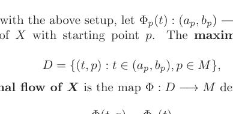

## 第16章
## 光滑流形上的微分与积分
### 16.1 外微分

设 $M$ 是一个光滑 $m$ 维流形，回顾 $C^{\infty}(M)=\Lambda^{0}(M)$ 且 $\mathfrak{X}^{*}(M)=\Lambda^{1}(M)$。因此，15.4节的外微分 $d : C^{\infty}(M) \longrightarrow \mathfrak{X}^{*}(M)$ 可表示为

$d : \Lambda^{0}(M) \longrightarrow \Lambda^{1}(M).$

根据定理15.4.6，$d$ 是线性的，并满足一种乘积法则。在本节中，我们描述 $d$ 的一个具有相应性质的推广。这一理论有三种等价的处理方式——公理化、局部和整体。

### 定理16.1.1（外微分公理）。若 $M$ 是一个光滑 $m$ 维流形，则存在唯一一族线性映射

$d : \Lambda^{s}(M) \longrightarrow \Lambda^{s+1}(M)$

对 $s \ge 0$ 定义，称为外微分，使得：

- (a) $d : \Lambda^{0}(M) \longrightarrow \Lambda^{1}(M)$ 是15.4节定义的外微分。
- (b) 对所有 $\Lambda^{s}(M)$ 中的形式 $\omega$ 和 $\Lambda^{s'}(M)$ 中的形式 $\xi$，$d(\omega \wedge \xi) = d(\omega) \wedge \xi + (-1)^{s} \omega \wedge d(\xi)$。
- (c) $d^{2}=0$；即对所有 $\Lambda^{s}(M)$ 中的形式 $\omega$，$d \circ d(\omega)=0$。

我们注意到，当 $s \ge m$ 时，$\Lambda^m(M)$ 是零向量空间，此时 $d$ 是零映射。对于 $C^\infty(M) = \Lambda^0(M)$ 中的任意函数 $f$ 以及 $\Lambda^s(M)$ 中的任意形式 $\omega$，由(15.8.3)有 $f\omega = f \wedge \omega$，再由定理16.1.1(b)得

$d(f\omega) = d(f \wedge \omega) = d(f) \wedge \omega + f \wedge d(\omega) = d(f) \wedge \omega + f d(\omega).    (16.1.1)$

### 定理16.1.2（外微分的局部坐标表达式）。设 $M$ 是一个光滑 $m$ 维流形，$\omega$ 是 $\Lambda^s(M)$ 中的一个形式，在局部坐标下设

$\omega = \sum_{1 \le i_1 < ... < i_s \le m} \alpha_{i_1...i_s} d(x^{i_1}) \wedge \cdots \wedge d(x^{i_s}).$

则

$d(\omega) = \sum_{1 \le i_1 < ... < i_s \le m} d(\alpha_{i_1...i_s}) \wedge d(x^{i_1}) \wedge \cdots \wedge d(x^{i_s}).$

定理16.1.2以后会经常使用，通常不再注明。

### 定理16.1.3（外微分的整体表达式）。设 $M$ 是一个光滑 $m$ 维流形，$\omega$ 是 $\Lambda^s(M)$ 中的一个形式，且 $X_1, ..., X_{s+1}$ 是 $\mathfrak{X}(M)$ 中的向量场。则

$d(\omega)(X_1, ..., X_{s+1})$
$= \sum_{i=1}^{s+1} (-1)^{i-1} X_i(\omega(X_1, ..., \hat{X_i}, ..., X_{s+1}))$
$+ \sum_{1 \le i < j \le s+1} (-1)^{i+j} \omega([X_i, X_j], X_1, ..., \hat{X_i}, ..., \hat{X_j}, ..., X_{s+1}),$

其中 ^ 表示省略了相应项。

### 例16.1.4. 在定理16.1.3中令 $s = 1$ 得

$d(\omega)(X_1, X_2) = X_1(\omega(X_2)) - X_2(\omega(X_1)) - \omega([X_1, X_2]).$

下一个结果是定理15.11.2的推广。

### 定理16.1.5（形式的拉回与外微分的交换性）。若 $M$ 和 $N$ 是光滑流形，且 $F : M \longrightarrow N$ 是光滑映射，则

$F^* \circ d = d \circ F^*;$

即对所有 $\Lambda^s(M)$ 中的形式 $\omega$，有

$F^*(d(\omega)) = d(F^*(\omega)).$

下面三个例子表明，外微分与10.6节中介绍的经典旋度、梯度和散度算子有关。

### 例16.1.6（旋度）。

设 $\alpha_1,\alpha_2,\alpha_3$ 是 $C^\infty(\mathbb{R}^3)$ 中的函数，并通过下式定义 $\mathfrak{X}^*(\mathbb{R}^3)=\Lambda^1(\mathbb{R}^3)$ 中的余向量场 $\omega$：

$$\omega=\alpha_1d(x)+\alpha_2d(y)+\alpha_3d(z).$$

暂时将 $(x,y,z)$ 记为 $(x^1,x^2,x^3)$，则有

$$\begin{aligned}
d(\omega)&=d\left(\sum_i\alpha_i d(x^i)\right)=\sum_i d\left(\alpha_i d(x^i)\right)=\sum_i\left[d(\alpha_i)\wedge d(x^i)+\alpha_i d^2(x^i)\right]\\
&=\sum_i\left[\left(\sum_j\frac{\partial\alpha_i}{\partial x^j}d(x^j)\right)\wedge d(x^i)\right]=\sum_{ij}\frac{\partial\alpha_i}{\partial x^j}d(x^j)\wedge d(x^i)\\
&=\sum_{1\le i<j\le m}\frac{\partial\alpha_i}{\partial x^j}d(x^j)\wedge d(x^i)+\sum_{1\le j<i\le m}\frac{\partial\alpha_i}{\partial x^j}d(x^j)\wedge d(x^i)\\
&=-\sum_{1\le i<j\le m}\frac{\partial\alpha_i}{\partial x^j}d(x^i)\wedge d(x^j)+\sum_{1\le i<j\le m}\frac{\partial\alpha_j}{\partial x^i}d(x^i)\wedge d(x^j)\\
&=\sum_{1\le i<j\le m}\left(\frac{\partial\alpha_j}{\partial x^i}-\frac{\partial\alpha_i}{\partial x^j}\right)d(x^i)\wedge d(x^j).
\end{aligned}$$

其中第三个等号由(16.1.1)得到，第四个等号由定理15.4.7和定理16.1.1(c)得到，第六个等号由定理15.8.2(c)得到，第七个等号由定理15.8.2(b)得到。回到先前的记号，得

$$\begin{aligned}
d(\omega)&=\left(\frac{\partial\alpha_2}{\partial x}-\frac{\partial\alpha_1}{\partial y}\right)d(x)\wedge d(y)+\left(\frac{\partial\alpha_3}{\partial x}-\frac{\partial\alpha_1}{\partial z}\right)d(x)\wedge d(z)\\
&\quad+\left(\frac{\partial\alpha_3}{\partial y}-\frac{\partial\alpha_2}{\partial z}\right)d(y)\wedge d(z)\\
&=\left(\frac{\partial\alpha_3}{\partial y}-\frac{\partial\alpha_2}{\partial z}\right)d(y)\wedge d(z)+\left(\frac{\partial\alpha_1}{\partial z}-\frac{\partial\alpha_3}{\partial x}\right)d(z)\wedge d(x)\\
&\quad+\left(\frac{\partial\alpha_2}{\partial x}-\frac{\partial\alpha_1}{\partial y}\right)d(x)\wedge d(y).
\end{aligned}\tag{16.1.2}$$

与 $\omega$ 对应，我们定义光滑映射 $F=(\alpha_1,\alpha_2,\alpha_3):\mathbb{R}^3\to\mathbb{R}^3$。回顾第10.6节，

$$\operatorname{curl}(F)=\left(\frac{\partial\alpha_3}{\partial y}-\frac{\partial\alpha_2}{\partial z},\frac{\partial\alpha_1}{\partial z}-\frac{\partial\alpha_3}{\partial x},\frac{\partial\alpha_2}{\partial x}-\frac{\partial\alpha_1}{\partial y}\right).$$

因此，$d(\omega)$ 的分量与 $\operatorname{curl}(F)$ 的分量相同。

### 例16.1.7（梯度）。

设 $f$ 是 $C^\infty(M)=\Lambda^0(M)$ 中的函数。由第10.6节和式(11.4.3)有

$$\operatorname{grad}(f)=\left(\frac{\partial f}{\partial x},\frac{\partial f}{\partial y},\frac{\partial f}{\partial z}\right).$$

并由定理15.4.7，有

$d(f) = \frac{\partial f}{\partial x} d(x) + \frac{\partial f}{\partial y} d(y) + \frac{\partial f}{\partial z} d(z).$

将 $\omega = d(f)$ 和 $(\alpha_1, \alpha_2, \alpha_3) = \operatorname{grad}(f)$ 代入(16.1.2)，得

$d^2(f) = \left(\frac{\partial^2 f}{\partial y \partial z} - \frac{\partial^2 f}{\partial z \partial y}\right) d(y) \wedge d(z) + \left(\frac{\partial^2 f}{\partial z \partial x} - \frac{\partial^2 f}{\partial x \partial z}\right) d(z) \wedge d(x)$

$+ \left(\frac{\partial^2 f}{\partial x \partial y} - \frac{\partial^2 f}{\partial y \partial x}\right) d(x) \wedge d(y).$

由混合偏导数的相等性（定理10.1.6）可知 $d^2(f) = 0$，这与定理16.1.1(c)的预期一致。换一个角度看，$d^2 = 0$ 是用外微分表达混合偏导数相等性的一种方式。鉴于例16.1.6中提到的 $d(\omega)$ 与 $\operatorname{curl}(F)$ 之间的联系，我们现在看到 $d^2(f) = 0$ 等价于 $\operatorname{curl}(\operatorname{grad}(f)) = 0$，即定理10.6.1(c)。

### 例16.1.8（散度）。

设 $\alpha_1, \alpha_2, \alpha_3$ 是 $C^\infty(\mathbb{R}^3)$ 中的函数，并通过下式定义 $\Lambda^2(\mathbb{R}^3)$ 中的形式 $\xi$：

$\xi = \alpha_1 d(y) \wedge d(z) + \alpha_2 d(z) \wedge d(x) + \alpha_3 d(x) \wedge d(y).$

按照例16.1.6的方式计算得

$d(\xi) = \left(\frac{\partial \alpha_1}{\partial x} + \frac{\partial \alpha_2}{\partial y} + \frac{\partial \alpha_3}{\partial z}\right) d(x) \wedge d(y) \wedge d(z). \qquad (16.1.3)$

与 $\xi$ 对应，我们定义光滑映射 $F = (\alpha_1, \alpha_2, \alpha_3) : \mathbb{R}^3 \longrightarrow \mathbb{R}^3$。回顾第10.6节，

$\operatorname{div}(F) = \frac{\partial \alpha_1}{\partial x} + \frac{\partial \alpha_2}{\partial y} + \frac{\partial \alpha_3}{\partial z}.$

因此，$d(\xi)$ 的唯一分量等于 $\operatorname{div}(F)$。

取 $\omega$ 如例16.1.6中所示，由(16.1.2)知 $d(\omega)$ 是 $\Lambda^2(\mathbb{R}^3)$ 中的一个形式。在(16.1.3)中令 $\xi = d(\omega)$，得

$d^2(\omega) = \left[\frac{\partial}{\partial x}\left(\frac{\partial \alpha_3}{\partial y} - \frac{\partial \alpha_2}{\partial z}\right) + \frac{\partial}{\partial y}\left(\frac{\partial \alpha_1}{\partial z} - \frac{\partial \alpha_3}{\partial x}\right) + \frac{\partial}{\partial z}\left(\frac{\partial \alpha_2}{\partial x} - \frac{\partial \alpha_1}{\partial y}\right)\right]$ 
$\cdot d(x) \wedge d(y) \wedge d(z)$

$= \left[\left(\frac{\partial^2 \alpha_3}{\partial x \partial y} - \frac{\partial^2 \alpha_2}{\partial x \partial z}\right) + \left(\frac{\partial^2 \alpha_1}{\partial y \partial z} - \frac{\partial^2 \alpha_3}{\partial y \partial x}\right) + \left(\frac{\partial \alpha_2}{\partial z \partial x} - \frac{\partial^2 \alpha_1}{\partial z \partial y}\right)\right]$ 
$\cdot d(x) \wedge d(y) \wedge d(z).$

由混合偏导数的相等性（定理10.1.6）可知 $d^2(\omega) = 0$，这与定理16.1.1(c)的预期一致。鉴于例16.1.6中提到的 $d(\omega)$ 与 $\operatorname{curl}(F)$ 之间的联系，我们现在看到 $d^2(\omega) = 0$ 等价于 $\operatorname{div}(\operatorname{curl}(F)) = 0$，即定理10.6.1(d)。


我们以两个与电动力学相关的计算来结束本节，它们将在第 22.2 节中用到。

### 例 16.1.9（电动力学）。

设 $(x, y, z, t)$ 是 $\mathbb{R}^4$ 上的标准坐标，设 $\alpha_1, \alpha_2, \alpha_3, \alpha_4$ 是 $C^\infty(\mathbb{R}^4)$ 中的函数，并定义 $\mathfrak{X}^*(\mathbb{R}^4)$ 中的余向量场 $\omega$ 如下：

$$
\omega = \alpha_1 d(x) + \alpha_2 d(y) + \alpha_3 d(z) + \alpha_4 d(t).
$$

则

$$
d(\omega) = d(\alpha_1) \wedge d(x) + d(\alpha_2) \wedge d(y) + d(\alpha_3) \wedge d(z) + d(\alpha_4) \wedge d(t).
$$

我们有

$$
d(\alpha_1) \wedge d(x) = \left(\frac{\partial \alpha_1}{\partial x} d(x) + \frac{\partial \alpha_1}{\partial y} d(y) + \frac{\partial \alpha_1}{\partial z} d(z) + \frac{\partial \alpha_1}{\partial t} d(t)\right) \wedge d(x)
$$

$$
= \frac{\partial \alpha_1}{\partial y} d(y) \wedge d(x) + \frac{\partial \alpha_1}{\partial z} d(z) \wedge d(x) + \frac{\partial \alpha_1}{\partial t} d(t) \wedge d(x)
$$

$$
= - \frac{\partial \alpha_1}{\partial y} d(x) \wedge d(y) - \frac{\partial \alpha_1}{\partial z} d(x) \wedge d(z) - \frac{\partial \alpha_1}{\partial t} d(x) \wedge d(t).
$$

类似地，

$$
d(\alpha_2) \wedge d(y) = \frac{\partial \alpha_2}{\partial x} d(x) \wedge d(y) - \frac{\partial \alpha_2}{\partial z} d(y) \wedge d(z) - \frac{\partial \alpha_2}{\partial t} d(y) \wedge d(t)
$$

$$
d(\alpha_3) \wedge d(z) = \frac{\partial \alpha_3}{\partial x} d(x) \wedge d(z) + \frac{\partial \alpha_3}{\partial y} d(y) \wedge d(z) - \frac{\partial \alpha_3}{\partial t} d(z) \wedge d(t)
$$

$$
d(\alpha_4) \wedge d(t) = \frac{\partial \alpha_4}{\partial x} d(x) \wedge d(t) + \frac{\partial \alpha_4}{\partial y} d(y) \wedge d(t) + \frac{\partial \alpha_4}{\partial z} d(z) \wedge d(t).
$$

因此，

$$
d(\omega) = \left(\frac{\partial \alpha_4}{\partial x} - \frac{\partial \alpha_1}{\partial t}\right) d(x) \wedge d(t) + \left(\frac{\partial \alpha_4}{\partial y} - \frac{\partial \alpha_2}{\partial t}\right) d(y) \wedge d(t) + \left(\frac{\partial \alpha_4}{\partial z} - \frac{\partial \alpha_3}{\partial t}\right) d(z) \wedge d(t) + \left(\frac{\partial \alpha_3}{\partial y} - \frac{\partial \alpha_2}{\partial z}\right) d(y) \wedge d(z) + \left(\frac{\partial \alpha_1}{\partial z} - \frac{\partial \alpha_3}{\partial x}\right) d(z) \wedge d(x) + \left(\frac{\partial \alpha_2}{\partial x} - \frac{\partial \alpha_1}{\partial y}\right) d(x) \wedge d(y).
$$

### 例 16.1.10（电动力学）。

设 $(x, y, z, t)$ 是 $\mathbb{R}^4$ 上的标准坐标，并设 $\alpha_1, \alpha_2, \alpha_3, \beta_1, \beta_2, \beta_3$ 是 $C^\infty(\mathbb{R}^4)$ 中的函数。定义 $\mathfrak{X}^*(\mathbb{R}^4)$ 中的余向量场 $\xi$ 以及 $\Lambda^2(\mathbb{R}^4)$ 中的微分形式 $\zeta, \varphi$ 如下：

$$
\xi = \alpha_1 d(x) + \alpha_2 d(y) + \alpha_3 d(z),
$$

$$
\zeta = \beta_1 d(y) \wedge d(z) + \beta_2 d(z) \wedge d(x) + \beta_3 d(x) \wedge d(y),
$$

以及

$$
\varphi=\xi\wedge d(t)+\zeta
$$

$$
=\alpha_1d(x)\wedge d(t)+\alpha_2d(y)\wedge d(t)+\alpha_3d(z)\wedge d(t)
$$

$$
\quad+\beta_1d(y)\wedge d(z)+\beta_2d(z)\wedge d(x)+\beta_3d(x)\wedge d(y).
$$

我们求下式的另一种表达式：

$$
d(\varphi)=d(\alpha_1)\wedge d(x)\wedge d(t)+d(\alpha_2)\wedge d(y)\wedge d(t)+d(\alpha_3)\wedge d(z)\wedge d(t)
$$

$$
\quad+d(\beta_1)\wedge d(y)\wedge d(z)+d(\beta_2)\wedge d(z)\wedge d(x)+d(\beta_3)\wedge d(x)\wedge d(y).
$$

我们有

$$
d(\alpha_1)\wedge d(x)\wedge d(t)
$$

$$
=\left(\frac{\partial\alpha_1}{\partial x}d(x)+\frac{\partial\alpha_1}{\partial y}d(y)+\frac{\partial\alpha_1}{\partial z}d(z)+\frac{\partial\alpha_1}{\partial t}d(t)\right)\wedge d(x)\wedge d(t)
$$

$$
=\frac{\partial\alpha_1}{\partial x}d(x)\wedge d(x)\wedge d(t)+\frac{\partial\alpha_1}{\partial y}d(y)\wedge d(x)\wedge d(t)
$$

$$
\quad+\frac{\partial\alpha_1}{\partial z}d(z)\wedge d(x)\wedge d(t)+\frac{\partial\alpha_1}{\partial t}d(t)\wedge d(x)\wedge d(t)
$$

$$
=-\frac{\partial\alpha_1}{\partial y}d(x)\wedge d(y)\wedge d(t)-\frac{\partial\alpha_1}{\partial z}d(x)\wedge d(z)\wedge d(t).
$$

类似地，

$$
d(\alpha_2)\wedge d(y)\wedge d(t)=\frac{\partial\alpha_2}{\partial x}d(x)\wedge d(y)\wedge d(t)-\frac{\partial\alpha_2}{\partial z}d(y)\wedge d(z)\wedge d(t)
$$

$$
d(\alpha_3)\wedge d(z)\wedge d(t)=\frac{\partial\alpha_3}{\partial x}d(x)\wedge d(z)\wedge d(t)+\frac{\partial\alpha_3}{\partial y}d(y)\wedge d(z)\wedge d(t)
$$

$$
d(\beta_1)\wedge d(y)\wedge d(z)=\frac{\partial\beta_1}{\partial x}d(x)\wedge d(y)\wedge d(z)+\frac{\partial\beta_1}{\partial t}d(y)\wedge d(z)\wedge d(t)
$$

$$
d(\beta_2)\wedge d(z)\wedge d(x)=\frac{\partial\beta_2}{\partial y}d(x)\wedge d(y)\wedge d(z)-\frac{\partial\beta_2}{\partial t}d(x)\wedge d(z)\wedge d(t)
$$

$$
d(\beta_3)\wedge d(x)\wedge d(y)=\frac{\partial\beta_3}{\partial z}d(x)\wedge d(y)\wedge d(z)+\frac{\partial\beta_3}{\partial t}d(x)\wedge d(y)\wedge d(t).
$$

因此，

$$
d(\varphi)=\left(\frac{\partial\beta_1}{\partial x}+\frac{\partial\beta_2}{\partial y}+\frac{\partial\beta_3}{\partial z}\right)d(x)\wedge d(y)\wedge d(z)
$$

$$
\quad+\left(\frac{\partial\alpha_2}{\partial x}-\frac{\partial\alpha_1}{\partial y}+\frac{\partial\beta_3}{\partial t}\right)d(x)\wedge d(y)\wedge d(t)
$$

$$
\quad-\left(\frac{\partial\alpha_1}{\partial z}-\frac{\partial\alpha_3}{\partial x}+\frac{\partial\beta_2}{\partial t}\right)d(x)\wedge d(z)\wedge d(t)
$$

$$
\quad+\left(\frac{\partial\alpha_3}{\partial y}-\frac{\partial\alpha_2}{\partial z}+\frac{\partial\beta_1}{\partial t}\right)d(y)\wedge d(z)\wedge d(t).
$$

## 16.2 张量导子

光滑流形 $M$ 上的一个张量导子是一个线性映射族 $\mathbf{D}$：

$$
\mathbf{D}^{r}_{s}:\mathcal{T}^{r}_{s}(M)\longrightarrow \mathcal{T}^{r}_{s}(M)
$$

它对 $r,s\geq 0$ 有定义，并且使得对于所有 $\mathcal{T}^{r}_{s}(M)$ 中的张量场 $\mathcal{A}$ 和 $\mathcal{T}^{r'}_{s'}(M)$ 中的张量场 $\mathcal{B}$，以及所有 $(k,l)$-缩并 $C^k_l$，有：

**[D1]**
$$
\mathbf{D}^{r+r'}_{s+s'}(\mathcal{A}\otimes\mathcal{B})=\mathbf{D}^{r}_{s}(\mathcal{A})\otimes\mathcal{B}+\mathcal{A}\otimes\mathbf{D}^{r'}_{s'}(\mathcal{B}).
$$

**[D2]**
$$
C^k_l\circ\mathbf{D}^{r}_{s}(\mathcal{A})=\mathbf{D}^{r-1}_{s-1}\circ C^k_l(\mathcal{A}).
$$

[D1] 是张量场的一种乘积法则，而 [D2] 说明“缩并与张量导子可交换”。

**定理 16.2.1.** 设 $M$ 是一个光滑流形，$\mathbf{D}$ 是 $M$ 上的一个张量导子，并设 $\mathcal{A}_i$ 是 $\mathcal{T}^{r_i}_{s_i}(M)$ 中的张量场，$i=1,\ldots,k$。则

$$
\mathbf{D}^{r_1+\cdots+r_k}_{s_1+\cdots+s_k}(\mathcal{A}_1\otimes\cdots\otimes\mathcal{A}_k)=\sum_{i=1}^{k}\mathcal{A}_1\otimes\cdots\otimes\mathbf{D}^{r_i}_{s_i}(\mathcal{A}_i)\otimes\cdots\otimes\mathcal{A}_k.
$$

*证明.* 这可由 [D1] 通过归纳论证得到。

**定理 16.2.2.** 设 $M$ 是一个光滑流形，$\mathbf{D}$ 是 $M$ 上的一个张量导子，设 $f$ 是 $C^\infty(M)$ 中的一个函数，并设 $\mathcal{A}$ 是 $\mathcal{T}^{r}_{s}(M)$ 中的张量场。则：

(a) $\mathbf{D}^{0}_{0}$ 是 $\mathfrak{X}(M)$ 中的一个向量场。

(b) $\mathbf{D}^{r}_{s}(f\mathcal{A})=\mathbf{D}^{0}_{0}(f)\mathcal{A}+f\mathbf{D}^{r}_{s}(\mathcal{A})$。

*证明.* (a)：对于 $C^\infty(M)=\mathcal{T}^{0}_{0}(M)$ 中的函数 $f,g$，由 [D1] 我们有

$$
\mathbf{D}^{0}_{0}(fg)=f\mathbf{D}^{0}_{0}(g)+g\mathbf{D}^{0}_{0}(f).
$$

因此，$\mathbf{D}^{0}_{0}$ 是 $C^\infty(M)$ 上的一个导子。此结论现在可由定理 15.2.1 给出的等同关系推出。

(b)：由于 $f$ 是 $C^\infty(M)=\mathcal{T}^{0}_{0}(M)$ 中的函数，$\mathbf{D}^{0}_{0}(f)$ 也是。根据定义，$f\otimes\mathcal{A}=f\mathcal{A}$，且 $\mathbf{D}^{0}_{0}(f)\otimes\mathcal{A}=\mathbf{D}^{0}_{0}(f)\mathcal{A}$。于是 [D1] 给出

$$
\mathbf{D}^{r}_{s}(f\mathcal{A})=\mathbf{D}^{0}_{0}(f)\otimes\mathcal{A}+f\otimes\mathbf{D}^{r}_{s}(\mathcal{A})=\mathbf{D}^{0}_{0}(f)\mathcal{A}+f\mathbf{D}^{r}_{s}(\mathcal{A}).
$$

**例 16.2.3.** 设 $M$ 是一个光滑流形，$\mathbf{D}$ 是 $M$ 上的一个张量导子，并设 $\mathcal{A}$ 是 $\mathcal{T}^{1}_{1}(M)$ 中的张量场。我们寻求 $\mathbf{D}^{1}_{1}(\mathcal{A})$ 的显式表达式。设 $X=\mathbf{D}^{0}_{0}$ 为由定理 16.2.2(a) 给出的 $\mathfrak{X}(M)$ 中的向量场，并令 $C=C^1_1\circ C^2_2$。两次使用 [D2] 可得 $\mathbf{D}^{0}_{0}\circ C=C\circ\mathbf{D}^{2}_{2}$。对于余向量


对于 \(\mathfrak{X}^*(M)\) 中的余向量场 \(\omega\) 和 \(\mathfrak{X}(M)\) 中的向量场 \(Y\)，我们有

\[
X(\mathcal{A}(\omega,Y))
= D_0^0(\mathcal{A}(\omega,Y))
= D_0^0(C(Y\otimes\mathcal{A}\otimes\omega))
= C(D_2^2(Y\otimes\mathcal{A}\otimes\omega))
= C(D_1^0(Y)\otimes\mathcal{A}\otimes\omega + Y\otimes D_1^1(\mathcal{A})\otimes\omega + Y\otimes\mathcal{A}\otimes D_1^0(\omega))
= C(D_1^0(Y)\otimes\mathcal{A}\otimes\omega) + C(Y\otimes D_1^1(\mathcal{A})\otimes\omega) + C(Y\otimes\mathcal{A}\otimes D_1^0(\omega))
= \mathcal{A}(\omega,D_0^1(Y)) + D_1^1(\mathcal{A})(\omega,Y) + \mathcal{A}(D_1^0(\omega),Y),
\]

其中第二个和第六个等号由例 5.4.6 的流形版本得到，第三个等号由 [D2] 得到。因此，

\[
D_1^1(\mathcal{A})(\omega,Y)
= X(\mathcal{A}(\omega,Y)) - \mathcal{A}(D_1^0(\omega),Y) - \mathcal{A}(\omega,D_0^1(Y)).
\]

注意，在上述计算中，我们隐式地使用了定理 15.7.2，将 \(\mathcal{A}\) 等同于 \(\operatorname{Mult}_{C^\infty(M)}(\mathfrak{X}^*(M)\times\mathfrak{X}(M),C^\infty(M))\) 中的一个映射。下一个结果用同样的方法推广了例 16.2.3。

### 定理 16.2.4（张量导子的整体表达式）。

设 \(M\) 为光滑流形，\(D\) 为 \(M\) 上的张量导子，并令 \(X = D_0^0\) 为定理 16.2.2(a) 给出的 \(\mathfrak{X}(M)\) 中的向量场。设 \(\mathcal{A}\) 为 \(\mathcal{T}_s^r(M)\) 中的张量场，\(\omega^1,\ldots,\omega^r\) 为 \(\mathfrak{X}^*(M)\) 中的余向量场，\(Y_1,\ldots,Y_s\) 为 \(\mathfrak{X}(M)\) 中的向量场。则

\[
\begin{aligned}
D_s^r(\mathcal{A})(\omega^1,\ldots,\omega^r,Y_1,\ldots,Y_s)
&= X(\mathcal{A}(\omega^1,\ldots,\omega^r,Y_1,\ldots,Y_s)) \\
&\quad -\sum_{i=1}^{r}\mathcal{A}(\omega^1,\ldots,\omega^{i-1},D_1^0(\omega^i),\omega^{i+1},\ldots,\omega^r,Y_1,\ldots,Y_s) \\
&\quad -\sum_{j=1}^{s}\mathcal{A}(\omega^1,\ldots,\omega^r,Y_1,\ldots,Y_{j-1},D_0^1(Y_j),Y_{j+1},\ldots,Y_s).
\end{aligned}
\tag{16.2.1}
\]

**证明。** 该证明是对例 16.2.3 的详细展开。我们有

\[
\begin{aligned}
X(\mathcal{A}(\omega^1,\ldots,\omega^r,Y_1,\ldots,Y_s))
&= D_0^0(\mathcal{A}(\omega^1,\ldots,\omega^r,Y_1,\ldots,Y_s)) \\
&= D_0^0(C(Y_1\otimes\cdots\otimes Y_s\otimes\mathcal{A}\otimes\omega^1\otimes\cdots\otimes\omega^r)) \\
&= C(D_{s+r}^{s+r}(Y_1\otimes\cdots\otimes Y_s\otimes\mathcal{A}\otimes\omega^1\otimes\cdots\otimes\omega^r)) \\
&= C\Bigl(\sum_{j=1}^{s}Y_1\otimes\cdots\otimes D_0^1(Y_j)\otimes\cdots\otimes Y_s\otimes\mathcal{A}\otimes\omega^1\otimes\cdots\otimes\omega^r \\
&\qquad + Y_1\otimes\cdots\otimes Y_s\otimes D_s^r(\mathcal{A})\otimes\omega^1\otimes\cdots\otimes\omega^r \\
&\qquad + \sum_{i=1}^{r}Y_1\otimes\cdots\otimes Y_s\otimes\mathcal{A}\otimes\omega^1\otimes\cdots\otimes D_1^0(\omega^i)\otimes\cdots\otimes\omega^r\Bigr) \\
&= \sum_{j=1}^{s}C(Y_1\otimes\cdots\otimes D_0^1(Y_j)\otimes\cdots\otimes Y_s\otimes\mathcal{A}\otimes\omega^1\otimes\cdots\otimes\omega^r) \\
&\quad + C(Y_1\otimes\cdots\otimes Y_s\otimes D_s^r(\mathcal{A})\otimes\omega^1\otimes\cdots\otimes\omega^r) \\
&\quad + \sum_{i=1}^{r}C(Y_1\otimes\cdots\otimes Y_s\otimes\mathcal{A}\otimes\omega^1\otimes\cdots\otimes D_1^0(\omega^i)\otimes\cdots\otimes\omega^r) \\
&= \sum_{j=1}^{s}\mathcal{A}(\omega^1,\ldots,\omega^r,Y_1,\ldots,Y_{j-1},D_0^1(Y_j),Y_{j+1},\ldots,Y_s) \\
&\quad + D_s^r(\mathcal{A})(\omega^1,\ldots,\omega^r,Y_1,\ldots,Y_s) \\
&\quad + \sum_{i=1}^{r}\mathcal{A}(\omega^1,\ldots,\omega^{i-1},D_1^0(\omega^i),\omega^{i+1},\ldots,\omega^r,Y_1,\ldots,Y_s),
\end{aligned}
\]

其中第二个和第六个等号由定理 15.14.4 得到，第三个等号由 [D2] 得到。结论得证。

### 例 16.2.5。

对于 \(\mathfrak{X}^*(M)=\mathcal{T}_1^0(M)\) 中的余向量场 \(\omega\) 和 \(\mathfrak{X}(M)\) 中的向量场 \(Y\)，在定理 16.2.4 中令 \(r=0\)、\(s=1\)，可得

\[
D_1^0(\omega)(Y)=X(\omega(Y))-\omega(D_0^1(Y)),
\tag{16.2.2}
\]

其中 \(X=D_0^0\)。

### 定理 16.2.6。

光滑流形 \(M\) 上的张量导子 \(D\) 由其在 \(C^\infty(M)\) 和 \(\mathfrak{X}(M)\) 上的取值唯一确定。

**证明。** 由定理 16.2.4 可以看出，\(D\) 由其在 \(C^\infty(M)\)、\(\mathfrak{X}(M)\) 和 \(\mathfrak{X}^*(M)\) 上的取值唯一确定。然而，(16.2.2) 表明 \(D\) 在 \(\mathfrak{X}^*(M)\) 上的取值由其在 \(\mathfrak{X}(M)\) 上的取值唯一确定。

### 定理 16.2.7（张量导子的存在性）。

设 \(M\) 为光滑流形，\(X\) 为 \(\mathfrak{X}(M)\) 中的向量场，并设

\[
\mathcal{D}_X:\mathfrak{X}(M)\longrightarrow\mathfrak{X}(M)
\]

是一个线性映射，使得

\[
\mathcal{D}_X(fY)=X(f)Y+f\mathcal{D}_X(Y)
\tag{16.2.3}
\]

对所有 \(C^\infty(M)\) 中的函数 \(f\) 和 \(\mathfrak{X}(M)\) 中的所有向量场 \(Y\) 成立。则在 \(M\) 上存在唯一一个张量导子 \(D\)，使得

\[
D_0^0=X \quad\text{且}\quad D_0^1=\mathcal{D}_X.
\tag{16.2.4}
\]

**证明。** 结合 (16.2.6) 和 (16.2.7) 可得

\[
D_1^0(\omega)(fY+Z)=fD_1^0(\omega)(Y)+D_1^0(\omega)(Z),
\]

这就证明了该结论。

下一步是定义一个映射

\[
D_1^0:\mathfrak{X}^*(M)\longrightarrow\operatorname{Lin}_{C^\infty(M)}(\mathfrak{X}(M),C^\infty(M))
\tag{16.2.8}
\]

通过如下对应关系

\[
\omega\longmapsto D_1^0(\omega)
\]

对所有 \(\mathfrak{X}^*(M)\) 中的余向量场 \(\omega\) 成立。我们有 \(\mathfrak{X}^*(M)=\mathcal{T}_1^0(M)\)，且由定理 15.5.3，\(\operatorname{Lin}_{C^\infty(M)}(\mathfrak{X}(M),C^\infty(M))\) 可以与 \(\mathfrak{X}^*(M)\) 等同。因此，(16.2.8) 可以表示为 \(D_1^0:\mathcal{T}_1^0(M)\longrightarrow\mathcal{T}_1^0(M)\)，这正是对应于 \((r,s)=(0,1)\) 的张量导子所需要的。

还需证明 [D1] 和 [D2] 成立。设 \(f\) 为 \(C^\infty(M)\) 中的函数，\(\omega\) 为 \(\mathfrak{X}^*(M)\) 中的余向量场，\(Y\) 为 \(\mathfrak{X}(M)\) 中的向量场。则

\[
\begin{aligned}
D_{0+1}^{0+0}(f\otimes\omega)(Y)
&= D_1^0(f\omega)(Y) \\
&= X(f\omega(Y))-f\omega(\mathcal{D}_X(Y)) \qquad [(16.2.5)] \\
&= X(f)\omega(Y)+fX(\omega(Y))-f\omega(\mathcal{D}_X(Y)) \qquad [(15.1.3)] \\
&= D_0^0(f)\omega(Y)+fD_1^0(\omega)(Y) \qquad [(16.2.4), (16.2.5)] \\
&= (D_0^0(f)\otimes\omega+f\otimes D_1^0(\omega))(Y).
\end{aligned}
\]

由于 \(Y\) 是任意的，

\[
D_{0+1}^{0+0}(f\otimes\omega)=D_0^0(f)\otimes\omega+f\otimes D_1^0(\omega),
\]

因此 [D1] 成立。对于 \((r,s)=(0,1)\)，不可能进行缩并，所以 [D2] 平凡地成立。

**唯一性。** 由 (16.2.2) 和 (16.2.4) 可知，(16.2.5) 是定义 \(D_1^0\) 的唯一选择。

## 16.3 形式导子

光滑流形 \(M\) 上的形式导子是一族线性映射 \(\mathfrak{D}\)

\[
\mathfrak{D}_s:\Lambda^s(M)\longrightarrow\Lambda^s(M)
\]

对所有 \(s\ge 0\) 定义，使得

\[
\mathfrak{D}_{s+s'}(\omega\wedge\xi)=\mathfrak{D}_s(\omega)\wedge\xi+\omega\wedge\mathfrak{D}_{s'}(\xi)
\tag{16.3.1}
\]

对所有 \(\Lambda^s(M)\) 中的形式 \(\omega\) 和 \(\Lambda^{s'}(M)\) 中的 \(\xi\) 成立。

### 定理 16.3.1。

若 \(M\) 是光滑流形且 \(\mathfrak{D}\) 是 \(M\) 上的形式导子，则在局部坐标下，

\[
\mathfrak{D}_s(d(x^1)\wedge\cdots\wedge d(x^s))=\sum_i d(x^1)\wedge\cdots\wedge\mathfrak{D}_1(d(x^i))\wedge\cdots\wedge d(x^s).
\]

**证明。** 证明采用归纳法。当 \(s=1\) 时，结论是平凡的。设 \(s>1\)，并假设该断言对所有小于 \(s\) 的指标成立。由 (16.3.1) 我们有

\[
\mathfrak{D}_s(d(x^1)\wedge\cdots\wedge d(x^s))
=\mathfrak{D}_1(d(x^1))\wedge d(x^2)\wedge\cdots\wedge d(x^s)
+d(x^1)\wedge\mathfrak{D}_{s-1}(d(x^2)\wedge\cdots\wedge d(x^s)).
\tag{16.3.2}
\]

根据归纳假设，

\[
\mathfrak{D}_{s-1}(d(x^2)\wedge\cdots\wedge d(x^s))
=\sum_{i=2}^{s}d(x^2)\wedge\cdots\wedge\mathfrak{D}_1(d(x^i))\wedge\cdots\wedge d(x^s),
\]

因此

\[
d(x^1)\wedge\mathfrak{D}_{s-1}(d(x^2)\wedge\cdots\wedge d(x^s))
=\sum_{i=2}^{s}d(x^1)\wedge d(x^2)\wedge\cdots\wedge\mathfrak{D}_1(d(x^i))\wedge\cdots\wedge d(x^s).
\tag{16.3.3}
\]

结合 (16.3.2) 和 (16.3.3) 即得 \(s\) 时的结论。

### 定理 16.3.2。

光滑流形 \(M\) 上的形式导子 \(\mathfrak{D}\) 由其在 \(C^\infty(M)\) 和 \(\{d(f):f\in C^\infty(M)\}\) 上的取值唯一确定。

**证明。** 设 \(\dim(M)=m\)，\(\omega\) 为 \(\Lambda^s(M)\) 中的形式，且在局部坐标下，令

\[
\omega=\sum_{1\le i_1<\cdots<i_s\le m}\alpha_{i_1\ldots i_s}d(x^{i_1})\wedge\cdots\wedge d(x^{i_s}).
\]

则

\[
\begin{aligned}
\mathfrak{D}_s(\omega)
&=\sum_{1\le i_1<\cdots<i_s\le m}\mathfrak{D}_{0+s}(\alpha_{i_1\ldots i_s}d(x^{i_1})\wedge\cdots\wedge d(x^{i_s})) \\
&=\sum_{1\le i_1<\cdots<i_s\le m}\Bigl[\mathfrak{D}_0(\alpha_{i_1\ldots i_s})\wedge d(x^{i_1})\wedge\cdots\wedge d(x^{i_s})+\alpha_{i_1\ldots i_s}\wedge\mathfrak{D}_s(d(x^{i_1})\wedge\cdots\wedge d(x^{i_s}))\Bigr] \\
&=\sum_{1\le i_1<\cdots<i_s\le m}\Bigl[\mathfrak{D}_0(\alpha_{i_1\ldots i_s})d(x^{i_1})\wedge\cdots\wedge d(x^{i_s})+\alpha_{i_1\ldots i_s}\sum_{j=1}^{s}d(x^{i_1})\wedge\cdots\wedge\mathfrak{D}_1(d(x^{i_j}))\wedge\cdots\wedge d(x^{i_s})\Bigr],
\end{aligned}
\]

其中第二个等号由 (16.3.1) 得到，第三个等号由定理 16.3.1 得到。结论得证。

## 16.4 李导数

设 \(M\) 为光滑流形，\(X\) 为 \(\mathfrak{X}(M)\) 中的向量场，并考虑由 \(\mathcal{L}_X(Y)=[X,Y]\) 对所有 \(\mathfrak{X}(M)\) 中的向量场 \(Y\) 定义的映射 \(\mathcal{L}_X:\mathfrak{X}(M)\longrightarrow\mathfrak{X}(M)\)。由定理 15.3.2 的 (c) 和 (d) 部分可知，\(\mathcal{L}_X\) 是线性的，并且满足

\[
\mathcal{L}_X(fY)=X(f)Y+f\mathcal{L}_X(Y)
\]

对所有 \(C^\infty(M)\) 中的函数 \(f\) 和 \(\mathfrak{X}(M)\) 中的所有向量场 \(Y\) 成立。由定理 16.2.7 可知，在 \(M\) 上存在唯一的张量导子

\[
\mathcal{L}_X:\mathcal{T}_s^r(M)\longrightarrow\mathcal{T}_s^r(M)
\]

称为**关于 \(X\) 的李导数**，使得

\[
\mathcal{L}_X(f)=X(f) \quad\text{且}\quad \mathcal{L}_X(Y)=[X,Y]
\tag{16.4.1}
\]

对所有 \(C^\infty(M)\) 中的函数 \(f\) 和 \(\mathfrak{X}(M)\) 中的所有向量场 \(Y\) 成立，其中 \((\mathcal{L}_X)_s^r\) 已被简写为 \(\mathcal{L}_X\)。

李导数具有丰富的代数性质。

### 定理 16.4.1（李导数的向量场性质）。

设 \(M\) 为光滑流形，\(X,Y,Z\) 为 \(\mathfrak{X}(M)\) 中的向量场，\(f,g\) 为 \(C^\infty(M)\) 中的函数。则：

- (a) \(\mathcal{L}_X(Y)=-\mathcal{L}_Y(X)\)。
- (b) \(\mathcal{L}_{X+Y}(Z)=\mathcal{L}_X(Z)+\mathcal{L}_Y(Z)\)。
- (c) \(\mathcal{L}_X(Y+Z)=\mathcal{L}_X(Y)+\mathcal{L}_X(Z)\)。
- (d) \(\mathcal{L}_{fX}(gY)=fg\mathcal{L}_X(Y)+fX(g)Y-gY(f)X\)。
- (e) \(\mathcal{L}_X([Y,Z])=[\mathcal{L}_X(Y),Z]+[Y,\mathcal{L}_X(Z)]\)。

**证明。** 这由定理 15.3.2 得出。

我们注意到，定理 15.3.2 的 (e) 部分中的雅可比恒等式引出了上述定理 (e) 部分中李括号的乘积法则。接下来的结果给出了张量积的乘积法则，其后的一个结果给出了楔积的乘积法则。

### 定理 16.4.2（李导数的张量场性质）。

设 \(M\) 为光滑流形，\(X\) 为 \(\mathfrak{X}(M)\) 中的向量场，\(\mathcal{A},\mathcal{B}\) 为 \(\mathcal{T}_s^r(M)\) 中的张量场，\(\mathcal{C}\) 为 \(\mathcal{T}_{s'}^{r'}(M)\) 中的张量场，\(f\) 为 \(C^\infty(M)\) 中的函数。则：

- (a) \(\mathcal{L}_X(\mathcal{A}+\mathcal{B})=\mathcal{L}_X(\mathcal{A})+\mathcal{L}_X(\mathcal{B})\)。
- (b) \(\mathcal{L}_X(f\mathcal{A})=X(f)\mathcal{A}+f\mathcal{L}_X(\mathcal{A})\)。
- (c) \(\mathcal{L}_X(\mathcal{A}\otimes\mathcal{C})=\mathcal{L}_X(\mathcal{A})\otimes\mathcal{C}+\mathcal{A}\otimes\mathcal{L}_X(\mathcal{C})\)。

**证明。** 这由 \(\mathcal{L}_X\) 作为 \(M\) 上张量导子的性质得出。

### 定理 16.4.3（李导数的形式导子性质）。

若 \(M\) 是光滑流形且 \(X\) 是 \(\mathfrak{X}(M)\) 中的向量场，则 \(\mathcal{L}_X\) 是形式导子；也就是说，

\[
\mathcal{L}_X(\omega\wedge\xi)=\mathcal{L}_X(\omega)\wedge\xi+\omega\wedge\mathcal{L}_X(\xi)
\]

对所有 \(\Lambda^s(M)\) 中的形式 \(\omega\) 和 \(\Lambda^{s'}(M)\) 中的形式 \(\xi\) 成立。

### 定理 16.4.4（李导数的整体表达式）。

设 \(M\) 为光滑流形，\(X\) 为 \(\mathfrak{X}(M)\) 中的向量场。设 \(\mathcal{A}\) 为 \(\mathcal{T}_s^r(M)\) 中的张量场，\(\omega^1,\ldots,\omega^r\) 为 \(\mathfrak{X}^*(M)\) 中的余向量场，\(Y_1,\ldots,Y_s\) 为 \(\mathfrak{X}(M)\) 中的向量场。则

\[
\begin{aligned}
\mathcal{L}_X(\mathcal{A}(\omega^1,\ldots,\omega^r,Y_1,\ldots,Y_s))
&=X(\mathcal{A}(\omega^1,\ldots,\omega^r,Y_1,\ldots,Y_s)) \\
&\quad-\sum_{i=1}^{r}\mathcal{A}(\omega^1,\ldots,\omega^{i-1},\mathcal{L}_X(\omega^i),\omega^{i+1},\ldots,\omega^r,Y_1,\ldots,Y_s) \\
&\quad-\sum_{j=1}^{s}\mathcal{A}(\omega^1,\ldots,\omega^r,Y_1,\ldots,Y_{j-1},[X,Y_j],Y_{j+1},\ldots,Y_s).
\end{aligned}
\]

**注。** 由 (16.4.1) 可知，上述恒等式中的 \(X(\mathcal{A}(\omega^1,\ldots,\omega^r,Y_1,\ldots,Y_s))\) 可以替换为 \(\mathcal{L}_X(\mathcal{A}(\omega^1,\ldots,\omega^r,Y_1,\ldots,Y_s))\)。

**证明。** 因为 \(\mathcal{L}_X(Y_j)=[X,Y_j]\)，所以由定理 16.2.4 可得结论。

### 例 16.4.5。

对于 \(\mathfrak{X}^*(M)=\mathcal{T}_1^0(M)\) 中的余向量场 \(\omega\) 和 \(\mathfrak{X}(M)\) 中的向量场 \(X,Y\)，在定理 16.4.4 中令 \(r=0\)、\(s=1\)，可得

\[
\mathcal{L}_X(\omega)(Y)=X(\omega(Y))-\omega([X,Y]).
\]

### 定理 16.4.6（李导数与函数外导数的交换性）。

若 \(M\) 是光滑流形且 \(X\) 是 \(\mathfrak{X}(M)\) 中的向量场，则

\[
\mathcal{L}_X\circ d=d\circ\mathcal{L}_X;
\]

也就是说，

\[
\mathcal{L}_X(d(f))=d(\mathcal{L}_X(f))
\]

对所有 \(C^\infty(M)\) 中的函数 \(f\) 成立。

**证明。** 对于 \(\mathfrak{X}(M)\) 中的向量场 \(Y\)，我们有

\[
\begin{aligned}
\mathcal{L}_X(d(f))(Y)
&=X(d(f)(Y))-d(f)([X,Y]) \qquad [\mathrm{Ex\ 16.4.5}] \\
&=X(Y(f))-[X,Y](f) \qquad [\mathrm{Th\ 15.4.5(b)}] \\
&=Y(X(f)) \qquad [(15.3.1)] \\
&=d(X(f))(Y) \qquad [\mathrm{Th\ 15.4.5(b)}] \\
&=d(\mathcal{L}_X(f))(Y). \qquad [(16.4.1)]
\end{aligned}
\]

由于 \(f\) 和 \(Y\) 是任意的，结论得证。

### 定理 16.4.7。

设 \(M\) 为光滑 \(m\) 维流形，\(X\) 为 \(\mathfrak{X}(M)\) 中的向量场，且在局部坐标下，令

\[
X=\sum_i\alpha^i\frac{\partial}{\partial x^i}.
\]


然后
\[
\mathcal{L}_X(d(x^i)) = d(\alpha^i)
\]
对 \(i=1,\ldots,m\)。

**证明。** 由 (16.4.1) 可知
\[
\mathcal{L}_X(x^i)=X(x^i)=\left(\sum_j\alpha^j\frac{\partial}{\partial x^j}\right)(x^i)=\sum_j\alpha^j\frac{\partial x^i}{\partial x^j}=\alpha^i,
\]
然后由定理 16.4.6 可知
\[
\mathcal{L}_X(d(x^i))=d(\mathcal{L}_X(x^i))=d(\alpha^i).
\]

### 定理 16.4.8（李导数的局部坐标表达式）。

设 \(M\) 为光滑 \(m\)-流形，设 \(X\) 为 \(\mathfrak{X}(M)\) 中的向量场，设 \(\mathcal{A}\) 为 \(T^r_s(M)\) 中的张量场。在局部坐标下，设
\[
X=\sum_{i=1}^{m}\alpha^i\frac{\partial}{\partial x^i},
\]
并且设 \(\mathcal{A}^{i_1\ldots i_r}_{j_1\ldots j_s}\) 为 \(\mathcal{A}\) 的分量。则 \(\mathcal{L}_X(\mathcal{A})\) 的分量为
\[
\mathcal{L}_X(\mathcal{A})^{i_1\ldots i_r}_{j_1\ldots j_s}
= \sum_{k=1}^{m}\alpha^k\frac{\partial\mathcal{A}^{i_1\ldots i_r}_{j_1\ldots j_s}}{\partial x^k}
-\sum_{l=1}^{r}\left(\sum_{k=1}^{m}\mathcal{A}^{i_1\ldots i_{l-1}\,k\,i_{l+1}\ldots i_r}_{j_1\ldots j_s}\frac{\partial\alpha^{i_l}}{\partial x^k}\right)
+\sum_{l=1}^{s}\left(\sum_{k=1}^{m}\mathcal{A}^{i_1\ldots i_r}_{j_1\ldots j_{l-1}\,k\,j_{l+1}\ldots j_s}\frac{\partial\alpha^k}{\partial x^{j_l}}\right).
\]

**证明。** 由定理 16.4.4，
\[
\mathcal{L}_X(\mathcal{A})^{i_1\ldots i_r}_{j_1\ldots j_s}
= \mathcal{L}_X(\mathcal{A})\left(d(x^{i_1}),\ldots,d(x^{i_r}),\frac{\partial}{\partial x^{j_1}},\ldots,\frac{\partial}{\partial x^{j_s}}\right)
\]
\[
= X\left(\mathcal{A}\left(d(x^{i_1}),\ldots,d(x^{i_r}),\frac{\partial}{\partial x^{j_1}},\ldots,\frac{\partial}{\partial x^{j_s}}\right)\right)
-\sum_{l=1}^{r}\mathcal{A}\left(d(x^{i_1}),\ldots,\mathcal{L}_X(d(x^{i_l})),\ldots,d(x^{i_r}),\frac{\partial}{\partial x^{j_1}},\ldots,\frac{\partial}{\partial x^{j_s}}\right)
-\sum_{l=1}^{s}\mathcal{A}\left(d(x^{i_1}),\ldots,d(x^{i_r}),\frac{\partial}{\partial x^{j_1}},\ldots,\left[X,\frac{\partial}{\partial x^{j_l}}\right],\ldots,\frac{\partial}{\partial x^{j_s}}\right). \tag{16.4.2}
\]

我们寻求 (16.4.2) 最后三行中各项的另一种表达式。对于第一项，
\[
X\left(\mathcal{A}\left(d(x^{i_1}),\ldots,d(x^{i_r}),\frac{\partial}{\partial x^{j_1}},\ldots,\frac{\partial}{\partial x^{j_s}}\right)\right)
= X\left(\mathcal{A}^{i_1\ldots i_r}_{j_1\ldots j_s}\right)
= \left(\sum_{k=1}^{m}\alpha^k\frac{\partial}{\partial x^k}\right)\left(\mathcal{A}^{i_1\ldots i_r}_{j_1\ldots j_s}\right)
= \sum_{k=1}^{m}\alpha^k\frac{\partial\mathcal{A}^{i_1\ldots i_r}_{j_1\ldots j_s}}{\partial x^k}. \tag{16.4.3}
\]

对于第二项，定理 15.4.7 和定理 16.4.7 给出
\[
\mathcal{L}_X\left(d(x^{i_l})\right)=d(\alpha^{i_l})=\sum_{k=1}^{m}\frac{\partial\alpha^{i_l}}{\partial x^k}\,d(x^k),
\]
故
\[
\sum_{l=1}^{r}\mathcal{A}\left(d(x^{i_1}),\ldots,\mathcal{L}_X(d(x^{i_l})),\ldots,d(x^{i_r}),\frac{\partial}{\partial x^{j_1}},\ldots,\frac{\partial}{\partial x^{j_s}}\right)
= \sum_{l=1}^{r}\mathcal{A}\left(d(x^{i_1}),\ldots,\sum_{k=1}^{m}\frac{\partial\alpha^{i_l}}{\partial x^k}\,d(x^k),\ldots,d(x^{i_r}),\frac{\partial}{\partial x^{j_1}},\ldots,\frac{\partial}{\partial x^{j_s}}\right)
\]
\[
= \sum_{l=1}^{r}\left\{\sum_{k=1}^{m}\frac{\partial\alpha^{i_l}}{\partial x^k}\,\mathcal{A}\left(d(x^{i_1}),\ldots,d(x^k),\ldots,d(x^{i_r}),\frac{\partial}{\partial x^{j_1}},\ldots,\frac{\partial}{\partial x^{j_s}}\right)\right\} \tag{16.4.4}
\]
\[
= \sum_{l=1}^{r}\left(\sum_{k=1}^{m}\mathcal{A}^{i_1\ldots i_{l-1}\,k\,i_{l+1}\ldots i_r}_{j_1\ldots j_s}\frac{\partial\alpha^{i_l}}{\partial x^k}\right).
\]

对于第三项，
\[
\left[X,\frac{\partial}{\partial x^{j_l}}\right]
= \sum_{k=1}^{m}\left[\alpha^k\frac{\partial}{\partial x^k},\frac{\partial}{\partial x^{j_l}}\right] \qquad[\text{Th 15.3.2(b)}]
\]
\[
= \sum_{k=1}^{m}\left(\alpha^k\left[\frac{\partial}{\partial x^k},\frac{\partial}{\partial x^{j_l}}\right]-\frac{\partial\alpha^k}{\partial x^{j_l}}\frac{\partial}{\partial x^k}\right) \qquad[\text{Th 15.3.2(d)}]
\]
\[
= -\sum_{k=1}^{m}\frac{\partial\alpha^k}{\partial x^{j_l}}\frac{\partial}{\partial x^k}, \qquad[\text{Th 15.3.3(b)}]
\]
故
\[
\sum_{l=1}^{s}\mathcal{A}\left(d(x^{i_1}),\ldots,d(x^{i_r}),\frac{\partial}{\partial x^{j_1}},\ldots,\left[X,\frac{\partial}{\partial x^{j_l}}\right],\ldots,\frac{\partial}{\partial x^{j_s}}\right)
= \sum_{l=1}^{s}\mathcal{A}\left(d(x^{i_1}),\ldots,d(x^{i_r}),\frac{\partial}{\partial x^{j_1}},\ldots,-\sum_{k=1}^{m}\frac{\partial\alpha^k}{\partial x^{j_l}}\frac{\partial}{\partial x^k},\ldots,\frac{\partial}{\partial x^{j_s}}\right)
\]
\[
= -\sum_{l=1}^{s}\left\{\sum_{k=1}^{m}\frac{\partial\alpha^k}{\partial x^{j_l}}\,\mathcal{A}\left(d(x^{i_1}),\ldots,d(x^{i_r}),\frac{\partial}{\partial x^{j_1}},\ldots,\frac{\partial}{\partial x^k},\ldots,\frac{\partial}{\partial x^{j_s}}\right)\right\}
\]
\[
= -\sum_{l=1}^{s}\left(\sum_{k=1}^{m}\mathcal{A}^{i_1\ldots i_r}_{j_1\ldots j_{l-1}\,k\,j_{l+1}\ldots j_s}\frac{\partial\alpha^k}{\partial x^{j_l}}\right). \tag{16.4.5}
\]

将 (16.4.3)–(16.4.5) 代入 (16.4.2) 即得结果。

### 例 16.4.9。

设 \(M\) 为光滑流形，设 \(X\) 为 \(\mathfrak{X}(M)\) 中的向量场，设 \(\omega\) 为 \(\mathfrak{X}^*(M)\) 中的余向量场，并且在局部坐标下，设
\[
X=\sum_{i=1}^{m}\alpha^i\frac{\partial}{\partial x^i}\quad\text{and}\quad \omega=\sum_{j=1}^{m}\beta_j\,d(x^j).
\]
由定理 16.4.8，余向量场 \(\mathcal{L}_X(\omega)\) 在 \(\mathfrak{X}^*(M)\) 中的分量为
\[
\mathcal{L}_X(\omega)_j=\sum_{k=1}^{m}\alpha^k\frac{\partial\beta_j}{\partial x^k}+\sum_{k=1}^{m}\beta_k\frac{\partial\alpha^k}{\partial x^j}.
\]

## 16.5 内乘

下面的定义是第 7.4 节中出现的流形版本。设 \(M\) 为光滑流形，设 \(X\) 为 \(\mathfrak{X}(M)\) 中的向量场。**由 \(X\) 的内乘** 是线性映射族
\[
i_X:\Lambda^s(M)\longrightarrow\Lambda^{s-1}(M)
\]
对 \(s\ge 2\) 定义为
\[
i_X(\omega)(Y_1,\ldots,Y_{s-1})=\omega(X,Y_1,\ldots,Y_{s-1})
\]
对所有 \(\Lambda^s(M)\) 中的形式 \(\omega\) 和所有 \(\mathfrak{X}(M)\) 中的向量场 \(Y_1,\ldots,Y_{s-1}\) 成立。回顾由 (15.8.1) 和 (15.8.2) 可知 \(\Lambda^1(M)=\mathfrak{X}^*(M)\) 且 \(\Lambda^0(M)=C^\infty(M)\)，我们现在将前述定义推广到 \(s=1\) 如下：
\[
i_X:\Lambda^1(M)\longrightarrow\Lambda^0(M)
\]
由
\[
i_X(\omega)=\omega(X)
\]
对所有 \(\mathfrak{X}^*(M)\) 中的余向量场 \(\omega\) 给出。特别地，对任意函数 \(f\) 在 \(C^\infty(M)\) 中，由定理 15.4.5(b) 和 (16.5.1) 可知
\[
i_X(df)=df(X)=X(f).
\]
对 \(s=0\)，我们平凡地定义 \(i_X=0\)；即
\[
i_X(f)=0
\]
对所有 \(C^\infty(M)\) 中的函数 \(f\) 成立。

### 定理 16.5.1。

设 \(M\) 为光滑流形，设 \(X,Y\) 为 \(\mathfrak{X}(M)\) 中的向量场，设 \(\omega,\xi\) 为 \(\Lambda^s(M)\) 中的形式，设 \(\zeta\) 为 \(\Lambda^{s'}(M)\) 中的形式，设 \(f\) 为 \(C^\infty(M)\) 中的函数。则：

- (a) \(i_{X+Y}(\omega)=i_X(\omega)+i_Y(\omega)\)。
- (b) \(i_{fX}(\omega)=f\,i_X(\omega)\)。
- (c) \(i_X(\omega+\xi)=i_X(\omega)+i_X(\xi)\)。
- (d) \(i_X(f\omega)=f\,i_X(\omega)\)。
- (e) \(i_X(\omega\wedge\zeta)=i_X(\omega)\wedge\zeta+(-1)^s\omega\wedge i_X(\zeta)\)。

**证明。** 这是定理 7.4.1 的流形版本结合定理 7.4.3 的流形版本。

### 例 16.5.2。

对 \(\mathfrak{X}(M)\) 中的向量场 \(X\) 和 \(\Lambda^1(M)=\mathfrak{X}^*(M)\) 中的余向量场 \(\omega,\xi\)，由 (15.8.3)、(16.5.1) 和定理 16.5.1(e) 可知
\[
i_X(\omega\wedge\xi)=i_X(\omega)\wedge\xi-\omega\wedge i_X(\xi)=\omega(X)\wedge\xi-\omega\wedge\xi(X)
=\omega(X)\xi-\xi(X)\omega.
\]

我们已在光滑流形上定义了两个微分算子——外微分和李导数。尽管它们在构造和性质上明显不同，但它们通过一个涉及内乘的 remarkable 恒等式相关联。

### 定理 16.5.3（Cartan 恒等式）。

若 \(M\) 为光滑流形且 \(X\) 为 \(\mathfrak{X}(M)\) 中的向量场，则
\[
\mathcal{L}_X=d\circ i_X+i_X\circ d;
\]
即
\[
\mathcal{L}_X(\omega)=d(i_X(\omega))+i_X(d\omega)
\]
对所有 \(\Lambda^s(M)\) 中的形式 \(\omega\) 成立。

**证明。** 设 \(\omega\) 和 \(\xi\) 分别为 \(\Lambda^s(M)\) 和 \(\Lambda^{s'}(M)\) 中的形式。我们有
\[
(d\circ i_X+i_X\circ d)(\omega\wedge\xi)=d(i_X(\omega\wedge\xi))+i_X(d(\omega\wedge\xi)),
\]
\[
\begin{aligned}
d(i_X(\omega\wedge\xi))
&=d(i_X(\omega)\wedge\xi+(-1)^s\omega\wedge i_X(\xi))\\
&=d(i_X(\omega)\wedge\xi)+(-1)^s d(\omega\wedge i_X(\xi))\\
&=d(i_X(\omega))\wedge\xi+(-1)^{s-1}i_X(\omega)\wedge d\xi\\
&\quad+(-1)^s\left[d(\omega)\wedge i_X(\xi)+(-1)^s\omega\wedge d(i_X(\xi))\right]\\
&=(d\circ i_X)(\omega)\wedge\xi-(-1)^s i_X(\omega)\wedge d\xi\\
&\quad+(-1)^s d(\omega)\wedge i_X(\xi)+\omega\wedge(d\circ i_X)(\xi),
\end{aligned}
\]
并且
\[
\begin{aligned}
i_X(d(\omega\wedge\xi))
&=i_X(d\omega\wedge\xi+(-1)^s\omega\wedge d\xi)\\
&=i_X(d\omega)\wedge\xi+(-1)^s i_X(\omega\wedge d\xi)\\
&=i_X(d\omega)\wedge\xi+(-1)^{s+1}d\omega\wedge i_X(\xi)\\
&\quad+(-1)^s\left[i_X(\omega)\wedge d\xi+(-1)^s\omega\wedge i_X(d\xi)\right]\\
&=(i_X\circ d)(\omega)\wedge\xi-(-1)^s d\omega\wedge i_X(\xi)\\
&\quad+(-1)^s i_X(\omega)\wedge d\xi+\omega\wedge(i_X\circ d)(\xi).
\end{aligned}
\]
结合上述恒等式得
\[
\begin{aligned}
(d\circ i_X+i_X\circ d)(\omega\wedge\xi)
&=(d\circ i_X)(\omega)\wedge\xi+(i_X\circ d)(\omega)\wedge\xi\\
&\quad+\omega\wedge(d\circ i_X)(\xi)+\omega\wedge(i_X\circ d)(\xi)\\
&=(d\circ i_X+i_X\circ d)(\omega)\wedge\xi+\omega\wedge(d\circ i_X+i_X\circ d)(\xi).
\end{aligned}
\]


因此，$d \circ i_X + i_X \circ d$ 是 $M$ 上的一个形式导数。根据定理 16.4.3，$\mathcal{L}_X$ 也有同样的性质。

设 $f$ 是 $C^\infty(M)$ 中的一个函数。则

```
(d \circ i_X + i_X \circ d)(f) = d(i_X(f)) + i_X(d(f)) = X(f) [(16.5.2), (16.5.3)] = \mathcal{L}_X(f) [(16.4.1)]
```

并且

```
(d \circ i_X + i_X \circ d)(d(f)) = d(i_X(d(f))) + i_X(d^2(f)) = d(X(f)) [Th 16.1.1(c), (16.5.2)] = d(\mathcal{L}_X(f)) [(16.4.1)] = \mathcal{L}_X(d(f)). [Th 16.4.6]
```

由于 $f$ 是任意的，$d \circ i_X + i_X \circ d$ 与 $\mathcal{L}_X$ 在 $C^\infty(M)$ 和 $\{d(f) : f \in C^\infty(M)\}$ 上一致。结果现在由定理 16.3.2 得出。

下一个结果是定理 16.4.6 的推广。

## 定理 16.5.4（李导数与外导数的交换性）。若 $M$ 是一个光滑流形且 $X$ 是 $\mathfrak{X}(M)$ 中的一个向量场，则

```
\mathcal{L}_X \circ d = d \circ \mathcal{L}_X;
```

也就是说，

```
\mathcal{L}_X(d(\omega)) = d(\mathcal{L}_X(\omega))
```

对所有 $\Lambda^s(M)$ 中的形式 $\omega$ 成立。

证明。由定理 16.1.1(c) 和定理 16.5.3 可得

```
\mathcal{L}_X \circ d = (d \circ i_X + i_X \circ d) \circ d = d \circ i_X \circ d + i_X \circ d^2 = d \circ i_X \circ d
```

并且

```
d \circ \mathcal{L}_X = d \circ (d \circ i_X + i_X \circ d) = d^2 \circ i_X + d \circ i_X \circ d = d \circ i_X \circ d.
```

结果得证。

## 16.6 定向

本节的材料大量借鉴了第 8.2 节和第 12.7 节。

设 $M$ 是一个光滑流形，设 $(U, (x^i))$ 和 $(\widetilde{U}, (\widetilde{x}^i))$ 是 $M$ 上的重叠图表，且 $\mathcal{X}$ 和 $\widetilde{\mathcal{X}}$ 为相应的坐标标架。召回

是 $M$ 上的一个图表，对应的坐标标架为

```
-𝒳 = ( -∂/∂x¹ , ∂/∂x² , … , ∂/∂xᵐ ).
```

利用定理 14.3.5(b) 易证

```
-𝔄 = { (U, (-x¹, …, xᵐ)) : (U, (x¹, …, xᵐ)) ∈ 𝔄 }
```

是 $M$ 的一个一致光滑图册。由 -𝔄 诱导的 $M$ 的定向为

```
-𝔒 = { -𝔒(p) : p ∈ M },
```

其中

```
-𝔒(p) = [ -𝒳_p ] = [ ( ∂/∂x¹|_p , ∂/∂x²|_p , … , ∂/∂xᵐ|_p ) ].
```

我们说定向 -𝔒 是 𝔒 的相反。

向量空间总是有且仅有两个定向，但光滑流形的情况不同。如我们在例 12.7.9 中所见，莫比乌斯带没有光滑的单位法向量场，因此根据定理 12.7.6，它没有定向。另一方面，如果一个光滑流形有一个定向，那么它至少有两个定向，即给定的定向及其相反——但可能还有更多。

用图册定义光滑流形的定向最终依赖于切空间基的定向方式，这在几何上很有吸引力。然而，这种方法在计算上并不方便。我们现在给出一种代数替代方案，可以缓解这个问题，但代价是抽象性更大。

设 $M$ 是一个光滑 $m$ 流形。我们说 $\Lambda^m(M)$ 中的形式 $\omega$ 是定向形式（在 $M$ 上），如果它是处处非零的；等价地，如果对所有 $p \in M$，$\omega_p$ 是 $\Lambda^m(T_p(M))$ 中的一个非零多余向量；等价地，如果对所有 $p \in M$，$\omega_p$ 是 $T_p(M)$ 上的一个定向多余向量。在文献中，这样的形式通常被称为体积形式，但我们保留此术语用于一种特定的定向形式，它使得在某些设定下能够度量“体积”。正如我们很快会看到的，并不能保证给定的光滑流形具有定向形式。

## 定理 16.6.1。设 $M$ 是一个光滑流形，且 $\omega, \vartheta$ 是 $M$ 上的定向形式。则：

- (a) 存在唯一确定的处处非零函数 $f \in C^\infty(M)$ 使得 $\omega = f \vartheta$。
- (b) 如果 $M$ 作为拓扑空间是连通的，则 $f$ 要么严格为正，要么严格为负。

证明。 (a)：设 $p$ 是 $M$ 中的一点。根据定义，$\omega_p$ 和 $\vartheta_p$ 是 $T_p^*(M)$ 中的余向量，所以由定理 7.2.12(d) 可得 $\omega_p = f(p) \vartheta_p$，其中 $f(p)$ 为某个实数。根据定义，$\omega$ 和 $\vartheta$ 是处处非零的，所以 $f(p) \neq 0$。映射 $p \longmapsto f(p)$ 定义了一个处处非零的函数 $f : M \longrightarrow \mathbb{R}$ 使得 $\varpi = f\vartheta$。设 $(U,(x^i))$ 是 $M$ 上的一个图表，且 $(d(x^1),\ldots,d(x^m))$ 为相应的对偶标架。由定理 14.3.3(b) 可得 $\varpi|_U$ 和 $\vartheta|_U$ 是 $U$ 上的定向形式，然后由定理 15.8.5 可得 $\varpi|_U = g\,d(x^1)\wedge\cdots\wedge d(x^m)$ 且 $\vartheta|_U = h\,d(x^1)\wedge\cdots\wedge d(x^m)$，其中 $g$ 和 $h$ 是 $C^\infty(U)$ 中唯一确定的函数。由于 $\varpi|_U$ 和 $\vartheta|_U$ 是处处非零的，所以 $g$ 和 $h$ 也是处处非零的。于是 $\varpi|_U = (g/h)\vartheta|_U$，故 $f|_U = g/h$ 是 $C^\infty(U)$ 中的函数。由于 $p$ 是任意的，$f$ 在 $C^\infty(M)$ 中。$f$ 的唯一性由前述论证得出。

(b)：这由定理 9.1.20 和定理 10.1.1 得出。

设 $M$ 是一个光滑流形，且 $\varpi$ 和 $\vartheta$ 是 $M$ 上的定向形式。根据定理 16.6.1(a)，存在唯一确定的处处非零函数 $f \in C^\infty(M)$ 使得 $\varpi = f\vartheta$。我们说 $\varpi$ 和 $\vartheta$ 是**一致的（在 $M$ 上）**，并记 $\varpi \sim \vartheta$，如果 $f$ 在 $M$ 上严格为正。易证 $\sim$ 是 $M$ 上定向形式集合上的一个等价关系。包含 $\varpi$ 的等价类记为 $[\varpi]$。由于 $\varpi$ 和 $-\varpi$ 不一致，$[\varpi]$ 和 $[-\varpi]$ 是不同的等价类。我们再次强调，并不能保证给定的光滑流形甚至有一个定向形式，因此前述等价关系可能为空。另一方面，如果等价关系确实存在，则可能有不止两个等价类。

## 定理 16.6.2。设 $M$ 是一个光滑 $m$ 流形，设 $(U,(x^i))$ 和 $(\widetilde{U},(\widetilde{x}^i))$ 是 $M$ 上的重叠图表，设 $\mathcal{X}$ 和 $\widetilde{\mathcal{X}}$ 为相应的坐标标架，且 $(d(x^1),\ldots,d(x^m))$ 和 $(d(\widetilde{x}^1),\ldots,d(\widetilde{x}^m))$ 为相应的对偶坐标标架。则 $(U,(x^i))$ 和 $(\widetilde{U},(\widetilde{x}^i))$ 一致当且仅当 $d(x^1)\wedge\cdots\wedge d(x^m)$ 和 $d(\widetilde{x}^1)\wedge\cdots\wedge d(\widetilde{x}^m)$ 在 $U\cap\widetilde{U}$ 上一致。

*证明。* 设 $p$ 是 $U\cap\widetilde{U}$ 中的一点。则 $\mathcal{X}_p$ 和 $\widetilde{\mathcal{X}}_p$ 是 $p$ 处的坐标基，且 $(d_p(x^1),\ldots,d_p(x^m))$ 和 $(d_p(\widetilde{x}^1),\ldots,d_p(\widetilde{x}^m))$ 为相应的对偶坐标基。由定理 7.3.3(a) 可得

$d_p(\widetilde{x}^1)\wedge\cdots\wedge d_p(\widetilde{x}^m) = f(p)\,d_p(x^1)\wedge\cdots\wedge d_p(x^m)$，

其中

$f(p) = \det\big([\mathrm{id}_{T_p(M)}]_{\mathcal{X}_p}^{\widetilde{\mathcal{X}}_p}\big)$。

映射 $p\longmapsto f(p)$ 定义了一个 $C^\infty(U\cap\widetilde{U})$ 中的函数 $f$ 使得

$d(\widetilde{x}^1)\wedge\cdots\wedge d(\widetilde{x}^m) = f\,d(x^1)\wedge\cdots\wedge d(x^m)$

在 $U\cap\widetilde{U}$ 上成立。由定理 2.5.3，$f$ 是处处非零的。结果得证。

## 定理 16.6.3。设 $M$ 是一个光滑流形，且 $\varpi$ 是 $M$ 上的一个定向形式。对每个点 $p \in M$，设 $\mathfrak{O}(p)$ 为由定向多余向量 $\varpi_p$ 诱导的 $T_p(M)$ 的定向（由定理 8.2.3 给出）。则 $\mathfrak{O} = \{\mathfrak{O}(p) : p \in M\}$ 是 $M$ 的一个定向，称为由 $\varpi$ 诱导的**定向。**

## 16.6 定向

*证明。* 我们需要构造一个一致的光滑图册 $\mathcal A$，其诱导定向为 $\mathcal D$。设 $\mathcal B$ 是 $M$ 的一个光滑图册。按照定理 12.7.4 的证明的论证，我们不失一般性地假设 $\mathcal B$ 中每个图表的坐标域在 $M$ 中是连通集。设 $(U,(x^1,x^2,\ldots,x^m))$ 是 $\mathcal B$ 中的一个图表，且 $d(x^1)\wedge\cdots\wedge d(x^m)$ 为相应的对偶坐标标架。则 $\varpi_U$ 和 $d(x^1)\wedge\cdots\wedge d(x^m)$ 是 $U$ 上的定向形式。将 $U$ 视为光滑 $m$ 流形，由定理 16.6.1 可得存在唯一确定的 $C^\infty(U)$ 中的函数 $f$ 使得 $\varpi|_U=f\,d(x^1)\wedge\cdots\wedge d(x^m)$，且 $f$ 要么严格为正要么严格为负。在前一种情况下，$\varpi|_U$ 与 $d(x^1)\wedge d(x^2)\wedge\cdots\wedge d(x^m)$ 一致，我们将 $(U,(x^1,x^2,\ldots,x^m))$ 包含在 $\mathcal A$ 中。在后一种情况下，$\varpi|_U$ 与 $d(-x^1)\wedge d(x^2)\wedge\cdots\wedge d(x^m)$ 一致，我们将 $(U,(-x^1,x^2,\ldots,x^m))$ 包含在 $\mathcal A$ 中。根据构造，$\mathcal A$ 中任意一对重叠图表对应的对偶坐标标架都与 $\varpi$ 的一个限制一致，因而彼此一致。由定理 16.6.2 可得 $\mathcal A$ 中任意一对重叠图表是一致的。因此，$\mathcal A$ 是 $M$ 的一个一致光滑图册。

设 $p$ 是 $M$ 中的一点，设 $(U,(x^1,\ldots,x^m))$ 是 $\mathcal A$ 中在 $p$ 处的图表，且 $\mathcal X=(\partial/\partial x^1,\ldots,\partial/\partial x^m)$ 和 $(d(x^1),\ldots,d(x^m))$ 为相应的坐标和对偶坐标标架。由上述构造，存在唯一确定的 $C^\infty(U)$ 中的严格正函数 $f$ 使得 $\varpi|_U=f\,d(x^1)\wedge\cdots\wedge d(x^m)$。则定理 7.2.9 给出

$$\varpi_p\left(\left.\frac{\partial}{\partial x^1}\right|_p,\ldots,\left.\frac{\partial}{\partial x^m}\right|_p\right)=f(p)\,d_p(x^1)\wedge\cdots\wedge d_p(x^m)\left(\left.\frac{\partial}{\partial x^1}\right|_p,\ldots,\left.\frac{\partial}{\partial x^m}\right|_p\right)$$

$$=f(p)>0.$$

因此，$\mathcal X_p$ 在 $\mathcal D(p)$ 中，或等价地，$\mathcal D(p)=[\mathcal X_p]$。由于 $p$ 和 $(U,(x^1,\ldots,x^m))$ 都是任意的，$\mathcal D$ 是由 $\mathcal A$ 诱导的定向。

## 定理 16.6.4。如果 $(M,\mathcal D)$ 是一个定向光滑流形，则存在一个诱导 $\mathcal D$ 的定向形式在 $M$ 上。

*证明。* 设 $\mathcal A=\{(U_\alpha,(x_\alpha^i)):\alpha\in A\}$ 是 $M$ 的一个一致光滑图册，且 $\mathcal X_\alpha=(\partial/\partial x_\alpha^1,\ldots,\partial/\partial x_\alpha^m)$ 和 $(d(x_\alpha^1),\ldots,d(x_\alpha^m))$ 为 $(U_\alpha,(x_\alpha^i))$ 对应的坐标和对偶坐标标架。设 $\pi_\alpha=d(x_\alpha^1)\wedge\cdots\wedge d(x_\alpha^m)$，且 $\{\pi_\alpha:\alpha\in A\}$ 是 $M$ 的开覆盖 $\{U_\alpha:\alpha\in A\}$ 的一个单位分解。可以证明 $\pi_\alpha\varpi_\alpha$ 的一个光滑延拓到整个 $M$ 存在，且该延拓，仍记为 $\pi_\alpha\varpi_\alpha$，在 $M\setminus\operatorname{supp}(\pi_\alpha)$ 上恒为 0。也可以证明 $\Omega=\sum_\alpha\pi_\alpha\varpi_\alpha$ 是 $\Lambda^m(M)$ 中的一个形式。我们断言 $\Omega$ 是一个诱导 $\mathcal D$ 的定向形式。对给定的点 $p \in M$，设 $(U_\beta,(x_\beta^i))$ 是 $\mathcal A$ 中在 $p$ 处的图表，并考虑

$$\Omega_p\left(\left.\frac{\partial}{\partial x_\beta^1}\right|_p,\ldots,\left.\frac{\partial}{\partial x_\beta^m}\right|_p\right)=\sum_\alpha\pi_\alpha(p)\,\varpi_{\alpha|p}\left(\left.\frac{\partial}{\partial x_\beta^1}\right|_p,\ldots,\left.\frac{\partial}{\partial x_\beta^m}\right|_p\right).$$

由单位分解的性质，对所有 $\alpha$，$\pi_\alpha(p)\ge 0$，且对至少一个 $\alpha$，$\pi_\alpha(p)>0$。由于 $\mathcal X_{\beta|p}$ 与所有 $\alpha$ 的 $\mathcal X_{\alpha|p}$ 一致，由定理


根据定理8.2.2，

\[
\varpi_{\alpha}\big|_{p}\left(\left.\frac{\partial}{\partial x_{\beta}^{1}}\right|_{p},\ldots,\left.\frac{\partial}{\partial x_{\beta}^{m}}\right|_{p}\right)>0
\]

对所有\(\alpha\)成立，因此

\[
\Omega_{p}\left(\left.\frac{\partial}{\partial x_{\beta}^{1}}\right|_{p},\ldots,\left.\frac{\partial}{\partial x_{\beta}^{m}}\right|_{p}\right)>0.
\]

由于\(p\)是任意的，由前面的不等式可知\(\Omega\)处处非零，因此是一个定向形式。由于\((U_{\beta},x_{\beta}^{i})\)也是任意的，由前面的不等式和定理16.6.3同样可知\(\Omega\)诱导\(\mathfrak{D}\)。

### 定理16.6.5（光滑流形的可定向性准则）。

一个光滑流形是可定向的当且仅当它有一个定向形式。

**证明。**（⇒）：这由定理16.6.4得出。  
（⇐）：这由定理16.6.3得出。

### 定理16.6.6。

设\((r^{1},\ldots,r^{m})\)是\(\mathbb{R}^{m}\)上的标准坐标，并设\((d(r^{1}),\ldots,d(r^{m}))\)是相应的标准对偶坐标标架。则\(d(r^{1})\wedge\cdots\wedge d(r^{m})\)诱导\(\mathbb{R}^{m}\)的标准定向。

**证明。** 根据例15.1.6，我们有等同\((\partial/\partial r^{1},\ldots,\partial/\partial r^{m})=(e_{1},\ldots,e_{m})\)，其中\((e_{1},\ldots,e_{m})\)是\(\mathbb{R}^{m}\)的标准基。由定理15.8.4，\(d(r^{1})\wedge\cdots\wedge d(r^{m})(e_{1},\ldots,e_{m})=1\)。因此，\(d(r^{1})\wedge\cdots\wedge d(r^{m})\)是\(\mathbb{R}^{m}\)上的一个定向形式。由定理16.6.3，\([(e_{1},\ldots,e_{m})]\)属于由\(d(r^{1})\wedge\cdots\wedge d(r^{m})\)诱导的\(\mathbb{R}^{m}\)的定向。

### 定理16.6.7。

设\(M\)是一个可定向的光滑流形，设\(\{[\varpi]\}\)是\(M\)上定向形式的等价类的集合，并设\(\{\mathfrak{D}\}\)是\(M\)的定向的集合。则映射\(\iota:\{[\varpi]\}\longrightarrow\{\mathfrak{D}\}\)（定义为将\([\varpi]\)指派给由\(\varpi\)诱导的定向）是双射。

在本节引言中已经指出，如果一个光滑流形有一个定向，那么它至少有两个定向。下一个结果给出了恰好有两个定向的条件。

### 定理16.6.8。

连通的可定向光滑流形恰好有两个定向。

**证明。** 设\(M\)是连通的可定向光滑流形。由定理16.6.5，\(M\)有一个定向形式\(\varpi\)。\([\varpi]\)中的每个定向形式都诱导相同的定向，而\([-\varpi]\)中的每个定向形式诱导其相反的定向。设\(\vartheta\)是\(M\)上的另一个定向形式。由定理16.6.1(a)，存在唯一确定的处处非零函数\(f\in C^{\infty}(M)\)使得\(\vartheta=f\varpi\)，再由定理16.6.1(b)得\(\vartheta\)要么属于\([\varpi]\)，要么属于\([-\varpi]\)。

由定理14.1.3可知，一个光滑流形具有可数个连通分支，每个连通分支都是该光滑流形中的开集。设\(M\)是具有有限个连通分支\(C_{1},\ldots,C_{k}\)的光滑流形。假设\(C_{i}\)作为\(M\)的开子流形，对\(i=1,\ldots,k\)都是可定向的。则\(C_{i}\)可以独立于其他连通分支而被赋予一个定向\(\mathfrak{D}_{i}\)。综合起来，这些\(\mathfrak{D}_{i}\)给出\(M\)的一个定向，我们将其记为\((\mathfrak{D}_{1},\ldots,\mathfrak{D}_{k})\)。由定理16.6.8可知，取\((\pm\mathfrak{D}_{1},\ldots,\pm\mathfrak{D}_{k})\)中所有符号组合，我们得到\(M\)的\(2^{k}\)个可能的定向。

设\((\overline{M},\overline{\mathfrak{D}})\)是一个定向光滑\(\bar{m}\)-流形，其中\(\bar{m}\ge 2\)，并设\(M\)是\(\overline{M}\)的一个子流形。一般来说，不存在从\(\overline{\mathfrak{D}}\)构造\(M\)的定向的机制。然而，当\(M\)是\(\overline{M}\)的超曲面时，这可能可行，如下一结果所示。

### 定理16.6.9。

设\((\overline{M},\overline{\mathfrak{D}})\)是一个定向光滑\(\bar{m}\)-流形，其中\(\bar{m}\ge 2\)，设\(M\)是\(\overline{M}\)的超曲面，并假设在\(\widetilde{\mathfrak X}_{M}(M)\)中存在一个处处非切向量场\(V\)。则：

- (a) 存在\(M\)的一个唯一定向\(\mathfrak{D}_{M}\)，称为由\(V\)诱导的定向，使得对所有点\(p\in M\)，\((v_{1},\ldots,v_{\bar{m}-1})\)是\(T_{p}(M)\)的一个相对于\(\mathfrak{D}_{M}(p)\)为正定向的基，当且仅当\((V_{p},v_{1},\ldots,v_{\bar{m}-1})\)是\(T_{p}(\overline{M})\)的一个相对于\(\overline{\mathfrak{D}}(p)\)为正定向的基。

- (b) 如果\(\varpi\)是\(\overline{M}\)上诱导\(\overline{\mathfrak{D}}\)的一个定向形式，则\(i_{V}(\varpi)|_{M}\)是\(M\)上诱导\(\mathfrak{D}_{M}\)的一个定向形式。

- (c) \(\mathfrak{D}_{M}\)不依赖于\(\overline{M}\)上诱导\(\overline{\mathfrak{D}}\)的定向形式的选择。

**证明。** 这是定理8.2.5的流形版本，但我们给出详细证明。

(a), (b)：设\(\varpi\)是\(\overline{M}\)上诱导\(\overline{\mathfrak{D}}\)的一个定向形式。根据定理16.6.3，由定义可知，\(\varpi_{q}\)是\(T_{q}(\overline{M})\)上的一个定向多重余向量，对所有\(q\in\overline{M}\)诱导\(\overline{\mathfrak{D}}(q)\)。由定理8.2.5(b)可知，\((i_{V}(\varpi)|_{M})|_{p}=i_{V_{p}}(\varpi_{p})|_{T_{p}(M)}\)是\(T_{p}(M)\)上的一个定向多重余向量，对所有\(p\in M\)成立。因此，\(i_{V}(\varpi)|_{M}\)是\(M\)上的一个处处非零形式。对于向量场\(X_{1},\ldots,X_{\bar{m}-1}\in\mathfrak X(M)\)，我们有

\[
i_{V}(\varpi)|_{M}(X_{1},\ldots,X_{\bar{m}-1})=\varpi(V,X_{1},\ldots,X_{\bar{m}-1}).
\]

由于\(\varpi\)是光滑的且\(X_{1},\ldots,X_{\bar{m}-1}\)是任意的，由定义可知，\(i_{V}(\varpi)|_{M}\)是光滑的。这表明\(i_{V}(\varpi)|_{M}\)是\(M\)上的一个定向形式。由定理8.2.5(a)和定理16.6.3可知，由\(i_{V}(\varpi)|_{M}\)诱导的定向正是(a)部分陈述中所描述的定向。

(c)：这由(a)部分得出。

关于定理16.6.9，有几点评述是必要的。首先，虽然\(\mathfrak{D}_{M}\)不依赖于\(\overline{M}\)上诱导\(\overline{\mathfrak{D}}\)的定向形式\(\varpi\)的选择，但对于\(\widetilde{\mathfrak X}_{M}(M)\)中处处非切向量场\(V\)的选择则不能这样说。特别地，由\(-V\)诱导的定向是\(-\mathfrak{D}_{M}\)。其次，即使\(M\)满足上述假设，也不能保证\(\widetilde{\mathfrak X}_{M}(M)\)中一开始就存在处处非切向量场，这个问题我们将在定理19.11.1中重新讨论。

设\((M,\mathfrak{D})\)和\((\overline{M},\overline{\mathfrak{D}})\)是定向光滑\(m\)-流形，并设\(F:M\longrightarrow\overline{M}\)是一个微分同胚。如果对所有\(p\in M\)，线性映射\(d_{p}(F):T_{p}(M)\longrightarrow T_{F(p)}(\overline{M})\)都是保定向的，则称\(F\)是保定向的。

### 定理16.6.10。

设\(U\)和\(V\)是\(\mathbb{R}^{m}\)中的开集，并设\(F:U\longrightarrow V\)是一个微分同胚。则\(F\)是保定向的当且仅当对所有\(p\in U\)，\(\det(J_{F}(p))>0\)，其中\(J_{F}(p)\)是\(F\)在\(p\)处的雅可比矩阵。

**证明。** 设\(\mathcal E\)是\(\mathbb{R}^{m}\)的标准基。由(10.1.3)，我们有\([d_{p}(F)]_{\mathcal E}^{\mathcal E}=J_{F}(p)\)，因此\(\det(d_{p}(F))=\det(J_{F}(p))\)。现在由定理8.2.8可得结论。

## 16.7 微分形式的积分

在本节中，我们介绍光滑流形上的积分理论。了解到在此情形下被积分的对象不是函数而是微分形式，可能会令人感到惊讶。为了使函数的积分成为可能，我们需要一种光滑流形，它具有到目前为止尚未考虑过的额外结构。这个主题将在第19.10节中讨论。

设\(M\)是一个光滑\(m\)-流形，并设\(\omega\)是\(\Lambda^{m}(M)\)中的一个形式。\(\omega\)的**支集**记为\(\operatorname{supp}(\omega)\)，定义为\(M\)中\(\omega\)非零点集的闭包：

\[
\operatorname{supp}(\omega)=\operatorname{cl}_{M}(\{p\in M:\omega_{p}\ne 0\}).
\]

如果\(\operatorname{supp}(\omega)\)在\(M\)中是紧的，则称\(\omega\)具有**紧支集**。设\(U\)是\(M\)中的一个开集。如果\(\operatorname{supp}(\omega)\subseteq U\)，则称\(\omega\)具有**在\(U\)中的支集**；如果\(\operatorname{supp}(\omega)\subseteq U\)且\(\operatorname{supp}(\omega)\)在\(M\)中是紧的，则称\(\omega\)具有**在\(U\)中的紧支集**。

我们首先在欧几里得空间的背景下定义微分形式的积分，然后推广到光滑流形。

设\(V\)是\(\mathbb{R}^{m}\)中的一个开集，并设\(\omega\)是\(\Lambda^{m}(V)\)中具有紧支集的一个形式。由定理15.8.5，\(\omega\)可以表示为

\[
\omega=f\,d(r^{1})\wedge\cdots\wedge d(r^{m}), \tag{16.7.1}
\]

可以证明，\(\int_{M}\omega\)不依赖于开覆盖的选择或单位分解的选择。

微分形式的积分具有积分所期望的性质。

### 定理16.7.2。

设\((M,\mathcal D)\)是一个定向光滑\(m\)-流形，设\(\omega,\xi\)是\(\Lambda^{m}(M)\)中具有紧支集的形式，并设\(c\)是一个实数。则：

- (a) \(\displaystyle\int_{M}(c\omega+\xi)=c\int_{M}\omega+\int_{M}\xi.\)

- (b) \(\displaystyle\int_{-M}\omega=-\int_{M}\omega,\) 其中\(-M\)表示\((M,-\mathcal D)\)。

## 16.8 线积分

由于端点问题，\(\mathbb{R}\)中的闭区间\([a,b]\)不是光滑1-流形。然而，正如第17.1节所讨论的，\([a,b]\)是我们稍后将称为带边界的光滑1-流形。就目前而言，忽略这一区别并将\([a,b]\)视为光滑1-流形是方便的。

设\(M\)是一个光滑流形，并设\(\lambda(t):[a,b]\longrightarrow M\)是一条（不一定光滑的）曲线。如果存在一个有限的实数序列\(a=a_{0}<a_{1}<a_{2}<\cdots<a_{k}=b\)，使得\(\lambda\)在\([a_{i},a_{i+1}]\)上的限制对\(i=0,\ldots,k-1\)是光滑曲线，则称\(\lambda\)是分段光滑的。假设\(\lambda\)确实是分段光滑的，并设\(\omega\)是\(\mathfrak X^{*}(M)\)中的一个余向量场。受(16.7.3)的启发，\(\omega\)在\(\lambda\)上的线积分记为\(\int_{\lambda}\omega\)，定义为

\[
\int_{\lambda}\omega=\sum_{i=0}^{k-1}\int_{[a_{i},a_{i+1}]}\lambda^{*}(\omega), \tag{16.8.1}
\]

其中右端第\(i\)个被积式被解释为\(\lambda^{*}(\omega)\)限制到\([a_{i},a_{i+1}]\)上的结果。当\(\lambda\)光滑时，(16.8.1)简化为

\[
\int_{\lambda}\omega=\int_{[a,b]}\lambda^{*}(\omega). \tag{16.8.2}
\]

显然，\([a_{i},a_{i+1}]\)是\(\mathbb{R}\)中的一个积分域，并且由定理9.4.2，它对\(i=0,\ldots,k-1\)是紧的。由定理15.11.8、(16.7.2)和(16.8.1)可得

\[
\int_{\lambda}\omega=\sum_{i=0}^{k-1}\int_{a_{i}}^{a_{i+1}}\omega_{\lambda(t)}\left(\frac{d\lambda}{dt}(t)\right)\,dt. \tag{16.8.3}
\]

当\(\lambda\)光滑时，(16.8.3)简化为

\[
\int_{\lambda}\omega=\int_{a}^{b}\omega_{\lambda(t)}\left(\frac{d\lambda}{dt}(t)\right)\,dt. \tag{16.8.4}
\]


设 $g(u):[c,d]\to[a,b]$ 为一个微分同胚，且 $c_i=g^{-1}(a_i)$ 对 $i=1,\ldots,k+1$。根据定理 10.2.4(c)，$g$ 要么严格递增，要么严格递减，所以我们有要么 $c=c_1<c_2<\cdots<c_{k+1}=d$ 要么 $c=c_{k+1}<c_k<\cdots<c_1=d$。由 (16.8.1)，$\omega$ 沿 $\lambda\circ g$ 的线积分是

$$\int_{\lambda\circ g}\omega=\sum_{i=1}^{k}\int_{g^{-1}([a_i,a_{i+1}])}(\lambda\circ g)^*(\omega). \tag{16.8.5}$$

其中

$$g^{-1}([a_i,a_{i+1}])=\begin{cases}[c_i,c_{i+1}]&\text{if }g\text{ is strictly increasing},\\[2pt][c_{k+2-i},c_{k+1-i}]&\text{if }g\text{ is strictly decreasing},\end{cases}$$

对 $i=1,\ldots,k$。当 $\lambda$ 光滑时，(16.8.5) 化简为

$$\int_{\lambda\circ g}\omega=\int_{[c,d]}(\lambda\circ g)^*(\omega). \tag{16.8.6}$$

下一个结果是定理 16.7.1 的线积分对应物。

## 定理 16.8.1 (线积分的微分同胚不变性)。

设 $M$ 为光滑流形，$\omega$ 为 $\mathfrak{X}^*(M)$ 中的余向量场，$\lambda(t):[a,b]\to M$ 为分段光滑曲线，且 $g(u):[c,d]\to[a,b]$ 为微分同胚。则

$$\int_{\lambda\circ g}\omega=\pm\int_{\lambda}\omega,$$

其中正号（负号）是在 $g$ 严格递增（严格递减）时选取的。

*证明.* 我们仅考虑 $\lambda$ 光滑的情形。则

$$\begin{aligned}\int_{\lambda}\omega&=\int_{[a,b]}\lambda^*(\omega) &&[(16.8.2)]\\ &=\pm\int_{[c,d]}g^*(\lambda^*(\omega)) &&[\text{Th 16.7.1}]\\ &=\pm\int_{[c,d]}(\lambda\circ g)^*(\omega) &&[\text{Th 15.9.2, (15.12.3)}]\\ &=\pm\int_{\lambda\circ g}\omega. &&[(16.8.6)]\end{aligned}$$

定理 16.8.1 表明，除以重参数化微分同胚的“方向”决定的符号外，$\omega$ 的线积分与 $\lambda$ 的参数化方式无关。

下一个结果可以看作是微积分基本定理的推广。

## 定理 16.8.2 (线积分的微积分基本定理)。 设 $M$ 为光滑流形，$f$ 为 $C^\infty(M)$ 中的函数，且 $\lambda(t) : [a, b] \longrightarrow M$ 为分段光滑曲线。则

$$\int_{\lambda} d(f) = f(\lambda(b)) - f(\lambda(a)).$$

证明. 我们仅考虑 $\lambda$ 光滑的情形。则

$$\int_{\lambda} d(f) = \int_{a}^{b} d(f)_{\lambda(t)} ( d\lambda/dt (t) ) dt \quad [(16.8.4)]$$
$$= \int_{a}^{b} d_{\lambda(t)}(f) ( d\lambda/dt (t) ) dt \quad [(15.4.4)]$$
$$= \int_{a}^{b} d(f \circ \lambda)/dt (t) dt \quad [\text{Th 14.7.4(b)}]$$
$$= f(\lambda(b)) - f(\lambda(a)),$$

其中最后的等式由微积分基本定理得出。

## 16.9 闭的和恰当的余向量场

设 $M$ 为光滑流形，且 $\omega$ 为 $\mathfrak{X}^*(M)$ 中的余向量场。我们称 $\omega$ 为闭的如果 $d(\omega)=0$，恰当的如果存在 $C^\infty(M)$ 中的函数 $f$ 使得 $\omega=d(f)$，保守的如果 $\int_\lambda \omega=0$ 对所有分段光滑曲线 $\lambda(t):[a,b]\longrightarrow M$ 且 $\lambda(a)=\lambda(b)$ 成立，以及路径无关的如果 $\int_\mu \omega=\int_\psi \omega$ 对所有分段光滑曲线 $\mu(t):[a,b]\longrightarrow M$ 和 $\psi(u):[c,d]\longrightarrow M$ 且 $\mu(a)=\psi(c)$ 且 $\mu(b)=\psi(d)$ 成立。在本节中，我们探讨这些性质之间的各种关系。

## 定理 16.9.1。 设 $M$ 为光滑 $m$-流形，$\omega$ 为 $\mathfrak{X}^*(M)$ 中的余向量场，且在局部坐标下，

$$\omega = \sum_i \alpha^i d(x^i).$$

则 $\omega$ 为闭的当且仅当对每一个这样的局部坐标表达式，

$$\partial\alpha^i / \partial x^j = \partial\alpha^j / \partial x^i$$

对 $i,j=1,\ldots,m$ 成立。

证明. 如例 16.1.6 中计算那样给出

$$d(\omega) = \sum_{1 \le i < j \le m} ( \partial\alpha^j/\partial x^i - \partial\alpha^i/\partial x^j ) d(x^i) \wedge d(x^j),$$

由此结果得出。

## 定理 16.9.2。 若 $M$ 为光滑流形且 $\omega$ 为 $\mathfrak{X}^*(M)$ 中的余向量场，则以下等价：

- (a) $\omega$ 是恰当的。
- (b) $\omega$ 是保守的。
- (c) $\omega$ 是路径无关的。

证明. (a) $\Rightarrow$ (b)：设 $f$ 为 $C^\infty(M)$ 中的函数使得 $\omega=d(f)$，且 $\lambda(t):[a,b]\longrightarrow M$ 为分段光滑曲线使得 $\lambda(a)=\lambda(b)$。由定理 16.8.2，

$$\displaystyle \int_{\lambda} \omega = \int_{\lambda} d(f) = f(\lambda(b)) - f(\lambda(a)) = 0.$$

(b) $\Rightarrow$ (c)：设 $\mu(t):[a,b]\longrightarrow M$ 和 $\psi(u):[c,d]\longrightarrow M$ 为光滑曲线使得 $\mu(a)=\psi(c)$ 且 $\mu(b)=\psi(d)$。不失一般性，我们假设 $[a,b]=[-1,0]$ 且 $[c,d]=[0,1]$，使得 $\mu(-1)=\psi(0)$ 且 $\mu(0)=\psi(1)$。定义光滑曲线 $g(s):[0,1]\longrightarrow[0,1]$ 为 $g(s)=1-s$，以及分段光滑曲线 $\lambda(s):[-1,1]\longrightarrow M$ 为

$$\displaystyle \lambda(s)=\begin{cases}\mu(s) & \text{if } s\in[-1,0] \\ \psi\circ g(s) & \text{if } s\in[0,1].\end{cases}$$

$\lambda$ 的像是一条从 $\mu(-1)=\psi(0)$ 开始并结束于 $\mu(-1)=\psi(0)$ 的路径，并经过 $\mu(0)=\psi(1)$。我们有

$$\displaystyle 0 = \int_{\lambda} \omega = \int_{\mu} \omega + \int_{\psi\circ g} \omega = \int_{\mu} \omega - \int_{\psi} \omega,$$

其中最后的等式来自定理 16.8.1。结果得证。

(c) $\Rightarrow$ (a)：仅给出证明的概要。以下构造可在 $M$ 的每个连通分支上进行，所以不失一般性我们假设 $M$ 是连通的。设 $p_0$ 为 $M$ 中的给定点。由于 $M$ 是连通的，可以证明对 $M$ 中任意点 $p$，存在分段光滑曲线 $\mu(t):[a,b]\longrightarrow M$ 使得 $\mu(a)=p_0$ 且 $\mu(b)=p$。设

$$\displaystyle f(p)=\int_{\mu} \omega.$$

根据假设，$\omega$ 的线积分是路径无关的，所以实数 $f(p)$ 不依赖于连接 $p_0$ 与 $p$ 的曲线的选择。因此，映射 $p\longmapsto f(p)$ 定义了函数 $f:M\longrightarrow\mathbb{R}$。可以证明 $f$ 是光滑的。

我们断言 $d(f)=\omega$。设 $\lambda_1(t):[a,b]\longrightarrow M$ 和 $\lambda_2(t):[b,c]\longrightarrow M$ 为分段光滑曲线使得 $\lambda_1(a)=p_0$ 且 $\lambda_1(b)=\lambda_2(b)$。定义分段光滑曲线 $\lambda(t):[a,c]\longrightarrow M$ 为

$$\displaystyle \lambda(t)=\begin{cases}\lambda_1(t) & \text{if } t\in[a,b] \\ \lambda_2(t) & \text{if } t\in[b,c],\end{cases}$$

使得 $\lambda(a)=p_0$ 且 $\lambda(b)=\lambda_2(b)$。则

f(λ₂(c)) = ∫_λ ω = ∫_{λ₁} ω + ∫_{λ₂} ω = f(λ₁(b)) + ∫_{λ₂} ω = f(λ₂(b)) + ∫_{λ₂} ω,

故

∫_{λ₂} ω = f(λ₂(c)) − f(λ₂(b)) = ∫_{λ₂} d(f),

其中最后的等式由定理 16.8.2 得出。于是，

∫_{λ₂} [ω − d(f)] = 0.

可以证明由于 λ₂ 是任意的，ω − d(f) 必须是零形式；即 ω = d(f)。

## 定理 16.9.3。 设 $M$ 为光滑流形，且 $\omega$ 为 $\mathfrak{X}^*(M)$ 中的余向量场。若 $\omega$ 是恰当的，则它是闭的。

证明. 这由定理 16.1.1(c) 得出。

鉴于定理 16.9.3，余向量场关于是否恰当、是否闭有三种可能性：(i) 恰当（从而闭），(ii) 闭但不恰当，以及 (iii) 不闭（从而不恰当）。以下例子说明这三种情形。

## 例 16.9.4。 设 $\omega$ 为 $\mathfrak{X}^*(\mathbb{R}^2)$ 中的余向量场，定义为

ω_{(r,s)} = s d(r) + r d(s).

由于 ω = d(rs)，它是恰当的。

## 例 16.9.5 (穿孔平面)。 设 φ 为 [0,2π] 上的标准坐标，且 (r,s) 为 ℝ²\{(0,0)} 上的标准坐标，穿孔平面。设 λ(φ) : [0,2π] ⟶ ℝ²\{(0,0)} 为光滑曲线 λ(φ) = (cos(φ), sin(φ))，并考虑形式

ω_{(r,s)} = − s/(r² + s²) d(r) + r/(r² + s²) d(s)

在 Λ²(ℝ²\{(0,0)}) 中。利用定理 16.9.1，容易证明 ω 是闭的。设 (U, (xⁱ)) = ([0,2π], (φ)) 且 (V, (yʲ)) = (ℝ², (r,s)) 在定理 15.11.3 的推广中给出

λ*(ω)(φ) = [ (− s/(r² + s²) ∘ λ) ∂(r ∘ λ)/∂φ + ( r/(r² + s²) ∘ λ) ∂(s ∘ λ)/∂φ ] d(φ) = ( − sin(φ)/(cos²(φ)+sin²(φ)) ∂(cos(φ))/∂φ + cos(φ)/(cos²(φ)+sin²(φ)) ∂(sin(φ))/∂φ ) d(φ) = d(φ).

则 (16.8.2) 给出

∫_λ ω = ∫_[0,2π] λ*(ω) = ∫_0^{2π} dφ = 2π.

因此，ω 不是保守的。由定理 16.9.2，它不是恰当的。

## 例 16.9.6。 设 ω 为 𝔛*(ℝ²) 中的余向量场，定义为

ω_(r,s) = rs d(r) + rs d(s).

由定理 16.9.1 可知 ω 不是闭的。

设 M 为光滑流形，且 ω 为 Λ^s(M) 中的形式。推广先前的定义，我们称 ω 为闭的如果 d(ω)=0，且恰当的如果存在 Λ^{s−1}(M) 中的形式 ξ 使得 ω = d(ξ)。

定理 16.9.3 有一个直接的推广。

## 定理 16.9.7。 设 M 为光滑流形，且 ω 为 Λ^s(U) 中的形式。若 ω 是恰当的，则它是闭的。

证明. 这由定理 16.1.1(c) 得出。

我们回忆说 ℝ^m 的子集 S 关于点 p0 ∈ S 被称为星形，如果 t p + (1 − t) p0 属于 S 对所有 p ∈ S 和所有 t ∈ [0,1]；即对所有 p ∈ S，连接 p0 与 p 的线段包含于 S。

## 定理 16.9.8 (Poincaré 引理)。 设 U 为 ℝ^m 中的星形开集，且 ω 为 Λ^s(U) 中的形式。若 ω 是闭的，则它是恰当的。

证明. 我们寻求 Λ^{s−1}(U) 中的形式 ξ 使得 d(ξ)=ω。不失一般性假设 U 关于 (0,…,0) 为星形，设我们把 U 视为具有覆盖坐标图 (U, id_U = (r^i)) 的光滑 m-流形，以及相应的坐标和对偶坐标框架 (∂/∂r^1,…,∂/∂r^m) 和 (d(r^1),…,d(r^m))。Λ^s(U) 中的任意形式都可以唯一地表示为 f d(r^{i1}) ∧ ⋯ ∧ d(r^{is}) 形式的和，其中 f 为 C^∞(U) 中的函数且 1 ≤ i1 < ⋯ < is ≤ m。我们定义一族线性映射

h : Λ^s(U) ⟶ Λ^s(U)

对 s ≥ 1 指定 h 在此类形式上的作用，然后通过线性延拓到整个 Λ^s(U)：

h( f(r^1,…,r^m) d(r^{i1}) ∧ ⋯ ∧ d(r^{is}) ) = ( ∫_0^1 t^{s−1} f(t r^1,…,t r^m) dt ) d(r^{i1}) ∧ ⋯ ∧ d(r^{is})

对所有 (r^1,…,r^m) ∈ U。由于 U 关于 (0,…,0) 为星形，f(t r^1,…,t r^m) 对所有 t ∈ [0,1] 有定义。𝔛(U) 中的向量场 R 定义为

R = Σ_i r^i ∂/∂r^i


命题2. \(d \circ h = h \circ d.\)

我们有
\[
\begin{aligned}
d\left(\int_{0}^{1} t^{s-1} f(tr^{1},\dots,tr^{m})\,dt\right) \\
&= \sum_{j} \frac{\partial}{\partial r^{j}}\left(\int_{0}^{1} t^{s-1} f(tr^{1},\dots,tr^{m})\,dt\right) d(r^{j}) \quad [\text{定理 15.4.7}] \\
&= \sum_{j}\left(\int_{0}^{1} \frac{\partial}{\partial r^{j}}\left(t^{s-1} f(tr^{1},\dots,tr^{m})\right) dt\right) d(r^{j}) \quad [\text{定理 10.5.5}] \\
&= \sum_{j}\left(\int_{0}^{1} t^{s} \frac{\partial f}{\partial r^{j}}(tr^{1},\dots,tr^{m})\,dt\right) d(r^{j}),
\end{aligned}
\]
因此
\[
\begin{aligned}
h\left(d\left(f(r^{1},\dots,r^{m}) d(r^{i_{1}}) \wedge \cdots \wedge d(r^{i_{s}})\right)\right) \\
&= h\left(d(f)^{(r^{1},\dots,r^{m})} \wedge d(r^{i_{1}}) \wedge \cdots \wedge d(r^{i_{s}})\right) \\
&= h\left(\left[\sum_{j} \frac{\partial f}{\partial r^{j}}(r^{1},\dots,r^{m}) d(r^{j})\right] \wedge d(r^{i_{1}}) \wedge \cdots \wedge d(r^{i_{s}})\right) \\
&= \sum_{j} h\left(\frac{\partial f}{\partial r^{j}}(r^{1},\dots,r^{m}) d(r^{j}) \wedge d(r^{i_{1}}) \wedge \cdots \wedge d(r^{i_{s}})\right) \\
&= \sum_{j}\left[\left(\int_{0}^{1} t^{s} \frac{\partial f}{\partial r^{j}}(tr^{1},\dots,tr^{m}) dt\right) d(r^{j}) \wedge d(r^{i_{1}}) \wedge \cdots \wedge d(r^{i_{s}})\right] \\
&= \left[\sum_{j} \frac{\partial}{\partial r^{j}}\left(\int_{0}^{1} t^{s-1} f(tr^{1},\dots,tr^{m}) dt\right) d(r^{j})\right] \wedge d(r^{i_{1}}) \wedge \cdots \wedge d(r^{i_{s}}) \\
&= d\left(\int_{0}^{1} t^{s-1} f(tr^{1},\dots,tr^{m}) dt\right) \wedge d(r^{i_{1}}) \wedge \cdots \wedge d(r^{i_{s}}) \\
&= d\left(\left[\int_{0}^{1} t^{s-1} f(tr^{1},\dots,tr^{m}) dt\right] d(r^{i_{1}}) \wedge \cdots \wedge d(r^{i_{s}})\right) \\
&= d\left(h\left(f(r^{1},\dots,r^{m}) d(r^{i_{1}}) \wedge \cdots \wedge d(r^{i_{s}})\right)\right),
\end{aligned}
\]
其中第一个和第七个等式由定理16.1.2得出，第二个和第六个等式由定理15.4.7得出，第五个等式由定理10.5.5得出。这证明了该命题。

然后
\[
\begin{aligned}
\omega &= h \circ \mathcal{L}_{R}(\omega) & [\text{命题1}] \\
&= (h \circ d \circ i_{R} + h \circ i_{R} \circ d)(\omega) & [\text{定理 16.5.3}] \\
&= h \circ d \circ i_{R}(\omega) & [\omega \text{ 是闭形式}] \\
&= d \circ h \circ i_{R}(\omega) & [\text{命题2}] \\
&= d\left(h \circ i_{R}(\omega)\right).
\end{aligned}
\]

我们取 ξ = h(i_R(ω))。

定理16.9.8解释了为何例16.9.6中的形式不是恰当的：穿孔平面在原点处不是星形的。

## 16.10 流

我们在第15.1节中看到，光滑流形上光滑曲线的速度是曲线上的向量场。在本节中，我们将这一观察反过来，探讨光滑流形上给定的光滑向量场是否可以由一族光滑曲线的速度来实现。

设 M 为光滑流形，X 为 𝔛(M) 中的向量场，p 为 M 中的一点。以 p 为起点的 X 的积分曲线是一条光滑曲线 λ(t) : (a,b) ⟶ M，使得

λ(0) = p 且 dλ/dt (t) = X_{λ(t)}

对所有 t ∈ (a,b) 成立。若 λ 无法延拓到更大的开区间上仍满足这些性质的光滑曲线，则称 λ 是极大的。

### 定理 16.10.1（极大积分曲线的存在性）。设 M 为光滑流形，X 为 𝔛(M) 中的向量场，p 为 M 中的一点。则以 p 为起点的 X 的极大积分曲线

Φ_p(t) : (a_p, b_p) ⟶ M

存在且唯一。

注记。根据定义，

Φ_p(0) = p 且 dΦ_p/dt (t) = X_{Φ_p(t)} （16.10.1）

对所有 t ∈ (a_p, b_p) 成立。

证明。我们只考虑 Φ_p((a_p, b_p)) ⊂ U 的情形，其中 (U, (x^i)) 是 M 上的一个图。由定理14.7.1(b)可知，在局部坐标下，Φ_p 满足

dΦ_p/dt (t) = Σ_i d(x^i ∘ Φ_p)/dt (t) ∂/∂x^i |_{Φ_p(t)}

对所有 t ∈ (a_p, b_p) 成立。在局部坐标下，设 X = Σ_i α^i (∂/∂x^i)，于是

X_{Φ_p(t)} = Σ_i α^i(Φ_p(t)) ∂/∂x^i |_{Φ_p(t)}。

（16.10.1）中的第二个恒等式现在可以表示为

Σ_i d(x^i ∘ Φ_p)/dt (t) ∂/∂x^i |_{Φ_p(t)} = Σ_i α^i(Φ_p(t)) ∂/∂x^i |_{Φ_p(t)} ，

这等价于常微分方程组

$$\frac{d(x^i \circ \Phi_p)}{dt}(t) = \alpha^i(\Phi_p(t)) \tag{16.10.2}$$

其中 $i = 1, \dots, m$。结论由微分方程理论得出。

### 例 16.10.2。设 $(r,s)$ 为 $\mathbb{R}^2$ 上的标准坐标，考虑 $\mathfrak{X}(\mathbb{R}^2)$ 中的向量场 $X = (-s,r)$。设 $\Phi_{(1,0)}(t) : \mathbb{R} \longrightarrow \mathbb{R}^2$ 为以 $(1,0)$ 为起点的 $X$ 的积分曲线。对应于（16.10.2）的微分方程组为

$$\frac{d(r \circ \Phi_{(1,0)})}{dt}(t) = -s \circ \Phi_{(1,0)}(t) \quad \text{和} \quad \frac{d(s \circ \Phi_{(1,0)})}{dt}(t) = r \circ \Phi_{(1,0)}(t),$$

初始条件为 $\Phi_{(1,0)}(0) = (1,0)$。将 $\Phi_{(1,0)} = (\Phi_{(1,0)}^1, \Phi_{(1,0)}^2)$ 写出，方程组变为

$$\frac{d(\Phi_{(1,0)}^1)}{dt}(t) = -\Phi_{(1,0)}^2(t) \quad \text{和} \quad \frac{d(\Phi_{(1,0)}^2)}{dt}(t) = \Phi_{(1,0)}^1(t),$$

初始条件为 $\Phi_{(1,0)}^1(0) = 1$ 且 $\Phi_{(1,0)}^2(0) = 0$。显然的解是 $\Phi_{(1,0)}(t) = (\cos(t), \sin(t))$，它显然是极大的。图16.10.1将向量场用箭头表示，积分曲线用虚线圆表示。



# 图 16.10.1. 例 16.10.2 的图示

继续上述设定，设 $\Phi_p(t) : (a_p, b_p) \longrightarrow M$ 为以 $p$ 为起点的 $X$ 的极大积分曲线。极大流定义域定义为

$$D = \{(t,p) : t \in (a_p, b_p), p \in M\},$$

$X$ 的极大流是映射 $\Phi : D \longrightarrow M$，定义为

$$\Phi(t,p) = \Phi_p(t)$$

对所有 $(t,p) \in D$ 成立。对每个 $t \in \mathbb{R}$，设

$M_t = \{p \in M : t \in (a_p, b_p)\}$，

并考虑映射

$\Phi_t : M_t \longrightarrow M$

定义为

$\Phi_t(p) = \Phi(t,p)$

对所有 $p \in M_t$ 成立。我们注意到，对于足够大的 $t$，$M_t$ 可能为空集。

用物理术语来说，$M_t$ 是 $M$ 中这样的点 $p$ 的集合：从 $p$ 出发的“粒子”能在 $\Phi$ 的“作用”下“流动”$t$ 个单位时间。将 $\Phi_t$ 视为一个映射，使向量场的一部分在底层光滑流形上整体“流动”$t$ 个单位的“距离”，这有助于理解。我们观察到，利用上述定义，

$\Phi_p(t) = \Phi(t,p) = \Phi_t(p).$ \quad (16.10.3)

### 定理 16.10.3（流的基本定理）。设 $M$ 为光滑流形，$X$ 为 $\mathfrak{X}(M)$ 中的向量场，$\Phi(t,p) : D \longrightarrow M$ 为 $X$ 的极大流。则：

- (a) $D$ 是 $\mathbb{R} \times M$ 中的开集。
- (b) $\Phi$ 是光滑的。
- (c) $\Phi$ 满足群法则：对所有 $p \in M$，$\Phi_p(0) = p$；对所有 $s \in (a_p, b_p)$ 以及 $t \in (a_{\Phi_p(s)}, b_{\Phi_p(s)})$，且满足 $s+t \in (a_p, b_p)$ 时，有 $\Phi_{\Phi_p(s)}(t) = \Phi_p(s+t)$。
- (d) 对每个 $t \in \mathbb{R}$ 且 $M_t$ 非空，$M_t$ 是 $M$ 中的开集，且 $\Phi_t : M_t \longrightarrow M_{-t}$ 是一个微分同胚，其逆为 $(\Phi_t)^{-1} = \Phi_{-t}$。

定理16.10.3说明，向量场对应的极大积分曲线合并起来构成一个定义在开集上的光滑映射，并且上文提到的“粒子”的“流动”以“微分同胚”的方式进行。

我们以两个结果来结束本节，这两个结果展示了极大流和李导数之间惊人的密切联系。

### 定理 16.10.4（函数的李导数）。设 $M$ 为光滑流形，$X$ 为 $\mathfrak{X}(M)$ 中的向量场，$\Phi : D \longrightarrow M$ 为 $X$ 的极大流，$f$ 为 $C^{\infty}(M)$ 中的函数。则

$\mathcal{L}_X(f)(p) = \lim_{t \to 0} \frac{(\Phi_t)^\bullet(f)(p) - f(p)}{t}$

对所有 $p \in M$ 成立。

**证明.** 我们有

$$\begin{aligned}
\mathcal{L}_X(f)(p) &= X(f)(p) &&\text{[(16.4.1)]}\\
&= X_p(f) &&\text{[(15.1.2)]}\\
&= d_p(f)(X_p) &&\text{[定理 14.5.5]}\\
&= d_{\Phi_p(0)}(f)\left(\frac{d\Phi_p}{dt}(0)\right) &&\text{[(16.10.1)]}\\
&= \frac{d(f\circ\Phi_p)}{dt}(0) &&\text{[定理 14.7.4(b)]}\\
&= \lim_{t\to 0}\frac{(f\circ\Phi_p)(t)-(f\circ\Phi_p)(0)}{t}\\
&= \lim_{t\to 0}\frac{(f\circ\Phi_t)(p)-f(p)}{t} &&\text{[(16.10.3)]}\\
&= \lim_{t\to 0}\frac{(\Phi_t)^*(f)(p)-f(p)}{t}. &&\text{[(15.9.2)]}
\end{aligned}$$

### **定理 16.10.5（向量场的李导数）。**

设 $M$ 为光滑流形，$X,Y$ 为 $\mathfrak{X}(M)$ 中的向量场，$\Phi:D\to M$ 为 $X$ 的极大流。则

$$\begin{aligned}
\mathcal{L}_X(Y)_p &= \lim_{t\to 0}\frac{d\Phi_t(p)(\Phi_{-t})_*(Y_{\Phi_t(p)})-Y_p}{t}\\
&= \lim_{t\to 0}\frac{(\Phi_t)^*(Y)_p-Y_p}{t} && (16.10.4)\\
&= \lim_{t\to 0}\frac{Y_p-(\Phi_{-t})_*(Y)_p}{t}.
\end{aligned}$$

对所有 $p \in M$ 成立。

**证明.** 我们首先证明（16.10.4）中的三个右端相等。由

$$\begin{aligned}
d\Phi_t(p)(\Phi_{-t})_*(Y_{\Phi_t(p)}) &= (\Phi_{-t})_*(Y)_p &&\text{[定理 15.10.1, 定理 16.10.3(d)]}\\
&= (\Phi_t)^*(Y)_p &&\text{[(15.10.2), 定理 16.10.3(d)]}
\end{aligned}$$

可知第一个和第二个右端相等，并且

$$\begin{aligned}
\lim_{t\to 0}\frac{Y_p-(\Phi_t)^*(Y)_p}{t}
&=\lim_{t\to 0}\frac{Y_p-(\Phi_{-t})_*(Y)_p}{t}\\
&=\lim_{t\to 0}\frac{(\Phi_{-t})_*(Y)_p-Y_p}{-t}\\
&=\lim_{t\to 0}\frac{(\Phi_t)^*(Y)_p-Y_p}{t},
\end{aligned}$$

因此第二个和第三个右端相等。


对于充分小的实数 ε > 0，定义一个光滑函数 g_t(p) : (−ε,ε) × M ⟶ ℝ 为

```
g_t(p) = (Φ_t)^•(f)(p) − f(p) = f ∘ Φ_t − f,    (16.10.5)
```

并注意到 g_0(p) = 0。考虑光滑函数 h_t(p) : (−ε,ε) × M ⟶ ℝ 定义为

```
h_t(p) = ∫₀¹ ∂g_{st}/∂s (p) ds.
```

对于 t ≠ 0，做变量替换，并利用微积分基本定理得到

```
h_t(p) = 1/t ∫₀^t dg_r/dr (p) dr = 1/t (g_r(p))|_{r=0}^{r=t} = g_t(p)/t.    (16.10.6)
```

于是

```
h_0(p) = lim_{t→0} h_t(p)
      = ℒ_X(f)(p)      [Th 16.10.4]
      = X(f)(p)        [(16.4.1)]
```

对所有 p ∈ M 成立，故

```
h_0 = X(f).    (16.10.7)
```

我们有

```
(Φ_t)_*(Y)_p(f) = (Φ_t)_*(Y)_{Φ_{-t}(p)}(f)                     [Th 16.10.3(d)]
                 = d_{Φ_{-t}(p)}(Φ_t(Y_{Φ_{-t}(p)}))(f)               [Th 15.10.1]
                 = Y_{Φ_{-t}(p)}(f ∘ Φ_t)                             [(14.4.1)]
                 = Y_{Φ_{-t}(p)}(f + t h_t)                           [(16.10.5), (16.10.6)]
                 = Y_{Φ_{-t}(p)}(f) + t Y_{Φ_{-t}(p)}(h_t)
                 = Y(f)(Φ_{-t}(p)) + t Y(h_t)(Φ_{-t}(p)),             [(15.1.2)]
```

式 (16.10.8) 右边两项为

$$\begin{aligned}
\lim_{t\to 0}\frac{Y(f)(p)-Y(f)(\Phi_{-t}(p))}{t}
&=\lim_{t\to 0}\frac{Y(f)(\Phi_{-t}(p))-Y(f)(p)}{-t}\\
&=\lim_{t\to 0}\frac{Y(f)(\Phi_t(p))-Y(f)(p)}{t}\\
&=\lim_{t\to 0}\frac{(\Phi_t)_*(Y(f))(p)-Y(f)(p)}{t}\\
&=\mathcal{L}_X(Y(f))(p)\\
&=X(Y(f))(p).
\end{aligned}$$

和

$$\begin{aligned}
\lim_{t\to 0}Y(h_t)(\Phi_{-t}(p))&=Y(h_0)(\Phi_0(p))\\
&=Y(X(f))(p).
\end{aligned}$$

将 (16.10.9) 和 (16.10.10) 代入 (16.10.8) 得

$$\begin{aligned}
\lim_{t\to 0}\frac{(\Phi_t)^*(Y)_p-(\Phi_t)_*(Y)_p(f)}{t}
&=X(Y(f))(p)-Y(X(f))(p)\\
&=[X,Y](f)(p)\\
&=[X,Y]_p(f)\\
&=\mathcal{L}_X(Y)_p(f).
\end{aligned}$$

由于 f 为任意的，

$$\lim_{t\to 0}\frac{(\Phi_t)_*(Y)_p-Y_p}{t}=\mathcal{L}_X(Y)_p.$\quad\square$$

式 (16.10.4) 的第二个右边项使我们能够把 $\mathcal{L}_X(Y)_p$ 视为 $Y$ 在“方向” $X_p$ 上的某种“方向导数”，意义如下。通常 $T_p(M)$ 中的向量与 $M$ 其他切空间中的向量之间没有联系。$X$ 的最大流在 $T_p(M)$ 与那些对应于位于以 $p$ 为起点最大积分曲线上的点的切空间之间建立了联系。为了求 $\mathcal{L}_X(Y)_p$，利用微分同胚 $\Phi_t$ 计算 $Y$ 在 $p$ 处的拉回，得到 $T_p(M)$ 中的向量 $(\Phi_t)_*(Y)_p$，然后通过取极限将其与 $Y_p$ 进行比较。这是有意义的，因为所有计算都在 $T_p(M)$ 中进行。

在第 16.4 节，Lie 导数被表述为张量导数。特别地，矢量场的 Lie 导数是用 Lie 括号定义的。在文献中，矢量场的 Lie 导数更通常是用式 (16.10.4) 中的第一个等式定义的。定理 16.10.5 表明这两种方法等价。
