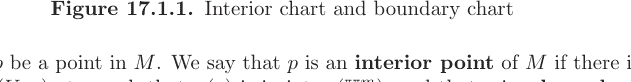
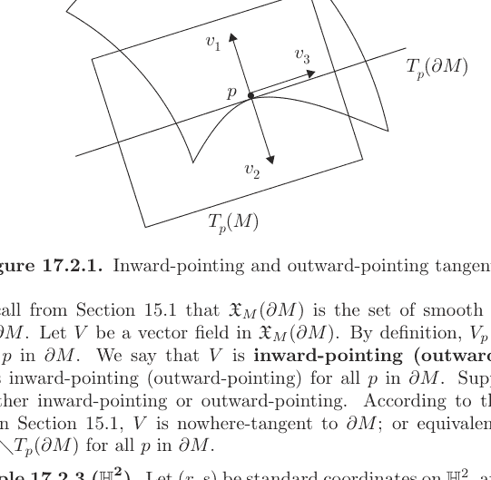

## 第 17 章

## 带边界的光滑流形

在实践中遇到原本是光滑流形但因某种“边界”的存在而有所不同的情况并不罕见。本章中，我们引入带边界的光滑流形并证明微分几何中最重要的结果之一——Stokes 定理。

### 17.1 带边界的光滑流形

ℝ^m 的闭上半空间，由

ℍ^m = {(x¹, …, x^m) ∈ ℝ^m : x^m ≥ 0}

定义，是我们后来所称的带边界光滑 m-流形的模型。容易证明

int_ℝ^m(ℍ^m) = {(x¹, …, x^m) ∈ ℝ^m : x^m > 0}
ext_ℝ^m(ℍ^m) = {(x¹, …, x^m) ∈ ℝ^m : x^m < 0}
bd_ℝ^m(ℍ^m) = {(x¹, …, x^m) ∈ ℝ^m : x^m = 0}.

例如，ℍ³ = {(x, y, z) ∈ ℝ³ : z ≥ 0} 是包含 xy-平面的 ℝ³ 的上半部分，int_ℝ³(ℍ³) 是不含 xy-平面的 ℝ³ 的上半部分，ext_ℝ³(ℍ³) 是不含 xy-平面的 ℝ³ 的下半部分，而 bd_ℝ³(ℍ³) 是 xy-平面。

在整个讨论中，ℍ^m 假定具有由 ℝ^m 诱导的子空间拓扑。

我们的第一个目标是利用 ℍ^m 来拓广我们先前对“图表”的概念。设 M 是一个拓扑空间，并考虑对第 14.1 节中图表定义的一种修改。M 上的图表是一个对 (U, φ)，其中 U 是 M 中的开集且 φ : U ⟶ ℍ^m 是一个映射，使得：

- [C1] φ(U) 是 ℍ^m 中的开集。
- [C2] φ : U ⟶ φ(U) 是一个同胚。

与先前表述的不同之处在于 [C1] 中出现了 ℍ^m 而不是 ℝ^m。我们把 m 称为图表的维数。对于 φ(U) 中的每个点 p，(U, φ) 称为在 p 处的图表。如前所述，M 的一个图册 𝔄 = {(Uα, φα) : α ∈ A} 是 M 上图表的集合，使得 Uα 构成 M 的一个开覆盖。

带边界的拓扑 m-流形是一个对 (M, 𝔄)，其中 M 是一个拓扑空间且 𝔄 是 M 的一个图册，使得：

- [T1] 𝔄 中每个图表的维数为 m。
- [T2] M 的拓扑具有可数基。
- [T3] 对于 M 中任意一对不同点 p1, p2，存在 M 中不相交的开集 U1 和 U2，使得 p1 在 U1 中且 p2 在 U2 中。

设 M 是一个带边界的拓扑 m-流形，设 (U, φ) 是 M 上的一个图表。我们说 (U, φ) 是内部图表，如果 φ(U) 包含于 intℝ^m(ℍ^m)，并且是边界图表，如果 φ(U) 与 bdℝ^m(ℍ^m) 相交。显然，M 上的任何图表要么是内部图表要么是边界图表。由于 intℝ^m(ℍ^m) 是 ℝ^m 中的开集，根据定理 9.1.5 可知，如果 (U, φ) 是内部图表，则它是第 14.1 节意义下的图表。另一方面，如果 φ(U) 与 bdℝ^m(ℍ^m) 相交，我们就有了全新的东西。

图 17.1.1. 内部图表和边界图表

设 p 是 M 中的一点。我们说 p 是 M 的内部点，如果存在在 p 处的图表 (U, φ) 使得 φ(p) 在 intℝ^m(ℍ^m) 中，并且说 p 是 M 的边界点，如果存在在 p 处的图表 (V, ψ) 使得 ψ(p) 在 bdℝ^m(ℍ^m) 中。见图 17.1.1，其中 p1 和 p2 是内部点，而 p3 是边界

点。我们注意到，在内部点处的图表要么是内部图表要么是边界图表，但边界点处的图表必然是边界图表。由于 M 中任意点 p 都包含于至少一个图表中，它要么是内部点（相对于该图表）要么是边界点（相对于该图表）。这就引出了这样一个问题：p 是否可能相对于一个图表是内部点，同时相对于另一个图表是边界点。这是一个关键事实：这种情况不可能发生。

### 定理 17.1.1 （边界的拓扑不变性）。带边界的拓扑流形中的每个点要么是内部点要么是边界点，但不是两者兼有。

设 M 是一个带边界的拓扑流形，设 p 是 M 中的一点。定理 17.1.1 的一个推论是，判断 p 是内部点还是边界点与在 p 处选择的图表无关。M 的内部点的集合记为 M° 并称为 M 的（流形）内部，M 的边界点的集合记为 ∂M 并称为 M 的（流形）边界。因此，M 是 M° 与 ∂M 的不交并。

有了图表的概念，第 14.1 节中提出的其它核心定义——过渡映射、切空间、光滑图册等——几乎逐字逐句地转移到本设定中。然而，必须考虑 ℍ^m 的边界。为此，在考虑光滑性时，我们采用第 10.1 节中引入的“扩展”光滑性定义。

带边界的拓扑流形 (M,𝔄) 称为带边界的光滑 m-流形，如果 𝔄 是 M 的一个光滑图册。

### 例 17.1.2 （ℍ^m）。带边界的光滑 m-流形的明显例子是拓扑空间 ℍ^m 配上由单个图表 (ℍ^m, id_ℍ^m = (r¹,…,r^m)) 构成的光滑图册。ℍ^m 的内部和边界分别为

(ℍ^m)° = int_ℝ^m(ℍ^m)      且      ∂ℍ^m = bd_ℝ^m(ℍ^m)，

分别。我们模仿 ℝ^m 的情况，称 (r¹,…,r^m) 为 ℍ^m 上的标准坐标，称 (∂/∂r¹,…,∂/∂r^m) 和 (d(r¹),…,d(r^m)) 分别为 ℍ^m 的相应标准坐标标架和标准对偶坐标标架，并称由 d(r¹)∧⋯∧d(r^m) 诱导的 ℍ^m 的定向为标准定向。

### 例 17.1.3 （闭区间）。ℝ 中的闭区间 [a,b] 是一个带边界的光滑 1-流形，其中 [a,b]° = (a,b) 且 ∂[a,b] = {a,b}。该例子在第 16.8 节中已有预示。

设 M 是一个带边界的光滑流形，设 (U,φ) 是 M 上的一个边界图表，设 p 是 ∂M∩U 中的一点。根据定义，p 是边界点，所以由定理 17.1.1 可知 φ(p) 在 ∂ℍ^m 中。因此，坐标映射把边界点映到边界点。更一般地，我们有以下结果。

## 定理17.1.4（边界的微分同胚不变性）。

*若* $M$ *和* $N$ *是带边光滑流形，且* $F:M\to N$ *是微分同胚，则* $F(\partial M)=\partial N$，*因此* $F(M^\circ)=F(N^\circ)$。

带边光滑流形的定义中并没有要求边界非空。若边界实际上为空，则光滑图册完全由内部坐标卡组成。在这种情况下，所得到的光滑结构就是第14.1节所定义的光滑流形结构。因此，边界为空的带边光滑流形将简称为**光滑流形**。另一方面，我们确立如下约定。

**今后，带边光滑流形默认具有非空边界。**

第14.8节给出的子流形定义可以直接推广到当前情形。光滑流形或带边光滑流形的子流形可能有边界，也可能没有边界。必要时我们使用术语**子流形**和**带边子流形**来明确情况。例如，$\mathbb{H}^m$ 是光滑 $m$ 流形 $\mathbb{R}^m$ 的一个带边 $m$ 子流形。在处理光滑流形或带边光滑流形时，我们以一般意义使用术语**坐标卡**，指内部坐标卡或边界坐标卡，仅在需要明确区分时使用“边界坐标卡”这一术语。

流形边界与拓扑边界之间的区别值得强调。例如，考虑 $\mathbb{R}^2$ 中的单位开圆盘 $D$。作为光滑 2 流形 $\mathbb{R}^2$ 的一个开 2 子流形，$D$ 本身是一个光滑 2 流形，因此没有边界。另一方面，作为拓扑空间 $\mathbb{R}^2$ 的子集，$D$ 的拓扑边界由单位圆周组成。

根据下面的结果，带边光滑流形的边界自动具有光滑结构。

### 定理17.1.5。

*若* $M$ *是带边的光滑* $m$ *流形，其中* $m\ge 2$，*则* $\partial M$ *是* $M$ *的一个* $(m-1)$*-子流形，从而是* $M$ *的一个超曲面。*

例如，$\partial\mathbb{H}^m$ 是 $\mathbb{H}^m$ 的一个超曲面。有时将光滑 $(m-1)$ 流形 $\partial\mathbb{H}^m$ 与 $\mathbb{R}^{m-1}$ 等同起来是方便的。

## 17.2 内指向量与外指向量

对于带边光滑流形的边界点，有两个相关联的切空间，需要区分它们。设 $M$ 是带边的光滑 $m$ 流形，并设 $p$ 是 $M$ 中的一点。由上面给出的定义可知，$T_p(M)$ 是一个 $m$ 维向量空间，无论 $p$ 是内点还是边界点都是如此。然而，当 $p$ 是边界点时，由定理17.1.5可知 $\partial M$ 是 $M$ 的超曲面，因此 $T_p(\partial M)$ 是一个 $(m-1)$ 维向量空间。由 (14.8.1) 和定理17.1.5可知，$T_p(\partial M)$ 是 $T_p(M)$ 的子空间（或至少可与 $T_p(M)$ 的一个子空间等同）。

### 定理17.2.1。设 M 是带边的光滑 m 流形，设 p 是一个边界点，设 v 是 T_p(M) 中的一个向量。设 (U, φ = (x^i)) 和 (Ũ, φ̃ = (x̃^i)) 是 p 处的（边界）坐标卡，并且在局部坐标中，设

v = Σ_{i=1}^m a^i ∂/∂x^i|_p 和 v = Σ_{i=1}^m ã^i ∂/∂x̃^i|_p.

则 a^m 和 ã^m 要么都为 0，要么都不为 0 且符号相同。

证明：我们不妨假设 φ(p) = (0,…,0)。考虑转移映射 φ̃ ∘ φ^{-1} : φ(W) ⟶ φ̃(W)，其中 W = U ∩ Ũ，且 φ̃ ∘ φ^{-1} = (x̃^1 ∘ φ^{-1}, …, x̃^m ∘ φ^{-1})。

由定理17.1.4，φ̃ ∘ φ^{-1} 将 H^m 的边界（内部）点送到 H^m 的边界（内部）点。因此，对 φ(W) ∩ ∂H^m 中的所有 (r^1,…,r^{m-1},0)，有 x̃^m ∘ φ^{-1}(r^1,…,r^{m-1},0) = 0 (17.2.1)；对 φ(W) ∩ (H^m)° 中的所有 (r^1,…,r^{m-1},r^m)（注意 r^m > 0），有 x̃^m ∘ φ^{-1}(r^1,…,r^{m-1},r^m) > 0 (17.2.2)。由 (14.3.2) 和 (17.2.1) 可得，当 i = 1,…,m−1 时，

∂x̃^m/∂x^i (p) = ∂(x̃^m ∘ φ^{-1})/∂r^i (0,…,0,0) = 0 (17.2.3)；

由 (14.3.2)、(17.2.1) 和 (17.2.2) 可得，

∂x̃^m/∂x^m (p) = ∂(x̃^m ∘ φ^{-1})/∂r^m (0,…,0,0) = lim_{r→0+} [x̃^m ∘ φ^{-1}(0,…,0,r) − x̃^m ∘ φ^{-1}(0,…,0,0)]/r (17.2.4) = lim_{r→0+} [x̃^m ∘ φ^{-1}(0,…,0,r)]/r ≥ 0。

设 $\mathcal X$ 和 $\widetilde{\mathcal X}$ 分别是与 $(U,(x^i))$ 和 $(\widetilde U,(\widetilde x^i))$ 对应的坐标标架。则由定理14.3.5(b)和(17.2.3)可得

$$[\operatorname{id}_{T_p(M)}]_{\mathcal X_p}^{\widetilde{\mathcal X}_p}=\begin{bmatrix}\dfrac{\partial\widetilde x^1}{\partial x^1}(p)&\cdots&\dfrac{\partial\widetilde x^1}{\partial x^{m-1}}(p)&\dfrac{\partial\widetilde x^1}{\partial x^m}(p)\\ \vdots&\ddots&\vdots&\vdots\\ \dfrac{\partial\widetilde x^{m-1}}{\partial x^1}(p)&\cdots&\dfrac{\partial\widetilde x^{m-1}}{\partial x^{m-1}}(p)&\dfrac{\partial\widetilde x^{m-1}}{\partial x^m}(p)\\ 0&\cdots&0&\dfrac{\partial\widetilde x^m}{\partial x^m}(p)\end{bmatrix},$$ (17.2.5)

因此

$$\det\left([\operatorname{id}_{T_p(M)}]_{\mathcal X_p}^{\widetilde{\mathcal X}_p}\right)=\frac{\partial\widetilde x^m}{\partial x^m}(p)\det\left(\begin{bmatrix}\dfrac{\partial\widetilde x^1}{\partial x^1}(p)&\cdots&\dfrac{\partial\widetilde x^1}{\partial x^{m-1}}(p)\\ \vdots&\ddots&\vdots\\ \dfrac{\partial\widetilde x^{m-1}}{\partial x^1}(p)&\cdots&\dfrac{\partial\widetilde x^{m-1}}{\partial x^{m-1}}(p)\end{bmatrix}\right).$$

由定理2.5.3，上述等式左边非零，因此右边也非零。于是由(17.2.4)得

$$\frac{\partial\widetilde x^m}{\partial x^m}(p)>0.$$ (17.2.6)

由(2.2.5)我们有

$$\begin{bmatrix}\widetilde a^1\\ \vdots\\ \widetilde a^m\end{bmatrix}=[\operatorname{id}_{T_p(M)}]_{\mathcal X_p}^{\widetilde{\mathcal X}_p}\begin{bmatrix}a^1\\ \vdots\\ a^m\end{bmatrix},$$

再由(17.2.5)得

$$\widetilde a^m=a^m\frac{\partial\widetilde x^m}{\partial x^m}(p).$$ (17.2.7)

现在结论由(17.2.6)和(17.2.7)直接得出。

沿用上述记号，若 $a^m>0$，则称 $v$ 是**内指的**；若 $a^m<0$，则称 $v$ 是**外指的**。根据定理17.2.1，这一判定与用来在局部坐标中表示 $v$ 的坐标卡的选取无关。我们需要考虑 $a^m=0$ 的情形。由定理14.8.3(b)和定理17.1.5可知，在 $M$ 上的 $p$ 点存在一个（边界）坐标卡，它是 $\partial M$ 在 $M$ 中的切片坐标卡。若 $(U,\varphi=(x^1,\ldots,x^m))$ 是这样的坐标卡，则 $((\partial/\partial x^1)|_p,\ldots,(\partial/\partial x^{m-1})|_p)$ 是 $T_p(\partial M)$ 的一组基。因此，$a^m=0$ 当且仅当 $v$ 属于 $T_p(\partial M)$。这一观察连同定理17.2.1证明了下面的结果。

### 定理17.2.2。

设 M 是带边光滑流形，设 p 是 M 中的一个边界点。则 T_p(M) 是 p 处内指切向量集合、外指切向量集合与 T_p(∂M) 的不交并。

参见图17.2.1，其中 v₁ 是内指的，v₂ 是外指的，v₃ 属于 T_p(∂M)。

# 图17.2.1. 内指和外指切向量

回顾第15.1节，𝔛_M(∂M) 是沿 ∂M 的光滑向量场的集合。设 V 是 𝔛_M(∂M) 中的一个向量场。根据定义，对所有 p ∈ ∂M，V_p 属于 T_p(M)。若对所有 p ∈ ∂M，V_p 都是内指的（外指的），则称 V 是内指的（外指的）。假设 V 实际上是内指的或外指的。根据第15.1节给出的定义，V 处处不与 ∂M 相切；等价地，对所有 p ∈ ∂M，V_p 属于 T_p(M) \ T_p(∂M)。

### 例17.2.3 (ℍ²)。

设 (r, s) 是 ℍ² 上的标准坐标，设 (∂/∂r, ∂/∂s) 是相应的标准坐标标架。由例15.1.6，我们有等同关系 (∂/∂r, ∂/∂s) = (e₁, e₂)。因此，∂/∂s 和 −∂/∂s 分别是 𝔛_ℍ²(∂ℍ²) 中的内指和外指向量场。

### 例17.2.4（半球）。

设 (x, y, z) 是 ℝ³ 上的标准坐标，设 (∂/∂x, ∂/∂y, ∂/∂z) 是相应的标准坐标标架。根据例15.1.6，我们有等同关系 (∂/∂x, ∂/∂y, ∂/∂z) = (e₁, e₂, e₃)。考虑半球形带边光滑 2 流形

𝒮² ∩ ℍ³ = {(x, y, z) ∈ ℝ³ : x² + y² + z² = 1, z ≥ 0}，

其中边界

∂(𝒮² ∩ ℍ³) = {(x, y, z) ∈ ℝ³ : x² + y² = 1, z = 0}

是 $\mathbb{R}^3$ 的 $xy$ 平面中的单位圆。则 $\partial/\partial z$ 和 $-\partial/\partial z$ 分别是 $\mathfrak{X}_{S^2\cap\mathbb{H}^3}(\partial(S^2\cap\mathbb{H}^3))$ 中的内指向和外指向向量场。

前面例子中的“构造”可以推广到任意带边界的光滑流形，下面我们就来证明这一点。

### 定理 17.2.5（外指向向量场的存在性）

若 $M$ 是带边界的光滑流形，则 $\mathfrak{X}_M(\partial M)$ 中存在一个外指向向量场。

证明. 这里只给出证明的梗概。设 $\mathfrak{A} = \{(U_\alpha, (x_\alpha^1,\dots,x_\alpha^m)) : \alpha \in A\}$ 是 $M$ 的一个光滑图册，并设 $(\partial/\partial x_\alpha^1,\dots,\partial/\partial x_\alpha^m)$ 是与 $(U_\alpha,(x_\alpha^1,\dots,x_\alpha^m))$ 对应的坐标标架。为简洁起见，令 $V_\alpha = -(\partial/\partial x_\alpha^m)|_{\partial M\cap U_\alpha}$。则 $V_\alpha$ 是 $\mathfrak{X}_M(\partial M\cap U_\alpha)$ 中的一个外指向向量场。设 $\{\pi_\alpha : \alpha \in A\}$ 是从属于 $\partial M$ 的开覆盖 $\{\partial M \cap U_\alpha : \alpha \in A\}$ 的单位分解。可以证明，$\pi_\alpha V_\alpha$ 有一个到整个 $\partial M$ 的光滑延拓，使得该延拓（仍记为 $\pi_\alpha V_\alpha$）在 $\partial M\setminus\operatorname{supp}(\pi_\alpha)$ 上恒取常数值 $0$。还可以证明 $V = \sum_\alpha \pi_\alpha V_\alpha$ 是 $\mathfrak{X}_M(\partial M)$ 中的一个向量场。

我们断言 $V$ 是外指向的。设 $p$ 是 $\partial M$ 中的一点，设 $(U,(x^1,\dots,x^m))$ 是 $p$ 处的（边界）坐标卡，并设 $((\partial/\partial x^1)|_p,\dots,(\partial/\partial x^m)|_p)$ 是 $p$ 处相应的坐标基。对每个 $\alpha \in A$，$V_\alpha|_p = \sum_{i=1}^m \beta_\alpha^i(p)\, \partial/\partial x^i|_p$，其中 $\beta_\alpha^1(p),\dots,\beta_\alpha^m(p)$ 是实数，因此 $V_p = \sum_\alpha \pi_\alpha(p)V_\alpha|_p = \sum_{i=1}^m \left(\sum_\alpha \pi_\alpha(p)\beta_\alpha^i(p)\right) \partial/\partial x^i|_p$。

由单位分解的性质，对所有 $\alpha$ 有 $\pi_\alpha(p) \geq 0$，且至少有一个 $\alpha$ 使 $\pi_\alpha(p) > 0$。由于 $V_\alpha|_p$ 是外指向的，对所有 $\alpha$ 有 $\beta_\alpha^m(p) < 0$。由此可得 $\sum_\alpha \pi_\alpha(p)\beta_\alpha^m(p) < 0$，故 $V_p$ 是外指向的。由于 $p$ 是任意的，$V$ 是外指向的。

## 17.3 边界的定向

设 $(M,\mathfrak{O})$ 是带边界的光滑 $m$ 维定向流形，其中 $m \geq 2$。由定理 17.2.5，$\mathfrak{X}_M(\partial M)$ 中存在一个外指向向量场 $V$。设 $\mathfrak{O}_{\partial M}$ 是由 $V$ 诱导的 $\partial M$ 的定向，如定理 16.6.9 所给出。我们将 $\mathfrak{O}_{\partial M}$ 称为 $\partial M$ 的斯托克斯定向。在定理 16.6.9 的相关讨论中提到，由与超曲面处处不相切的向量场所诱导的超曲面定向，并不独立于这种向量场的选择。这里超曲面是边界，而处处不切向量场是外指向的。这一附加特殊性有以下推论。

### 定理 17.3.1.

若 $(M,\mathfrak{O})$ 是带边界的光滑 $m$ 维定向流形，其中 $m \geq 2$，则 $\partial M$ 的斯托克斯定向不依赖于 $\mathfrak{X}_M(\partial M)$ 中外指向向量场的选择。

证明. 设 $V$ 和 $W$ 是 $\mathfrak{X}_M(\partial M)$ 中的外指向向量场。由定理 16.6.9(b)，$i_V(\varpi)|_{\partial M}$ 和 $i_W(\varpi)|_{\partial M}$ 是 $\partial M$ 上的定向形式。由定理 16.6.1(a)，存在唯一确定的处处非零函数 $f \in C^\infty(\partial M)$，使得 $i_W(\varpi)|_{\partial M}=f\,i_V(\varpi)|_{\partial M}$。只需证明 $i_V(\varpi)|_{\partial M}$ 与 $i_W(\varpi)|_{\partial M}$ 一致，即 $f$ 在 $\partial M$ 上恒为正。设 $p$ 是 $\partial M$ 中的一点，设 $(U,(x^1,\dots,x^m))$ 是 $p$ 处的（边界）坐标卡，设 $((\partial/\partial x^1)|_p,\dots,(\partial/\partial x^m)|_p)$ 是 $p$ 处相应的坐标基，并在局部坐标下令

$V_p = \sum_{i=1}^m a^i \frac{\partial}{\partial x^i}\Big|_p \quad\text{和}\quad W_p = \sum_{i=1}^m b^i \frac{\partial}{\partial x^i}\Big|_p. \tag{17.3.1}$

类似于证明定理 1.1.2 和定理 1.1.4 所用的论证表明

$\mathcal{V}_p = \left(V_p, \frac{\partial}{\partial x^1}\Big|_p, \dots, \frac{\partial}{\partial x^{m-1}}\Big|_p\right)$

与

$\mathcal{W}_p = \left(W_p, \frac{\partial}{\partial x^1}\Big|_p, \dots, \frac{\partial}{\partial x^{m-1}}\Big|_p\right)$

都是 $T_p(M)$ 的基。于是

$(i_V(\varpi)|_{\partial M})|_p\left(\frac{\partial}{\partial x^1}\Big|_p, \dots, \frac{\partial}{\partial x^{m-1}}\Big|_p\right) = \varpi_p\left(V_p, \frac{\partial}{\partial x^1}\Big|_p, \dots, \frac{\partial}{\partial x^{m-1}}\Big|_p\right) = \det\left([\mathrm{id}_{T_p(M)}]^{\mathcal{W}_p}_{\mathcal{V}_p}\right)\varpi_p\left(W_p, \frac{\partial}{\partial x^1}\Big|_p, \dots, \frac{\partial}{\partial x^{m-1}}\Big|_p\right) = \det\left([\mathrm{id}_{T_p(M)}]^{\mathcal{W}_p}_{\mathcal{V}_p}\right)(i_W(\varpi)|_{\partial M})|_p\left(\frac{\partial}{\partial x^1}\Big|_p, \dots, \frac{\partial}{\partial x^{m-1}}\Big|_p\right),$

其中第二个等号由定理 7.3.3(b) 得出。因此，$f(p)=\det\left([\mathrm{id}_{T_p(M)}]^{\mathcal{W}_p}_{\mathcal{V}_p}\right).$

再由 (2.2.6) 和 (2.2.7) 得

$$[\operatorname{id}_{T_p(M)}]\,{}^{W_p}V_p = \begin{bmatrix}\dfrac{b^m}{a^m} & O_{1\times(m-1)} \\ \begin{bmatrix}\dfrac{a^m b^2-b^m a^2}{a^m} \\ \vdots \\ \dfrac{a^m b^{m-1}-b^m a^{m-1}}{a^m}\end{bmatrix} & I_{m-1}\end{bmatrix},$$

因此 $f(p)=b^m/a^m$。因为 $V_p$ 和 $W_p$ 是外指向的，按定义有 $a^m,b^m<0$，所以 $f(p)>0$。由于 $p$ 是任意的，结论得证。

### 定理 17.3.2（$\partial\mathbb{H}^m$ 的斯托克斯定向）

设 $(r^1,\ldots,r^m)$ 是 $\mathbb{H}^m$ 上的标准坐标，设 $(\partial/\partial r^1,\ldots,\partial/\partial r^m)$ 和 $(d(r^1),\ldots,d(r^m))$ 分别是相应的标准坐标标架和对偶坐标标架，并设 $\mathbb{H}^m$ 具有标准定向。则 $\partial\mathbb{H}^m$ 上的标架 $((-1)^m\partial/\partial r^1,\ldots,\partial/\partial r^{m-1})$ 具有斯托克斯定向。

*证明.* 由例 17.1.2 知，按定义，$\mathbb{H}^m$ 的标准定向由 $\Omega_{\mathbb{H}^m}=d(r^1)\wedge\cdots\wedge d(r^m)$ 诱导。由于 $-\partial/\partial r^m$ 是 $\mathfrak{X}_{\mathbb{H}^m}(\partial\mathbb{H}^m)$ 中的外指向向量场，由定理 16.6.9(b) 和定理 17.3.1 可知，$\iota_{-\partial/\partial r^m}(\Omega_{\mathbb{H}^m}|_{\partial\mathbb{H}^m})$ 是 $\partial\mathbb{H}^m$ 上诱导斯托克斯定向的定向形式。设 $X_1,\ldots,X_{m-1}$ 是 $\mathfrak{X}(\partial\mathbb{H}^m)$ 中的向量场。由定理 15.8.3(a)，

$$\iota_{-\partial/\partial r^m}(\Omega_{\mathbb{H}^m})|_{\partial\mathbb{H}^m}(X_1,\ldots,X_{m-1}) = \Omega_{\mathbb{H}^m}\left(-\frac{\partial}{\partial r^m},X_1,\ldots,X_{m-1}\right)$$

$$=\det\begin{pmatrix}0 & d(r^1)(X_1) & \cdots & d(r^1)(X_{m-1})\\ \vdots & \vdots & \ddots & \vdots\\ 0 & d(r^{m-1})(X_1) & \cdots & d(r^{m-1})(X_{m-1})\\ -1 & d(r^m)(X_1) & \cdots & d(r^m)(X_{m-1})\end{pmatrix}$$

$$=(-1)^m\det\begin{pmatrix}d(r^1)(X_1) & \cdots & d(r^1)(X_{m-1})\\ \vdots & \ddots & \vdots\\ d(r^{m-1})(X_1) & \cdots & d(r^{m-1})(X_{m-1})\end{pmatrix}$$

$$=(-1)^m d(r^1)\wedge\cdots\wedge d(r^{m-1})(X_1,\ldots,X_{m-1}).$$

由于 $X_1,\ldots,X_{m-1}$ 是任意的，

$$\iota_{-\partial/\partial r^m}(\Omega_{\mathbb{H}^m})|_{\partial\mathbb{H}^m}=(-1)^m d(r^1)\wedge\cdots\wedge d(r^{m-1}).$$

按照 17.1 节末尾的注记，我们将 $\partial\mathbb{H}^m$ 等同于 $\mathbb{R}^{m-1}$。于是 $(r^1,\ldots,r^{m-1})$ 是 $\partial\mathbb{H}^m$ 上的标准坐标，且 $(\partial/\partial r^1,\ldots,\partial/\partial r^{m-1})$ 是相应的标准坐标标架。由定理 15.8.4，

$$\iota_{-\partial/\partial r^m}(\Omega_{\mathbb{H}^m})|_{\partial\mathbb{H}^m}(\partial/\partial r^1,\ldots,\partial/\partial r^{m-1}) = (-1)^m,$$

因此

$$\iota_{-\partial/\partial r^m}(\Omega_{\mathbb{H}^m})|_{\partial\mathbb{H}^m}((-1)^m\partial/\partial r^1,\ldots,\partial/\partial r^{m-1}) = 1.$$

由于 $\iota_{-\partial/\partial r^m}(\Omega_{\mathbb{H}^m})|_{\partial\mathbb{H}^m}$ 诱导斯托克斯定向，由定理 16.6.3 可知 $((-1)^m\partial/\partial r^1,\ldots,\partial/\partial r^{m-1})$ 具有斯托克斯定向。

## 17.4 斯托克斯定理

在本节中，我们证明微分几何的核心结果之一——斯托克斯定理。它用一条概括性的陈述统一了向量分析的众多核心定理，如 21.2 节所示。

虽然此处不给出细节，但 16.7 节中关于光滑流形上微分形式积分的理论可以推广到带边界的光滑流形上的微分形式积分。

### 定理 17.4.1（斯托克斯定理）

设 $(M,\mathfrak{D})$ 是带边界的光滑 $m$ 维定向流形，并设 $\partial M$ 具有斯托克斯定向。若 $\omega$ 是 $\Lambda^{m-1}(M)$ 中具有紧支集的微分形式，则

$$\int_M d(\omega) = \int_{\partial M} \omega, \tag{17.4.1}$$

其中右端被积函数解释为 $\omega|_{\partial M}$。

*证明.* 我们只考虑 $M = \mathbb{H}^m$ 的情形。设 $(r^1,\ldots,r^m)$ 是 $\mathbb{H}^m$ 上的标准坐标，并设 $(d(r^1),\ldots,d(r^m))$ 是相应的标准对偶坐标标架。设 $\mathbb{H}^m$ 具有标准定向，且 $\partial\mathbb{H}^m$ 具有相应的斯托克斯定向。

第 1 步：计算 (17.4.1) 的左端 $\int_{\mathbb{H}^m} d(\omega)$。

由于 $\omega$ 具有紧支集，由定理 9.4.2 可知存在实数 $c_1,\ldots,c_m > 0$，使得 $\operatorname{supp}(\omega)$ 真包含于闭胞腔

$$C = [-c_1,c_1]\times\cdots\times[-c_{m-1},c_{m-1}]\times[0,c_m].$$

由定理 7.2.12(e) 的流形版本，在局部坐标下有

$$\omega = \sum_{i=1}^m \alpha_i\, d(r^1)\wedge\cdots\wedge\widehat{d(r^i)}\wedge\cdots\wedge d(r^m), \tag{17.4.2}$$

因此

$d(\omega) = \sum_{i=1}^{m} d(\alpha_i) \wedge d(r^1) \wedge \cdots \widehat{d(r^i)} \wedge \cdots \wedge d(r^m)$

$= \sum_{i=1}^{m} \left[\left(\sum_{j} \frac{\partial \alpha_i}{\partial r^j} d(r^j)\right) \wedge d(r^1) \wedge \cdots \widehat{d(r^i)} \wedge \cdots \wedge d(r^m)\right]$

$= \sum_{i=1}^{m} \left(\sum_{j} \frac{\partial \alpha_i}{\partial r^j} d(r^j) \wedge d(r^1) \wedge \cdots \widehat{d(r^i)} \wedge \cdots \wedge d(r^m)\right)$

$= \sum_{i=1}^{m} \left(\frac{\partial \alpha_i}{\partial r^i} d(r^i) \wedge d(r^1) \wedge \cdots \widehat{d(r^i)} \wedge \cdots \wedge d(r^m)\right)$

$= \left(\sum_{i=1}^{m} (-1)^{i-1} \frac{\partial \alpha_i}{\partial r^i}\right) d(r^1) \wedge \cdots \wedge d(r^m),$

其中第一个等号来自定理 16.1.2，第二个等号来自定理 15.4.7，第四个等号来自定理 15.8.3(b)，最后一个等号来自定理 15.8.2(b)，其中 ^ 表示省略一项。于是

$\int_{\mathbb{H}^m} d(\omega)$

$= \int_C \left(\sum_{i=1}^{m} (-1)^{i-1} \frac{\partial \alpha_i}{\partial r^i}\right) d(r^1) \wedge \cdots \wedge d(r^m)$

$= \sum_{i=1}^{m} (-1)^{i-1} \int_C \frac{\partial \alpha_i}{\partial r^i} d(r^1) \wedge \cdots \wedge d(r^m)$

$= \sum_{i=1}^{m} (-1)^{i-1} \int_0^{c_m} \int_{-c_{m-1}}^{c_{m-1}} \cdots \int_{-c_1}^{c_1} \frac{\partial \alpha_i}{\partial r^i}(r^1,\dots,r^m) dr^1 \cdots dr^m$

$= \sum_{i=1}^{m-1} (-1)^{i-1} \int_0^{c_m} \int_{-c_{m-1}}^{c_{m-1}} \cdots \widehat{\int_{-c_i}^{c_i}} \cdots \int_{-c_1}^{c_1} \left(\int_{-c_i}^{c_i} \frac{\partial \alpha_i}{\partial r^i}(r^1,\dots,r^m) dr^i\right)$

$dr^1 \cdots \widehat{dr^i} \cdots dr^m$

$+ (-1)^{m-1} \int_{-c_{m-1}}^{c_{m-1}} \cdots \int_{-c_1}^{c_1} \left(\int_0^{c_m} \frac{\partial \alpha_m}{\partial r^m}(r^1,\dots,r^m) dr^m\right) dr^1 \cdots dr^{m-1}$

$= \sum_{i=1}^{m-1} (-1)^{i-1} \int_0^{c_m} \int_{-c_{m-1}}^{c_{m-1}} \cdots \widehat{\int_{-c_i}^{c_i}} \cdots \int_{-c_1}^{c_1} \alpha_i(r^1,\dots,r^m)\Big|_{r^i=c_i}^{r^i=-c_i}$

$dr^1 \cdots \widehat{dr^i} \cdots dr^m$

$+ (-1)^{m-1} \int_{-c_{m-1}}^{c_{m-1}} \cdots \int_{-c_1}^{c_1} \alpha_m(r^1,\dots,r^m)\Big|_{r^m=c_m}^{r^m=0} dr^1 \cdots dr^{m-1},$

其中第三个等号来自 (16.7.2)，第四个等号来自定理 10.5.4，最后一个等号来自微积分基本定理。选择
