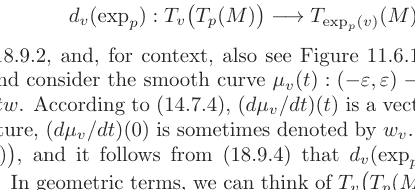
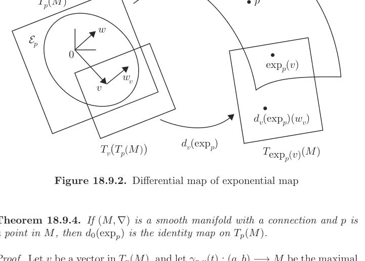
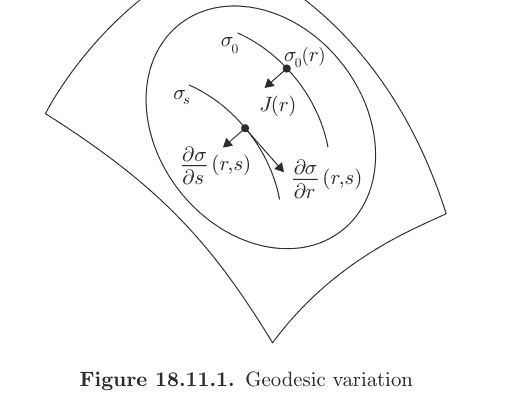

# 第 18 章

# 带联络的光滑流形

在第三部分的引言中，我们提出了在先前对曲线和曲面的研究基础上发展微分几何理论的任务，但不需要涉及环境空间。这项工作的隐含目标是尽可能恢复为曲线和曲面所呈现的结果。第 14–17 章已经完成了这一议程的重要部分。然而，明显缺少的是关于“协变导数”和“度量”的讨论。本章通过在光滑流形的讨论中加入“联络”来弥补前一个缺失。

## 18.1 协变导数

设 $M$ 是一个光滑流形。$M$ 上的一个**联络**是一个映射

$$\nabla : \mathfrak{X}(M) \times \mathfrak{X}(M) \longrightarrow \mathfrak{X}(M)$$

+   使得对于 $\mathfrak{X}(M)$ 中的所有向量场 $X,Y,Z$ 以及 $C^\infty(M)$ 中的所有函数 $f$：
+   
+   [V1] $\nabla(X+Y,Z)=\nabla(X,Z)+\nabla(Y,Z)$.
+   
+   [V2] $\nabla(fX,Y)=f\nabla(X,Y)$.
+   
+   [V3] $\nabla(X,Y+Z)=\nabla(X,Y)+\nabla(X,Z)$.
+   
+   [V4] $\nabla(X,fY)=X(f)Y+f\nabla(X,Y)$.

我们将二元组 $(M,\nabla)$ 称为一个**带联络的光滑流形**。一个给定的光滑流形可以有多个联络。因此，联络不是流形的基本组成部分，不像例如边界构成带边界光滑流形的一部分那样。

### 例 18.1.1。

联络有两个明显的例子。设 U 是 ℝ^m 中的开集。将 U 视为光滑 m-流形，令

D : 𝔛(U) × 𝔛(U) ⟶ 𝔛(U)

是由

D(X, Y) = D_X(Y)

对 𝔛(U) 中的所有向量场 X, Y 定义的映射，其中 D_X 是关于 X 的欧几里得导数。由定理 10.3.1 可知，D 是 U 上的联络。

类似地，设 (M, 𝔤) 是 ℝ³ 中的正则曲面。根据例 14.1.5，M 是光滑 2-流形。令

∇ : 𝔛(M) × 𝔛(M) ⟶ 𝔛(M)

是由

∇(X, Y) = ∇_X(Y)

对 𝔛(M) 中的所有向量场 X, Y 定义的映射，其中 ∇_X 是关于 X 的协变导数。我们从定理 12.4.1 得到 ∇ 是 M 上的联络。◇

在前面的每个例子中，我们都从一个“导数”出发，并用它来定义联络。给定一个带联络的光滑流形，我们可以反过来进行这个过程。

设 (M, ∇) 是一个带联络的光滑流形，设 X 是 𝔛(M) 中的一个向量场。我们定义映射

∇_X : 𝔛(M) ⟶ 𝔛(M)

为

∇_X(Y) = ∇(X, Y)

对 𝔛(M) 中的所有向量场 Y。从 [∇3] 和 [∇4] 可知 ∇_X 是 ℝ^m-线性的，并且从 [∇4] 可知

∇_X(fY) = X(f)Y + f∇_X(Y)

对所有 C^∞(M) 中的函数 f 和 𝔛(M) 中的所有向量场 Y 成立。根据定理 16.2.7，存在一个唯一的张量导数

∇_X : 𝒯_s^r(M) ⟶ 𝒯_s^r(M)

在 M 上，称为关于 X 的协变导数，其中 (∇_X)_s^r 已简写为 ∇_X。特别地，我们有

∇_X(f) = X(f) (18.1.1)

对所有 C^∞(M) 中的函数 f 成立。

### 定理 18.1.2（协变导数的向量场性质）。

设 (M, ∇) 是一个带联络的光滑流形，设 X, Y, Z 是 𝔛(M) 中的向量场，设 f 是 C^∞(M) 中的函数。则：

+   (a) ∇_{X+Y}(Z) = ∇_X(Z) + ∇_Y(Z).
+   (b) ∇_{fX}(Y) = f∇_X(Y).
+   (c) ∇_X(Y + Z) = ∇_X(Y) + ∇_X(Z).
+   (d) ∇_X(fY) = X(f)Y + f∇_X(Y).

证明。这直接从性质 [∇1]–[∇4] 得出。

### 定理 18.1.3（协变导数的张量场性质）。

设 (M,∇) 是一个带联络的光滑流形，设 X 是 𝔛(M) 中的一个向量场，设 𝒜,ℬ 和 𝒞 分别是 𝒯_s^r(M) 和 𝒯_{s'}^r'(M) 中的张量场。则：

+   (a) ∇_X(𝒜 + ℬ) = ∇_X(𝒜) + ∇_X(ℬ).
+   (b) ∇_X(𝒜 ⊗ 𝒞) = ∇_X(𝒜) ⊗ 𝒞 + 𝒜 ⊗ ∇_X(𝒞).

证明。这由第 16.2 节给出的张量导数的定义性质得出。

### 定理 18.1.4（协变导数的整体表达式）。

设 (M,∇) 是一个带联络的光滑流形，设 𝒜 是 𝒯_s^r(M) 中的一个张量场，设 X, Y₁,...,Y_s 是 𝔛(M) 中的向量场，设 ω¹,...,ω^r 是 𝔛*(M) 中的余向量场。则

∇_X(𝒜)(ω¹,...,ω^r, Y₁,...,Y_s)
= X(𝒜(ω¹,...,ω^r, Y₁,...,Y_s))
− ∑_{i=1}^r 𝒜(ω¹,...,ω^{i−1}, ∇_X(ω^i), ω^{i+1},...,ω^r, Y₁,...,Y_s)
− ∑_{j=1}^s 𝒜(ω¹,...,ω^r, Y₁,...,Y_{j−1}, ∇_X(Y_j), Y_{j+1},...,Y_s).

证明。这由定理 16.2.4 得出。

### 例 18.1.5。

设 (M,∇) 是一个带联络的光滑流形，设 𝒜 是 𝒯₂⁰(M) 中的一个张量场，设 X,Y,Z 是 𝔛(M) 中的向量场，设 ω 是 𝔛*(M)=𝒯₁⁰(M) 中的一个余向量场。我们从 (18.1.1) 和定理 18.1.4 得到

∇_X(ω)(Y) = X(ω(Y)) − ω(∇_X(Y)) = ∇_X(ω(Y)) − ω(∇_X(Y))    (18.1.2)

以及

∇_X(𝒜)(Y,Z) = X(𝒜(Y,Z)) − 𝒜(∇_X(Y),Z) − 𝒜(Y,∇_X(Z))
= ∇_X(𝒜(Y,Z)) − 𝒜(∇_X(Y),Z) − 𝒜(Y,∇_X(Z)).    (18.1.3)

容易证明，如果 𝒜 在其两个参数上是对称的，那么 ∇_X(𝒜) 也是对称的。

设 $(M,\nabla)$ 是一个带联络的光滑流形，设 $X$ 是 $\mathfrak{X}(M)$ 中的一个向量场。可以证明，$\nabla_X$ 在以下意义上是逐点确定的：对于 $M$ 中的所有点 $p$ 和 $\mathfrak{X}(M)$ 中的所有向量场 $Y$，

$$\nabla_X(Y)_p = \nabla_{\tilde{X}}(Y)_p$$

对于 $\mathfrak{X}(M)$ 中所有满足 $X_p = \tilde{X}_p$ 的向量场 $X,\tilde{X}$。对于 $M$ 中的每个点 $p$ 和 $T_p(M)$ 中的向量 $v$，我们通过

$$\nabla_v(Y) = \nabla_X(Y)_p \tag{18.1.4}$$

定义 $T_p(M)$ 中的向量 $\nabla_v(Y)$，其中 $X$ 是 $\mathfrak{X}(M)$ 中满足 $X_p = v$ 的任意向量场。由定理 15.1.2，这样的 $X$ 总是存在。由于 $\nabla_X$ 是逐点确定的，$\nabla_v(Y)$ 与向量场的选择无关，因此是良定义的。由 (18.1.4) 可知，对于 $\mathfrak{X}(M)$ 中的所有向量场 $X,Y$，

$$\nabla_{X_p}(Y) = \nabla_X(Y)_p \tag{18.1.5}$$

根据定义，$\operatorname{Lin}(\mathfrak{X}(M),\mathfrak{X}(M))$ 是从向量空间 $\mathfrak{X}(M)$ 到自身的所有 $\mathbb{R}$-线性映射构成的向量空间。我们通过将乘法定义为映射的复合，使 $\operatorname{Lin}(\mathfrak{X}(M),\mathfrak{X}(M))$ 成为 $\mathbb{R}$ 上的环。设 $\Theta,\Upsilon,\Psi$ 是三个这样的映射，并定义 $\Theta$ 和 $\Upsilon$ 的括号为

$$[\Theta,\Upsilon] = \Theta \circ \Upsilon - \Upsilon \circ \Theta.$$

容易证明，在这个定义下，$\operatorname{Lin}(\mathfrak{X}(M),\mathfrak{X}(M))$ 是 $\mathbb{R}$ 上的李代数。特别地，雅可比恒等式成立：

$$[[\Theta,\Upsilon],\Psi] + [[\Upsilon,\Psi],\Theta] + [[\Psi,\Theta],\Upsilon] = 0.$$

对于 $\mathfrak{X}(M)$ 中的向量场 $X,Y,Z$，从定理 18.1.2 的 (c) 和 (d) 部分可知，$\nabla_X,\nabla_Y,\nabla_Z$ 是 $\operatorname{Lin}(\mathfrak{X}(M),\mathfrak{X}(M))$ 中的映射，因此

$$[[\nabla_X,\nabla_Y],\nabla_Z] + [[\nabla_Y,\nabla_Z],\nabla_X] + [[\nabla_Z,\nabla_X],\nabla_Y] = 0. \tag{18.1.6}$$

## 18.2 Christoffel 符号

在我们对 $\mathbb{R}_p^3$ 中正则曲面的研究中，我们定义了 Christoffel 符号，并用它们来构造协变导数，现在我们将其视为与联络等价（参见例 18.1.1）。我们对带联络的光滑流形的处理方法则是相反的：我们从一个联络开始，然后用它来定义 Christoffel 符号。

设 $(M,\nabla)$ 是一个带联络的光滑 $m$-流形，设 $X$ 是 $\mathfrak{X}(M)$ 中的一个向量场，设 $(U,(x^i))$ 是 $M$ 上的一个坐标卡，设 $\mathcal{X} = (\partial/\partial x^1,\dots,\partial/\partial x^m)$ 是对应的坐标标架。可以证明，$\nabla$ 无歧义地限制到光滑 $m$-流形 $U$ 上。为简化记号，我们将限制

$$\nabla|_U \quad \text{记为} \quad \nabla.$$


hence
\[
\nabla_X(Y) = \sum_i \alpha^i \nabla_{\partial/\partial x^i}(Y) = \sum_j \left( \sum_i \alpha^i \beta^j_{;i} \right) \frac{\partial}{\partial x^j}.
\]

(b): The components of \(\nabla_{\partial/\partial x^i}(d(x^j))\) are

\[
\nabla_{\partial/\partial x^i}(d(x^j))\left(\frac{\partial}{\partial x^k}\right)
= \frac{\partial}{\partial x^i}\left( d(x^j)\left(\frac{\partial}{\partial x^k}\right) \right)
- d(x^j)\left( \nabla_{\partial/\partial x^i}\left(\frac{\partial}{\partial x^k}\right) \right)
\quad [(18.1.2)]
\]
\[
= - d(x^j)\left( \sum_l \Gamma^l_{ik} \frac{\partial}{\partial x^l} \right)
\quad [(18.2.1)]
\]
\[
= - \sum_l \Gamma^l_{ik} d(x^j)\left(\frac{\partial}{\partial x^l}\right) = -\Gamma^j_{ik},
\]
hence
\[
\nabla_{\partial/\partial x^i}(d(x^j)) = - \sum_k \Gamma^j_{ik} d(x^k). \tag{18.2.4}
\]

Then
\[
\nabla_{\partial/\partial x^i}(\omega)
= \nabla_{\partial/\partial x^i}\left( \sum_j \gamma_j d(x^j) \right)
= \sum_j \nabla_{\partial/\partial x^i}(\gamma_j d(x^j))
\]
\[
= \sum_j \left( \nabla_{\partial/\partial x^i}(\gamma_j) d(x^j) + \gamma_j \nabla_{\partial/\partial x^i}(d(x^j)) \right)
\]
\[
= \sum_j \left( \frac{\partial \gamma_j}{\partial x^i} d(x^j) - \gamma_j \sum_k \Gamma^j_{ik} d(x^k) \right)
\quad [(18.2.4)]
\]
\[
= \sum_j \frac{\partial \gamma_j}{\partial x^i} d(x^j) - \sum_{j,k} \gamma_j \Gamma^j_{ik} d(x^k)
\]
\[
= \sum_j \frac{\partial \gamma_j}{\partial x^i} d(x^j) - \sum_{j,k} \gamma_k \Gamma^k_{ij} d(x^j)
\]
\[
= \sum_j \left( \frac{\partial \gamma_j}{\partial x^i} - \sum_k \gamma_k \Gamma^k_{ij} \right) d(x^j)
= \sum_j \gamma_{j;i} d(x^j),
\]
so
\[
\nabla_X(\omega)
= \sum_i \alpha^i \nabla_{\partial/\partial x^i}(\omega)
= \sum_i \alpha^i \left( \sum_j \gamma_{j;i} d(x^j) \right)
= \sum_j \left( \sum_i \alpha^i \gamma_{j;i} \right) d(x^j). \quad \square
\]

We observe that the expressions for \(\nabla_X(Y)\) and \(\nabla_X(\omega)\) in parts (a) and (b) of Theorem 18.2.1 involve the \(\alpha^i\) but not their partial derivatives. In order to compute \(\nabla_X(Y)\) and \(\nabla_X(\omega)\) at a given point, all we need to know about \(X\) is its value at that point. This is consistent with \(\nabla_X\) being determined pointwise, as was remarked in conjunction with (18.1.4).

In the notation of Theorem 18.2.1, we have as special cases

\[
\nabla_{\partial/\partial x^i}(Y) = \sum_j \beta^j_{;i} \frac{\partial}{\partial x^j}
\quad\text{and}\quad
\nabla_{\partial/\partial x^i}(\omega) = \sum_j \gamma_{j;i} d(x^j).
\]

These formulas tell us that to take the covariant derivatives of \(Y\) and \(\omega\) with respect to \(\partial/\partial x^i\), we simply add a subscript “;i” to each of the components in the local coordinate expressions.

### Theorem 18.2.2 (Local Coordinate Expression for Covariant Derivative).

Let \((M,\nabla)\) be a smooth \(m\)-manifold with a connection, let \(\mathcal{A}\) be a tensor field in \(T^r_s(M)\), and, in local coordinates, let \(\mathcal{A}^{i_1\cdots i_r}_{j_1\cdots j_s}\) be the components of \(\mathcal{A}\). Then the components of \(\nabla_{\partial/\partial x^k}(\mathcal{A})\) are

\[
\nabla_{\partial/\partial x^k}(\mathcal{A})^{i_1\cdots i_r}_{j_1\cdots j_s}
= \frac{\partial \mathcal{A}^{i_1\cdots i_r}_{j_1\cdots j_s}}{\partial x^k}
+ \sum_{l=1}^{r} \left( \sum_{p=1}^{m} \Gamma^{i_l}_{kp} \mathcal{A}^{i_1\cdots i_{l-1} p i_{l+1}\cdots i_r}_{j_1\cdots j_s} \right)
- \sum_{l=1}^{s} \left( \sum_{p=1}^{m} \Gamma^p_{k j_l} \mathcal{A}^{i_1\cdots i_r}_{j_1\cdots j_{l-1} p j_{l+1}\cdots j_s} \right).
\]

**Proof.** By Theorem 18.1.4,

\[
\begin{aligned}
\nabla_{\partial/\partial x^k}(\mathcal{A})^{i_1\cdots i_r}_{j_1\cdots j_s}
&= \nabla_{\partial/\partial x^k}(\mathcal{A})\left(d(x^{i_1}),\ldots,d(x^{i_r}),\frac{\partial}{\partial x^{j_1}},\ldots,\frac{\partial}{\partial x^{j_s}}\right) \\
&= \frac{\partial}{\partial x^k}\left( \mathcal{A}\left(d(x^{i_1}),\ldots,d(x^{i_r}),\frac{\partial}{\partial x^{j_1}},\ldots,\frac{\partial}{\partial x^{j_s}}\right) \right) \\
&\quad - \sum_{l=1}^{r} \mathcal{A}\left(d(x^{i_1}),\ldots,\nabla_{\partial/\partial x^k}(d(x^{i_l})),\ldots,d(x^{i_r}),\frac{\partial}{\partial x^{j_1}},\ldots,\frac{\partial}{\partial x^{j_s}}\right) \\
&\quad - \sum_{l=1}^{s} \mathcal{A}\left(d(x^{i_1}),\ldots,d(x^{i_r}),\frac{\partial}{\partial x^{j_1}},\ldots,\nabla_{\partial/\partial x^k}\left(\frac{\partial}{\partial x^{j_l}}\right),\ldots,\frac{\partial}{\partial x^{j_s}}\right).
\end{aligned}
\]

We have

\[
\frac{\partial}{\partial x^k}\left( \mathcal{A}\left(d(x^{i_1}),\ldots,d(x^{i_r}),\frac{\partial}{\partial x^{j_1}},\ldots,\frac{\partial}{\partial x^{j_s}}\right) \right)
= \frac{\partial \mathcal{A}^{i_1\cdots i_r}_{j_1\cdots j_s}}{\partial x^k}.
\]

## 18.2 Christoffel Symbols

**Proof.** We have

\[
\nabla_{\partial/\partial \tilde{x}^p}\left(\frac{\partial}{\partial \tilde{x}^q}\right)
= \sum_l \tilde{\Gamma}^{l}_{pq}\frac{\partial}{\partial \tilde{x}^l}
\tag{18.2.1}
\]
\[
= \sum_l \tilde{\Gamma}^{l}_{pq}\left(\sum_k \frac{\partial x^k}{\partial \tilde{x}^l}\frac{\partial}{\partial x^k}\right)
\quad \text{(Theorem 15.1.8)}
\]
\[
= \sum_k\left(\sum_l \tilde{\Gamma}^{l}_{pq}\frac{\partial x^k}{\partial \tilde{x}^l}\right)\frac{\partial}{\partial x^k}.
\tag{18.2.5}
\]

On the other hand,

\[
\nabla_{\partial/\partial \tilde{x}^p}\left(\frac{\partial}{\partial \tilde{x}^q}\right)
= \nabla_{\sum_i \frac{\partial x^i}{\partial \tilde{x}^p}\frac{\partial}{\partial x^i}}
\left(\sum_j \frac{\partial x^j}{\partial \tilde{x}^q}\frac{\partial}{\partial x^j}\right)
\]
\[
= \sum_{ij}\frac{\partial x^i}{\partial \tilde{x}^p}
\nabla_{\partial/\partial x^i}
\left(\frac{\partial x^j}{\partial \tilde{x}^q}\frac{\partial}{\partial x^j}\right)
\]
\[
= \sum_{ij}\frac{\partial x^i}{\partial \tilde{x}^p}
\left[
\nabla_{\partial/\partial x^i}
\left(\frac{\partial x^j}{\partial \tilde{x}^q}\right)\frac{\partial}{\partial x^j}
+ \frac{\partial x^j}{\partial \tilde{x}^q}
\nabla_{\partial/\partial x^i}
\left(\frac{\partial}{\partial x^j}\right)
\right]
\]
\[
= \sum_{ij}\frac{\partial x^i}{\partial \tilde{x}^p}
\left[
\nabla_{\partial/\partial x^i}
\left(\frac{\partial x^j}{\partial \tilde{x}^q}\right)\frac{\partial}{\partial x^j}
+ \frac{\partial x^j}{\partial \tilde{x}^q}
\sum_k \Gamma^k_{ij}\frac{\partial}{\partial x^k}
\right].
\tag{18.2.6}
\]

where the first equality follows from Theorem 15.1.8, and the last equality from (18.2.1). We also have

\[
\nabla_{\partial/\partial x^i}\left(\frac{\partial x^j}{\partial \tilde{x}^q}\right)
= \sum_k \frac{\partial \tilde{x}^k}{\partial x^i}
\nabla_{\partial/\partial \tilde{x}^k}
\left(\frac{\partial x^j}{\partial \tilde{x}^q}\right)
= \sum_k \frac{\partial \tilde{x}^k}{\partial x^i}
\frac{\partial^2 x^j}{\partial \tilde{x}^k\partial \tilde{x}^q},
\tag{18.2.7}
\]

where the first equality follows from Theorem 15.1.8. Combining (18.2.6) and (18.2.7) yields

\[
\nabla_{\partial/\partial \tilde{x}^p}\left(\frac{\partial}{\partial \tilde{x}^q}\right)
= \sum_{ij}\frac{\partial x^i}{\partial \tilde{x}^p}
\left[
\left(\sum_k\frac{\partial \tilde{x}^k}{\partial x^i}
\frac{\partial^2 x^j}{\partial \tilde{x}^k\partial \tilde{x}^q}\right)\frac{\partial}{\partial x^j}
+ \frac{\partial x^j}{\partial \tilde{x}^q}
\sum_k \Gamma^k_{ij}\frac{\partial}{\partial x^k}
\right]
\tag{18.2.8}
\]
\[
= \sum_{ijk}\frac{\partial x^i}{\partial \tilde{x}^p}
\frac{\partial x^j}{\partial \tilde{x}^q}
\Gamma^k_{ij}\frac{\partial}{\partial x^k}
+ \sum_{ijk}\frac{\partial x^i}{\partial \tilde{x}^p}
\frac{\partial \tilde{x}^k}{\partial x^i}
\frac{\partial^2 x^j}{\partial \tilde{x}^k\partial \tilde{x}^q}
\frac{\partial}{\partial x^j}.
\]

The second term in the last line of (18.2.8) can be expressed as

\[
\begin{aligned}
\sum_{ijk}\frac{\partial x^i}{\partial \tilde{x}^p}
\frac{\partial \tilde{x}^k}{\partial x^i}
\frac{\partial^2 x^j}{\partial \tilde{x}^k\partial \tilde{x}^q}
\frac{\partial}{\partial x^j}
&= \sum_{jk}\left[
\left(\sum_i \frac{\partial \tilde{x}^k}{\partial x^i}
\frac{\partial x^i}{\partial \tilde{x}^p}\right)
\frac{\partial^2 x^j}{\partial \tilde{x}^k\partial \tilde{x}^q}
\frac{\partial}{\partial x^j}
\right] \\
&= \sum_{jk}\frac{\partial \tilde{x}^k}{\partial \tilde{x}^p}
\frac{\partial^2 x^j}{\partial \tilde{x}^k\partial \tilde{x}^q}
\frac{\partial}{\partial x^j} \\
&= \sum_j \frac{\partial^2 x^j}{\partial \tilde{x}^p\partial \tilde{x}^q}
\frac{\partial}{\partial x^j} \\
&= \sum_k \frac{\partial^2 x^k}{\partial \tilde{x}^p\partial \tilde{x}^q}
\frac{\partial}{\partial x^k},
\end{aligned}
\]

so (18.2.8) becomes

\[
\nabla_{\partial/\partial \tilde{x}^p}\left(\frac{\partial}{\partial \tilde{x}^q}\right)
= \sum_k \left(
\sum_{ij}\frac{\partial x^i}{\partial \tilde{x}^p}
\frac{\partial x^j}{\partial \tilde{x}^q}
\Gamma^k_{ij}
+ \frac{\partial^2 x^k}{\partial \tilde{x}^p\partial \tilde{x}^q}
\right)\frac{\partial}{\partial x^k}.
\tag{18.2.9}
\]

Comparing (18.2.5) and (18.2.9) shows that

\[
\sum_{ij}\frac{\partial x^i}{\partial \tilde{x}^p}
\frac{\partial x^j}{\partial \tilde{x}^q}
\Gamma^k_{ij}
+ \frac{\partial^2 x^k}{\partial \tilde{x}^p\partial \tilde{x}^q}
= \sum_l \tilde{\Gamma}^l_{pq}\frac{\partial x^k}{\partial \tilde{x}^l}.
\]

Multiplying both sides of the preceding identity by \(\partial \tilde{x}^r/\partial x^k\) and summing over \(k\) yields

\[
\begin{aligned}
\sum_{ijk}\frac{\partial x^i}{\partial \tilde{x}^p}
\frac{\partial x^j}{\partial \tilde{x}^q}
\frac{\partial \tilde{x}^r}{\partial x^k}
\Gamma^k_{ij}
+ \sum_k \frac{\partial^2 x^k}{\partial \tilde{x}^p\partial \tilde{x}^q}
\frac{\partial \tilde{x}^r}{\partial x^k}
&= \sum_{kl}\tilde{\Gamma}^l_{pq}
\frac{\partial \tilde{x}^r}{\partial x^k}
\frac{\partial x^k}{\partial \tilde{x}^l} \\
&= \sum_l \tilde{\Gamma}^l_{pq}
\left(\sum_k \frac{\partial \tilde{x}^r}{\partial x^k}
\frac{\partial x^k}{\partial \tilde{x}^l}\right) \\
&= \sum_l \tilde{\Gamma}^l_{pq}
\frac{\partial \tilde{x}^r}{\partial \tilde{x}^l} \\
&= \tilde{\Gamma}^r_{pq}.
\end{aligned}
\]

We see from Theorem 15.6.3 and Theorem 18.2.3 that, despite appearances, the Christoffel symbols are not the components of a tensor. In classical terminology it is said that the Christoffel symbols “do not transform” like the components of a tensor.

## 18.3 Covariant Derivative on Curves

The definition of covariant derivative given in Section 18.1 refers to an entire smooth manifold. We now discuss a version of covariant derivative that applies only to smooth curves on a smooth manifold.

### Theorem 18.3.1 (Existence of Covariant Derivative on a Curve).

If \((M,\nabla)\) is a smooth manifold with a connection and \(\lambda(t):(a,b)\longrightarrow M\) is a smooth curve, then there is a unique linear map

\[
\frac{\nabla}{dt}: \mathfrak{X}_M(\lambda)\longrightarrow \mathfrak{X}_M(\lambda),
\]

called the covariant derivative on \(\lambda\), such that for all vector fields \(J,K\) in \(\mathfrak{X}_M(\lambda)\), all functions \(f\) in \(C^\infty(M)\), all vector fields \(X\) in \(\mathfrak{X}(M)\), and all points \(t\) in \((a,b)\):

- (a) \(\displaystyle \frac{\nabla(J+K)}{dt}(t)=\frac{\nabla J}{dt}(t)+\frac{\nabla K}{dt}(t)\).
- (b) \(\displaystyle \frac{\nabla(fJ)}{dt}(t)=\frac{df}{dt}(t)J(t)+f(t)\frac{\nabla J}{dt}(t)\).
- (c) \(\displaystyle \frac{\nabla(X\circ\lambda)}{dt}(t)=\nabla_{(d\lambda/dt)(t)}(X)\).

**Remark.** The notation \(\nabla_{(d\lambda/dt)(t)}(X)\) in part (c) is justified by the discussion surrounding (18.1.4).

### Theorem 18.3.2 (Local Coordinate Expression for Covariant Derivative on a Curve).

Let \((M,\nabla)\) be a smooth manifold with a connection, let \(\lambda(t):(a,b)\longrightarrow M\) be a smooth curve, and let \(J\) be a vector field in \(\mathfrak{X}_M(\lambda)\). Let \((U,(x^i))\) be a chart on \(M\) such that \(\lambda((a,b))\subset U\), and, in local coordinates, let

\[
J(t)=\sum_i \alpha^i(t)\left.\frac{\partial}{\partial x^i}\right|_{\lambda(t)}.
\]

Then

\[
\frac{\nabla J}{dt}(t)
= \sum_k \left(
\frac{d\alpha^k}{dt}(t)
+ \sum_{ij}\frac{d(x^i\circ\lambda)}{dt}(t)\alpha^j(t)\Gamma^k_{ij}(\lambda(t))
\right)
\left.\frac{\partial}{\partial x^k}\right|_{\lambda(t)}
\]

for all \(t\) in \((a,b)\).

**Proof.** Theorem 18.3.1 is used repeatedly in what follows. We have

\[
\frac{\nabla}{dt}\left(\left.\frac{\partial}{\partial x^j}\right|_{\lambda(t)}\right)
= \nabla_{(d\lambda/dt)(t)}\left(\frac{\partial}{\partial x^j}\right),
\]

so

\[
\begin{aligned}
\frac{\nabla J}{dt}(t)
&= \sum_j \frac{\nabla}{dt}\left(\alpha^j(t)\left.\frac{\partial}{\partial x^j}\right|_{\lambda(t)}\right) \\
&= \sum_j \frac{d\alpha^j}{dt}(t)\left.\frac{\partial}{\partial x^j}\right|_{\lambda(t)}
+ \sum_j \alpha^j(t)\nabla_{(d\lambda/dt)(t)}\left(\frac{\partial}{\partial x^j}\right).
\tag{18.3.1}
\end{aligned}
\]

By Theorem 14.7.1(b),

\[
\frac{d\lambda}{dt}(t)
= \sum_i \frac{d(x^i\circ\lambda)}{dt}(t)\left.\frac{\partial}{\partial x^i}\right|_{\lambda(t)},
\]


hence

$$\nabla_{(d\lambda/dt)(t)}\left(\frac{\partial}{\partial x^j}\right) = \sum_i \frac{d(x^i\circ\lambda)}{dt}(t)\nabla_{(\partial/\partial x^i)(\lambda(t))}\left(\frac{\partial}{\partial x^j}\right)$$
$$= \sum_i \frac{d(x^i\circ\lambda)}{dt}(t)\left(\sum_k \Gamma^k_{ij}(\lambda(t))\frac{\partial}{\partial x^k}\bigg|_{\lambda(t)}\right)$$
$$= \sum_{ik}\frac{d(x^i\circ\lambda)}{dt}(t)\Gamma^k_{ij}(\lambda(t))\frac{\partial}{\partial x^k}\bigg|_{\lambda(t)}.$$

The second term in the last line of (18.3.1) can therefore be expressed as

$$\sum_j \alpha^j(t)\nabla_{(d\lambda/dt)(t)}\left(\frac{\partial}{\partial x^j}\right)
= \sum_j\alpha^j(t)\left(\sum_{ik}\frac{d(x^i\circ\lambda)}{dt}(t)\Gamma^k_{ij}(\lambda(t))\frac{\partial}{\partial x^k}\bigg|_{\lambda(t)}\right)$$
$$= \sum_k\left(\sum_{ij}\frac{d(x^i\circ\lambda)}{dt}(t)\alpha^j(t)\Gamma^k_{ij}(\lambda(t))\right)\frac{\partial}{\partial x^k}\bigg|_{\lambda(t)}.$$

Then (18.3.1) becomes

$$\frac{\nabla J}{dt}(t)
= \sum_k\frac{d\alpha^k}{dt}(t)\frac{\partial}{\partial x^k}\bigg|_{\lambda(t)}
+ \sum_k\left(\sum_{ij}\frac{d(x^i\circ\lambda)}{dt}(t)\alpha^j(t)\Gamma^k_{ij}(\lambda(t))\right)\frac{\partial}{\partial x^k}\bigg|_{\lambda(t)}$$
$$= \sum_k\left(\frac{d\alpha^k}{dt}(t)+\sum_{ij}\frac{d(x^i\circ\lambda)}{dt}(t)\alpha^j(t)\Gamma^k_{ij}(\lambda(t))\right)\frac{\partial}{\partial x^k}\bigg|_{\lambda(t)}.$$

## Theorem 18.3.3.

Let $(M,\nabla)$ be a smooth manifold with a connection, let $\lambda(t):(a,b)\longrightarrow M$ be a smooth curve, let $J$ be a vector field in $\mathfrak X_M(\lambda)$, and let $g(u):(c,d)\longrightarrow(a,b)$ be a diffeomorphism. Then, for all $u$ in $(c,d)$:

- (a)
  
  $$\frac{\nabla(J\circ g)}{du}(u)=\frac{dg}{du}(u)\frac{\nabla J}{dt}(g(u)).$$
  
- (b)
  
  $$\frac{\nabla}{du}\left(\frac{d(\lambda\circ g)}{du}\right)(u)=\frac{d^2g}{du^2}(u)\frac{d\lambda}{dt}(g(u))+\left(\frac{dg}{du}(u)\right)^2\frac{\nabla}{dt}\left(\frac{d\lambda}{dt}\right)(g(u)).$$

> *Remark.* $\nabla/dt$ and $\nabla/du$ denote covariant differentiation on $\lambda$ and $\lambda\circ g$, respectively.

*Proof.* We consider only the case where $(U,(x^i))$ is a chart on $M$ such that $\lambda(a,b)\subset U$.

(b): The components of $\nabla(X)$ are

$$
\begin{aligned}
\nabla(X)\left(d(x^i),\frac{\partial}{\partial x^j}\right)
&=d(x^i)\left(\nabla_{\partial/\partial x^j}(X)\right)\\
&=d(x^i)\left(\sum_k\alpha^k_{;j}\frac{\partial}{\partial x^k}\right)\\
&=\sum_k\alpha^k_{;j}d(x^i)\left(\frac{\partial}{\partial x^k}\right)=\alpha^i_{;j},
\end{aligned}
$$

from which the result follows.

## Theorem 18.4.5.

Let $(M,\nabla)$ be a smooth manifold with a connection, let $X,Y$ be vector fields in $\mathfrak{X}(M)$, and let $\omega$ be a covector field in $\mathfrak{X}^*(M)$. Then:

- (a) $$\nabla(\omega)(X,Y)=X(\omega(Y))-\omega(\nabla_X(Y)).$$
- (b) If $\omega=\sum_k\gamma_kd(x^k)$ in local coordinates, then
  
  $$\nabla(\omega)=\sum_{ij}\gamma_{j;i}\,d(x^i)\otimes d(x^j).$$

*Proof.* (a): We have

$$
\begin{aligned}
\nabla(\omega)(X,Y)&=\nabla_X(\omega)(Y)\\
&=X(\omega(Y))-\omega(\nabla_X(Y)).
\end{aligned}
$$

(b): The components of $\nabla(\omega)$ are

$$
\begin{aligned}
\nabla(\omega)\left(\frac{\partial}{\partial x^i},\frac{\partial}{\partial x^j}\right)
&=\nabla_{\partial/\partial x^i}(\omega)\left(\frac{\partial}{\partial x^j}\right)\\
&=\left(\sum_k\gamma_kd(x^k)\right)\left(\frac{\partial}{\partial x^j}\right)\\
&=\sum_k\gamma_{k;i}d(x^k)\left(\frac{\partial}{\partial x^j}\right)=\gamma_{j;i},
\end{aligned}
$$

from which the result follows.

## Theorem 18.4.6.

Let $(M,\nabla)$ be a smooth manifold with a connection, let $\mathcal{A}$ be a tensor field in $\mathcal{T}^0_2(M)$, and let $X,Y,Z$ be vector fields in $\mathfrak{X}(M)$. Then

$$\nabla(\mathcal{A})(X,Y,Z)=X(\mathcal{A}(Y,Z))-\mathcal{A}(\nabla_X(Y),Z)-\mathcal{A}(Y,\nabla_X(Z)).$$

*Proof.* We have

$$
\begin{aligned}
\nabla(\mathcal{A})(X,Y,Z)
&=\nabla_X(\mathcal{A})(Y,Z)\\
&=X(\mathcal{A}(Y,Z))-\mathcal{A}(\nabla_X(Y),Z)-\mathcal{A}(Y,\nabla_X(Z)).
\end{aligned}
$$

## 18.5 Parallel Translation

## Theorem 18.4.7

Let $(M,\nabla)$ be a smooth manifold with a connection, let $f$ be a function in $C^\infty(M)$, and let $X,Y$ be vector fields in $\mathfrak{X}(M)$. Then

$$\nabla^2(f)(X,Y)=X(Y(f))-\nabla_X(Y)(f).$$

*Proof.* We have

$$\begin{aligned}
\nabla^2(f)(X,Y)&=\nabla(\nabla(f))(X,Y)\\
&=\nabla(df)(X,Y) && [\mathrm{Th\ 18.4.3}]\\
&=X(df(Y))-df(\nabla_X(Y)) && [\mathrm{Th\ 18.4.5(a)}]\\
&=X(Y(f))-\nabla_X(Y)(f). && [\mathrm{Th\ 15.4.5(b)}]
\end{aligned}$$

Adopting the notation of Theorem 18.4.7 and using (18.1.1) three times, we obtain

$$\begin{aligned}
\nabla^2(f)(X,Y)&=X(Y(f))-\nabla_X(Y)(f)\\
&=\nabla_X(\nabla_Y(f))-\nabla_{\nabla_X(Y)}(f).
\end{aligned}\tag{18.4.3}$$

This shows that in the context of regular surfaces in $\mathbb{R}^3$, $\nabla^2(f)(X,Y)$ is precisely $\nabla^2_{X,Y}(f)$, the second order covariant derivative of $f$ with respect to $X$ and $Y$, as given by (12.4.3).

## 18.5 Parallel Translation

Let $(M,\nabla)$ be a smooth manifold with a connection, and let $\lambda:(a,b)\longrightarrow M$ be a smooth curve. We say that a vector field $J$ in $\mathfrak{X}_M(\lambda)$ is **parallel** (with respect to $\nabla$) if

$$\frac{\nabla J}{dt}(t)=0$$

for all $t$ in $(a,b)$.

## Theorem 18.5.1 (Existence of Parallel Vector Field on a Curve).

Let $(M,\nabla)$ be a smooth $m$-manifold with a connection, let $\lambda(t):(a,b)\longrightarrow M$ be a smooth curve, let $t_0$ be a point in $(a,b)$, and let $v$ be a vector in $T_{\lambda(t_0)}(M)$. Then:

- (a) There is a unique parallel vector field $J$ in $\mathfrak{X}_M(\lambda)$ such that $J(t_0)=v$.
- (b) Let $(U,(x^i))$ be a chart on $M$ such that $\lambda((a,b))\subset U$, and, in local coordinates, let

$$J(t)=\sum_i\alpha^i(t)\left.\frac{\partial}{\partial x^i}\right|_{\lambda(t)}.\tag{18.5.1}$$

Then the $\alpha^i$ satisfy the following system of differential equations, with initial condition $J(t_0)=v$:

$$\frac{d\alpha^k}{dt}(t)+\sum_{i,j}\frac{d(x^i\circ\lambda)}{dt}(t)\,\alpha^j(t)\,\Gamma^k_{ij}(\lambda(t))=0$$

for all $t$ in $(a,b)$ for $k=1,\ldots,m$.

Proof. By Theorem 18.3.2, the identity $(\nabla J/dt)(t)=0$ for all $t$ in $(a,b)$ is equivalent to the above system of ordinary differential equations. The result now follows from the theory of differential equations.

Continuing with the notation of Theorem 18.5.1, let us denote

J(t) by $\Pi_{\lambda(t_0)}^{\lambda(t)}(v)$.

Then (18.5.1) becomes

$\Pi_{\lambda(t_0)}^{\lambda(t)}(v) = \sum_i \alpha^i(t) \partial/\partial x^i |_{\lambda(t)}$.

Fixing $t_0$ and $t$ in $(a,b)$ and allowing $v$ to vary, the assignment

$v \longmapsto \Pi_{\lambda(t_0)}^{\lambda(t)}(v)$

for all vectors $v$ in $T_{\lambda(t_0)}(M)$ defines a map

$\Pi_{\lambda(t_0)}^{\lambda(t)} : T_{\lambda(t_0)}(M) \longrightarrow T_{\lambda(t)}(M)$

called parallel translation on $\lambda$ from $\lambda(t_0)$ to $\lambda(t)$. We say that $\Pi_{\lambda(t_0)}^{\lambda(t)}(v)$ is the parallel translate of $v$. Let us observe that the initial condition of Theorem 18.5.1 can now be expressed as $\Pi_{\lambda(t_0)}^{\lambda(t_0)}(v)=v$.

## Example 18.5.2 (Smooth 2-Manifolds).

For smooth 2-manifolds with a connection, the differential equations in Theorem 18.5.1 are simply

$d\alpha^1/dt (t) + d(x^1\circ\lambda)/dt (t)[\alpha^1(t)\Gamma^1_{11}(\lambda(t)) + \alpha^2(t)\Gamma^1_{12}(\lambda(t))] + d(x^2\circ\lambda)/dt (t)[\alpha^1(t)\Gamma^1_{21}(\lambda(t)) + \alpha^2(t)\Gamma^1_{22}(\lambda(t))] = 0$

and

$d\alpha^2/dt (t) + d(x^1\circ\lambda)/dt (t)[\alpha^1(t)\Gamma^2_{11}(\lambda(t)) + \alpha^2(t)\Gamma^2_{12}(\lambda(t))] + d(x^2\circ\lambda)/dt (t)[\alpha^1(t)\Gamma^2_{21}(\lambda(t)) + \alpha^2(t)\Gamma^2_{22}(\lambda(t))] = 0$.

In particular, these equations apply to regular surfaces with the connection defined in Example 18.1.1.

## Example 18.5.3 (Pln).

Let us view the regular surface Pln, discussed in Section 13.1, as a smooth 2-manifold with the connection defined in Example 18.1.1. Let $\lambda(t) : (a,b) \longrightarrow Pln$ be a smooth curve, let $t_0$ be a point in $(a,b)$, and let $v$ be a vector in Pln. The Christoffel symbols have constant value 0, so $\Pi_{\lambda(t_0)}^{\lambda(t)}(v) = (\alpha^1(t),\alpha^2(t))$. From Example 18.5.2, the differential equations are $(d\alpha^k/dt)(t)=0$ for $k=1,2$, with the initial condition $\Pi_{\lambda(t_0)}^{\lambda(t_0)}(v)=v$. It


# 18.5 平行移动

可知 $\alpha^k$ 与 $t$ 无关，所以对所有 $t$ 在 $(a,b)$ 中有 $\Pi^{\lambda(t)}_{\lambda(t_0)}(v)=v$。这表明在 $\mathrm{PIn}$ 中将一个向量从一个点平行移动到另一个点，与连接这两个点的光滑曲线的选择无关。特别地，沿着 $\mathrm{PIn}$ 中闭合光滑曲线（如圆）的整个轨迹对向量进行平行移动，会使向量回到自身。

**例 18.5.4 ($S^2$)。** 设我们将正则曲面 $S^2$，在第 13.4 节中讨论过，视为一个光滑 2-流形，其联络由例 18.1.1 定义。设

$\theta(t):(a,b)\longrightarrow(0,\pi)\qquad\text{and}\qquad\phi(t):(a,b)\longrightarrow(-\pi,\pi)$

为微分同胚，并考虑光滑曲线 $\lambda(t):(a,b)\longrightarrow S^2$ 由

$$\lambda(t)=\varphi(\theta(t),\phi(t))=\bigl(\sin(\theta(t))\cos(\phi(t)),\sin(\theta(t))\sin(\phi(t)),\cos(\theta(t))\bigr).$$

在 $\lambda(t)$ 处的坐标基为 $(H_1|_{(\theta(t),\phi(t))},H_2|_{(\theta(t),\phi(t))})$，其中

$$H_1|_{(\theta(t),\phi(t))}=\bigl(\cos(\theta(t))\cos(\phi(t)),\cos(\theta(t))\sin(\phi(t)),-\sin(\theta(t))\bigr)$$

$$H_2|_{(\theta(t),\phi(t))}=\bigl(-\sin(\theta(t))\sin(\phi(t)),\sin(\theta(t))\cos(\phi(t)),0\bigr).$$

设

$$v=\frac{d\lambda}{dt}(t_0) \tag{18.5.2}$$

在定理 18.5.1 中并回顾第 13.4 节中关于 Christoffel 符号的结果，例 18.5.2 中的微分方程变为

$$\frac{d\alpha^1}{dt}(t)-\cos(\theta(t))\sin(\theta(t))\frac{d\phi}{dt}(t)\alpha^2(t)=0$$

$$\frac{d\alpha^2}{dt}(t)+\cot(\theta(t))\left(\frac{d\phi}{dt}(t)\alpha^1(t)+\frac{d\theta}{dt}(t)\alpha^2(t)\right)=0, \tag{18.5.3}$$

其中我们使用了

$(x\circ\lambda(t),x^2\circ\lambda(t))=(x^1,x^2)\circ\lambda(t)=\varphi^{-1}\circ\lambda(t)=(\theta(t),\phi(t)).$

对于 $(0,\pi)$ 中的给定点 $\theta_0$，设 $\theta$ 为常值为 $\theta_0$ 的函数，并设 $\phi$ 为恒等函数。此外，设我们用 $\phi$ 表示 $t$，使得 $\phi_0=t_0$ 且 $\phi$ 在 $(-\pi,\pi)$ 中。设 $c_0=\cos(\theta_0)$ 且 $s_0=\sin(\theta_0)$，我们有

$$\lambda(\phi)=(s_0\cos(\phi),s_0\sin(\phi),c_0) \tag{18.5.4}$$

$$\frac{d\lambda}{d\phi}(\phi)=(-s_0\sin(\phi),s_0\cos(\phi),0) \tag{18.5.5}$$

$$H_1|_{(\theta_0,\phi)}=(c_0\cos(\phi),c_0\sin(\phi),-s_0) \tag{18.5.6}$$

$$H_2|_{(\theta_0,\phi)}=(-s_0\sin(\phi),s_0\cos(\phi),0).$$

dα¹/dφ (φ) − c₀ s₀ α²(φ) = 0

dα²/dφ (φ) + c₀/s₀ α¹(φ) = 0,  (18.5.7)

其中我们假设 s₀ ≠ 0，或等价地，θ₀ ≠ π/2。注意 λ 的像落在 $S^2$ 对应于 θ₀ 的纬度曲线上。见图 13.4.1。

现在设 φ₀ = 0。则由 (18.5.2) 和 (18.5.5) 得 v = (0, s₀, 0)。我们寻求显式表达式

Π_{λ(0)}^{λ(φ)} ((0, s₀, 0)) = α¹(φ) H₁|_{(θ₀,φ)} + α²(φ) H₂|_{(θ₀,φ)},  (18.5.8)

满足初始条件

(0, s₀, 0) = Π_{λ(0)}^{λ(0)} ((0, s₀, 0)) = α¹(0) H₁|_{(θ₀,0)} + α²(0) H₂|_{(θ₀,0)}.  (18.5.9)

(18.5.7) 的解为

α¹(φ) = A cos(c₀ φ) − B sin(c₀ φ)
α²(φ) = −1/s₀ [A sin(c₀ φ) + B cos(c₀ φ)]  (18.5.10)

对于某些实数 A, B。令 φ = 0 代入 (18.5.6) 和 (18.5.10) 得

H₁|_{(θ₀,0)} = (c₀, 0, −s₀)      H₂|_{(θ₀,0)} = (0, s₀, 0)  (18.5.11)

且

α¹(0) = A      α²(0) = −B/s₀.  (18.5.12)

由 (18.5.9)、(18.5.11) 和 (18.5.12) 可得

(0, s₀, 0) = A(c₀, 0, −s₀) − B/s₀ (0, s₀, 0) = (A c₀, −B, −A s₀),

故 A = 0 且 B = −s₀。于是由 (18.5.10) 得

α¹(φ) = s₀ sin(c₀ φ)      α²(φ) = cos(c₀ φ).  (18.5.13)

最后，将 (18.5.6) 和 (18.5.13) 代入 (18.5.8) 得

Π_{λ(0)}^{λ(φ)} ((0, s₀, 0)) = s₀ sin(c₀ φ)(c₀ cos(φ), c₀ sin(φ), −s₀) + cos(c₀ φ)(−s₀ sin(φ), s₀ cos(φ), 0).

为研究 v = (0, s₀, 0) 的平行移动性质，将 φ 的定义域延拓到整个 ℝ 并无害。特别地，我们有 φ = 2π 时

Π_{λ(0)}^{λ(2π)} ((0, s₀, 0)) = s₀ sin(2π c₀)(c₀, 0, −s₀) + cos(2π c₀)(0, s₀, 0).

易证 Π_{λ(0)}^{λ(2π)}((0, s₀, 0)) = (0, s₀, 0) 当且仅当 θ₀ = π/2；即当且仅当 λ 的像位于“赤道”上。因此我们得到惊人的发现：沿着除赤道外的其他纬度曲线的整个轨迹对 v 进行平行移动，并不会使 v 回到自身。这是球面“曲率”的体现。

$S^2$ 与通过原点的平面的交集称为 $S^2$ 的大圆，赤道就是明显的例子。我们起初选择的参数化包含了赤道，但这只是出于方便。由于 $S^2$ 的对称性，任何大圆都适用。

# 定理 18.5.5（曲线的平行性的微分同胚不变性）。

设 $(M, \nabla)$ 为带联络的光滑流形，设 $\lambda(t) : (a, b) ⟶ M$ 为光滑曲线，且 $g(u) : (c, d) ⟶ (a, b)$ 为微分同胚。则向量场 $J$ 在 $\mathfrak{X}_M(\lambda)$ 中平行当且仅当向量场 $J \circ g$ 在 $\mathfrak{X}_M(\lambda \circ g)$ 中平行。

证明。由定理 10.2.4(a) 和定理 18.3.3(a) 可得。

# 定理 18.5.6。

设 $(M, \nabla)$ 为带联络的光滑流形，设 $\lambda : (a, b) ⟶ M$ 为光滑曲线，且 $t_0$ 和 $t$ 为 $(a, b)$ 中的点。则 $\Pi_{λ(t₀)}^{λ(t)} : T_{λ(t₀)}(M) ⟶ T_{λ(t)}(M)$ 为线性同构，且其逆

(Π_{λ(t₀)}^{λ(t)})⁻¹ : T_{λ(t)}(M) ⟶ T_{λ(t₀)}(M)

由

(Π_{λ(t₀)}^{λ(t)})⁻¹(v) = Π_{λ(t)}^{λ(t₀)}(v)

对所有 $T_{λ(t)}(M)$ 中的向量 $v$ 给出。

证明。设 $v, w$ 为 $T_{λ(t₀)}(M)$ 中的向量。由定理 18.5.1，存在 $\mathfrak{X}_M(λ)$ 中的平行向量场 $J, K$ 使得 $J(t₀) = v$ 且 $K(t₀) = w$。对于实数 $c$，我们有

∇(cJ + K)/dt (t) = c ∇J/dt (t) + ∇K/dt (t) = 0

对所有 $t$ 在 $(a, b)$ 中成立。因此，$cJ + K$ 是 $\mathfrak{X}_M(λ)$ 中的平行向量场，使得 $(cJ + K)(t₀) = cJ(t₀) + K(t₀) = cv + w$。

由定理 18.5.1 中的唯一性性质可得 Π_{λ(t₀)}^{λ(t)}(cv + w) = (cJ + K)(t) = cJ(t) + K(t) = c Π_{λ(t₀)}^{λ(t)}(v) + Π_{λ(t₀)}^{λ(t)}(w)。

因此，Π_{λ(t₀)}^{λ(t)} 是线性的。

设 $v$ 和 $w$ 分别为 $T_{λ(t₀)}(M)$ 和 $T_{λ(t)}(M)$ 中的向量。由常微分方程的性质可知，$w$ 是 $v$ 的平行平移当且仅当 $v$ 是 $w$ 的平行平移。因此，Π_{λ(t₀)}^{λ(t)} 是双射映射，因而是线性同构，其逆为 $(Π_{λ(t₀)}^{λ(t)})⁻¹ = Π_{λ(t)}^{λ(t₀)}$。

# 定理 18.5.7（曲线上的平行标架存在性）。设 $(M, \nabla)$ 为带联络的光滑 $m$-流形，设 $\lambda(t): (a,b) \longrightarrow M$ 为光滑曲线，设 $t_0$ 为 $(a,b)$ 中的点，且 $(v_1,\dots,v_m)$ 为 $T_{\lambda(t_0)}(M)$ 的基。则存在 $\lambda$ 上的唯一标架 $\mathcal{J}$ 由 $\mathfrak{X}_M(\lambda)$ 中的平行向量场组成，使得 $\mathcal{J}(t_0) = (v_1,\dots,v_m)$ 且 $\mathcal{J}(t)$ 对所有 $t$ 在 $(a,b)$ 中为 $T_{\lambda(t)}(M)$ 的基。

证明。根据定理 18.5.1，存在 $\mathfrak{X}_M(\lambda)$ 中的唯一平行向量场 $J_i$ 使得 $J_i(t_0)=v_i$，$i=1,\dots,m$。根据定义，$J_i(t)=\Pi_{\lambda(t_0)}^{\lambda(t)}(v_i)$ 对所有 $t$ 在 $(a,b)$ 中成立。假设存在 $(a,b)$ 中的点 $t$ 使得 $\sum_i a^i J_i(t)=0$ 对某些实数 $a^1,\dots,a^m$ 成立。利用定理 18.5.6 将 $(\Pi_{\lambda(t_0)}^{\lambda(t)})^{-1}$ 应用于上述恒等式的两边得到 $\sum_i a^i v_i=0$，故 $a^i=0$，$i=1,\dots,m$。因此，$J_1(t),\dots,J_m(t)$ 是 $T_{\lambda(t)}(M)$ 中的线性无关向量。由定理 14.3.4(c)，$T_{\lambda(t)}(M)$ 的维数为 $m$，所以 $\mathcal{J}(t)$ 对所有 $t$ 在 $(a,b)$ 中为 $T_{\lambda(t)}(M)$ 的基。

在本节开头，沿曲线协变微分被用来定义平行移动。下一个结果表明平行移动可用来定义沿曲线的协变微分。在此意义上，协变微分和平行移动是等价的概念。

# 定理 18.5.8。设 $(M,\nabla)$ 为带联络的光滑流形，设 $\lambda(t): (a,b) \longrightarrow M$ 为光滑曲线，设 $t_0$ 为 $(a,b)$ 中的点，且 $K$ 为 $\mathfrak{X}_M(\lambda)$ 中的向量场。则

$$\frac{\nabla K}{dt}(t_0)=\lim_{t\to t_0}\frac{\Pi_{\lambda(t)}^{\lambda(t_0)}(K(t))-K(t_0)}{t}$$

证明。设 $\mathcal{J}=(J_1,\dots,J_m)$ 为定理 18.5.7 给出的标架。则 $K(t)$ 可表示为

$$K(t)=\sum_i \alpha^i(t)J_i(t),\qquad(18.5.14)$$

其中 $\alpha^i$ 为 $C^\infty((a,b))$ 中唯一确定的函数。特别地

$$K(t_0)=\sum_i \alpha^i(t_0)v_i.$$

由于每个 $J_i$ 都是 $\mathfrak{X}_M(\lambda)$ 中的平行向量场，我们有 $(\nabla J_i/dt)(t)=0$，故

$$\frac{\nabla K}{dt}(t)=\sum_i\left(\frac{d\alpha^i}{dt}(t)J_i(t)+\alpha^i(t)\frac{\nabla J_i}{dt}(t)\right)=\sum_i\frac{d\alpha^i}{dt}(t)J_i(t),$$

所以

$$\frac{\nabla K}{dt}(t_0)=\sum_i\frac{d\alpha^i}{dt}(t_0)J_i(t_0)=\sum_i\frac{d\alpha^i}{dt}(t_0)v_i.\qquad(18.5.15)$$


根据定义，$J_i(t) = \Pi_{\lambda(t_0)}^{\lambda(t)}(v_i)$ 对所有 $t$ 在 $(a,b)$ 中成立。利用定理 18.5.6 对等式 (18.5.14) 两边同时应用 $(\Pi_{\lambda(t_0)}^{\lambda(t)})^{-1}$ 得到

$$\Pi_{\lambda(t)}^{\lambda(t_0)}(K(t)) = \sum_i \alpha^i(t) v_i.$$

于是，

$$\lim_{t\to t_0}\frac{\Pi_{\lambda(t)}^{\lambda(t_0)}(K(t))-K(t_0)}{t}=\sum_i\left(\lim_{t\to t_0}\frac{\alpha^i(t)-\alpha^i(t_0)}{t}\right)v_i\tag{18.5.16}$$

$$=\sum_i \frac{d\alpha^i}{dt}(t_0)v_i.$$

结果现在由 (18.5.15) 和 (18.5.16) 得出。

## 18.6 挠率张量

设 $(M,\nabla)$ 为带联络的光滑流形。对应于 $\nabla$ 的挠率张量（场）是映射

$$T : \mathfrak{X}(M) \times \mathfrak{X}(M) \longrightarrow \mathfrak{X}(M)$$

定义为

$$T(X,Y)=\nabla_X(Y)-\nabla_Y(X)-[X,Y]\tag{18.6.1}$$

对所有向量场 $X,Y$ 在 $\mathfrak{X}(M)$ 中。我们称 $\nabla$ 为对称的（或无挠的）如果 $T=0$；即

$$\nabla_X(Y)-\nabla_Y(X)=[X,Y]$$

对所有向量场 $X,Y$ 在 $\mathfrak{X}(M)$ 中。

由于 $T$ 的取值在 $\mathfrak{X}(M)$ 中，将 $T$ 称为“张量场”，尽管在文献中很常见，但与定理 15.7.2 不一致。我们将在第 19.5 节讨论此问题。

### 例 18.6.1（$\mathbb{R}^3_\nu$ 中的正则曲面）。

将正则曲面视为带由例 18.1.1 定义的联络的光滑 2-流形，由 (12.6.1) 可知该联络是对称的。

## 定理 18.6.2. 若 $(M,\nabla)$ 为带联络的光滑流形且 $X,Y$ 为 $\mathfrak{X}(M)$ 中的向量场，则：

- (a) $T(Y,X) = -T(X,Y)$
- (b) $T$ 是 $C^\infty(M)$-双线性的。

证明. (a)：这由定理 15.3.2(a) 得出。

(b)：利用定理 15.3.2 和定理 18.1.2，可容易证明 $T$ 在两个变元中都可加。对 $C^\infty(M)$ 中的函数 $f,g$，由同一两个定理可得

$$\begin{aligned}
T(fX,gY)&=\nabla_{fX}(gY)-\nabla_{gY}(fX)-[fX,gY]\\
&=(fX(g)Y+fg\,\nabla_X(Y))-(gY(f)X+fg\,\nabla_Y(X))\\
&\quad -(fg[X,Y]+fX(g)Y-gY(f)X)\\
&=fg(\nabla_X(Y)-\nabla_Y(X)-[X,Y])\\
&=fgT(X,Y),
\end{aligned}$$

故 $T$ 是 $C^\infty(M)$-双线性的。

设 $(M,\nabla)$ 为带联络的光滑 $m$-流形，且 $(U,(x^i))$ 为 $M$ 上的一个坐标图。在局部坐标下，$T(\partial/\partial x^i,\partial/\partial x^j)$ 可表示为

$$T\left(\frac{\partial}{\partial x^i},\frac{\partial}{\partial x^j}\right)=\sum_k T^k_{ij}\frac{\partial}{\partial x^k}.$$

其中 $T^k_{ij}$ 是 $C^\infty(U)$ 中唯一确定的函数。

## 定理 18.6.3. 在上述设定下：

- (a) $T^k_{ij}=\Gamma^k_{ij}-\Gamma^k_{ji}$ 对 $i,j,k=1,\ldots,m$。
- (b) $\nabla$ 对称当且仅当对所有此类局部坐标表达式，$\Gamma^k_{ij}=\Gamma^k_{ji}$ 对 $i,j,k=1,\ldots,m$。

*证明.* (a)：由定理 15.3.3(b) 和 (18.2.1) 可得

$$\begin{aligned}
T\left(\frac{\partial}{\partial x^i},\frac{\partial}{\partial x^j}\right)
&=\nabla_{\partial/\partial x^i}\left(\frac{\partial}{\partial x^j}\right)-\nabla_{\partial/\partial x^j}\left(\frac{\partial}{\partial x^i}\right)-\left[\frac{\partial}{\partial x^i},\frac{\partial}{\partial x^j}\right]\\
&=\sum_k(\Gamma^k_{ij}-\Gamma^k_{ji})\frac{\partial}{\partial x^k}.
\end{aligned}$$

(b)：由定理 18.6.2(b)，$T$ 是 R-双线性的，故对称性由 $T$ 在坐标标架上的行为决定。由 (a) 部分，$T^k_{ij}=0$ 当且仅当 $\Gamma^k_{ij}=\Gamma^k_{ji}$。结果得证。

## 定理 18.6.4. 若 $(M,\nabla)$ 为带对称联络的光滑流形且 $\sigma(r,s):(a,b)\times(-\epsilon,\epsilon)\longrightarrow M$ 为一个参数化曲面，则

$$\frac{\nabla}{\partial r}\left(\frac{\partial\sigma}{\partial s}\right)=\frac{\nabla}{\partial s}\left(\frac{\partial\sigma}{\partial r}\right).$$

其中 $\partial\sigma/\partial r$ 和 $\partial\sigma/\partial s$ 由 (14.9.1) 和定理 15.1.5 给出，且 $\nabla/\partial r$ 和 $\nabla/\partial s$ 由 (18.3.3) 给出。

## 18.6 挠率张量

**证明.** 设 $(U,(x^i))$ 为 $M$ 上的一个坐标图，它与 $\sigma((a,b)\times(-\epsilon,\epsilon))$ 相交。由定理 14.9.2，

\[
\frac{\partial\sigma}{\partial r}=\sum_i\frac{\partial(x^i\circ\sigma)}{\partial r}\left(\frac{\partial}{\partial x^i}\circ\sigma\right).
\tag{18.6.2}
\]

且

\[
\frac{\partial\sigma}{\partial s}=\sum_i\frac{\partial(x^i\circ\sigma)}{\partial s}\left(\frac{\partial}{\partial x^i}\circ\sigma\right).
\tag{18.6.3}
\]

由定理 18.3.1(c) 和 (18.6.3) 可得

\[
\nabla_{\partial r}\left(\frac{\partial\sigma}{\partial s}\right)
=\sum_i\nabla_{\partial r}\left(\frac{\partial(x^i\circ\sigma)}{\partial s}\left(\frac{\partial}{\partial x^i}\circ\sigma\right)\right)
\]

\[
=\sum_i\frac{\nabla}{\partial r}\left(\frac{\partial(x^i\circ\sigma)}{\partial s}\right)\left(\frac{\partial}{\partial x^i}\circ\sigma\right)+\sum_i\frac{\partial(x^i\circ\sigma)}{\partial s}\frac{\nabla}{\partial r}\left(\frac{\partial}{\partial x^i}\right)
\]

\[
=\sum_k\frac{\partial^2(x^k\circ\sigma)}{\partial r\partial s}\left(\frac{\partial}{\partial x^k}\circ\sigma\right)+\sum_i\frac{\partial(x^i\circ\sigma)}{\partial s}\nabla_{\partial\sigma/\partial r}\left(\frac{\partial}{\partial x^i}\right).
\]

且由 (18.2.1) 和 (18.6.2) 可得

\[
\sum_i\frac{\partial(x^i\circ\sigma)}{\partial s}\nabla_{\partial\sigma/\partial r}\left(\frac{\partial}{\partial x^i}\right)
\]

\[
=\sum_i\frac{\partial(x^i\circ\sigma)}{\partial s}\left[\sum_j\frac{\partial(x^j\circ\sigma)}{\partial r}\nabla_{(\partial/\partial x^j)\circ\sigma}\left(\frac{\partial}{\partial x^i}\right)\right]
\]

\[
=\sum_{ij}\left[\frac{\partial(x^j\circ\sigma)}{\partial r}\frac{\partial(x^i\circ\sigma)}{\partial s}\nabla_{(\partial/\partial x^j)\circ\sigma}\left(\frac{\partial}{\partial x^i}\right)\right]
\]

\[
=\sum_{ij}\left\{\frac{\partial(x^j\circ\sigma)}{\partial r}\frac{\partial(x^i\circ\sigma)}{\partial s}\left[\sum_k(\Gamma^k_{ji}\circ\sigma)\left(\frac{\partial}{\partial x^k}\circ\sigma\right)\right]\right\}
\]

\[
=\sum_k\left[\sum_{ij}\frac{\partial(x^j\circ\sigma)}{\partial r}\frac{\partial(x^i\circ\sigma)}{\partial s}(\Gamma^k_{ji}\circ\sigma)\right]\left(\frac{\partial}{\partial x^k}\circ\sigma\right),
\]

故

\[
\nabla_{\partial r}\left(\frac{\partial\sigma}{\partial s}\right)
=\sum_k\left[\frac{\partial^2(x^k\circ\sigma)}{\partial r\partial s}
+\sum_{ij}\left(\frac{\partial(x^j\circ\sigma)}{\partial r}\frac{\partial(x^i\circ\sigma)}{\partial s}(\Gamma^k_{ji}\circ\sigma)\right)\right]\left(\frac{\partial}{\partial x^k}\circ\sigma\right).
\]

在上述恒等式中交换 $r$ 与 $s$ 的角色并利用定理 10.1.6 得

$$\frac{\nabla}{\partial s}\left(\frac{\partial\sigma}{\partial r}\right)=\sum_k\left[\frac{\partial^2(x^k\circ\sigma)}{\partial s\partial r}\right]+\sum_{ij}\left[\frac{\partial(x^j\circ\sigma)}{\partial s}\frac{\partial(x^i\circ\sigma)}{\partial r}(\Gamma^k_{ji}\circ\sigma)\right]\left(\frac{\partial}{\partial x^k}\circ\sigma\right)$$

$$=\sum_k\left[\frac{\partial^2(x^k\circ\sigma)}{\partial r\partial s}\right]+\sum_{ij}\left[\frac{\partial(x^j\circ\sigma)}{\partial r}\frac{\partial(x^i\circ\sigma)}{\partial s}(\Gamma^k_{ij}\circ\sigma)\right]\left(\frac{\partial}{\partial x^k}\circ\sigma\right).$$

比较最后两个恒等式并引用定理 18.6.3(b) 即得结果。

## 18.7 曲率张量

在本节中，我们将黎曼曲率张量推广到带联络的光滑流形，该张量原本定义在 $\mathbb{R}^3$ 中的正则曲面上。

设 $(M,\nabla)$ 为带联络的光滑流形。**曲率张量（场）** 是映射

$$R:\mathfrak{X}(M)^3\longrightarrow\mathfrak{X}(M)$$

定义为

$$R(X,Y)Z=\nabla_X(\nabla_Y(Z))-\nabla_Y(\nabla_X(Z))-\nabla_{[X,Y]}(Z) \tag{18.7.1}$$

对所有向量场 $X,Y,Z$ 在 $\mathfrak{X}(M)$ 中。由于 $R$ 的取值在 $\mathfrak{X}(M)$ 中，将 $R$ 称为“张量场”，尽管在文献中普遍使用，但与第 18.6 节中挠率张量所遇到的术语问题相同。此问题将在第 19.5 节中解决。

## 定理 18.7.1. 若 $(M,\nabla)$ 为带联络的光滑流形且 $X,Y,Z$ 为 $\mathfrak{X}(M)$ 中的向量场，则：

(a) $R(Y,X)Z=-R(X,Y)Z$。

(b) $R$ 是 $C^\infty(M)$-多线性的。

**证明.** (a)：这由定理 15.3.2(a) 得出。

(b)：利用定理 15.3.2 和定理 18.1.2，可容易证明 $R$ 在每个变元中都可加。对 $C^\infty(M)$ 中的函数 $f$，由定理


## 18.7 曲率张量

15.3.2(d) 和定理 18.1.2 可得

$$\begin{aligned}
R(fX,Y)Z &= \nabla_X(\nabla_Y(Z))-\nabla_Y(\nabla_X(Z))-\nabla_{[X,Y]}(Z)\\
&=f\nabla_X(\nabla_Y(Z))-\nabla_Y(f\nabla_X(Z))-\nabla_{[fX,Y]}(Z)\\
&=f\nabla_X(\nabla_Y(Z))-\{Y(f)\nabla_X(Z)+f\nabla_Y(\nabla_X(Z))\}\\
&\quad-(f\nabla_{[X,Y]}(Z)-Y(f)\nabla_X(Z))\\
&=f(\nabla_X(\nabla_Y(Z))-\nabla_Y(\nabla_X(Z))-\nabla_{[X,Y]}(Z))\\
&=fR(X,Y)Z.
\end{aligned}$$

同样，

$$R(X,fY)Z=fR(X,Y)Z.$$

我们也有

$$\begin{aligned}
R(X,Y)(fZ)&=\nabla_X(\nabla_Y(fZ))-\nabla_Y(\nabla_X(fZ))-\nabla_{[X,Y]}(fZ),\\
\nabla_X(\nabla_Y(fZ))&=\nabla_X(Y(f)Z+f\nabla_Y(Z))=\nabla_X(Y(f)Z)+\nabla_X(f\nabla_Y(Z))\\
&=X(Y(f))Z+Y(f)\nabla_X(Z)+X(f)\nabla_Y(Z)+f\nabla_X(\nabla_Y(Z)),\\
\nabla_Y(\nabla_X(fZ))&=Y(X(f))Z+X(f)\nabla_Y(Z)+Y(f)\nabla_X(Z)+f\nabla_Y(\nabla_X(Z)),
\end{aligned}$$

并且

$$\begin{aligned}
\nabla_{[X,Y]}(fZ)&=[X,Y](f)Z+f\nabla_{[X,Y]}(Z)\\
&=X(Y(f))Z-Y(X(f))Z+f\nabla_{[X,Y]}(Z),
\end{aligned}$$

因此

$$\begin{aligned}
R(X,Y)(fZ)&=f\{\nabla_X(\nabla_Y(Z))-\nabla_Y(\nabla_X(Z))-\nabla_{[X,Y]}(Z)\}\\
&=fR(X,Y)(Z).
\end{aligned}$$

于是，$R$ 是 $C^\infty(M)$-多线性的。

设 $(M,\nabla)$ 是一个带有联络的光滑 $m$-流形，设 $(U,(x^i))$ 是 $M$ 上的一个坐标图。在局部坐标下，$R(\partial/\partial x^i,\partial/\partial x^j)\partial/\partial x^k$ 可以表示为

$$R\left(\frac{\partial}{\partial x^i},\frac{\partial}{\partial x^j}\right)\frac{\partial}{\partial x^k}=\sum_l R^l_{ijk}\frac{\partial}{\partial x^l}. \tag{18.7.2}$$

其中 $R^l_{ijk}$ 是 $C^\infty(U)$ 中唯一确定的函数。

**定理 18.7.2（曲率张量的局部坐标表达式）。**

*在上述设定下，*

$$R^l_{ijk}=\frac{\partial\Gamma^l_{jk}}{\partial x^i}-\frac{\partial\Gamma^l_{ik}}{\partial x^j}+\sum_n(\Gamma^l_{in}\Gamma^n_{jk}-\Gamma^l_{jn}\Gamma^n_{ik})$$

对于 $i,j,k,l=1,\ldots,m$。

**证明。** 我们由 (18.7.1) 和 (18.7.2) 可得

$$\sum_{l} R^{l}_{ijk}\,\frac{\partial}{\partial x^{l}} = R\left(\frac{\partial}{\partial x^{i}},\frac{\partial}{\partial x^{j}}\right)\frac{\partial}{\partial x^{k}}$$

$$= \nabla_{\partial/\partial x^{i}}\left(\nabla_{\partial/\partial x^{j}}\left(\frac{\partial}{\partial x^{k}}\right)\right) - \nabla_{\partial/\partial x^{j}}\left(\nabla_{\partial/\partial x^{i}}\left(\frac{\partial}{\partial x^{k}}\right)\right)$$ 

$$- \nabla_{[\partial/\partial x^{i},\partial/\partial x^{j}]}\left(\frac{\partial}{\partial x^{k}}\right).$$

然后 (18.2.1) 给出

$$\nabla_{\partial/\partial x^{i}}\left(\nabla_{\partial/\partial x^{j}}\left(\frac{\partial}{\partial x^{k}}\right)\right) = \nabla_{\partial/\partial x^{i}}\left(\sum_{l}\Gamma^{l}_{jk}\frac{\partial}{\partial x^{l}}\right) = \sum_{l}\nabla_{\partial/\partial x^{i}}\left(\Gamma^{l}_{jk}\frac{\partial}{\partial x^{l}}\right)$$ 

$$= \sum_{l}\left[\frac{\partial\Gamma^{l}_{jk}}{\partial x^{i}}\frac{\partial}{\partial x^{l}} + \Gamma^{l}_{jk}\nabla_{\partial/\partial x^{i}}\left(\frac{\partial}{\partial x^{l}}\right)\right]$$

$$= \sum_{l}\left(\frac{\partial\Gamma^{l}_{jk}}{\partial x^{i}}\frac{\partial}{\partial x^{l}} + \Gamma^{l}_{jk}\sum_{n}\Gamma^{n}_{il}\frac{\partial}{\partial x^{n}}\right)$$ 

$$= \sum_{l}\frac{\partial\Gamma^{l}_{jk}}{\partial x^{i}}\frac{\partial}{\partial x^{l}} + \sum_{ln}\Gamma^{l}_{jk}\Gamma^{n}_{il}\frac{\partial}{\partial x^{n}}$$

$$= \sum_{l}\frac{\partial\Gamma^{l}_{jk}}{\partial x^{i}}\frac{\partial}{\partial x^{l}} + \sum_{ln}\Gamma^{n}_{jk}\Gamma^{l}_{in}\frac{\partial}{\partial x^{l}}$$

$$= \left(\sum_{l}\frac{\partial\Gamma^{l}_{jk}}{\partial x^{i}} + \sum_{ln}\Gamma^{n}_{jk}\Gamma^{l}_{in}\right)\frac{\partial}{\partial x^{l}}$$

并且

$$\nabla_{\partial/\partial x^{j}}\left(\nabla_{\partial/\partial x^{i}}\left(\frac{\partial}{\partial x^{k}}\right)\right) = \left(\sum_{l}\frac{\partial\Gamma^{l}_{ik}}{\partial x^{j}} + \sum_{ln}\Gamma^{n}_{ik}\Gamma^{l}_{jn}\right)\frac{\partial}{\partial x^{l}},$$

而定理 15.3.3(b) 给出

$$\nabla_{[\partial/\partial x^{i},\partial/\partial x^{j}]}\left(\frac{\partial}{\partial x^{k}}\right) = 0.$$

综合上述恒等式即得结果。

在文献中，$R^{l}_{ijk}$ 的指标有时定义为

$$R\left(\frac{\partial}{\partial x^{j}},\frac{\partial}{\partial x^{k}}\right)\frac{\partial}{\partial x^{i}} = \sum_{l} R^{l}_{ijk}\,\frac{\partial}{\partial x^{l}}.$$

这会改变某些恒等式的指标，但没有实质性影响。

其中最后一个等式由 (18.7.3) 和 (18.7.4) 可得。我们也由 (18.6.1) 和 (18.7.1) 可得

$$R(X,Y)Z$$
$$=\nabla_X(\nabla_Y(Z))-\nabla_Y(\nabla_X(Z))-\nabla_{[X,Y]}(Z)$$
$$=\nabla_X(T(Y,Z)+\nabla_Z(Y)+[Y,Z])-\nabla_Y(\nabla_X(Z))-\nabla_{[X,Y]}(Z)$$
$$=\nabla_X(T(Y,Z))+\nabla_X(\nabla_Z(Y))+\nabla_X([Y,Z])-\nabla_Y(\nabla_X(Z))-\nabla_{[X,Y]}(Z).$$

然后 (18.7.3) 给出

$$\sum_{(X,Y,Z)} R(X,Y)Z$$
$$=\sum_{(X,Y,Z)}\nabla_X(T(Y,Z))+\sum_{(X,Y,Z)}\nabla_X(\nabla_Z(Y))+\sum_{(X,Y,Z)}\nabla_X([Y,Z])$$
$$\quad-\sum_{(X,Y,Z)}\nabla_Y(\nabla_X(Z))-\sum_{(X,Y,Z)}\nabla_{[X,Y]}(Z)$$
$$=\sum_{(X,Y,Z)}\nabla_X(T(Y,Z))+\sum_{(X,Y,Z)}\nabla_X([Y,Z])-\sum_{(X,Y,Z)}\nabla_{[X,Y]}(Z).$$

结果现在由 (18.7.6) 和 (18.7.7) 可得。

(b)：这由部分 (a) 可得。

**定理 18.7.4（第二 Bianchi 恒等式）。**

*若 $(M,\nabla)$ 是一个带有联络的光滑流形且 $X,Y,Z,W$ 是 $\mathfrak{X}(M)$ 中的向量场，则*

$$\sum_{(X,Y,Z)}\nabla_X(R(Y,Z)W)=\sum_{(X,Y,Z)}R(X,Y)\nabla_Z(W)+\sum_{(X,Y,Z)}R([X,Y],Z)W.$$

*证明。* 回顾第 18.1 节末尾关于 Lie 代数 $\operatorname{Lin}(\mathfrak{X}(M),\mathfrak{X}(M))$ 的讨论，$R(X,Y)Z$ 可以表示为

$$R(X,Y)Z=\nabla_X(\nabla_Y(Z))-\nabla_Y(\nabla_X(Z))-\nabla_{[X,Y]}(Z)$$
$$=(\nabla_X\circ\nabla_Y-\nabla_Y\circ\nabla_X-\nabla_{[X,Y]})(Z)$$
$$=([\nabla_X,\nabla_Y]-\nabla_{[X,Y]})(Z).$$

因此

$$\nabla_Z(R(X,Y)W)=\nabla_Z(([\nabla_X,\nabla_Y]-\nabla_{[X,Y]})(W))$$
$$=(\nabla_Z\circ[\nabla_X,\nabla_Y]-\nabla_Z\circ\nabla_{[X,Y]})(W),$$

$$R(X,Y)\nabla_Z(W)=([\nabla_X,\nabla_Y]-\nabla_{[X,Y]})(\nabla_Z(W))$$
$$=([\nabla_X,\nabla_Y]\circ\nabla_Z-\nabla_{[X,Y]}\circ\nabla_Z)(W),$$

并且

$$R([X,Y],Z)W=([\nabla_{[X,Y]},\nabla_Z]-\nabla_{[[X,Y],Z]})(W).$$

综合前述三个恒等式可得

$$\begin{aligned}
\nabla_Z(R(X,Y)W)-R(X,Y)\nabla_Z(W)-R([X,Y],Z)W
&=(\nabla_Z\circ[\nabla_X,\nabla_Y]-\nabla_Z\circ\nabla_{[X,Y]}-([\nabla_X,\nabla_Y]\circ\nabla_Z-\nabla_{[X,Y]}\circ\nabla_Z))(W)\\
&=([\nabla_Z\circ[\nabla_X,\nabla_Y]-[\nabla_X,\nabla_Y]\circ\nabla_Z]-(\nabla_Z\circ\nabla_{[X,Y]}-\nabla_{[X,Y]}\circ\nabla_Z))(W)\\
&\quad+([\nabla_Z,\nabla_{[X,Y]}]-\nabla_{[Z,[X,Y]]})(W)\\
&=([\nabla_Z,[\nabla_X,\nabla_Y]]-[\nabla_Z,\nabla_{[X,Y]}]+[\nabla_Z,\nabla_{[X,Y]}]-\nabla_{[Z,[X,Y]]})(W)\\
&=[\nabla_Z,[\nabla_X,\nabla_Y]](W)-\nabla_{[Z,[X,Y]]}(W).
\end{aligned}$$

然后 (18.7.3)–(18.7.5) 给出

$$\sum_{(X,Y,Z)}\nabla_X(R(Y,Z)W)-\sum_{(X,Y,Z)}R(X,Y)\nabla_Z(W)-\sum_{(X,Y,Z)}R([X,Y],Z)W=\left(\sum_{(X,Y,Z)}[\nabla_X,[\nabla_Y,\nabla_Z]]\right)(W)-\left(\nabla_{\sum_{(X,Y,Z)}[X,[Y,Z]]}\right)(W)=0.$$

**定理 18.7.5。** 设 $(M,\nabla)$ 是一个带有联络的光滑流形，设 $\sigma(r,s):(a,b)\times(-\varepsilon,\varepsilon)\longrightarrow M$ 是一个参数化曲面，且 $V$ 是 $\mathfrak{X}_M(\sigma)$ 中的一个向量场。则

$$R\left(\frac{\partial\sigma}{\partial r},\frac{\partial\sigma}{\partial s}\right)V=\frac{\nabla}{\partial r}\left(\frac{\nabla V}{\partial s}\right)-\frac{\nabla}{\partial s}\left(\frac{\nabla V}{\partial r}\right). \tag{18.7.8}$$

**证明。** 证明是一个冗长的计算。我们寻求 (18.7.8) 两边的另两种表达式。设 $(U,(x^i))$ 是 $M$ 上的一个坐标图，它与 $\sigma((a,b)\times(-\varepsilon,\varepsilon))$ 相交。由定理 14.9.2，

$$\frac{\partial\sigma}{\partial r}=\sum_i\frac{\partial(x^i\circ\sigma)}{\partial r}\left(\frac{\partial}{\partial x^i}\circ\sigma\right). \tag{18.7.9}$$

并且

$$\frac{\partial\sigma}{\partial s}=\sum_j\frac{\partial(x^j\circ\sigma)}{\partial s}\left(\frac{\partial}{\partial x^j}\circ\sigma\right). \tag{18.7.10}$$


我们首先考虑 $V = (\partial/\partial x^k)\circ\sigma$ 的情形。对于 (18.7.8) 的左边，有

$R\left(\frac{\partial\sigma}{\partial r}, \frac{\partial\sigma}{\partial s}\right)\left(\frac{\partial}{\partial x^k}\circ\sigma\right)$
$= R\left(\sum_i \frac{\partial(x^i\circ\sigma)}{\partial r}\left(\frac{\partial}{\partial x^i}\circ\sigma\right), \sum_j \frac{\partial(x^j\circ\sigma)}{\partial s}\left(\frac{\partial}{\partial x^j}\circ\sigma\right)\right)\left(\frac{\partial}{\partial x^k}\circ\sigma\right)$
$= \sum_{ij} \frac{\partial(x^i\circ\sigma)}{\partial r}\frac{\partial(x^j\circ\sigma)}{\partial s} R\left(\frac{\partial}{\partial x^i}\circ\sigma, \frac{\partial}{\partial x^j}\circ\sigma\right)\left(\frac{\partial}{\partial x^k}\circ\sigma\right)$
$= \sum_{ij} \frac{\partial(x^i\circ\sigma)}{\partial r}\frac{\partial(x^j\circ\sigma)}{\partial s} \left[\nabla_{(\partial/\partial x^i)\circ\sigma}\left(\nabla_{\partial/\partial x^j}\left(\frac{\partial}{\partial x^k}\right)\right) - \nabla_{(\partial/\partial x^j)\circ\sigma}\left(\nabla_{\partial/\partial x^i}\left(\frac{\partial}{\partial x^k}\right)\right)\right],$ (18.7.11)

其中最后一个等式由定理15.3.3(b)和(18.7.1)得出。

对于 (18.7.8) 的右边，由定理18.3.1(c)和(18.7.10)给出

$\frac{\nabla}{\partial s}\left(\frac{\partial}{\partial x^k}\circ\sigma\right) = \nabla_{\partial\sigma/\partial s}\left(\frac{\partial}{\partial x^k}\right) = \sum_j \frac{\partial(x^j\circ\sigma)}{\partial s} \nabla_{(\partial/\partial x^j)\circ\sigma}\left(\frac{\partial}{\partial x^k}\right),$

因此

$\frac{\nabla}{\partial r}\left(\frac{\nabla}{\partial s}\left(\frac{\partial}{\partial x^k}\circ\sigma\right)\right) = \sum_j \frac{\nabla}{\partial r}\left(\frac{\partial(x^j\circ\sigma)}{\partial s} \nabla_{(\partial/\partial x^j)\circ\sigma}\left(\frac{\partial}{\partial x^k}\right)\right)$
$= \sum_j \frac{\nabla}{\partial r}\left(\frac{\partial(x^j\circ\sigma)}{\partial s}\right) \nabla_{(\partial/\partial x^j)\circ\sigma}\left(\frac{\partial}{\partial x^k}\right)$
$+ \sum_j \frac{\partial(x^j\circ\sigma)}{\partial s} \nabla_{\partial\sigma/\partial r}\left(\nabla_{\partial/\partial x^j}\left(\frac{\partial}{\partial x^k}\right)\right) \quad (18.7.12)$
$= \sum_j \frac{\partial^2 x^j}{\partial r\partial s} \nabla_{(\partial/\partial x^j)\circ\sigma}\left(\frac{\partial}{\partial x^k}\right)$
$+ \sum_j \frac{\partial(x^j\circ\sigma)}{\partial s} \nabla_{\partial\sigma/\partial r}\left(\nabla_{\partial/\partial x^j}\left(\frac{\partial}{\partial x^k}\right)\right).$

利用(18.7.9)，(18.7.12)最后一行中的项可表示为

$\sum_j \partial(x^j \circ \sigma)/\partial s \nabla_{\partial\sigma/\partial r} (\nabla_{\partial/\partial x^j} (\partial/\partial x^k)) = \sum_j \partial(x^j \circ \sigma)/\partial s [\sum_i \partial(x^i \circ \sigma)/\partial r \nabla_{(\partial/\partial x^i)\circ\sigma} (\nabla_{\partial/\partial x^j} (\partial/\partial x^k))] = \sum_{ij} \partial(x^i \circ \sigma)/\partial r \partial(x^j \circ \sigma)/\partial s \nabla_{(\partial/\partial x^i)\circ\sigma} (\nabla_{(\partial/\partial x^j)\circ\sigma} (\partial/\partial x^k)).$

于是(18.7.12)变为

$\nabla_{\partial/\partial r} (\nabla_{\partial/\partial s} (\partial/\partial x^k \circ \sigma)) = \sum_j \partial^2 x^j/\partial r\partial s \nabla_{(\partial/\partial x^j)\circ\sigma} (\partial/\partial x^k) + \sum_{ij} \partial(x^i \circ \sigma)/\partial r \partial(x^j \circ \sigma)/\partial s \nabla_{(\partial/\partial x^i)\circ\sigma} (\nabla_{\partial/\partial x^j} (\partial/\partial x^k)).$

在上述恒等式中交换 r 和 s，并利用定理10.1.6，可得

$\nabla_{\partial/\partial s} (\nabla_{\partial/\partial r} (\partial/\partial x^k \circ \sigma)) = \sum_j \partial^2 x^j/\partial s\partial r \nabla_{(\partial/\partial x^j)\circ\sigma} (\partial/\partial x^k) + \sum_{ij} \partial(x^i \circ \sigma)/\partial s \partial(x^j \circ \sigma)/\partial r \nabla_{(\partial/\partial x^i)\circ\sigma} (\nabla_{\partial/\partial x^j} (\partial/\partial x^k)) = \sum_j \partial^2 x^j/\partial r\partial s \nabla_{(\partial/\partial x^j)\circ\sigma} (\partial/\partial x^k) + \sum_{ij} \partial(x^i \circ \sigma)/\partial r \partial(x^j \circ \sigma)/\partial s \nabla_{(\partial/\partial x^j)\circ\sigma} (\nabla_{\partial/\partial x^i} (\partial/\partial x^k)).$

将上述两个恒等式相减，得到

$\nabla_{\partial/\partial r} (\nabla_{\partial/\partial s} (\partial/\partial x^k \circ \sigma)) - \nabla_{\partial/\partial s} (\nabla_{\partial/\partial r} (\partial/\partial x^k \circ \sigma)) = \sum_{ij} \partial(x^i \circ \sigma)/\partial r \partial(x^j \circ \sigma)/\partial s [\nabla_{(\partial/\partial x^i)\circ\sigma} (\nabla_{\partial/\partial x^j} (\partial/\partial x^k)) - \nabla_{(\partial/\partial x^j)\circ\sigma} (\nabla_{\partial/\partial x^i} (\partial/\partial x^k))] \quad (18.7.13)$

这就是(18.7.8)右边所期望的表达式。

由(18.7.11)和(18.7.13)，我们得到

$R\left(\frac{\partial \sigma}{\partial r}, \frac{\partial \sigma}{\partial s}\right)\left(\frac{\partial}{\partial x^{k}} \circ \sigma\right) = \frac{\nabla}{\partial r}\left(\frac{\nabla}{\partial s}\left(\frac{\partial}{\partial x^{k}} \circ \sigma\right)\right) - \frac{\nabla}{\partial s}\left(\frac{\nabla}{\partial r}\left(\frac{\partial}{\partial x^{k}} \circ \sigma\right)\right). \tag{18.7.14}$

这证明了 $V = (\partial/\partial x^k) \circ \sigma$ 情形的断言。

更一般地，在局部坐标中，考虑

$V = \sum_{k} \alpha^{k}\left(\frac{\partial}{\partial x^{k}} \circ \sigma\right).$

那么

$R\left(\frac{\partial \sigma}{\partial r}, \frac{\partial \sigma}{\partial s}\right)V = R\left(\frac{\partial \sigma}{\partial r}, \frac{\partial \sigma}{\partial s}\right)\left(\sum_{k} \alpha^{k}\left(\frac{\partial}{\partial x^{k}} \circ \sigma\right)\right) = \sum_{k} \alpha^{k} R\left(\frac{\partial \sigma}{\partial r}, \frac{\partial \sigma}{\partial s}\right)\left(\frac{\partial}{\partial x^{k}} \circ \sigma\right) = \sum_{k} \alpha^{k}\left[\frac{\nabla}{\partial r}\left(\frac{\nabla}{\partial s}\left(\frac{\partial}{\partial x^{k}} \circ \sigma\right)\right) - \frac{\nabla}{\partial s}\left(\frac{\nabla}{\partial r}\left(\frac{\partial}{\partial x^{k}} \circ \sigma\right)\right)\right], \tag{18.7.15}$

其中最后一个等式由(18.7.14)得出。我们还有

$\frac{\nabla V}{\partial s} = \sum_{k} \frac{\nabla}{\partial s}\left(\alpha^{k}\left(\frac{\partial}{\partial x^{k}} \circ \sigma\right)\right) = \sum_{k} \frac{\partial \alpha^{k}}{\partial s}\left(\frac{\partial}{\partial x^{k}} \circ \sigma\right) + \sum_{k} \alpha^{k} \frac{\nabla}{\partial s}\left(\frac{\partial}{\partial x^{k}} \circ \sigma\right),$

因此

$\frac{\nabla}{\partial r}\left(\frac{\nabla V}{\partial s}\right) = \sum_{k} \frac{\nabla}{\partial r}\left(\frac{\partial \alpha^{k}}{\partial s}\left(\frac{\partial}{\partial x^{k}} \circ \sigma\right)\right) + \sum_{k} \frac{\nabla}{\partial r}\left(\alpha^{k} \frac{\nabla}{\partial s}\left(\frac{\partial}{\partial x^{k}} \circ \sigma\right)\right) = \sum_{k} \frac{\partial^{2} \alpha^{k}}{\partial r \partial s}\left(\frac{\partial}{\partial x^{k}} \circ \sigma\right) + \sum_{k} \frac{\partial \alpha^{k}}{\partial s} \frac{\nabla}{\partial r}\left(\frac{\partial}{\partial x^{k}} \circ \sigma\right) + \sum_{k} \frac{\partial \alpha^{k}}{\partial r} \frac{\nabla}{\partial s}\left(\frac{\partial}{\partial x^{k}} \circ \sigma\right) + \sum_{k} \alpha^{k} \frac{\nabla}{\partial r}\left(\frac{\nabla}{\partial s}\left(\frac{\partial}{\partial x^{k}} \circ \sigma\right)\right).$

在上述恒等式中交换 r 和 s，并利用定理10.1.6，可得

$\nabla/\partial s (\nabla V/\partial r) = \Sigma_k \partial^2\alpha^k/\partial r\partial s (\partial/\partial x^k \circ \sigma) + \Sigma_k \partial\alpha^k/\partial r \nabla/\partial s (\partial/\partial x^k \circ \sigma) + \Sigma_k \partial\alpha^k/\partial s \nabla/\partial r (\partial/\partial x^k \circ \sigma) + \Sigma_k \alpha^k \nabla/\partial s (\nabla/\partial r (\partial/\partial x^k \circ \sigma)).$

将上述两个恒等式相减，得到

$\nabla/\partial r (\nabla V/\partial s) - \nabla/\partial s (\nabla V/\partial r) = \Sigma_k \alpha^k [ \nabla/\partial r (\nabla/\partial s (\partial/\partial x^k \circ \sigma)) - \nabla/\partial s (\nabla/\partial r (\partial/\partial x^k \circ \sigma)) ]. \quad (18.7.16)$

现在由(18.7.15)和(18.7.16)即可得到结果。

## 18.8 测地线

在本节中，我们为带联络的光滑流形引入一类“直线”。欧氏空间中直线的一个基本特征是它们给出不同点之间的最短距离。这在当前背景下没有意义，因为在带联络的光滑流形上没有距离的概念。然而，在牛顿物理学中，零加速度的粒子在欧氏空间中描绘出一条直线。我们将这一观察作为出发点。

设$(M,\nabla)$为带联络的光滑流形，设$\lambda(t) : (a,b) \longmapsto M$为光滑曲线。回顾定理15.1.3，$\lambda$的速度是$\mathfrak{X}_M(\lambda)$中的向量场$d\lambda/dt$，并且如果$\lambda$的速度处处非零，则称$\lambda$是正则的。$\lambda$的加速度定义为速度的协变导数，即$\mathfrak{X}_M(\lambda)$中的向量场$(\nabla/dt)(d\lambda/dt)$。如果$\lambda$的加速度为零，则称$\lambda$为测地线；即

$\nabla/dt (d\lambda/dt)(t) = 0$

对所有$t\in(a,b)$成立；等价地，如果$d\lambda/dt$是$\mathfrak{X}_M(\lambda)$中的平行向量场。

例如，考虑$\mathbb{R}^3$中的直线，其参数化为$\lambda(t) = (t,t,t) : \mathbb{R} \longmapsto \mathbb{R}^3$。速度和加速度分别为$(d\lambda/dt)(t) = (1,1,1)$和$(\nabla/dt)(d\lambda/dt)(t) = (0,0,0)$对所有$t\in\mathbb{R}$成立，因此$\lambda$是测地线。现在考虑另一个参数化$\tilde{\lambda}(t) = (t^3,t^3,t^3) : \mathbb{R} \longmapsto \mathbb{R}^3$。那么$(d\tilde{\lambda}/dt)(t) = (3t^2,3t^2,3t^2)$和$(\nabla/dt)(d\tilde{\lambda}/dt)(t) = (6t,6t,6t)$，所以$\tilde{\lambda}$不是测地线。这说明判断一条光滑曲线是否为测地线不仅取决于其“几何”，还取决于其参数化。


**证明.** 我们证明逻辑上等价的断言：如果 $\gamma$ 不是正则的，则它是常值。假设 $(d\gamma/dt)(t_0)=0$ 对某个点 $t_0$ 在 $(a,b)$ 中成立。令 $g(u):(a-t_0,b-t_0)\longrightarrow(a,b)$ 为由 $g(u)=u+t_0$ 给出的微分同胚。由于 $g$ 是双射的，随着 $u$ 在 $(c,d)$ 上变化，$g(u)$ 在 $(a,b)$ 上变化。因为 $\gamma$ 是测地线，由定理 18.3.3(b) 可知

$$\frac{\nabla}{du}\left(\frac{d(\gamma\circ g)}{du}\right)(u)=\frac{d^2g}{du^2}(u)\frac{d\gamma}{dt}(g(u))=0$$

对所有 $u$ 在 $(c,d)$ 中成立。因此，$\gamma\circ g$ 是测地线。令 $p=\gamma(t_0)$，使得 $\gamma\circ g(0)=p$。由定理 14.4.5，

$$\frac{d(\gamma\circ g)}{du}(0)=\frac{dg}{du}(0)\frac{d\gamma}{dt}(g(0))=\frac{d\gamma}{dt}(t_0)=0.$$

我们由定理 18.8.2(b) 知 $\gamma\circ g$ 是 $\gamma_{p,0}$ 在 $(a-t_0,b-t_0)$ 上的限制。由定理 18.8.3，$\gamma_{p,0}$ 具有常值 $p$，因此 $\gamma$ 也是如此。

## **定理 18.8.5.**

设 $(M,\nabla)$ 为带联络的光滑流形，设 $\gamma(t):(a,b)\longrightarrow M$ 为非常值测地线，且 $g(u):(c,d)\longrightarrow(a,b)$ 为微分同胚。则 $\gamma\circ g(u):(c,d)\longrightarrow(a,b)$ 是测地线当且仅当 $g$ 是线性的。

**证明.** 由于 $\gamma$ 是测地线，由定理 18.3.3(b)，

$$\frac{\nabla}{du}\left(\frac{d(\gamma\circ g)}{du}\right)(u)=\frac{d^2g}{du^2}(u)\frac{d\gamma}{dt}(g(u)),$$

并且因为 $\gamma$ 是非常值的，由定理 18.8.4，$(d\gamma/dt)(g(u))\ne0$ 对所有 $u$ 在 $(c,d)$ 中成立。由于 $g$ 是双射的，随着 $u$ 在 $(c,d)$ 上变化，$g(u)$ 在 $(a,b)$ 上变化。因此，

$$\begin{aligned}
\gamma\circ g\text{ is a geodesic}
&\iff \frac{\nabla}{du}\left(\frac{d(\gamma\circ g)}{du}\right)=0\\
&\iff \frac{d^2g}{du^2}=0\\
&\iff g\text{ is linear.}
\end{aligned}$$

## **定理 18.8.6.**

设 $(M,\nabla)$ 为带联络的光滑流形，设 $p$ 为 $M$ 中的点，且 $v$ 为 $T_p(M)$ 中的向量。设 $\gamma_{p,v}(t):(a,b)\longrightarrow M$ 为起点为 $p$ 且初始速度为 $v$ 的最大测地线，且 $\epsilon>0$ 为实数。则起点为 $p$ 且初始速度为 $\epsilon v$ 的最大测地线是 $\gamma_{p,\epsilon v}(t):(a/\epsilon,b/\epsilon)\longrightarrow M$，其中

$$\gamma_{p,\epsilon v}(t)=\gamma_{p,v}(\epsilon t)$$

对所有 $t$ 在 $(a/\epsilon,b/\epsilon)$ 中成立。

证明. 考虑微分同胚 g(u) : (a/ε, b/ε) ⟶ (a, b) 由 g(u) = εu 给出。由定理 18.8.5，γ_{p,v} ∘ g(u) : (a/ε, b/ε) ⟶ M 是测地线。由于 γ_{p,v} 是最大的，所以 γ_{p,v} ∘ g 也是最大的，否则 γ_{p,v} 可被延拓。我们由定理 18.8.2(a) 知 γ_{p,v} ∘ g(0) = γ_{p,v}(0) = p，且由定理 14.4.5 和定理 18.8.2(a) 知

```
d(γ_{p,v} ∘ g)/du (0) = dg/du (0) dγ_{p,v}/dt (g(0)) = ε dγ_{p,v}/dt (0) = εv.
```

由定理 18.8.2 可知 γ_{p,εv} = γ_{p,v} ∘ g。因此，γ_{p,εv}(u) = γ_{p,v}(εu) 对所有 u 在 (a/ε, b/ε) 中成立。

### 例 18.8.7 (光滑 2-流形)。

对于带对称联络的光滑 2-流形，定理 18.8.1 中的测地线方程简化为

```
d²(x¹ ∘ λ)/dt² (t) + (d(x¹ ∘ λ)/dt (t))² Γ¹₁₁(λ(t)) + 2 d(x¹ ∘ λ)/dt (t) d(x² ∘ λ)/dt (t) Γ¹₁₂(λ(t)) + (d(x² ∘ λ)/dt (t))² Γ¹₂₂(λ(t)) = 0
```

和

```
d²(x² ∘ λ)/dt² (t) + (d(x¹ ∘ λ)/dt (t))² Γ²₁₁(λ(t)) + 2 d(x¹ ∘ λ)/dt (t) d(x² ∘ λ)/dt (t) Γ²₁₂(λ(t)) + (d(x² ∘ λ)/dt (t))² Γ²₂₂(λ(t)) = 0.
```

将正则曲面视为带例 18.1.1 中定义的联络的光滑 2-流形，我们由例 18.6.1 知联络是对称的。因此，上面的测地线方程适用。

### 例 18.8.8 (Pln)。

设我们将第 13.1 节中讨论的正则曲面 Pln 视为带例 18.1.1 中定义的联络的光滑 2-流形。设 γ(t) = (γ¹, γ²) : ℝ ⟶ ℝ² 为测地线。由于 Christoffel 符号恒为 0，由定理 18.8.1，测地线方程为 (d²γᵏ/dt²)(t) = 0 对 k = 1,2。这些方程的解为 γᵏ(t) = aᵏ + bᵏ t 对任意实数 a¹, b¹, a², b² 的选择。因此，

```
γ(t) = (a¹, a²) + t(b¹, b²).
```

毫不奇怪，γ 的像是直线。这表明 Pln 中以给定起点为起点的最大测地线是通过该点的直线。

### 例 18.8.9 (Cyl)。

设我们将第 13.2 节中讨论的正则曲面 Cyl 视为带例 18.1.1 中定义的联络的光滑 2-流形。设 γ(u) : ℝ ⟶ Cyl 为由

```
γ(u) = (cos(φ(u)), sin(φ(u)), t(u)).
```

参数化的测地线。我们由例 18.8.7 知测地线方程为

```
d²t/du²(u) = 0      and      d²φ/du²(u) = 0,
```

这些方程的解为 t(u) = a¹ + b¹ u 且 φ(u) = a² + b² u 对任意实数 a¹, b¹, a², b² 的选择。因此，

```
γ(u) = (cos(a¹ + b¹ u), sin(a¹ + b¹ u), a² + b² u).
```

若 b¹ = 0，则 γ 的像是平行于 z 轴的直线；若 b² = 0，则 γ 的像是位于平行于 xy 平面的平面内的圆。否则，γ 的像是螺旋线。这表明 Cyl 中以给定起点为起点的最大测地线是通过该点的直线、圆和螺旋线。是否为其中之一由最大测地线的初始速度决定。

### 例 18.8.10 (S²)。

设我们将第 13.4 节中讨论的正则曲面 S² 视为带例 18.1.1 中定义的联络的光滑 2-流形。继续例 18.5.4，设 γ(t) : (a, b) ⟶ S² 为测地线。令 α¹ = dθ/dt 且 α² = dφ/dt 在 (18.5.3) 中给出测地线方程

```
d²θ/dt²(t) − cos(θ(t)) sin(θ(t)) (dφ/dt(t))² = 0

d²φ/dt²(t) + 2 cot(θ(t)) dθ/dt(t) dφ/dt(t) = 0.   (18.8.1)
```

为便于计算，我们将 S² 视为我们稍后将称之为黎曼 2-流形的对象。在当前背景下，这意味着将 S² 视为 ℝ₀³ 中的正则曲面并允许涉及欧几里得内积的计算。

令

```
μ = (μ¹, μ²) = (θ, φ)   (18.8.2)
```

在 (12.5.2) 中，我们由定理 12.5.2(d) 知

```
⟨dγ/dt(t), dγ/dt(t)⟩ = (dθ/dt(t))² + sin²(θ(t)) (dφ/dt(t))².
```

由定理 19.9.1(a)，γ 具有常速，设为 c。上述恒等式则变为

```
(dθ/dt(t))² + sin²(θ(t)) (dφ/dt(t))² = c².   (18.8.3)
```

利用 (18.8.1) 和 (18.8.3)，一个冗长但直接的计算给出

```
\frac{d^2\gamma}{dt^2}(t) + c^2\gamma(t) = 0. \tag{18.8.4}
```

另由定理 12.5.2(c)、第 13.4 节中的 Christoffel 符号结果以及 (18.8.2) 可知

```
\frac{d^2\gamma}{dt^2}(t) = \left[\frac{d^2\theta}{dt}(t) - \cos(\theta(t))\sin(\theta(t))\left(\frac{d\phi}{dt}(t)\right)^2\right] H_{1\mid(\theta(t),\phi(t))} + \left[\frac{d^2\phi}{dt}(t) + 2\cot(\theta(t))\frac{d\theta}{dt}\frac{d\phi}{dt}\right] H_{2\mid(\theta(t),\phi(t))} - \left[\left(\frac{d\theta}{dt}(t)\right)^2 + \sin^2(\theta(t))\left(\frac{d\phi}{dt}(t)\right)^2\right] G_{(\theta(t),\phi(t))},
```

由 (18.8.1)–(18.8.3) 代入得 $(d^2\gamma/dt^2)(t) + c^2 G_{(\theta(t),\phi(t))} = 0$。由定理 12.7.3(a) 和第 13.4 节末尾的注记可知

```
G_{(\theta(t),\phi(t))} = \mathcal{N}_{\varphi(\theta(t),\phi(t))} = \varphi(\theta(t),\phi(t)) = \gamma(t),
```

于是我们再次得到 (18.8.4)。

(18.8.4) 的解为

```
\gamma(t) = \cos(ct)v + \sin(ct)w, \tag{18.8.5}
```

对于尚待确定的向量 $v, w$ 在 $\mathbb{R}^3$ 中。若 $c = 0$，则 $\gamma$ 具有常值 $\gamma(0) = v$。我们排除此情形并设 $\pi/(2c)$ 在 $(a,b)$ 中。则

```
\gamma(0) = v, \quad \gamma\left(\frac{\pi}{2c}\right) = w, \quad \text{and} \quad \frac{d\gamma}{dt}(0) = c w.
```

由定理 18.8.2 可知 $\gamma$ 是 $\gamma_{v,cw}$ 在 $(a,b)$ 上的限制，由 (18.8.5) 可知 $\gamma$ 的像位于 $\mathcal{S}^2$ 与由 $v$ 和 $w$ 张成的 $\mathbb{R}^3_0$ 子空间的交集中。因此，$\gamma$ 的像是大圆的全部或一部分。更一般地，$\mathcal{S}^2$ 中以给定起点为起点的最大测地线是通过该点的大圆。

## 18.9 径向测地线和指数映射

设 $(M,\nabla)$ 为带联络的光滑流形，设 $p$ 为 $M$ 中的点，且设 $T_p(M)$ 具有标准光滑结构。设 $\mathcal{E}_p$ 为 $T_p(M)$ 中使 $\gamma_{p,v}(1)$ 有定义的向量 $v$ 的集合；即 $1$ 在 $\gamma_{p,v}$ 的定义域中，其中 $\gamma_{p,v}$ 为起点为 $p$ 且初始速度为 $v$ 的最大测地线。

## 定理 18.9.1. 在上述设定下：

- (a) $\mathcal{E}_p$ 在 $T_p(M)$ 中是开集。
- (b) $\mathcal{E}_p$ 关于 $T_p(M)$ 中的零向量是星形的。


(c) 若 $v$ 是 $\mathcal{E}_p$ 中的向量，则 $\gamma_{p,v}$ 定义在 $[0,1]$ 上。

**证明.** 我们仅考虑部分 (b) 和 (c)。

(b)：设 $v$ 是 $T_p(M)$ 中的向量，且 $0<\epsilon\leq 1$。若 $\gamma_{p,v}$ 的定义域为 $(a,b)$，则由定理 18.8.6，$\gamma_{p,\epsilon v}$ 的定义域为 $(a/\epsilon,b/\epsilon)$，它包含 $(a,b)$。由此可知若 $\gamma_{p,v}(1)$ 有定义，则 $\gamma_{p,\epsilon v}(1)$ 也有定义；即若 $v$ 在 $\mathcal{E}_p$ 中，则 $\epsilon v$ 也在其中。

(c)：由部分 (b) 可知 $\gamma_{p,tv}(1)$ 对所有 $t$ 在 $[0,1]$ 中都有定义，且由定理 18.8.6 可知 $\gamma_{p,v}(t)=\gamma_{p,tv}(1)$。结论得证。

在上述设定下继续，设 $v$ 是 $\mathcal{E}_p$ 中的向量。利用定理 18.9.1(c)，我们将 $\gamma_{p,v}$ 限制到 $[0,1]$ 并得到测地线

$\rho_{p,v}(t)=\gamma_{p,v}|_{[0,1]}:[0,1]\longrightarrow M,$  \hfill (18.9.1)

称为以 $p$ 为起点、以 $v$ 为初速度的**径向测地线**。由定理 18.8.2(a) 可知 $\rho_{p,v}(0)=p$。改变 $v$，我们得到以 $p$ 为起点的径向测地线族。

## 例 18.9.2 (Pln 和 $S^2$)。设 $p$ 是 Pln 中的点。由例 18.8.8 可知，以 $p$ 为起点的径向测地线是 Pln 中从 $p$ 辐射出的线段。由此可知 $\mathcal{E}_p=T_p(\mathrm{Pln})$。设 $q$ 是 Pln 中的另一点。由底层的欧几里得几何可知，存在唯一的径向测地线从 $p$ 开始并结束于 $q$。

现在设 $p$ 是 $S^2$ 中的点。由例 18.8.10 可知，以 $p$ 为起点的径向测地线是 $S^2$ 上从 $p$ 发出的大圆的部分（或全部）。由此可知 $\mathcal{E}_p=T_p(S^2)$。设 $q$ 是 $S^2$ 中的另一点。存在唯一的大圆经过 $p$ 和 $q$，它由 $S^2$ 与经过 $p$、$q$ 和 $(0,0,0)$ 的平面相交得到。这给出了两条从 $p$ 开始并结束于 $q$ 的径向测地线。

在本节余下部分，我们致力于获得一个条件，以确保径向测地线的唯一性条件。

设 $(M,\nabla)$ 是一个带有联络的光滑 $m$ 流形，设 $p$ 是 $M$ 中的点。**在 $p$ 处的指数映射**是光滑映射

$\exp_p:\mathcal{E}_p\longrightarrow M$

定义为

$\exp_p(v)=\gamma_{p,v}(1)$  \hfill (18.9.2)

对所有 $\mathcal{E}_p$ 中的向量 $v$。

## 定理 18.9.3。设 $(M,\nabla)$ 是带有联络的光滑流形，设 $p$ 是 $M$ 中的点，设 $v$ 是 $\mathcal{E}_p$ 中的向量。设 $\gamma_{p,v}(t):(a,b)\to M$ 是以 $p$ 为起点、以 $v$ 为初速度的最大测地线，设 $\rho_{p,v}(t):[0,1]\to M$ 是以 $p$ 为起点、以 $v$ 为初速度的径向测地线。则

$\gamma_{p,v}(t)=\exp_p(tv)\qquad\text{for all }t\text{ in }(a,b)$

且

$\rho_{p,v}(t)=\exp_p(tv)\qquad\text{for all }t\text{ in }[0,1].$  \hfill (18.9.3)

证明。我们有

t is in (a,b)
⇔ γ_{p,v}(t) is defined
⇔ γ_{p,tv}(1) is defined      [Th 18.8.6]
⇔ exp_p(tv) is defined.      [(18.9.2)]

因此，当 $\gamma_{p,v}(t)$、$\gamma_{p,tv}(1)$ 或 $\exp_p(tv)$ 中的任一个有定义时，它们都已定义，此时等式成立：

γ_{p,v}(t) = γ_{p,tv}(1) = exp_p(tv).

这证明了第一个等式。第二个等式由 (18.9.1) 得出。

粗略地说，定理 18.9.3 表明指数函数将通过切空间中零向量的直线（或直线部分）映射到通过该点的光滑流形中的测地线。见图 18.9.1。



# 图 18.9.1. 指数映射

由定理 14.8.4 和定理 18.9.1(a)，ℰ_p 是 $T_p(M)$ 的开 $m$ 子流形，且由定理 14.3.3(b)，我们有对每个 $\mathcal{E}_p$ 中的向量 $v$ 的等同 $T_v(\mathcal{E}_p) = T_v(T_p(M))$。因此 $\exp_p : \mathcal{E}_p ⟶ M$ 在 $v$ 处的微分映射可以表示为

d_v(exp_p) : T_v(T_p(M)) ⟶ T_{exp_p(v)}(M).      (18.9.4)

见图 18.9.2，且为上下文，也见图 11.6.1。设 $w$ 是 $T_p(M)$ 中的向量，并考虑光滑曲线 μ_v(t) : (−ε, ε) ⟶ T_p(M) 定义为 μ_v(t) = v + t w。根据 (14.7.4)，(dμ_v/dt)(t) 是 $T_{μ_v(t)}(T_p(M))$ 中的向量。在文献中，(dμ_v/dt)(0) 有时记为 w_v。因此，w_v 是 $T_v(T_p(M))$ 中的向量，且由 (18.9.4) 可知 d_v(exp_p)(w_v) 是 $T_{exp_p(v)}(M)$ 中的向量。在几何上，我们可以将 $T_v(T_p(M))$ 视为 $T_p(M)$ 平移到 $v$，w_v 是 $w$ 的相应平移。有时方便将 w_v 仅记为 w 并允许底层的平移被理解。作为进一步简化，当 v = 0 时，我们利用 (14.3.4) 将 $T_0(T_p(M))$ 与 $T_p(M)$ 等同，并写

T_0(T_p(M)) = T_p(M).

由于 exp_p(0) = p，我们由 (18.9.4) 可知对 v = 0 微分映射可表示为

d₀(exp_p) : T_p(M) ⟶ T_p(M).



# 图 18.9.2. 指数映射的微分映射

## 定理 18.9.4。若 $(M, ∇)$ 是带有联络的光滑流形且 $p$ 是 $M$ 中的点，则 d₀(exp_p) 是 $T_p(M)$ 上的恒等映射。

证明。设 $v$ 是 $T_p(M)$ 中的向量，设 γ_{p,v}(t) : (a, b) ⟶ M 是以 $p$ 为起点、以 $v$ 为初速度的最大测地线。考虑光滑曲线 λ(t) : (a, b) ⟶ E_p 定义为 λ(t) = t v。由定理 18.9.3，γ_{p,v} = exp_p ∘ λ。由于 λ(0) = 0 且 (dλ/dt)(0) = v，我们由定理 14.7.4(a) 和定理 18.8.2(b) 可知

d₀(exp_p)(v) = d/dt (exp_p ∘ λ)(0) = dγ_{p,v}/dt (0) = v.

设 $(M, ∇)$ 是带有联络的光滑流形，设 $p$ 是 $M$ 中的点。我们称 $M$ 中 $p$ 的邻域 $V$ 为正规的，如果存在零向量在 $T_p(M)$ 中的星形邻域 $\tilde{V} ⊆ E_p$ 使得 $\exp_p|_{\tilde{V}} : \tilde{V} ⟶ V$ 是微分同胚。为简洁起见，我们经常记

exp_p|_{\tilde{V}} : \tilde{V} ⟶ V   by   exp_p : \tilde{V} ⟶ V.

## 定理 18.9.5 (正规邻域的存在性)。带有联络的光滑流形中的每一点都有一个正规邻域。

**证明。** 设 $(M,\nabla)$ 是带有联络的光滑流形，设 $p$ 是 $M$ 中的点。由定理 14.6.2 和定理 18.9.4，存在 $T_p(M)$ 中零向量的邻域 $\widetilde{W}\subset\mathcal{E}_p$ 和 $M$ 中 $p$ 的邻域 $W$ 使得 $\exp_p|_{\widetilde{W}}:\widetilde{W}\longrightarrow W$ 是微分同胚。假设 $T_p(M)$ 具有标准光滑结构，并设 $(T_p(M),A)$ 是 $T_p(M)$ 上的（覆盖）坐标图，其中 $A:T_p(M)\longrightarrow\mathbb{R}^m$ 是任意线性同构。由定理 9.1.14，$A(\widetilde{W})$ 是 $\mathbb{R}^m$ 中的开集。设 $B\subset A(\widetilde{W})$ 是 $\mathbb{R}^m$ 中以 $(0,\ldots,0)$ 为中心的开球，并注意到 $B$ 关于 $(0,\ldots,0)$ 是星形的。设 $v$ 是 $A^{-1}(B)$ 中的向量。则 $A(tv)=tA(v)$ 对所有 $t$ 在 $[0,1]$ 中都在 $B$ 中，故 $tv$ 对所有 $t$ 在 $[0,1]$ 中都在 $A^{-1}(B)$ 中。因此，$A^{-1}(B)\subset\mathcal{E}_p$ 关于 $T_p(M)$ 中的零向量是星形的。设 $\widetilde{V}=A^{-1}(B)$，我们发现 $V=\exp_p(A^{-1}(B))$ 是 $M$ 中 $p$ 的正规邻域。

如我们现在所示，正规邻域上的径向测地线具有唯一性性质。

## 定理 18.9.6 (径向测地线的唯一性)。

设 $(M,\nabla)$ 是带有联络的光滑流形，设 $p$ 是 $M$ 中的点，设 $V$ 是 $M$ 中 $p$ 的正规邻域，设 $\exp_p:\widetilde{V}\longrightarrow V$ 是相应的微分同胚。设 $q$ 是 $V$ 中的点，设 $v=\exp_p^{-1}(q)$，设 $\rho_{p,v}:[0,1]\longrightarrow M$ 是以 $p$ 为起点、以 $v$ 为初速度的径向测地线。则 $\rho_{p,v}$ 是满足 $\rho_{p,v}(0)=p$、$\rho_{p,v}(1)=q$ 且 $\rho_{p,v}([0,1])\subset V$ 的唯一径向测地线。

**注。** 由于 $q$ 在 $V$ 中且 $\exp_p^{-1}(V)=\widetilde{V}\subset\mathcal{E}_p$，我们看到 $v$ 在 $\mathcal{E}_p$ 中，故 $\rho_{p,v}$ 有定义，所以断言有意义。

**证明。** 如 (18.9.1) 所述，$\rho_{p,v}(0)=p$，且由 (18.9.3) 可知 $\rho_{p,v}(1)=\exp_p(v)=q$。由假设，$\widetilde{V}$ 关于 $T_p(M)$ 中的零向量是星形的且 $\exp_p(\widetilde{V})=V$，所以由 (18.9.3) 亦可知 $\rho_{p,v}(t)$ 对所有 $t$ 在 $[0,1]$ 中都在 $V$ 中。因此，$\rho_{p,v}$ 满足三个指定的性质。为证明唯一性，设 $\rho_{r,w}$ 是另一条满足这些性质的径向测地线；即 (i) $\rho_{r,w}(0)=p$，(ii) $\rho_{r,w}(1)=q$，且 (iii) $\rho_{r,w}([0,1])\subset V$。我们需要证明 $r=p$ 且 $v=w$。由定理 18.8.2(a)、(18.9.1) 和 (i) 可知 $r=\rho_{r,w}(0)=p$。由 $r=p$ 和 (iii) 可知 $\rho_{p,w}(t)\in V$，故 $\rho_{p,w}$ 有定义，然后由 (18.9.3) 可知 $\rho_{p,w}(1)=\exp_p(w)$。然后由 (18.9.3)、$r=p$ 和 (ii) 得

$$\exp_p(v)=\rho_{p,v}(1)=q=\rho_{p,w}(1)=\rho_{p,w}(1)=\exp_p(w).$$

由于 $\exp_p|_{\widetilde{V}}$ 是微分同胚，$v=w$。因此，$\rho_{r,w}=\rho_{p,v}$。

## 例 18.9.7 (Pln 和 $S^2$)。

我们继续例 18.9.2。显然 $\mathrm{Pln}$ 是其任意点的正规邻域。然而 $S^2$ 不是，因为 $S^2$ 与欧几里得平面中的开集不同胚（更不用说微分同胚）。然而 $S^2$ 的适当子集，如一个半球，是其任意点的正规邻域。


## 18.10 正则坐标

设 $(M,\nabla)$ 为带有联络的光滑 $m$-流形，$p$ 为 $M$ 中的一点，$(\widetilde{e}_1,\dots,\widetilde{e}_m)$ 为 $T_p(M)$ 的一个基。映射

$\ell_p : \mathbb{R}^m \longrightarrow T_p(M)$

定义为

$\ell_p(r^1,\dots,r^m)=\sum_i r^i\widetilde{e}_i \qquad (18.10.1)$

是线性同构。设 $V$ 为 $p$ 在 $M$ 中的一个正规邻域，$\exp_p : \widetilde{V} \longrightarrow V$ 为相应的微分同胚，并考虑光滑映射

$\ell_p^{-1}\circ\exp_p^{-1} : V \longrightarrow \ell_p^{-1}(\widetilde{V})$

则

$(V,\ell_p^{-1}\circ\exp_p^{-1}=(x^1,\dots,x^m)) \qquad (18.10.2)$

是在 $p$ 处的坐标系，称为 $p$ 处的**正规坐标**。设 $\mathcal{X}_p=((\partial/\partial x^1)|_p,\dots,(\partial/\partial x^m)|_p)$ 和 $(d_p(x^1),\dots,d_p(x^m))$ 为 $p$ 处相应的坐标基和对偶坐标基。

### 定理 18.10.1. 在上述设定下：

(a)

$\widetilde{e}_i = \left.\frac{\partial}{\partial x^i}\right|_p$

对 $i=1,\dots,m$。

(b)

$x^i\circ\exp_p = d_p(x^i)$

对 $i=1,\dots,m$。

(c)

$\exp_p^{-1}(q)=\sum_i x^i(q)\left.\frac{\partial}{\partial x^i}\right|_p$

对所有 $q$ 在 $V$ 中。

证明. (a): 设 $\mathcal{E}=(e_1,\dots,e_m)$ 为 $\mathbb{R}^m$ 的标准基，并设 $\varphi=\ell_p^{-1}\circ\exp_p^{-1}$。我们有

$d_{\varphi(p)}(\varphi^{-1})=d_{\varphi(p)}(\exp_p\circ\ell_p)=d_{\ell_p(\varphi(p))}(\exp_p)\circ d_{\varphi(p)}(\ell_p)\quad[\text{Th 14.4.5}] =d_0(\exp_p\circ\ell_p)\quad[\text{Th 14.4.4}]=\ell_p.\quad[\text{Th 18.9.4}]$

则定理 14.8.5(d) 和 (18.10.1) 给出

$\left.\frac{\partial}{\partial x^i}\right|_p = \ell_p(e_i)=\widetilde{e}_i.$

对 i, j = 1, ..., m。注意 $\Gamma^k_{ij}(p)$ 与 $(r^1, ..., r^m)$ 的选取无关。令

```
(r^1, ..., r^i, ..., r^m) = (0, ..., 1, ..., 0)
```

得到

```
Γ^k_ii(p) = 0    (18.10.4)
```

对 $i = 1, ..., m$；并令

```
(r^1, ..., r^i, ..., r^j, ..., r^m) = (0, ..., 1, ..., 1, ..., 0)
```

得到

```
0 = Γ^k_ii(p) + Γ^k_ij(p) + Γ^k_ji(p) + Γ^k_jj(p) = 2Γ^k_ij(p)
```

对 $i \neq j = 1, ..., m$，其中最后的等式由定理 18.6.3(b) 和 (18.10.4) 推出。

## 18.11 Jacobi 场

从直观上看，似乎测地线从光滑流形上给定点辐射的方式，以及它们扩散的快慢，应该与该点处光滑流形的“曲率”有关。这一推理线索导致了对 Jacobi 场的考虑。

设 $(M, \nabla)$ 为带有联络的光滑流形，并设 $\gamma(r) : (a, b) \longrightarrow M$ 为一条测地线。我们说向量场 $J$ 在 $\mathfrak{X}_M(\gamma)$ 中是 Jacobi 场，如果它满足 Jacobi 方程：

```
R(J, dγ/dr) dγ/dr + ∇²J/dr² = 0,    (18.11.1)
```

其中我们记

```
∇/dr ∘ ∇/dr  by  ∇²/dr².
```

由定理 18.7.1(a)，Jacobi 方程等价于

```
R(dγ/dr, J) dγ/dr = ∇²J/dr².
```

### 定理 18.11.1 (Jacobi 场的存在性)。设 $(M, \nabla)$ 为带有联络的光滑流形，$p$ 为 $M$ 中的一点。设 $\gamma(r) : (a, b) \longrightarrow M$ 为一条测地线，且 $\gamma(0) = p$，并设 $v, w$ 为 $T_p(M)$ 中的向量。则存在唯一的 Jacobi 场 $J$ 在 $\mathfrak{X}_M(\gamma)$ 中使得 $J(0) = v$ 且 $(\nabla J/\partial r)(0) = w$。

证明. 可以证明 Jacobi 方程等价于常微分方程组。结果现在由微分方程理论得出。

设 $(M, \nabla)$ 为带有联络的光滑流形，并设

$\sigma(r,s): (a,b) \times (-\varepsilon,\varepsilon) \longrightarrow M$

为一个参数化曲面。回顾第 14.9 节，对于 $(-\varepsilon,\varepsilon)$ 中的给定点 $s$，相应的经线曲线 $\sigma_s(r): (a,b) \longrightarrow M$ 定义为 $\sigma_s(r) = \sigma(r,s)$。设 $\gamma(r): (a,b) \longrightarrow M$ 为一条测地线。我们说 $\sigma$ 是 $\gamma$ 的**测地线变分**，如果 $\sigma_0 = \gamma$ 且每个 $\sigma_s$ 都是测地线。

假设 $\sigma$ 确实是 $\gamma$ 的测地线变分。则

$\frac{d\gamma}{dr}(r) = \frac{\partial \sigma}{\partial r}(r,0)$

(18.11.2)

对所有 $r$ 在 $(a,b)$ 中。$\sigma$ 的**变分场**是向量场 $J$ 在 $\mathfrak{X}_M(\gamma)$ 中定义为

$J(r) = \frac{\partial \sigma}{\partial s}(r,0)$

(18.11.3)

对所有 $r$ 在 $(a,b)$ 中。由于 $\sigma_s$ 是测地线且 $\partial \sigma / \partial r$ 是其速度，我们有

$\frac{\nabla}{\partial r}\left(\frac{\partial \sigma}{\partial r}\right)(r,s) = 0$

(18.11.4)

对所有 $(r,s)$ 在 $(a,b) \times (-\varepsilon,\varepsilon)$ 中。见图 18.11.1。



**图 18.11.1. 测地线变分**

### 例 18.11.2 ($\mathcal{S}^2$)。在第 13.4 节的记号下，考虑参数化曲面

$\varphi(\theta,\phi): (0,\pi) \times (-\pi,\pi) \longrightarrow \mathcal{S}^2$

给定为

$\varphi(\theta,\phi)=(\sin(\theta)\cos(\phi),\sin(\theta)\sin(\phi),\cos(\theta)).$

光滑曲线

$\gamma(\theta)=\varphi(\theta,0)=(\sin(\theta),0,\cos(\theta)):(0,\pi)\longrightarrow S^2$

的像是原点为中心的 $xz$-平面内的单位圆的一部分，这是 $S^2$ 的一个大圆。由例 18.8.10 可知 $\gamma$ 是测地线。因此，$\varphi$ 是 $\gamma$ 的测地线变分。

### 定理 18.11.3.

如果 $(M,\nabla)$ 是带有对称联络的光滑流形且 $\gamma$ 是测地线，则任意测地线变分的变分场是 $\mathcal{X}_M(\gamma)$ 中的 Jacobi 场。

*证明.* 设 $\sigma(r,s):(a,b)\times(-\varepsilon,\varepsilon)\longrightarrow M$ 为 $\gamma$ 的测地线变分，并设 $J$ 为其变分场。则

```
$$\begin{aligned}
0&=\frac{\nabla}{\partial s}\left(\frac{\nabla}{\partial r}\left(\frac{\partial\sigma}{\partial r}\right)\right)\\
&=\frac{\nabla}{\partial r}\left(\frac{\nabla}{\partial s}\left(\frac{\partial\sigma}{\partial r}\right)\right)+R\left(\frac{\partial\sigma}{\partial s},\frac{\partial\sigma}{\partial r}\right)\frac{\partial\sigma}{\partial r}\\
&=\frac{\nabla}{\partial r}\left(\frac{\nabla}{\partial r}\left(\frac{\partial\sigma}{\partial s}\right)\right)+R\left(\frac{\partial\sigma}{\partial s},\frac{\partial\sigma}{\partial r}\right)\frac{\partial\sigma}{\partial r}\\
&=\frac{\nabla^2}{\partial r^2}\left(\frac{\partial\sigma}{\partial s}\right)+R\left(\frac{\partial\sigma}{\partial s},\frac{\partial\sigma}{\partial r}\right)\frac{\partial\sigma}{\partial r}.
\end{aligned}$$
```

令 $s=0$ 并利用 (18.11.2) 和 (18.11.3) 得到 (18.11.1)。

### 定理 18.11.4.

设 $(M,\nabla)$ 为带有联络的光滑流形，$p$ 为 $M$ 中的一点，并设 $\psi(s):(-\varepsilon,\varepsilon)\longrightarrow T_p(M)$ 为光滑曲线。考虑参数化曲面 $\sigma(r,s):[0,1]\times(-\varepsilon,\varepsilon)\longrightarrow M$ 给定为

$$\sigma(r,s)=\exp_p(r\psi(s)),$$

其中假设 $r\psi(s)$ 对所有 $(r,s)$ 在 $[0,1]\times(-\varepsilon,\varepsilon)$ 中属于 $\mathcal{E}_p$。则：

- (a) 对 $(-\varepsilon,\varepsilon)$ 中的每个点 $s$，$\sigma_s$ 是以 $p$ 为起点、初速度为 $\psi(s)$ 的径向测地线 $\rho_{p,\psi(s)}$。
- (b) $\sigma$ 是 $\sigma_0$ 的测地线变分。
- (c) $$\frac{\partial\sigma}{\partial r}(r,s)=d_{r\psi(s)}(\exp_p)(\psi(s)).$$
- (d) $$\frac{\partial\sigma}{\partial s}(r,s)=r\,d_{r\psi(s)}(\exp_p)\left(\frac{d\psi}{ds}(s)\right).$$

**证明.** (a): 由定理 18.9.3，

\[
\sigma_s(r)=\sigma(r,s)=\exp_p(r\psi(s))=\rho_{p,\psi(s)}(r)
\]

对所有 \(r\) 在 \([0,1]\) 中。

(b): 这由 (a) 部分得出。

(c), (d): 我们定义光滑映射

\[
\widetilde{\sigma}(r,s):[0,1]\times(-\varepsilon,\varepsilon)\longrightarrow T_p(M)
\]

为

\[
\widetilde{\sigma}(r,s)=r\psi(s),
\]

使得 $\sigma=\exp_p\circ\widetilde{\sigma}$。则

\[
\frac{\partial\widetilde{\sigma}}{\partial r}(r,s)=\psi(s)
\qquad\text{and}\qquad
\frac{\partial\widetilde{\sigma}}{\partial s}(r,s)=r\frac{d\psi}{ds}(s).
\]

故

\[
\frac{\partial\sigma}{\partial r}(r,s)
=\frac{\partial(\exp_p\circ\widetilde{\sigma})}{\partial r}(r,s)
=d_{\sigma(r,s)}(\exp_p)\left(\frac{\partial\widetilde{\sigma}}{\partial r}(r,s)\right)
=d_{r\psi(s)}(\exp_p)(\psi(s)).
\]

类似地，

\[
\frac{\partial\sigma}{\partial s}(r,s)
=\frac{\partial(\exp_p\circ\widetilde{\sigma})}{\partial s}(r,s)
=d_{\sigma(r,s)}(\exp_p)\left(\frac{\partial\widetilde{\sigma}}{\partial s}(r,s)\right)
=d_{r\psi(s)}(\exp_p)\left(r\frac{d\psi}{ds}(s)\right)
=r\,d_{r\psi(s)}(\exp_p)\left(\frac{d\psi}{ds}(s)\right).
\]

### 定理 18.11.5.

*设 $(M,\nabla)$ 为带有联络的光滑流形，$p$ 为 $M$ 中的一点，并设 $v,w$ 为 $T_p(M)$ 中的向量。设 $\rho_{p,v}(r)=\exp_p(rv):[0,1]\to M$ 为以 $p$ 为起点、初速度为 $v$ 的径向测地线。设 $\sigma(r,s):[0,1]\times(-\varepsilon,\varepsilon)\to M$ 为 $\rho_{p,v}(r)$ 的测地线变分，定义为*

\[
\sigma(r,s)=\exp_p(r(v+sw)),
\]

*其中假设 $r(v+sw)$ 对所有 $(r,s)\in[0,1]\times(-\varepsilon,\varepsilon)$ 属于 $E_p$。则：*

(a) *变分场 $J$ 的 $\sigma$ 给出为*

\[
J(r)=r\,d_{rv}(\exp_p)(w)
\]

*对所有 $r$ 在 $[0,1]$ 中。*


(b) 若 ∇ 是对称的，则 J 是 𝔛_M(ρ_{p,v}) 中唯一的 Jacobi 场，使得 J(0) = 0 且 (∇J/dr)(0) = w。

注。ρ_{p,v}(r) = exp_p(rv) 由定理 18.9.3 可得。由定理 18.11.4(b)，σ 是 ρ_{p,v} 的测地线变分。我们由 (18.9.4) 可知 exp_p : ℰ_p ⟶ M 在 rv 处的微分映射为

d_{rv}(exp_p) : T_{rv}(T_p(M)) ⟶ T_{exp_p(rv)}(M)。

在部分 (a) 中更精确的写法是 J(r) = r d_{rv}(exp_p)(w_{rv})。将部分 (a) 如上所述表述相当于作了等同 T_{rv}(T_p(M)) = T_p(M)。

证明。 (a)：在定理 18.11.4(d) 中令 ψ(s) = v + sw 得

∂σ/∂s (r, s) = r d_{r(v+sw)}(exp_p)(w)。

在前述恒等式中令 s = 0 并利用 (18.11.3) 即得结果。

(b)：由于 ∇ 是对称的，由定理 18.11.3 和部分 (a) 可知 J 是 𝔛_M(ρ_{p,v}) 中的 Jacobi 场。由部分 (a) 中的恒等式可得 J(0) = 0 且

∇J/dr (r) = d_{rv}(exp_p)(w) + r ∇/dr (d_{rv}(exp_p)(w))。

由定理 18.9.4，d_0(exp_p) 是恒等微分同胚。在前述恒等式中令 r = 0 得 (∇J/dr)(0) = w。J 的唯一性性质现在由定理 18.11.1 可得。

## 例 18.11.6。设 (M, ∇) 为带联络的光滑流形，γ(r) : [0,1] ⟶ M 为 (径向) 测地线。考虑 𝔛_M(γ) 中定义的向量场 J 和 K

J(r) = dγ/dr (r)      且      K(r) = r dγ/dr (r)。

我们有

∇/dr (dγ/dr) = 0      且      R∘γ (dγ/dr, dγ/dr) dγ/dr = 0，

其中第二个恒等式由定理 18.7.1(a) 可得。现在容易证明 J 和 K 都是 Jacobi 场。
