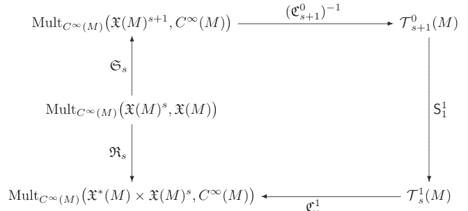
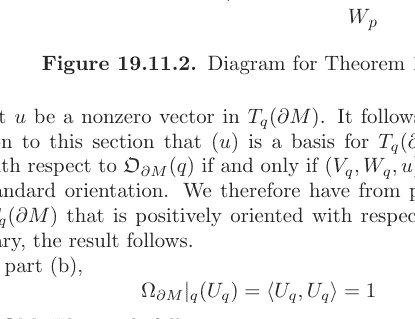

## 第 19 章

## 半黎曼流形

回顾关于光滑流形和带联络的光滑流形所呈现的材料，我们看到许多由我们对正则曲面和 ℝ³ 中正则曲面的研究所激励的概念和结果已被恢复——但并非全部。最近的工作中缺少的是对“长度”和“面积”的任何讨论。为弥补这一不足，有必要为光滑流形赋予额外的结构，这就涉及半黎曼流形的考虑。

### 19.1  半黎曼流形

以下材料基于第 12.2 节中的讨论部分。设 M 为光滑 m-流形，设 𝔤 为 𝒯⁰₂(M) 中的对称张量场，使得对所有 p ∈ M，𝔤_p 是 𝒯⁰₂(T_p(M)) 中的对称张量。我们称 𝔤 为 M 上的度量，如果：

+   [G1] 对所有 p ∈ M，𝔤_p 在 T_p(M) 上非退化。  
+   [G2] ind(𝔤_p) 与 p ∈ M 无关。

当 [G1] 成立时，对所有 p ∈ M，𝔤_p 是 T_p(M) 上的标量积；或等价地，对所有 p ∈ M，(T_p(M),𝔤_p) 是标量积空间。

设 𝔤 确实为度量。在这种情况下，称对 (M,𝔤) 为半黎曼 m-流形。我们将 𝔤_p 的那些与 p 无关的性质归于 𝔤。因此，𝔤 被称为双线性的、对称的、非退化的，等等。ind(𝔤_p) 的共同值记为 ν 并称为 𝔤 的指标或 M 的指标。𝔤_p 的共同符号记为 (ε₁,…,ε_m) 并称为 𝔤 的符号或 M 的符号。为简便起见，我们通常记

$$\mathbf{g}_p(\cdot,\cdot) \quad\text{by}\quad \langle\cdot,\cdot\rangle.$$

当 ν = 0 时，我们称 M 为黎曼 m-流形，而当 m ≥ 2 且 ν = 1 时，M 称为洛伦兹 m-流形。带联络的半黎曼 m-流形是一个三元组 (M, 𝔤, ∇)，其中 (M, 𝔤) 是半黎曼 m-流形且 ∇ 是 M 上的联络。暂时我们不假设 𝔤 和 ∇ 相关。

我们已经遇到过若干半黎曼流形，尽管当时我们还不能使用此类术语。例如，半欧几里得 (m, ν)-空间 ℝᵥᵐ = (ℝᵐ, 𝔰) 是指标为 ν 的半黎曼 m-流形。特别地，欧几里得 m-空间 ℝ₀ᵐ = (ℝᵐ, 𝔢) 是黎曼 m-流形，而闵可夫斯基 m-空间 ℝ₁ᵐ = (ℝᵐ, 𝔪) 是洛伦兹 m-流形。有了张量记号，我们现在可以在局部坐标下将 𝔰 表示为

```
𝔰 = { Σᵢ=1ᵐ d(xⁱ) ⊗ d(xⁱ)                     if ν = 0
       Σᵢ=1ᵐ⁻ᵛ d(xⁱ) ⊗ d(xⁱ) − Σᵢ=m−ν+1ᵐ d(xⁱ) ⊗ d(xⁱ)   if 1 ≤ ν ≤ m − 1
      − Σᵢ=1ᵐ d(xⁱ) ⊗ d(xⁱ)                     if ν = m. }
```

在我们的半黎曼流形列表中，让我们加上单位球面 𝓢² 和双曲空间 ℋ²，它们是黎曼 2-流形，以及伪球面 𝒫²，它是洛伦兹 2-流形。事实上，第 13.1–13.8 节中描述的 ℝ₀³ 中的每个正则曲面都是黎曼 2-流形。我们现在给出一个不太明显的黎曼 2-流形的例子。

## 例 19.1.1。

设 ℙ² = {(r, s) ∈ ℝ² : s > 0}，它是光滑 2-流形 ℝ² 中的开集。由定理 14.3.3(b)、(14.3.4) 和定理 14.8.4 可知 ℙ² 是 ℝ² 的 2-子流形，且 T₍ᵣ,ₛ₎(ℙ²) 可与 ℝ² 识别。我们在 𝒯₂⁰(ℙ²) 中定义一个张量场 𝔭 为

𝔭₍ᵣ,ₛ₎(v, w) = 1/s² ⟨v, w⟩

对所有点 (r, s) ∈ ℙ² 和所有向量 v, w ∈ T₍ᵣ,ₛ₎(ℙ²)，其中 ⟨·,·⟩ 为欧几里得内积。容易证明对所有 (r, s) ∈ ℙ²，𝔭₍ᵣ,ₛ₎ 是内积。因此，(ℙ², 𝔭) 是黎曼 2-流形，称为庞加莱半平面。◇

## 定理 19.1.2 (开集)。

若 (M, 𝔤) 是指标为 ν 的半黎曼 m-流形且 U 是 M 中的开集，则 (U, 𝔤|ᵤ) 是 (M, 𝔤) 的指标为 ν 的半黎曼 m-子流形。

证明。由定理 14.8.4，U 是 M 的 m-子流形。由定理 14.3.3(b)，我们有等同 Tₚ(U) = Tₚ(M) 对所有 p ∈ U 成立。由此可知 (𝔤|ᵤ)|ₚ 在 Tₚ(U) 上对所有 p ∈ U 非退化，且 ind((𝔤|ᵤ)ₚ) = ind(𝔤ₚ) = ν 对所有 p ∈ U 成立。因此 𝔤|ᵤ 满足 [G1] 和 [G2]。□

本节余下部分给出稍后会起作用的定义。

### 19.1  半黎曼流形

设 $(M,g)$ 为半黎曼 $m$-流形，设 $X,Y$ 为 $\mathfrak{X}(M)$ 中的向量场。我们称 $X$ 为 **单位向量场** 如果对所有 $p\in M$，$X_p$ 为单位向量；并称 $X$ 和 $Y$ 为 **正交向量场** 如果对所有 $p\in M$，$X_p$ 和 $Y_p$ 正交。

我们定义一个函数

$$\langle X,Y\rangle:M\longrightarrow\mathbb{R}$$

在 $C^\infty(M)$ 中，通过赋值

$$p\longmapsto\langle X_p,Y_p\rangle$$

对所有 $p\in M$。类似地，对光滑曲线 $\lambda:(a,b)\longrightarrow M$ 和 $\mathfrak{X}_M(\lambda)$ 中的向量场 $J,K$，我们定义一个函数

$$\langle J,K\rangle:(a,b)\longrightarrow\mathbb{R}$$

在 $C^\infty((a,b))$ 中，通过赋值

$$t\longmapsto\langle J(t),K(t)\rangle$$

对所有 $t\in(a,b)$。

设 $(U,(x^i))$ 为 $M$ 上的一个坐标图，设 $\mathcal{X}=(\partial/\partial x^1,\ldots,\partial/\partial x^m)$ 为相应的坐标标架。我们在 $C^\infty(U)$ 中定义函数 $g_{ij}$ 为

$$g_{ij}(p)=\left\langle\left.\frac{\partial}{\partial x^i}\right|_p,\left.\frac{\partial}{\partial x^j}\right|_p\right\rangle \tag{19.1.1}$$

对所有 $p\in U$，$i,j=1,\ldots,m$。$g$ 关于 $\mathcal{X}$ 的 **矩阵** 记为 $g_{\mathcal{X}}$ 并定义为

$$g_{\mathcal{X}}(p)=\begin{bmatrix}g_{11}(p)&\cdots&g_{1m}(p)\\ \vdots&\ddots&\vdots\\ g_{m1}(p)&\cdots&g_{mm}(p)\end{bmatrix}$$

对所有 $p\in U$。回想第 3.1 节，$g_p$ 关于 $\mathcal{X}_p$ 的矩阵为 $(g_p)_{\mathcal{X}_p}=[g_{ij}(p)]$。因此就记号而言，

$$g_{\mathcal{X}}(p)=(g_p)_{\mathcal{X}_p}.$$

$g$ 关于 $\mathcal{X}$ 的 **逆矩阵** 记为 $g_{\mathcal{X}}^{-1}$ 并定义为

$$g_{\mathcal{X}}^{-1}(p)=g_{\mathcal{X}}(p)^{-1}$$

对所有 $p\in U$。通常用上标表示 $g_{\mathcal{X}}^{-1}(p)$ 的条目：

$$g_{\mathcal{X}}^{-1}(p)=\begin{bmatrix}g_{11}(p)&\cdots&g_{1m}(p)\\ \vdots&\ddots&\vdots\\ g_{m1}(p)&\cdots&g_{mm}(p)\end{bmatrix}^{-1}=\begin{bmatrix}g^{11}(p)&\cdots&g^{1m}(p)\\ \vdots&\ddots&\vdots\\ g^{m1}(p)&\cdots&g^{mm}(p)\end{bmatrix}.$$

赋值 $p\longmapsto g^{ij}(p)$ 定义了 $C^\infty(U)$ 中的函数 $g^{ij}$，$i,j=1,\ldots,m$。由于 $[g_{ij}]$ 和 $[g^{ij}]$ 都是对称矩阵，函数 $g_{ij}$ 和 $g^{ij}$ 在 $i,j$ 上对称。


## 定理 19.1.3.

设 $(M,\mathfrak{g})$ 是一个 $m$ 维半黎曼流形，设 $p$ 是 $M$ 中的一点，设 $(U,(x^i))$ 与 $(\widetilde{U},(\widetilde{x}^i))$ 是 $p$ 处的坐标卡，并设 $\mathcal{X}_p$ 与 $\widetilde{\mathcal{X}}_p$ 是 $p$ 处相应的坐标基。则

$$\mathfrak{g}_{\widetilde{\mathcal{X}}}(p)=\left(\left[\mathrm{id}_{T_p(M)}\right]_{\mathcal{X}_p}^{\widetilde{\mathcal{X}}_p}\right)^{\mathrm{T}}\,\mathfrak{g}_{\mathcal{X}}(p)\left[\mathrm{id}_{T_p(M)}\right]_{\mathcal{X}_p}^{\widetilde{\mathcal{X}}_p},$$

其中

$$\left[\mathrm{id}_{T_p(M)}\right]_{\mathcal{X}_p}^{\widetilde{\mathcal{X}}_p}=\begin{bmatrix}\frac{\partial x^1}{\partial \widetilde{x}^1}(p)&\cdots&\frac{\partial x^1}{\partial \widetilde{x}^m}(p)\\\vdots&\ddots&\vdots\\\frac{\partial x^m}{\partial \widetilde{x}^1}(p)&\cdots&\frac{\partial x^m}{\partial \widetilde{x}^m}(p)\end{bmatrix}.$$

证明：这由定理 3.1.3 和定理 14.3.5(b) 得出。

设 $(\overline{M},\overline{\mathfrak{g}})$ 是一个半黎曼流形，并设 $M$ 是 $\overline{M}$ 的子流形。若 $\overline{\mathfrak{g}}|_M$ 是 $M$ 上的度量，则称 $(M,\overline{\mathfrak{g}}|_M)$ 是 $(\overline{M},\overline{\mathfrak{g}})$ 的半黎曼子流形。在这种情况下，根据定义：(i) 对 $M$ 中所有 $p$，$(\overline{\mathfrak{g}}|_M)_p$ 在 $T_p(M)$ 上非退化；(ii) $\mathrm{ind}((\overline{\mathfrak{g}}|_M)_p)$ 与 $M$ 中的 $p$ 无关。$\mathrm{ind}((\overline{\mathfrak{g}}|_M)_p)$ 的公共值记为 $\mathrm{ind}(\overline{\mathfrak{g}}|_M)$，称为 $\overline{\mathfrak{g}}|_M$ 的指标或 $M$ 的指标。$(\overline{\mathfrak{g}}|_M)_p$ 的公共符号差称为 $\overline{\mathfrak{g}}|_M$ 的符号差或 $M$ 的符号差。若 $(M,\overline{\mathfrak{g}}|_M)$ 在本身作为半黎曼流形来看时是黎曼（洛伦兹）流形，则称 $(M,\overline{\mathfrak{g}}|_M)$ 是黎曼（洛伦兹）子流形。当 $(M,\overline{\mathfrak{g}}|_M)$ 是 $\overline{M}$ 的黎曼（洛伦兹）子流形且同时是超曲面时，我们称 $(M,\overline{\mathfrak{g}}|_M)$ 为 $\overline{M}$ 的黎曼（洛伦兹）超曲面。注意到，若 $(\overline{M},\overline{\mathfrak{g}})$ 是黎曼流形，则 $(M,\overline{\mathfrak{g}}|_M)$ 自动是黎曼子流形。另一方面，若 $(\overline{M},\overline{\mathfrak{g}})$ 是洛伦兹流形，且 $(M,\overline{\mathfrak{g}}|_M)$ 是半黎曼子流形，则后者既可能是黎曼子流形，也可能是洛伦兹子流形。举例说明，由定理 12.2.12(d) 和定理 14.8.2 可知，$\mathcal{S}^2$ 是黎曼 3-流形 $\mathbb{R}^3$ 的黎曼超曲面，而 $\mathcal{H}^2$ 是洛伦兹 3-流形 $\mathbb{R}^3_1$ 的黎曼超曲面，$\mathcal{P}^2$ 是 $\mathbb{R}^3_1$ 的洛伦兹超曲面。

设 $(M,\overline{\mathfrak{g}}|_M)$ 是 $(\overline{M},\overline{\mathfrak{g}})$ 的半黎曼超曲面，并设 $p$ 是 $M$ 中的一点。根据 (14.8.1)，$T_p(M)$ 可以看作 $T_p(\overline{M})$ 的向量子空间。由定理 4.1.3 可得 $T_p(\overline{M})=T_p(M)\oplus T_p(M)^\perp$，再由定理 1.1.18 可得 $T_p(M)^\perp$ 是 1 维的。若 $T_p(\overline{M})$ 中的向量 $v$ 属于 $T_p(M)^\perp$，则称 $v$ 在 $p$ 处为法向量。若 $v$ 同时是单位向量，则称它为 $p$ 处的单位法向量。此时，由于 $v$ 非零，我们有 $T_p(M)^\perp=\mathbb{R}v$。设 $V$ 是沿 $M$ 的（未必光滑的）向量场。若对 $M$ 中所有 $p$，$V_p$ 都在 $p$ 处为法向量，则称 $V$ 是法向量场。当 $V$ 既是单位向量场又是法向量场时，称它为单位法向量场。

定理 12.2.2–12.2.5 可以直接推广到半黎曼流形的半黎曼超曲面的情形。由定理 12.2.5 的推广可知，存在沿 M 的（未必光滑的）单位法向量场 V，使得 ⟨V_p, V_p⟩ 与 M 中的 p 无关。⟨V_p, V_p⟩ 的公共值记为 ε_M，称为 M 的符号。因此，对所有 p ∈ M，ε_M = ⟨V_p, V_p⟩。由定理 12.2.2(b) 的推广可得 ε_M = (−1)^{μ−ind(𝔤|_M)}。

## 19.2 曲线

设 (M, 𝔤) 是一个半黎曼流形，λ(t) : (a, b) ⟶ M 是一条光滑曲线，g(u) : (c, d) ⟶ (a, b) 是一个微分同胚。光滑曲线 λ ∘ g(u) : (c, d) ⟶ ℝ³ 称为 λ 的光滑重参数化。回顾第 15.1 节，λ 的速度是光滑曲线 (dλ/dt)(t) : (a, b) ⟶ M，并且若 λ 的速度处处非零，则称 λ 是正则的。λ 的速率是（未必光滑的）曲线 ‖(dλ/dt)(t)‖ : (a, b) ⟶ M。当 ν = 0 时，λ 正则当且仅当其速率处处非零。若存在实数 c，使得对所有 t ∈ (a, b) 都有 ‖(dλ/dt)(t)‖ = c，则称 λ 具有常速率。若对所有 t ∈ (a, b)，(dλ/dt)(t) 都是类空（相应地，类时、类光）的，则称 λ 是类空（相应地，类时、类光）的。另外，若对所有 t ∈ (a, b)，(dλ/dt)(t) 都是未来指向（过去指向）的，则称 λ 是未来指向（过去指向）的。

设 λ(t) : [a, b] ⟶ M 是闭区间上的光滑曲线。λ 的长度定义为 L(λ) = ∫_a^b ‖ dλ/dt (t) ‖ dt。 (19.2.1)

## 定理 19.2.1（长度的微分同胚不变性）

设 (M, 𝔤) 是一个半黎曼流形，λ(t) : [a, b] ⟶ M 是一条光滑曲线，g(u) : [c, d] ⟶ [a, b] 是一个微分同胚。则 L(λ) = L(λ ∘ g)。

证明：该证明与定理 12.1.1 的证明相同。

## 19.3 半黎曼流形的基本定理

设 (M, 𝔤, ∇) 是带联络的半黎曼流形。如果没有进一步假设，就没有理由期望 𝔤 和 ∇ 之间存在联系。若对所有向量场 X, Y, Z ∈ 𝔛(M)，都有 X(⟨Y, Z⟩) = ⟨∇_X Y, Z⟩ + ⟨Y, ∇_X Z⟩ = ∇_X(⟨Y, Z⟩) (19.3.1)，则称 ∇ 与 𝔤 相容，其中第二个等号由 (18.1.1) 得出。根据第 18.4 节给出的定义，∇(𝔤) 是 T_3^0(M) 中的张量场；如果 ∇(𝔤) = 0，则 𝔤 是（关于 ∇）平行的。

## 定理 19.3.1.

设 $(M,\mathfrak{g},\nabla)$ 是带联络的半黎曼流形。则以下条件等价：

- (a) $\nabla$ 与 $\mathfrak{g}$ 相容。
- (b) $\mathfrak{g}$ 关于 $\nabla$ 平行。
- (c) 若 $\lambda(t): (a,b)\longrightarrow M$ 是正则光滑曲线，且 $J,K$ 是 $\mathfrak{X}_M(\lambda)$ 中的向量场，则

$$\frac{d\langle J,K\rangle}{dt}(t)=\left\langle\frac{\nabla J}{dt}(t),K(t)\right\rangle+\left\langle J(t),\frac{\nabla K}{dt}(t)\right\rangle$$

对所有 $t\in(a,b)$ 成立。
- (d) 若 $\lambda(t): (a,b)\longrightarrow M$ 是光滑曲线，且 $J,K$ 是 $\mathfrak{X}_M(\lambda)$ 中的平行向量场，则函数 $\langle J,K\rangle(t): (a,b)\longrightarrow\mathbb{R}$ 是常值函数。

证明：(a) ⇔ (b)：由定理 18.4.6，对所有向量场 $X,Y,Z\in\mathfrak{X}(M)$，有

$$\nabla(\mathfrak{g})(X,Y,Z)=X\langle Y,Z\rangle-\langle\nabla_X(Y),Z\rangle-\langle Y,\nabla_X(Z)\rangle$$

由此即得结论。

(a) ⇒ (c)：设 $\lambda(t): (a,b)\longrightarrow M$ 是正则光滑曲线，设 $J,K$ 是 $\mathfrak{X}_M(\lambda)$ 中的向量场，设 $t_0$ 是 $(a,b)$ 中的一点，并设 $p=\lambda(t_0)$。由定理 15.1.2，存在 $\mathfrak{X}(M)$ 中的向量场 $X$，使得 $X_p=(d\lambda/dt)(t_0)$。由于 $\lambda$ 是正则的，可以证明存在包含 $t_0$ 的区间 $(c,d)\subseteq(a,b)$ 以及 $\mathfrak{X}(M)$ 中的向量场 $Y,Z$，使得 $J|_{(c,d)}=Y\circ\lambda|_{(c,d)}$，$K|_{(c,d)}=Z\circ\lambda|_{(c,d)}$。于是

$$\frac{d\langle J,K\rangle}{dt}(t_0)=\frac{d\langle Y\circ\lambda,Z\circ\lambda\rangle}{dt}(t_0)=\frac{d\langle Y,Z\rangle\circ\lambda}{dt}(t_0)$$
$$=\frac{d\lambda}{dt}(t_0)\langle Y,Z\rangle=X_p\langle Y,Z\rangle=X\langle Y,Z\rangle(p)$$
$$=\langle\nabla_X(Y)_p,Z_p\rangle+\langle Y_p,\nabla_X(Z)_p\rangle$$
$$=\langle\nabla_{X_p}(Y),Z_p\rangle+\langle Y_p,\nabla_{X_p}(Z)\rangle$$
$$=\langle\nabla_{(d\lambda/dt)(t_0)}(Y),Z_p\rangle+\langle Y_p,\nabla_{(d\lambda/dt)(t_0)}(Z)\rangle$$
$$=\left\langle\frac{\nabla(Y\circ\lambda)}{dt}(t_0),Z_p\right\rangle+\left\langle Y_p,\frac{\nabla(Z\circ\lambda)}{dt}(t_0)\right\rangle$$
$$=\left\langle\frac{\nabla J}{dt}(t_0),K(t_0)\right\rangle+\left\langle J(t_0),\frac{\nabla K}{dt}(t_0)\right\rangle,$$

其中第三个等号由 (14.7.5) 得出，第五个等号由 (15.1.2) 得出，第六个等号根据假设，第七个等号由 (18.1.5) 得出，第九个等号由定理 18.3.1(c) 得出。由于 $t_0$ 是任意的，结论得证。

(c) ⇒ (a)：设 $X,Y,Z$ 是 $\mathfrak{X}(M)$ 中的向量场，设 $p$ 是 $M$ 中的一点，并设 $\lambda(t): (a,b)\longrightarrow M$ 是光滑曲线，使得 $\lambda(t_0)=p$ 且 $(d\lambda/dt)(t_0)=X_p$


对某个 $t_0\in(a,b)$。于是

$$
X(\langle Y,Z\rangle)(p)=X_p(\langle Y,Z\rangle)=\frac{d\lambda}{dt}(t_0)(\langle Y,Z\rangle)
$$

$$
=\frac{d(\langle Y,Z\rangle\circ\lambda)}{dt}(t_0)=\frac{d(\langle Y\circ\lambda,Z\circ\lambda\rangle)}{dt}(t_0)
$$

$$
=\left\langle\frac{\nabla(Y\circ\lambda)}{dt}(t_0),Z|_{\lambda(t_0)}\right\rangle+\left\langle Y|_{\lambda(t_0)},\frac{\nabla(Z\circ\lambda)}{dt}(t_0)\right\rangle
$$

$$
=\langle(\nabla_{d\lambda/dt})_{(t_0)}(Y),Z_p\rangle+\langle Y_p,(\nabla_{d\lambda/dt})_{(t_0)}(Z)\rangle
$$

$$
=\langle\nabla_{X_p}(Y),Z_p\rangle+\langle Y_p,\nabla_{X_p}(Z)\rangle
$$

$$
=\langle\nabla_X(Y)_p,Z_p\rangle+\langle Y_p,\nabla_X(Z)_p\rangle
$$

$$
=\langle\nabla_X(Y),Z\rangle(p)+\langle Y,\nabla_X(Z)\rangle(p),
$$

其中第一个等号来自(15.1.2)，第三个等号来自(14.7.5)，第五个等号由假设得出，第六个等号来自定理18.3.1(c)，第八个等号来自(18.1.5)。由于 $p$ 是任意的，结论得证。

$(c)\Rightarrow(d)$：由假设，$\nabla J/dt=0$ 且 $\nabla K/dt=0$，因此(c)部分中的恒等式变为 $(d(\langle J,K\rangle)/dt)(t)=0$ 对所有 $t\in(a,b)$ 成立，从而函数 $\langle J,K\rangle$ 是常数。

$(d)\Rightarrow(c)$：设 $(e_1,\ldots,e_m)$ 为 $T_{\lambda(0)}(M)$ 的标准正交基。定理18.5.1给出 $e_i$ 的平行平移 $E_i(t)=\Pi^{\lambda(t)}_{\lambda(0)}(e_i)$，对所有 $t\in(a,b)$，其中 $E_i(0)=e_i$，$i=1,\ldots,m$。由假设，函数 $\langle E_i,E_j\rangle$ 是常数，因此 $\langle E_i(t),E_j(t)\rangle=\langle e_i,e_j\rangle$。从而 $(E_1(t),\ldots,E_m(t))$ 是 $T_{\lambda(t)}(M)$ 的标准正交基，对所有 $t\in(a,b)$。将 $J$ 和 $K$ 表示为

$$
J=\sum_i\alpha^iE_i\qquad\text{and}\qquad K=\sum_j\beta^jE_j,
$$

其中 $\alpha^i,\beta^j$ 是 $C^\infty((a,b))$ 中唯一确定的函数，我们得到

$$
\langle J,K\rangle=\sum_{ij}\langle E_i,E_j\rangle\alpha_i\beta_j=\sum_i\langle e_i,e_i\rangle\alpha_i\beta_i,
$$

因此

$$
\frac{d(\langle J,K\rangle)}{dt}=\sum_i\langle e_i,e_i\rangle\left(\frac{d\alpha^i}{dt}\beta^i+\alpha^i\frac{d\beta^i}{dt}\right).
$$

由于 $E_i$ 是平行的，

$$
\frac{\nabla J}{dt}=\sum_i\frac{\nabla}{dt}(\alpha^iE_i)=\sum_i\frac{d\alpha^i}{dt}E_i+\sum_i\alpha^i\frac{\nabla E_i}{dt}=\sum_i\frac{d\alpha^i}{dt}E_i.
$$

类似地，

$$
\frac{\nabla K}{dt}=\sum_j\frac{d\beta^j}{dt}E_j.
$$

因此，

$$
\left\langle \frac{\nabla J}{dt},K\right\rangle=\left\langle\sum_i\frac{d\alpha^i}{dt}E_i,\sum_j\beta^jE_j\right\rangle=\sum_{ij}\langle E_i,E_j\rangle\frac{d\alpha^i}{dt}\beta^j
$$

$$
=\sum_i\langle e_i,e_i\rangle\frac{d\alpha^i}{dt}\beta^i.
$$

类似地，

$$
\left\langle\frac{\nabla K}{dt},J\right\rangle=\sum_i\langle e_i,e_i\rangle\frac{d\beta^i}{dt}\alpha_i.
$$

结合(19.3.2)–(19.3.4)即得结论。

下一个结果有时被称为“半黎曼几何的奇迹”。

### **定理19.3.2（半黎曼流形基本定理）。**

若 $(M,\mathfrak{g})$ 是半黎曼流形，则 $M$ 上存在唯一的连接，称为**Levi-Civita连接**，它是对称的且与 $\mathfrak{g}$ 相容。

*证明。唯一性。* 假设这样的连接 $\nabla$ 存在。由于它是对称的，

$$
\nabla_X(Z)=\nabla_Z(X)+[X,Z]
$$

$$
\nabla_Y(X)=\nabla_X(Y)+[Y,X]
$$

$$
\nabla_Z(Y)=\nabla_Y(Z)+[Z,Y],
$$

并且因为它与 $\mathfrak{g}$ 相容，

$$
X(\langle Y,Z\rangle)=\langle\nabla_X(Y),Z\rangle+\langle Y,\nabla_X(Z)\rangle
$$

$$
Y(\langle Z,X\rangle)=\langle\nabla_Y(Z),X\rangle+\langle Z,\nabla_Y(X)\rangle
$$

$$
Z(\langle X,Y\rangle)=\langle\nabla_Z(X),Y\rangle+\langle X,\nabla_Z(Y)\rangle.
$$

结合上述恒等式得到

$$
X(\langle Y,Z\rangle)=\langle\nabla_X(Y),Z\rangle+\langle Y,\nabla_Z(X)\rangle+\langle Y,[X,Z]\rangle
$$

$$
Y(\langle Z,X\rangle)=\langle\nabla_Y(Z),X\rangle+\langle Z,\nabla_X(Y)\rangle+\langle Z,[Y,X]\rangle
$$

$$
Z(\langle X,Y\rangle)=\langle\nabla_Z(X),Y\rangle+\langle X,\nabla_Y(Z)\rangle+\langle X,[Z,Y]\rangle.
$$

将上述三式中的前两个恒等式相加并减去第三个得到

$$
X(\langle Y,Z\rangle)+Y(\langle Z,X\rangle)-Z(\langle X,Y\rangle)
$$

$$
=2\langle\nabla_X(Y),Z\rangle-\langle X,[Z,Y]\rangle+\langle Y,[X,Z]\rangle+\langle Z,[Y,X]\rangle
$$

$$
=2\langle\nabla_X(Y),Z\rangle+\langle X,[Y,Z]\rangle-\langle Y,[Z,X]\rangle-\langle Z,[X,Y]\rangle,
$$

从而

$$
2\langle\nabla_X(Y),Z\rangle=X(\langle Y,Z\rangle)+Y(\langle Z,X\rangle)-Z(\langle X,Y\rangle)
$$

$$
\qquad-\langle X,[Y,Z]\rangle+\langle Y,[Z,X]\rangle+\langle Z,[X,Y]\rangle,
$$

这称为Koszul公式。假设 $\widetilde{\nabla}$ 是满足Koszul公式的另一个连接。Koszul公式的右端不依赖于连接的选择，因此对所有 $\mathfrak{X}(M)$ 中的向量场 $X,Y,Z$，有 $\langle\nabla_X(Y)-\widetilde{\nabla}_X(Y),Z\rangle=0$。由于 $\mathfrak{g}$ 在 $M$ 上非退化，对所有 $\mathfrak{X}(M)$ 中的向量场 $X,Y$，有 $\nabla_X(Y)=\widetilde{\nabla}_X(Y)$。因此，$\nabla=\widetilde{\nabla}$。

存在性。设 $\mathfrak{R}(X,Y,Z)$ 为Koszul公式的右端。暂时将 $X$ 和 $Y$ 视为固定的，我们通过赋值 $Z\longmapsto\mathfrak{R}(X,Y,Z)$ 定义映射 $\overline{\mathfrak{R}}:\mathfrak{X}(M)\longrightarrow C^{\infty}(M)$，对所有 $Z\in\mathfrak{X}(M)$。容易证明 $\overline{\mathfrak{R}}$ 是 $C^{\infty}(M)$-线性的，因此 $\overline{\mathfrak{R}}\in\mathrm{Lin}_{C^{\infty}(M)}(\mathfrak{X}(M),C^{\infty}(M))$。由定理15.5.3可知，$\overline{\mathfrak{R}}$ 可与 $\mathfrak{X}^*(M)$ 中的余向量场等同；再由定理19.4.2可知，存在唯一的向量场 $\nabla(X,Y)\in\mathfrak{X}(M)$，使得对所有 $Z\in\mathfrak{X}(M)$，有 $2\langle\nabla(X,Y),Z\rangle=\mathfrak{R}(X,Y,Z)$。这定义了一个映射 $\nabla:\mathfrak{X}(M)\times\mathfrak{X}(M)\longrightarrow\mathfrak{X}(M)$。我们需要验证连接的条件 $[\nabla 1]$–$[\nabla 4]$ 被满足。显然，$[\nabla 1]$ 和 $[\nabla 3]$ 被满足，而类似于证明 $\mathfrak{R}$ 是 $C^{\infty}(M)$-线性的计算表明 $[\nabla 2]$ 和 $[\nabla 4]$ 也被满足。

### 例19.3.3（$\mathbb{R}_\nu^3$ 中的正则曲面）。

将 $\mathbb{R}_\nu^3$ 中的正则曲面 $(M,\mathfrak{g})$ 视为带有例18.1.1中定义的连接 $\nabla$ 的光滑2-流形，由(12.6.1)可知 $\nabla$ 是对称的，由定理12.4.1(e)可知它与 $\mathfrak{g}$ 相容。根据定理19.3.2，$\nabla$ 是 $M$ 上对应于 $\mathfrak{g}$ 的Levi-Civita连接。

除非另有说明，半黎曼流形上的连接均指Levi-Civita连接。

按照这一约定，当我们说 $(M,\mathfrak{g})$ 是半黎曼流形时，隐含着 $M$ 上存在一个连接，且该连接就是Levi-Civita连接。另一方面，记号 $(M,\mathfrak{g},\nabla)$ 表示 $(M,\mathfrak{g})$ 是一个带连接（但不一定是Levi-Civita连接）的半黎曼流形。

$\mathbb{R}_\nu^3$ 中正则曲面的Christoffel符号在第12.3节引入，带连接的光滑流形的Christoffel符号在第18.2节引入。如下一个结果所示，有了度量，我们就可以恢复定理12.3.3(b)中给出的Christoffel符号恒等式。

### 定理19.3.4（Christoffel符号的局部坐标表达式）。

若 $(M,\mathfrak{g})$ 是半黎曼流形，则在局部坐标中，

$$
\Gamma_{ij}^k = \frac{1}{2} \sum_l \mathfrak{g}^{kl} \left( \frac{\partial \mathfrak{g}_{jl}}{\partial x^i} + \frac{\partial \mathfrak{g}_{il}}{\partial x^j} - \frac{\partial \mathfrak{g}_{ij}}{\partial x^l} \right)
$$

对 $i,j,k=1,\ldots,m$。

*证明。* 我们有

$$
2\sum_n \Gamma^n_{ij}g_{ln}
$$

$$
=2\sum_n\Gamma^n_{ij}\left\langle\frac{\partial}{\partial x^n},\frac{\partial}{\partial x^l}\right\rangle=2\left\langle\sum_n\Gamma^n_{ij}\frac{\partial}{\partial x^n},\frac{\partial}{\partial x^l}\right\rangle=2\left\langle\nabla_{\partial/\partial x^i}\left(\frac{\partial}{\partial x^j}\right),\frac{\partial}{\partial x^l}\right\rangle
$$

$$
=\frac{\partial}{\partial x^i}\left\langle\frac{\partial}{\partial x^j},\frac{\partial}{\partial x^l}\right\rangle+\frac{\partial}{\partial x^j}\left\langle\frac{\partial}{\partial x^l},\frac{\partial}{\partial x^i}\right\rangle-\frac{\partial}{\partial x^l}\left\langle\frac{\partial}{\partial x^i},\frac{\partial}{\partial x^j}\right\rangle
$$

$$
-\left\langle\frac{\partial}{\partial x^i},\left[\frac{\partial}{\partial x^j},\frac{\partial}{\partial x^l}\right]\right\rangle+\left\langle\frac{\partial}{\partial x^j},\left[\frac{\partial}{\partial x^l},\frac{\partial}{\partial x^i}\right]\right\rangle+\left\langle\frac{\partial}{\partial x^l},\left[\frac{\partial}{\partial x^i},\frac{\partial}{\partial x^j}\right]\right\rangle
$$

$$
=\frac{\partial g_{jl}}{\partial x^i}+\frac{\partial g_{il}}{\partial x^j}-\frac{\partial g_{ij}}{\partial x^l}.
$$

其中第三个等号来自(18.2.1)，第四个等号来自Koszul公式，最后一个等号来自定理15.3.3(b)。因此，

$$
\frac{1}{2}\left(\frac{\partial g_{jl}}{\partial x^i}+\frac{\partial g_{il}}{\partial x^j}-\frac{\partial g_{ij}}{\partial x^l}\right)=\sum_n g_{ln}\Gamma^n_{ij}.
$$

将上述恒等式两边乘以 $g^{kl}$ 并对 $l$ 求和得到

$$
\frac{1}{2}\sum_l g^{kl}\left(\frac{\partial g_{jl}}{\partial x^i}+\frac{\partial g_{il}}{\partial x^j}-\frac{\partial g_{ij}}{\partial x^l}\right)=\sum_l g^{kl}\left(\sum_n g_{ln}\Gamma^n_{ij}\right)
$$

$$
=\sum_n\left(\sum_l g^{kl}g_{ln}\right)\Gamma^n_{ij}=\sum_n\delta^k_n\Gamma^n_{ij}=\Gamma^k_{ij}.
$$

### **定理19.3.5（标准坐标）。**

若 $(\epsilon_1,\ldots,\epsilon_m)$ 是 $\mathbb{R}^m_\nu=(\mathbb{R}^m,\mathfrak{s})$ 的符号差，则在标准坐标中，

$$
\mathfrak{s}_{ij}(p)=\epsilon_i\delta_{ij}\qquad\text{and}\qquad \Gamma^k_{ij}(p)=0
$$

对所有 $p\in\mathbb{R}^m_\nu$，$i,j,k=1,\ldots,m$。

*证明。* 设 $(e_1,\ldots,e_m)$ 为 $\mathbb{R}^m_\nu$ 的标准基。由(4.2.1)、定理14.5.7和(19.1.1)我们有

$$
\mathfrak{s}_{ij}(p)=\left\langle\left.\frac{\partial}{\partial r^i}\right|_p,\left.\frac{\partial}{\partial r^j}\right|_p\right\rangle=\langle e_i,e_j\rangle=\epsilon_i\delta_{ij},
$$

这证明了第一个恒等式。第二个恒等式由第一个恒等式和定理19.3.1得出。

下一个结果表明，在给定点的法坐标中，指标为 $\nu$ 的半黎曼 $m$-流形在*该点*处的度量与Christoffel符号方面表现得像 $\mathbb{R}^m_\nu$。


## 19.3 半黎曼流形的基石定理

**定理 19.3.6（正规坐标）。**

若 $(M,g)$ 是一个签名为 $(\epsilon_1,\ldots,\epsilon_m)$ 的半黎曼 $m$-流形，$p$ 是 $M$ 中的一点，则在 $p$ 处的正规坐标下，

$$g_{ij}(p)=\epsilon_i\delta_{ij}\qquad\text{and}\qquad \Gamma^k_{ij}(p)=0$$

对 $i,j,k=1,\ldots,m$ 成立。

**证明。** 继续采用第 18.10 节开头建立的设定，设 $(\tilde e_1,\ldots,\tilde e_m)$ 是 $T_p(M)$ 的一个正交基。由定理 18.10.1(a) 和 (19.1.1) 可得，

$$g_{ij}(p)=\left\langle\left.\frac{\partial}{\partial x^i}\right|_p,\left.\frac{\partial}{\partial x^j}\right|_p\right\rangle=\langle\tilde e_i,\tilde e_j\rangle.$$

根据定义，$T_p(M)$ 与 $M$ 具有相同的签名，故 $\langle\tilde e_i,\tilde e_j\rangle=\epsilon_i\delta_{ij}$。这证明了第一个恒等式。第二个恒等式是定理 18.10.2 的重复。

设 $(M,g)$ 为半黎曼流形，$U$ 为 $M$ 中的开集，$\mathcal X=(X_1,\ldots,X_m)$ 为 $U$ 上的一个标架。我们称 $\mathcal X$ 为 **正交** 的，如果 $\mathcal X_p=(X_{1|p},\ldots,X_{m|p})$ 对 $U$ 中所有 $p$ 都是 $T_p(M)$ 的正交基。当 $M$ 可定向时，若 $\mathcal X_p$ 对 $U$ 中所有 $p$ 都是正定向的，则称 $\mathcal X$ 为 **正定向** 的。

**定理 19.3.7（正交标架的存在性）。**

半黎曼流形中每一点都存在一个邻域，在该邻域上存在正交标架。若半黎曼流形可定向，则正交标架可以选为正定向的。

**证明。** 设 $(M,g)$ 为半黎曼流形，$p$ 为 $M$ 中的一点，$(e_1,\ldots,e_m)$ 为 $T_p(M)$ 的正交基。设 $V$ 为 $p$ 在 $M$ 中的一个正规邻域，$\exp_p:\widetilde V\longrightarrow V$ 为相应的微分同胚，$\gamma(t):[0,1]\longrightarrow M$ 为起点为 $p$ 的径向测地线。由定理 18.5.7，存在唯一的标架 $(E_{1\gamma},\ldots,E_{m\gamma})$ 在 $\gamma$ 上，由 $\mathcal X_m(\gamma)$ 中的平行向量场组成，使得 $(E_{1\gamma}(0),\ldots,E_{m\gamma}(0))=(e_1,\ldots,e_m)$ 且 $(E_{1\gamma}(t),\ldots,E_{m\gamma}(t))$ 对所有 $t\in[0,1]$ 都是 $T_{\gamma(t)}(M)$ 的基。由定理 19.3.1 可知 $\langle E_{i\gamma}(t),E_{j\gamma}(t)\rangle=\langle e_i,e_j\rangle$ 对所有 $t\in[0,1]$ 及 $i,j=1,\ldots,m$ 成立。因此，每个 $(E_{1\gamma}(t),\ldots,E_{m\gamma}(t))$ 都是正交基。可以证明，将这些向量场在所有以 $p$ 为起点的径向测地线上组合起来，可得到 $V$ 上的正交标架 $(E_1,\ldots,E_m)$。

现在假设 $M$ 可定向。若必要，可将 $e_1$ 替换为 $-e_1$，不失一般性地假设 $(E_{1|p},\ldots,E_{m|p})=(e_1,\ldots,e_m)$ 是 $T_p(M)$ 的正定向正交基，并且上述构造已相应地修改。由定理 16.6.5，存在一个诱导 $M$ 的定向的定向形式 $\varpi$。则 $\varpi_p(E_{1|p},\ldots,E_{m|p})>0$，故 $f=\varpi|_V(E_1,\ldots,E_m)$ 是 $C^\infty(V)$ 中的一个函数且 $f(p)>0$。由于 $f$ 是光滑的，由定理 14.2.2，它是连续的。设 $\epsilon>0$ 为实数，使得开区间 $I=(f(p)-\epsilon,f(p)+\epsilon)$ 由正实数组成。由定理 9.1.5 和定理 9.1.7，$W=f^{-1}(I)$ 是 $p$ 在 $M$ 中的一个邻域，在该邻域上 $f$ 取正值。由此可知 $(E_1,\ldots,E_m)$ 在 $W$ 上是正定向的。

我们经常调用定理 19.3.7，但通常不加引用。

**定理 19.3.8。** 设 $(M,\mathfrak g)$ 为半黎曼流形，$X$ 为 $\mathfrak X(M)$ 中的向量场，$\mathcal A$ 为 $\mathcal T_s^r(M)$ 中的张量场。则

$\nabla_X(\mathfrak g \otimes \mathcal A) = \mathfrak g \otimes \nabla_X(\mathcal A)$。

证明。我们有

$\nabla_X(\mathfrak g \otimes \mathcal A) = \nabla_X(\mathfrak g) \otimes \mathcal A + \mathfrak g \otimes \nabla_X(\mathcal A)$ [Th 18.1.3(b)] = $\mathfrak g \otimes \nabla_X(\mathcal A)$。 [Th 18.4.1, Th 19.3.1]

## 19.4 平坦映射与锐映射

在本节中，我们给出第 3.3 节、第 6.2 节和第 6.3 节中定义的平坦映射和锐映射的流形版本。

设 $(M,\mathfrak g)$ 为半黎曼流形。对 $\mathfrak X(M)$ 中的给定向量场 $X$，我们定义一个映射

$X^f : \mathfrak X(M) \longrightarrow C^\infty(M)$

由

$X^f(Y) = \langle X, Y \rangle$ (19.4.1)

对所有 $\mathfrak X(M)$ 中的向量场 $Y$ 定义。

**定理 19.4.1。** 在上述设定下，$X^f$ 是 $\mathfrak X^*(M)$ 中的一个余向量场。

证明。设 $Y,Z$ 为 $\mathfrak X(M)$ 中的向量场，$f$ 为 $C^\infty(M)$ 中的函数。则

$X^f(Y + Z) = \langle X, Y + Z \rangle = \langle X, Y \rangle + \langle X, Z \rangle = X^f(Y) + X^f(Z)$

且 $(fX)^f(Y) = \langle fX, Y \rangle = f\langle X, Y \rangle = f X^f(Y)$，所以 $X^f$ 是 $\operatorname{Lin}_{C^\infty(M)}(\mathfrak X(M), C^\infty(M))$ 中的映射。结果现在由定理 15.5.3 得出。

$M$ 上的平坦映射是映射

$F : \mathfrak X(M) \longrightarrow \mathfrak X^*(M)$

由赋值

$X \mapsto X^f$

对所有 $\mathfrak X(M)$ 中的向量场 $X$ 定义。因此，作为记号，

$F(X) = X^f$。

## 定理 19.4.2。

在上述设定下，$F$ 是 $C^\infty(M)$-模同构：

$$\mathfrak{X}(M) \cong \mathfrak{X}^*(M).$$

**证明。** 易证 $F$ 是 $C^\infty(M)$-模同态。我们需要证明 $F$ 是双射。

**单射性。** 由于 $\mathbf g$ 非退化，$\ker(F)=0$。由定理 B.5.3 可知 $F$ 是单射。

**满射性。** 设 $\omega$ 为 $\mathfrak{X}^*(M)$ 中的余向量场，$(U,(x^i))$ 为 $M$ 上的一个坐标图，在局部坐标下设 $\omega|_U=\sum_i\alpha_i d(x^i)$。定义 $U$ 上的向量场 $X|_U$ 为

$$X|_U=\sum_{ij}g^{ij}\alpha_i\frac{\partial}{\partial x^j}.$$

则

$(X|_U)^F\left(\frac{\partial}{\partial x^i}\right)=\left\langle X|_U,\frac{\partial}{\partial x^i}\right\rangle=\left\langle\sum_{jk}g^{jk}\alpha_j\frac{\partial}{\partial x^k},\frac{\partial}{\partial x^i}\right\rangle=\sum_{jk}\alpha_jg^{jk}g_{ki}$

$=\sum_j\alpha_j\left(\sum_kg^{jk}g_{ki}\right)=\sum_j\delta_i^j\alpha_j=\alpha_i$

对 $i=1,\ldots,m$，故

$$\omega|_U=\sum_i(X|_U)^F\left(\frac{\partial}{\partial x^i}\right)d(x^i)$$

由流形版本的定理 1.2.1(e) 可知 $(X|_U)^F=\omega|_U$。

设 $(\widetilde U,\widetilde\varphi)$ 为 $M$ 上的一个与 $(U,\varphi)$ 重叠的坐标图，在局部坐标下设 $\omega|_{\widetilde U}=\sum_i\widetilde\alpha_i d(\widetilde x^i)$。我们有

$$\frac{\partial}{\partial\widetilde x^i}=\sum_q\frac{\partial x^q}{\partial\widetilde x^i}\frac{\partial}{\partial x^q},\qquad \widetilde\alpha_j=\sum_p\frac{\partial x^p}{\partial\widetilde x^j}\alpha_p,\qquad \widetilde g^{ij}=\sum_{kl}\frac{\partial\widetilde x^i}{\partial x^k}g^{kl}\frac{\partial\widetilde x^j}{\partial x^l},$$

其中第一个恒等式由定理 15.1.8 得出，第二个恒等式由定理 15.6.3 得出，第三个恒等式由流形版本的定理 2.2.5(b)、定理 14.3.5(b) 和定理 19.1.3 得出。则

$X|_{\widetilde U}=\sum_{ij}\widetilde g^{ij}\widetilde\alpha_i\frac{\partial}{\partial\widetilde x^j}=\sum_{ijkl p q}\left(\frac{\partial\widetilde x^i}{\partial x^k}g^{kl}\frac{\partial\widetilde x^j}{\partial x^l}\right)\left(\frac{\partial\widetilde x^j}{\partial x^p}\alpha_p\right)\left(\frac{\partial x^q}{\partial\widetilde x^i}\frac{\partial}{\partial x^q}\right)$

$=\sum_{klp q}\left[g^{kl}\alpha_p\left(\sum_i\frac{\partial\widetilde x^i}{\partial x^k}\frac{\partial x^q}{\partial\widetilde x^i}\right)\left(\sum_j\frac{\partial\widetilde x^j}{\partial x^l}\frac{\partial x^p}{\partial\widetilde x^j}\right)\frac{\partial}{\partial x^q}\right]$

$=\sum_{klpq}\delta_k^q\delta_l^p g^{kl}\alpha_p\frac{\partial}{\partial x^q}$

$=\sum_{kl}g^{kl}\alpha_k\frac{\partial}{\partial x^l}=X|_U,$

所以在重叠处有相容性。综合起来，对每个点在 $M$ 中的 $X|_U$ 定义一个 $\mathfrak X(M)$ 中的向量场 $X$，使得 $X^F = \omega$。因此，$F$ 是满射。

$M$ 上的锐映射

$S : \mathfrak X^*(M) \longrightarrow \mathfrak X(M)$

定义为 $F$ 的逆；即

$S = F^{-1}$。

设 $1 \le k \le r$ 且 $1 \le l \le s + 1$ 为整数（从而 $r \ge 1$ 且 $s \ge 0$）。$(k,l)$-平坦映射记为

$F_l^k : \mathcal T_s^r(M) \longrightarrow \mathcal T_{s+1}^{r-1}(M)$

并定义（使用定理 15.7.2）对所有 $\mathcal T_s^r(M)$ 中的张量场 $\mathcal A$、所有 $\mathfrak X^*(M)$ 中的余向量场 $\omega^1,\dots,\omega^{r-1}$ 以及所有 $\mathfrak X(M)$ 中的向量场 $X_1,\dots,X_{s+1}$ 如下，其中 $^\wedge$ 表示省略一个表达式：

- 对 $r = 1$（从而 $k = 1$）：

$F_l^1(\mathcal A)(X_1, \dots, X_{s+1}) = \mathcal A(X_l^F, X_1, \dots, \hat X_l, \dots, X_{s+1})$。

- 对 $r \ge 2$ 且 $1 \le k \le r - 1$：

$F_l^k(\mathcal A)(\omega^1, \dots, \omega^{r-1}, X_1, \dots, X_{s+1}) = \mathcal A(\omega^1, \dots, \omega^{k-1}, X_l^F, \omega^k, \dots, \omega^{r-1}, X_1, \dots, \hat X_l, \dots, X_{s+1})$。

- 对 $r \ge 2$ 且 $k = r$：

$F_l^r(\mathcal A)(\omega^1, \dots, \omega^{r-1}, X_1, \dots, X_{s+1}) = \mathcal A(\omega^1, \dots, \omega^{r-1}, X_l^F, X_1, \dots, \hat X_l, \dots, X_{s+1})$。

类似地，设 $1 \le k \le r + 1$ 且 $1 \le l \le s$ 为整数（从而 $r \ge 0$ 且 $s \ge 1$）。$(k,l)$-锐映射记为

$S_l^k : \mathcal T_s^r(M) \longrightarrow \mathcal T_{s-1}^{r+1}(M)$

并定义（使用定理 15.7.2）对所有 $\mathcal T_s^r(M)$ 中的张量场 $\mathcal A$、所有 $\mathfrak X^*(M)$ 中的余向量场 $\omega^1,\dots,\omega^{r+1}$ 以及所有 $\mathfrak X(M)$ 中的向量场 $X_1,\dots,X_{s-1}$ 如下：

- 对 $s = 1$（从而 $l = 1$）：

$S_1^k(\mathcal A)(\omega^1, \dots, \omega^{r+1}) = \mathcal A(\omega^1, \dots, \hat\omega^k, \dots, \omega^{r+1}, \omega^k S)$。

- 对 $s \ge 2$ 且 $1 \le l \le s - 1$：

$S_l^k(\mathcal A)(\omega^1, \dots, \omega^{r+1}, X_1, \dots, X_{s-1}) = \mathcal A(\omega^1, \dots, \hat\omega^k, \dots, \omega^{r+1}, X_1, \dots, X_{l-1}, \omega^k S, X_l, \dots, X_{s-1})$。


对于 \(s \ge 2\) 且 \(l=s\)：

\[
S_s^k(A)(\omega^1,\ldots,\omega^{r+1},X_1,\ldots,X_{s-1})
= A(\omega^1,\ldots,\widehat{\omega^k},\ldots,\omega^{r+1},X_1,\ldots,X_{s-1},\omega^k S).
\]

**定理 19.4.3.** 在上述设定下，\(\Gamma_l^k\) 与 \(S_l^k\) 是互逆的 \(C^\infty(M)\)-模同构。

*证明.* 容易证明 \(\Gamma_l^k\) 和 \(S_l^k\) 是 \(C^\infty(M)\)-模同态。它们互为 \(C^\infty(M)\)-模同构并且互逆，分别由定理 6.3.7 和定理 19.4.2 的流形版本得出。

## 19.5 张量场的表示

光滑流形上张量场的表示已在第 15.7 节中讨论过。现在我们利用半黎曼流形所提供的额外结构回到该主题。我们引入第 5.3 节和第 6.4 节中分别介绍的表示映射和标量积映射的光滑流形对应物，并通过第 15.5 节和第 15.7 节中定义的刻画映射将它们联系起来。诚然，符号相当繁琐，但其思想本质上是在简单得多的标量积空间背景下引入的那些思想。

设 \((M,g)\) 为半黎曼流形。遵循第 B.5 节，我们记

\[
\operatorname{Mult}_{C^\infty(M)}(\mathfrak{X}(M)^s,\mathfrak{X}(M))
\]

为从 \(\mathfrak{X}(M)^s\) 到 \(\mathfrak{X}(M)\) 的 \(C^\infty(M)\)-多重线性映射构成的 \(C^\infty(M)\)-模，并记

\[
\operatorname{Mult}_{C^\infty(M)}(\mathfrak{X}^*(M)^r\times\mathfrak{X}(M)^s,C^\infty(M))
\]

为从 \(\mathfrak{X}^*(M)^r\times\mathfrak{X}(M)^s\) 到 \(C^\infty(M)\) 的 \(C^\infty(M)\)-多重线性映射构成的 \(C^\infty(M)\)-模。

我们定义一个映射

\[
\mathcal{S}_s:\operatorname{Mult}_{C^\infty(M)}(\mathfrak{X}(M)^s,\mathfrak{X}(M))\longrightarrow \operatorname{Mult}_{C^\infty(M)}(\mathfrak{X}(M)^{s+1},C^\infty(M)),
\]

称为**标量积映射**，定义为

\[
\mathcal{S}_s(\Psi)(X_1,\ldots,X_{s+1})=\langle X_1,\Psi(X_2,\ldots,X_{s+1})\rangle
\]

对所有 \(\operatorname{Mult}_{C^\infty(M)}(\mathfrak{X}(M)^s,\mathfrak{X}(M))\) 中的映射 \(\Psi\) 以及 \(\mathfrak{X}(M)\) 中所有向量场 \(X_1,\ldots,X_{s+1}\) 成立。我们注意到 \(\mathcal{S}_s\) 是由 (6.4.1) 定义的映射的光滑流形对应物。

**定理 19.5.1.** 若 \((M,g)\) 是半黎曼流形，则 \(\mathcal{S}_s\) 是 \(C^\infty(M)\)-模同构：

\[
\operatorname{Mult}_{C^\infty(M)}(\mathfrak{X}(M)^s,\mathfrak{X}(M))\cong \operatorname{Mult}_{C^\infty(M)}(\mathfrak{X}(M)^{s+1},C^\infty(M)).
\]

**证明.** 容易证明 \(\mathcal{S}_s\) 是 \(C^\infty(M)\)-模同态。我们需要证明 \(\mathcal{S}_s\) 是双射。

**单射性.** 假设 \(\Psi\) 是 \(\operatorname{Mult}_{C^\infty(M)}(\mathfrak{X}(M)^s,\mathfrak{X}(M))\) 中的映射且 \(\mathcal{S}_s(\Psi)=0\)。则对 \(\mathfrak{X}(M)\) 中所有向量场 \(X_1,\ldots,X_{s+1}\) 以及 \(M\) 中所有 \(p\)，有 \(\langle X_1|_p,\Psi(X_2,\ldots,X_{s+1})|_p\rangle=0\)。由于 \(g\) 非退化，对 \(\mathfrak{X}(M)\) 中所有向量场 \(X_2,\ldots,X_{s+1}\) 以及 \(M\) 中所有 \(p\)，有 \(\Psi(X_2,\ldots,X_{s+1})|_p=0\)。因此，对 \(\mathfrak{X}(M)\) 中所有向量场 \(X_2,\ldots,X_{s+1}\)，有 \(\Psi(X_2,\ldots,X_{s+1})=0\)。因此 \(\Psi=0\)，所以 \(\ker(\mathcal{S}_s)=\{0\}\)。由定理 B.5.3，\(\mathcal{S}_s\) 是单射。

**满射性.** 设 \(\Upsilon\) 是 \(\operatorname{Mult}_{C^\infty(M)}(\mathfrak{X}(M)^{s+1},C^\infty(M))\) 中的映射。我们需要找到 \(\operatorname{Mult}_{C^\infty(M)}(\mathfrak{X}(M)^s,\mathfrak{X}(M))\) 中的映射 \(\widetilde{\Upsilon}\) 使得 \(\mathcal{S}_s(\widetilde{\Upsilon})=\Upsilon\)。根据定理 19.4.2，定义 \(\mathfrak{X}^*(M)\) 中的余向量场等价于定义 \(\mathfrak{X}(M)\) 中的向量场。对于给定的 \(\mathfrak{X}(M)\) 中向量场 \(X_2,\ldots,X_{s+1}\)，定义 \(\mathfrak{X}^*(M)\) 中的余向量场 \(\widetilde{\Upsilon}(X_2,\ldots,X_{s+1})^\flat\) 为

\[
\widetilde{\Upsilon}(X_2,\ldots,X_{s+1})^\flat(X_1)=\Upsilon(X_1,\ldots,X_{s+1})
\]

对所有 \(\mathfrak{X}(M)\) 中的向量场 \(X_1\) 成立。则

\[
\mathcal{S}_s(\widetilde{\Upsilon})(X_1,\ldots,X_{s+1})
=\langle X_1,\widetilde{\Upsilon}(X_2,\ldots,X_{s+1})\rangle
=\langle\widetilde{\Upsilon}(X_2,\ldots,X_{s+1}),X_1\rangle
=\widetilde{\Upsilon}(X_2,\ldots,X_{s+1})^\flat(X_1)
=\Upsilon(X_1,\ldots,X_{s+1}).
\]

由于 \(X_1,\ldots,X_{s+1}\) 是任意的，\(\mathcal{S}_s(\widetilde{\Upsilon})=\Upsilon\)。因此，\(\mathcal{S}_s\) 是满射。□

现在我们来定义一个映射

\[
\mathfrak{R}_s:\operatorname{Mult}_{C^\infty(M)}(\mathfrak{X}(M)^s,\mathfrak{X}(M))\longrightarrow\operatorname{Mult}_{C^\infty(M)}(\mathfrak{X}^*(M)\times\mathfrak{X}(M)^s,C^\infty(M)),
\]

称为**表示映射**，定义为

\[
\mathfrak{R}_s(\Psi)(\omega,X_1,\ldots,X_s)=\omega(\Psi(X_1,\ldots,X_s)) \tag{19.5.1}
\]

对所有 \(\operatorname{Mult}_{C^\infty(M)}(\mathfrak{X}(M)^s,\mathfrak{X}(M))\) 中的映射 \(\Psi\)，所有 \(\mathfrak{X}^*(M)\) 中的余向量场 \(\omega\)，以及所有 \(\mathfrak{X}(M)\) 中的向量场 \(X_1,\ldots,X_s\) 成立。我们注意到 \(\mathfrak{R}_s\) 是由 (5.3.1) 定义的映射的光滑流形对应物。当 \(s=1\) 时，我们记

\[
\mathfrak{R}_1\quad\text{为}\quad\mathfrak{R}
\]

并得到

\[
\mathfrak{R}:\operatorname{Lin}_{C^\infty(M)}(\mathfrak{X}(M),\mathfrak{X}(M))\longrightarrow\operatorname{Mult}_{C^\infty(M)}(\mathfrak{X}^*(M)\times\mathfrak{X}(M),C^\infty(M)).
\]

则

\[
\mathfrak{R}(\Psi)(\omega,X)=\omega(\Psi(X)) \tag{19.5.2}
\]

对所有 \(\operatorname{Lin}_{C^\infty(M)}(\mathfrak{X}(M),\mathfrak{X}(M))\) 中的映射 \(\Psi\)，所有 \(\mathfrak{X}^*(M)\) 中的余向量场 \(\omega\)，以及所有 \(\mathfrak{X}(M)\) 中的向量场 \(X\) 成立。

**定理 19.5.2.** 若 \((M,g)\) 是半黎曼流形，则 \(\mathfrak{R}_s\) 是 \(C^\infty(M)\)-模同构：

\[
\operatorname{Mult}_{C^\infty(M)}(\mathfrak{X}(M)^s,\mathfrak{X}(M))\cong \operatorname{Mult}_{C^\infty(M)}(\mathfrak{X}^*(M)\times\mathfrak{X}(M)^s,C^\infty(M)).
\]

**证明.** 回顾第 15.7 节中定义的刻画映射 \(\mathcal{C}_s^r\)。让我们定义“尖锐”映射

\[
\mathfrak{P}_1^1:\operatorname{Mult}_{C^\infty(M)}(\mathfrak{X}(M)^{s+1},C^\infty(M))\longrightarrow \operatorname{Mult}_{C^\infty(M)}(\mathfrak{X}^*(M)\times\mathfrak{X}(M)^s,C^\infty(M))
\]

为

\[
\mathfrak{P}_1^1=\mathcal{C}_s^1\circ S_1^1\circ(\mathcal{C}_{s+1}^0)^{-1}. \tag{19.5.3}
\]

由定理 15.7.2 和定理 19.4.3，我们知道 \(\mathcal{C}_s^1\)、\(\mathcal{C}_{s+1}^0\) 和 \(S_1^1\) 是 \(C^\infty(M)\)-模同构，因此 \(\mathfrak{P}_1^1\) 也是。

我们断言

\[
\mathfrak{R}_s=\mathfrak{P}_1^1\circ\mathcal{C}_s, \tag{19.5.4}
\]

这是定理 6.4.1(d) 的流形版本。一旦证明了这一点，结果可由定理 19.5.1 得出。设 \(\Upsilon\) 是 \(\operatorname{Mult}_{C^\infty(M)}(\mathfrak{X}(M)^{s+1},C^\infty(M))\) 中的映射。利用定理 15.7.2 中固有的等同，可以证明

\[
\mathfrak{P}_1^1(\Upsilon)(\omega,X_1,\ldots,X_s)=\Upsilon(\omega^\sharp,X_1,\ldots,X_s)
\]

对所有 \(\mathfrak{X}^*(M)\) 中的余向量场 \(\omega\) 和所有 \(\mathfrak{X}(M)\) 中的向量场 \(X_1,\ldots,X_s\) 成立。对于 \(\operatorname{Mult}_{C^\infty(M)}(\mathfrak{X}(M)^s,\mathfrak{X}(M))\) 中的映射 \(\Psi\)，我们有

\[
\begin{aligned}
\mathfrak{R}_s(\Psi)(\omega,X_1,\ldots,X_s)
&=\omega(\Psi(X_1,\ldots,X_s))
=(\omega^\sharp)^\flat(\Psi(X_1,\ldots,X_s))\\
&=\langle\omega^\sharp,\Psi(X_1,\ldots,X_s)\rangle
=\mathcal{S}_s(\Psi)(\omega^\sharp,X_1,\ldots,X_s)\\
&=\mathfrak{P}_1^1\circ\mathcal{S}_s(\Psi)(\omega,X_1,\ldots,X_s).
\end{aligned}
\]

由于 \(\Psi,\omega\) 和 \(X_1,\ldots,X_s\) 是任意的，这证明了该断言。◻

**定理 19.5.3.** 在上述设定下，图 19.5.1 是 \(C^\infty(M)\)-模同构的交换图。也就是说，任意两个 \(C^\infty(M)\)-模都可通过取中间各 \(C^\infty(M)\)-模同构的复合而构成的 \(C^\infty(M)\)-模同构相连。

**证明.** 由 (19.5.3) 和 (19.5.4) 可得

\[
\mathfrak{R}_s=\mathcal{C}_s^1\circ S_1^1\circ(\mathcal{C}_{s+1}^0)^{-1}\circ\mathcal{C}_s.
\]
◻

**定理 19.5.4（协变张量场的表示）。** 若 \((M,g)\) 是半黎曼流形，则

\[
\mathcal{T}^0_{s+1}(M)\cong\operatorname{Mult}_{C^\infty(M)}(\mathfrak{X}(M)^s,\mathfrak{X}(M))\cong\mathcal{T}^1_s(M).
\]

**证明.** 这是定理 6.4.2 的流形版本，可由定理 19.5.3 得出。◻




**Figure 19.5.1.** Commutative diagram for Theorem 19.5.3

本节以及我们在“表示”领域先前所做的许多工作，最终都是为了得到以下结果。它为使用“张量”一词来指代挠率张量和曲率张量提供了期待已久的 justification。

**Theorem 19.5.5 (Representation of $T$ and $R$).** Let $(M,g)$ be a semi-Riemannian manifold, and let $T$ and $R$ be the torsion tensor and curvature tensor, respectively. Then:

- **(a)** $T$ is a map in $\mathrm{Mult}_{C^\infty(M)}(\mathfrak{X}(M)^2,\mathfrak{X}(M))$ and can be identified with a tensor field in $\mathcal{T}^1_2(M)$.

- **(b)** $R$ is a map in $\mathrm{Mult}_{C^\infty(M)}(\mathfrak{X}(M)^3,\mathfrak{X}(M))$ and can be identified with a tensor field in $\mathcal{T}^1_3(M)$.

*Proof.* (a): This follows from Theorem 18.6.2(b) and Theorem 19.5.4.

(b): This follows from Theorem 18.7.1(b) and Theorem 19.5.4. □

## 19.6 Contraction of Tensor Fields

The contraction of tensor fields on smooth manifolds was considered in Section 15.14. We now return to this topic armed with the properties of semi-Riemannian manifolds.

**Theorem 19.6.1 (Orthonormal Frame Expression for Ordinary Contraction).** Let $(M,g)$ be a semi-Riemannian $m$-manifold with signature $(\varepsilon_1,\ldots,\varepsilon_m)$, let $(E_1,\ldots,E_m)$ be an orthonormal frame on an open set $U$ in $M$, and let $\mathcal{A}$ be a tensor field in $\mathcal{T}^1_s(M)$. Then:

- **(a)** For integers $s \ge 2$ and $1 \le l \le s-1$, the tensor field $\mathrm{C}_l^1(\mathcal{A})$ in $\mathcal{T}_{s-1}^0(M)$ is given on $U$ by
  $$
  \mathrm{C}_l^1(\mathcal{A})(X_1,\ldots,X_{s-1})
  = \sum_i \varepsilon_i \left\langle \mathfrak{R}_s^{-1}\circ \mathrm{C}_s^1(\mathcal{A})(X_1,\ldots,X_{l-1},E_i,X_l,\ldots,X_{s-1}), E_i\right\rangle,
  $$
  for all vector fields $X_1,\ldots,X_{s-1}$ in $\mathfrak{X}(M)$, where $\mathfrak{R}_s$ and $\mathrm{C}_s^1$ are given by (19.5.1) and (15.7.1), respectively.

- **(b)** For $s = 1$, the function $\mathrm{C}_1^1(\mathcal{A})$ in $C^\infty(M)$ is given by
  $$
  \mathrm{C}_1^1(\mathcal{A}) = \sum_i \varepsilon_i \left\langle \mathfrak{R}^{-1}\circ \mathrm{C}_1^1(\mathcal{A})(E_i), E_i\right\rangle,
  $$
  where $\mathfrak{R}$ is given by (19.5.2).

**Remark.** According to Figure 19.5.1, $\mathfrak{R}_s^{-1}\circ \mathrm{C}_s^1(\mathcal{A})$ is in $\mathrm{Mult}_{C^\infty(M)}(\mathfrak{X}(M)^s,\mathfrak{X}(M))$, so the scalar product in part (a) makes sense.

*Proof.* This is the manifold version of Theorem 6.1.1.

Let $(M,g)$ be a semi-Riemannian manifold. Corresponding to the $(k,l)$-flat map $F_l^k$ and the $(k,l)$-sharp map $S_l^k$ introduced in Section 19.4, we now define manifold versions of the metric contraction maps described in Section 6.5.

For integers $r \ge 2$, $s \ge 0$, and $1 \le k < l \le r$, and motivated by (6.5.1), the $(k,l)$-contravariant metric contraction is the map

$$
C^{kl} : \mathcal{T}_s^r(M) \longrightarrow \mathcal{T}_s^{r-2}(M)
$$

defined by

$$
C^{kl} = \mathrm{C}_1^k \circ F_1^l. \tag{19.6.1}
$$

Corresponding to (6.5.2), we have

$$
C^{k,k+1} = \mathrm{C}_1^k \circ F_1^k.
$$

For integers $r \ge 0$, $s \ge 2$, and $1 \le k < l \le s$, and motivated by (6.5.3), the $(k,l)$-covariant metric contraction is the map

$$
C_{kl} : \mathcal{T}_s^r(M) \longrightarrow \mathcal{T}_{s-2}^r(M)
$$

defined by

$$
C_{kl} = \mathrm{C}_k^1 \circ S_l^1. \tag{19.6.2}
$$

**Theorem 19.6.2 (Orthonormal Frame Expression for Metric Contraction).** Let $(M,\mathfrak{g})$ be a semi-Riemannian manifold with signature $(\varepsilon_1,\dots,\varepsilon_m)$, let $(E_1,\dots,E_m)$ be an orthonormal frame on an open set $U$ in $M$, and let $\mathcal{A}$ be a tensor field in $\mathcal{T}^0_s(M)$. Then:

- **(a)** For integers $s \ge 3$ and $1 \le k < l \le s$, the tensor field $\mathrm{C}_{kl}(\mathcal{A})$ in $\mathcal{T}^0_{s-2}(M)$ is given on $U$ by
  $$
  \mathrm{C}_{kl}(\mathcal{A})(X_1,\dots,X_{s-2})
  = \sum_i \varepsilon_i \mathcal{A}(X_1,\dots,X_{k-1},E_i,X_k,\dots,X_{l-2},E_i,X_{l-1},\dots,X_{s-2})
  $$
  for all vector fields $X_1,\dots,X_{s-2}$ in $\mathfrak{X}(M)$.

- **(b)** For $s = 2$, the function $\mathrm{C}_{12}(\mathcal{A})$ in $C^\infty(M)$ is given by
  $$
  \mathrm{C}_{12}(\mathcal{A}) = \sum_i \varepsilon_i \mathcal{A}(E_i,E_i).
  $$

**Remark.** Observe that in part (a), the $E_i$ appear in the $k$th and $l$th positions.

*Proof.* This is the manifold version of Theorem 6.5.1.

**Theorem 19.6.3.** If $(M,\mathfrak{g})$ is a semi-Riemannian manifold, then covariant derivatives and total covariant derivatives commute with flat maps, sharp maps, ordinary contractions, and metric contractions.

*Proof.* We illustrate the proof with a few representative cases. Let $X$ be a vector field in $\mathfrak{X}(M)$, and let $\mathcal{A}$ be a tensor field in $\mathcal{T}^r_s(M)$. Since $\nabla_X$ is a tensor derivation, property [D2] in Section 16.2 gives

$$
\nabla_X \circ \mathrm{C}^k_l = \mathrm{C}^k_l \circ \nabla_X. \tag{19.6.4}
$$

We have

$$
\begin{aligned}
\nabla_X \circ \mathrm{F}^k_1(\mathcal{A})
&= \nabla_X\left(\mathrm{C}^k_1(\mathfrak{g}\otimes\mathcal{A})\right) && \text{[mv Th 6.2.6]}\\
&= \mathrm{C}^k_1\left(\nabla_X(\mathfrak{g}\otimes\mathcal{A})\right) && \text{[(19.6.4)]}\\
&= \mathrm{C}^k_1\left(\mathfrak{g}\otimes\nabla_X(\mathcal{A})\right) && \text{[Th 19.3.8]}\\
&= \mathrm{F}^k_1\left(\nabla_X(\mathcal{A})\right) && \text{[mv Th 6.2.6]}\\
&= \mathrm{F}^k_1 \circ \nabla_X(\mathcal{A}),
\end{aligned}
$$

## 19.7 Isometries

Linear isometries on scalar product spaces were introduced in Section 4.4. We now describe their counterpart for semi-Riemannian manifolds.

Let $(M,\mathfrak{g})$ and $(\widetilde{M},\widetilde{\mathfrak{g}})$ be semi-Riemannian manifolds with the same dimension, and let $F,G : M \longrightarrow \widetilde{M}$ be smooth maps. We say that $F$ is an **isometry**, and that $M$ and $\widetilde{M}$ are **isometric**, if $F$ is a diffeomorphism and $F^*(\widetilde{\mathfrak{g}})=\mathfrak{g}$, where, by definition, the latter condition is equivalent to $F^*(\widetilde{\mathfrak{g}})_p = \mathfrak{g}_p$ for all $p$ in $M$. We say that $G$ is a **local isometry**, and that $M$ is **locally isometric** to $\widetilde{M}$, if for every point $p$ in $M$, there is a neighborhood $U$ of $p$ in $M$ and a neighborhood $\widetilde{U}$ of $G(p)$ in $\widetilde{M}$ such that $G|_U : U \longrightarrow \widetilde{U}$ is an isometry. We have from Theorem 19.1.2 that $(U,\mathfrak{g}|_U)$ and $(\widetilde{U},\widetilde{\mathfrak{g}}|_{\widetilde{U}})$ are semi-Riemannian manifolds with the same dimension and index, so the preceding definition makes sense. Since every diffeomorphism is a local diffeomorphism, it follows that every isometry is a local isometry.

**Theorem 19.7.1.** Let $(M,\mathfrak{g})$ and $(\widetilde{M},\widetilde{\mathfrak{g}})$ be semi-Riemannian manifolds with the same dimension, and let $F : M \longrightarrow \widetilde{M}$ be a smooth map. Then the following are equivalent:

- **(a)** $F$ is a local isometry.
- **(b)** $F^*(\widetilde{\mathfrak{g}})=\mathfrak{g}$.
- **(c)** The differential map $d_p(F) : T_p(M) \longrightarrow T_{F(p)}(\widetilde{M})$ is a linear isometry for all $p$ in $M$.

*Proof.* (b) $\Leftrightarrow$ (c): For a point $p$ in $M$,

$$
\begin{aligned}
F^*(\widetilde{\mathfrak{g}})_p = \mathfrak{g}_p
&\Leftrightarrow\quad F^*(\widetilde{\mathfrak{g}})_p(v,w) = \mathfrak{g}_p(v,w) \text{ for all } v,w \text{ in } T_p(M)\\
&\Leftrightarrow\quad \widetilde{\mathfrak{g}}_{F(p)}(d_p(F)(v), d_p(F)(w)) = \mathfrak{g}_p(v,w) \text{ for all } v,w \text{ in } T_p(M)\\
&\Leftrightarrow\quad d_p(F) \text{ is a linear isometry,}
\end{aligned}
$$

where the second equivalence follows from (15.12.2). Since $p$ was arbitrary, the result follows.

(a) $\Rightarrow$ (b): Straightforward.

(b) $\Rightarrow$ (a): We have

$$
\begin{aligned}
F^*(\widetilde{\mathfrak{g}})=\mathfrak{g}
&\Rightarrow\quad d_p(F) \text{ is a linear isometry for all } p \text{ in } M \qquad [(b)\Rightarrow(c)]\\
&\Rightarrow\quad d_p(F) \text{ is a linear isomorphism for all } p \text{ in } M \qquad [\text{Th 4.4.1(a)}]\\
&\Rightarrow\quad d_p(F) \text{ is injective for all } p \text{ in } M \qquad [\text{Th 1.1.14}] \quad (19.7.1)\\
&\Rightarrow\quad F \text{ is an immersion} \qquad [\text{by definition}]\\
&\Rightarrow\quad F \text{ is a local diffeomorphism,} \qquad [\text{Th 14.6.2}]
\end{aligned}
$$

from which the result follows.

**Theorem 19.7.2.** Let $(M,\mathfrak{g})$ and $(\widetilde{M},\widetilde{\mathfrak{g}})$ be semi-Riemannian manifolds with the same dimension, and let $F : M \longrightarrow \widetilde{M}$ be a smooth map. Then $F$ is an isometry if and only if it is a bijective local isometry.

*Proof.* ($\Rightarrow$): By definition, a diffeomorphism (hence an isometry) is bijective. As remarked above, an isometry is a local isometry.

($\Leftarrow$): Since $F$ is a local isometry, by Theorem 19.7.1, $F^*(\widetilde{\mathfrak{g}}) = \mathfrak{g}$. It follows from (19.7.1) that $F$ is a local diffeomorphism. Since a bijective local diffeomorphism is a diffeomorphism, $F$ is a diffeomorphism.

Let $(M,\mathfrak{g})$ be a semi-Riemannian $m$-manifold of index $\nu$, let $p$ be a point in $M$, and let $(\widetilde{e}_1,\dots,\widetilde{e}_m)$ be an orthonormal basis for $T_p(M)$. Replacing $\mathbb{R}^m$ with $\mathbb{R}_\nu^m$ in (18.10.1), we obtain the linear isomorphism

$$
\ell_p : \mathbb{R}_\nu^m \longrightarrow T_p(M)
$$

defined by

$$
\ell_p(r^1,\dots,r^m) = \sum_i r^i \widetilde{e}_i. \tag{19.7.2}
$$

Using Theorem 14.1.6 and Theorem 14.2.5, let us now view $\mathbb{R}_\nu^m$ and $(T_p(M),\mathfrak{g}_p)$ as semi-Riemannian $m$-manifolds of index $\nu$, and $\ell_p$ as a diffeomorphism.

**Theorem 19.7.3.** With the above setup, $\ell_p$ is an isometry (between semi-Riemannian $m$-manifolds of index $\nu$).

*Proof.* Let $q$ be a point in $\mathbb{R}_\nu^m$, and make the identifications $T_q(\mathbb{R}_\nu^m)=\mathbb{R}_\nu^m$ and $T_q(T_p(M))=T_p(M)$. Since $\ell_p$ is linear, we have from Theorem 14.4.4 that $d_q(\ell_p)=\ell_p$. Let $(e_1,\dots,e_m)$ be the standard basis for $\mathbb{R}_\nu^m$. Because $\mathbb{R}_\nu^m$ and $T_p(M)$ have the same index, hence the same signature,

$$
\begin{aligned}
\|d_q(\ell_p)(r^1,\dots,r^m)\| &= \|\ell_p(r^1,\dots,r^m)\| = \sqrt{\left|\left\langle\sum_i r^i\widetilde{e}_i,\sum_j r^j\widetilde{e}_j\right\rangle\right|}\\
&= \sqrt{\left|\sum_i \langle\widetilde{e}_i,\widetilde{e}_i\rangle (r^i)^2\right|} = \sqrt{\left|\sum_i \langle e_i,e_i\rangle (r^i)^2\right|}\\
&= \sqrt{\left|\left\langle\sum_i r^i e_i,\sum_j r^j e_j\right\rangle\right|} = \|(r^1,\dots,r^m)\|,
\end{aligned}
$$

so $d_q(\ell_p)$ is a linear isometry for all $q$ in $\mathbb{R}_\nu^m$. By Theorem 19.7.1, $\ell_p$ is a local isometry. Since $\ell_p$ is a diffeomorphism, and therefore bijective, it follows from Theorem 19.7.2 that $\ell_p$ is an isometry.

**Theorem 19.7.4.** Let $(M,\mathfrak{g})$ be a semi-Riemannian manifold, let $p$ be a point in $M$, and let $\psi : (-\varepsilon,\varepsilon) \longrightarrow T_p(M)$ be a smooth curve. Consider the parametrized surface $\sigma : [0,1] \times (-\varepsilon,\varepsilon) \longrightarrow M$ given by

$$
\sigma(r,s) = \exp_p\bigl(r\psi(s)\bigr),
$$


## 19.7 等距映射

其中假设 $r\psi(s)$ 在 $\mathcal{E}_p$ 中对所有 $(r,s)$ 在 $[0,1]\times(-\varepsilon,\varepsilon)$ 成立。则，对所有 $(r,s)$ 在 $[0,1]\times(-\varepsilon,\varepsilon)$：

-   (a)

$$\left\langle \frac{\partial\sigma}{\partial r}(r,s),\frac{\partial\sigma}{\partial r}(r,s)\right\rangle=\langle\psi(s),\psi(s)\rangle.$$

-   (b)

$$\left\langle\frac{\partial\sigma}{\partial r}(r,s),\frac{\partial\sigma}{\partial s}(r,s)\right\rangle=r\left\langle\frac{d\psi}{ds}(s),\psi(s)\right\rangle.$$

**证明。** (a): 回顾第 14.9 节，对于 $(-\varepsilon,\varepsilon)$ 中的给定点 $s$，经度曲线 $\sigma_s(r):[0,1]\longrightarrow M$ 定义为 $\sigma_s(r)=\sigma(r,s)$。根据定理 18.11.4(a)，$\sigma_s$ 是以 $\psi(s)$ 为初速度的测地线；即，$(d\sigma_s/dr)(0)=\psi(s)$。由定理 19.9.1(a) 可知，函数 $\langle d\sigma_s/dr,d\sigma_s/dr\rangle:[0,1]\longrightarrow M$ 为常数，故

$$\left\langle\frac{\partial\sigma}{\partial r}(r,s),\frac{\partial\sigma}{\partial r}(r,s)\right\rangle=\left\langle\frac{d\sigma_s}{dr}(r),\frac{d\sigma_s}{dr}(r)\right\rangle=\left\langle\frac{d\sigma_s}{dr}(0),\frac{d\sigma_s}{dr}(0)\right\rangle=\langle\psi(s),\psi(s)\rangle.$$

(b): 根据定理 19.3.1，

$$\frac{\partial}{\partial r}\left(\left\langle\frac{\partial\sigma}{\partial r},\frac{\partial\sigma}{\partial s}\right\rangle\right)=\left\langle\nabla_{\frac{\partial}{\partial r}}\left(\frac{\partial\sigma}{\partial r}\right),\frac{\partial\sigma}{\partial s}\right\rangle+\left\langle\frac{\partial\sigma}{\partial r},\nabla_{\frac{\partial}{\partial r}}\left(\frac{\partial\sigma}{\partial s}\right)\right\rangle.$$

由于 $\sigma_s$ 是测地线，

$$\nabla_{\frac{\partial}{\partial r}}\left(\frac{\partial\sigma}{\partial r}\right)=0,$$

并且根据定理 18.6.4，

$$\left\langle\frac{\partial\sigma}{\partial r},\nabla_{\frac{\partial}{\partial r}}\left(\frac{\partial\sigma}{\partial s}\right)\right\rangle=\left\langle\frac{\partial\sigma}{\partial r},\nabla_{\frac{\partial}{\partial s}}\left(\frac{\partial\sigma}{\partial r}\right)\right\rangle.$$

将上述三个恒等式合并得到

$$\frac{\partial}{\partial r}\left(\left\langle\frac{\partial\sigma}{\partial r},\frac{\partial\sigma}{\partial s}\right\rangle\right)=\left\langle\frac{\partial\sigma}{\partial r},\nabla_{\frac{\partial}{\partial s}}\left(\frac{\partial\sigma}{\partial r}\right)\right\rangle.$$

我们有

$$2\left\langle\frac{\partial\sigma}{\partial r},\nabla_{\frac{\partial}{\partial s}}\left(\frac{\partial\sigma}{\partial r}\right)\right\rangle=\frac{\partial}{\partial s}\left(\left\langle\frac{\partial\sigma}{\partial r},\frac{\partial\sigma}{\partial r}\right\rangle\right)\qquad[\text{Th 19.3.1}]$$

$$=\frac{d}{ds}(\langle\psi,\psi\rangle)\qquad[\text{part (a)}]$$

$$=2\left\langle\frac{d\psi}{ds},\psi\right\rangle.\qquad[\text{Th 19.3.1}]$$

于是前两个恒等式给出

$$\frac{\partial}{\partial r}\left\langle\frac{\partial\sigma}{\partial r}(r,s),\frac{\partial\sigma}{\partial s}(r,s)\right\rangle=\left\langle\frac{d\psi}{ds}(s),\psi(s)\right\rangle,$$

其中我们注意到右端与 $r$ 无关。由一元实变量微分学，

$$\left\langle\frac{\partial\sigma}{\partial r}(r,s),\frac{\partial\sigma}{\partial s}(r,s)\right\rangle=c+r\left\langle\frac{d\psi}{ds}(s),\psi(s)\right\rangle \tag{19.7.3}$$

对于某个实数 $c$。由定理 18.9.4 和定理 18.11.4(c) 可知

$$\frac{\partial\sigma}{\partial r}(0,s)=d_0(\exp_p)(\psi(s))=\psi(s),$$

并且由定理 18.11.4(d) 可知

$$\frac{\partial\sigma}{\partial s}(0,s)=0.$$

在 (19.7.3) 中令 $r=0$ 并利用前述两个恒等式得到 $c=0$。

设 $(M,\mathfrak g)$ 为半黎曼流形，$p$ 为 $M$ 中的一点。设 $v$ 和 $w$ 为 $\mathcal E_p$ 中的向量，并回顾由 (18.9.4) 给出的微分映射

$$d_v(\exp_p):T_v(T_p(M))\longrightarrow T_{\exp_p(v)}(M).$$

下一个结果表明 $d_v(\exp_p)$ 可以被视为沿径向测地线的“线性等距映射”。

### **定理 19.7.5（高斯引理）。** *在上述设定下，*

$$\langle v,w\rangle=\left\langle d_v(\exp_p)(v),d_v(\exp_p)(w)\right\rangle.$$

*证明。* 设 $\psi(s):(-\varepsilon,\varepsilon)\longrightarrow T_p(M)$ 为光滑曲线，使得 $\psi(0)=v$ 且 $(d\psi/ds)(0)=w$，例如 $\psi(s)=v+sw$。考虑参数化曲面 $\sigma(r,s):[0,1]\times(-\varepsilon,\varepsilon)\longrightarrow M$ 定义为 $\sigma(r,s)=\exp_p(r\psi(s))$，其中我们假设 $r\psi(s)$ 在所有 $(r,s)$ 在 $[0,1]\times(-\varepsilon,\varepsilon)$ 时属于 $\mathcal E_p$。由定理 18.11.4 的 (c) 和 (d) 部分可知

$$\frac{\partial\sigma}{\partial r}(1,0)=d_v(\exp_p)(v)\quad\text{and}\quad\frac{\partial\sigma}{\partial s}(1,0)=d_v(\exp_p)(w),$$

然后由定理 19.7.4(b) 可知

$$\left\langle d_v(\exp_p)(v),d_v(\exp_p)(w)\right\rangle=\left\langle\frac{d\psi}{ds}(0),\psi(0)\right\rangle=\langle w,v\rangle.$$

## 19.8 黎曼曲率张量

设 $(M,\mathfrak{g})$ 为半黎曼流形。在此设定下，曲率张量（场）$R$，最初在具有联络的光滑流形背景下引入，被称为 **黎曼曲率张量（场）**。我们定义映射

```
\mathcal{R}: \mathfrak{X}(M)^4 \longrightarrow C^{\infty}(M),
```

也称为黎曼曲率张量（场）由

```
\mathcal{R}(X, Y, Z, W) = \langle R(X, Y) Z, W \rangle
```

对所有向量场 $X, Y, Z, W$ 在 $\mathfrak{X}(M)$ 中成立。

### **定理 19.8.1（$\mathcal{R}$ 的表示）。** 若 $(M,\mathfrak{g})$ 为半黎曼流形，则 $\mathcal{R}$ 为 $\mathrm{Mult}_{C^{\infty}(M)}(\mathfrak{X}(M)^4, C^{\infty}(M))$ 中的映射并且可以等同于 $\mathcal{T}_4^0(M)$ 中的张量场。

*证明。* 由定理 18.7.1(b) 可知 $\mathcal{R}$ 在其前三个自变量上为 $C^{\infty}(M)$-线性，显然它在其第四个自变量上也为 $C^{\infty}(M)$-线性。这证明了第一个断言。第二个断言由定理 15.7.2 得出。

通过详细研究图 19.5.1、定理 19.5.5(b) 和定理 19.8.1，我们发现 $\mathcal{R}$ 可以与 $R$ 等同。通常认为 $\mathcal{R}$ 是通过“降低一个指标”从 $R$ 得到。这解释了将 $\mathcal{R}$ 和 $R$ 都称为黎曼曲率张量的做法。

### **定理 19.8.2。** 若 $(M,\mathfrak{g})$ 为具有联络的半黎曼 $m$-流形，则在局部坐标下，对 $i,j,k,l = 1,\dots,m$：
(a) $\mathcal{R}$ 关于坐标标架的分量为

```
\mathcal{R}_{ijkl} = \sum_{n} \mathfrak{g}_{ln} R^{n}_{ijk}.
```

(b)

```
R^{l}_{ijk} = \sum_{n} \mathfrak{g}^{ln} \mathcal{R}_{ijkn}.
```

*证明。* (a): 由 (18.7.2) 可知

```
\mathcal{R}_{ijkl} = \mathcal{R}\left(\frac{\partial}{\partial x^{i}}, \frac{\partial}{\partial x^{j}}, \frac{\partial}{\partial x^{k}}, \frac{\partial}{\partial x^{l}}\right) = \left\langle R\left(\frac{\partial}{\partial x^{i}}, \frac{\partial}{\partial x^{j}}\right)\frac{\partial}{\partial x^{k}}, \frac{\partial}{\partial x^{l}}\right\rangle
```

```
= \left\langle \sum_{n} R^{n}_{ijk} \frac{\partial}{\partial x^{n}}, \frac{\partial}{\partial x^{l}}\right\rangle = \sum \mathfrak{g}_{ln} R^{n}_{ijk}.
```

(b): 由 (a) 部分，

```
\sum_{n} \mathfrak{g}^{ln} \mathcal{R}_{ijkn} = \sum_{n} \mathfrak{g}^{ln} \left(\sum_{p} \mathfrak{g}_{np} R^{p}_{ijk}\right) = \sum_{p} \left(\sum_{n} \mathfrak{g}^{ln} \mathfrak{g}_{np}\right) R^{p}_{ijk}
```

```
= \sum_{p} \delta^{l}_{p} R^{p}_{ijk} = R^{l}_{ijk}.
```

### 定理 19.8.3（第一 Bianchi 恒等式）。

设 $(M,g,\nabla)$ 为具有联络的半黎曼流形，设 $X,Y,Z,W$ 为 $\mathfrak{X}(M)$ 中的向量场。则：

-   (a)

$$\sum_{(X,Y,Z)} \mathcal{R}(X,Y,Z,W)=\sum_{(X,Y,Z)}\langle\nabla_X(T(Y,Z)),W\rangle+\sum_{(X,Y,Z)}\langle T(X,[Y,Z]),W\rangle,$$

其中 $T$ 为挠率张量。

-   (b) 若 $\nabla$ 为对称的（尤其是若 $\nabla$ 为 Levi-Civita 联络），则

$$\sum_{(X,Y,Z)}\mathcal{R}(X,Y,Z,W)=0.$$

*证明。* 这由定理 18.7.3 得出。

### 定理 19.8.4（第二 Bianchi 恒等式）。

设 $(M,g,\nabla)$ 为具有联络的半黎曼流形，设 $X,Y,Z,V,W$ 为 $\mathfrak{X}(M)$ 中的向量场。则：

-   (a)

$$\sum_{(X,Y,Z)}\nabla_X(\mathcal{R})(Y,Z,V,W)=-\sum_{(X,Y,Z)}\mathcal{R}(T(X,Y),Z,V,W),\tag{19.8.1}$$

其中 $T$ 为挠率张量。

-   (b) 若 $\nabla$ 为对称的（尤其是若 $\nabla$ 为 Levi-Civita 联络），则

$$\sum_{(X,Y,Z)}\nabla_X(\mathcal{R})(Y,Z,V,W)=0.$$

*证明。* (a): 我们反复使用 (18.7.3)。由定理 18.1.4，

$$\nabla_X(\mathcal{R})(Y,Z,V,W)=X(\mathcal{R}(Y,Z,V,W))-\mathcal{R}(\nabla_X(Y),Z,V,W)$$
$$\qquad-\mathcal{R}(Y,\nabla_X(Z),V,W)-\mathcal{R}(Y,Z,\nabla_X(V),W)$$
$$\qquad-\mathcal{R}(Y,Z,V,\nabla_X(W)).$$


于是 (19.8.1) 的左边可以表示为

```
$$\begin{aligned}
\sum_{(X,Y,Z)} \nabla_X(\mathcal{R})(Y,Z,V,W)
&= \sum_{(X,Y,Z)} X(\mathcal{R}(Y,Z,V,W)) - \sum_{(X,Y,Z)} \mathcal{R}(\nabla_X(Y),Z,V,W) \\
&\quad - \sum_{(X,Y,Z)} \mathcal{R}(Y,\nabla_X(Z),V,W) - \sum_{(X,Y,Z)} \mathcal{R}(Y,Z,\nabla_X(V),W) \\
&\quad - \sum_{(X,Y,Z)} \mathcal{R}(Y,Z,V,\nabla_X(W)) \\
&= \sum_{(X,Y,Z)} X(\mathcal{R}(Y,Z,V,W)) - \sum_{(X,Y,Z)} \mathcal{R}(\nabla_X(Y),Z,V,W) \\
&\quad - \sum_{(X,Y,Z)} \mathcal{R}(X,\nabla_Z(Y),V,W) - \sum_{(X,Y,Z)} \mathcal{R}(X,Y,\nabla_Z(V),W) \\
&\quad - \sum_{(X,Y,Z)} \mathcal{R}(X,Y,V,\nabla_Z(W)).
\end{aligned}$$
```

我们由 (18.6.1) 和定理 18.7.1(a) 得到

```
$$\begin{aligned}
\mathcal{R}(T(X,Y),Z)V &= \mathcal{R}(\nabla_X(Y)-\nabla_Y(X)-[X,Y],Z)V \\
&= \mathcal{R}(\nabla_X(Y),Z)V - \mathcal{R}(\nabla_Y(X),Z)V - \mathcal{R}([X,Y],Z)V \\
&= \mathcal{R}(\nabla_X(Y),Z)V + \mathcal{R}(Z,\nabla_Y(X))V - \mathcal{R}([X,Y],Z)V,
\end{aligned}$$
```

因此 (19.8.1) 右边之和可以表示为

```
$$\begin{aligned}
\sum_{(X,Y,Z)} \mathcal{R}(T(X,Y),Z,V,W)
&= \sum_{(X,Y,Z)} \mathcal{R}(\nabla_X(Y),Z,V,W) + \sum_{(X,Y,Z)} \mathcal{R}(Z,\nabla_Y(X),V,W) \\
&\quad - \sum_{(X,Y,Z)} \mathcal{R}([X,Y],Z,V,W) \\
&= \sum_{(X,Y,Z)} \mathcal{R}(\nabla_X(Y),Z,V,W) + \sum_{(X,Y,Z)} \mathcal{R}(X,\nabla_Z(Y),V,W) \\
&\quad - \sum_{(X,Y,Z)} \mathcal{R}([X,Y],Z,V,W).
\end{aligned}$$
```

我们需要证明 (19.8.2) 最后三行中的项之和与 (19.8.3) 最后两行中的项之和相差一个符号。两个和

有两项是共同的但符号相反，所以我们需要证明

∑_{(X,Y,Z)} ℛ([X,Y], Z, V, W) = ∑_{(X,Y,Z)} X(ℛ(Y,Z,V,W)) − ∑_{(X,Y,Z)} ℛ(X,Y,∇_Z(V),W) − ∑_{(X,Y,Z)} ℛ(X,Y,V,∇_Z(W)). (19.8.4)

利用 (19.3.1) 得

X(ℛ(Y,Z,V,W)) = X(⟨R(Y,Z)V,W⟩) = ⟨∇_X(R(Y,Z)V),W⟩ + ⟨R(Y,Z)V,∇_X(W)⟩ = ⟨∇_X(R(Y,Z)V),W⟩ + ℛ(Y,Z,V,∇_X(W)),

故

∑_{(X,Y,Z)} X(ℛ(Y,Z,V,W)) = ∑_{(X,Y,Z)} ⟨∇_X(R(Y,Z)V),W⟩ + ∑_{(X,Y,Z)} ℛ(Y,Z,V,∇_X(W)) = ∑_{(X,Y,Z)} ⟨∇_X(R(Y,Z)V),W⟩ + ∑_{(X,Y,Z)} ℛ(X,Y,V,∇_Z(W)). (19.8.5)

由定理 18.7.4，

∑_{(X,Y,Z)} ⟨∇_X(R(Y,Z)V),W⟩ = ∑_{(X,Y,Z)} ℛ(X,Y,∇_Z(V),W) + ∑_{(X,Y,Z)} ℛ([X,Y],Z,V,W). (19.8.6)

把 (19.8.6) 代入 (19.8.5) 得

∑_{(X,Y,Z)} X(ℛ(Y,Z,V,W)) = ∑_{(X,Y,Z)} ℛ(X,Y,∇_Z(V),W) + ∑_{(X,Y,Z)} ℛ([X,Y],Z,V,W) + ∑_{(X,Y,Z)} ℛ(X,Y,V,∇_Z(W)),

这等价于 (19.8.4)。

(b): 这由 (a) 推出。

## ### 定理 19.8.5 (黎曼曲率张量的对称性)。

若 $(M,g)$ 是半黎曼流形且 $X,Y,Z,W$ 是 $\mathfrak{X}(M)$ 中的向量场，则 $\mathcal{R}$ 满足以下对称性：

- [S1] $\mathcal{R}(X,Y,Z,W)=-\mathcal{R}(Y,X,Z,W)$。
- [S2] $\mathcal{R}(X,Y,Z,W)=-\mathcal{R}(X,Y,W,Z)$。
- [S3] $\mathcal{R}(X,Y,Z,W)=\mathcal{R}(Z,W,X,Y)$。
- [S4] $\mathcal{R}(X,Y,Z,W)+\mathcal{R}(Y,Z,X,W)+\mathcal{R}(Z,X,Y,W)=0$。

**证明.** [S1]: 这由定理 18.7.1(a) 推出。

[S2]: 由于

$$\mathcal{R}(X,Y,Z+W,Z+W)$$
$$=\mathcal{R}(X,Y,Z,Z)+\mathcal{R}(X,Y,Z,W)+\mathcal{R}(X,Y,W,Z)+\mathcal{R}(X,Y,W,W),$$

只需证明 $\mathcal{R}(X,Y,Z,Z)=0$ 对所有向量场 $X,Y,Z$ 在 $\mathfrak{X}(M)$ 中成立。利用 (19.3.1) 得

$$\langle\nabla_X(\nabla_Y(Z)),Z\rangle=X(\langle\nabla_Y(Z),Z\rangle)-\langle\nabla_Y(Z),\nabla_X(Z)\rangle$$

$$\langle\nabla_Y(\nabla_X(Z)),Z\rangle=Y(\langle\nabla_X(Z),Z\rangle)-\langle\nabla_X(Z),\nabla_Y(Z)\rangle$$

$$\langle\nabla_Y(Z),Z\rangle=\frac{1}{2}Y(\langle Z,Z\rangle)$$

$$\langle\nabla_X(Z),Z\rangle=\frac{1}{2}X(\langle Z,Z\rangle)$$

$$\langle\nabla_{[X,Y]}(Z),Z\rangle=\frac{1}{2}[X,Y](\langle Z,Z\rangle),$$

故

$$\mathcal{R}(X,Y,Z,Z)=\langle\mathcal{R}(X,Y)Z,Z\rangle$$
$$=\langle\nabla_X(\nabla_Y(Z))-\nabla_Y(\nabla_X(Z))-\nabla_{[X,Y]}(Z),Z\rangle$$
$$=\langle\nabla_X(\nabla_Y(Z)),Z\rangle-\langle\nabla_Y(\nabla_X(Z)),Z\rangle-\langle\nabla_{[X,Y]}(Z),Z\rangle$$
$$=X(\langle\nabla_Y(Z),Z\rangle)-Y(\langle\nabla_X(Z),Z\rangle)-\langle\nabla_{[X,Y]}(Z),Z\rangle$$
$$=\frac{1}{2}\{X(Y(\langle Z,Z\rangle))-Y(X(\langle Z,Z\rangle))-[X,Y](\langle Z,Z\rangle)\}=0.$$

[S4]: 这由定理 19.8.3(b) 推出。

[S3]: 这由 [S1]、[S2]、[S4] 和定理 6.6.1 推出。

## ### 例 19.8.6。

定理 19.8.5 中的对称性极大地简化了涉及 $\mathcal{R}$ 的计算，尤其当某些向量场相等时。例如，在 [S1] 中令 $X=Y$ 得 $\mathcal{R}(X,X,Z,W)=0$。对于半黎曼二维流形，我们有以下表格：

| (i, j, k, l) | $\mathcal{R}_{ijkl}$ |
| (i, j, k, l) | $\mathcal{R}_{ijkl}$ |

因此，16 个 $\mathcal{R}_{ijkl}$ 值中有 12 个恒为 0，其余四个值等于 $\pm\mathcal{R}_{1221}$。

# 定理 19.8.7. 若 $R$ 和 $\mathcal{R}$ 是 $\mathbb{R}^m_\nu$ 上的黎曼曲率张量，则 $R$ 的常数 (向量) 值为 0，且 $\mathcal{R}$ 的常数 (实数) 值为 0。

证明. 我们由定理 19.3.5 知在标准坐标下 $\mathbb{R}^m_\nu$ 中的 Christoffel 符号恒为 0，然后由定理 18.7.2 知 $R$ 恒为 0。$\mathcal{R}$ 的相应结果由定理 19.8.2(a) 推出。

# 定理 19.8.8. 设 $(M,\mathfrak{g})$ 和 $(\widetilde{M},\widetilde{\mathfrak{g}})$ 是同维数的半黎曼流形，并设 $\mathcal{R}$ 和 $\widetilde{\mathcal{R}}$ 为相应的黎曼曲率张量。若 $F : M \longrightarrow \widetilde{M}$ 是等距映射，则 $F^*(\widetilde{\mathcal{R}})=\mathcal{R}$。

证明. 设 $p$ 是 $M$ 中的点，设 $(U,(x^i))$ 是 $p$ 处的坐标图。由于 $F$ 是微分同胚，$(\widetilde{U},(\widetilde{x}^i))=(F(U),(x^i\circ F^{-1}))$ 是 $F(p)$ 处的坐标图。由定理 14.4.6(a)，

$d_p(F)\left(\left.\frac{\partial}{\partial x^i}\right|_p\right)=\left.\frac{\partial}{\partial \widetilde{x}^i}\right|_{F(p)}$ ,

故

$\widetilde{\mathfrak{g}}_{ij}(F(p))=\widetilde{\mathfrak{g}}_{F(p)}\left(\left.\frac{\partial}{\partial \widetilde{x}^i}\right|_{F(p)},\left.\frac{\partial}{\partial \widetilde{x}^j}\right|_{F(p)}\right)$ [(19.1.1)]
$=\widetilde{\mathfrak{g}}_{F(p)}\left(d_p(F)\left(\left.\frac{\partial}{\partial x^i}\right|_p\right),d_p(F)\left(\left.\frac{\partial}{\partial x^j}\right|_p\right)\right)$
$=F^*(\widetilde{\mathfrak{g}})_p\left(\left.\frac{\partial}{\partial x^i}\right|_p,\left.\frac{\partial}{\partial x^j}\right|_p\right)$ [(15.12.2)]
$=\mathfrak{g}_p\left(\left.\frac{\partial}{\partial x^i}\right|_p,\left.\frac{\partial}{\partial x^j}\right|_p\right)$ [$F^*(\widetilde{\mathfrak{g}})=\mathfrak{g}$]
$=\mathfrak{g}_{ij}(p)$ [(19.1.1)]

对 $i,j=1,\ldots,m$。我们然后由定理 18.7.2、定理 19.3.4 和定理 19.8.2(a) 得 $\widetilde{\mathcal R}_{ijkl}(F(p))=\mathcal R_{ijkl}(p)$ 对 $i,j,k,l=1,\ldots,m$。由于 $p$ 是任意的，结果得证。

设 $(M,g)$ 是指标为 $\nu$ 的半黎曼 $m$ 流形。我们称 $M$ 为平坦的，如果对 $M$ 中每一点 $p$，存在等距映射 $F_p:(V,g|_V)\to(U,\tilde g|_U)$，其中 $V$ 是 $M$ 中 $p$ 的邻域，且 $U$ 是 $\mathbb R^m_\nu=(\mathbb R^m,\tilde g)$ 中的开集。根据定理 19.1.2，半黎曼流形中的开集本身就是半黎曼流形，因此该定义是有意义的。前述条件与要求 $M$ 局部等距于 $\mathbb R^m_\nu$ 不同，因为没有保证 $F_p$ 能组合成从 $M$ 到 $\mathbb R^m_\nu$ 的光滑映射。

黎曼曲率张量（以其任一形式）是一个复杂的数学对象。下一个结果表明，至少在一种情况下，它对“曲率”有明确的几何意义。

# **定理 19.8.9 (黎曼定理)。**

设 $(M,g)$ 是半黎曼流形，并设 $\mathcal R$ 为黎曼曲率张量。则 $\mathcal R$ 恒为 0 当且仅当 $M$ 是平坦的。

*证明.* 设 $M$ 的维数为 $m$ 且指标为 $\nu$。

$(\Rightarrow)$: 设 $p$ 是 $M$ 中的点，设 $V$ 是 $M$ 中 $p$ 的正规邻域，并设 $\exp_p|_{\widetilde V}:\widetilde V\longrightarrow V$ 为相应的微分同胚。由于 $(T_p(M),g_p)$ 和 $(M,g)$ 是指标为 $\nu$ 的半黎曼 $m$ 流形，由定理 19.1.2，$\widetilde V$ 和 $V$ 也是。我们断言 $\exp_p|_{\widetilde V}$ 是等距映射。

设 $v,w_1,w_2$ 是 $\widetilde V\subseteq\mathcal E_p$ 中的向量，并设 $\rho_{p,v}(r)=\exp_p|_{\widetilde V}(rv):[0,1]\longrightarrow M$ 为起点为 $p$、初速为 $v$ 的径向测地线。由定理 18.5.1，存在 $\mathcal J_i$ 在 $\mathcal X_M(\rho_{p,v})$ 中平行向量场使得 $\mathcal J_i(0)=w_i$ 对 $i=1,2$。设我们定义向量场 $\widetilde{\mathcal J}_i$ 在 $\mathcal X_M(\rho_{p,v})$ 中为 $\widetilde{\mathcal J}_i(r)=r\mathcal J_i(r)$。由于 $\nabla\mathcal J_i/dr$ 恒为 0，我们有

$$\frac{\nabla\widetilde{\mathcal J}_i}{dr}(r)=\mathcal J_i(r)+r\frac{\nabla\mathcal J_i}{dr}(r)=\mathcal J_i(r),$$

故

$$\frac{\nabla^2\widetilde{\mathcal J}_i}{dr^2}(r)=\frac{\nabla\mathcal J_i}{dr}(r)=0$$

对所有 $r$ 在 $[0,1]$ 中。由定理 19.8.2，黎曼曲率张量 $\mathcal R$ 恒为 0 (实数) 当且仅当黎曼曲率张量 $R$ 恒为 0 (向量)。于是 $\widetilde{\mathcal J}_i$ 满足 Jacobi 方程 (18.11.1) 且因此是 Jacobi 场。注意 $\widetilde{\mathcal J}_i(0)=0$ 且 $(\nabla\widetilde{\mathcal J}_i/dr)(0)=w_i$。由定理 18.11.1，$\widetilde{\mathcal J}_i$ 是 $\mathcal X_M(\rho_{p,v})$ 中满足前述两个恒等式的唯一 Jacobi 场。

回顾定理 18.11.4(b)，并设 $\sigma_i(r,s):[0,1]\times(-\varepsilon,\varepsilon)\longrightarrow M$ 为 $\rho_{p,v}(r)$ 的测地线变分，定义为

$$\sigma_i(r,s)=\exp_p|_{\widetilde V}(r(v+sw_i)).$$


其中假设对所有 $(r,s)\in[0,1]\times(-\varepsilon,\varepsilon)$，$r(v+sw_i)$ 属于 $\mathcal{E}_p$。由定理18.11.5可知，$\widetilde{J}_i$ 是 $\sigma_i$ 的变分场，并且对所有 $r\in[0,1]$，$\widetilde{J}_i(r)=r\,d r_v(\exp_p|_{\widetilde V})(w_i)$。因此，

$$J_i(1)=\widetilde{J}_i(1)=d_v(\exp_p|_{\widetilde V})(w_i)$$

对 $i=1,2$ 成立。由定理19.3.1，函数 $\langle J_1,J_2\rangle$ 与 $r$ 无关，所以

$$\langle w_1,w_2\rangle=\langle J_1(0),J_2(0)\rangle=\langle J_1(1),J_2(1)\rangle$$

$$=\langle d_v(\exp_p|_{\widetilde V})(w_1),d_v(\exp_p|_{\widetilde V})(w_2)\rangle.$$

由于 $v,w_1,w_2$ 是任意的，$d_v(\exp_p|_{\widetilde V}):T_v(\widetilde V)\longrightarrow T_{\exp_p|_{\widetilde V}(v)}(V)$ 对所有 $v\in\widetilde V$ 都是线性等距。由定理19.7.1，$\exp_p|_{\widetilde V}$ 是局部等距。因为 $\exp_p|_{\widetilde V}$ 是微分同胚，因此是双射，所以由定理19.7.2可得 $\exp_p|_{\widetilde V}$ 是等距。这就证明了该断言。

对于如(19.7.2)所定义的映射 $\ell_p$，令 $U=\ell_p^{-1}(\widetilde V)$。由定理19.7.1和定理14.2.2，$U$ 在 $\mathbb{R}^m_v$ 中是开集。由定理19.7.3可知 $\ell_p|_U:U\longrightarrow\widetilde V$ 是等距。等距的复合仍是等距，等距的逆也是等距，因此 $(\exp_p|_{\widetilde V}\circ\ell_p|_U)^{-1}:V\longrightarrow U$ 是等距。由于 $p$ 是任意的，结论成立。

$(\Leftarrow)$：这由定理19.8.7和定理19.8.8得出。

## 19.9 测地线

在第18.8节中，测地线被定义为加速度为零的曲线。现在我们利用半黎曼流形的度量性质来加深对测地线的理解。特别地，我们将找到测地线与长度之间的关系。

**定理19.9.1.** 设 $(M,g)$ 为半黎曼流形，$\gamma(t):(a,b)\longrightarrow M$ 为一条测地线，则：

(a) $\langle d\gamma/dt,d\gamma/dt\rangle:(a,b)\longrightarrow\mathbb{R}$ 是常值函数，因此 $\gamma$ 具有恒定速率。

(b) $\gamma$ 或者是类空的、类时的，或者是类光的。

(c) $\gamma$ 具有恒定速率 $0$ 当且仅当它是类光的。

*证明.* (a)：由于 $\gamma$ 是测地线，$d\gamma/dt$ 是 $\widetilde X(M)$ 中的平行向量场。由定理19.3.1即可得到结果。

(b)：这由(a)得出。

(c)：显然。

**定理19.9.2.** 设 $p$ 和 $q$ 是 $\mathbb{R}^m_v$ 中两个不同的点，$a<b$ 为实数，则：

(a) 由

$$\gamma(t)=p+\frac{t-a}{b-a}(q-p)$$

定义的光滑曲线 $\gamma(t):[a,b]\longrightarrow\mathbb{R}^m_v$ 是满足 $\gamma(a)=p$ 和 $\gamma(b)=q$ 的唯一测地线。

那么

$$L(\lambda)=\int_a^b\left\|\frac{d\lambda}{dt}(t)\right\|dt$$  \quad [(19.2.1)]

$$\geq \int_a^b\left|\frac{d\alpha^m}{dt}(t)\right|dt$$  \quad [(19.9.1)]

$$\geq \left|\int_a^b\frac{d\alpha^m}{dt}(t)\,dt\right|$$

$$=|\alpha^m(b)-\alpha^m(a)|$$  \quad [FTC]

$$=\|q-p\|$$  \quad [(19.9.2)]

$$=L(\gamma),$$  \quad [Th 19.9.2(b)]

其中FTC代表微积分基本定理。

## 定理19.9.4.

设 $\lambda(t):[a,b]\longrightarrow\mathbb{R}_1^m$ 为一条未来指向的类时光滑曲线。则：

- (a) $\lambda(b)-\lambda(a)$ 属于 $\mathcal{T}_m^+$。
- (b) 若 $\lambda(a)$ 属于 $\mathcal{T}_m^+$，则对所有 $t\in[a,b]$，$\lambda(t)$ 属于 $\mathcal{T}_m^+$。

**证明.** (b)：定义光滑函数 $f(t):[a,b]\longrightarrow\mathbb{R}$ 为 $f(t)=\langle\lambda(t),\lambda(t)\rangle$，于是

$$\frac{df}{dt}(t)=2\left\langle\frac{d\lambda}{dt}(t),\lambda(t)\right\rangle.$$

由于对所有 $t\in[a,b]$，$\lambda(a)$ 和 $(d\lambda/dt)(t)$ 都属于 $\mathcal{T}_m^+$，因此 $f(a)<0$ 且 $(df/dt)(a)<0$。所以，$f$ 最初为负，并且至少在开始时刻是严格递减的。事实上，只要 $\lambda(t)$ 保持在 $\mathcal{T}_m^+$ 中，$f$ 就随 $t$ 的增大而持续递减。从 $\mathbb{R}_1^m$ 中时间锥的几何性质可以清楚地看到，$\lambda(t)$ 不能对所有 $t\in[a,b]$ 都保持在 $\mathcal{T}_m^+$ 中，当且仅当存在 $t_0\in[a,b]$ 使得 $\lambda(t_0)$ 属于 $\Lambda_m^+$ 或 $\lambda(t_0)=(0,\ldots,0)$；无论哪种情况，都有 $f(t_0)=0$。假设这样的 $t_0$ 存在。由于 $f$ 光滑，由定理10.1.1，它是连续的。由实数域的基本性质和 $f$ 的连续性可知，存在一个最小的这样的 $t_0$。那么 $f$ 在 $[a,t_0)$ 上取负值且严格递减，并有 $f(t_0)=0$，这意味着 $f$ 在 $t_0$ 处不连续。这个矛盾表明这样的 $t_0$ 不存在。

(a)：考虑由 $\lambda'(t)=\lambda(t)-\lambda(a)$ 给出的光滑曲线 $\lambda'(t):[a,b]\longrightarrow\mathbb{R}_1^m$。由于对所有 $t\in[a,b]$，$(d\lambda'/dt)(t)=(d\lambda/dt)(t)$，$\lambda'$ 是未来指向的类时曲线，因此

$$\frac{d\lambda'}{dt}(a)=\lim_{\varepsilon\to0^+}\frac{\lambda'(a+\varepsilon)-\lambda'(a)}{\varepsilon}=\lim_{\varepsilon\to0^+}\frac{\lambda'(a+\varepsilon)}{\varepsilon}$$

属于 $\mathcal{T}_m^+$。对于足够小的实数 $\varepsilon_0>0$，$\lambda'(a+\varepsilon_0)/\varepsilon_0$ 属于 $\mathcal{T}_m^+$，从而由定理4.9.3(a)，$\lambda'(a+\varepsilon_0)$ 也属于 $\mathcal{T}_m^+$。因此，光滑曲线 $\lambda''(t)=\lambda'|_{[a+\varepsilon_0,b]}(t):[a+\varepsilon_0,b]\longrightarrow\mathbb{R}_1^m$ 是未来指向的类时曲线，且 $\lambda''(a+\varepsilon_0)$ 属于 $\mathcal{T}_m^+$。由(b)部分，$\lambda'(b)=\lambda(b)-\lambda(a)=\lambda''(b)$ 属于 $\mathcal{T}_m^+$。

定理19.9.3和下一个结果生动地说明了 $\mathbb{R}_0^m$ 与 $\mathbb{R}_1^m$ 的几何性质有多么不同。

那么
\[ L(\lambda) = \int_a^b \left\| \frac{d\lambda}{dt}(t) \right\| dt \quad \text{[(19.2.1)]} \]
\[ \le \int_a^b \frac{d\alpha^m}{dt}(t) dt \quad \text{[(19.9.4)]} \]
\[ = \alpha^m(b) - \alpha^m(a) \quad \text{[FTC]} \]
\[ = \|q - p\| \quad \text{[(19.9.5)]} \]
\[ = L(\gamma), \quad \text{[Th 19.9.2(b)]} \]

其中FTC代表微积分基本定理。

定理19.9.3到任意黎曼流形的推广见定理21.1.1。定理19.9.5到任意洛伦兹流形也有相应的推广，但此处未包含。

## 19.10 体积形式

在第16.7节中，我们讨论了光滑流形上微分形式的积分。半黎曼流形的结构使得将该理论推广到光滑函数的积分成为可能。

**定理19.10.1（体积形式的存在性）。** *如果 $(M, \mathfrak{g}, \mathfrak{O})$ 是一个定向半黎曼 $m$ 维流形或带边界的定向半黎曼 $m$ 维流形，则在 $M$ 上存在唯一的定向形式 $\Omega_M$，称为**体积形式**，使得：(i) $\Omega_M$ 诱导 $\mathfrak{O}$；(ii) 若 $U$ 是 $M$ 中的开集，且 $(E_1,\dots,E_m)$ 是 $U$ 上的正定向标准正交标架，则函数 $\Omega_M|_U(E_1,\dots,E_m)$ 在 $U$ 上取常值 $1$。*

*证明.* 这是定理8.3.4的流形版本。

**定理19.10.2（体积形式的局部坐标表达式）。** *设 $(M, \mathfrak{g}, \mathfrak{O})$ 为定向半黎曼 $m$ 维流形或带边界的定向半黎曼 $m$ 维流形，设 $(U, (x^i))$ 为 $M$ 上的正定向坐标卡，并设 $\mathcal{X}$ 和 $(d(x^1),\dots,d(x^m))$ 分别为相应的坐标标架和对偶坐标标架。则*

\[ \Omega_M|_U = \sqrt{|\det(\mathfrak{g}_\mathcal{X})|}\, d(x^1) \wedge \cdots \wedge d(x^m). \]

*证明.* 这是定理8.3.5的流形版本。

设 $(M, \mathfrak{g}, \mathfrak{O})$ 为定向半黎曼 $m$ 维流形，$\Omega_M$ 为其体积形式，$f$ 为 $C^\infty(M)$ 中具有紧支撑的函数。则 $f\,\Omega_M$ 是 $\Lambda^m(M)$ 中具有紧支撑的形式。**$f$ 在 $M$ 上的积分**定义为

\[ \int_M f\,\Omega_M. \]


M 的体积是通过取 C^∞(M) 中常值为 1 的函数 f 获得的：

vol(M) = ∫_M Ω_M.

## Example 19.10.3 (Area of Regular Surface in ℝ₀³).

设 (M, 𝔤, 𝔒) 是 ℝ₀³ 中的紧致定向正则曲面，设 (U, φ) 是 M 上的正定向坐标图，设 ℋ = (H₁, H₂) 为相应的坐标标架。 这里“图”的用法与第 11.2 节中的意义相同：U 是 ℝ² 中的开集且 φ : U ⟶ ℝ₀³ 是一个光滑映射。 在本设定中，我们将“体积”称为“面积”。 经过第 16.7 节中定义的推导并使用定理 19.10.2，我们发现

area(φ(U)) = ∬_U √det(𝔤_ℋ) dr¹ dr².

我们由定理 4.6.3 知 det(𝔤_ℋ) > 0 在 U 上成立，因此上述积分是良定义的。 由定理 8.4.6(b)，‖H₁ × H₂‖ = √det(𝔤_ℋ)，故

area(φ(U)) = ∬_U ‖H₁ × H₂‖ dr¹ dr².

这就是来自两个实变量积分学的熟悉的面积定义。

## Example 19.10.4 (𝓢²).

设我们将 (𝓢², 𝔢|𝓢²) 视为黎曼 3 流形 ℝ₀³ = (ℝ³, 𝔢) 的黎曼 2 子流形。 回顾第 13.4 节的结果，并考虑 𝓢² 上的图 (U, φ = (θ, φ))，其中 U = (0, π) × (−π, π) 且 φ : U ⟶ 𝓢² 由

φ(θ, φ) = (sin(θ) cos(φ), sin(θ) sin(φ), cos(θ)).

给出。 由

𝔤_ℋ(θ, φ) = [1 0; 0 sin²(θ)]

和定理 19.10.2，体积形式由

Ω_𝓢²|_(θ,φ) = √det(𝔤_ℋ(θ, φ)) d(θ) ∧ d(φ) = sin(θ) d(θ) ∧ d(φ).

给出。 由于 φ(U) 等于 𝓢² 除去一个大圆的一部分（其面积为 0），𝓢² 的面积为

area(𝓢²) = ∬_U Ω_𝓢²|_(θ,φ) dθ dφ = ∫_{-π}^{π} ∫_0^{π} sin(θ) dθ dφ = 4π.

## 19.11 Orientation of Hypersurfaces

在本节中，我们总结并扩展了关于超曲面定向的先前结果。

𝔛_M̄(M ∩ U ∩ V) 中的向量场。 见图 19.11.1(b)，其中 G 是 “∂/∂x¹ 的向量积”，因此与 ∂/∂x¹ 正交。

设 (M ∩ Ũ, (x̃¹, …, x̃m−1)) 是 𝔐 中的另一个（正定向）图，设 X̃ = (∂/∂x̃¹, …, ∂/∂x̃m−1) 为 M ∩ Ũ 上的相应（正定向）坐标标架，设 Ẽ 是与 M ∩ Ũ 相交的 M̄ 中邻域 Ṽ 上的正定向标准正交标架，并设 G̃|_{M∩Ũ∩Ṽ} 为 𝔛_M̄(M ∩ Ũ ∩ Ṽ) 中的相应单位法向量场。 设 M ∩ U ∩ V 与 M ∩ Ũ ∩ Ṽ 相交。 由于 𝒳 和 X̃ 是正定向的，它们是一致的，同样原因，Ẽ 和 Ẽ 也是如此。 由定理 8.4.11(b) 和定理 8.4.13(b) 可知 G_p = G̃_p 对所有 p ∈ M ∩ (U ∩ V) ∩ (Ũ ∩ Ṽ) 成立。 因此我们可以为 M 中的每一点 p 分配一个在 p 处为单位法向量的向量 𝒩_p，并且在坐标域和标准正交标架的域与 M 重叠时做到一致。 这定义了沿 M 的单位法向量场 𝒩。 根据构造，𝒩 在 M 中每一点的邻域上光滑，因此在 M 上光滑。 于是，𝒩 是 𝔛_M̄(M) 中的单位法向量场。

(⇐): 设 V 是 𝔛_M̄(M) 中的单位法向量场。 由于 V 是 𝔛_M̄(M) 中的无处切向向量场，由定理 16.6.9 可知 V 诱导了 M 的一个定向。 根据定义，存在一个一致的光滑图册用于 M 来诱导该定向，因此根据定义，M 是可定向的。

## Theorem 19.11.2.

设 (M̄, ḡ, 𝔇) 是定向的半黎曼 m̄ 流形或带边界的定向半黎曼 m̄ 流形，其中 m̄ ≥ 2，并设 Ω_M̄ 为其体积形式。 设 (M, ḡ|_M) 是 M̄ 的可定向半黎曼超曲面或 M̄ 的带边界的可定向半黎曼超曲面。 设 V 是 𝔛_M̄(M) 中的单位法向量场（如定理 19.11.1 所给），并设 𝔇_M 是由 i_V(Ω_M̄)|_M 诱导的 M 的定向（如定理 16.6.9 所给），使得 (M, ḡ|_M, 𝔇_M) 是 M̄ 的定向半黎曼超曲面或 M̄ 的带边界的定向半黎曼超曲面。 设 Ω_M 为其体积形式。 则：

(a)

 i_V(Ω_M̄)|_M = Ω_M.

(b) 更一般地，若 X 是 𝔛_M̄(M) 中的向量场，则

 i_X(Ω_M̄)|_M = ε_M⟨X, V⟩ Ω_M.

证明。 这是定理 8.3.6 的流形版本。

我们上面指出，对于带边界的光滑流形，定理 17.2.5 保证了边界沿着存在外指向的光滑向量场。 在半黎曼流形的更专门的设定中，外指向的光滑向量场可以升级为单位法向光滑向量场，如我们现在所示。

## Theorem 19.11.3 (Existence of Outward-Pointing Vector Field).

设 (M, g) 是带边界的半黎曼 m 流形，其中 m ≥ 2，且

或 $\mathcal{N}|_{\partial M\cap M}= -G|_{\partial M\cap M}$。 这表明 $\mathcal{N}$ 在 $\partial M$ 中每一点的邻域上在 $\partial M$ 上光滑。 于是，$\mathcal{N}$ 在 $\partial M$ 上光滑。

## **Theorem 19.11.4.**

设 $(M,\epsilon|_M)$ 是 $\mathbb{R}_0^3=(\mathbb{R}^3,\epsilon)$ 的可定向黎曼带边界超曲面，设 $V=(V^1,V^2,V^3)$ 是 $\mathfrak{X}_{\mathbb{R}_0^3}(M)$ 中的单位法向量场（如定理 19.11.1 所给），并设 $\mathcal{D}_M$ 是由 $V$ 诱导的 $M$ 的定向，使得 $(M,\epsilon|_M,\mathcal{D}_M)$ 是 $\mathbb{R}_0^3$ 的定向黎曼带边界超曲面。 设 $\Omega_M$ 为其体积形式。 设 $W$ 是 $\mathfrak{X}(\partial M)$ 中的唯一外指向单位法向量场（如定理 19.11.3 所给），并设 $\mathcal{D}_{\partial M}$ 是由 $W$ 诱导的（Stokes）定向，使得 $(\partial M,\epsilon|_{\partial M},\mathcal{D}_{\partial M})$ 是 $(M,\epsilon|_M,\mathcal{D}_M)$ 的定向黎曼超曲面。 设 $\Omega_{\partial M}$ 为其体积形式，并设 $U=V\times W$。 则：

+   (a) 对所有点 $p$ 在 $M$ 中和所有向量 $v,w$ 在 $T_p(M)$ 中，
+   
+   $$
+   \Omega_M|_p(v,w)=\langle V_p,v\times w\rangle
+   $$
+   
+   $$
+   =\bigl(V^1(p)\,d(y)\wedge d(z)+V^2(p)\,d(z)\wedge d(x)
+   +V^3(p)\,d(x)\wedge d(y)\bigr)(v,w).
+   $$

+   (b) 对所有点 $q$ 在 $\partial M$ 中和所有向量 $u$ 在 $T_q(\partial M)$ 中，
+   
+   $$
+   \Omega_{\partial M}|_q(u)=\langle U_q,u\rangle.
+   $$

+   (c) 对所有点 $q$ 在 $\partial M$，$(U_q,V_q,W_q)$ 和 $(V_q,W_q,U_q)$ 是 $\mathbb{R}_0^3$ 的具有标准定向的正交基。

+   (d) $U$ 是 $\mathfrak{X}(\partial M)$ 中关于 $\mathcal{D}_{\partial M}$ 正定向的唯一单位向量场。

+   (e) 函数 $\Omega_{\partial M}(U)$ 在 $C^\infty(\partial M)$ 中具有常值 $1$。

**Proof.** (a): 设 $v=(a^1,a^2,a^3)$ 和 $w=(b^1,b^2,b^3)$，并设 $\Omega_{\mathbb{R}_0^3}=d(x)\wedge d(y)\wedge d(z)$ 为 $\mathbb{R}_0^3$ 上的体积形式，其中，如通常假设，$\mathbb{R}_0^3$ 具有标准定向。 则

```
$$
\begin{aligned}
\Omega_M|_p(v,w)
&=\bigl(i_V(\Omega_{\mathbb{R}_0^3}|_M)\bigr)|_p(v,w)
=\Omega_{\mathbb{R}_0^3}|_p(V_p,v,w)\\
&=d(x)\wedge d(y)\wedge d(z)(V_p,v,w)\\
&=\langle V_p,v\times w\rangle
=\det\begin{pmatrix}
V^1(p)&a^1&b^1\\
V^2(p)&a^2&b^2\\
V^3(p)&a^3&b^3
\end{pmatrix}\\
&=V^1(p)\det\begin{pmatrix}a^2&b^2\\a^3&b^3\end{pmatrix}
-V^2(p)\det\begin{pmatrix}a^1&b^1\\a^3&b^3\end{pmatrix}\\
&\quad+V^3(p)\det\begin{pmatrix}a^1&b^1\\a^2&b^2\end{pmatrix}\\
&=\bigl(V^1(p)d(y)\wedge d(z)+V^2(p)d(z)\wedge d(x)\\
&\quad+V^3(p)d(x)\wedge d(y)\bigr)(v,w).
\end{aligned}
$$
```

其中第一个等式由定理 19.11.2(a) 推出，第四和第五个等式由定理 8.4.5(a) 推出，最后一个等式由定理 7.2.8 推出。

(b): 我们有

```
Ω_{∂M}|_q(u) = (i_W(Ω_M)|_{∂M})|_q(u) = Ω_M|_q(W_q, u)
= ⟨V_q, W_q × u⟩ = ⟨V_q × W_q, u⟩ = ⟨U_q, u⟩,
```

其中第一个等式由定理 19.11.2(a) 推出，第三个等式由部分 (a) 推出，第四个等式由定理 8.4.5(a) 推出。

(c): 根据定义，V_q 是 T_q(M)⊥ 中的单位向量，W_q 是 T_q(M) 中的单位向量，且 U_q = V_q × W_q。 由定理 8.4.6(b) 可知 U_q 是单位向量。 于是，(U_q, V_q, W_q)，从而 (V_q, W_q, U_q)，是 ℝ₀³ 的正交基。 由定理 8.4.10(b)，(U_q, V_q, W_q) 具有标准定向，所以 (V_q, U_q, W_q) 具有相反定向，故 (V_q, W_q, U_q) 具有标准定向。 见图 19.11.2。



# Figure 19.11.2. Diagram for Theorem 19.11.4

(d): 设 u 是 T_q(∂M) 中的非零向量。 由本节引言中的第 (v) 条可知，(u) 是关于 𝔇_{∂M}(q) 正定向的 T_q(∂M) 的基当且仅当 (V_q, W_q, u) 是具有标准定向的 ℝ₀³ 的基。 因此我们由部分 (c) 可知 (U_q) 是关于 𝔇_{∂M}(q) 正定向的 T_q(∂M) 的基。 由于 q 是任意的，结果得证。

(e): 由部分 (b)，

```
Ω_{∂M}|_q(U_q) = ⟨U_q, U_q⟩ = 1
```

对所有 q ∈ ∂M 成立。 结果得证。

我们注意到，前述定理的各部分 (d) 和 (e) 合在一起与定理 19.10.1 一致。 作为部分 (a) 的一个例子，单位球面 S² 的外指向单位法向量场由 V_{(x,y,z)} = (x, y, z) 给出，所以

```
Ω_{S²}|_{(x,y,z)} = x d(y) ∧ d(z) + y d(z) ∧ d(x) + z d(x) ∧ d(y).
```


### 19.12 诱导联络

在本节中，我们将关于向量场的欧几里得导数（第10.3节）和关于向量场的诱导欧几里得导数（第12.3节）置于半黎曼流形的更大背景中。

设 $\overline{M},\overline{g},\overline{\nabla}$ 为半黎曼 $\overline{m}$-流形，设 $(M,g,\nabla)$ 为半黎曼 $m$-子流形，其中 $\overline{\nabla}$ 和 $\nabla$ 都是 Levi-Civita 联络。根据定义，$\overline{\nabla}$ 和 $\nabla$ 是映射

$$\overline{\nabla}:\mathfrak{X}(\overline{M})\times\mathfrak{X}(\overline{M})\longrightarrow\mathfrak{X}(\overline{M}) \tag{19.12.1}$$

以及

$$\nabla:\mathfrak{X}(M)\times\mathfrak{X}(M)\longrightarrow\mathfrak{X}(M),$$

其中 $\mathfrak{X}(\overline{M})$ 是 $\overline{M}$ 上光滑向量场的 $C^\infty(\overline{M})$-模，$\mathfrak{X}(M)$ 是 $M$ 上光滑向量场的 $C^\infty(M)$-模。回顾第15.1节，$\mathfrak{X}_{\overline{M}}(M)$ 是沿 $M$ 的光滑向量场的 $C^\infty(M)$-模，并且 $\mathfrak{X}(M)$ 是 $\mathfrak{X}_{\overline{M}}(M)$ 的一个 $C^\infty(M)$-子模。

对于 $M$ 中每一点 $p$，由定义和(14.8.1)可知，$\overline{g}_p$ 在 $T_p(\overline{M})$ 的子空间 $T_p(M)$ 上是非退化的。由定理4.1.3，

$$T_p(\overline{M})=T_p(M)\oplus T_p(M)^\perp.$$

为简洁起见，我们将投影映射 $\mathcal{P}_{T_p(M)}$ 和 $\mathcal{P}_{T_p(M)^\perp}$ 分别记为 $\tan_p$ 和 $\operatorname{nor}_p$，即

$$\tan_p:T_p(\overline{M})\longrightarrow T_p(M)\qquad\text{且}\qquad \operatorname{nor}_p:T_p(\overline{M})\longrightarrow T_p(M)^\perp.$$

对于 $T_p(\overline{M})$ 中的任意向量 $v$，$\tan_p(v)$ 是 $p$ 处的一个切向量，$\operatorname{nor}_p(v)$ 是 $p$ 处的一个法向量。我们定义相应的映射

$$\tan:\mathfrak{X}_{\overline{M}}(M)\longrightarrow\mathfrak{X}(M)\qquad\text{且}\qquad \operatorname{nor}:\mathfrak{X}_{\overline{M}}(M)\longrightarrow\mathfrak{X}(M)^\perp$$

如下：

$$\tan(V)_p=\tan_p(V_p)\qquad\text{且}\qquad \operatorname{nor}(V)_p=\operatorname{nor}_p(V_p)$$

对所有 $M$ 中的点 $p$ 以及 $\mathfrak{X}_{\overline{M}}(M)$ 中的所有向量场 $V$ 成立。因此，

$$V=\tan(V)+\operatorname{nor}(V). \tag{19.12.2}$$

设 $X$ 和 $V$ 分别是 $\mathfrak{X}(M)$ 和 $\mathfrak{X}_{\overline{M}}(M)$ 中的向量场。就目前而言，$\overline{\nabla}(X,V)$ 是没有意义的，因为 $X$ 和 $V$ 不在 $\mathfrak{X}(\overline{M})$ 中。可以证明，对于 $M$ 中的每个 $p$，在 $\overline{M}$ 上存在 $p$ 处的一个坐标卡 $(\overline{U},\varphi)$ 以及 $\mathfrak{X}(\overline{U})$ 中的向量场 $\overline{X}$ 和 $\overline{V}$，使得 $X$ 与 $\overline{X}$ 在 $\overline{U}\cap M$ 上一致，$V$ 与 $\overline{V}$ 亦如此。我们定义 $\overline{\nabla}(X,V)$ 为 $\overline{\nabla}(\overline{X},\overline{V})$ 在 $\overline{U}\cap M$ 上的限制。这样一来，我们得到一个映射

$$\overline{\nabla}:\mathfrak{X}(M)\times\mathfrak{X}_{\overline{M}}(M)\longrightarrow\mathfrak{X}_{\overline{M}}(M), \tag{19.12.3}$$

称为 $M$ 上的诱导联络。在(19.12.1)和(19.12.3)中都使用记号 $\overline{\nabla}$ 是有意为之，旨在强调这两个映射之间的关联。

对于 $\mathfrak{X}(M)$ 中给定的向量场 $X$，关于 $X$ 的诱导协变导数是映射

$$\overline{\nabla}_X : \mathfrak{X}_{\overline{M}}(M) \longrightarrow \mathfrak{X}_{\overline{M}}(M)$$

定义为

$$\overline{\nabla}_X(V) = \overline{\nabla}(X, V)$$

对所有 $\mathfrak{X}_{\overline{M}}(M)$ 中的 $V$ 成立。与定理12.3.1相应，我们有以下结果。

**定理19.12.1.** 在上述设定下，设 $X, Y$ 和 $V, W$ 分别是 $\mathfrak{X}(M)$ 和 $\mathfrak{X}_{\overline{M}}(M)$ 中的向量场，并设 $f$ 为 $C^\infty(M)$ 中的函数。则：

- (a) $\overline{\nabla}_{X+Y}(V) = \overline{\nabla}_X(V) + \overline{\nabla}_Y(V)$。
- (b) $\overline{\nabla}_{fX}(V) = f \overline{\nabla}_X(V)$。
- (c) $\overline{\nabla}_X(V + W) = \overline{\nabla}_X(V) + \overline{\nabla}_X(W)$。
- (d) $\overline{\nabla}_X(fV) = X(f)V + f \overline{\nabla}_X(V)$。
- (e) $\overline{\nabla}_X(\langle V, W \rangle) = \langle \overline{\nabla}_X(V), W \rangle + \langle V, \overline{\nabla}_X(W) \rangle$。

**定理19.12.2.** 在上述设定下，若 $X, Y$ 是 $\mathfrak{X}(M)$ 中的向量场，则

$$\nabla_X(Y) = \tan(\overline{\nabla}_X(Y)).$$

**定理19.12.3.** 在上述设定下，定义映射

$$\mathfrak{h} : \mathfrak{X}(M) \times \mathfrak{X}(M) \longrightarrow \mathfrak{X}(M)^\perp,$$

称为形状张量，由

$$\mathfrak{h}(X, Y) = \operatorname{nor}(\overline{\nabla}_X(Y))$$

对所有 $\mathfrak{X}(M)$ 中的向量场 $X, Y$ 给出。则 $\mathfrak{h}$ 是 $C^\infty(M)$-双线性的且对称的。

由(19.12.2)以及前述两个定理，我们有

$$\overline{\nabla}_X(Y) = \nabla_X(Y) + \mathfrak{h}(X, Y),$$

这是(12.9.4)的对应式。

为清晰起见，在下文中我们暂时将上述半黎曼联络 $\overline{\nabla}$ 和诱导半黎曼联络 $\overline{\nabla}$ 分别记为 $\overline{\nabla}_1$ 和 $\overline{\nabla}_2$。类似地，我们将欧几里得联络 $D$ 和诱导欧几里得联络 $D$ 分别记为 $D_1$ 和 $D_2$。下表总结了相关记号。在上述关于半黎曼联络的讨论中，我们从 $\overline{\nabla}_1$ 和 $\nabla$ 出发，然后构造了 $\overline{\nabla}_2$。相比之下，在欧几里得联络的情形中，我们从 $D_1$ 和 $D_2$ 出发，然后利用定理19.12.2作为定义来构造 $\nabla$。

|   | 半黎曼情形 | 欧几里得情形 |
|---|---|---|
| 流形 | $(\overline{M}, \overline{g}, \overline{\nabla}_1)$ | $\mathbb{R}_0^3 = (\mathbb{R}^3, \mathfrak{e}, D_1)$ |
| 子流形 | $(M, g, \nabla)$ | $(M, g, \nabla)$ |
| 诱导联络 | $\overline{\nabla}_2$ | $D_2$ |
