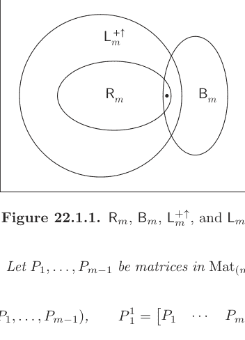

## 第 22 章 物理学应用

### 22.1 洛伦兹向量空间上的线性等距映射

设 \((V,\mathfrak{g},\mathfrak{O})\) 为一个定向洛伦兹向量空间，且 \(\mathcal{E} = (e_1,\dots,e_m)\) 为 \(V\) 的一个正交基，关于 \(\mathfrak{O}\) 为正定向。我们用 \(\mathsf{L}_m\) 表示 \(V\) 上的线性等距映射的集合：

\[
\mathsf{L}_m = \{A \in \operatorname{Lin}(V,V) : A \text{ a linear isometry}\}
\]

其中我们回顾 \(\operatorname{Lin}(V,V)\) 为从 \(V\) 到 \(V\) 的线性映射的向量空间。

### 定理 22.1.1

\(\mathsf{L}_m\) 是一个群（在线性映射的复合下），称为 \(V\) 上的 *洛伦兹群*。

证明。设 \(A\) 为 \(\mathsf{L}_m\) 中的一个映射。由定理 1.1.9 和定理 4.4.1(a) 可知逆 \(A^{-1}\) 存在且在 \(\operatorname{Lin}(V,V)\) 中。设 \(v,w\) 为 \(V\) 中的向量。则

\[
\langle v,w \rangle = \langle A(A^{-1}(v)), A(A^{-1}(w)) \rangle = \langle A^{-1}(v), A^{-1}(w) \rangle,
\]

所以 \(A^{-1}\) 在 \(\mathsf{L}_m\) 中。\(\mathsf{L}_m\) 为群的其余验证是直接的。

设 \(A\) 为 \(\operatorname{Lin}(V,V)\) 中的一个映射。为简便起见，我们用 \([A]_{\mathcal{E}}^{\mathcal{E}}\) 表示为 \([A]\)，并且同样省略其他矩阵记号中的 \(\mathcal{E}\)。对应于 (4.4.1) 和 (4.4.2)，我们有

\[
[A] = \begin{bmatrix} [A]_1^1 & [A]_1^2 \\ [A]_2^1 & \gamma \end{bmatrix}
\]

和

\[
[A]^{-1} = \begin{bmatrix} ([A]_1^1)^\mathrm{T} & -([A]_1^2)^\mathrm{T} \\ -([A]_2^1)^\mathrm{T} & \gamma \end{bmatrix},
\]

分别，其中

\[
[A]_1^1 = \begin{bmatrix} a_1^1 & \cdots & a_{m-1}^1 \\ \vdots & \ddots & \vdots \\ a_1^{m-1} & \cdots & a_{m-1}^{m-1} \end{bmatrix},
\]

\[
[A]_2^1 = \begin{bmatrix} a_m^1 \\ \vdots \\ a_m^{m-1} \end{bmatrix},
\]

和

\[
[A]_1^2 = [a_1^m \cdots a_{m-1}^m].
\]

由定理 2.2.3(b) 给出的环同构限制为 \(\mathsf{L}_m\) 与一般线性群 \(\operatorname{GL}(m) \subset \operatorname{Mult}_{m\times m}\) 的一个子群之间的（乘性）群同构。在下文中，但不再提及，使用此群同构来证明关于 \(\mathsf{L}_m\) 群结构的断言。特别是，我们依赖于以下事实：\(\mathsf{L}_m\) 的一个子集是子群当且仅当对应的 \(\operatorname{GL}(m)\) 的子集是子群。

### 定理 22.1.2

若 \(A\) 为 \(\mathsf{L}_m\) 中的一个映射，则：

- (a) \([A]_1^1([A]_1^1)^T = I_{m-1} + [A]_2^1([A]_2^1)^T = I_{m-1} + ([A]_1^2)^T [A]_1^2\)。
- (b) \(\gamma[A]_2^1 = [A]_1^1([A]_1^2)^T\)。
- (c) \(\gamma[A]_1^2 = ([A]_2^1)^T [A]_1^1\)。
- (d) \(\gamma^2 = 1 + ([A]_2^1)^T [A]_2^1 = 1 + [A]_1^2([A]_1^2)^T\)。

证明。(a)：这由定理 4.4.6 的部分 (a) 和 (d) 得出。
(b)：这由定理 4.4.6(b) 得出。
(c)：这由定理 4.4.6(e) 得出。
(d)：这由定理 4.4.6 的部分 (c) 和 (f) 得出。

由定理 22.1.2(d) 可知

\[
\gamma^2 \ge 1. \tag{22.1.1}
\]

让我们定义

\[
\beta = \frac{\sqrt{\gamma^2 - 1}}{\gamma}. \tag{22.1.2}
\]

其中我们注意到，按定义，$\gamma$ 和 $\beta$ 具有相同的符号。然后

$$-1<\beta<1 \qquad\text{and}\qquad \gamma^2(1-\beta^2)=1. \tag{22.1.3}$$

当 $\gamma\ge 1$ 时，即最感兴趣的情况，

$$0\le\beta<1 \qquad\text{and}\qquad \gamma=\frac{1}{\sqrt{1-\beta^2}}.$$

给定 $L_m$ 中的映射 $A$，我们由定理 4.4.3 得 $\det(A)=\pm1$，由 (22.1.1) 得 $\gamma\ge1$ 或 $\gamma\le-1$。考虑集合

$$L_m^+ = \{A\in L_m:\det(A)=1\},$$

$$L_m^{\uparrow}=\{A\in L_m:\gamma\ge1\},$$

和

$$L_m^{+\uparrow}=L_m^+\cap L_m^{\uparrow}.$$

在当前语境中，保向（反向）的映射被称为 **proper（improper）**。

## 定理 22.1.3. *设 $A$ 是 $L_m$ 中的映射。则 $A$ 在 $L_m^{+\uparrow}$ 中的充要条件是 $A$ 为 proper。*

*证明.* 由于 $\det(A)=+1$，结果由定理 8.2.8 得出。

让我们回顾第 4.9 节中采用的约定：对于 $V$ 的给定标准正交基 $(e_1,\ldots,e_m)$，未来时间锥 $\mathcal T^+$ 定义为包含类时单位向量 $e_m$ 的那个锥。

## 定理 22.1.4. *若 $A$ 是 $L_m$ 中的映射，则以下条件等价：*  
(a) $A$ 在 $L_m^{\uparrow}$ 中。  
(b) $A(e_m)$ 在 $\mathcal T^+$ 中。  
(c) $A$ 为 orthochronous。

*证明.* (a) $\Longleftrightarrow$ (b)：根据关于 $e_m$ 的上述约定，我们由 (4.9.8) 得 $A(e_m)$ 在 $\mathcal T^+$ 中当且仅当 $\langle A(e_m),e_m\rangle<0$。由于 $[e_m]=[0\ \cdots\ 0\ 1]^{\mathsf T}$，由定理 2.2.4，

$$[A(e_m)]=\begin{bmatrix}[A^1_m]_2\\ \gamma\end{bmatrix},$$

并且因为 $g_{\mathcal E}=\operatorname{diag}(1,\ldots,1,-1)$，由定理 3.1.2(a)，

$$\langle A(e_m),e_m\rangle=[A(e_m)]^{\mathsf T}g_{\mathcal E}[e_m]=-\gamma.$$

由此可得 $\langle A(e_m),e_m\rangle<0$ 当且仅当 $\gamma>0$。由于 $\gamma^2\ge1$，我们有 $\gamma>0$ 当且仅当 $\gamma\ge1$。因此，$A(e_m)$ 在 $\mathcal T^+$ 中当且仅当 $\gamma\ge1$。

(b) $\Longleftrightarrow$ (c)：给定关于 $e_m$ 的上述约定，这由定理 4.9.6 得出。

鉴于前述两个结果，我们可以如下刻画 $L_m^+$、$L_m^{\uparrow}$ 和 $L_m^{+\uparrow}$：

$$L_m^+ = \{A \in L_m : A\text{ is proper}\},$$

$$L_m^{\uparrow} = \{A \in L_m : A\text{ is orthochronous}\},$$

和

$$L_m^{+\uparrow} = \{A \in L_m : A\text{ is proper and orthochronous}\}.$$

## 定理 22.1.5. $L_m^+$、$L_m^{\uparrow}$ 和 $L_m^{+\uparrow}$ 都是 $L_m$ 的子群。

*证明.* 易证 $L_m^+$ 是 $L_m$ 的子群。利用定理 4.9.6，可知 $L_m^{\uparrow}$ 是 $L_m$ 的子群。由于子群的交集是子群，$L_m^{+\uparrow}$ 的结果即得。

在物理文献中，$L_m^{+\uparrow}$ 被称为 $V$ 上的 **proper orthochronous Lorentz group**。

回顾第 2.4 节， 正交群 $O(m)$ 由 $\operatorname{Mat}_{m\times m}$ 中满足 $P^\mathsf{T}P=I_m$ 的所有矩阵 $P$ 组成，而特殊正交群 $SO(m)$ 是 $O(m)$ 的子群，由满足 $\det(P)=1$ 的矩阵 $P$ 组成。

我们说 $\operatorname{Lin}(V,V)$ 中的映射 $A$ 是关于 $\vartheta$ 的 **rotation**（旋转）如果 $[A]$ 的形式为

$$[A]=\begin{bmatrix}[A]^1_1 & O_{(m-1)\times 1}\\ O_{1\times(m-1)} & 1\end{bmatrix},$$

其中 $[A]^1_1$ 在 $SO(m-1)$ 中。按定义，$\det([A]^1_1)=1$，故 $\det(A)=1$。旋转的集合为

$$R_m=\{A\in\operatorname{Lin}(V,V): A\text{ a rotation}\}.$$

## 定理 22.1.6. $R_m$ 是 $L_m^{+\uparrow}$ 的子群。

*证明.* 由于 $SO(m-1)$ 是群，易证 $R_m$ 也是群。设 $A$ 是 $R_m$ 中的映射。我们由 $\mathfrak g=\operatorname{diag}(1,\ldots,1,-1)$ 得

$$[A]^\mathsf{T}\mathfrak g[A]=\begin{bmatrix}([A]^1_1)^\mathsf{T}[A]^1_1 & O_{(m-1)\times1}\\ O_{1\times(m-1)} & -1\end{bmatrix}=\begin{bmatrix}I_{m-1} & O_{(m-1)\times1}\\ O_{1\times(m-1)} & -1\end{bmatrix}=\mathfrak g.$$

由定理 4.4.2，$A$ 是线性等距映射，因而在 $L_m$ 中。由于 $\det(A)=1$，$A$ 在 $L_m^+$ 中。按定义 $\gamma=1$，故 $A$ 在 $L_m^{\uparrow}$ 中。这表明 $A$ 在 $L_m^{+\uparrow}$ 中。因此 $R_m\subseteq L_m^{+\uparrow}$。

## 定理 22.1.7. 若 $A$ 是 $L_m^{+\uparrow}$ 中的映射，则以下条件等价：

- (a) $A$ 在 $R_m$ 中。  
- (b) $\gamma=1$。  
- (c) $[A]^1_2=O_{(m-1)\times1}$。  
- (d) $[A]^2_1=O_{1\times(m-1)}$。

证明. (b) ⇒ (c)：我们由定理 22.1.2(d) 得

$$(a_m^1)^2 + \cdots + (a_m^{m-1})^2 = 0,$$

由此结果得证。

(c) ⇒ (b)：由定理 22.1.2(d)，$\gamma^2 = 1$，故 $\gamma = \pm 1$。由于 $A$ 在 $\mathrm{L}_m^\uparrow$ 中，我们有 $\gamma = 1$。

(c) ⇔ (d)：我们由定理 22.1.2(d) 得

$$(a_m^1)^2 + \cdots + (a_m^{m-1})^2 = (a_1^m)^2 + \cdots + (a_{m-1}^m)^2,$$

由此结果得证。

(a) ⇒ (b)：由定义。

(b) ⇒ (a)：我们刚刚证明了 (b)、(c) 和 (d) 等价，故 $[A]$ 的形式为

$$[A] = \begin{bmatrix} [A]_1^1 & O_{(m-1)\times 1} \\ O_{1\times (m-1)} & 1 \end{bmatrix}$$

对于某个矩阵 $[A]_1^1$ 在 $\mathrm{Mat}_{(m-1)\times (m-1)}$ 中。由定理 22.1.2(a)，$[A]_1^1 ([A]_1^1)^\mathrm{T} = I_{m-1}$，故 $[A]_1^1$ 在 $\mathrm{O}(m-1)$ 中。由于 $A$ 在 $\mathrm{L}_m^\uparrow$ 中，我们有 $\det([A]_1^1) = \det([A]) = 1$，所以 $[A]_1^1$ 在 $\mathrm{SO}(m-1)$ 中。因此 $A$ 在 $\mathrm{R}_m$ 中。

我们说 $\mathrm{Lin}(V,V)$ 中的映射 $A$ 是 boost（关于 $\mathcal{E}$ 在第 $(m-1)$ 个类空方向）如果 $[A]$ 的形式为

$$[A] = \begin{bmatrix} I_{m-2} & O_{(m-2)\times 2} \\ O_{2\times (m-2)} & \begin{bmatrix} \gamma & -\beta\gamma \\ -\beta\gamma & \gamma \end{bmatrix} \end{bmatrix},$$

其中 $\gamma \ge 1$ 且 $\beta$ 由 (22.1.2) 计算。为记号方便，我们已在第 $(m-1)$ 个类空方向定义了 boost，但任何其他类空方向亦可。例如，第一类空方向的 boost 形式为

$$\begin{bmatrix} \gamma & O_{1\times (m-2)} & -\beta\gamma \\ O_{(m-2)\times 1} & I_{m-2} & O_{(m-2)\times 1} \\ -\beta\gamma & O_{1\times (m-2)} & \gamma \end{bmatrix}.$$

boost 的集合为

$$\mathrm{B}_m = \{A \in \mathrm{Lin}(V,V) : A \text{ a boost}\}.$$

显然 $\mathrm{B}_m$ 包含恒等映射。设 $A'$ 是另一个 boost，且

$$[A'] = \begin{bmatrix} I_{m-2} & O_{(m-2)\times 2} \\ O_{2\times (m-2)} & \begin{bmatrix} \gamma' & -\beta'\gamma' \\ -\beta'\gamma' & \gamma' \end{bmatrix} \end{bmatrix}.$$

则

$$[A][A'] = \begin{bmatrix} I_{m-2} & O_{(m-2)\times 2} \\ O_{2\times (m-2)} & \begin{bmatrix} \gamma'' & -\beta''\gamma'' \\ -\beta''\gamma'' & \gamma'' \end{bmatrix} \end{bmatrix},$$

其中
\[\gamma'' = \gamma\gamma'(1 + \beta\beta')\quad\text{and}\quad\beta'' = \frac{\beta + \beta'}{1 + \beta\beta'}.\]

易证 $\gamma'' \ge 1$，且 $\gamma''$ 与 $\beta''$ 满足 (22.1.2)。因此 $A \circ A'$ 是 boost。这证明了 $\mathrm{B}_m$ 在乘法下封闭。然而，

\[\begin{bmatrix} I_{m-2} & O_{(m-2)\times 2} \\ O_{2\times(m-2)} & \begin{bmatrix} \gamma & -\beta\gamma \\ -\beta\gamma & \gamma \end{bmatrix} \end{bmatrix}^{-1} = \begin{bmatrix} I_{m-2} & O_{(m-2)\times 2} \\ O_{2\times(m-2)} & \begin{bmatrix} \gamma & \beta\gamma \\ \beta\gamma & \gamma \end{bmatrix} \end{bmatrix}.\]

由于右边的矩阵缺少使之成为 boost 所需的负号，$\mathrm{B}_m$ 不包含逆元（除恒等映射情形外）。因此 $\mathrm{B}_m$ 不是群。

## 定理 22.1.8. $\mathrm{B}_m$ 是 $\mathrm{L}_m$ 的子集。

*证明.* 设 $A$ 是 $\mathrm{B}_m$ 中的映射。我们由 $\mathfrak{g}_\mathcal{E} = \operatorname{diag}(1,\dots,1,-1)$ 及 (22.1.3) 中的恒等式得

\[[A]^\mathrm{T}\,\mathfrak{g}_\mathcal{E}\,[A] = \begin{bmatrix} I_{m-2} & O_{(m-2)\times 2} \\ O_{2\times(m-2)} & \begin{bmatrix} \gamma & \beta\gamma \\ -\beta\gamma & -\gamma \end{bmatrix} \begin{bmatrix} \gamma & -\beta\gamma \\ -\beta\gamma & \gamma \end{bmatrix} \end{bmatrix}
= \begin{bmatrix} I_{m-2} & O_{(m-2)\times 2} \\ O_{2\times(m-2)} & \begin{bmatrix} 1 & 0 \\ 0 & -1 \end{bmatrix} \end{bmatrix} = \mathfrak{g}_\mathcal{E}.\]

由定理 4.4.2，$A$ 是线性等距映射，因而在 $\mathrm{L}_m$ 中。

## 定理 22.1.9. $\mathrm{R}_m \cap \mathrm{B}_m = \{\mathrm{id}_V\}$。

*证明.* 若 $A$ 在 $\mathrm{R}_m \cap \mathrm{B}_m$ 中，则在上述记号下，

\[\begin{bmatrix} [A]^1_1 & O_{(m-1)\times 1} \\ O_{1\times(m-1)} & 1 \end{bmatrix} = [A] = \begin{bmatrix} I_{m-2} & O_{(m-2)\times 2} \\ O_{2\times(m-2)} & \begin{bmatrix} \gamma & -\beta\gamma \\ -\beta\gamma & \gamma \end{bmatrix} \end{bmatrix},\]

其中按定义 $[A]^1_1$ 在 $\mathrm{SO}(m-1)$ 中，$\gamma \ge 1$，且 $\beta$ 由 (22.1.2) 计算。由此可得 $\gamma = 1$，再由 (22.1.2) 得 $\beta = 0$。因此 $[A] = I_m$。

基于定理 22.1.5、定理 22.1.6、定理 22.1.8 和定理 22.1.9，图 22.1.1 描述了 $\mathrm{R}_m$、$\mathrm{B}_m$ 与 $\mathrm{L}_m^{\pm\uparrow}$ 作为 $\mathrm{L}_m$ 子集之间的关系，其中点表示 $\mathrm{id}_V$。

回顾第 2.4 节，列矩阵的向量空间 $\mathrm{Mat}_{m\times 1}$ 及其基 $\mathbb{E}_m = (E_1,\dots,E_m)$。我们通过选取定向 $\mathbb{O}_m = [\mathbb{E}_m]$ 并利用矩阵乘法定义内积，使 $\mathrm{Mat}_{m\times 1}$ 成为定向内积空间：对于 $\mathrm{Mat}_{m\times 1}$ 中的矩阵 $P,Q$，内积为 $P^T Q$。赋予此结构后，我们以明显的方式将 $\mathrm{Mat}_{m\times 1}$ 与内积空间 $\mathbb{R}_0^m$ 识别。

# 图 22.1.1. R_m、B_m、L_m^{+↑} 和 L_m

# 定理 22.1.10.

设 P₁, …, P_{m−1} 是 Mat_{(m−1)×1} 中的矩阵，并考虑矩阵

𝕡 = (P₁, …, P_{m−1}),      P₁¹ = [P₁ ⋯ P_{m−1}],

以及

P = [ P₁¹   O_{(m−1)×1} ; O_{1×(m−1)}   1 ].

则：

+   (a) 𝕡 是 Mat_{(m−1)×1} 的标准正交基，当且仅当 P₁¹ 属于 O(m−1)。
+   (b) 𝕡 是 Mat_{(m−1)×1} 的正定向标准正交基，当且仅当 P₁¹ 属于 SO(m−1)。
+   (c) 若 𝕡 是 Mat_{(m−1)×1} 的正定向标准正交基，且 A 是 Lin(V,V) 中的映射，满足 [A] = P 或 [A] = Pᵀ，则 A 属于 R_m。

证明. 为简洁起见，设 𝕄 = Mat_{(m−1)×1}，𝔼 = 𝔼_{m−1}。由 (2.2.7) 有

P₁¹ = [[P₁]_𝔼 ⋯ [P_{m−1}]_𝔼] = [id_𝕄]_𝕡^𝔼,

因此

det(P₁¹) = det( [id_𝕄]_𝕡^𝔼 ).    (22.1.4)

由此可见，若 𝕡 是 𝕄 的基，则：𝕡 与 𝔼 一致（从而正定向）当且仅当 det(P₁¹) > 0。

(a)：根据定义，P₁¹ 属于 O(m−1) 当且仅当 (P₁¹)ᵀ P₁¹ = I_{m−1}，这等价于 (P_i)ᵀ P_j = δ^i_j, i, j = 1, …, m−1。

(b)(⇒)：由于 𝕡 是标准正交基，由 (a) 部分可知 P₁¹ 属于 O(m−1)。于是

1 = det(I_{m−1}) = det((P₁¹)ᵀ P₁¹) = det(P₁¹)²,

所以 det(P₁¹) = ±1。由于 𝕡 正定向，因此与 𝔼 一致，由 (22.1.4) 得 det(P₁¹) = 1。因此，P₁¹ 属于 SO(m − 1)。

(b)(⇐)：由于 P₁¹ 属于 SO(m − 1)，而 SO(m − 1) 是 O(m − 1) 的子群，由 (a) 部分可知 𝕡 是 𝕄 的标准正交基。又因为 P₁¹ 属于 SO(m − 1)，所以 det(P₁¹) = 1。由 (22.1.4) 得 𝕡 与 𝔼 一致，从而正定向。

(c)：若 [A] = P，则结果由 (b) 部分得出。假设 [A] = Pᵀ，此时 [A] = [(P₁¹)ᵀ  O_{(m−1)×1}; O_{1×(m−1)} 1]。

设 (P₁¹)ᵀ = [Q₁ … Q_{m−1}]，其中 Q₁,…,Q_{m−1} 是 𝕄 中的矩阵，并设 ℚ = (Q₁,…,Q_{m−1})。由于 𝕡 是 𝕄 的基，由定理 2.3.2 可知 ℚ 也是 𝕄 的基。此外，因为 𝕡 是标准正交的，ℚ 也是标准正交的。类似上面的论证给出 (P₁¹)ᵀ = [[Q₁]_𝔼 … [Q_{m−1}]_𝔼] = [id_𝕄]_𝔼^ℚ，

因此 det(P₁¹) = det([id_𝕄]_ℚ^𝔼)。由于 𝕡 正定向，由 (22.1.4) 可知 ℚ 也正定向。我们已证明 ℚ 是 𝕄 的正定向标准正交基。结果现在由 (b) 部分得出。

我们通过证明固有正时洛伦兹群中的任何映射都可以表示为一个旋转、一个推进和另一个旋转的复合来结束本节。

# 定理 22.1.11. L_m^{↑+} 中的任何映射 A 都可以表示为 A = R₁ ∘ B ∘ R₂，其中 R₁, R₂ 是 R_m 中的映射，B 是 B_m 中的映射。

证明. 若 ([A]₂¹)ᵀ[A]₂¹ = 0，则 [A]₂¹ = O_{(m−1)×1}。由定理 22.1.7，A 属于 R_m，因此在这种情况下我们设 R₁ = A，B = R₂ = id_V。

现在假设 ([A]₂¹)ᵀ[A]₂¹ ≠ 0，并令 P_{m−1} = − 1/βγ [A]₂¹, (22.1.5)

则 (22.1.5) 给出

$$P_1^1[A]_2^1=-\beta\gamma\begin{bmatrix}(P_1)^\mathrm{T}P_{m-1}\\ \vdots\\ (P_{m-1})^\mathrm{T}P_{m-1}\end{bmatrix}=[0\ \cdots\ 0\ -\beta\gamma]^\mathrm{T}.$$

设

$$P_1^1[A]_1^1=[Q_1\ \cdots\ Q_{m-1}]^\mathrm{T},$$

其中 $Q_1,\ldots,Q_{m-1}$ 是 $\operatorname{Mat}_{(m-1)\times 1}$ 中的矩阵。我们有

$$\begin{bmatrix}(Q_1)^\mathrm{T}\\ \vdots\\ (Q_{m-1})^\mathrm{T}\end{bmatrix}[Q_1\ \cdots\ Q_{m-1}]$$

$$=(P_1^1[A]_1^1)(P_1^1[A]_1^1)^\mathrm{T}$$
$$=P_1^1\big([A]_1^1([A]_1^1)^\mathrm{T}\big)(P_1^1)^\mathrm{T}$$
$$=P_1^1\big(I_{m-1}+[A]_2^1([A]_2^1)^\mathrm{T}\big)(P_1^1)^\mathrm{T}\quad[\text{Th 22.1.2(a)}]$$
$$=I_{m-1}+(P_1^1[A]_2^1)(P_1^1[A]_2^1)^\mathrm{T}\quad[\text{Th 22.1.10(a)}]$$
$$=I_{m-1}+\operatorname{diag}(0,\ldots,0,\beta^2\gamma^2)\quad[(22.1.8)]$$
$$=\begin{bmatrix}I_{m-2}&O_{(m-2)\times1}\\O_{1\times(m-2)}&\gamma^2\end{bmatrix}\quad[(22.1.3)].$$

这表明 $(Q_1,\ldots,Q_{m-1})$ “接近”于 $\operatorname{Mat}_{(m-1)\times1}$ 的标准正交基。由于 $A$ 属于 $L_m^+$，根据定义有 $\gamma\geq1$。令 $\varepsilon=\pm1$，并令

$$R_{m-1}=\frac{\varepsilon}{\gamma}Q_{m-1}.$$

由 (22.1.10) 可知 $R_{m-1}$ 是单位向量，且

$$(Q_{m-1})^\mathrm{T}R_{m-1}=\varepsilon\gamma.$$

对于适当选取的 $\varepsilon$，$(Q_1,\ldots,Q_{m-2},R_{m-1})$ 是 $\operatorname{Mat}_{(m-1)\times1}$ 的正定向标准正交基。（我们很快会看到，事实上 $\varepsilon=1$。）设

$$R_1^1=[Q_1\ \cdots\ Q_{m-2}\ R_{m-1}]^\mathrm{T}$$

以及

$$R=\begin{bmatrix}R_1^1&O_{(m-1)\times1}\\O_{1\times(m-1)}&1\end{bmatrix}.$$

由定理 2.2.3(a) 可知，存在 $\operatorname{Lin}(V,V)$ 中的映射 $F$ 和 $G$，使得

$$[F]=P\quad\text{and}\quad[G]=R^\mathrm{T}.$$

因此
[F ○ A ○ G] = [F][A][G]      [Th 2.2.2(c)]
= P[A]Rᵀ      [(22.1.14)]
= ⎡ P₁¹[A]₁¹(R₁¹)ᵀ   P₁¹[A]₁² ⎤ .      [(22.1.7), (22.1.13)]
  ⎣ [A]₁²(R₁¹)ᵀ      γ      ⎦
(22.1.15)

我们寻求 P₁¹[A]₁¹(R₁¹)ᵀ 和 [A]₁²(R₁¹)ᵀ 的替代表达式。对于前者，

P₁¹[A]₁¹(R₁¹)ᵀ
= ⎡ (Q₁)ᵀ ⎤ ⎡ Q₁ ⋯ Qₘ₋₂  Rₘ₋₁ ⎤  [(22.1.9), (22.1.12)]
  ⎢  ⋮  ⎥
  ⎢(Qₘ₋₂)ᵀ⎥
  ⎣(Qₘ₋₁)ᵀ⎦
(22.1.16)
= ⎡ Iₘ₋₂   O₍ₘ₋₂₎×₁ ⎤ .      [(22.1.10), (22.1.11)]
  ⎣ O₁×₍ₘ₋₂₎  εγ   ⎦

对于后者，

[Q₁ ⋯ Qₘ₋₁] = ([A]₁¹)ᵀ (P₁¹)ᵀ      [(22.1.9)]
= [ ([A]₁¹)ᵀ P₁ ⋯ ([A]₁¹)ᵀ Pₘ₋₁ ],      [(22.1.6)]

因此
Qₘ₋₁ = ([A]₁¹)ᵀ Pₘ₋₁
= -1/βγ ([A]₁¹)ᵀ [A]₁²      [(22.1.5)]
= -1/β ([A]₁²)ᵀ,      [定理 22.1.2(c)]

所以
[A]₁² = -β (Qₘ₋₁)ᵀ.      (22.1.17)

由 (22.1.10) 和 (22.1.17) 可得
[A]₁² Qᵢ = -β (Qₘ₋₁)ᵀ Qᵢ = 0
对 i = 1, …, m − 2 成立，并且由 (22.1.11) 和 (22.1.17) 可得
[A]₁² Rₘ₋₁ = -β (Qₘ₋₁)ᵀ Rₘ₋₁ = -εβγ，
因此

$$[A]^2_1(R^1_1)^T = [ [A]^2_1Q_1 \ \cdots \ [A]^2_1Q_{m-2} \ [A]^2_1R_{m-1} ]\ [(22.1.12)] = [0 \ \cdots \ 0 \ -\varepsilon\beta\gamma].$$

将 (22.1.8)、(22.1.16) 和 (22.1.18) 代入 (22.1.15)，得到

$$[F\circ A\circ G]=\begin{bmatrix} I_{m-2} & O_{(m-2)\times1}\\ O_{1\times(m-2)} & \varepsilon\gamma\\ 0&\cdots&0&-\varepsilon\beta\gamma\end{bmatrix}\begin{bmatrix}0\\ \vdots\\ 0\\ -\beta\gamma\\ \gamma\end{bmatrix} = \begin{bmatrix} I_{m-2} & O_{(m-2)\times2}\\ O_{2\times(m-2)} & \begin{bmatrix}\varepsilon\gamma&-\beta\gamma\\ -\varepsilon\beta\gamma&\gamma\end{bmatrix}\end{bmatrix}.$$

由构造可知，$(P_1,\ldots,P_{m-1})$ 和 $(Q_1,\ldots,Q_{m-2},R_{m-1})$ 是 $\operatorname{Mat}_{(m-1)\times1}$ 的正定向标准正交基。由 (22.1.7)、定理 22.1.10(b) 和 (22.1.13) 可得

$$\det(P)=\det(R)=1.$$

由于 $A$ 属于 $L_m^{+\dagger}$，

$$\begin{aligned}1&=\det([A])\\ &=\det(P[A]R^T) &&[(22.1.20)]\\ &=\det([F][A][G]) &&[(22.1.14)]\\ &=\det([F\circ A\circ G]) &&[\text{Th 2.2.2(c)}]\\ &=\varepsilon(\gamma^2-\beta^2\gamma^2) &&[(22.1.19)]\\ &=\varepsilon, &&[(22.1.3)]\end{aligned}$$

所以 (22.1.19) 变为

$$[F\circ A\circ G]=\begin{bmatrix} I_{m-2} & O_{(m-2)\times2}\\ O_{2\times(m-2)} & \begin{bmatrix}\gamma&-\beta\gamma\\ -\beta\gamma&\gamma\end{bmatrix}\end{bmatrix}.$$

根据定义，$\beta$ 和 $\gamma$ 满足 (22.1.2)。因此，$F\circ A\circ G$ 属于 $B_m$。由 (22.1.6)、(22.1.7)、定理 22.1.10(c) 和 (22.1.14) 可知 $F$ 属于 $R_m$。类似地，由 (22.1.12)、(22.1.13)、定理 22.1.10(c) 和 (22.1.14) 可知 $G$ 属于 $R_m$。由定理 22.1.6 可知 $F^{-1}$ 和 $G^{-1}$ 属于 $R_m$。令 $B=F\circ A\circ G$，$R_1=F^{-1}$，$R_2=G^{-1}$，则 $A=R_1\circ B\circ R_2$，这就是用两个旋转和一个推进表示 $A$ 的所需表达式。

# 22.2 麦克斯韦方程组

设 $(x, y, z, t)$ 是 $\mathbb{R}_0^3 \times \mathbb{R}$ 上的标准坐标。在下文中，我们把 $x, y, z$ 看作“空间”变量，把 $t$ 看作“时间”变量。利用 10.6 节中的微分算子，$\mathbb{R}_0^3 \times \mathbb{R}$ 中的**电磁场**由**麦克斯韦方程组**刻画：

[M1] $\operatorname{div}(E) = \frac{1}{\epsilon_0} \rho$
[M2] $\operatorname{div}(B) = 0$
[M3] $\operatorname{curl}(E) = -\frac{\partial B}{\partial t}$
[M4] $\operatorname{curl}(B) = \mu_0 J + \mu_0 \epsilon_0 \frac{\partial E}{\partial t}$，

其中 $\mathfrak{X}(\mathbb{R}_0^3 \times \mathbb{R})$ 中的向量场 $E, B, J$ 分别是**电场**、**磁场**和**电流密度**；$C^\infty(\mathbb{R}_0^3 \times \mathbb{R})$ 中的函数 $\rho$ 是**电荷密度**；实数 $\epsilon_0$ 和 $\mu_0$ 分别是**真空电容率**和**真空磁导率**。我们将上述恒等式中的算子 div 和 curl 解释为仅作用于空间变量，对后面出现的其他向量微积分算子也是如此。让我们假设已选定单位使得 $c = 1$，其中 $c = \mu_0 \epsilon_0$ 是光速。因此，[M4] 变为

[M4'] $\operatorname{curl}(B) = \mu_0 J + \frac{\partial E}{\partial t} = \frac{1}{\epsilon_0} J + \frac{\partial E}{\partial t}$.

我们注意到 $J$ 和 $\rho$ 不是彼此独立的：

$0 = \operatorname{div}(\operatorname{curl}(B))$ [Th 10.6.1(d)]
$= \operatorname{div}\left(\frac{\partial E}{\partial t} + \mu_0 J\right)$ [M4']
$= \frac{\partial(\operatorname{div}(E))}{\partial t} + \mu_0 \operatorname{div}(J)$
$= \frac{1}{\epsilon_0} \frac{\partial \rho}{\partial t} + \mu_0 \operatorname{div}(J)$. [M1]

于是由 $\mu_0 \epsilon_0 = 1$ 得

$\operatorname{div}(J) + \frac{\partial \rho}{\partial t} = 0,$ (22.2.1)

这称为**连续性方程**。

本节其余部分致力于寻找麦克斯韦方程组的其他表达形式，尤其是用微分形式表达的形式。这是展示前面开发的一些计算工具的一个机会。

让我们使用所谓的势来重新表述麦克斯韦方程组。由定理 10.6.3 和 [M2] 可知，存在 $\mathfrak{X}(\mathbb{R}_0^3 \times \mathbb{R})$ 中的一个向量场 $A$，称为**磁势**，使得

$B = \operatorname{curl}(A).$ (22.2.2)

于是，[M3] 给出

curl(E) = -curl(∂A/∂t)

因此

curl(E + ∂A/∂t) = 0.

由定理 10.6.2，存在一个函数 φ ∈ C^∞(ℝ₀³ × ℝ)，称为电势，使得

E + ∂A/∂t = -grad(φ)

所以

E = -(grad(φ) + ∂A/∂t)    (22.2.3)

方程 (22.2.2) 和 (22.2.3) 用 A 和 φ 表示 E 和 B。就目前而言，这一表示并不唯一。例如，设 ψ 是 C^∞(ℝ₀³ × ℝ) 中的任意函数，并令

à = A + grad(ψ)      且       φ̃ = φ - ∂ψ/∂t

这称为 A 和 φ 的规范变换。于是

grad(φ̃) + ∂Ã/∂t = grad(φ - ∂ψ/∂t) + ∂/∂t(A + grad(ψ))

= grad(φ) + ∂A/∂t

并且由定理 10.6.1(c)，

curl(Ã) = curl(A) + curl(grad(ψ)) = curl(A).

因此，Ã 和 φ̃ 也满足 (22.2.2) 和 (22.2.3)。势的范围受到约束

div(A) + ∂φ/∂t = 0,    (22.2.4)

的限制，该约束称为洛伦兹规范。

## 定理 22.2.1. 在洛伦兹规范下，麦克斯韦方程组等价于：

□(A) = -μ₀J

□(φ) = -1/ε₀ ρ

其中 □ 是达朗贝尔算子，如例 20.7.3 所定义。

证明. 假设麦克斯韦方程组成立。由 (22.2.4) 有

div(∂A/∂t) + ∂²φ/∂t² = 0,  (22.2.5)

因此

1/ε₀ ρ = div(E)  [M1]
= −div(grad(φ)) − div(∂A/∂t)  [(22.2.3)]
= −lap(φ) − div(∂A/∂t)  [表 10.6.1]
= −(lap(φ) − ∂²φ/∂t²)  [(22.2.5)]
= −□(φ).

同样地，我们有

μ₀ J = curl(B) − ∂E/∂t  [M4′]
= curl(curl(A)) + ∂/∂t(grad(φ) + ∂A/∂t)  [(22.2.2), (22.2.3)]
= grad(div(A)) − lap(A) + grad(∂φ/∂t + ∂²A/∂t²)  [定理 10.6.1(e)]
= −lap(A) + ∂²A/∂t²  [(22.2.4)]
= −□(A).

反过来，假设 □(A) = −μ₀ J 和 □(φ) = −ρ/ε₀ 成立。前面的计算“反过来”表明麦克斯韦方程组成立。

现在，我们把关注点从 ℝ₀³ × ℝ 转到 ℝ₁⁴，并用微分形式重新表述前面的讨论。设 J = (J¹, J², J³), E = (E¹, E², E³), A = (A¹, A², A³)，B = (B¹, B², B³)，并定义 𝔛*(ℝ₁⁴) 中相应的余向量场 𝒥、ℰ、𝒜 以及 Λ²(ℝ₁⁴) 中的形式 ℬ、ℱ 如下：

𝒥 = 1/ε₀ [J¹ d(x) + J² d(y) + J³ d(z) − ρ d(t)],
ℰ = E¹ d(x) + E² d(y) + E³ d(z),
𝒜 = A¹ d(x) + A² d(y) + A³ d(z) − φ d(t),  (22.2.6)
ℬ = B¹ d(y) ∧ d(z) + B² d(z) ∧ d(x) + B³ d(x) ∧ d(y),

以及

ℱ = ℰ ∧ d(t) + ℬ
= E¹ d(x) ∧ d(t) + E² d(y) ∧ d(t) + E³ d(z) ∧ d(t)
+ B¹ d(y) ∧ d(z) + B² d(z) ∧ d(x) + B³ d(x) ∧ d(y).

这证明了连续性方程的恒等式。由定理 4.5.4 的流形版本和 (22.2.6) 可得 𝒜^S=(A^1,A^2,A^3,φ)，因此

-δ(𝒜)=Div(𝒜^S) [定理 20.4.3(b)]

=∂A^1/∂x+∂A^2/∂y+∂A^3/∂z+∂φ/∂t [例 20.4.6]

=div(A)+∂φ/∂t,

这证明了洛伦兹规范的恒等式。

## 定理 22.2.4. 在洛伦兹规范 (22.2.4) 下，麦克斯韦方程组等价于：

d(𝒜)=ℱ

Δ(𝒜)=𝒥,

其中 Δ 是拉普拉斯–德拉姆算子，如 (20.8.1) 所定义。

证明. 我们需要几个预备观察。在例 16.1.9 中令 ω=𝒜，于是 (α₁,α₂,α₃,α₄)=(A¹,A²,A³,−φ)，得到

d(𝒜)= (−∂φ/∂x−∂A¹/∂t)d(x)∧d(t)+(−∂φ/∂y−∂A²/∂t)d(y)∧d(t)
+(−∂φ/∂z−∂A³/∂t)d(z)∧d(t)
+(∂A³/∂y−∂A²/∂z)d(y)∧d(z)+(∂A¹/∂z−∂A³/∂x)d(z)∧d(x)
+(∂A²/∂x−∂A¹/∂y)d(x)∧d(y).

我们还有

grad(φ)+∂A/∂t=(∂φ/∂x+∂A¹/∂t,∂φ/∂y+∂A²/∂t,∂φ/∂z+∂A³/∂t)

以及

curl(A)=(∂A³/∂y−∂A²/∂z,∂A¹/∂z−∂A³/∂x,∂A²/∂x−∂A¹/∂y).

因此，d(𝒜)=ℱ 当且仅当 (22.2.2) 和 (22.2.3) 成立，这就是我们的第一个预备观察。由 (20.8.1) 和定理 22.2.3 可得

Δ(𝒜)=dδ(𝒜)+δd(𝒜)=dδ(𝒜), (22.2.7)

这就是我们的第二个预备观察。

现在进行主要证明。假设麦克斯韦方程组成立。那么 (22.2.2) 和 (22.2.3) 成立，从而 d(𝒜)=ℱ，这证明了第一个恒等式。由于 d(𝒜)=ℱ，由定理 22.2.2 和 (22.2.7) 可得 Δ(𝒜)=δd(𝒜)=δ(ℱ)=𝒥，这证明了第二个恒等式。反过来，假设 d(𝒜)=ℱ 和 Δ(𝒜)=𝒥 成立。由定理 16.1.1(c) 可得 d(ℱ)=d²(𝒜)=0，并由 (22.2.7) 可得 𝒥=Δ(𝒜)=δd(𝒜)=δ(ℱ)。根据定理 22.2.2，麦克斯韦方程组成立。

## 22.3 爱因斯坦张量

设 $(M,\mathfrak{g})$ 是一个半黎曼流形，并设 $\mathcal{R}$ 为黎曼曲率张量。$\mathcal{T}_2^0(M)$ 中的里奇曲率张量（场）定义为

R = C_{14}(\mathcal{R})

(22.3.1)

$C^{\infty}(M)$ 中的标量曲率（函数）定义为

S = C_{12}(R)

(22.3.2)

并且 $\mathcal{T}_2^0(M)$ 中的爱因斯坦张量（场）定义为

G = R - \frac{1}{2} S\mathfrak{g}.

在物理学中，术语“里奇曲率张量”、“标量曲率”和“爱因斯坦张量”通常只在 $M$ 是洛伦兹 4-流形时使用，但我们将继续在更一般的背景下讨论。

## 定理 22.3.1（里奇曲率的局部坐标表达式）。

设 $(M,\mathfrak{g})$ 是一个半黎曼流形，则在局部坐标下有：

(a)

R_{ij} = \sum_{k} R_{kij}^{k}

= \sum_{k} \left( \frac{\partial \Gamma_{ij}^{k}}{\partial x^{k}} - \frac{\partial \Gamma_{jk}^{k}}{\partial x^{i}} \right) + \sum_{kl} (\Gamma_{kl}^{k} \Gamma_{ij}^{l} - \Gamma_{il}^{k} \Gamma_{jk}^{l}).

(22.3.3)

(b) R 是对称的；即对所有 $i,j = 1,\dots,m$，有 $R_{ij} = R_{ji}$。

证明. 一个预备结果是

R_{ij} = C_{14}(\mathcal{R})_{ij} [(22.3.1)]

= C_{1} \circ S_{4}^{1}(\mathcal{R})_{ij} [(19.6.2)]

= \sum_{kl} \mathfrak{g}^{kl} \mathcal{R}_{kijl}. [流形版本定理 6.3.5(a)]

(22.3.4)

(a)：我们有

R_{ij} = \sum_{kl} \mathfrak{g}^{kl} \mathcal{R}_{kijl} [(22.3.4)]

= \sum_{kl} \mathfrak{g}^{kl} \left( \sum_{n} \mathfrak{g}_{ln} R_{kij}^{n} \right) [定理 19.8.2(a)]

= \sum_{kn} \left( \sum_{l} \mathfrak{g}^{kl} \mathfrak{g}_{ln} \right) R_{kij}^{n} = \sum_{kn} \delta_{n}^{k} R_{kij}^{n} = \sum_{k} R_{kij}^{k},

这证明了第一个等式。第二个等式由定理 18.7.2 得出。

(b)：定理 19.8.5 中黎曼曲率对称性的局部坐标版本给出

\mathcal{R}_{kijl}=\mathcal{R}_{jlki}=\mathcal{R}_{ljik}.

于是

R_{ij}=\sum_{kl}g^{kl}R_{kijl}
=\sum_{kl}g^{lk}R_{ljik}
=R_{ji}.

## 定理 22.3.2（里奇曲率的标准正交标架表达式）。

设 $(M,g)$ 是一个带符号差 $(\varepsilon_1,\ldots,\varepsilon_m)$ 的半黎曼 $m$-流形，设 $(E_1,\ldots,E_m)$ 是 $M$ 中开集 $U$ 上的标准正交标架，并设 $X,Y$ 是 $\mathfrak{X}(M)$ 中的向量场。则：

(a)

R(X,Y)=\sum_i \varepsilon_i\mathcal{R}(E_i,X,Y,E_i)

在 $U$ 上成立。

(b) $R$ 是对称的；即对所有向量场 $X,Y \in \mathfrak{X}(M)$，有 $R(X,Y)=R(Y,X)$。

证明. (a)：这由定理 19.6.2(a) 和 (22.3.1) 得出。

(b)：由定理 19.8.5，

\mathcal{R}(E_i,X,Y,E_i)=\mathcal{R}(Y,E_i,E_i,X)=\mathcal{R}(E_i,Y,X,E_i).

现在由 (a) 部分得出结果。

## 定理 22.3.3（标量曲率的局部坐标表达式）。

设 $(M,g)$ 是一个半黎曼流形，则在局部坐标下有

S=\sum_{ij}g^{ij}R_{ij}.

证明. 由 (19.6.3) 和 (22.3.2) 可得

S=C_{12}(R)=C^1_\circ S^1_1(R).

现在由定理 6.3.5(b) 的流形版本得出结果。

## 定理 22.3.4（标量曲率的标准正交标架表达式）。

设 $(M,g)$ 是一个带符号差 $(\varepsilon_1,\ldots,\varepsilon_m)$ 的半黎曼流形，且 $(E_1,\ldots,E_m)$ 是 $M$ 中开集 $U$ 上的标准正交标架，则

S=\sum_i\varepsilon_i\mathcal{R}(E_i,E_i)

在 $U$ 上成立。

## 22.3 爱因斯坦张量

证明。这由定理 19.6.2(b) 和 (22.3.2) 可得。

**定理 22.3.5 (Ricci 曲率散度的正交标架表达式)。** 设 \((M,\mathfrak{g})\) 为签名为 \((\varepsilon_1,\dots,\varepsilon_m)\) 的半黎曼 \(m\)-流形，设 \((E_1,\dots,E_m)\) 为 \(M\) 上开集 \(U\) 上的一个正交标架，且 \(X\) 为 \(\mathfrak{X}(M)\) 中的一个向量场。则

\[
\operatorname{Div}(\mathrm{R})(X)=\sum_i \varepsilon_i \nabla_{E_i}(\mathrm{R})(X,E_i)=\sum_i \varepsilon_i \nabla_{E_i}(\mathrm{R})(E_i,X)
\]

在 \(U\) 上成立。

证明。这由定理 20.9.1 和定理 22.3.2(b) 可得。

**定理 22.3.6。** 若 \((M,\mathfrak{g})\) 为半黎曼 \(m\)-流形，则：

- (a) \[
\operatorname{Div}(\mathrm{R})=\frac12 d(\mathrm{S})=\frac12 \operatorname{Div}(\mathrm{S}\mathfrak{g}).
\]

- (b) \(\operatorname{Div}(\mathbf{G})=0.\)

证明。 (a)：对于 \(\mathfrak{X}(M)\) 中的向量场 \(X\)，我们有

\[
\begin{aligned}
d(\mathrm{S})(X)&=X(\mathrm{S}) && [\text{Th 15.4.5(b)}]\\
&=\nabla_X(\mathrm{S}) && [(18.1.1)]\\
&=\nabla_X\circ\mathrm{C}_{12}\circ\mathrm{C}_{14}(\mathcal{R}) && [(22.3.1),\ (22.3.2)]\\
&=\mathrm{C}_{12}\circ\mathrm{C}_{14}\circ\nabla_X(\mathcal{R}). && [\text{Th 19.6.3}]
\end{aligned}\tag{22.3.5}
\]

由于 \(x\) 和 \(X\) 都是任意的，这证明了第一个等式。根据定理 20.9.2，\(\operatorname{Div}(\mathrm{S}\mathfrak{g})=d(\mathrm{S})\)，因此第二个等式由第一个等式得出。

(b)：这由部分 (a) 可得。

采用广泛接受的单位，**爱因斯坦场方程** 对于洛伦兹 4-流形由张量恒等式给出

\[
\mathbf{G}=\frac{8\pi G}{c^4}\mathbf{T},
\]

其中 \(G\) 为牛顿引力常数，\(c\) 为光速，且 \(\mathbf{T}\) 为所谓的 **应力-能量张量**。这些 10 个偏微分方程构成了广义相对论的基础，描述了引力如何由质量和能量使时空弯曲而产生。值得注意的是，爱因斯坦方程的“左边”完全用几何术语表达，因为爱因斯坦张量完全由洛伦兹 4-流形的度量决定。
