# 开始使用 Shopify

从互联网诞生的那一刻起，人们就看到了信息触手可及的便利。自那时起，人们一直在努力创建各种互联网应用和综合服务，让我们的生活更轻松，随之而来的是电子商务商店。因此，Shopify 应运而生。

第一章为理解 Shopify 是什么以及其工作原理奠定了坚实的基础，而实践表明我们常常会跳过这一步。砍掉理论直接进入语法的思路听起来可能很诱人。然而，即使是最小的涟漪也可能在长期造成相当大的问题。虽然我们不会过多谈论 Toby Lutke 如何创建 **Shopify**，但在本章中，我们将涵盖以下主要主题：

- Shopify 是什么？
- 如何开始？
- 导航管理面板
- 管理主题
- 理解主题结构

到本章结束时，我们不仅会了解 Shopify 是什么，还将学习如何在 Shopify Partners Program 下创建账户，创建一个开发商店用于练习，学会导航 Shopify 管理后台，并创建子主题并理解其结构。有了这些知识，我们将拥有坚实的基础，了解所有这些要素如何让我们在学习之旅中更进一步，自定义 Shopify 上的主题。

## 技术要求

虽然每个主题都会通过 accompanying 图形进行解释和展示，但由于 Shopify 是一项托管服务，我们需要互联网连接才能跟随本章中概述的步骤。

## Shopify 是什么？

无论是作为开发者还是通过一般使用互联网，很可能 *Shopify* 这个名字至少出现过一次，*但 Shopify 是什么？* **Shopify** 是一家总部位于加拿大渥太华的跨国电子商务公司，为其客户提供各种综合服务。这项基于订阅的服务从购买域名到轻松构建和管理未来的梦想商店，应有尽有。

多年来，Shopify 已证明它不仅仅是另一个商店构建器或销售产品的工具。相反，它已确立自己为电子商务巨头，允许任何人构建商店并为其购物者创造独特的体验。作为一个基于模板的商店构建器，Shopify 提供各种免费或付费主题以实现商店定制，使你无需任何开发知识即可使用直观简便的主题编辑器。然而，如果最终目标是创建一个完全独特的商店，并在我们的指尖拥有各种定制选项，那么我们就需要一位精通 Liquid 的开发者来定制主题并在代码编辑器中创建额外的选项。

## 如何开始？

学习和在 Shopify 上工作的第一步要求我们了解 Shopify Partners Program。Partners Program 是 Shopify 创建的一个平台，汇集了来自世界各地的人，并为他们提供为商店业主构建新的电子商务商店、设计主题、开发应用以及向 Shopify 推荐新客户的能力。平台最诱人的扩展之一是它将允许我们创建一个开发商店来练习我们的 Liquid 知识。

在创建我们的 **Development store** 并熟悉 Shopify 之前，我们首先需要在 Shopify Partners Program 中创建一个账户。创建账户是一个相对直接的过程，我们可以从以下页面开始：

`https://www.shopify.com/partners`

1. 我们可以通过点击页眉右上角的 **Join now** 按钮开始流程，或通过点击 **Log in** 按钮访问现有账户。在填写创建账户页面和随后的 **Account Information** 页面上的基本信息后，我们将首次看到 Partners 仪表板：

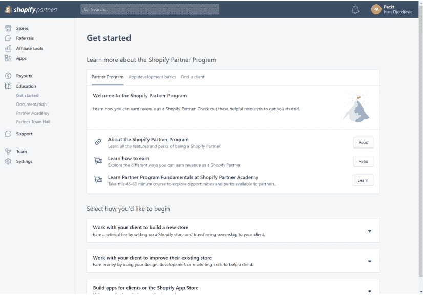

图 1.1 – Shopify 合作伙伴仪表板的示例

2. 创建账户后，下一步将是创建我们的 **Development store**。我们可以通过访问左上角侧边栏中的 **Store** 链接并按下 **Add store** 按钮来完成，这将提示一个商店注册表单，我们需要填写：

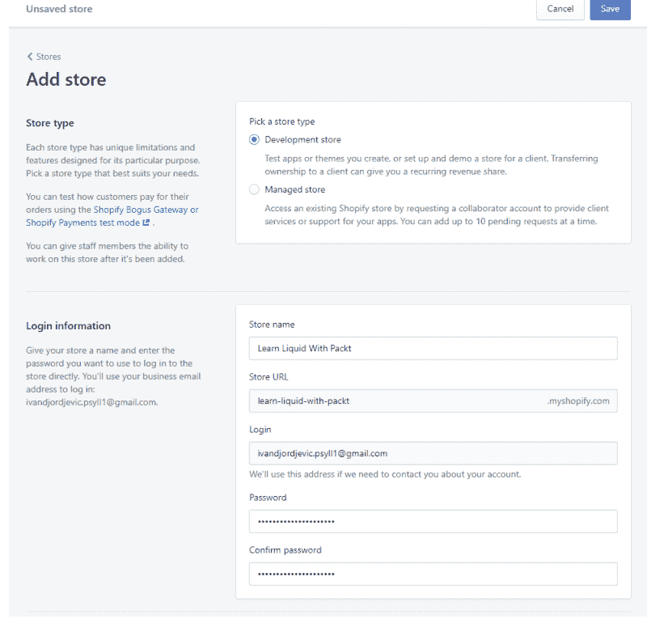

图 1.2 – 创建 Development store 的示例

大多数选项无需简化，因为它们不言自明，但我们需要分析最重要的一个，**Store type**，它包含两个选项：

- **Development store**
- **Managed store**

出于学习目的，我们将使用 **Development store**。然而，我们也会提供 **Managed store** 选项的简短解释以及我们何时可以使用它。

**Managed store** 选项将使我们能够请求对现有商店的 **collaborator** 访问权限。选择此选项将提示另一个名为 **Permission** 的部分，在其中我们需要选择我们请求的访问类型。一般来说，我们可以选择请求访问客户商店的所有区域。然而，要对客户商店执行主题定制，我们需要访问 **Online store** 下的 **Themes** 选项。

一旦我们选择了执行工作所需的权限级别并输入了我们请求访问的商店的 URL，剩下的就是通过按下 **Save** 按钮发送请求。商店所有者将收到商店访问请求的通知，然后选择授予或拒绝访问。

**Development store** 选项将允许我们创建一个全新的商店，在其中我们可以练习我们的 Liquid 技能，在功能推广到 Shopify 实时店面前测试新功能，或创建一个我们可以稍后转移给客户的新商店。

> **重要提示：**
> 
> 虽然创建 **Development store** 完全免费，但在将商店转移给客户时，主题将自动失去开发状态。我们已转移所有权的个人将需要选择一个循环计划，初始创建主题的开发者将只要他们为订阅计划付费，就会获得循环佣金。

让我们通过选择 **Development store** 作为商店类型并填写商店信息来创建我们的开发商店。

> **提示：**
> 
> 开发者预览是一个 Shopify 近期推出的新功能，将允许我们在创新功能上线到实时店面前预览它们。然而，我们将避免使用此选项。

一旦你填写了登录信息、商店地址并选择了商店用途，请按下 **Save** 按钮创建你的商店。

成功！我们的商店已准备就绪，有了它，我们就可以继续熟悉 Shopify 管理面板了。

## 导航管理面板

随着新开发商店的创建，我们将首次看到商店主页。主页由中间屏幕组成，其中将包含一些供商店业主开始业务的一般建议、日常任务、最近活动，以及在屏幕左侧，我们将看到侧边栏，这将是我们主要关注的重点。

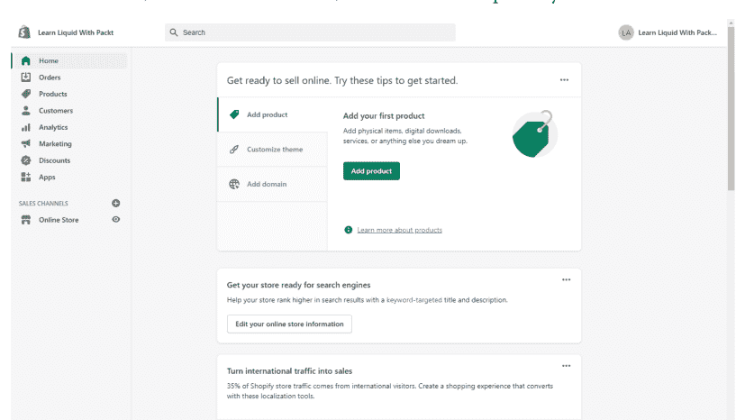

图 1.3 – 示例 Shopify 管理主页

虽然我们不会立即深入细节，但对我们将在本书不同章节中多次引用的商店每个区域有一个基本了解至关重要。我们将侧边栏分为三个部分以便于参考，我们可以将其列为如下：

- 核心方面
- 销售渠道
- 设置

## 核心方面

第一部分“核心方面”包含商店所有者通常使用的与商店相关的选项，其中包括以下信息：

- **订单** 部分包含商店所有者收到的所有订单的相关信息。商店所有者可以在此处单独预览每个订单并决定是否继续处理。所有者还可以使用草稿方法手动创建订单并预览已放弃的结账。
- **产品** 部分由四个独立区域组成，允许我们创建和管理产品，处理现有产品的入库库存，创建和管理商品集合或产品类别（如果您愿意），并创建礼品卡。
- **客户** 部分顾名思义，允许我们创建和管理客户数据库。此部分以及之前的 **产品** 部分将对我们特别感兴趣。我们稍后会详细介绍其中一些对我们感兴趣的功能。
- 接下来名为 **分析** 的部分将主要由商店所有者使用。它提供了大量有关商店表现的信息，例如销售的详细报告，以及客户访问商店的实时视图及其行为。
- **营销** 部分顾名思义，允许我们查看商店营销策略概览。我们可以通过电子邮件或其他社交网络创建和管理活动，并创建自动化以提高商店的留存率。
- 我们可以使用 **折扣** 部分创建折扣优惠券代码，可以与客户分享，让他们在结账时手动输入以获得整单或特定产品的折扣。此外，我们可以设置自动折扣，一旦满足商店所有者设定的要求就会自动触发。
- 最后一个部分名为 **应用**，让我们快速预览商店中安装的所有应用，我们可以在其中管理或删除应用（如果选择）。

> **重要提示：**
> 由于 Shopify 平台的限制，不可能合并折扣。如果我们已符合 10% 的自动折扣资格，就无法输入之前从商店所有者处收到的免费运费手动折扣优惠券代码。

> **提示：**
> 虽然可以，但当您在托管类型的商店中使用协作者账户工作时，您绝不应自行安装应用。假设您需要某个特定应用来完成委托给您的任务。在这种情况下，您应联系商店所有者，说明其必要性，并请他们在继续之前为您安装，因为他们需要授予特定权限并与应用共享商店数据，而这些数据应由商店所有者审查并接受。

## 销售渠道

我们侧边栏的第二部分 **销售渠道** 代表我们可以用来销售商店产品的各种平台。默认情况下，唯一可见的渠道是 **在线商店**，这将是我们主要的目标；不过，我们可以通过单击销售渠道旁边的加号按钮轻松添加更多渠道。

**在线商店** 渠道是商店的核心，因为它为我们提供了为客户输出可见商店店面的能力，我们可以将其细分为六个独立部分：

- **主题** 部分允许我们通过自定义商店主题来管理商店外观以符合我们独特的品牌。我们有时在打开 **主题** 部分后首先看到的就是 Shopify 的提示，说明我们的在线商店处于 *密码保护* 状态，这意味着商店尚未对客户可见。在密码保护期间，任何尝试查看我们商店的访客都只能看到商店处于密码保护状态且当前无法访问的通知。

> **重要提示：**
> 我们可以通过单击 **主题** 部分中密码保护提示上的 **查看商店密码** 按钮，或访问 **在线商店** 部分中的 **偏好设置** 部分来轻松禁用密码保护。但是，考虑到我们选择了开发选项作为我们的商店，禁用密码保护不可用。我们只能在将商店转移给客户或购买自己的订阅计划后才可移除密码保护。

密码保护提示之后，我们在 **主题** 部分下可以看到的下一个区域名为 **当前主题**。此部分显示当前主题的名称和一个小预览，其后是 **在线商店速度** 部分，为我们提供商店速度报告。**在线商店** 速度部分对于密码保护的商店目前处于禁用状态。

- **Google Analytics**：有关 Google Analytics 的详细信息，请参阅 `https://help.shopify.com/manual/reports-and-analytics/google-analytics`。
- **Facebook Pixel**：有关 Facebook Pixel 的详细信息，请参阅 `https://help.shopify.com/manual/promoting-marketing/facebook-pixel`。
- **客户隐私**：有关客户隐私的详细信息，请参阅 `https://help.shopify.com/en/manual/your-account/privacy/cookies`。
- **密码保护**：有关密码保护的详细信息，请参阅 `https://help.shopify.com/manual/using-themes/password-page`。
- **垃圾邮件保护**：有关垃圾邮件保护和 Google reCaptcha 使用的详细信息，请参阅 `https://help.shopify.com/en/manual/online-store/setting-up/preferences#protect-your-store-with-google-recaptcha`。

### 设置

我们侧边栏的第三部分也是最后一部分，名为 **设置**，包含许多帮助商店所有者设置和运营商店的选项。由于 **设置** 中包含大量部分和后续选项，我们不会全部涵盖，但我们将在本书的后续章节中提及其中一些对我们感兴趣的选项。

### 管理主题

我们已在 **主题** 部分下提及此主题，但 *主题是什么？* **主题** 是控制您商店布局的主模板文件，它允许我们通过编辑代码或通过此模板编辑主题编辑器设置来更改店面布局。

2. 按下 **浏览免费主题** 按钮后，我们将看到一个弹出窗口，其中包含可添加到我们商店的八个免费 Shopify 主题以及我们已安装并标记为 **当前** 的 **Debut** 主题：

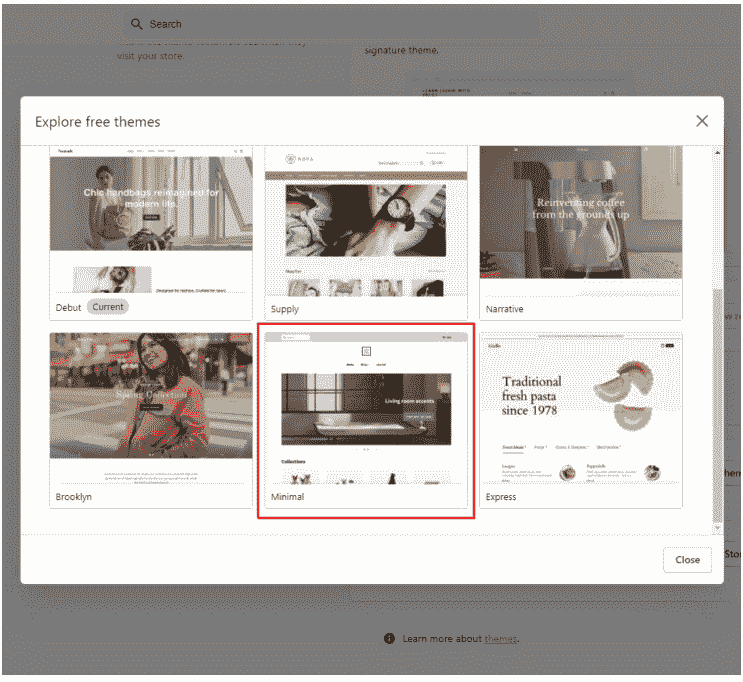

图 1.5 – 选择名为 Minimal 的免费 Shopify 主题

3. 虽然我们可以选择其中任何一个主题，但让我们选择第三行第二列的主题 **Minimal**，单击即可。

与大多数主题一样，**Minimal** 主题包含多种样式，例如 **Modern**、**Vintage** 和 **Fashion**。虽然这些都是很好的选择，但我们将为学习目的选择 **Modern** 选项。选择 **Modern** 选项后，单击 **添加到主题库** 按钮以完成流程并将新选择的主题添加到我们商店的主题库中：

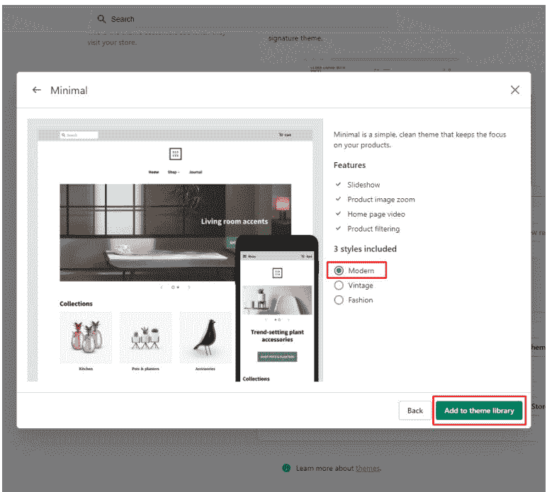

图 1.6 – 为所选主题选择样式并将其添加到主题库

根据您的互联网连接，Shopify 加载新主题可能需要几秒钟，之后您将收到 Minimal 主题已成功添加到您商店的通知。即使我们已向商店添加了新主题，Debut 主题仍然是我们的实时主题，而如果我们查看主题库，我们将看到新添加的 Minimal 主题。要更改此设置，我们需要将新主题设为当前主题。

4. 我们可以通过滚动到我们希望发布为实时的主题来发布新主题。在我们的例子中，该主题是 **Minimal**。单击 **操作** 按钮，然后单击 **发布** 按钮，之后会出现一个弹出窗口，要求确认发布 **Minimal** 主题为实时。第二次按下 **发布** 按钮以确认我们的选择，这将自动发布并将 **Minimal** 主题设为我们商店的当前主题：

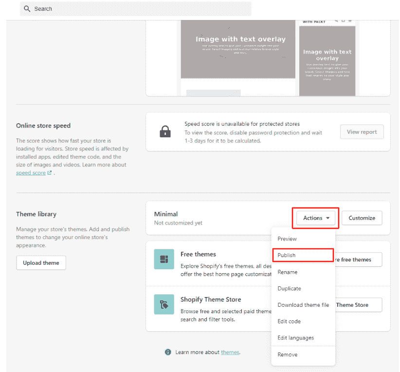

图 1.7 – 发布新的 Shopify 主题为实时

5. 现在我们已安装新主题，是时候预览新主题在我们商店中的外观了。我们可以通过单击 **操作** 按钮来执行此操作：

## 图 1.8 – 预览主题店面

然而，这一次，我们应该点击的 Actions 按钮将位于我们当前主题上，而不是主题库中，然后选择 Preview 按钮，这将在新标签页中打开我们的商店预览。

从为我们打开的预览页面可以看出，店面看起来并不吸引人，因为它缺少内容。我们只能看到一些带有占位图片的默认分区。

考虑到这是一个新安装的主题，没有任何内容，复制过程应该不需要太多时间。过程完成后，你会注意到我们向 **主题库** 添加了一个新主题，名为 `Copy of Debut`。

> **重要提示：**
> 每当你决定进行重大修改时，建议创建一个复制主题。但我们应该记住，Shopify 每个商店最多只允许 20 个复制主题。达到该限制后，我们会收到通知，提示已达到每个商店 20 个复制主题的限制。这一限制还会阻止我们创建新的主题副本；如果我们还想再创建一个，就需要删除一些不再使用的旧主题副本。

- 8. 默认情况下，Shopify 会自动采用我们复制的主题的名称，并在其前面添加 `Copy of` 字样。鉴于多个名称相似的主题很快就会变得难以控制，我们应该立即重命名新主题，以避免将来可能出现的混淆。

- 9. 点击我们新建的 **Copy of Debut** 主题上的 **操作** 按钮，然后选择 **重命名选项**：

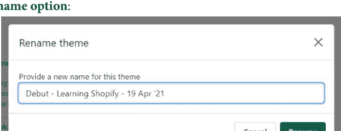

此操作将自动弹出一个窗口，你可以在其中输入新名称。Shopify 允许我们使用最多 50 个字符来命名新主题，这给了我们充足的空间来选择一个合适的名称。你应该包含补充信息，例如日期以及它所包含的自定义内容。在我们的例子中，我们将主题命名为 `Debut - Learning Shopify - 19 Apr '21`，然后点击 **重命名** 按钮以确认我们的选择。

现在我们已经学会了如何创建和重命名复制主题，是时候深入研究我们新创建的主题，并进一步了解它的工作原理了。

## 了解主题结构

要开始熟悉主题结构，我们首先需要打开代码编辑器。我们可以点击 Debut - Learning Shopify - 19 Apr '21 主题上的 **操作** 按钮，然后点击 **编辑代码** 按钮来打开代码编辑器，这样我们就能第一次看到代码编辑器的外观。

我们可以将代码编辑器分为以下两个部分：

- 页眉
- 侧边栏

## 页眉

我们可以在页面顶部找到 **页眉** 部分，其中包含主题名称，左侧有退出编辑器的箭头按钮，右侧有三个按钮，名称如下：

- **预览**
- **定制主题**
- **主题专家帮助**

## 预览

我们列表中的第一个按钮，即 **预览** 按钮，允许我们快速预览正在处理的复制主题以及我们所做的任何更改。虽然当前主题预览只包含占位内容，但它确实包含一个对我们非常实用的元素——**预览栏**：

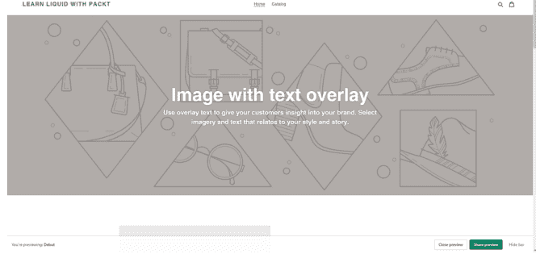

图 1.11 – 预览屏幕和预览栏示例

我们可以在预览屏幕的底部找到预览栏，它的左侧包含我们正在预览的主题名称，右侧包含三个按钮：

- **关闭预览** 按钮将自动关闭我们的复制主题预览，并将我们重定向到当前线上主题的主页。
- 点击 **分享预览** 按钮会触发一个弹窗，我们可以与任何人分享该弹窗，让他们了解我们在同一主题上所做的更改。拥有此链接的任何人虽然都能查看新主题的各个方面，但无法完成任何购买或进入结账页面。此外，自动生成的预览链接只保留 14 天，这意味着 14 天后，你需要重复预览步骤生成新的预览链接，并再次与你选中的人分享。
- 预览栏中的最后一个按钮叫做 **隐藏栏**，顾名思义，它允许我们隐藏预览栏，这样我们就可以在没有任何视觉障碍的情况下预览更改。请注意，刷新页面时，预览栏会自动显示出来。

## 定制主题

在我们编辑器的 **页眉** 区域下方，下一个项目是 **定制主题** 按钮，它会打开另一种不同类型的编辑器——主题编辑器。在这个编辑器中，我们可以更新一些主题设置，例如排版、颜色和媒体链接，甚至可以管理店面分区。

## 主题专家帮助

最后，**主题专家帮助** 按钮是商店所有者用来通过 Shopify 合作伙伴计划发布工作请求的工具；学完本书后，你将作为一名 Shopify 专家等待接单。

## 布局

`Layout` 目录是我们主题的主要目录，因为它包含商店运行所需的基本文件。该目录通常包含最多四个文件，我们可以称之为主题布局模板，如下所述。

## gift_card.liquid

`gift_card.liquid` 是一个模板文件，包含渲染礼品卡页面的代码；当客户购买礼品卡时，渲染后的礼品卡页面会通过电子邮件通知发送给我们的客户。

## password.liquid

`password.liquid` 文件模板渲染在线商店密码页面；当我们的商店处于开发模式时，任何客户访问我们的商店都会看到这个页面。我们在讨论 **销售渠道** 及其 **在线商店** 区域时，曾在 *导航管理面板* 一节中提到过什么是密码保护以及如何禁用它。

为了更好地理解密码保护页面，让我们尝试预览一下，看看它是如何工作的。你可以将商店的 URL `https://my-store-name.myshopify.com` 与末尾添加的 `/password` 组合起来，预览商店的密码页面。

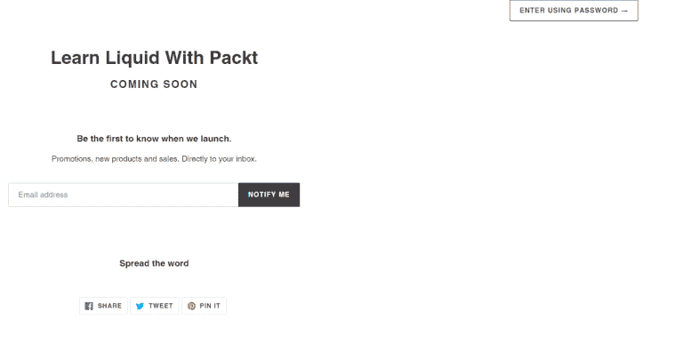

图 1.13 – Shopify 密码保护页面示例

正如我们所见，密码保护只包含最基本的信息。然而，它成功完成了我们设计它的任务：在商店仍处于开发状态时，阻止人们查看我们的受密码保护的商店。

在密码保护页面的右上角，我们会注意到一个按钮——**使用密码进入**，它会打开一个弹出窗口，我们可以在其中使用商店所有者凭据登录到我们的商店，然后点击 **在此登录** 链接，该链接会将我们重定向到管理面板：

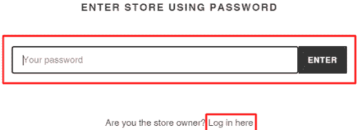

图 1.14 – 密码页面登录表单

但是，如果我们想通过输入密码来预览我们的主题店面呢？此表单要求的密码与我们为启用密码保护页面而设置的密码相同。在我们的例子中，当我们选择开发选项作为商店类型时，系统会自动生成该密码。

要确定密码保护页面的密码，我们需要在新浏览器标签页的 URL 中键入 https://my-store-name.myshopify.com/admin，返回管理面板。进入后，在左侧边栏的 **销售渠道** 下，单击以展开 **在线商店** 字段，然后点击 **偏好设置** 选项。在名为 **密码保护** 的区域下，你会找到密码页面表单所需的密码，以便访问我们的店面：

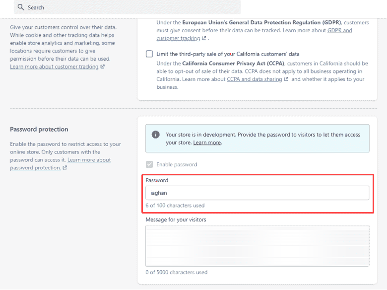

假设我们返回密码保护页面并输入我们找到的密码。在这种情况下，密码保护页面将对我们暂时解除，商店会重定向我们到预览或线上主题店面，具体取决于我们最初打开的链接类型。

## theme.liquid

回到代码编辑器中，我们可以将列表中的下一项 `theme.liquid` 视为主布局文件，所有其他模板文件以及我们之后将了解的任何其他元素都将在其中渲染。

## checkout.liquid

我们列表中的最后一个布局文件 `checkout.liquid` 目前在我们的开发商店中不可见。此布局文件仅对购买了 **Shopify Plus** 订阅的 Shopify 商店所有者可见。

通常，每个主题都包含一组预定义选项，这些选项允许我们对结账页面进行一些基本的样式修改。然而，当我们拥有 `checkout.liquid` 布局文件后，我们就可以访问结账文件，从而进行一些更复杂而原本无法实现的修改。

请注意，即使我们手中掌握了 `checkout.liquid` 文件，出于安全原因，我们也无法修改结账页面的处理流程。我们只能进行一些不会中断结账流程的基本修改。

我们只能通过向 Shopify 支持团队提交请求来激活 Shopify 套餐。他们审核我们的申请后，会为在商店中启用这一独特套餐生成一个定制价格。

> **重要说明：**
> 
> 即使你已在商店中激活了 Shopify Plus 套餐，`checkout.liquid` 文件也不会立即显示。相反，你需要向 Shopify 支持团队提交请求，请他们将该特殊文件包含到你的商店中。

基于这些原因，我们不会深入探讨 `checkout.liquid` 文件的细节。不过，我们将介绍布局文件中包含的*操作方法*和最核心的元素，这将帮助我们走上正确理解布局文件的路径。有关编辑结账文件的更多信息，请参阅：`https://shopify.dev/themes/architecture/layouts/checkout-liquid`

## 模板

我们主题目录列表中的下一个要点是模板，这是一组允许我们一次创建和管理多个页面外观的文件。模板文件由两种类型的文件组成：

-   第一种类型的模板文件是 `.json` 文件，这是 Shopify 的新增功能。使用 `.json` 类型模板，我们可以通过主题编辑器轻松控制任何页面的布局。不过，为了更好理解，我们现在不会深入讨论太多细节。在接下来的几个章节中，介绍 `.json` 模板及其可能性会更富有成效。
-   第二种类型是 `.liquid` 类型文件，这是一种简单的标记类型文件，我们现在就来熟悉一下。

按照惯例，每个主题针对每种页面类型都会附带一个模板文件，例如 `product.liquid`，系统会自动将其分配给我们可能创建的任何当前或未来的产品页面。考虑到 Shopify 是基于模板的，对特定模板所做的任何更改都会影响我们之前分配了该模板的任何页面。不过，Shopify 还允许我们为每种页面类型创建额外的模板文件，并在不改变原始模板文件布局的情况下进一步自定义它们。

我们可以通过点击模板目录正下方的**添加新模板**按钮来创建新的模板文件，之后会出现一个弹窗，要求我们选择新模板文件的类型和名称：

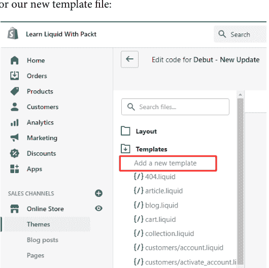

成功创建新的模板文件后，我们现在可以将新模板分配给我们为其创建该新模板的页面。具体做法是，根据我们创建的页面模板类型，在后台面板中打开任意对应页面，然后在**主题模板**区域下的**模板后缀**下拉菜单中选择新模板名称。

**重要说明：**
**模板后缀**下拉菜单只能读取当前线上主题的值。这意味着，在我们发布副本主题上线，或在我们当前的线上主题中创建相同的模板文件之前，新创建的模板文件不会显示在我们的后台中。如果我们选择第二种方式，请注意我们需要创建同名的文件；无需对文件内容做任何更改。

如果在后台看不到**主题模板**区域，我们应该通过检查已创建的模板类型来确认是否打开了正确的页面，因为**模板后缀**下拉菜单只会在已创建了多个模板的页面上显示。

## 分区和代码片段

我们目录列表中的下一个关注点是 `Sections`，这是一种不同类型的模板文件，当与模板文件结合使用时，它可以让我们创建真正可自定义的功能，这正是 Shopify 闻名之处。请注意，在分区内创建的任何变量都无法在分区外访问，反之亦然。该规则唯一的例外是，如果分区包含代码片段，则提供单向通信。

`Snippets` 文件允许我们通过引用其名称，在 `Templates/` 和 `Sections` 中复用重复的代码片段。除了允许我们复用部分代码外，只要我们将这些变量作为参数传递给代码片段，`Snippets` 还能让我们访问父元素内部的变量。

## 资源

顾名思义，`Assets` 目录允许我们存储任何与主题相关的资源，包括图片、字体文件、JavaScript、CSS 文件，并且可以在整个主题文件中轻松引用它们。

## 配置

`Config` 目录在我们的主题中至关重要。在这个目录中，我们可以定义和管理主题的全局 JSON 值。该目录包含两个关键文件：

-   `settings_schema.json` 文件允许我们创建和管理主题编辑器中的内容，我们可以在整个主题文件中引用这些内容。
-   另一方面，`settings_data.json` 文件记录了模式文件中定义的所有选项并保存它们的值。你可以将此文件视为主题数据库，它允许我们预览当前的 JSON 值，或者通过更新主题编辑器中的主题设置，或直接编辑 `settings_data.json` 文件中的值来修改这些值。

## 区域设置

我们列表中的最后一个目录名为 `Locales`，包含主题的区域设置文件，我们可以用它来翻译主题的内容。该目录可能包含的文件数量不固定。它可以有一个默认文件 `en.default.json`，也可以包含多个文件，具体取决于你希望为商店提供多少种语言。

## 总结

在第一章中，我们涵盖了 Shopify 的基本方面，学习了什么是 Shopify，以及如何在 Shopify 合作伙伴计划中创建账户，我们将在学习过程中以及未来在 Shopify 平台上的任何工作中使用该账户。

我们已经创建了一个开发商店，并理解了为什么在进行任何重大更改之前创建主题副本至关重要，以及如何创建。虽然我们介绍的一些内容听起来可能无关紧要，但其中每一项都将帮助我们更好地理解作为 Shopify 开发者经常会做的工作流程。

最后，我们掌握了主题文件内部结构的一些知识，这将在下一章中对我们大有帮助。在下一章中，我们将熟悉 Liquid 的基础知识，并进一步拓展关于主题自定义的知识。

## 问题

- 1. 什么是合作伙伴计划？
- 2. 如何禁用开发类型商店的密码保护？
- 3. `Layout` 目录文件和 `Templates` 目录文件有什么区别？
- 4. 在什么情况下，新模板文件会显示在你页面的后台部分中？
- 5. 哪些类型的文件以及满足什么条件，才能让我们访问父文件作用域内的变量？

## 延伸阅读

-   有关 Shopify 后台的更多信息和概述，请参阅 https://help.shopify.com/en/manual/shopify-admin。
-   有关管理商店账户的详细信息，请参阅 https://help.shopify.com/en/manual/your-account。
-   有关在线商店的更多信息，请参阅 https://help.shopify.com/en/manual/online-store。

