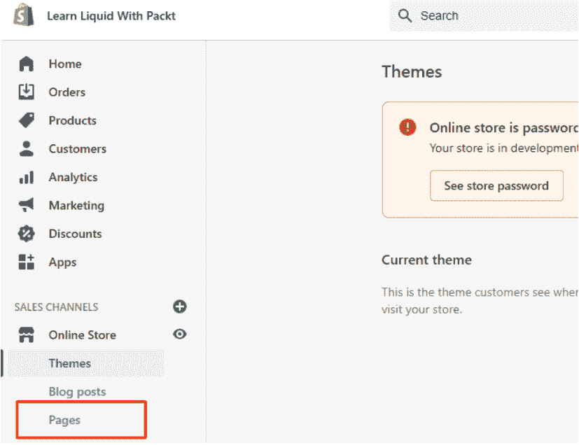
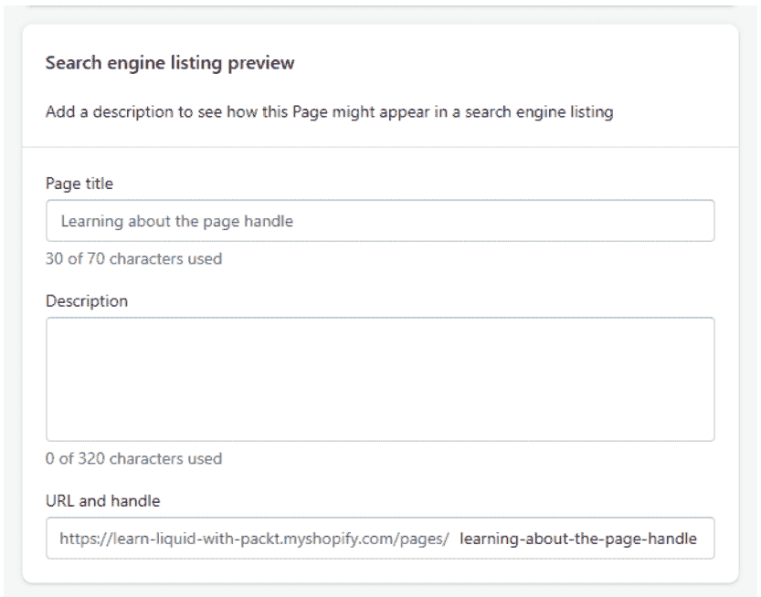

# 2
Liquid 的基本流程

本章将帮助我们理解 Liquid 是什么，并学习 Liquid 的基础知识，为掌握它提供必要的知识。我们将把本章分为以下主题：

- Liquid 是什么？
- 理解 Liquid 及其分隔符
- 学习比较运算符
- 使用逻辑运算符
- 理解数据类型
- 控制空白

到本章结束时，我们将对 Liquid 逻辑有更深入的理解，了解可用于操作各种类型数据的运算符类型，以及 Liquid 去除那些讨厌的空白字符的方式。通过学习如何使用逻辑运算符和操作 handle 属性，我们将获得创建各种动态功能的有价值的知识，为编写高质量和复杂的代码奠定正确的技能基础。

## 技术要求

本章的代码可在 GitHub 上获取：https://github.com/PacktPublishing/Shopify-Theme-Customization-with-Liquid/tree/main/Chapter02。

本章的 Code in Action 视频可在以下位置找到：https://bit.ly/3ArKxia

## Liquid 是什么？

在上一章中，我们获得了对 Shopify 的初步认识。我们了解了 Shopify 是什么，如何创建 Shopify Partner 账户，以及如何管理我们的主题。最后，我们了解了主题结构、其包含的目录以及布局目录中的一些重要文件，此时我们可能会注意到我们的大多数文件都包含 .liquid 扩展名。那么 Liquid 到底是什么？

Liquid 是由 Shopify 联合创始人兼 CEO Tobias Lütke 创建的开源项目。作为一种模板语言，Liquid 变量将 Shopify 商店的数据连接到我们主题中的静态 HTML 内容，使我们能够将静态模板页面转变为功能齐全且强大的电子商务商店，并产生令人印象深刻的结果。我们也可以将 Liquid 元素视为占位符，只有在文件中的代码被编译并发送到浏览器后才会用正确的数据填充。

自 2006 年以来，Liquid 一直在成长和演变。如今，许多不同的 Web 应用程序都依赖于 Liquid，Shopify 就是其中之一，这表明对 Liquid 的需求不断增长。学习 Liquid 是进一步提升知识的绝佳方式，并且由于其易于学习的语法，我们将掌握 Liquid 并能够在短时间内创建复杂的功能。

## 理解 Liquid 及其分隔符

我们可以通过 .liquid 扩展名来区分 Liquid 文件的两种方式之一。作为一种模板语言，Liquid 文件是静态内容和动态内容的组合：

- 我们用 HTML 编写的元素称为**静态内容**，无论我们当前在哪个页面，它们都保持不变。
- 另一方面，用 Liquid 编写的元素称为**动态内容**元素，其内容会根据我们所在的页面而变化。

虽然我们的浏览器可以快速处理 HTML 代码，但它们不知道如何处理 Liquid 代码，因为它们无法理解它。我们可以将提交 Shopify URL 到浏览器时的流程分解为五个逻辑步骤：

1. Shopify 服务器尝试确定我们要访问哪个商店。
2. 根据我们当前请求信息的页面类型，Shopify 尝试从活动主题目录中定位并选择适当的 Liquid 模板。
3. 成功识别出我们需要的 Liquid 模板后，Shopify 服务器开始用存储在 Shopify 平台上的实际数据替换占位符。
4. Shopify 完成替换占位符并执行所选模板中的任何逻辑后，我们的浏览器将收到编译后的 HTML 文件。
5. 现在我们的浏览器收到了 HTML 文件作为响应，浏览器开始处理该文件并获取所有其他所需资源，包括 JavaScript、样式表、图像等。

我们可以通过其两个分隔符来区分 Liquid 文件和代码的第二种方式：

- {{ }} 双大括号用于指示我们期望输出。一个期望输出的 Liquid 代码示例如下：

```
Our collection name is {{ collection.title }}
```

在上一行中，我们看到一个字符串，后面跟着 {{ collection.title }}。正如我们所见，collection.title 被双大括号包围，表示代码的结果将被输出。Shopify 服务器处理我们的 Liquid 代码并返回浏览器可以处理的内容后，我们将收到以下字符串作为结果：

```
Our collection name is Winter Shoes
```

-  带百分号的大括号则用于指示我们想要执行某种逻辑。

在上一个示例中，我们能够看到使用 {{ collection.title }} 恢复集合名称的结果。现在，如果我们想显示集合描述，但由于某种原因，集合描述字段没有返回任何内容会怎样？我们将得到一条不完整的消息：

```
Our collection description is
```

为确保这种情况不会发生，我们可以使用 Liquid 逻辑和比较运算符结合一些 Shopify 数据类型来检查数据值是否存在。

## 学习比较运算符

使用 Liquid，我们可以使用七个比较运算符，将其组合以创建代码所需的任何类型的逻辑流程。让我们按如下方式回顾它们：

- `==` 运算符允许我们检查我们比较的元素是否等于某个值：

```liquid

  Winter Shoes collection found!

```

如果 `collection.title` 严格等于我们的字符串 "Winter Shoes"，逻辑返回 `true`，我们将看到我们的消息显示。否则，逻辑返回 `false`。请注意，只有当字符串完全匹配，包括文本大小写时，比较才会返回 true。

- `!=` 运算符的工作方式与前一个运算符类似。不同之处在于此运算符检查我们比较的元素是否不等于某个值：

```liquid

  Winter Shows collection is not found!

```

与前一个示例一样，我们将使用 `collection.title`，但在这种情况下，我们将检查集合的名称是否不等于 "Winter Shoes" 字符串。如果结果是 `collection.title` 与我们的字符串不同，逻辑返回 `true`，我们将看到我们的消息显示。否则，逻辑返回 `false`，消息将不可见。

- `>` 运算符允许我们检查比较值是否大于比较值：

```liquid

  The collection has more than 25 products!

```

在这里，我们检查集合中所有产品的数量是否大于 25。如果是，逻辑将返回 `true`，我们将看到我们的消息显示。否则，逻辑返回 `false`，消息将不可见。

- 类似地，与前一个示例一样，我们将检查集合中的产品数量，但在这种情况下，我们将使用 < 运算符，只有当比较值小于被比较的值时才返回 true：

```

    The collection has less than 25 products!

```

如果集合中的产品数量少于 25，逻辑将返回 true，我们将看到我们的消息显示。否则，逻辑返回 false，消息将不可见。

我们对 < 和 > 运算符的工作原理有一个大致的了解，但如果我们有以下示例会怎样：

```

    The collection has more than 25 products!

```

正如我们回忆的那样，> 运算符允许我们检查比较值是否大于比较值。如果是，逻辑返回 true，我们的消息将显示。然而，如果我们现在运行代码，逻辑将返回 false，我们将看不到我们的消息。为什么？

如果我们查看我们的示例，我们会注意到我们的比较值被引号包围，这意味着我们的比较值是一个字符串，与返回数字的 collection.all_products_count 相比。正如我们之前提到的，比较运算符只有在满足运算符所需的确切条件时才会返回 true。在我们当前的示例中，为了使我们的消息可见，必须满足两个条件。

第一个条件是两个值必须是相同的数据类型，这意味着我们不能像刚才那样混合两种数据类型。我们需要从比较值中删除引号，从而将其从字符串数据类型转换为数字数据类型。

第二个条件是我们的比较值大于被比较的值。一旦我们满足了这两个条件，逻辑返回 true，我们的消息将被显示。


+   - `>=` 运算符允许我们检查所比较的元素是否大于或等于比较值：

```

    The collection has more or an exact number of
    products as the comparing value!

```

由于两个值的数据类型相同，如果产品数量大于或等于比较值，逻辑将返回 true，我们将看到消息显示。否则，逻辑返回 false，消息将不可见。

+   - `<=` 运算符允许我们检查被比较值是否小于或等于比较值：

```

    The collection has less or an exact number of
    products as the comparing value!

```

与之前的比较元素类似，我们检查集合中的产品总数是否小于或等于比较值。如果我们满足条件，逻辑返回 true，消息将显示。否则，逻辑将返回 false，消息将不可见。

## 使用逻辑运算符

除了比较运算符，我们还有两个逻辑运算符，它们允许我们组合多个条件来创建复杂的语句。我们可以将它们分为以下两组：

+   - `or` 运算符允许我们设置多个条件，其中至少需要满足一个：

```

    The collection name is Winter Shoes, or the
    collection contains more than 25 products!

```

在上述示例中，我们检查集合名称是否等于 `Winter Shoes`，或者集合是否包含超过 25 件商品。如果我们至少满足这两个条件之一，逻辑将返回 `true`，消息将显示。否则，逻辑将返回 `false`，消息将不可见。

+   - 类似地，`and` 运算符允许我们设置多个条件。但是，该运算符要返回 `true`，必须满足所有条件：

```
```liquid

The collection name is Winter Shoes, and the
  collection contains more than 25 products!

```
```

在此示例中，我们通过检查集合名称是否等于 `Winter Shoes` 以及集合是否包含超过 25 件商品，来判断两个条件是否都已满足。如果我们同时满足这两个条件，逻辑将返回 `true`，并显示消息。否则，逻辑将返回 `false`，消息将不可见。

> **重要说明：**
> 
> 我们现在可以使用多个比较值来创建条件语句。但是，我们应当注意，条件语句执行检查的顺序是从右侧开始的。我们不能使用括号来更改此顺序，因为括号在 Liquid 中是无效字符，会导致代码出错。

+   - `contains` 是我们列表中的最后一个运算符。这个特殊运算符的工作方式与前面的运算符不同，它不检查比较值是否等于被比较值，而是允许我们检查字符串是否包含子字符串：

```
```liquid

Our Christmas collection is stocked and ready to go!

```
```

在上一段代码中，我们检查返回字符串的 `collection.title` 是否包含单词“Christmas”，如果包含，则显示消息。请注意，`contains` 区分大小写，只有当子字符串与字符串中的相应部分完全匹配时，才会返回 `true`。

> **重要说明：**
> 我们可以使用 `contains` 来搜索字符串中是否存在子字符串，甚至可以检查我们的字符串是否是字符串数组的一部分。但是，我们不能用它来检查对象数组中是否存在某个对象。我们只能使用 `contains` 来搜索字符串是否存在。

我们已经学习了很多关于使用逻辑运算符和比较运算符的知识。然而，我们只学会了如何将一个值与另一个已知值进行比较。那么，*我们如何检查一个被比较值（例如集合描述）是否存在呢？* 由于 `collection.description` 返回的内容我们不熟悉，以我们目前的知识，我们无法执行此检查。要执行此操作，我们首先需要了解可以搭配 Liquid 使用的不同类型的数据。

## 理解数据类型

到目前为止，我们提到了两种数据类型，确切地说是**字符串**和**数字**。然而，在 Liquid 中，有六种不同的数据类型可供我们使用：

+   - 字符串
+   - 数字
+   - 布尔值
+   - Nil
+   - 数组
+   - EmptyDrop

### 字符串

**字符串**是一种用于表示文本的数据类型。由于字符串可以是字母、数字或特殊字符的任意组合，因此我们应该始终用引号将其括起来：

```

    We have found a product that contains the word Book or
    the product that contains the word 2021.

```

在上面的示例中，我们检查产品标题是否包含字符串“Book”，或者同一产品标题是否包含字符串“2021”，如果包含，消息将显示。

### 数字

**数字**是一种不需要引号的数据类型，我们用它来表示以下两种数值数据：

+   - **浮点型（float）**是带有小数点的数字类型。
+   - **整型（integer）**或 int 则是不带小数点的整数：

```

    The number of products in a collection is greater
    than 25, and the product's price is lower than 3500.

```

在这个例子中，我们检查商品价格是否大于 25，同时低于 3500。如果两个条件都为 true，消息就会显示。请记住，因为我们使用了 and 运算符，所以两个条件都必须为 true。如果其中任何一个返回 false，消息就不会显示。

请注意，我们的两个比较值 25 和 3500 都没有用引号括起来。否则，它们会变成字符串，而正如我们记得的，我们不能将字符串与 `product.price` 返回的整数进行比较。

### 布尔值

**布尔值**是一种可以是 true 或 false 的数据类型：

```

    The customer has signed up for our newsletter!

```

从示例中可以看到，与数字数据类型类似，布尔值不使用引号。如果 `customer.accepts_marketing` 表明客户已注册我们的新闻通讯，该值将为 true，消息将可见。

我们记得，我们只能使用 nil 来检查某个元素（如对象）是否存在。它不能检查元素的内容，但这到底是什么意思呢？

```

<h3>{{ collection.description }}</h3>

```

在这个示例中，我们使用 nil 数据类型将元素包裹在条件语句中，以检查 `collection.description` 实例是否存在。然而，正如我们所见，这并不是我们希望得到的结果：

```
<h3></h3>
```

由于 nil 只检查元素是否存在，在我们的例子中，条件语句发现 `collection.description` 尽管为空，但确实存在。请记住，除 `false` 和 `nil` 之外，Liquid 中的所有值默认为真值（truthy），这意味着即使是空字符串也被视为真值。因此，即使我们的 `collection.description` 实例为空并返回空字符串（因为我们在条件语句中使用了 nil），结果仍然是真值。因此，条件语句内的代码是可见的。

为了解决这个问题，我们不应检查值是否存在，而应检查我们的值是否不为空：

```

<h3>The collection description element will show only if its content is not empty.<h3>

```

在上面的示例中，我们使用 `!=` 运算符与 `blank` 比较，以检查集合描述是否不为空。如果此条件的结果是 `collection.description` 不为空，我们定义的消息将显示。否则，条件将返回 false，条件内部定义的消息将不会渲染。


## Array

**数组** 是一种数据结构，包含一个元素列表，通常类型相同。请注意，我们不能仅使用 Liquid 初始化数组，但我们可以将一个字符串拆分为子字符串的数组，其中的数据我们可以使用以下两种方法之一访问：

- 访问数组内部数据的第一个选项是直接单独访问每个项目。

由于正如我们提到的，我们不能仅使用 Liquid 初始化数组，对于此示例，我们可以使用 `product.tags`，它将返回一个字符串数组：

```
"learning", "with", "packt", "is", "awesome!"
```

要访问此字符串内部的这些字符串，我们可以使用方括号注释 `[]` 结合 `product.tags` 和索引位置来单独访问每个项目：

```
<p>{{ product.tags[0] }}</p>
<p>{{ product.tags[1] }}</p>
<p>{{ product.tags[2] }}</p>
<p>{{ product.tags[3] }}</p>
<p>{{ product.tags[4] }}</p>
```

请注意数组索引从 0 开始，因此我们使用 `product.tags[0]` 来访问数组中的第一个元素。在将代码提交到 Liquid 服务器后，我们收到以下字符串列表：

```
<p>learning</p>
<p>with</p>
<p>packt</p>
<p>is</p>
<p>awesome!</p>
```

虽然这种方法会产生结果，但它仅适用于我们完全了解数组内容以及所需元素的确切位置的情况。另一方面，如果我们希望在不写太多代码的情况下输出整个数组的内容，则需要使用不同的方法。

- 要访问数组中的所有项目，我们需要遍历数组中的每个项目并输出其内容：

```

  <p>{{ tag }}</p>

```

我们可以使用 `for` 标签重复执行一段代码，或遍历数组中的所有值并输出它们：

```
```liquid
<p>learning</p>
<p>with</p>
<p>packt</p>
<p>is</p>
<p>awesome!</p>
```
```

正如我们所见，运行 `for` 循环的结果与我们之前单独访问每个项目时完全相同。

虽然使用循环遍历数组来快速输出数组比单独调用数组中的每个项目更容易，但了解这两种方法至关重要，这将使我们以后能够创建一些复杂的功能。

## EmptyDrop

我们列表中的最后一种数据类型是 **EmptyDrop**，它会因我们尝试访问之前已删除或通过其句柄禁用的对象的属性而产生。

在学习最后一种数据类型之前，我们首先需要了解句柄是什么，以及如何找到它。

### Finding the handle

**句柄** 是页面标题以小写形式书写，用连字符 (-) 替换任何特殊字符和空格。类似于我们学习如何使用位置索引访问数组中的单个项目时，我们可以使用页面句柄来访问 Liquid 对象的属性。

我们现在了解页面句柄是什么，但让我们通过在商店中创建一个页面并亲眼看看我们刚刚学到的内容来将其置于上下文中：

- 1. 要创建新页面，我们首先需要通过访问 `https://www.my-store-name.myshopify.com/admin` 并使用 Shopify Partner 凭据登录来导航到我们的商店。另一种方法是访问 Shopify Partners 网站 `https://www.shopify.com/partners` 并使用我们在上一章中创建的 Partner 帐户登录，随后点击左侧边栏中的 **Store** 按钮，然后通过点击商店名称旁边的 **Log in** 按钮登录到我们的商店。

2. 成功登录商店后，在侧边栏中，在 **Sales channels** 下，点击 **Online Store** 以展开菜单的附加部分，随后点击 **Pages** 链接，将我们重定向到商店的 **Pages** 部分：



Figure 2.1 – Accessing the Pages section

3. 进入后，由于我们的商店是新的且没有内容，我们唯一能看到的就是 **Add page** 按钮。否则，我们会看到商店中所有可访问页面的列表。要继续创建我们的第一个页面，请点击 **Add page** 按钮。

5. 现在我们已经创建了页面，我们可以通过点击窗口下部的 Edit website SEO 按钮来查看页面句柄，这将展开并显示页面的 SEO 信息，其中在其他选项中，我们可以看到页面的句柄：



Figure 2.3 – Updating the page URL and handle information

正如我们回忆的那样，句柄是页面标题的小写形式，连字符 (-) 替换特殊字符和空空格。在我们的例子中，我们页面的句柄是 learning-about-the-page-handle。

> **Important note:**
> 如果出于某种原因，我们要更改现在创建的页面的标题，这只会影响页面标题。句柄将保持不变，因为更改页面名称不会自动更新句柄。更改句柄的唯一方法是点击 Edit website SEO 并手动编辑 URL 和句柄字段中的句柄。

现在我们已经了解了页面句柄是什么以及如何管理它，我们可以继续从我们离开的地方开始 EmptyDrop 数据类型。

### EmptyDrop data type

正如我们回忆的那样，EmptyDrop 是因我们尝试访问之前已删除或禁用的对象的属性而产生的。请注意 EmptyDrop 与 nil 一样，不是文本为 EmptyDrop 的字符串，也不是变量，因此它没有视觉表示。

我们可以通过将我们要访问的对象的名称复数化，然后跟随方括号 ([]) 或点 (.) 记法来使用其句柄访问对象：

```
<h1>{{ pages.learning-about-the-page-handle.title }}</h1>
<h1>{{ pages["learning-about-the-page-handle"].title}}</h1>
```

虽然无论选择哪种记法，结果都将相同，但重要的是要提到两者，因为它们各自有其用途，我们将在后面的章节中介绍：

```
<h1>Learning about the page handle</h1>
<h1>Learning about the page handle</h1>
```

我们现在已经学会了如何通过页面句柄访问对象并读取其属性。但是，如果我们回到管理界面并通过将可见性选项切换为 Hidden 来禁用之前创建的页面呢？这种操作的结果将是 EmptyDrop：

```
<h1></h1>
<h1></h1>
```

EmptyDrop 属性只有一个名为 empty? 的属性，它始终为真。为了避免此问题，我们可以创建一个条件语句来检查 EmptyDrop 是否为空：

```

  <div class="tester">{{ pages["learning-about-the-page-handle"].title }}</div>

```

如果对象不等于 empty，而 EmptyDrop 对 empty 始终为真，我们条件语句中的代码将被渲染。否则，如果代码等于 empty，我们正在寻找的对象为空，代码将不会渲染。

## Controlling whitespace

在前面的章节中，我们学习了如何使用条件语句与变量数据类型，以确保我们始终获得正确的值。然而，即使有了我们的条件语句，相同的数值也可能伴随一些不需要的空白：

```
Collection info:


    The collection's name is {{ collection.title }} !

```

在之前的示例中，我们创建了一个条件语句，如果我们的 collection 对象存在则返回 `true`，确保我们的消息不会不完整。虽然我们的结果看起来正确，但如果我们检查页面，我们会看到事情并不完美：

```
Collection info:
The collection's name is Winter Shoes !
```

正如我们从之前的示例中看到的那样，我们已成功恢复集合信息。然而，我们可以看到消息周围有大量空空格，这是处理 Liquid 代码的结果。即使并非每个 Liquid 代码都会输出 HTML，每个 Liquid 代码行默认都会为每行 Liquid 代码生成一行。

为了解决这个问题，我们可以在语法标签内引入连字符，如 {{- -}} 或 ，这允许我们删除任何不需要的空白：

```
Collection info:


    The collection's name is {{ collection.title -}} !

```

通过在之前的代码块中引入连字符，我们已成功删除条件语句渲染的两个空行：

```
Collection info:
The collection's name is Winter Shoes!
```


注意我们在条件语句两端添加的连字符是如何移除两侧空白的。然而，我们只在`collection.title`的闭合括号上添加了一个连字符，以移除其右侧的空白。如果我们还在左侧添加一个连字符，就会移除分隔动词“is”和集合名称的那个空格。

## 小结

在本章中，我们通过了解什么是Liquid，以及通过学习如何阅读和编写其语法来辨别Liquid代码，从而涵盖了Liquid的基础知识。我们已经理解了所有Liquid逻辑和比较运算符，结合我们已经涵盖的所有Liquid数据类型，这将帮助我们确保始终只接收到我们期望的数据。随着我们进一步深入，这将变得越来越重要。

最后，我们学习了如何单独创建和访问每个页面，这将在下一章中对我们非常有用，在下一章中我们将进一步了解在本章中多次提到的对象。

## 测验

+   1. 如果我们期望得到输出，应该使用什么类型的分隔符？
+   2. 以下条件的结果是什么，为什么？
+   3. 访问属性内项目的两种方法是什么？
+   4. 使用句柄访问对象的正确方法是什么？
+   5. 以下代码块中存在的两个问题是什么？

```
```liquid

  The number of products in a collection is greater
  than 20!

```
```

```
```liquid

  Welcome {{- customer.name -}} !

```
```
