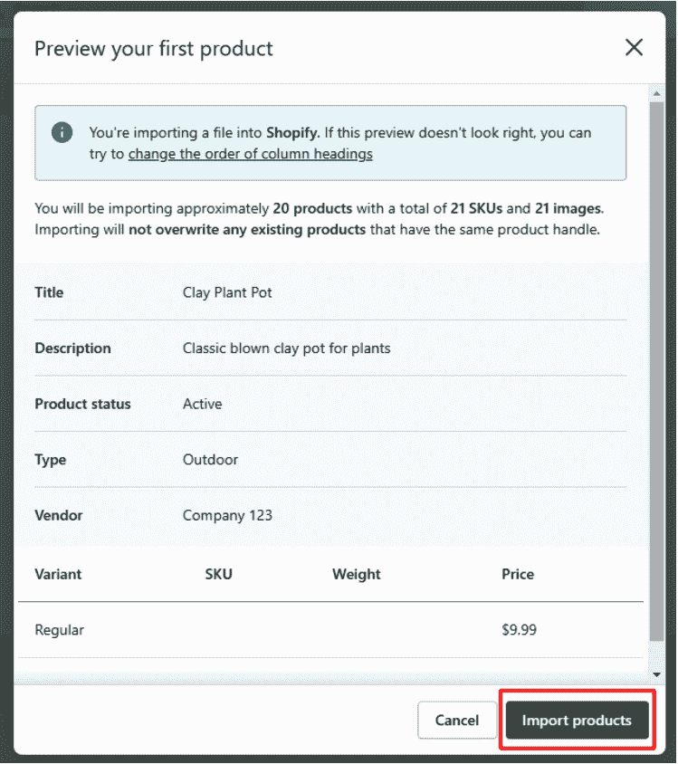
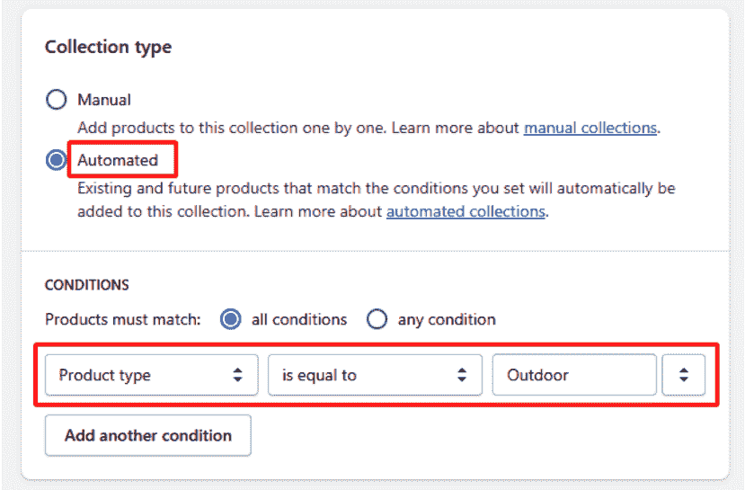
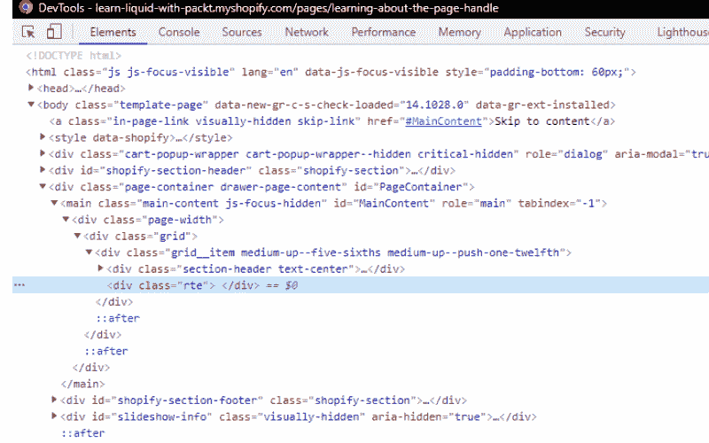
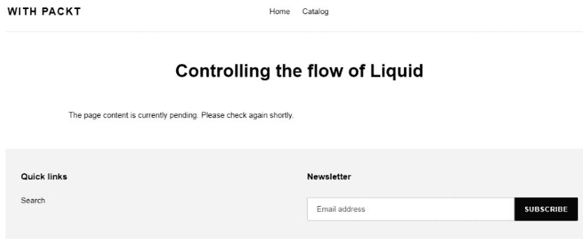
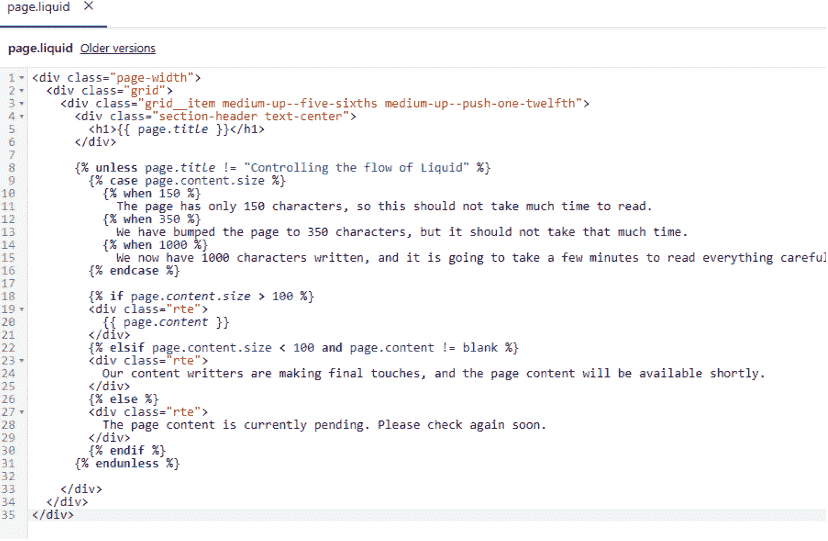
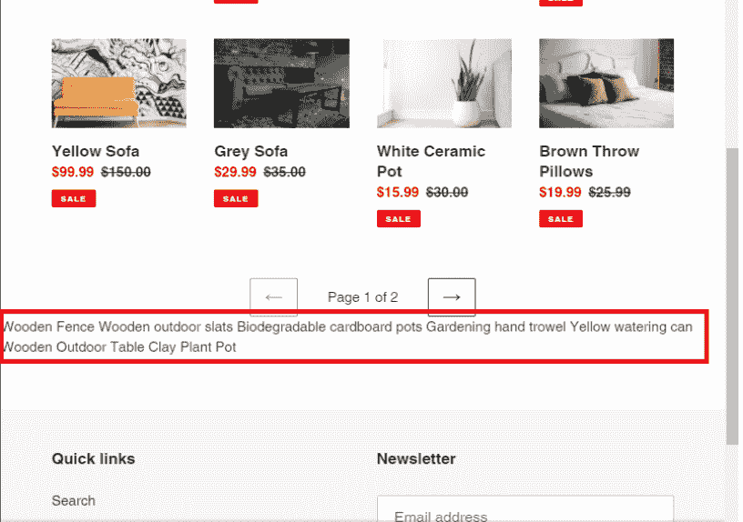
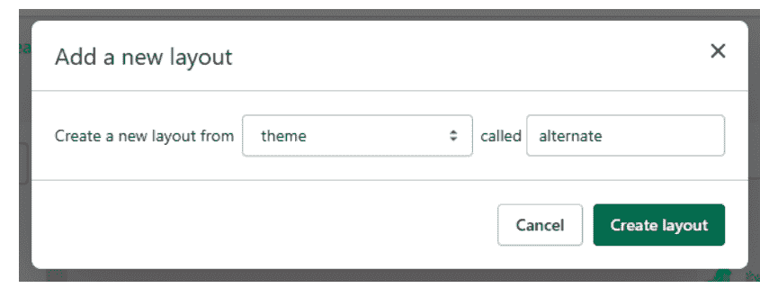
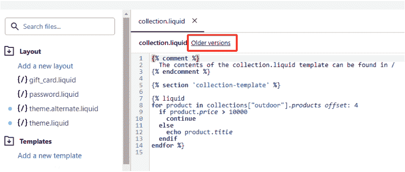

# 使用标签深入Liquid核心

在前几章中，我们见到了一些Liquid标签，例如控制流标签的实际运用。在本章中，我们将了解更多不同的标签，这些标签可用于动态修改页面内容。我们将学习创建变量标签和主题标签，以及使用它们的最佳方式。

通过学习各种类型的迭代标签和参数，我们将获得重复执行代码块的能力，这将帮助我们编写更高质量的代码。最后，我们将提到一些已弃用的标签；它们会出现在一些较旧的主题中，因此了解它们的功能以及如何使用它们至关重要。

本章涵盖以下主题：

+   - 控制Liquid的流程（控制标签）
+   - 变量标签
+   - 迭代标签
+   - 主题标签
+   - 已弃用的标签

第三章将通过探索Liquid编程逻辑，扩展我们对逻辑和比较运算符以及不同数据类型的知识。

## 技术要求

考虑到Shopify是一项托管服务，你需要连接互联网才能遵循本章概述的步骤。

本章使用的数据集（*.csv格式）可在GitHub上获得：https://github.com/PacktPublishing/Shopify-Theme-Customization-with-Liquid/blob/main/Product-data.csv。

本章的代码可在GitHub上获得：https://github.com/PacktPublishing/Shopify-Theme-Customization-with-Liquid/tree/main/Chapter03。

本章的Code in Action视频可在此处找到：https://bit.ly/3nP8uwG

## 准备工作

在继续之前，我们需要先创建一些产品和集合页面，我们将在接下来的练习中使用它们。

## 创建产品页面

通常，创建页面或产品页面是一个直接且直观的过程：

+   1. 我们可以先导航到侧边栏中的**产品**部分，并点击**添加产品**按钮，系统会自动将我们重定向到定义产品名称、描述、图片、价格和其他参数的页面。我们不会深入讨论管理产品的太多细节。但是，如果你想了解更多关于此主题的信息，请参阅 https://help.shopify.com/en/manual/products/add-update-products。
+   2. 为了避免手动创建大量后续需要的产品，我们将使用GitHub上已经创建的产品。我们创建了一个.csv文件，使我们能够轻松地为我们的开发商店创建许多产品，正是为此目的。我们唯一需要做的就是从 https://github.com/PacktPublishing/Shopify-Theme-Customization-with-Liquid/blob/main/Product-data.csv 下载文件并将其导入到我们的商店。
+   3. 下载文件后，点击侧边栏中的**产品**链接，展开后它将自动将我们定位到**所有产品**。点击**导入**按钮以触发弹窗并开始该过程：

图3.1 – 开始导入产品流程的示例

4. 选择Product-data.csv文件后，我们可以通过点击“上传并继续”按钮开始该过程：

图3.2 – 选择并将.csv文件上传到商店

+   5. 几秒钟后，我们将看到另一个弹窗，预览我们将要导入的一个产品。确认字段包含正确信息后，我们可以通过点击**导入产品**按钮来完成导入过程：



图3.3 – 完成将产品从.csv文件上传到商店的过程

## 创建集合页面

既然我们已经用产品填充了商店，是时候创建一些集合页面了，然后我们可以将新产品填充到这些页面中。创建集合页面的过程与产品页面一样直接：

+   1. 我们可以通过点击侧边栏中的**产品**链接，然后点击扩展的**产品**菜单中的**集合**子链接来开始该过程。

+   2. 进入后，点击**创建集合**按钮，系统会自动将我们重定向到定义集合名称、描述、分配产品和其他参数的页面。

+   3. 考虑到我们有两种类型的产品，我们将创建两个集合，并将相同类型的产品分配到每个集合。点击**创建集合**按钮后，输入名称`Outdoor`作为集合名称，并将**集合类型**设置为**自动化**，这样我们就不必手动分配每个产品。最后一步是设置**条件**，使得我们只填充类型等于**Outdoor**的产品：



图3.4 – 创建集合并根据产品类型自动填充的示例

保存更改后，我们的集合页面将立即创建，并填充与条件匹配的产品。请注意，在继续之前，我们应该为**Indoor**集合重复上述步骤，我们将在接下来的章节中需要它。如果你想了解更多关于管理集合页面的信息，请参阅`https://help.shopify.com/en/manual/products/collections`。

## 更新导航菜单

为了更快地导航，我们可以将两个集合的链接包含在主菜单导航中：

+   1. 我们可以通过点击侧边栏中的**在线商店**来展开它，然后点击**导航**链接来实现这一点。
+   2. 进入后，我们可以通过打开**主菜单**并点击**添加菜单项**来添加任意数量的链接。如果你想了解更多关于管理导航菜单的信息，请参阅`https://help.shopify.com/en/manual/online-store/menus-and-links`。

现在我们已经完成了产品和集合页面的设置，我们可以学习Liquid编程逻辑了。

## 控制Liquid的流程

在前几章中，我们见到了一些控制流标签，例如`if`、`and`和`or`的实际运用；现在我们将进一步深入这个主题，了解所有类型的控制流标签以及如何使用它们。控制流标签是一种Liquid编程逻辑，它通过允许我们在特定条件下选择应执行哪个代码块来告诉我们的Liquid代码该做什么。我们可以将控制流标签分为四组：

+   - `if/else/elsif`
+   - `and/or`
+   - `case/when`
+   - `unless`

### if/else/elsif 标签

在之前的一些示例中，我们已经见识了条件`if`语句，如果条件证明为真，则执行我们语句中的代码。让我们看看实际应用。在上一章中，我们创建了**了解页面句柄**页面。


然而，让我们尝试为这个练习创建一个新页面，以巩固我们的知识并让所有内容保持简洁：

+   1. 我们先创建一个名为 **控制液体流动** 的新页面，后续我们将继续使用这个页面。假设我们需要提醒自己如何创建新页面，可以回顾上一章，查看 *理解数据类型* 部分下的 *EmptyDrop* 小节，我们在那里概述了创建新页面的过程。
+   2. 创建新页面后，我们需要编辑新创建的页面模板文件。我们需要导航到 **在线商店** 区域下的 **主题** 部分，点击我们创建的副本主题上的 **操作** 按钮，然后选择 **编辑代码** 选项，这将打开我们的代码编辑器。
+   3. 进入代码编辑器后，找到当前分配给页面的模板。在我们的案例中，模板名称是 page.liquid，因此点击它。
+   4. 目前，我们的页面由两个 Liquid 元素组成：{{ page.title }}（生成页面标题）和 {{ page.content }}（生成页面内容），以及一些 HTML 元素。但是，如果我们的 {{ page.content }} 是空的呢？我们最终会得到一个空的 div 元素：



图 3.5 – 页面中空元素的示例

为了解决这个问题，我们可以将 {{ page.content }} 及其封装它的 div 包在一个条件语句中，该条件将检查页面内容是否为空：

```

<div class="rte">
  {{ page.content }}
</div>

```

有了这个条件语句，我们现在可以确保页面上不会出现任何多余的空字符串和元素。

现在，让我们尝试加入一些占位文本，让访问我们页面的用户知道我们很快会添加页面内容。这时就需要 else 和 elsif 语句来帮助我们。通过添加 else 和 elsif，我们可以创建多个条件，以确保代码正确执行：

+   1. 首先，在  之前添加 else 条件，以便当我们的 {{ page.content }} 为空时执行不同的结果：

```

<div class="rte">
  {{ page.content }}
</div>

<div class="rte">
  The page content is currently pending. Please check again shortly.
</div>

```

加上 else 条件后，如果有人意外访问我们的页面，他们不会认为页面出了问题，因为会有一条提示消息等着他们：



图 3.6 – else 条件被执行的示例

2. 让我们尝试改进我们的页面，添加一条语句来检查我们是否已经开始处理页面内容，并相应地更新通知消息。为此，我们可以添加一个 elsif 语句来检查页面内容是否超过 100 个字符。然而，要想实现这一点，我们还需要修改现有的 if 语句，将现有条件改为：如果页面内容有 100 个或更多字符，则显示页面内容：

```

  <div class="rte">
    {{ page.content }}
  </div>

  <div class="rte">
    Our content writers are making the final touches,
    and the page content will be available shortly.
  </div>

  <div class="rte">
    The page content is currently pending. Please
    check again soon.
  </div>

```

```
The page content is currently pending. Please check again soon.
</div>

```

通过添加第二个条件，我们确保了控制流标签将正确执行。第一条语句在页面内容超过 100 个字符时返回 true，第二条语句在页面内容少于 100 个字符且页面不为空时返回 true。最后，如果前两个语句都返回 false，则执行 else 语句中的代码。

与 and 参数类似，or 参数允许我们在标签上链接另一个条件。然而，关键区别在于：对于带有 and 参数的语句，只有条件语句的左侧和右侧都返回 true 时，它才会返回 true。而使用 or 参数时，我们只需要至少一个条件返回 true 即可使该语句为真，从而执行其中的代码。

### case/when 标签

与 if/elsif/else 条件类似，case/when 是一种控制流标签，我们可以用它来创建 switch 语句，在返回值完全匹配时执行特定的代码块。我们可以使用 case 来初始化 switch 语句，使用 when 来按我们想要执行的特定顺序设置条件。

让我们回到之前处理的 page.liquid 模板，创建一个 switch 语句，用于检查页面内容的具体字符数，并根据哪个语句为 true 来渲染相应的消息。我们可以将此功能放在我们添加的第一个 if 语句之上：

```


    The page has only 150 characters, so this should not take much time to read.

    We have bumped the page to 350 characters, but it should not take that much time.

    We now have 1000 characters written, and it is going to take a few minutes to read everything carefully.

```

### unless 标签

与 `if` 标签类似，`if` 标签允许我们检查特定条件的状态，而 `unless` 标签允许我们检查是否未满足该条件：

```
```liquid

Unless the page title is Controlling the Flow of Liquid,
    the code inside this conditional will not execute.

```
```

我们可以将 unless 标签的起始语句放在 case 标签起始语句的上方，并将结束语句放在 `if/elsif/else` 标签结束语句的下方：



图 3.8 – 与 Liquid 控制流相关的完整代码示例

添加了 `unless` 语句后，我们确保所有代码只会在该特定页面上执行，不会影响任何其他使用相同 `page.liquid` 模板文件的页面。

调用我们的三个变量将生成与最初分配给每个变量相同类型的数据：

```
"This is a string!"
2021
true
```

请注意，使用双花括号分隔符调用变量时，如果单独调用，将返回变量值。如果我们想在 for 标签或 if 语句中使用变量，则只需使用变量名称调用，而不需要双花括号分隔符：

```

    The variable content is a string value!

    The variable content is a number value!

    The variable content is a boolean value!

```

我们在一个多重 if 语句中使用了之前声明的变量来确定变量的值。由于我们的变量值等于第一条语句中比较的值，因此第一条语句将返回 true。

到目前为止，我们已经学习了如何将单个数据类型赋值给变量，但如果我们想创建一个存储字符串和变量组合的变量呢？要实现这一点，我们需要另一种类型的变量标签——capture 的帮助。

### capture 标签

与 assign 标签（仅允许我们捕获单个值）不同，capture 允许我们使用其开始和结束标签来捕获多个值。我们可以用一组花括号分隔符声明一个 capture 变量，在 capture 一词周围加上百分号，后跟我们声明的变量名：

```



    If you order {{ deal }} books, you can receive up to a {{ percent }}% discount!
```


```liquid

```

```liquid
{{ promoMessage }}
```

在前面的示例中，我们首先使用 `assign` 标签定义了两个变量，一个包含数字值，一个包含字符串。声明这两个变量后，我们又使用 `capture` 标签声明了一个新变量。我们包含了一条同时含有先前定义变量的字符串消息，最后，我们调用 `promoMessage` 变量，方法是用双大括号分隔符将它包裹起来，以查看我们的工作成果：

```text
"If you order three or more books, you can receive up to a 15% discount!"
```

正如我们所见，使用 capture 标签，我们成功创建了一条复杂的字符串消息，随着我们知识的不断深入，这会派上用场。

> **重要说明：**
> 
> 虽然 `capture` 标签接受所有数据类型，正如我们在前面的示例中所看到的，但调用 capture 变量的结果始终会返回字符串数据。

使用 `assign` 标签，我们学会了如何创建新变量，在其中存储单一类型的数据。使用 `capture` 变量，我们学会了如何利用不同的变量创建复杂的字符串，*但是我们该如何创建一个内容为数字值、充当计数器的变量呢？*

### increment 标签

与 `assign` 和 `capture` 标签不同，increment 标签不需要预先声明。相反，我们第一次调用它时就会自动创建该变量。increment 标签允许我们自动创建一个变量，并在每次使用 increment 标签调用该变量时使其递增。我们可以使用一组大括号分隔符来调用 increment 变量，其中在 increment 一词周围加上百分号，后面跟着我们要创建的变量名：

```liquid

```

这个变量以及使用 increment 标签创建的任何其他变量的起始值始终为零。

**重要说明：**
调用 `increment` 变量不仅会自动生成并从零开始递增该值，还会在正在处理的模板中自动输出该变量的内容。

考虑到 `increment` 标签在调用时会自动输出值，它的用途相当有限。最常见的用法是为 HTML 元素自动生成唯一的编号标识符：

```
<div class="product-count">
    <div id="product-item-"></div>
    <div id="product-item-"></div>
    <div id="product-item-"></div>
</div>
```

上一个示例的结果将允许我们为每个 div 元素创建唯一的 ID，第一次出现 `increment` 标签时从零开始，之后的每次出现都将值增加一：

```
<div class="product-count">
    <div id="product-item-0"></div>
    <div id="product-item-1"></div>
    <div id="product-item-2"></div>
</div>
```

`increment` 标签的另一个关键方面是，它独立于使用 `assign` 或 `capture` 标签创建的变量。让我们尝试使用 `assign` 标签创建一个变量，看看当我们试图递增它时会发生什么：

```





{{ numberVar }}
```

在这个初始示例中，我们调用了 `decrement` 标签三次。由于 `decrement` 变量以负值开头，所以在调用三次之后，我们将收到以下值：

-1
-2
-3

> **重要说明：**
> 除了我们提到的两个差异之外，`decrement` 与 `increment` 标签有着相同的规则和限制，也就是说，`decrement` 标签独立于使用 `assign` 和 `capture` 方法创建的变量。如果没有初始化 `decrement` 标签，我们就无法独立调用它。

变量是一种强大的工具，与迭代标签结合使用，将使我们离编写更简洁、可复用的代码更近一步。

## 迭代标签

**迭代标签**是不同类型的 Liquid 编程逻辑，允许我们重复运行代码块。使用迭代标签可以节省我们手动为每次出现执行代码的时间；此外，它还能让我们的代码更加简洁易读。为了保持主题简洁，我们只会提及一些最常用的迭代标签及其参数，这比全部罗列更重要，因为它们都是用类似的概念创建的。我们可以将迭代标签分为四个独立的小组：

- `for/else`
- `jump statements`
- `for parameters`
- `cycle`

### for/else 标签

在上一章中，我们在解释 *理解数据类型* 主题中的数组时，曾在其中一个示例中使用了 `for` 循环。然而，我们还没有机会解释 `for` 循环能给我们带来的所有可能性。`for` 循环是一种 Liquid 编程逻辑，允许我们遍历任何代码块或数组，并输出该循环的结果以供进一步使用。

之前，我们处理的是 `page.liquid` 模板，但现在，我们将转向 `collection.liquid` 模板。

让我们首先编写一个 for 循环标签，列出我们所有的产品名称，并将它们放在 `` 这一行之下：

```liquid

  {{ product.title }}

```

在前面的示例中，我们使用了 for 标签，后面跟着 product 变量，来遍历 `collection.products` 对象，并返回当前分配给我们的集合的产品名称，我们可以在 **Indoor** 集合页面上看到这些名称：



图 3.9 – 使用 for 循环列出产品名称的示例

虽然我们的 `for` 循环确实起到了作用，并且可以看到列出的产品名称，但这并没有太大用处，因为我们已经有了那些相同的产品列表。让我们使用上一章在 *EmptyDrop* 小节（位于 *理解数据类型* 部分）中讨论过的访问页面句柄对象的不同方法。

在我们当前的代码中，我们正在读取当前访问的集合的产品。相反，让我们尝试访问名为 `outdoor` 的第二个集合中的产品：

```

  {{ product.title }}

```

尽管我们当前预览的是 `Indoor` 集合，但现在我们获得了一个属于 `Outdoor` 集合的产品列表。

### jump 语句

顾名思义，`jump` 语句允许我们设置条件，以排除循环中的某些项目，或在满足特定条件时停止循环。我们可以将 `jump` 语句分为以下两组：

- `continue`：`` 语句允许我们根据设定的条件跳过当前迭代。我们可以将其与 `if` 语句配对，只接受价格低于 $100.00 的产品，从而从 `for` 循环中排除某些产品。否则，我们应该将产品排除在循环之外：

```

  
    
  
    {{ product.title }}
  

```

有了 `if` 语句，任何价格高于 $100.00 的产品迭代都会触发我们的 `` 跳转语句，从而将该产品排除在我们的迭代之外。否则，任何未通过该语句的产品都会在页面上渲染其产品名称。

### offset 参数

offset 参数允许我们通过从特定索引处开始循环来延迟 for 循环的开始。我们可以在 for 循环开始标签的末尾添加一个 offset 参数，后面跟一个冒号，再跟一个数字值。

让我们以之前的示例为例，尝试将 limit 替换为 offset 参数，并将其值设置为 4：

```




{{ product.title }}


```

我们的 for 循环自动跳过了前四次产品迭代，并从索引 5 处开始迭代产品，最终我们的 for 循环返回了三次产品迭代。但是，如果我们在 offset 参数之后再加入 limit 参数，并将其值设置为 1，会怎么样呢？

```




{{ product.title }}


```

乍一看，前面的示例似乎无法工作，但这实际上是一个完全有效的循环，参数也是有效的。正如我们之前提到的，limit 参数允许我们将 for 循环限制为特定的迭代次数。添加两个参数后，我们的 for 循环将从索引 5 处开始迭代。它将按照 limit 参数设置的值覆盖一次迭代，然后停止 for 循环，无论这一次迭代是否成功通过了我们的 if 语句。


### 反向参数

我们列表中的最后一个参数是 `reversed`，顾名思义，它允许我们反转迭代的顺序。reversed 参数没有值表示，我们可以在打开的 `for` 循环标签末尾包含它：

```
```jinja

    {{ item }}

```
```

在前面的示例中，我们将 reversed 参数作为次要参数添加到我们的 `range` 参数旁边，从而使我们的标签以反向顺序执行迭代：

```
```text
5 4 3
```
```

正如我们自己所见，参数是 `for` 标签的强大补充，我们可以用它来实现所需的迭代类型并获得我们需要的结果。

### cycle 标签

`cycle` 是另一个强大的标签，我们只能将其与 `for` 标签结合使用，以循环遍历一组字符串并按最初定义的具体顺序将其输出到每次迭代。我们可以通过打开带百分号符号的大括号分隔符，后跟单词 `cycle`，后跟任意数量用逗号分隔的字符串来定义 `cycle` 标签。最后，我们用关闭大括号分隔符和百分号符号关闭 `cycle` 标签：

```
```jinja

    <div class="product-item "></div>

```
```

在前面的示例中，我们在限制为四次迭代的 `for` 循环内包含了一个包含四个不同字符串的 `cycle` 标签。通过实现 `cycle` 标签，我们确保我们的第一个 `div` 元素将接收类 `first`，第四个元素将接收 `last` 类，而中间的两个元素将不会接收任何类，因为这些位置的字符串为空：

```
```html
<div class="product-item first"></div>
<div class="product-item"></div>
<div class="product-item"></div>
```

```
<div class="product-item last"></div>
```

从我们的结果可以看出，cycle 标签是一个非常有价值的工具，我们可以用它以我们定义的有序方式将数据传递给循环中的特定迭代。但是，如果我们从循环中删除限制或将其增加到九次迭代会怎样？

```

    <div class="product-item "></div>

```

在我们之前的示例中，迭代次数与 cycle 标签内的字符串数量完全相同。在我们最新的示例中，迭代次数高于字符串数量，这意味着 cycle 将重置并开始再次按顺序应用字符串，以满足所需的迭代次数：

```
<div class="product-item first"></div>
<div class="product-item"></div>
<div class="product-item"></div>
<div class="product-item last"></div>
<div class="product-item first"></div>
<div class="product-item"></div>
<div class="product-item"></div>
<div class="product-item last"></div>
<div class="product-item first"></div>
```

到目前为止，我们已经学习了 cycle 标签的基本用法，并且标签将继续为尽可能多的迭代输出字符串，如果我们只有一个 cycle 标签，这非常有帮助，但如果我们有两个或更多个怎么办？

```

    <div class="product-item "></div>

```

```

    <div class="product-item "></div>

```

在前面的示例中，我们创建了两个单独的 for 循环，一个限制为六次迭代，另一个限制为四次。正如我们刚刚学到的，无论我们在 cycle 标签内定义了多少个字符串，标签都将继续为所需的迭代次数输出字符串：

```
<div class="product-item first"></div>
```

```
<div class="product-item"></div>
```

```
<div class="product-item"></div>
```

```
<div class="product-item last"></div>
```

```
<div class="product-item first"></div>
```

```
<div class="product-item"></div>
```

```
<div class="product-item"></div>
```

```
<div class="product-item last"></div>
```

```
<div class="product-item first"></div>
```

```
<div class="product-item"></div>
```

正如我们从结果中看到的那样，第一个 for 循环按我们预期的确切顺序创建了六次迭代。然而，第二个 for 循环没有产生相同的结果。相反，它继续从上一个 cycle 标签停止的确切位置开始输出字符串。

考虑到 Liquid 目前无法区分不同类型的 cycle 标签，这种行为是合乎逻辑的。但是，我们可以通过引入一个名为 cycle group 的参数来轻松解决这个问题。

cycle group 参数允许我们通过确保每个 cycle 都从位置一开始输出字符串来分隔 cycle 标签，无论我们是否已在同一页面上使用过 cycle 标签。在 cycle 关键字之后，我们可以通过添加用括号括起来的字符串名称，后跟冒号来包含 cycle group 参数：

```

```

```
  <div class="product-item "></div>
```

```

```

```

```

```
  <div class="product-item "></div>
```

```

```

- `render`
- `raw`
- `comment`

## layout 标签

正如我们从第一章回忆的那样，在讨论 `Layout` 目录时，我们提到了 `theme.liquid` 文件的重要性，因为我们将在此文件中呈现所有文件和模板。我们就是在此文件中安排页面整体布局的。

我们的页面目前由三个关键元素组成：**header**、**main content** 和 **footer**。假设我们想从产品页面中删除页眉和页脚部分，或者至少用另一组页眉和页脚替换它们。*我们该怎么做？*

1. 实现此目的的第一步是创建一个备用布局文件，我们的主题产品页面将改用它。我们可以通过在代码编辑器中展开 **Layout** 目录并单击 **Add a new layout** 按钮来完成此操作，这将触发一个弹出窗口以选择我们希望创建的布局页面类型并选择我们新页面的名称。
2. 在下拉菜单中，我们将选择 **theme** 选项作为布局类型，并在以下字段中输入 `alternate` 作为文件名。一旦我们完成选择布局文件类型和名称，请单击 **Create layout** 按钮以完成该过程：



图 3.10 – 创建新布局文件的示例

这样，我们就成功创建了一个名为 `theme.alternate.liquid` 的新布局文件。假设我们尝试将此文件与原始 `theme.liquid` 进行比较；我们会发现它们完全相同。原因是在我们创建新页面、布局或模板时，Shopify 不会完全创建新页面，而是会复制主题已在使用的默认页面。例如，如果我们要展开 **Templates** 目录并创建新的页面模板，新页面模板将包含我们之前对 `page.liquid` 文件所做的所有更改。

现在我们已经创建了新的布局文件，我们将将其分配给我们的产品页面。我们可以通过展开 **Templates** 目录并单击 `product.liquid` 文件来完成此操作，在该文件中我们可以为此特定模板定义布局，我们应该将其包含在文件的第一行。我们可以用一组带百分号符号的大括号分隔符围绕单词 `layout`，后跟布局文件名，我们应该将其括在括号内来定义布局标签：

```
```liquid

```
```

如果我们现在导航到 **theme.alternate** 模板并删除 `` 和 ``，页眉和页脚部分将不再在我们的产品页面上可见。但是，它们仍将在使用原始 `theme.liquid` 布局的页面上可见。

> **重要提示：**
> 
> 除了布局文件名外，layout 标签还接受 `none` 关键字作为其值，且不带括号，在这种情况下，页面将不使用任何布局文件。在这种情况下，使用此特定模板的特定页面将无法访问通过 `theme.liquid` 文件最初加载的任何代码或文件，包括 `.css`、`.js` 或其他文件。

任何不包含 layout 标签的模板文件默认将使用原始 `theme.liquid` 布局作为后备。

## liquid 和 echo 标签

`liquid` 标签是 Liquid 的最新添加之一，它非常强大，因为它允许我们在一个分隔符集中编写多个标签，使我们的代码更易于阅读和维护。我们可以用左边的花括号分隔符和百分号符号定义 liquid 标签，后跟单词 liquid，然后是所需的任意多行 Liquid 代码。请注意，我们只需要定义一个打开的 `liquid` 标签，其中 `liquid` 关闭标签会自动关闭。


## The form tag

The form tag allows us to automatically output various types of HTML `<form>` along with the required `<input>` elements, depending on the type of the form tag we have called. We can define the form tag within a pair of curly brace delimiters, followed by the form keyword, followed by the form's name encapsulated by parentheses, and lastly, followed by the closing endform tag surrounded by curly brace delimiters with percentage symbols:

```liquid


```

In the previous example, we have selected to generate the product form tag by using the product keyword within the parentheses. However, notice that following the comma, we also have another product keyword without parentheses. Certain forms, such as product forms that we are currently using, require us to pass them a parameter to generate the proper content. In this case, that parameter is the product object.

The most common use for this is on a product page. However, we can also use the form tag within a collection page or anywhere else where we have access to the product object. Let's try to include a form tag within the loop that we previously created on our collection page.

Since we will be dealing with a mix of strings and non-strings data, let's first undo the liquid and echo changes that we previously made. We can do this by clicking on the **Older versions** button, located between the file's name and the **Delete file** button:



Clicking the **Older versions** button will reveal the drop-down menu where we can see the date and time of all the changes that we have made within this particular file. Each date represents the last time that we pressed the **Save** button to save our changes. Selecting any option will automatically revert our code to that particular point.

After reverting our changes, we are ready to add the `form` tag to our `for` loop:

```liquid

  
    
  
    
      {{ product.title }}
    
  

```

By introducing the `form` tag within our `for` loop, we have generated an HTML form tag that we can see by inspecting the string elements that we see on our `Indoor` collection page. While the form tag is functional, we still lack one key ingredient to make our form usable, which we will be learning in the next chapter.

We can see that our `form` tag already has quite a few attributes by inspecting our collection page. *However, what if we wanted to add some of our own or modify the existing ones?* We can do this by simply adding the attribute name, followed by a comma, followed by the attribute's value:

```liquid

  
    
  
    productId-
    
      {{ product.title }}
    
  

```

In the previous example, we have included a data attribute in our form using a string. However, we have also modified the existing ID value using the previously defined variable.

Notice that while we can directly include the variable within the attribute value, we cannot mix the string and variable within the form tag itself. For this reason, we have previously captured the combined string and increment tag using the capture tag and called it the attribute value using the variable name.

Besides the ability to pass an object as a form parameter, the form tag provides us with one special parameter named the return_to parameter. By default, when we submit the product form, we are usually redirected to the cart page. However, with the return_to parameter, we can select the page we should land on after we submit the form:

```liquid


```

In our previous example, we have assigned the back value as a string for the return_to parameter, which will automatically return us to the same page we were on before submitting the form. Besides the back string, we can also use a relative path or a routes attribute to generate a dynamic URL to the page we should land on once we submit the form.

There are many types of form tags that we can use. However, as they are all created using the same format, we will only cover one example. For more information on different types of form tags and their parameters, refer to https://shopify.dev/docs/themes/liquid/reference/tags/theme-tags#form.

## The paginate tag

Previously, we have learned all about iteration tags, which we can use to repeatedly execute a code block. However, iteration tags have a limitation that means they can only output a maximum of 50 results per page. For any higher number of iterations, we would need to use the paginate tag to split the results across multiple pages.

The paginate tag must always wrap around a for tag that is looping over an array to be able to split the content into multiple pages. We can see an example of a paginate tag wrapping a for loop here:

```liquid

  
  

```

As we can see from our example, the paginate tag contains the paginate keyword, followed by the object that returns an array of products in the collection, followed by the by parameter and the number value. Depending on the number value that we include with the by parameter, which can go from one to fifty, the paginate tag will know the maximum number of items it should present per page. Inside the paginate tag, we can access attributes of the paginate object. To keep the book concise, we will not be going into detail regarding the paginate object. For detailed information, refer to https://shopify.dev/docs/themes/liquid/reference/objects/paginate.

## The render tag

The render tag allows us to render the content of a snippet file to a place of our choosing. As we recall from Chapter 1, Getting Started with Shopify, snippet files allow us to re-use repetitive pieces of code over Templates/Sections by referencing their names:

```liquid

```

As we can see from our example, we only need to use the render keyword, followed by the name of the snippet file, and we will render any content within our snippet file. By using the snippet file, we not only make our code more readable, but we also make it easier to maintain by re-using the same block of code.

> Important note:
> After rendering the snippet, we do not automatically have access to the variables created within the parent element. Additionally, the parent element cannot access the variables defined within the snippet.

Let's create a new snippet file named collection-form, where we will move the entire content of the else statement from the for loop we created within our collection page:

```liquid

  
    
  
    
  

```

While the preceding code looks correct, we would end up with an error if we tried to execute it. Why?

As we recall, a snippet file does not have access to the variables defined in the parent element. In this case, that variable is the product we have defined in the for loop, which we call inside the snippet as the form parameter. To resolve this, we will need to pass the variable to the snippet as a parameter:

```liquid

  
    
  
    
  

```

We have created a parameter named product, to which we have assigned the initially created variable. We could have given our parameter any name we liked, for example, collection_product. However, in that case, we would also have to update the product parameter inside the form tag from product to collection_product and product.title to collection_product.title, currently located within our snippet file, to match the new object keyword.

Once we have assigned the variable to a snippet via the parameter, we can modify the variable value inside the snippet independently from the value in the parent template. Even if we overwrite the variable value within the snippet, the variable will keep its value in the parent template. Note that we can pass as many variables as we may need to our snippet using its parameters. However, what if we wanted to pass an object to our snippet?

As with variables, we can pass an object to a snippet file using the with and as parameters. However, we are limited to only one object that we can pass as a parameter:

```liquid

```

In our previous example, we have used render parameters to pass the collection object to the snippet file, where we can access it using the featured_collection keyword.


我们可以使用 render 标签的最后一个参数是 `for` 参数。利用 `for` 和 `as` 参数，我们可以为每个出现项渲染一个片段。让我们尝试通过将其移入 `collection-form` 片段内部并使用 `for` 参数渲染产品，来重构我们在集合页面上的代码。然而，请注意，我们将无法复制原始 `for` 标签上当前拥有的参数，因为 `render` 不接受额外参数。此外，我们需要从表单标签中移除 `capture` 和 `productId` 参数，因为 `increment` 标签与 render 的 `for` 参数不兼容。

我们需要做的第一件事是将 `if` 和 `else` 语句移入片段文件并相应地放置它们：

```liquid

  

  
    {{ product.title }}
  

```

剩下的唯一事情就是向 render 标签添加额外参数。在下面的示例中，我们为 `render` 标签包含了 `for` 和 `as` 参数，这使我们能够迭代 `collections["outdoor"].products` 数组并为集合中的每次产品迭代渲染片段。此外，我们将迭代对象作为参数传递给我们的片段，我们可以在内部使用它：

```liquid

```

由于我们已经在片段文件内部使用了 `product` 关键字，我们成功地将对象传递给了产品表单参数和产品标题。如果我们现在运行代码，我们会看到结果与之前完全相同，但我们的代码看起来干净多了。

## raw 标签

raw 标签允许我们直接在页面上输出未解析的 Liquid 代码。我们可以通过使用 `raw` 和 `endraw` 标签包裹我们想要未解析的内容来使用 raw 标签：

```liquid

  The name of our collection is {{ collection.title }}.

```

在我们之前的示例中，我们创建了一条用于动态更新集合名称的消息。然而，由于我们已将整个消息包裹在 raw 标签内，Liquid 将不会处理它。相反，它会以完全相同的方式返回给我们：

```liquid
The name of our collection is {{ collection.title }}.
```

这种功能非常有帮助，尤其是在处理冲突的语法时，例如 Handlebars。

## comment 标签

顾名思义，comment 标签允许我们在 Liquid 模板文件中留下注释。位于打开和关闭注释标签之间的任何文本都不会在 Liquid 模板文件中渲染：

```liquid
We are currently learning about the comment tags.  Comment tags are a smart way to comment on our code. 
```

由于我们已将消息的第二部分包裹在 comment 标签内，Liquid 只会渲染第一部分：

```liquid
We are currently learning about the comment tags.
```

注释标签非常有帮助，因为它们允许我们在文件中保留必要的信息，而不会在 DOM 中留下可见的注释污染。

## 已弃用的标签

**已弃用的标签** 是被认为过时且我们不应再在开发过程中使用的 Liquid 标签。然而，我们仍可能在一些旧主题中遇到它们，因此认识它们并了解它们的作用很重要。

Shopify 弃用的唯一标签是 `include` 标签，它的工作方式与我们之前介绍的 `render` 标签类似：

```liquid

```

两者之间的唯一关键区别是，使用 `include` 标签渲染片段时，我们片段中的代码可以自动访问并修改其父模板中的变量。这不仅会造成很多性能问题，而且还会使我们的代码更难以维护，这就是 Shopify 用 `render` 标签替换它的原因。

## 总结

在本第三章中，我们学习了 Liquid 编程逻辑，它允许我们在特定条件下选择应执行哪个代码块。我们对变量和迭代标签有了理解，以及如何将它们与不同的编程逻辑结合使用，以重复执行代码块并仅恢复特定结果。

最后，我们学习了不同类型的主题标签以及如何使用它们输出模板特定的 HTML 标记。通过学习如何使用片段使我们的代码更具可读性和可维护性，我们已经在编写更高质量代码方面迈出了第一步。这在下一章中将尤其重要，在那里我们将进一步深入 Liquid 核心并了解更多关于 Liquid 对象及其属性的信息。

## 问题

- 1. 如果我们想显示最多七次迭代，同时跳过前三次迭代，我们应该在 `for` 循环中使用什么参数？

- 2. 我们可以使用 `capture` 标签创建的变量分配什么类型的数据？

- 3. 以下代码块中的两个问题是什么？

    ```liquid
    for product in collections["outdoor"].products
      if product.price > 10000
        continue
      else
        product.title
      endif
    endfor
    ```

- 4. 我们应该采取什么方法来通过用字符串和变量的组合替换现有的 class 属性来修改 HTML 生成的产品表单？

- 5. 如果我们想从父元素传递一个对象，我们应该使用什么参数？
