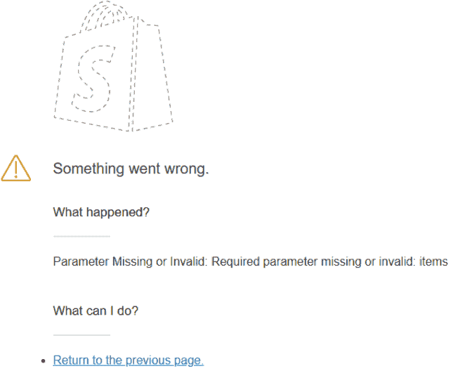
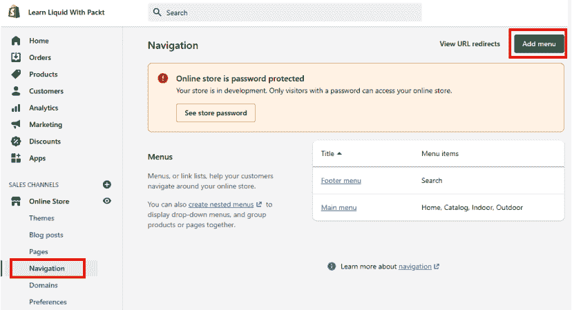
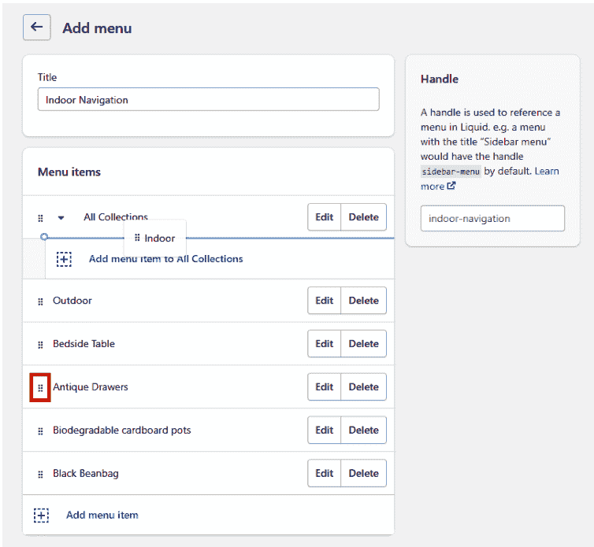
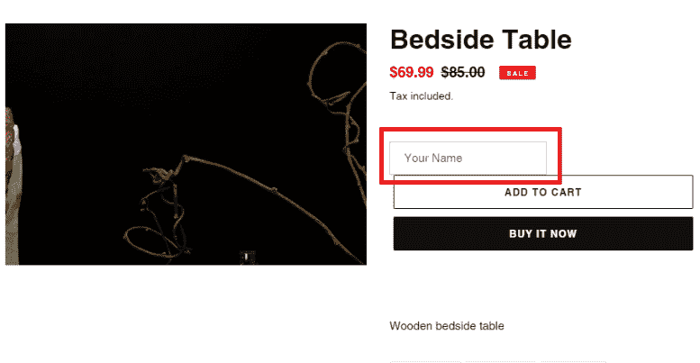
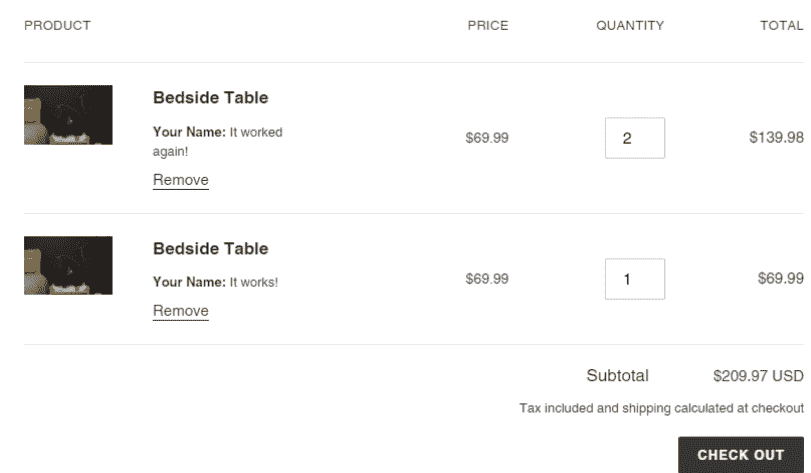
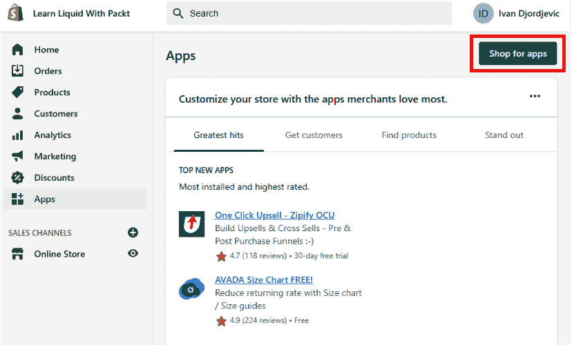
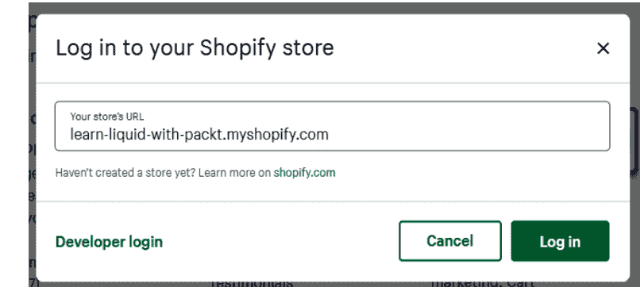
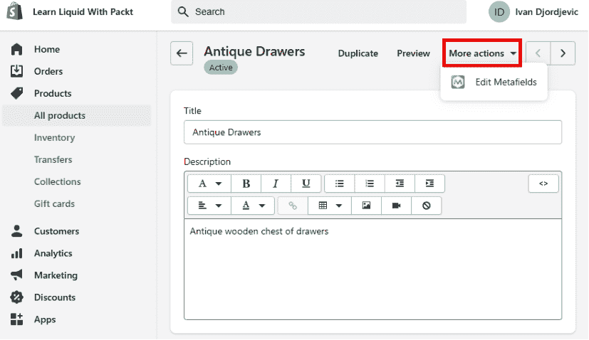
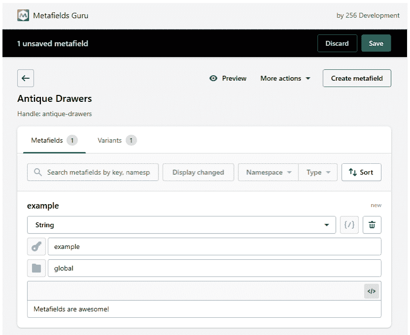

# 深入 Liquid 核心与对象

在之前的三章中，我们一直在引用对象。然而，在本章中，我们将学习对象、它们的属性以及一些最佳使用方法。通过学习对象，我们将完成一些已启动的项目并开展新项目以进一步发展我们的知识。

本章我们将涵盖以下主题：

- 使用全局对象
- 使用元字段改进工作流程
- 内容和特殊对象

完成本章后，我们将理解内容对象是什么、为什么它们是强制性的以及如何使用它们，这是创建未来模板的第一步。我们还将更深入地了解我们迄今为止一直在引用的全局对象。

然而，由于全局对象及其提供的属性数量众多，我们将不会全部涵盖。相反，我们只会解释一些基本全局对象和属性，这将为我们完全理解对象奠定正确的基础。通过学习对象，我们还将学会理解元字段，它允许我们在商店中存储和动态输出额外数据。最后，我们将学习特殊对象，它们将帮助我们在商店中输出一些有用的功能。

## 技术要求

虽然我们将解释每个主题并附带相应的图形，但由于 Shopify 是一项托管服务，为了跟随本章概述的步骤，我们需要互联网连接。

本章的代码可在 GitHub 上获取：https://github.com/PacktPublishing/Shopify-Theme-Customization-with-Liquid/tree/main/Chapter04

本章的 Code in Action 视频可在以下位置找到：https://bit.ly/3u7hqyB

## 使用全局对象

我们在上一章中引用了对象及其属性。但对象到底是什么？

这些对象，或所谓的 liquid 变量，是允许我们读取后端中定义的内容并动态输出以帮助我们创建更好编程逻辑的元素。我们可以通过将对象和属性封装在双花括号中组合来输出数据。我们在上一章中使用的全局对象的示例将是 `{{ collection.title }}`，其中 `collection` 关键字是我们的对象，而 `title` 是属性。

我们可以通过直接访问我们想要恢复内容的页面并调用对象，或手动使用其句柄调用特定页面的对象并将其与变量标签组合，来在任何文件中引用这些全局对象。让我们看看实际操作。

正如你可能还记得，在上一章中，当我们在室内集合页面上进行项目时，我们最初使用 `collection.title` 来恢复集合名称：

```liquid
{{ collection.title }}
```


在集合页面内部使用时，前面的代码将为我们提供所需的数据。然而，*如果我们想在访问户外集合页面时访问室内集合对象怎么办？*

这时我们关于使用页面句柄访问页面对象的知识就派上用场了，我们在 *第 2 章，Liquid 的基本流程* 中介绍过，具体在 *数据类型的理解* 部分的 *EmptyDrop* 小节。

我们可以通过将要访问的对象的名称复数化，然后使用方括号（ [ ] ）或点（ . ）表示法来访问对象：

```

```

```

```

通过定义一个包含室内集合对象的变量，我们只需调用该对象并加上所需的属性，就可以在任何页面上输出该集合的数据：

```
{{ customCollection.title }}
```

虽然我们的对象名称与原始对象名称不同，但它允许我们输出的信息与在集合模板内部使用 {{ collection.title }} 时相同。

> **重要提示：**
> 在前面的示例中，我们使用 `customCollection` 名称创建了一个变量。但是请注意，你可以使用任何你选择的名称来创建此变量，包括集合本身。虽然 `collection` 关键字未被保留，但在使用已在使用的关键字时，我们应格外注意，因为这可能会导致意外的结果。

考虑到全局对象是一个广泛的主题，分别解释每个对象及其属性并不会很有效。相反，我们将创建几个项目，以便亲身体验如何处理不同类型的对象以及它们返回的数据类型。

正如我们已经提到的，对象结合属性，允许我们从管理后台读取信息并动态输出以创建各种功能。让我们开始熟悉集合和产品对象，我们将使用它们来完成我们在上一章开始的 Custom `collection` 项目。

## Custom collection

在上一章中，我们创建了一个 for 循环，输出户外集合中价格低于 $100.00 的产品的名称。我们通过创建一个 collection-form snippet 来实现这一点，其内容我们使用 for 参数结合 render 标签进行输出。我们将其放置在我们的 collection.liquid 模板文件的底部：

```

```

在我们的 snippet 内部，我们添加了一个 if 语句来检查产品价格是否高于 10000。如果是，我们应该输出产品表单标签和产品标题：

```




{{ product.title }}


```

如果我们通过访问室内集合页面来预览我们的代码，我们将只看到一个名称列表，所以让我们尝试通过编写一些代码来改进此 snippet，使其输出整个产品块而不是仅产品的名称。

让我们开始重构 snippet 内部的代码，删除 continue 和 capture 标签，通过删除 else 语句来精简我们的语句，将 {{ product.title }} 包裹起来，将其置于产品表单之上，最后从我们的产品表单标签中删除额外的参数。

```

<p>{{ product.title }}</p>



```

我们的产品块开始看起来好多了，但我们仍然需要显示产品的价格。我们可以通过将 {{ product.price | money }} 包裹在 p HTML 标签内来包含产品价格：

```

<a href="{{ product.url }}">

<p>{{ product.title }}</p>
<p>{{ product.price | money }}</p>
</a>



```

> Tip:
> 请注意，我们在图像和价格对象上都有一个由管道字符分隔的小增补。此增补称为过滤器，它帮助我们修改否则会从对象接收到的输出。

例如，如果我们调用带有 price 属性的产品对象，我们将收到一个没有格式的数值，例如 2599。但是，通过将 money 过滤器应用于对象，我们已自动将原本无意义的数字更改为字符串数据类型，并根据我们商店选择的货币格式进行格式化，从而得到一个 $25.99 字符串。

我们现在不会详细介绍过滤器，因为我们将在下一章学习它们。就目前而言，这些关于过滤器的基本信息就足够了。让我们回到我们的示例。

到目前为止，我们已包含产品名称、图像和价格，这检查了展示产品所需的大多数必要条件。然而，请注意产品表单目前是空的。让我们通过引入一个输入元素来改变这一点，使其类型为 submit，这应该允许我们直接从集合页面购买产品：

```

<a href="{{ product.url }}">

<p>{{ product.title }}</p>
<p>{{ product.price | money }}</p>
```

```
</a>

<input type="submit" value="Add to Cart"/>


```

在添加了 **Add to Cart** 按钮后，我们创建了一个按钮，应该允许我们直接从集合页面购买产品，而无需导航到产品页面。然而，如果我们现在点击它，我们会遇到一个错误，提示 **Parameter Missing or Invalid: Required parameter missing or invalid: items:**



图 4.1 – 提交缺少参数的产品表单的结果

我们缺少的参数是 `id` 属性，即我们想要购买的变体的属性。

Shopify 上的每个产品最多可以有三组不同的选项。例如，一个产品可以有多种尺寸、颜色和材质。这些三个选择的每种组合都会生成一个唯一数字，称为变体 id，它告诉我们的产品表单应将哪种选项组合放入购物车。

请注意，这些选项完全是可选的，因为我们可以拥有没有任何变体选项的产品。然而，即使如此，我们仍然需要包含变体 id。我们应该将此变体 id 作为隐藏 HTML 输入元素的 value 属性，其 name 属性为 id：

```

  <a href="{{ product.url }}">
    
    <p>{{ product.title }}</p>
    <p>{{ product.price | money }}</p>
  </a>
  
    <input type="hidden" name="id" value="{{ product.first_available_variant.id }}" />
    <input type="submit" value="Add to Cart"/>
  

```

在添加了变体 id 后，我们现在拥有了一个完全功能的产品表单。通过点击 Add to Cart 按钮，我们可以将请求提交到 Shopify 服务器，在那里产品及其变体将根据提交的变体 id 进行识别并添加到我们的购物车中。

请注意，点击 Add to Cart 按钮后我们也会自动重定向到购物车页面。这是默认行为，我们可以通过两种方式之一来纠正。

第一种方式需要我们在产品表单标签中添加 return_to 参数，这将允许我们设置提交表单后应返回的页面。我们可以通过返回上一章并重新访问位于 Theme tags 部分的 The form tag 小节来提醒自己如何使用 return_to 参数。另一种方式是使用 Shopify Ajax API，我们将在本书后面学习。

让我们现在回到室内集合。让我们查看整个集合页面并比较初始集合产品与底部的自定义集合。你会注意到，除了样式比我们的集合好得多之外，初始集合产品还包含一个红色促销徽章，以及常规价格和折扣价。


在后台中，每个产品都包含两个不同的价格字段，位于 **定价** 部分下方。第一个字段名为 **价格**，用于设置产品的当前价格。而第二个字段名为 **原价**，用于设置初始价格以模拟折扣。我们可以将 `product` 对象与 `compare_at_price` 属性结合来访问该字段的数据。

让我们回到集合页面上的代码，并修改它，使其同时包含促销徽章和原价，以匹配最初的集合页面。我们可以将 `{{ product.compare_at_price | money }}` 包裹在 span 元素中，并紧跟在 `{{ product.price | money }}` 之后，从而显示原价。此外，我们可以通过创建一个简单的字符串消息，并将其放在价格元素下方的 span 标签内，从而实现促销徽章：

```

  <a href="{{ product.url }}">
    
    <p>{{ product.title }}</p>
    <p>{{ product.price | money }}<span>{{ product.compare_at_price | money }}</span></p>
    <span>sale</span>
  </a>
  
    <input type="hidden" name="id" value="{{ product.first_available_variant.id }}" />
    <input type="submit" value="Add to Cart"/>
  

```

我们已经为自定义集合商品包含了所有必要的元素。然而，相当多的产品没有显示其原价和促销徽章，这是因为产品后台中的 **原价** 字段为空。我们可以通过修改第一行的 if 语句来解决第二个问题，使其显示已定义原价的产品：

```

  <a href="{{ product.url }}">
    
    <p>{{ product.title }}</p>
    <p>{{ product.price | money }}<span>{{ product.compare_at_price | money }}</span></p>
```

到目前为止，我们只提到了属性返回单个值的对象，例如 `product.price`、`product.title` 或 `product.first_available_variant.id`。然而，它们也可以返回数组，甚至可以作为我们编程逻辑的辅助工具。

最常用的返回数组的对象之一是 `linklist` 对象。它与 `link` 对象结合，可以帮助我们从导航后台读取菜单数据，并帮助我们创建自定义导航菜单。

## 自定义导航

在我们的下一个项目中，我们将专门为集合页面创建一个多级导航菜单。然而，在学习 `linklist` 和 `link` 对象之前，我们需要先创建一个导航菜单。让我们开始吧：

1. 我们可以通过进入后台，点击 **在线商店** 展开它，然后点击 **导航** 链接来创建新的导航菜单，在那里我们可以通过点击 **添加菜单** 按钮来创建新菜单：

   

   图 4.3 – 访问导航菜单的示例

2. 点击 **添加菜单** 按钮后，将菜单标题设置为 **室内导航**。设置菜单名称后，菜单的句柄将自动填充，因此无需手动修改。

3. 现在我们可以填充菜单了。点击“添加菜单项”按钮，然后点击“链接”字段，它会自动显示一个下拉菜单。对于第一个菜单项，点击“集合”，然后点击“所有集合”，这应该会立即填充菜单项的名称和链接字段。点击“添加”按钮完成该菜单项的添加。

4. 重复上一步六次：创建两个菜单项，分别命名为 **室内** 和 **室外** 并链接到这两个集合，然后创建四个菜单项，分别链接到商店中的任意四个产品。

5. 创建完额外的菜单项后，将 **室内** 和 **室外** 菜单项移动到 **所有集合** 菜单项下，以创建嵌套菜单。我们可以通过点击菜单项名称前的六个点，然后按住并将它们拖到 **所有集合** 菜单项上方，直到出现缩进的蓝色线条，此时松开鼠标即可：

   

   图 4.4 – 在导航菜单中创建下拉菜单的示例

6. 重复上一步，将两个产品菜单项移动到 **室内** 集合菜单项下（该菜单项已移动到 **所有集合** 菜单项下）。对 **室外** 集合菜单项和剩余的两个产品菜单项重复相同的过程。

如果一切操作正确，我们最终会得到一个 **室内导航** 菜单，其中包含一个菜单项 **所有集合**，而该菜单项下包含两个集合菜单项，每个集合菜单项下又包含两个产品菜单项。假设按照上述步骤操作后菜单格式看起来不一样，那么我们可以查阅 Shopify 关于嵌套菜单项的文档，在那里可以找到更详细的说明和一个关于此主题的 YouTube 链接。

有关创建嵌套导航的更多信息，请参阅 `https://help.shopify.com/en/manual/online-store/menus-and-links/drop-down-menus`。

> **重要说明：**
> 
> 单个菜单中嵌套菜单项的最大数量最多为三级。我们可以将之前创建的菜单视为三级导航菜单，这已经达到了上限。

现在我们已经成功创建了导航菜单，可以开始创建一个变量，将 `linklist` 对象的值赋给它，并在后面附上我们要访问的导航的句柄。请记住，使用句柄访问对象时，我们需要在对象末尾添加字母 s，使其变为复数形式：

```

```

这样，我们就把室内导航的对象成功保存到了 `collection-menu` 变量中。让我们在 `collection.template` 中测试一下。为此，我们将在 `` 上方调用 `collection-menu` 对象，并在其后访问 title 和 levels 属性，以便我们能看到导航的名称及其拥有的嵌套菜单数量：

```

{{ collection-menu.title }} - {{ collection-menu.levels }}
```

如果我们预览我们的室内集合，我们将能够看到导航的名称以及导航菜单具有的嵌套层级数量：

```
Indoor Navigation - 3
```

```



```

我们现在已经拥有创建一个可用的悬停导航菜单所需的全部元素。剩下唯一要做的事情就是添加一些 HTML 标签，并应用必要的样式来创建悬停下拉效果。然而，在我们继续处理样式之前，让我们尝试更有创意一些。

请注意，我们的菜单链接就只是链接。但如果我们想更有创意一些，在每个产品菜单项旁边显示一张图片呢？要实现这一点，我们需要识别哪些菜单项指向产品，我们可以使用 `type` 属性，并比较返回值是否等于 `product_link` 字符串来实现。由于我们已经知道只有导航的第三级包含产品菜单项，因此我们只会把这个功能放在第三个 for 循环内：

```


{{ link.title }}

{{ sub_link.title }}




{{ sub_sub_link.title }}



```

现在，按理说这应该能生效，因此我们应该能够在导航菜单中看到四个产品图片。然而，请注意，sub_sub_link 仍然只是一个 link 对象，而 link 对象并没有附带图片。要显示产品所附带的图片，我们必须取回该链接所指向的产品对象。


在进行这个项目时，我们成功创建了 mega 菜单的基础版本，使得我们可以轻松输出附加到页面上的任何图片。虽然它可能看起来并不令人印象深刻，但从这个项目中学到的知识教会了我们如何创建任何导航菜单，以及一个自定义子集合页面，在该页面上我们可以输出其他集合。

到目前为止，我们所有的项目都与从我们的后台恢复预定义数据有关。但是，如果我们需要捕获有关特定产品自定义的数据，在购物车页面上显示该选择，然后将捕获的数据与订单一起转发呢？

## 产品自定义

对于我们的下一个项目，我们将在产品页面上创建一个自定义 HTML 输入框，这将使我们能够捕获客户可能输入的任何数据，并学习如何将输入的值与订单本身一起转发。

为了实现此功能，我们将使用 line_item 对象。line_item 代表我们购物车中的每个商品。我们可以通过 cart 对象，然后是 items 属性来访问 line_item 对象，这将为我们提供每个产品的 line_item 对象的访问权限。

在我们能够使用 line_item 对象在购物车页面上输出数据之前，我们需要创建一个字段来捕获此数据。让我们开始导航到我们的 product.liquid 模板并找到产品表单的开始标签。正如我们所见，产品表单标签并不存在于此文件中，但我们确实有一个 section 标签，正如你在上一章回忆的那样，它允许我们渲染一个静态 section。

让我们继续导航到 product-template.liquid section 文件。我们可以通过将鼠标悬停在 section 标签的名称上并单击小箭头来访问它。或者，我们可以在 Sections 目录中找到它。在找到产品表单标签后，我们可以通过添加一个文本类型的 HTML input 标签来开始创建自定义功能，我们将使用它来捕获与每个特定产品相关的信息。我们可以在产品表单标签的顶部，第一个 unless 语句的正上方添加此字段：

```

{{ form | payment_terms }}
<input type="text" placeholder="Your Name"/>

```

如果我们尝试预览产品页面，我们将看到一个输入字段，其占位符为 **Your Name**：



图 4.5 – 产品页面上的自定义字段示例

然而，如果我们填写输入框，将产品添加到购物车，并通过点击右上角的购物车图标访问我们的购物车页面，我们会注意到我们并未成功地将数据与产品一起捕获。为了保存 `line_item` 数据值，我们需要通过添加 name 属性以 `name="properties[Your Name]"` 格式来修改 HTML 输入框：

```
<input type="text" name="properties[Your Name]" placeholder="Your Name"/>
```

name 属性是一个预定义属性，允许我们捕获输入元素的值，后跟一个强制性关键字，称为 properties，以及一对方括号。这些方括号内的任何值——在我们的例子中是 **Your Name** ——将作为该属性名称。

有了 name 属性，如果我们填写输入字段，点击 **Add to Cart** 按钮并访问购物车页面，我们会注意到 `line_item` 属性的名称和值都已成功捕获并链接到每个产品。

在处理较新的主题时，例如我们正在使用的主题，这将是为每个产品捕获自定义的最后一步。然而，对于一些仍然相当常见的较旧主题，我们需要编写一些代码来在购物车页面内显示 `line_item` 属性。

在编写此代码之前，我们需要确定应该在哪里添加我们的代码。正如我们之前提到的，要访问 `line_item` 对象，我们需要使用 `cart.items` 来恢复我们购物车中的产品数组，这应该已经存在于我们的 `cart.liquid` section 文件中：

```


```

有了 `cart.items` 循环，我们获得了每个产品的对象访问权限，与 `product` 对象类似，它为我们提供了访问各种属性的权限，例如 `product` 对象的标题、价格、我们添加到购物车的数量以及其属性。

我们可以通过使用 `item` 作为我们的对象，后跟 `properties` 属性来访问每个产品的属性。然而，由于我们可以为每个产品捕获多个属性，`item.properties` 将返回一个数据数组，这意味着我们需要使用 `for` 标签：

```

  {{ property }}

```

请注意，`{{ property }}` 被视为一种数组数据类型，因为它同时包含 `line_item` 属性的名称和其值。如果我们使用此代码在页面上输出 `line_item` 代码，我们最终会得到两个值粘在一起。由于使用另一个 `for` 标签遍历包含两个元素的数组会过于繁琐，我们可以使用 `first` 和 `last` 过滤器来输出拆分后的值：

```

  <span>{{ property.first }}</span>:<span>{{ property.last }}</span>

```

`first` 和 `last` 过滤器，正如其名称所示，允许我们访问数组中的第一个和最后一个元素。然而，由于我们希望将数组拆分为两个独立的元素，这非常完美，因为它帮助我们避免编写另一个 `for` 循环。我们将在下一章学习更多关于此和其他过滤器的内容。

> **重要提示：**
> 将同一个产品变体多次添加到购物车中，并使用不同的 `line_item` 属性值，不会覆盖我们之前添加到购物车中的产品，也不会影响其 `line_item` 属性值。相反，我们将得到每个产品都位于新的一行，就好像它是不同的产品一样。

我们只能在产品变体包含相同数据、包含 `line_item` 属性的情况下，将同一产品的多个变体包含在同一行中。以下是示例：



图 4.6 – line item 属性链接到不同产品变体的示例

如果我们点击 **CHECK OUT** 按钮，我们会注意到相同的 `line_item` 值也在结账摘要中可见。请注意，如果我们通过结账页面完成购买，相同的 `line_item` 属性也将在订单管理中可见。

> **重要提示：**
> 我们只能通过 Shopify 的默认结账流程捕获 `line_item` 属性。如果我们通过任何其他结账方式完成付款，例如 **PayPal**，我们将无法将 `line_item` 属性附加到我们的产品上，并且它们在订单管理中将不可见。

至此，我们已经学会了如何为每个产品捕获自定义数据并在购物车和结账页面上显示它们。然而，有时我们将被迫恢复 `line_item` 数据并在购物车和结账页面上对其进行视觉隐藏。我们可以轻松地使用一些 CSS 代码将 `line_item` 数据从购物车页面隐藏起来，*但是我们 supposed 如何修改结账页面的代码，考虑到我们无法访问它呢？*

这就是下划线字符发挥作用的地方。如果我们希望收集 `line_items` 并在我们在管理后台收到订单时使其可见，同时在结账页面上视觉隐藏 `line_items` 属性，我们需要修改 `product.liquid` section 文件中的 name 属性，在方括号内包含下划线：

```
<input type="text" name="properties[_Your Name]" placeholder="Your Name"/>
```

任何在方括号内以下划线作为第一个字符的属性名称都将在结账页面上不可见。然而，它仍然会在我们收到订单的管理后台中可见。

除了允许我们自动从结账页面隐藏 `line_items` 属性外，下划线字符还有助于为我们创建一个更自动化的流程，以隐藏购物车页面上的 `line_items` 属性，而无需为我们想要隐藏的每个 `line_items` 属性编写 CSS 代码。

随着下划线字符的引入，我们现在拥有一个独特且具有辨识度的字符，可以用来过滤我们想要显示的 `line_items` 属性以及我们想要隐藏的 `line_items` 属性。


由于我们处理的是字符串类型数据，可以使用 `truncate` 过滤器，顾名思义，它允许我们截断字符串。`truncate` 过滤器接受以下两个参数：

- 第一个参数是必填的数字值，用于设置我们希望 `truncate` 过滤器返回多少个字符。
- 第二个参数是可选参数，用于设置我们希望追加到每个返回字符串值末尾的特定字符串值。请注意，如果我们不包含第二个参数，默认情况下，`truncate` 过滤器会在字符串末尾追加三个点，这三个点会计入前面参数的数字值计数中。

由于我们要检查 `line_items` 键值是否以下划线字符作为字符串的第一个字符，我们可以应用 `truncate` 过滤器并将第一个参数设置为 1。但是，我们还需要包含第二个参数并将其设置为空字符串，以避免前面提到的省略号：

```



<span>{{ property.first }}</span>:<span>{{ property.last }}</span>


```

注意，在整个项目中，我们只使用了单一的 `text` 输入类型。但是，我们可以自由使用任何可用的输入类型，包括 `date`、`color`、`radio` 和 `select` 输入。唯一的限制是我们不能将 `file` 上传输入类型与 Ajax 一起使用。产品 `form` 标签还需要包含 `enctype="multipart/form-data"` 属性，以捕获文件上传输入值。

通过这个项目，我们学会了如何创建一个有价值的功能，使我们可以为每个产品模板甚至每个产品单独创建特定的自定义设置。我们可以将其设计为包含单个输入的简单功能，也可以创建包含各种输入字段的完整表单，供客户在购买产品前填写。

我们还可以使用 **Shopify UI Elements** 生成器轻松创建任意数量的 `line_items`，然后直接粘贴到我们的产品模板中。我们可以在 `https://ui-elements-generator.myshopify.com/pages/line-item-property` 找到 Shopify UI Elements 生成器。

假设我们想要在后台管理系统中为某些页面保存特定于页面的数据。但是，如果我们导航到后台并打开一个产品、集合或任何其他页面，我们会注意到每个页面都包含预定义数量的字段来存储数据。这时，元字段对象就派上用场了。

## 使用元字段改进工作流程

**元字段**是全局对象，允许我们在后台管理系统中存储额外数据并将其输出到商店前台。因此，它们是创建具有独特内容的复杂设计所必需且强大的工具。

元字段由三个必需元素组成：

- **命名空间**，只要不同的元字段共享相同的命名空间，我们就可以用它来对它们进行分组。
- `key` 属性，允许我们访问特定的元字段。
- **值**，我们可以在其中存储整数、字符串或 `json_string` 数据类型。

我们还可以使用 `description` 字段来简短描述元字段，与前三个相比，该字段是可选的。

虽然元字段是强大的工具，但之前有一个很大的缺点：它们只能通过第三方应用使用。然而，自 Shopify Unite 2021 大会以来，元字段功能已在 Shopify 后台中原生可用，不仅如此，它还获得了相当大的升级！

`metafields` 功能虽然可用，但在撰写本文时，仅部分可用，因为我们只能访问产品和变体元字段。页面、博客、文章、集合、订单、客户和商店元字段尚未发布。因此，我们将学习如何通过第三方应用和 Shopify 后台来处理这些元字段。

考虑到当今大多数主题仍然依赖第三方应用来满足其元字段需求，让我们首先学习如何使用元字段应用为我们的页面创建自定义内容。

### 设置元字段应用

为了使用和访问元字段对象，我们需要安装一个应用或浏览器扩展来使用此功能。为了本书的目的，我们将继续安装一个应用，以便我们也能熟悉 Shopify 应用市场：

- 1. 要在我们的商店中安装应用，我们需要导航到后台，点击 **销售渠道** 上方的 **应用**。在 **应用** 部分，我们将能够看到商店中已安装的所有应用的列表。但是，由于我们目前没有任何应用，列表是空的。让我们点击右上角的 **查找应用** 按钮来改变这种情况：

  

  图 4.7 – 开始应用安装过程的示例

- 2. 点击 **查找应用** 按钮将在一个新窗口中打开 Shopify 应用商店。在这里，我们可以浏览热门应用，并按类别搜索各种应用。但是，由于我们知道自己在寻找什么，我们将在搜索字段中输入关键字 `metafields` 来搜索元字段应用。

- 3. 提交搜索后，我们会收到大量可用的应用，其中大多数都有免费计划。就我们的目的而言，我们将使用 Metafields Guru 应用。虽然选择哪个应用完全可选，但由于它们都提供相同的功能，我们建议您在此处使用相同的应用，这样更容易跟进后续开发。点击该应用后，您将被重定向到应用窗口。

- 4. 打开应用的着陆页后，我们将能够看到有关该页面的更多信息，我们应该始终阅读这些信息，以检查该应用是否提供我们需要的功能。让我们点击 **添加应用** 按钮，它会立即将我们重定向到我们的商店并开始应用安装过程。另一方面，如果我们没有登录，我们需要在弹出的窗口中提交商店 URL，然后点击 **登录** 按钮进行登录，这将启动应用安装过程：

  

  图 4.8 – Shopify 应用商店登录弹窗示例

- 5. 开始安装过程后，我们将看到最后一个窗口，需要向应用授予其请求的商店访问权限。由于我们是在开发商店中工作，我们可以立即点击 **安装应用** 按钮继续。但是，如果我们正在为客户管理托管商店，强烈建议我们切勿在他人的商店上安装应用，即使他们要求我们这样做。只有在了解应用将收集的所有个人信息后，商店所有者才应自行安装任何必要的应用。否则，我们可能要对任何可能的问题负责。

如前面的截图所示，元字段是强大的工具，允许我们自定义商店的任何部分。那么，让我们开始为产品页面创建元字段：

- 1. 我们需要做的第一件事是导航到后台的 **产品** 部分，选择我们选择的任何产品，然后点击它。

- 2. 打开产品页面后，点击右上角的 **更多操作** 按钮，以显示 **编辑元字段** 按钮。点击它以启动 **Metafields Guru** 应用：

  

  图 4.10 – 为特定页面启动 Metafield Guru 应用的示例

- 3. 进入应用后，我们将能够看到此特定产品所拥有的所有元字段的列表，如果我们选择 **变体** 卡片，甚至还能看到变体的元字段。但是，由于我们没有任何元字段，屏幕是空的。让我们点击 **创建元字段** 按钮来创建我们的第一个元字段。

- 4. 在第一个字段中，我们可以选择将保存到此特定元字段中的数据类型。在这里，我们将使用 key、namespace 和 `metafield` 值填充其他三个字段。在我们的示例中，我们可以保持选中 `String` 值，然后在键字段中输入单词 example。


命名空间字段已经包含全局关键字，但我们可以在最后一个字段中输入任意类型的文本。例如，我们将使用“Metafields are awesome!”。填写完所有字段后，点击右上角的**保存**按钮来保存你的更改：



图4.11 – 创建产品元字段的示例

既然我们已经学会了如何创建元字段，现在是时候学习如何将先前保存的数据输出到我们的店面了。

### 渲染元字段的值

我们可以通过我们为之创建元字段的页面对象来访问元字段对象，后面依次跟上元字段对象、命名空间和键：

```liquid
{{ product.metafields.global.example }}
```

尽管通过第三方应用添加元字段很有用，但需要相当多的硬编码，我们可以改为通过 Shopify 后台创建元字段来避免这种情况。然而，虽然元字段已经获得了强大的升级，但它们也有一个先决条件，我们在前面已经了解过。因此，我们将在接下来的章节中学习如何通过 Shopify 后台设置和处理元字段，以便更好地理解这一点。

使用元字段，我们现在可以向每个页面添加组织良好、独特的内容，甚至可以创建复杂的功能。例如，借助元字段，我们可以创建产品手风琴、展示精选推荐产品，并用它们显示每个产品/变体的预计送达时间以及其他功能。我们唯一受限于自己的灵感。

到目前为止，我们涉及的少数项目可能与我们拥有的不同类型的全局对象数量相比显得不足。然而，通过这些项目获得的知识已经让我们走上了完全理解对象的正确道路。我们的主要关注点并不是简单地列出对象及其属性（我们可以从 Shopify 文档中快速获取这些信息），而是学习如何通过真实项目来使用不同的对象和属性，这些项目是我们作为 Shopify 专家明天将要参与的。

在我们能说理解了对象如何工作之前，我们需要学习更多关于内容对象的知识，没有它们，我们将无法在页面上输出任何内容。

## 内容对象和特殊对象

之前，我们学习了如何使用全局对象将后台的数据输出到模板和分区文件中。现在，是时候学习如何使用内容对象来输出模板和分区文件的内容，以及 Shopify 商店运营所必需的任何其他资源了。我们可以将内容对象分为三个独立的组：content_for_header、content_for_index 和 content_for_layout。

所有三类内容对象都有描述性名称，告诉我们它们的作用。然而，为了确保我们完全理解它们的重要性，我们将对每一个作简要解释。

### content_for_header 对象

`content_for_header` 是一个必需对象，位于 `theme.liquid` 布局文件内——更具体地说，位于 HTML `<head>` 标签内：

```liquid
{{ content_for_header }}
```

这个对象的全部目的是将 Shopify 所需的所有脚本动态加载到文档的头部。在这些脚本中，我们可以找到 Shopify 和 Google Analytics 的脚本，甚至一些 Shopify 应用所需的脚本。

### content_for_index 对象

`content_for_index` 不是必需对象，它位于 `index.liquid` 模板内，我们可以在模板目录中找到：

```liquid
{{ content_for_index }}
```

然而，这个对象允许我们从主题编辑器动态输出动态分区，因此它成为必需对象。没有它，我们将无法从主题编辑器输出任何内容。

### content_for_layout 对象

`content_for_layout` 是位于 `theme.liquid` 布局文件内的最后一个必需对象。该对象允许我们加载由其他模板动态生成的内容，例如 `index.liquid` 和 `collection.liquid`：

```liquid
{{ content_for_layout }}
```

请注意，不能从各自的位置删除 `content_for_header` 和 `content_for_layout` 对象，因此我们不必过于担心它们。然而，了解每个内容对象的作用是至关重要的，因为即使我们不能删除它们，我们也可以将它们注释掉，这会给我们的店面带来问题。

最后，除了全局对象和内容对象，我们还有另一组只能在特定情况下使用的对象。我们目前可用的两个对象是 `additional_checkout_buttons` 和 `content_for_additional_checkout_buttons` 对象，它们将为我们提供一种动态生成一组指向第三方服务提供商结账页面的按钮的方法。

然而，请注意，决定哪些按钮可见取决于我们在后台中设置的支付方式，以及其他一些参数。例如，要使 **Apple Pay** 结账按钮可见，除了在后台启用该支付方式外，客户还必须使用 Apple 设备才能看到它。

`additional_checkout_buttons` 对象允许我们检查商店是否提供使用第三方支付提供商（如 PayPal、Apple 等）的支付方式。假设我们已经为某些第三方支付提供商启用了支付网关。`additional_checkout_buttons` 对象与 `if` 语句结合使用时，将返回 true，从而允许我们使用下一个特殊对象，即 `content_for_additional_checkout_buttons`。

在确认我们已经与第三方启用这些支付方式后，我们可以使用 `content_for_additional_checkout_buttons` 对象为这些支付提供商生成按钮：

```liquid

{{ content_for_additional_checkout_buttons }}

```

虽然代码的放置位置完全可以任意，但通常放在购物车页面上，紧挨着默认的**结账**按钮。

## 总结

在本章中，我们在各种项目中学习了不同类型的对象。在我们的第一个项目 `Custom collection` 中，我们通过创建一个带有功能齐全的产品表单的自定义集合功能，学习了如何访问 `product` 对象中的单值属性。第二个项目 `Custom navigation` 教会了我们如何访问和处理属性返回数组的对象。通过完成 `Product Customization` 项目，我们了解了如何捕获多种数据类型，将它们与选定的变体关联起来，并在购物车和结账页面上输出相同的数据。

除了处理不同的项目，我们还有幸学习了如何从商店安装新应用，以及如何使用第三方应用在我们的后台中创建额外的输入字段，这让我们能够使用 `metafields` 对象。

最后，我们学习了不同类型的内容和特殊对象，为什么有些是必需的，在哪里可以找到它们，以及如何使用其中一些将我们的商店连接到 Shopify 之外的各种支付提供商。

我们在本章获得的知识将在下一章中特别有用，在下一章中我们将进一步了解在项目中一直在引用的过滤器。

## 项目 1

对于我们的第一个项目，我们将在一个普通页面上创建一个自定义集合。然而，这个项目与我们之前做的项目的区别在于，这个自定义集合将是一个动态且可复用的代码块。根据页面名称的不同，我们会在特色集合中看到不同的产品。

以下是资源部分的步骤：

1. 创建一个名为 `featured-collection.liquid` 的新页面模板。
2. 创建一个新页面，命名为与商店中某个集合页面类似的名字，并为其分配我们之前创建的新页面模板。
3. 在当前主导航菜单中创建名为 `Projects` 的新菜单项，并将新创建的页面作为嵌套菜单添加到 `Projects` 菜单项内。
4. 创建一个名为 `custom-collection` 的新代码片段文件。

以下是任务步骤：

1. 在 `featured-collection.liquid` 中包含 `custom-collection` 代码片段，并将 `collection` 作为参数。由于该页面与我们集合页面的名称相似，我们应该使用页面句柄来创建 `collection` 对象。
2. 使用我们之前传递的 `collection` 对象，使用 `for` 标签创建一个自定义集合，最多显示四个产品。
3. 产品应包含图片、标题、供应商、常规价格、可见的划线比较价格以及一个可用的产品表单。
4. 如果产品有多个变体，请包含一个下拉菜单，以便我们可以选择要找的确切变体。
5. 提交表单后，返回我们之前所在的同一页面。
6. 完成后，任何分配了 `featured-collection.liquid` 作为模板的页面都应根据页面名称显示不同类型的产品；例如，室内或室外。


## 项目 2

对于我们的第二个项目，我们将创建一个子集合模板页面，以便输出不同的集合页面。与上一个项目类似，我们创建的代码应该是可复用的。我们应该会根据分配了模板的页面名称，以及分配给同名导航菜单的集合，得到不同的结果。

以下是资源（assets）的步骤：

- 1. 创建一个名为 `page-subcollection.liquid` 的新页面模板。
- 2. 创建一个新页面，并将其分配给我们之前创建的新页面模板。
- 3. 创建新的导航菜单，并赋予它与我们之前创建的页面相同的名称。
- 4. 在新的导航菜单中，包含不少于六个集合菜单项。
- 5. 创建一个名为 `custom-subcollection` 的新片段文件。

以下是任务步骤：

- 1. 在 `page-subcollection.liquid` 中包含 `custom-subcollection` 片段，并以 `subcollection` 作为参数。由于页面与我们的导航菜单同名，我们应该使用页面 handle 来创建 `subcollection` 对象。
- 2. 使用我们之前传递的 `subcollection` 对象，使用 `for` 标签创建特定导航菜单中所有集合页面的列表。
- 3. 集合列表应包含一张图片和一个标题。
- 4. 如果集合没有分配图片，我们应该获取该集合中第一个产品的图片，并将其显示为集合图片。
- 5. 完成后，任何将 `custom-subcollection.liquid` 分配为模板的页面，都应根据其名称以及分配到同名导航菜单的集合显示不同的结果。
