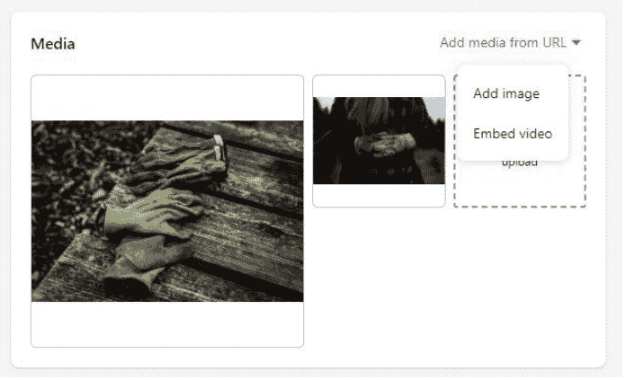
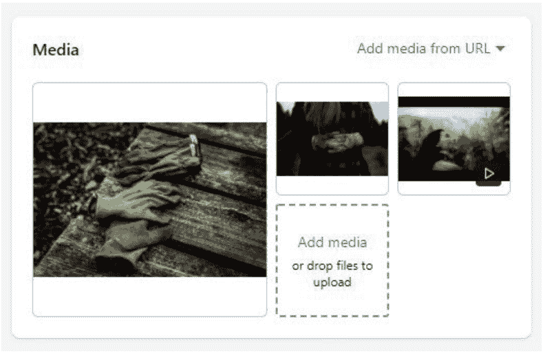
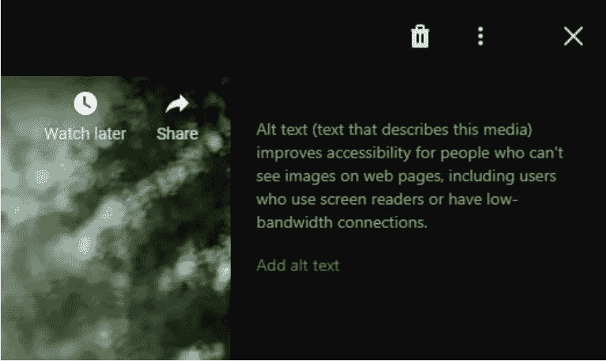
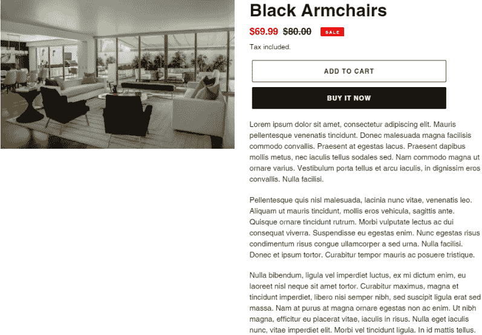
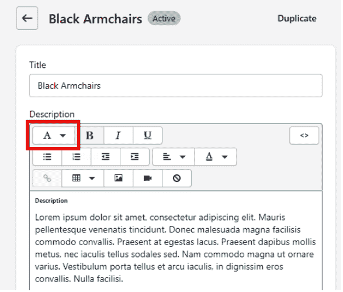
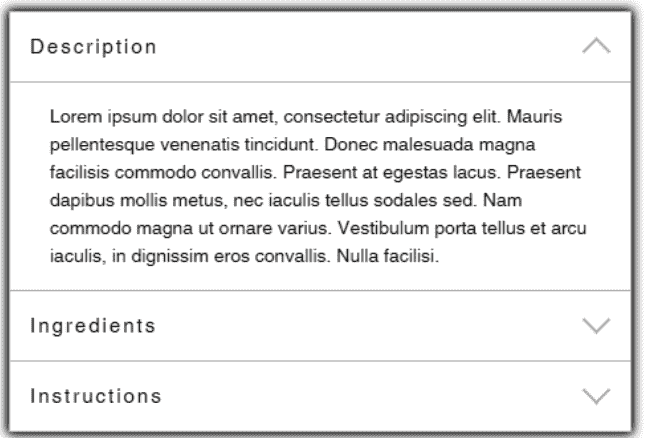
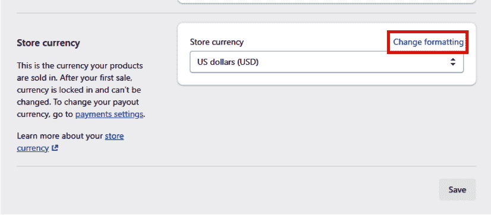

# 5 深入探索 Liquid 核心：过滤器

在前两章中，我们了解了所有不同的 Liquid 标签和对象，现在我们将重点介绍 Liquid 核心的最后一个特性，即 **过滤器**。我们已经多次提到过滤器，但 *过滤器究竟是什么？* 过滤器是通过管道符 | 表示的方法，通过它们我们可以操作不同的数据类型，包括字符串、数字、变量，甚至对象，使其成为一个极具吸引力的特性。

我们可以将本章分为以下几个主题：

- HTML 和 URL 过滤器
- 增强产品媒体图库
- 构建产品手风琴
- 数学和货币过滤器
- 探索其他过滤器

完成本章后，我们将准确理解过滤器为我们提供了多么强大的能力。与前一章一样，我们不会简单地列出并讲解所有过滤器，而只会通过一系列小项目来解释一些重要的过滤器。

首先，我们将学习通过 **HTML 和 URL 过滤器** 生成 HTML 元素。其次，理解 **媒体过滤器** 将帮助我们处理产品媒体图库，这是 Shopify 最新添加的功能之一，也是最受欢迎的功能之一。第三，通过产品手风琴项目，我们将学习如何通过各自的过滤器来操作字符串和数组类型的数据。最后，通过一个产品价格折扣项目，我们将获得 **数学和货币过滤器** 的相关知识。

## 技术要求

虽然我们会解释每个主题并附上截图，但考虑到 Shopify 是一种托管服务，你需要互联网连接才能按照本章的步骤操作。

本章的代码可在 GitHub 上获取：https://github.com/PacktPublishing/Shopify-Theme-Customization-with-Liquid/tree/main/Chapter05。

本章的 Code in Action 视频可在以下链接找到：https://bit.ly/3zmum4j

## 使用 HTML 和 URL 过滤器

在上一章中，我们在输出产品图片时有机会看到一种 URL 过滤器，`{{ image | img_url: "400x400" }}`。但是，URL 过滤器到底是什么？

**URL 过滤器** 是允许我们输出 Shopify **内容分发网络（CDN）** 上资源直接路径的方法。我们可以以多种方式使用 URL 过滤器。然而，单独的 URL 过滤器只能提供所请求资源的字符串路径。因此，为了发挥它们的作用，我们必须将它们与 HTML 标签配对，例如 `img` 标签，在其中我们可以将特定资源的字符串路径作为 `href` 属性添加。或者，我们可以将 URL 过滤器与 **HTML 过滤器** 结合使用，以自动生成具有必要属性的 HTML 元素。现在让我们看看它们的实际应用。

在 *第1章，Shopify 入门* 中，我们了解了主题文件中的 `Assets` 目录，以及它如何包含主题所需的全部内部资源，例如样式表、JavaScript 文件、字体文件和图片。然而，我们首先需要按照以下步骤在主题中加载这些文件，因为仅通过将它们上传到 `Assets` 目录，它们并不会自动被访问：

- 1. 我们可以通过将文件名括在引号中，后跟一个管道符，再后跟 asset_url 过滤器来获取 Assets 目录中文件的路径：

```
{{ "theme.css" | asset_url }}
```

- 2. 在上一个示例中，我们将商店中的样式表文件名与 asset_url 结合使用，这将为我们提供指向该特定文件的字符串路径：https://cdn.shopify.com/s/files/1/0559/0089/7434/t/4/assets/theme.css?v=10188701410004355449

- 3. 既然我们已经获取了路径，如前所述，我们有两种选择。第一种选择是使用 HTML link 标签将 CSS 文件与我们的主题关联起来：

```
<link rel="stylesheet" href="{{ "theme.css" | asset_url }}">
```

有了 link 标签，我们的主题现在可以完全访问 theme.css 文件及其规则：

```
<link rel="stylesheet" href="//cdn.shopify.com/s/files/1/0559/0089/7434/t/4/assets/theme.css?v=10188701410004355449">
```

- 4. 然而，正如我们之前提到的，除了使用 HTML link 标签之外，我们还可以将 URL 过滤器与 HTML 过滤器结合使用，以生成必要的 HTML 属性：

```
{{ "theme.css" | asset_url | stylesheet_tag }}
```

在上一个示例中，我们使用了要查找路径的资源名称，后跟 asset_url 过滤器，该过滤器通常只返回字符串路径。但是，将其与 stylesheet_tag 配对将自动生成带有所有必要属性的 HTML link 标签：

```
<link href="//cdn.shopify.com/s/files/1/0559/0089/7434/t/4/assets/theme.css?v=10188701410004355449" rel="stylesheet" type="text/css" media="all">
```

除了更加简洁之外，这两种方法的主要区别在于 `stylesheet_tag` 不接受额外的参数。因此，如果我们想将 `rel` 属性更改为 preload、修改 `media` 属性，甚至包含 `defer` 属性，我们就必须使用第一种方法，并使用 HTML `link` 标签来包含资源文件。

我们现在已经学会了如何将主题文件与所需的样式表连接起来。但是请注意，我们将根据要访问的文件类型使用不同类型的 HTML 过滤器。

例如，如果我们想将 `theme.js` 文件的内容输出到主题中，我们将使用类似的方法：先使用主题文件名，后跟 `asset_url` 以获取其路径，但我们将使用 `script_tag` 而不是 `stylesheet_tag`：

```
{{ "theme.js" | asset_url | script_tag }}
```

使用 `script_tag`，我们将自动生成 HTML `script` 标签并将其包含在主题中。但是请注意，与 `stylesheet_tag` 类似，`script_tag` 也不接受任何参数：

```
<script src="//cdn.shopify.com/s/files/1/0559/0089/7434/t/4/assets/theme.js?v=2017768116492187958" type="text/javascript"></script>
```

除了 `stylesheet_tag` 和 `script_tag` 之外，我们还可以使用 `img_tag`。访问 assets 中的图片文件可以通过使用图片文件名，后跟 `asset_url`，再后跟 `img_tag` 来完成：

```
{{ "ajax-loader.gif" | asset_url | img_tag }}
```

`img_tag` 与前两个过滤器之间的关键区别在于，`img_tag` 确实接受额外的参数。

在第4章，深入探索 Liquid 核心：对象 中，我们有机会看到 `img_url` 过滤器的实际应用，我们使用它来返回产品图片 URL 字符串，并将其与 HTML `img` 标签结合使用，将产品图片输出到我们的商店前台：

```

```

请注意，除了 `img_url` 过滤器，我们还使用了 `size` 参数来设置图片的尺寸限制，这是我们可以与 `img_url` 和 `img_tag` 过滤器一起使用的三个参数之一。然而，请注意，这两种过滤器使用的参数不同，我们稍后将通过下面的迷你项目进行说明。


## 构建产品画廊

在这个迷你项目中，我们将学习如何输出产品画廊所需的元素：

- 1. 让我们先创建一个名为 `Product Gallery` 的新页面，以及一个名为 `product-gallery` 的新页面模板，我们将把该模板分配给之前创建的页面。
- 2. 在创建页面并分配适当的模板后，我们应该确定一个拥有多个图片的产品并获取其句柄。我们将使用园艺手套作为我们的选择，它是我们之前从 *第 3 章，使用标签深入 Liquid 核心* 中的 `product-data.csv` 文件导入的产品之一。我们可以通过预览产品页面并从页面 URL 中复制页面句柄来检索产品句柄。或者，我们可以通过导航到管理区内的产品页面并从页面底部的页面 URL 链接中复制页面句柄来检索它。
- 3. 现在我们已经获取了产品句柄，让我们开始通过其句柄创建一个产品对象并将其分配给一个变量。为了实现这一点，我们可以使用之前学到的通过句柄访问页面对象的方法。然而，与之前章节中通过其集合访问产品对象相比，直接使用句柄访问产品对象略有不同。

我们将使用一个名为 `all_products` 的全局对象标签，而不是复数化产品对象名称，它使我们能够访问商店中的所有产品。

> **重要说明：**
> 
> 虽然 `all_products` 是一个相当实用的方法，允许我们直接通过句柄访问任何产品，但它有一个限制，即每个页面只能运行 20 次。这意味着如果我们需要在单个页面上恢复超过 20 个特定产品，我们将需要通过循环遍历集合来恢复它们。

- 4. 我们可以通过使用 `all_products` 全局对象，后跟我们要访问的产品句柄，来通过其句柄访问产品对象。对于我们的示例，我们将使用方括号，`[]`。然而，我们也可以使用点 `.` 注释：

```
```liquid

```
```

这样，我们现在就可以访问园艺手套产品对象了。要访问附加到产品的所有图片，我们将使用 `product_object` 变量作为我们的对象，后跟 `images` 属性，以恢复特定产品的图片数组。由于我们处理的是一个数组，我们将不得不使用 `for` 标签来循环遍历它们：

```
```liquid


  

```
```

我们现在已成功提取了产品图片数组，我们可以使用它结合各种滑块插件创建强大的画廊。然而，请注意，我们在商店前端上的图片尺寸相对较小。

这是因为如果我们不引入 `size` 参数，Liquid 总是默认使用 100x100 的尺寸。让我们通过将图片宽度和高度限制为 300 像素来引入 `size` 参数：

```
```liquid


  

```
```

请注意，我们的图片现在宽度为 300 像素，但高度只有 200 像素，即使我们指定了希望高度为 300 像素。这是因为 `size` 参数只能通过将图片尺寸减小到指定的值来限制图片大小。它不能改变图片的宽高比，也不能将图片尺寸增加到超过原始图片尺寸。

在前面的示例中，我们使用 "300x300" 来限制产品图片的宽度和高度。然而，我们也可以只限制一侧，通过使用 "300x" 将图片宽度设置为 300 像素，或使用 "x300" 将高度限制为 300 像素。如果我们只指定两个值中的一个，Shopify 将在保持图片宽高比的同时自动计算图片的尺寸。

我们可以用 `img_url` 过滤器使用的第二个参数是 crop 参数，它允许我们在结合 `size` 参数时裁剪图片到指定尺寸。crop 参数可以有五个不同的值：

- top
- center
- bottom
- left
- right

使用正确的选项，我们可以指定想要裁剪掉的图片的哪一侧。对于我们的示例，我们可以使用 center 选项，以确保图片从每一侧均匀裁剪：

```




```

通过使用 crop 参数更改图片尺寸，我们也改变了图片的宽高比，因为所有图片现在宽度和高度都正好是 300 像素。

我们可以用 `img_url` 过滤器使用的最后两个参数是 scale，它允许我们使用 2 和 3 作为其选项值来指定图片的像素密度，以及 format，这是一个相当有趣的参数，允许我们指定显示图片的格式。format 参数的两个可接受值是 jpg 和 pjpg。

使用 pjpg，我们可以将图片格式转换为渐进式 JPEG，自动加载全尺寸图片并逐渐提高其质量，而不是像传统 JPEG 那样从上到下加载图片（我们可以在以下链接阅读有关渐进式 JPEG 的更多信息：https://en.wikipedia.org/wiki/JPEG#JPEG_compression）：

```




```

正如我们所见，`image_url` 和 `img_tag` 过滤器都有其有用的参数，而 `img_tag` 更简洁，但它有限制，因为我们只能在生成的 HTML `img` 标签中包含有限数量的属性。

假设我们希望从 `Assets` 目录中提取一个图片文件，并应用适当的 `size` 参数将其用作背景图片。我们不能使用 `img_tag`，如前所述，因为它会返回一个 HTML `img` 标签。我们也不能单独使用 `asset_url`，因为 `asset_url` 不接受任何额外参数，包括 `size` 参数。

与 `stylesheet_tag` 和 `script_tag` 类似，我们可以使用特殊的 `asset_img_url` 过滤器，它允许我们包含 `size` 参数以从 `Assets` 目录中恢复图片：

```
{{ "ajax-loader.gif" | asset_img_url: "300x300", scale: 2, crop: "center" }}
```

请注意，`asset_img_url` 允许我们包含 `size` 参数和其他之前与 `img_url` 过滤器一起可用的参数，包括 `size`、`crop`、`scale` 和 `format`。

到目前为止，我们已经学习了如何访问 `Assets` 目录中的不同类型文件并为每种文件生成适当的 HTML 标签。我们还通过一个小型项目练习了如何使用 `img_url` 过滤器，输出创建基本产品画廊所需的元素。虽然我们没有介绍 Liquid 提供的所有 URL 和 HTML 过滤器，但我们现在已经为使用 HTML 和 URL 过滤器奠定了适当的基础，这些知识在 Liquid 中至关重要，并将对我们未来的工作有很大帮助。

> **提示：**
> 要获取有关所有可用 HTML 过滤器的更多信息，我们可以参考 https://shopify.dev/docs/themes/liquid/reference/filters/html-filters，并要获取有关可用 URL 过滤器的更多信息，我们可以参考 https://shopify.dev/docs/themes/liquid/reference/filters/url-filters。


现在，通过使用 media 属性，我们已经获取了一个包含所有不同媒体对象的数组，它可以包含以下媒体类型：

- image
- external_video
- video
- model

然而，拥有一个媒体类型数组也意味着我们现在拥有一个混合的对象数组，因此在做任何事情之前，我们都需要先把它们筛选出来。

我们将使用 case/when 标签，并结合 media_type 属性（媒体对象的一部分）来创建一个 switch 语句，以获取特定类型的所有媒体数组。我们可以通过查看第 3 章“使用标签深入探索 Liquid 核心”中的“控制 Liquid 的流程”一节，来回顾 case/when 标签的用法。

让我们创建一个 case 标签来筛选出 media_type，并为每种媒体类型编写一个 switch 语句：

```


  
    
    
    
    
    
  
  {{ media | img_tag: media.alt, "class1 class2", "300x300" }}

```

有了 case/when 标签，我们就成功筛选出了媒体类型，并能够访问输出媒体标签所需的每种媒体类型对象。

如果查看我们的代码，我们会注意到之前示例中用来输出图片的代码仍然存在。既然我们现在已经可以在第一个 switch 语句中访问 image 对象，我们只需将代码重新放置到其中，这将是输出图片媒体文件的第一步：

```




{{ media | img_tag: media.alt, "class1 class2", "300x300" }}






```

有了 img_tag，我们现在已经成功输出了产品的所有图片文件。不过，我们仍然缺少其他媒体类型的标签。那么，让我们继续处理 external_video。

external_video 对象为我们提供与特定产品关联的 Vimeo 或 YouTube 视频的信息。与 image 对象类似，要输出 external_video 媒体类型，我们需要使用 external_video_tag 来生成必要的 iframe 元素，无论是 Vimeo 还是 YouTube：

```




{{ media | img_tag: media.alt, "class1 class2", "300x300" }}

{{ media | external_video_tag }}


```

```

```

```

```

```

```

有了 `external_video_tag`，我们将自动为每种 `external_video` 媒体类型生成一个包含所有必要属性的 iframe，所以让我们快速测试一下：

1. 要测试 `external_video_tag` 是否有效，我们首先需要在产品页面的媒体中包含一个 Vimeo 或 YouTube 视频。
2. 为此，我们需要在管理后台侧边栏中点击 **产品** 部分，然后导航到我们正在查看其媒体文件的产品。在我们的例子中，这个产品就是园艺手套。
3. 打开特定产品页面后，我们需要向下滚动到 **媒体** 部分，在右上角会找到一个名为 **从 URL 添加媒体** 的下拉链接，点击它即可展开下拉选项。在下拉菜单中，我们会看到两个选项：第一个允许我们向产品添加外部图片，第二个允许我们嵌入 Vimeo 或 YouTube 视频。



图 5.1 – 向产品媒体嵌入外部资源的示例

4. 接下来，我们应该点击 **嵌入视频**，这会弹出一个窗口，我们可以在其中输入 Vimeo 或 YouTube 视频的 URL。粘贴链接后，点击 **嵌入视频** 按钮即可完成操作。经过几秒的处理，媒体视频就会出现在 **媒体** 部分中。



图 5.2 – 产品管理页面上各种媒体文件的示例

现在，视频已成功加载到产品媒体资源中，剩下要做的就是测试 `external_video_tag` 是否工作正常。

点击媒体视频资源后，会弹出一个窗口，一侧是预览，另一侧是填写替代文本的选项。此外，在右上角可以看到三个图标。第一个是垃圾桶图标，允许我们删除该媒体。中间的图标由三个点表示，点击后会显示一个包含 **替换缩略图** 选项的下拉菜单。

点击此选项后，我们可以上传一张缩略图，作为 iframe 视频的封面图（poster image），从而避免使用视频的第一帧作为封面。请注意，三个点图标只在视频资源上可见，在常规图片资源上不可见。



图 5.3 – 视频媒体资源弹出工具示例

预览 **产品图库** 页面，我们会看到已经正确生成了包含所有必要属性的 iframe 视频。不过，让我们先仔细看看 `iframe` 元素中包含的所有属性：

```
<iframe frameborder="0" allow="accelerometer; autoplay; encrypted-media; gyroscope; picture-in-picture" allowfullscreen="allowfullscreen" src="https://www.youtube.com/embed/neFK-pv2sKY?controls=1&amp;enablejsapi=1&amp;modestbranding=1&amp;origin=https%3A%2F%2Flearn-liquid-with-packt.myshopify.com&amp;playsinline=1&amp;rel=0" title="Gardening Gloves"></iframe>
```

正如我们所见，默认情况下，YouTube 视频嵌入中包含了许多属性，例如可见的控件和品牌标识。*但如果我们想要修改这些属性，或者添加一些新属性呢？*

要修改现有的外部视频属性或添加新属性，我们需要引入一个新的媒体过滤器 `external_video_url`。通过将 `external_video_url` 过滤器与 `external_video_tag` 结合使用，我们将能够修改 YouTube 嵌入视频的任何属性：

```


  
    
      {{ media | img_tag: media.alt, "class1 class2", "300x300" }}
    
      {{ media | external_video_url: controls: 0, color: "white" | external_video_tag }}
    
    
    
  

```

正如我们所见，我们可以从官方 YouTube 文档中引入任意数量的属性。虽然这些属性对 YouTube 视频嵌入很有帮助，但在处理 Vimeo 视频时却帮不上忙，因为 Vimeo 根据其自己的文档使用不同的属性。

为了区分哪个嵌入链接属于 YouTube、哪个属于 Vimeo，我们需要通过 `external_video` 对象引入 `host` 属性，它会返回以下两个值之一：

- youtube
- vimeo

将 host 属性与 if 语句结合使用，我们可以轻松区分这两种 iframe 元素，并为它们分别应用适当的属性：

```




{{ media | img_tag: media.alt, "class1 class2", "300x300" }}


{{ media | external_video_url: controls: 0, color: "white" | external_video_tag }}

{{ media | external_video_url: loop: 1, muted: 1 | external_video_tag }}






```

通过引入 host 属性，我们确保每种外部视频嵌入都能根据其文档获得适当的属性。

> 提示：
> 关于 YouTube 视频可用的属性，请参阅 https://developers.google.com/youtube/player_parameters#Parameters。
> 
> 关于 Vimeo 视频可用的属性，请参阅 https://vimeo.zendesk.com/hc/en-us/articles/360001494447-Using-Player-Parameters。

现在，我们已经学会了如何嵌入这两种类型的外部视频，并为每种类型添加任意属性。接下来，我们可以继续学习下一个 switch 语句，了解如何输出托管在 Shopify 平台本身的视频。


将视频作为产品媒体资源上传的方式与上传图片相同。要上传视频，请在管理侧边栏中点击 **Products** 部分并选择要为其上传视频资源的商品。进入后，向下滚动到 **Media** 部分并点击 **Add Media** 按钮开始上传过程。

> **重要提示：**
>
> 除了外部视频外，将资源上传到 Shopify 平台对所有资源，包括图片和视频，都有特定的限制。除了我们可以使用特定类型的格式外，图片文件不能超过 20 MP 的分辨率，大小不能超过 20 MB，且必须为 `.jpeg` 或 `.png` 格式，而视频文件限制为最长 60 秒，大小不能超过 20 MB，且必须为 `.mp4` 或 `.mov` 视频格式。

上传视频后，我们也可以通过与外部媒体相同的方式添加可选信息，包括 alt 文本和海报图片。

要输出上传到产品媒体文件中的视频，我们需要使用 `video_tag`，可通过 video 对象访问：

```liquid


  
    
      {{ media | img_tag: media.alt, "class1 class2", "300x300" }}
    
      
        {{ media | external_video_url: controls: 0, color: "white" | external_video_tag }}
      
        {{ media | external_video_url: loop: 1, muted: 1 | external_video_tag }}
      
    
      {{ media | video_tag }}
    
    
  

```

通过预览 **Product Gallery** 页面，我们会注意到视频所在的位置只有一张静态图片，而且是一张相对较小的静态图片。如果我们检查收到的结果，会注意到我们已正确生成了 HTML `video` 标签。然而，由于我们没有启用控件，它们默认被隐藏了。此外，如果我们仔细观察，会注意到 HTML `video` 标签中 `poster` 属性的 URL 尺寸很小，这就是商店前端图片很小的原因。

正如我们在学习图片滤镜时所回忆的，如果我们尝试输出图片而不定义图片尺寸，Shopify 会自动将图片调整为 100x100。

使用 `video_tag`，我们可以包含与常规 HTML `video` 标签一起使用的任意数量的属性，包括 `image_size` 参数，从而修改视频 `poster` 属性的尺寸。让我们修改 `video_tag` 以使控件可见，设置海报图片尺寸，并将视频尺寸设置为 300x 以匹配海报尺寸：

```liquid


  
    
      {{ media | img_tag: media.alt, "class1 class2", "300x300" }}
    
      
        {{ media | external_video_url: controls: 0, color: "white" | external_video_tag: class: "youtube_video" }}
      
        {{ media | external_video_url: loop: 1, muted: 1 | external_video_tag: class: "vimeo_video" }}
      
    
      {{ media | video_tag: controls: true, image_size: "300x300", width: "300x" }}
    
    
  

```

有了 `model_viewer_tag`，我们已涵盖了全部四种媒体类型，并确保我们将每种媒体类型以适当的媒体标签表示。然而，请注意我们仍然有一个最终的 switch 语句没有任何媒体标签。

我们可以将最终的 switch 语句视为一种故障保护，如果出于某种原因，之前的任何 switch 语句或媒体未能产生结果，我们将使用它配合 `media_tag`。

`media_tag` 滤镜有点特殊，因为该滤镜会自动为前面提到的四种媒体类型中的任何一种生成适当的媒体标签。因此，如果我们可以使用 `media_tag` 自动生成所有媒体标签，为什么不使用 `media_tag` 生成所有媒体文件呢？为什么我们还要费心学习到现在为止的所有媒体标签？

虽然 `media_tag` 确实会自动检测每种媒体类型并为其渲染适当的媒体标签，但使用 `media_tag` 会失去为特定媒体类型分配自定义类名和属性的能力。因此，我们绝不应将 `media_tag` 用作渲染媒体资源的主要选项。相反，我们应将其用作故障保护，以确保在商店前端正确渲染媒体资源：

```liquid


  
    
      {{ media | img_tag: media.alt, "class1 class2", "300x300" }}
    
      
        {{ media | external_video_url: controls: 0, color: "white" | external_video_tag: class: "youtube_video" }}
      
        {{ media | external_video_url: loop: 1, muted: 1 | external_video_tag: class: "vimeo_video" }}
      
    
      {{ media | video_tag: controls: true, image_size: "300x300", width: "300x" }}
    
      {{ media | model_viewer_tag }}
    
      {{ media | media_tag }}
  

```

到目前为止，我们已学习如何输出图片类型媒体文件，在不同类型的外部媒体资源之间进行区分，为托管在 Shopify 平台上的视频渲染媒体标签，以及为 3D 模型生成适当的媒体标签。最后，通过 `media_tag`，我们已涵盖了 Shopify 目前支持的每种媒体类型，并确保我们将在商店前端正确展示每种媒体资源。

现在我们已拥有创建媒体画廊所需的所有资源，唯一剩下要做的就是通过包含一些 HTML 元素来完善代码，以便正确格式化。除了代码格式外，我们还可以根据想要创建的画廊使用一些滑块插件，例如 Slick。为了保持简洁，我们将不涵盖媒体画廊的样式和功能。然而，对于希望通过完成项目来测试技能的人，可以在以下 Shopify 文章中找到有关样式和功能的必要建议（https://shopify.dev/tutorials/add-theme-support-for-rich-media-3d-and-video）。

在文章中，我们可以找到诸如使用宽高比框来创建响应式布局的信息，或有关功能的一些常见问题的答案，例如将缩略图连接到主画廊或变体本身。

> **提示：**
>
> 有关所有可用媒体滤镜的更多信息，我们可以参考 https://shopify.dev/docs/themes/liquid/reference/filters/media-filters。

在完成本项目时，我们创建了产品媒体画廊的基础版本，使我们能够将任何类型的产品媒体输出到任何页面。虽然它可能看起来并不令人印象深刻，但本项目所学到的知识教会了我们如何创建当今最受欢迎的功能之一，并且在我们的知识不断增长时，将极大地帮助我们创建更高级的功能。

## Building product accordions

在以下项目中，我们将通过处理和创建产品手风琴功能来学习字符串和数组滤镜。*但是，在继续项目之前，字符串和数组滤镜到底做什么？*

**String filters** 是允许我们操作 Liquid 代码输出或变量本身的方法，只要变量是字符串类型，而数组滤镜则允许我们操作数组的输出。

对于本项目，我们将首先找到一个描述较长的商品。为了节省时间，我们已在从 *Chapter 3, Diving into Liquid Core with Tags* 中 `product-data.csv` 文件导入的 **Black Armchairs** 商品中包含了必要的描述。



Figure 5.4 – Example of a long product description


从之前的截图可以看出，冗长的产品描述会占用大量空间，效率很低。虽然我们可以轻松地格式化产品描述代码，加入必要的 HTML 标签来创建产品折叠区块，但为每个产品手动调整代码会是一个漫长的过程，维护起来就更麻烦了。幸运的是，通过使用字符串过滤器和数组过滤器，我们可以轻松地处理产品描述的输出，将其拆分并以任何所需方式格式化：

1. 首先，我们先找到渲染当前产品描述的代码。我们可以在 `Sections` 目录下的 `product-template.liquid` 中找到产品描述，目前它是通过 `product.description` 渲染的：

```liquid
<div class="product-single__description rte">
  {{ product.description }}
</div>
```

2. 由于我们希望创建可复用的代码，首先要做的是创建一个变量来保存 `product.description` 的输出，这样可以避免多次调用 `product.description`：

```liquid
<div class="product-single__description rte">
  
</div>
```

现在变量已经就位，我们应该明确要实现的目标。再仔细看当前的产品描述，可以清楚地看到有三个完整的区块；假设我们想把整个产品描述拆分成三个甚至更多各自独立的产品折叠区块。

现在我们知道*要做什么*，还需要考虑*怎么做*。虽然我们可以轻松地将产品折叠区块的标题硬编码为**描述（Description）**、**成分（Ingredients）**和**使用说明（Instructions）**，但我们的目标是创建一个动态功能，让我们无需修改代码本身即可轻松加入任意数量的产品折叠区块。为此，我们将采用以下步骤：

- 首先，在后台管理页面进入 **Black Armchairs（黑色扶手椅）** 产品，并将 `Description`、`Ingredients` 和 `Instructions` 这几个词作为 h6 标题，分别放在每个文本块之前。这样，我们就可以用这些标题加入任意数量的产品标签标题，并为后续操作设置好标记。

- 然后，我们可以使用富文本编辑器来应用这些标题：只需选中要格式化的文本，点击 **A** 按钮，就会触发一个下拉菜单，从中选择所需的 h6 标题：



*图 5.5 – 在产品描述中应用标题的示例*

标题就位后，我们便有了合适的标记，可以用它把文本块拆分成独立的区块，具体可以使用下面的字符串过滤器 `split` 来实现。

## split 过滤器

`split` 过滤器使用一个子字符串作为参数，这个子字符串充当分隔符，将字符串拆分成一个数组，之后我们可以使用数组过滤器输出数组中的项目。*但它具体是如何工作的呢？*

```liquid

```

在这个示例中，我们创建了一个名为 `methods` 的变量，并为其赋了一个字符串。现在让我们使用 `split` 过滤器将字符串拆分成数组，并立即输出它来查看结果：

```liquid

{{ methods }}

StringsFilters
```

正如我们看到的，应用 `split` 过滤器后，用作分隔符的子字符串已从原始字符串中完全移除，最终得到了一个数组结果。因此，分配给 `split` 过滤器子字符串参数的任意值，不仅会作为标记分隔符，还会自动从字符串中移除所有与该子字符串值相同的部分。

使用 `split` 过滤器后，我们已将 `methods` 变量修改为数组。不过这一点并不明显，因为我们在分隔符中也包含了空格，所以最终两个词紧挨在一起，中间没有空格。要测试 `methods` 变量是否是一个数组，我们需要用 `for` 标签对它进行循环。*但如果数组中只有两个项目，我们想避免使用循环，那该怎么办？*

这时，`first` 数组过滤器就派上用场了。回想一下，在上一章处理 Product Customization 项目时，我们曾提到过 `first` 和 `last` 过滤器。使用 `first` 或 `last` 过滤器会自动获取数组中的第一个或最后一个元素。由于使用 `split` 过滤器后，我们的数组只有两个元素，正好适合。否则，我们就需要加入一个 `for` 标签来遍历数组，以获取相应的值。下面我们实际操作一下，只恢复分隔符之前的数据：

```liquid

{{ methods }}

Strings
```

我们现在可以看到，已经成功地将最初字符串类型的变量修改为数组类型，并且只成功获取了数组中的第一个项目。虽然这个特定方法看起来并不重要，但我们获得的知识将在今后的工作中大有用途。

在继续我们的项目之前，再看一个例子：

```liquid

```

在这个示例中，我们为 `message` 变量赋了一个短字符串。然后应用 `split` 过滤器，并将其子字符串参数设置为空格值，这意味着我们要在每个空格出现的位置拆分原始字符串。下面我们创建一个简短循环，确认 `message` 变量现在是数组类型：

```liquid


{{ item }}


This
is
a
short
string
message.
```

正如我们所见，通过引入 `split` 过滤器，我们使用子字符串参数成功地将初始字符串拆分并创建了数组，并通过 `for` 标签确认了这一点。现在让我们回到项目，利用刚学到的知识将产品描述拆分成三个独立的区块。

由于我们想要创建一个动态功能，因此需要将子字符串参数设置为一个我们知道会在每个产品描述中出现的值。请记住，我们之前已经添加了使用 h6 标题格式化的标题。所以，让我们使用 `split` 过滤器，并将子字符串值设置为开头的 h6 标签：

```liquid
<div class="product-single__description rte">

</div>
```

要理解将 h6 标签用作子字符串参数的意义，我们首先需要查看产品描述当前的 HTML 格式。如果在使用 `split` 过滤器之前检查产品描述，我们会看到如下 HTML 格式：

```html
<h6>Description</h6>
<p>Lorem ipsum content</p>
<h6>Ingredients</h6>
<p>Lorem ipsum content</p>
<h6>Instructions</h6>
<p>Lorem ipsum content</p>
```

如标记所示，每个标题都位于对应文本块的正上方，提供了完美的标记结构。使用开头的 h6 标签作为分隔符，我们的数组中应该有四个项目。现在，让我们以开头的 h6 标签作为分隔符来应用 `split` 过滤器，看看会发生什么：

```liquid
<div class="product-single__description rte">


<div class="product-single__description-item">
{{ item }}
</div>

</div>
```

根据我们的标记结构，在应用以开头的 h6 标签作为分隔符的 `split` 过滤器后，数组中的第一项应为空，因为在分隔符第一次出现之前没有任何内容。其余三项则应包含标题本身，以及第一次分隔符出现与下一次分隔符出现之间的所有内容：

```html
<div class="product-single__description-item"></div>
<div class="product-single__description-item">
<span>Description</span>
<p>Lorem ipsum content</p>
</div>
<div class="product-single__description-item">
<span>Ingredients</span>
```


<p>Lorem ipsum content<p>
</div>
<div class="product-single__description-item">
<span>Instructions</span>
<p>Lorem ipsum content<p>
</div>

查看结果后，我们可以看到我们已成功提取每个产品描述块。然而，还有一些问题需要解决。例如，我们会得到一个空的 div，我们可以通过引入 offset 参数并将其值设置为 1 来快速解决，这样就可以跳过 for 循环中的第一次迭代。我们可以通过访问第 3 章《深入 Liquid 核心与标签》中的 Iterations 标签部分来提醒自己 offset 参数：

```
<div class="product-single__description rte">


<div class="product-single__description-item">
{{ item }}
</div>

</div>
```

向 for 标签添加 offset 参数会跳过第一次迭代，否则会返回空值。此外，我们已确保我们的数组仅包含最初打算的三个产品描述块。但是，让我们更仔细地查看应用 offset 参数后我们数组的当前结果：

```
<div class="product-single__description-item">
<span>Description</span>
<p>Lorem ipsum content<p>
</div>
<div class="product-single__description-item">
<span>Ingredients</span>
<p>Lorem ipsum content<p>
</div>
<div class="product-single__description-item">
<span>Instructions</span>
<p>Lorem ipsum content<p>
</div>
```

正如我们所回忆的，通过使用 opening h6 标题作为 split 过滤器的子字符串，我们将自动删除初始字符串中的任何 opening h6 标题。然而，请注意，我们不仅删除了 opening h6 标签，还删除了 closing h6 标签。

从技术上讲，closing h6 标签仍然存在，位于 closing span 标签之后。然而，由于我们删除了 opening h6 标签，浏览器将其解释为错误并自动删除了 closing h6 标签。因此，与其依赖浏览器来清理，不如使用 closing h6 标签来进一步划分我们的三个块。

目前，for 循环中的每个 item 变量都包含标题和内容文本。通过应用使用 closing h6 标题的 split 过滤器，我们将修改 item 变量，使其成为自己的数组，包含标题和内容。因此，与其使用另一个 for 循环来遍历它们，不如回忆一下我们之前提到的 first 和 last 过滤器，并在此处使用它们来分别恢复每个值：

```
<div class="product-single__description rte">



<div class="product-single__description--item">
<div class="product-single__description-title">
{{ item | split: "</h6>" | first }}
</div>
<div class="product-single__description-content">
{{ item | split: "</h6>" | last }}
</div>
</div>

</div>
```

通过再次应用 split 过滤器，我们已删除剩余的 closing h6 标签。此外，我们更清晰地分离了内容，使我们能够更轻松地使用结果来完成我们的迷你项目。

此时，我们拥有完成产品手风琴项目所需的所有必要元素。唯一剩下的是包含一些样式并引入脚本来处理 on-input 动画。为了保持简洁，我们不会在本项目中介绍样式和功能。然而，我们将提供最终预期以帮助我们可视化一个清晰的目标，我们应该为此努力，因为它将成为未来工作的绝佳练习：



图 5.6 – 完整的产品手风琴项目示例

到目前为止，我们学习了如何通过将字符串变量转换为数组类型变量并使用它们来创建产品手风琴功能来操作字符串变量。此外，我们还学习了使用管道字符包含的 `split` 和 `first/last` 过滤器。然而，具体过滤器，例如 `size`，可以根据情况使用管道和点注释与管道一起使用：

```
```liquid


{{ message | size }}

    This message contains more than 10 characters.

```
```

在前面的示例中，我们创建了一个 message 变量并为其分配了一个简短的字符串。使用 size 过滤器和 message 变量，我们将呈现 message 字符串中的总字符数。然而，通过使用点注释的 size，我们获得了将 size 过滤器用作 Liquid 逻辑一部分的能力：

```
31
This message contains more than 10 characters.
```

我们还可以使用 size 过滤器改进我们的产品手风琴，通过包含一个 if 语句来检查产品描述是否包含超过 1 个代码块，如果是则呈现产品手风琴。否则，它应仅输出常规产品描述：

```
<div class="product-single__description rte">




<div class="product-single__description--item">
<div class="product-single__description-title">
{{ item | split: "</h6>" | first }}
</div>
<div class="product-single__description-content">
{{ item | split: "</h6>" | last }}
</div>
</div>


<div class="rte">{{ product.description }}</div>

</div>
```

通过引入 size 过滤器，我们使代码变得更加简洁和优化，因为我们不会为数组类型变量中的单个项目运行 for 循环。

> **提示：**
> 
> 有关所有可用字符串过滤器的更多信息，我们可以参考
> `https://shopify.dev/docs/themes/liquid/reference/filters/string-filters`。
> 
> 有关所有可用数组过滤器的更多信息，我们可以参考
> `https://shopify.dev/docs/themes/liquid/reference/filters/array-filters`。

我们看到了看似无关紧要的过滤器如何成为强大的工具，使我们能够创建商家经常寻求的复杂功能。通过这种类型的学习过程，我们通过在真实项目上工作获得了宝贵的经验，但我们也学会了如何处理各种类型的过滤器，这比简单地列出它们重要得多。

## 数学和货币过滤器

在上一章中，我们在处理 `Custom collections` 项目时有机会看到货币过滤器的实际应用。**货币过滤器**是简单类型的过滤器，其唯一任务是根据货币格式选项格式化数值，*但这到底意味着什么？*

为了更好地理解，让我们导航到我们的管理页面并点击左下角的 **Settings** 按钮。因此，点击 **General** 选项以打开我们将能够更新商店基本信息的位置。进入后，向下滚动直到到达名为 **Store currency** 的部分。这就是我们可以更改商店默认货币的地方，我们的客户将使用它进行购买。与其更改商店货币，不如点击 **Change formatting** 按钮。



图 5.7 – 商店货币格式的位置

另一方面，**数学过滤器**不言自明，因为它们允许我们执行特定的数学任务。同样，与字符串和数组过滤器一样，我们可以在一行中链接多个数学过滤器，在这种情况下，过滤器将按从左到右的顺序应用。

现在我们已经熟悉了货币和数学过滤器，让我们看看它们在实际中的效果，并开始我们的下一个迷你项目。

### 产品折扣价

在以下项目中，我们将通过处理我们在第 4 章《深入 Liquid 核心与对象》中开始的项目之一，即位于全局对象部分下的 Custom collection 来学习数学和货币过滤器。

我们的目标是创建产品折扣价并更新销售徽章以显示实际的折扣百分比。让我们开始导航到我们之前开发的代码位置。

我们通过在 Templates 目录下的 collection.liquid 文件中包含 collection-form.liquid snippet 来创建 Custom collection 功能。在 collection-form.liquid snippet 中，我们将看到以下代码：

```

<div class="custom-collection--item">
  <a href="{{ product.url }}">
    
    <p class="h4 custom-collection--title">{{ product.title }}</p>
    <p class="custom-collection--price">
      {{ product.price | money }}
      <span>{{ product.compare_at_price | money }}</span>
    </p>
    <span class="custom-collection--sale-badge">sale</span>
  </a>
  
    <input type="hidden" name="id" value="{{ product.first_available_variant.id }}" />
    <input type="submit" value="Add to Cart"/>
  
</div>

```


在当前设置下，我们同时显示常规价格和比较价格，因此让我们从修改比较价格并将其替换为实际折扣价开始。要输出两个价格之间的折扣，应该相对简单，因为我们只需要从比较价格中减去常规价格。

要从比较价格中减去常规价格，我们需要使用minus数学过滤器：

```
<p class="custom-collection--price">
  {{ product.price | money }}
  <span>{{ product.compare_at_price | minus: product.price }}</span>
</p>
```

请注意，引入minus过滤器后，我们必须完全移除money过滤器。如前所述，只有当所有值都是数字值时，我们才能使用数学过滤器。如果我们包含money过滤器，由于我们之前设置的货币格式，两个值都会变成字符串。

现在我们已经成功应用了minus过滤器，我们需要想办法包含money过滤器。在当前设置下，我们得到一个没有货币格式的数字值。然而，如前所述，如果我们对这两个值中的任何一个应用money过滤器，即使在product.price之后，money过滤器也只会影响product.price，而不会影响最终结果。因此，数学过滤器将不再起作用。

要解决这个问题，我们需要使用assign或capture关键字引入一个变量来计算两个数字之间的差值，然后使用money过滤器调用该变量：

```
<p class="custom-collection--price">
  {{ product.price | money }}
  
  <span>{{ discount-price | money }}</span>
</p>
```

如果我们现在预览我们的集合页面，我们将看到我们正确地执行了折扣价计算和货币格式化。所以现在我们可以进入项目的第二部分，即用实际的百分比折扣值替换促销徽章。

我们可以在同一个collection-form.liquid片段文件中找到促销徽章的HTML代码：

```

<div class="custom-collection--item">
  <a href="{{ product.url }}">
    
    <p class="custom-collection--price">
      {{ product.price | money }}
      
      <span>Save {{ discount-price | money }}</span>
    </p>
    <span class="custom-collection--sale-badge">sale</span>
  </a>
  
    <input type="hidden" name="id" value="{{ product.first_available_variant.id }}" />
    <input type="submit" value="Add to Cart"/>
  
</div>

```

要计算折扣百分比，我们可以使用以下公式，它将返回折扣百分比：

```
{{ product.compare_at_price | minus: product.price | times: 100 | divided_by: product.compare_at_price }}
```

在前面的例子中，我们必须将计算包含在变量中，以便稍后应用money过滤器。然而，由于这次我们不需要货币，我们可以简单地将计算包含在内，并在末尾添加百分号字符串。现在让我们把所有内容放在一起：

```

<div class="custom-collection--item">
  <a href="{{ product.url }}">
    
    <p class="h4 custom-collection--title">{{ product.title }}</p>
```

```liquid
<p class="custom-collection--price">
  {{ product.price | money }}
  
  <span>Save {{ discount-price | money }}</span>
</p>
<span class="custom-collection--sale-badge">{{
    product.compare_at_price | minus: product.price |
    times: 100 | divided_by: product.compare_at_price }}%</span>
</a>

  <input type="hidden" name="id" value="{{
    product.first_available_variant.id }}" />
  <input type="submit" value="Add to Cart"/>

</div>

```

正如我们所见，与字符串过滤器类似，我们可以轻松地链式使用多个数学过滤器来执行所需的计算。然而，值得一提的是，除了只处理数字值之外，数学过滤器不接受任何类型的括号，而我们通常使用括号来按特定优先级执行数学计算。

如果我们需要执行计算，我们有两种选择。第一种是让Liquid从左到右执行数学计算。另一方面，如果我们需要按特定顺序执行计算，则需要将公式拆分为多个变量，并在之后组合结果。

> **提示：**
> 
> 有关所有可用数学过滤器的更多信息，请参阅  
> https://shopify.dev/docs/themes/liquid/reference/filters/math-filters。
> 
> 有关所有可用货币过滤器的更多信息，请参阅  
> https://shopify.dev/docs/themes/liquid/reference/filters/money-filters。

虽然我们还没有涵盖所有数学和货币过滤器类型，但通过这个项目，我们对数学和货币过滤器的工作原理有了扎实的理解。这类知识将作为我们作为Shopify专家将要开发的功能的垫脚石。

## 探索其他过滤器

**其他过滤器**是一组不属于任何其他过滤器组的过滤器。然而，这并不会降低它们的重要性。虽然这里我们可以列举许多类型的过滤器，但我们只会提到其中三个最关键的，因为我们会经常使用它们。

### 默认过滤器

顾名思义，**default过滤器**允许我们为任何变量设置默认值，无论是字符串、数组还是哈希类型。请注意，只有当变量返回`nil`、`false`或空字符串时，我们才能返回默认值。如果变量包含空白字符，我们将无法返回`default`值：

```
Hello {{ customer.name | default: "customer" }}
```

通过在前面的示例中引入`default`值，我们确保了即使客户没有提供他们的名字，我们也不会得到损坏的字符串。此外，我们还使代码看起来更整洁。如果没有`default`过滤器，我们将不得不使用`if`语句来检查`customer.name`是否存在，并根据结果输出值。

### t（翻译）过滤器

**t过滤器**是一个翻译键，允许我们访问`Locales`目录下当前活跃的商店语言文件。如果我们导航到`Locales`目录，我们会注意到大量文件。然而，其中一个文件将包含字符串default，即我们商店中当前活跃的语言。

让我们回顾一下之前的项目之一`Custom collections`，我们在*第4章，深入Liquid核心与对象*中的*使用全局对象*部分进行了研究，在那里我们开发了一个提交按钮，其值硬编码为文本**Add to Cart**。目前这很好，*但如果我们更改商店语言呢？* 我们将不得不手动更新整个主题中所有出现的**Add to Cart**字符串。

使用t过滤器，我们可以通过更新单个值来更新整个主题中的任何字符串值。我们需要做的第一件事是按照Shopify命名和分组指南，在当前活跃的语言文件中定义三级JSON。由于我们要修改产品的提交按钮，我们可以将第一级设置为product，第二级设置为更具体的内容，即表单本身，最后，第三级指向我们要翻译的字符串：

```json
{
  "product": {
    "form": {
      "submit": "Add to Cart"
    }
  }
}
```

一旦我们在语言文件中成功创建了JSON，剩下的就是使用t过滤器读取翻译后的键值并将其渲染到商店前端：

```liquid
{{ product.form.submit | t }}
```

通过在所有产品表单上实现t过滤器，我们将能够自动翻译所有字符串，而无需手动在文件中搜索它们。此外，在其他语言文件中使用相同的JSON命名和分组，将使我们能够通过简单地更改商店语言来快速翻译整个主题。

t过滤器是一个强大的工具，允许我们通过逗号分隔并插值来传递多个参数：

```liquid
{{ header.general.customer | t: Customer: Customer.name }}
```

在前面的示例中，我们试图访问语言文件中的customer字符串。然而，我们还传递了customer.name值作为参数，然后我们在语言JSON文件中对其进行了插值：

```json
{
  "header": {
    "general": {
      "customer": "Welcome {{ customer }}!"
    }
  }
}
```


除了为我们提供插入变量的能力外，我们还可以转义翻译内容、在翻译键中包含 HTML 以及实现翻译键的复数化，使其成为我们手中相当强大的工具。

> 提示：
> 有关 t 过滤器命名和分组准则的更多信息，可参阅 https://shopify.dev/tutorials/develop-theme-localization-organize-translation-keys。
> 有关 t 过滤器所有可用参数的更多信息，可参阅 https://shopify.dev/tutorials/develop-theme-localization-use-translation-keys。

创建必要的翻译键后，我们还可以导航到管理页面，点击侧边栏中展开的“在线商店”选项下的“主题”来更新翻译。点击主题文件上的“操作”按钮会触发下拉菜单，点击“编辑语言”即可快速更新语言 JSON 文件中的任何翻译。

### JSON 过滤器

JSON 过滤器，顾名思义，允许我们将字符串转换为 JSON，更重要的是，它能让 JavaScript 可以读取 Liquid 代码：

```
var product_JSON = {{ product | json }};
var cart_JSON = {{ cart | json }};
```

请注意，在 Liquid 输出上使用 JSON 过滤器时，无需包含引号，因为 JSON 过滤器会自动添加引号。但请注意，某些特定值（如 `inventory_quantity` 和 `inventory_policy` 字段）无法通过 JSON 返回，因为 Shopify 出于安全原因已弃用这些字段。

> 提示：
> 有关所有可用附加过滤器的更多信息，可参阅 https://shopify.dev/docs/themes/liquid/reference/filters/additional-filters。

## 总结

在本章中，我们了解了如何使用诸如过滤器这样简单的东西来处理不同的数据类型，从而创造出强大的功能。我们学习了如何使用 URL 和 HTML 过滤器来访问 Shopify 中各种类型的资源，并帮助我们在店铺前台使用相应的 HTML 标签生成这些资源。

产品媒体库项目的实践让我们更深入地理解了媒体对象和过滤器，这是每个开发者都需要熟悉的内容。产品手风琴项目教会我们如何使用字符串和数组过滤器轻松操作数据，以创建简洁且易于维护的独特页面内容元素。接着，在数学和货币过滤器中，我们获得了通过 Shopify 执行复杂计算、并根据商店中设置的货币格式来格式化价格的重要见解。

最后，我们学习了附加过滤器，这些过滤器为我们提供了关键知识，让我们能够为没有赋值的变量分配默认值，并使 Liquid 代码可被 JavaScript 读取。通过理解如何使用翻译键，我们现在掌握了在主题中快速更新任何值而无需手动逐个更新的必要知识。

我们在本章获得的知识在下一章中将特别有用，下一章我们将进一步了解 JSON 设置，以及如何使用它们来创建商家可以通过主题编辑器访问的设置。

## 问题

- 1. 假设我们有一个名为 `product_handles` 的数组，其中包含 30 个产品的句柄。以下代码中的什么问题会阻止我们成功输出所有 30 个产品的图像？

```

  
  
    
  

```

- 2. 在创建产品媒体库时，为什么不建议仅使用 `model_viewer_tag` 标签？

```

  
    {{ media | model_viewer_tag }}
  

```

- 3. 如果我们想访问数组中特定位置的某个元素，可以使用哪个过滤器？

- 4. 我们可以使用哪个过滤器来快速更新主题文件中出现的任何字符串值？

## 熟能生巧

## 项目 3

在之前的一个练习中，我们学习了如何通过输出所有类型的产品媒体来创建基础和复杂的产品画廊。*然而，如果每次只需要输出与特定变体相关的几张图片呢？*

对于第三个项目，我们将渲染一个带有独特标记的产品媒体库，以便只显示当前所选变体的缩略图。

以下是资源的说明：

- 1. 使用名称 `variant-thumbnails.liquid` 创建一个新的页面模板。
- 2. 创建一个名为 `Product Variant Thumbnails` 的新页面。
- 3. 创建名为 `alternate.liquid` 的新布局文件。
- 4. 创建一个至少有三种颜色变体的新产品，并上传至少三个媒体资源来表示每个变体。创建新产品时，应将产品状态设置为“Active”（活动），而不要保留为“Draft”（草稿）。否则，我们以后将无法访问它。
- 5. 创建两个新的资源文件：一个名为 `custom.css` 的样式表和一个名为 `script.js` 的脚本文件。
- 6. 创建一个名为 `custom-media` 的新代码片段文件。

以下是任务的步骤：

- 1. 编辑新的布局文件，包含我们在此项目中之前使用过的两个资源文件。
- 2. 将布局文件包含到之前创建的页面模板中，并将新的页面模板分配给新创建的页面。
- 3. 导航到管理页面中的**产品**部分，找到我们之前创建的产品，并编辑每个图像的 alt 文本，使其包含小写的变体名称和实际图像 alt 文本，用下划线分隔。例如，`red_This` 是一个图像描述。对所有图像重复此过程。请注意，每个变体应至少有三张图像。
- 4. 在 `variant-thumbnails.liquid` 内部，创建一个变量，用于通过产品句柄（product handle）访问之前创建的产品对象。
- 5. 使用 `for` 循环访问产品媒体对象，并将媒体对象作为参数传递到 `custom-media` 代码片段中。
- 6. 在代码片段内部，使用 case 控制流标签和我们作为参数传递的对象，创建能输出每种媒体文件类型的代码。
- 7. 编辑每个媒体标签以包含三个属性。第一个属性 `data-variant` 将包含媒体 alt 文本中下划线之前的部分。第二个属性 `alt` 将包含媒体 alt 文本的第二部分。最后，第三个属性名为 `index`，将包含媒体文件的索引位置值。如果在代码片段内直接调用 `forloop` 对象的索引值有困难，我们可以考虑将其作为参数通过代码片段传递。

属性就绪后，我们就拥有了过滤产品媒体文件所需的全部要素，并且可以使用 `data-variant` 属性值仅显示与当前所选颜色变体相关的缩略图。

对于希望完成项目的人，请按照以下步骤操作：

- 1. 在 `custom.css` 中应用必要的样式，并在 `script.js` 中应用必要的脚本，以隐藏或仅显示具有正确 `data-` 属性值的媒体文件。
- 2. 此外，我们可以创建一个新的 `for` 循环，作为主媒体库。
- 3. 包含任何类型的轮播插件，例如 Slick 轮播，并将其连接到主媒体库。
- 4. 点击缩略图媒体资源应自动使主轮播滚动到所选资源。
