# 配置主题设置

在前几章中，我们一直在了解 Shopify 作为一个平台，熟悉 Liquid 基础，并使用 Liquid 核心在商店前端创建各种功能。然而，除非商店所有者是开发人员，否则他们对我们为其创建的任何功能不会有太多控制权。

在本章中，我们将学习如何使用 JSON 创建可通过主题编辑器访问的设置，这将允许商店所有者轻松自定义主题，而无需在整个主题中进行代码调整。我们将在本章中涵盖以下主题：

- 探索 JSON 设置
- 了解输入设置属性
- 基本和专用输入类型
- 组织主题编辑器
- 了解已弃用的设置

完成本章后，我们将更深入地理解 JSON 的重要性，以及如何使用它创建可在任何页面的整个主题中访问的主题设置。我们可以使用这些设置来修改 CSS 值、更改某些功能的内容，甚至可以完全启用或禁用某个功能。通过学习如何使用 JSON 创建这些设置，我们将朝着创建真正动态且可自定义的功能商店前端迈出又一步，而这正是 Shopify 的本质。

## 技术要求

虽然我们会解释每个主题并提供相应的图形，但由于 Shopify 是一项托管服务，我们需要互联网连接才能按照本章概述的步骤进行操作。

本章的代码可在 GitHub 上获取：https://github.com/PacktPublishing/Shopify-Theme-Customization-with-Liquid/tree/main/Chapter06。

本章的 Code in Action 视频可在此处找到：https://bit.ly/3nLQgMf

## 探索 JSON 设置

在第 1 章“Shopify 入门”中，我们简要提到了 Config 目录，我们可以在其中定义和管理整个主题的全局 JSON 值。让我们回顾一下该目录中的两个基本 .json 文件：

- `settings_schema.json` 文件允许我们在主题编辑器中创建和管理内容，我们可以引用整个主题文件中的这些内容。
- 另一方面，`settings_data.json` 文件记录我们在 schema 文件中定义的所有选项并保存其值。我们可以将此文件视为主题数据库，可以通过主题编辑器更新主题设置，或直接编辑 `settings_data.json` 文件中的值来管理它。

我们可以将全局设置选项分组到不同类别中，以便更直观地导航，我们可以使用 name 和 settings 属性来实现：

```
{
  "name": "Category",
  "settings": [
  ]
}
```

正如我们所见，与上一章提到的 Locales 目录中的 .json 文件一样，settings_schema.json 文件也有我们必须遵循的特定格式。使用 name 属性，我们可以设置类别的名称，settings 属性将包含该类别包含的设置数组：

```
{
  "name": "Category",
  "settings": [
    {
      "type": "color",
      "id": "store_background_color",
      "label": "Background Color",
      "default": "#ffffff"
    },
    {
      "type": "color",
      "id": "store_border_color",
      "label": "Border Color",
      "default": "#cccccc"
    }
  ]
}
```

在之前的示例中，我们包含了两种颜色设置，一种用于控制商店的背景颜色，另一种负责设置我们在整个商店中使用的边框颜色。正如我们所见，我们将每个设置选项都包含在花括号中，并用逗号分隔。但是请注意，类别中的最后一个设置选项没有逗号。

> **重要说明：**
> 在设置块中的最后一个属性后添加逗号，或在类别中的最后一个设置块后添加逗号，都会导致错误，我们将无法保存工作。

既然我们已经定义了全局设置，我们需要学习如何访问它们并恢复其值。我们可以使用 settings 关键字和输入的 ID（我们要恢复其值）来恢复任何全局输入设置的值，它们之间用点分隔，并用双花括号括起来：

```
{{ settings.store_background_color }}
```

```
{{ settings.store_border_color }}
```

我们现在有机会了解如何定义输入设置选项并读取其值，但我们到底在哪里渲染此选项，以及如何修改它？

我们可以通过导航到后台部分的在线主题（Online theme）部分，然后点击我们要自定义的主题上的 Customize（自定义）按钮来访问主题编辑器：

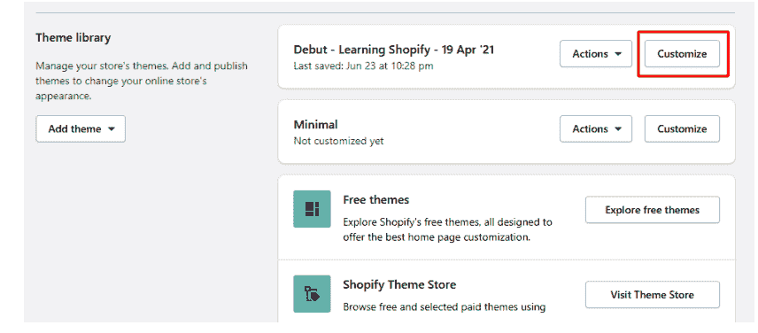

图 6.1 – 通过在线主题（Online theme）部分访问主题编辑器的示例

请注意，在主题编辑器中所做的更改是特定于主题的，因此我们应记得点击我们要自定义的主题上的 Customize（自定义）按钮。

或者，我们可以通过代码编辑器访问主题编辑器，方法是点击位于右上角的 **Customize theme（自定义主题）** 按钮：

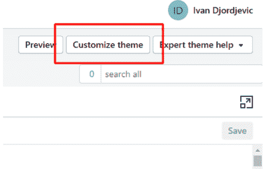

图 6.2 – 通过代码编辑器访问主题编辑器的另一种方式

进入主题编辑器后，我们会在侧边栏中看到一系列类别选项。但是，这些选项中的大多数是部分（sections）和块（blocks）的一部分，我们将在下一章中进一步了解。现在，我们可以通过点击位于右下角的 **Theme settings（主题设置）** 按钮来访问我们在 settings_schema.json 文件中定义的全局设置：

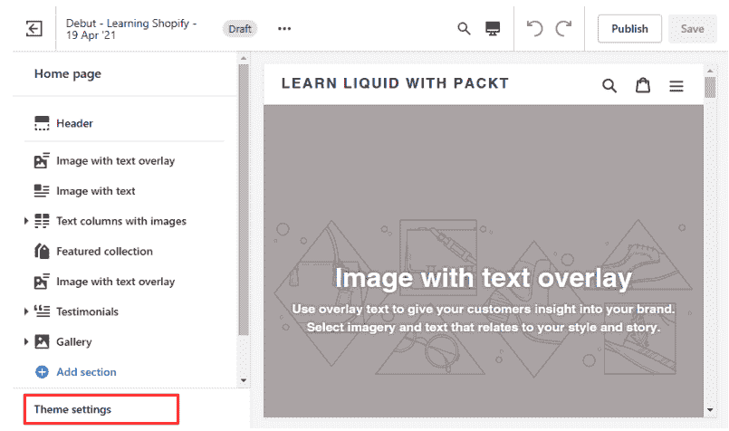

图 6.3 – 在主题编辑器中访问全局设置

在 **Theme settings（主题设置）** 中，我们会找到所有在 `settings_schema.json` 文件中定义的类别和输入设置，其中每个输入集包含一组属性。有些属性是必需的，其他属性是可选的。让我们进一步了解它们。

## 了解输入设置属性

每个输入设置选项可以包含以下五个属性，也称为标准属性：

- 顾名思义，`type` 属性允许我们设置输入设置的类型，它可以是基本类型或专用类型。`type` 属性是必需的。
- `id` 属性是另一个必需的属性，我们稍后将使用它来访问和读取设置值。
- `label` 属性允许我们设置主题编辑器中输入设置的标签。`label` 属性是必需的。
- `default` 值作为故障安全机制，允许我们为输入设置设置默认选项。但它不是必需的。
- 最后一个属性 `info` 允许我们包含关于输入设置的额外说明，也不是必需的。

虽然大多数输入设置仅包含之前提到的属性，但根据输入类型，在某些情况下我们需要包含一些额外的属性。

我们之前提到，type 属性允许我们在两种不同类型的输入设置（基本和专用）之间进行选择，但它们到底是什么？

## 基本输入类型

基本输入类型是一组选项，允许我们在主题编辑器中包含各种类型的输入设置。在基本类别下，我们可以使用以下选项：

- `checkbox`
- `number`
- `radio`
- `range`
- `select`
- `text`
- `textarea`

正如我们之前提到的，大多数输入设置仅包含标准属性。然而，一些专用输入甚至基本输入都需要额外的属性。现在让我们仔细看看每种输入类型，学习如何使用它，以及我们可以期待什么样的结果。

### 复选框输入

复选框输入类型，顾名思义，是一种布尔类型字段，允许我们在主题编辑器中创建复选框选项：

```json
{
  "type": "checkbox",
  "id": "enable_popup",
  "label": "Enable popup",
  "default": true
}
```

正如我们所见，复选框输入包含三个必需属性和一个可选属性，我们将可选属性的值设置为 true。否则，如果移除 `default` 属性，复选框的默认状态将为 `false`。以下截图展示了复选框输入类型的示例：

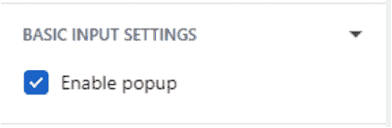

图 6.4 – 复选框基本输入类型的示例

我们可以使用布尔输入类型来切换功能的开启和关闭，这可以通过获取复选框输入值并使用 `if` 语句检查其当前状态来实现：

```liquid


```

通过检查复选框输入值是否等于 true，我们创建了一个简单功能，可以轻松启用或禁用商店中的某个功能，因为语句内的代码块仅在语句为 true 时才会渲染：

```liquid


```


请注意，我们可以通过将复选框输入值与 `blank` 变量进行比较来达到相同的结果。

### number 输入

number 类型的输入是 Shopify 推出的最新添加，正如其名称所示，它是一个数字类型的字段，允许我们在主题编辑器内创建一个数字选择器输入。除了标准属性外，我们还可以使用一个可选的 `placeholder` 属性，以便为文本输入包含一个占位值：

```
{
  "type": "number",
  "id": "number_of_products",
  "label": "Number of products",
  "placeholder": "24"
}
```

请注意，number 类型的输入只能包含数字值。在下面的截图中，我们可以看到 number 输入类型的示例：

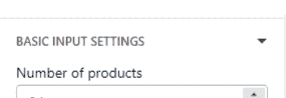

图 6.5 – number 基本输入类型示例

一旦我们定义了 number 输入，就可以通过将 `settings` 关键字与该文本输入的 ID 配对来访问它：

```
{{ settings.number_of_products }}
```

number 输入的值将始终返回一个数字值，除非它为空，在这种情况下它将返回一个 `EmptyDrop` 值。我们可以通过重新访问第 2 章“Liquid 的基本流程”，并在“理解数据类型”一节中查看 `EmptyDrop` 小节来提醒自己什么是 `EmptyDrop`。

### radio 输入

使用 radio 输入类型，我们可以输出一个单选选项字段，这允许我们进行多选一的选择。radio 输入使用标准属性，并额外包含一个强制的 `options` 属性。

`options` 属性接受一个由 `value` 和 `label` 属性组成的数组，这些属性都是强制的：

```
{
  "type": "radio",
  "id": "heading_alignment",
  "label": "Heading alignment",
  "options": [
    {
      "value": "left",
      "label": "Left"
    },
    {
      "value": "center",
      "label": "Center"
    },
    {
      "value": "right",
      "label": "Right"
    }
  ],
  "default": "center"
}
```

请注意，我们需要将 `default` 属性设置为之前在 `options` 数组中定义的某个值。否则，如果未定义 `default` 属性，则默认选择第一个单选按钮。以下是 radio 输入类型的示例：

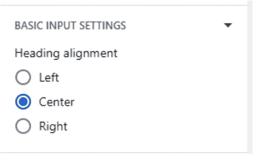

图 6.6 – radio 基本输入类型示例

一旦我们定义了 `radio` 输入，就可以通过将 `settings` 关键字与该 radio 输入的 ID 配对来访问它：

```css
.heading {
    text-align: {{ settings.heading_alignment }};
}
```

radio 按钮的值将始终返回一个字符串值。

### range 输入

使用 range 输入类型，我们可以创建一个范围滑块字段。与之前的输入相比，range 输入有四个额外属性，并且对标准属性做了一个更改。我们可以通过以下方式列出这些额外属性：

- `min` 属性允许我们设置 range 输入的最小值。`min` 值是强制的。
- `max` 值也是一个强制属性，允许我们设置 range 输入的最大值。
- `step` 值允许我们设置滑块步进之间的增量值。`step` 滑块是强制的。
- 第四个也是最后一个额外属性 `unit` 是一个可选属性，允许我们为此范围滑块的值设置视觉单位，例如 `px`。请注意，`unit` 属性只接受最多三个字符，并且将在主题编辑器内纯粹以视觉方式输出 `px`。实际值将返回一个不带单位的数字值。

对标准属性集的一个额外更改是，`default` 属性现在是强制的：

```json
{
  "type": "range",
  "id": "logo_size",
  "min": 120,
  "max": 220,
  "step": 1,
  "unit": "px",
  "label": "Logo Size",
  "default": 140
}
```

请注意，`min`、`max`、`step` 和 `default` 属性都是数字类型的值。在这些属性中的任何一个包含字符串值都将导致错误。

与之前的属性相比，`range` 属性带有一些我们必须遵循的规则。第一条规则是，`default` 值必须介于 `min` 和 `max` 值之间。第二条也是更重要的规则是，每个范围滑块最多可以有 100 步，但这到底是什么意思呢？

例如，在前面的示例中，我们设置了最小值为 120，最大值为 220。由于我们将 `step` 值设置为 1，因此在这两个值之间恰好有 100 步。

另一方面，如果我们将最大值设置为 320，则还必须将 `step` 值更新为 2，以保持最小值和最大值之间的 100 步。在下面的截图中，我们可以看到 range 输入类型的示例：

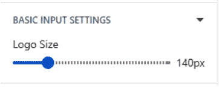

图 6.7 – range 基本输入类型示例

一旦我们定义了 `range` 输入，就可以通过将 `settings` 关键字与该 range 输入的 ID 配对来访问它。但是请记住，`unit` 属性纯粹是视觉上的。由于 range 输入返回一个数字值，我们需要在样式表中手动包含单位值：

```css
.logo-img {
  max-width: {{ settings.logo_size }}px;
}
```

这就是为什么我们在定义样式设置时应该始终包含 `default` 属性，或者至少将整个 CSS 行包装在一个检查值是否存在的语句中的原因之一。否则，如果输入的值未定义，我们就有可能破坏样式表。

### select 输入

`select` 输入类型允许我们创建一个下拉选择器字段。除了标准属性集之外，`select` 输入类型还有两个额外属性。我们可以通过以下方式列出这些额外属性：

- `options` 属性与 radio 输入的类似，允许我们创建一个由 `value` 和 `label` 属性组成的数组来定义下拉选项。数组中的 `options` 和 `value/label` 都是强制属性。
- `group` 属性是一个可选属性，允许我们在下拉列表中对不同选项进行分组。

与 `radio` 输入类型一样，如果我们未定义 `default` 属性，则默认选择第一个选项：

```json
{
  "type": "select",
  "id": "font_family",
  "label": "Font Family",
  "options": [
    {
      "value": "raleway-light",
      "label": "Raleway - Light",
      "group": "Raleway"
    },
    {
      "value": "raleway-regular",
      "label": "Raleway - Regular",
      "group": "Raleway"
    },
    {
      "value": "playfair-display-regular",
      "label": "Playfair Display - Regular",
      "group": "Playfair Display"
    }
  ],
  "default": "playfair-display-regular"
}
```

由于 select 输入返回一个字符串值，最常见的用途之一是在主题中包含一个自定义字体族，正如我们在前面的示例中有机会看到的：

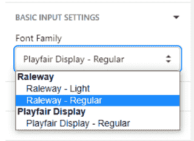

图 6.8 – select 基本输入类型示例

此外，通过使用 `group` 属性，我们成功地将所有属于同一字族的选项进行了分组：

```
.heading {
  font-family: {{ settings.font_family }};
}
```

Shopify 还有一个广泛的字体库可供我们使用，并且有一个专门的输入可以让我们访问上述库，我们稍后将学习。然而，如果我们希望包含一个 Shopify 字体库中不可用的自定义字体，在这种情况下，我们需要通过自定义解决方案将其包含进来，例如通过 select 类型下拉列表来包含它。

### text 输入

`text` 类型的输入，正如其名称所示，是一个字符串类型的字段，允许我们在主题编辑器内创建一个单行文本选项。除了标准属性外，我们还可以使用一个 `placeholder` 属性，以便为文本输入包含一个占位值：

```json
{
  "type": "text",
  "id": "header_announcement",
  "label": "Header Announcement",
  "placeholder": "Enter a short announcement.",
  "default": "Spend more than 100$ to qualify for a 10% discount!"
}
```

请注意，text 类型的输入只能包含字符串值，并且不能包含任何 HTML 标签。在下面的截图中，我们可以看到 text 输入类型的示例：

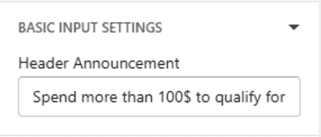

图 6.9 – text 基本输入类型示例

一旦我们定义了 text 输入，就可以通过将 `settings` 关键字与该文本输入的 ID 配对来访问它：

```liquid
{{ settings.header_announcement }}
```

text 输入的值将始终返回一个字符串值，除非它为空，在这种情况下它将返回一个 `EmptyDrop` 值。


### 文本域输入

textarea 类型的输入与文本输入的工作方式类似，唯一的区别在于 textarea 是一个多行文本字段，而文本输入是一个单行字段。除了标准属性外，我们还可以使用 placeholder 属性为 textarea 输入包含占位符值：

```
{
  "type": "textarea",
  "id": "header_announcement_textarea",
  "label": "Header Announcement",
  "placeholder": "Enter a short announcement.",
  "default": "Spend more than 100$ to qualify for a 10% discount!"
}
```

与文本输入值类似，textarea 输入值始终会返回一个字符串值，除非为空，在这种情况下它会返回一个 EmptyDrop 值。我们可以在以下截图中看到 textarea 输入的示例：

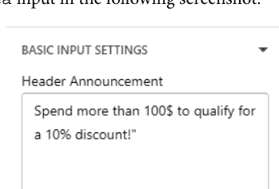

图 6.10 – textarea 基础输入类型的示例

有了 textarea，我们现在已经涵盖了所有基础输入设置，这为我们理解和操作主题编辑器 .json 文件奠定了坚实的基础。然而，要真正说我们对 .json 文件有工作知识，我们还需要学习专门的输入设置。

## 专门的输入设置

专门的输入类型是一组专门的选项，它不仅允许我们在主题编辑器中包含各种类型的输入设置，还为我们提供了轻松访问各种 Liquid 对象的途径。在专门的输入下，我们可以使用以下选项：

- `richtext`
- `html`
- `linklist`
- `liquid`
- `color`
- `url`
- `video_url`
- `image_picker`
- `font_picker`
- `article`
- `blog`
- `collection`
- `page`
- `product`

与基础输入类型类似，大多数输入设置只会包含标准属性。然而，一些输入需要额外的属性。通过学习所有不同类型的专门输入，我们将学习如何使用它们以及可以期望的哪种结果，这将有助于创建我们在下一章中将学习的复杂区块。

### richtext 输入

`richtext` 输入类型与基础 `textarea` 输入类型类似，因为它们都输出一个多行文本字段。主要区别在于 `richtext` 还为我们提供了一些基本格式选项：

- Bold
- Italic
- Underline
- Link
- Paragraph

请注意，与接受占位符的 `textarea` 相比，`richtext` 不接受任何 `placeholder` 属性。

### html 输入

`html` 输入类型是一个多行文本字段，正如其名称所示，允许我们在输入字段中包含 HTML 标记。除了标准属性外，`html` 输入类型还接受一个可选的 `placeholder` 属性：

```
{
  "type": "html",
  "id": "google_analytics",
  "label": "Google Analytics",
  "placeholder": "Paste the Google Analytics code here."
}
```

虽然 `html` 输入会接受大多数 HTML 标签，但 Shopify 会自动删除以下三个标签：

- `<html>`
- `<head>`
- `<body>`

`html` 类型输入值始终会返回一个字符串值，如果为空则返回 `EmptyDrop` 值。我们可以在以下截图中看到 `html` 输入的示例：

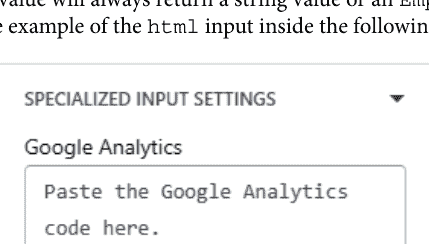

图 6.12 – html 专门输入类型的示例

请注意，虽然我们可以在 html 类型输入中包含 HTML 代码，但我们不能在字段中包含 Liquid 代码，因为它将被处理为一个简单的字符串。

### linklist 输入

使用 link_list 输入类型，我们可以创建一个特殊的菜单选择器类型字段，允许我们输出商店导航菜单之一。请注意，我们只能在位于 Online store 部分下的管理员 Navigation 部分中看到我们之前创建的菜单：

```
{
  "type": "link_list",
  "id": "header-menu",
  "label": "Header Menu",
  "default": "main-menu"
}
```

请注意，虽然 default 属性是可选的，但它只接受两个特定值，main-menu 和 footer。让我们在以下截图中看看 linklist 输入的外观：

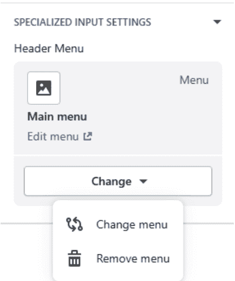

图 6.13 – linklist 专门输入类型的示例

使用设置和 ID 来检索 `link_list` 值将返回一个 `linklist` 对象，我们可以使用它来构建导航菜单。如果我们回忆一下，在 *第 4 章，使用对象的 Liquid 核心深入* 中，我们使用以下代码输出具有特定 `indoor-navigation` 处理程序的导航菜单：

```
```liquid



```
```

如果我们想使用不同的导航，我们就必须手动更新菜单导航处理程序。然而，考虑到我们现在可以直接从主题编辑器恢复 `linklist` 对象，我们可以更新之前硬编码的 `linklist` 对象值并将其替换为动态值：

```
```liquid



```
```

请注意，如果 `link_list` 类型输入没有 default 属性或我们尚未选择菜单，我们将收到空白值作为返回值。

### liquid 输入

`liquid` 输入类型也是 Shopify 的一个最新补充，它允许我们包含 HTML 标记和有限的 Liquid 代码，这使其成为一个非常强大的工具。这是此输入的示例代码：

```
```json
{
  "type": "liquid",
  "id": "liquid_block",
  "label": "Liquid block"
}
```
```

请注意，任何未关闭的 HTML 标签在我们保存设置时都会自动关闭。在以下截图中，我们可以看到 `liquid` 输入类型的示例：

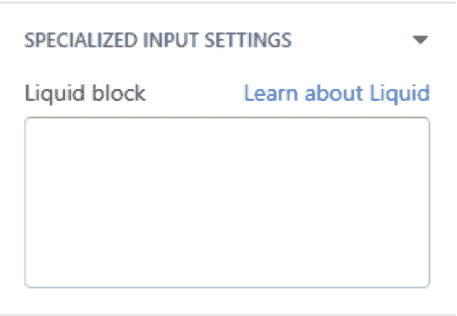

图 6.14 – liquid 专门输入类型的示例

`liquid` 输入类型为我们提供了访问所有全局对象、基于页面的对象以及标准标签和过滤器的权限。

请注意，`liquid` 类型输入值始终会返回一个字符串值，如果为空则返回 EmptyDrop 值。

### color 输入

顾名思义，`color` 输入类型允许我们创建一个颜色选择器类型输入，以便轻松更新商店的颜色调色板：

```
```json
{
  "type": "color",
  "id": "store_background_color",
  "label": "Background Color",
  "default": "#ffffff"
}
```
```

我们可以通过组合 settings 关键字和输入的 ID 来访问 `color` 输入类型的值：

```
```css
body {
  background-color: {{ settings.store_background_color }};
}
```
```

除了可以在 `color` 字段中手动输入十六进制颜色外，我们还可以触发一个实际的颜色调色板，在其中选择所需的颜色色调：

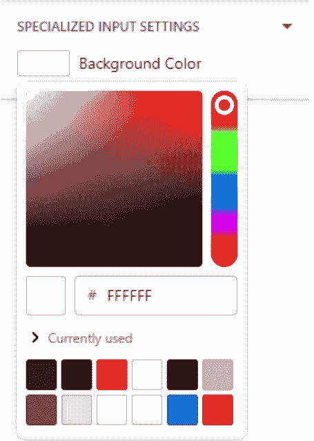

图 6.15 – color 专门输入类型的示例

请注意，虽然 `default` 属性是可选的，但我们应该始终包含默认值或将整个 CSS 行包装在检查输入值是否为空的语句中。如果我们忽略其中任何一个，在 `color` 输入值未定义的情况下，我们可能会最终得到一个损坏的样式表。

### url 输入

url 类型输入为我们提供了一个特殊的 URL 输入字段，我们可以在其中手动输入外部 URL 或使用一系列下拉菜单选择以下资源之一的路径：

- Articles
- Blogs
- Collections
- Pages
- Products
- Policies

我们还可以通过简单地粘贴 URL 并随后在下拉菜单中单击链接来确认选择，从而链接到我们商店以外的网站：

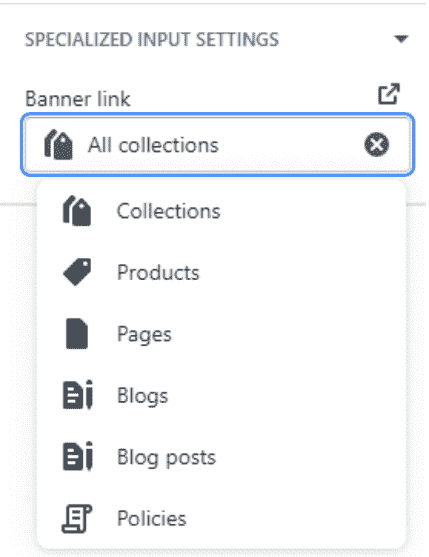

图 6.16 – url 专门输入类型的示例

请注意，虽然 default 属性是可选的，但它只接受两个特定值 – /collections 和 /collections/all：

```
{
  "type": "url",
  "id": "banner_link",
  "label": "Banner link",
  "default": "/collections"
}
```

我们可以通过组合 settings 关键字和输入的 ID 来访问 url 输入类型的值，然后将其作为 HTML <a> 标签的 href 参数包含在内：

```
<a href="{{ settings.banner_link }}"></a>
```

考虑到 HTML <a> 标签是硬编码的，我们无法使用 url 类型输入对标签进行任何动态修改。然而，我们可以引入一个额外的输入类型，例如复选框，我们可以使用它来显示或隐藏 target="_blank" 属性。

请注意，color 类型输入值始终会返回字符串值或如果值未定义则返回 nil。

### video_url 输入

video_url 类型输入为我们提供了一个特殊的 URL 输入字段，我们可以在其中手动输入来自 YouTube 或 Vimeo 的视频的外部 URL 并提取其 ID 以供以后使用。除了标准属性集外，video_url 输入类型还有两个附加属性。我们可以按以下方式列出附加属性：

- accept 属性是一个强制性的数组类型属性，我们可以在其中定义我们将接受其视频 URL 的不同提供商类型。有效值是 youtube、vimeo 或两者的组合。
- placeholder 属性是一个可选类型属性，允许我们为 video_url 输入包含占位符值。


以下代码展示了带有前置属性的 `video_url` 类型输入：

```
{
  "type": "video_url",
  "id": "banner_video_url",
  "label": "Video url",
  "accept": [
    "youtube",
    "vimeo"
  ],
  "placeholder": "Enter the YouTube or Vimeo video URL."
}
```

在将视频 URL 添加到两个视频平台之一后，我们将看到视频名称和第一帧，从而可以确认我们拥有正确的视频 URL：


图 6.17 – `video_url` 专用输入类型的示例

Files 部分是我们通过管理员或主题编辑器上传的所有资产的归属地，我们可以在 Shopify 中通过点击左下角的 Settings 链接，然后点击 Files 链接来找到它。除了充当我们所有资产的数据库，即 Files 部分之外，我们还可以使用右上角的 Upload files 按钮直接向 Files 部分上传资产。此外，我们可以轻松恢复任何资产的直接 URL 路径并使用它。

在下面的代码块中，我们可以看到如何使用 `image_picker` 输入的示例：

```
{
  "type": "image_picker",
  "id": "banner_image",
  "label": "Banner image"
}
```

请注意，`image_picker` 类型输入值将始终返回一个图像对象值，如果未定义该值则返回 nil：

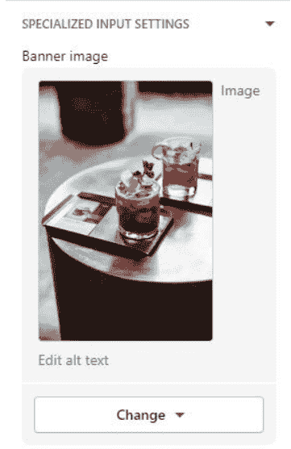

图 6.18 – `image_picker` 专用输入类型的示例

由于 `image_picker` 返回一个图像对象，我们可以使用 `img_tag` 或 `img_url` 过滤器动态生成必要的图像标签：

```

```

```
{{ settings.banner_image | img_tag: image_item.alt, "class1 class2", "600x600" }}
```

有关 `img_tag` 和 `img_url` 过滤器使用的详细提醒，我们可以重新查看第 5 章《Diving into Liquid Core with Filters》中的 HTML 和 URL 过滤器部分。

### The font_picker input

在学习 `select` 输入类型时，我们提到过 Shopify 为我们提供了访问庞大字体库的权限。`font_picker` 类型输入允许我们创建一个字体选择器选择字段，我们可以使用它在 Shopify 字体库中选择任何字体：

```
{
  "type": "font_picker",
  "id": "body_font",
  "label": "Body font",
  "default": "helvetica_n4"
}
```

与标准属性集相比的一个额外变化是，`default` 属性现在是强制性的。我们可以在以下链接 https://shopify.dev/themes/architecture/settings/fonts#available-fonts 中找到 `default` 属性的可能字体句柄值，通过点击每个字体文件名旁边的 More info 按钮。下面的屏幕截图向我们展示了 `font_picker` 类型输入的示例：

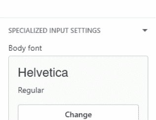

图 6.19 – `font_picker` 专用输入类型的示例

我们需要做的第一件事是创建一个变量来保存 `font_picker` 对象值，之后我们需要使用 `font_face` 过滤器调用该变量：

```
<style>

{{ body_font | font_face }}
</style>
```

在声明了 `font_face` 之后，我们现在可以轻松地从变量内部访问 `@font-face`。

假设现在我们想要修改特定元素的特定属性，例如 `font-weight` 和 `font-style`。要实现这种类型的功能，我们可以使用 `font_modify` 过滤器，它接受两个属性，即 `style` 属性，允许我们修改 `font-style`，以及 `weight`，我们可以使用它来修改 `font-weight` 属性：

```
<style>

{{ body_font | font_face }}




{{ body_font_bold | font_face }}
{{ body_font_italic | font_face }}
{{ body_font_bold_italic | font_face }}
</style>
```

请注意，我们现在有三个不同的变量包含三种不同类型的 `@font-face`。剩下的就是提取我们需要的特定属性并将其分配来设置内容样式。

我们可以通过使用字体对象的 `family`、`style` 和 `weight` 属性来返回特定的 `@font-face` 属性值：

```
```liquid
<style>
  
  {{ body_font | font_face }}

  
  
  
  {{ body_font_bold | font_face }}
  {{ body_font_italic | font_face }}
  {{ body_font_bold_italic | font_face }}

  .body_bold {
    font-family: "{{ body_font_bold.family }}";
    font-style: "{{ body_font_bold.style }}";
    font-weight: "{{ body_font_bold.weight }}";
  }
  .body_italic {
    font-family: "{{ body_font_italic.family }}";
    font-style: "{{ body_font_italic.style }}";
    font-weight: "{{ body_font_italic.weight }}";
  }
</style>
```
```

我们现在已经成功学习了 `font_picker` 输入类型的工作原理，更重要的是，我们还学习了如何使用字体对象和过滤器输出 `font_picker` 值并使字体选择过程完全动态化。

使我们的代码更具功能性的唯一补充是，如果所选字体族因某种原因无法渲染，则包含回退族。我们可以通过引入 `fallback_families` 对象来做到这一点，它将返回建议的回退字体族：

```
```liquid
<style>
  
  {{ body_font | font_face }}

  

  

  
  {{ body_font_bold | font_face }}
  {{ body_font_italic | font_face }}
  {{ body_font_bold_italic | font_face }}

  .body_bold {
    font-family: "{{ body_font_bold.family }}",
                 "{{ body_font_bold.fallback_families }}";
    font-style: "{{ body_font_bold.style }}";
    font-weight: "{{ body_font_bold.weight }}";
  }
  .body_italic {
    font-family: "{{ body_font_italic.family }}",
                 "{{ body_font_italic.fallback_families }}";
    font-style: "{{ body_font_italic.style }}";
    font-weight: "{{ body_font_italic.weight }}";
  }
</style>
```
```

有关所有可用字体过滤器的更多信息，我们可以参考 https://shopify.dev/api/liquid/filters/font-filters，关于所有可用字体对象的信息，我们可以参考 https://shopify.dev/api/liquid/objects/font。

### The article input

`article` 类型输入为我们提供了特殊的文章选择器选择字段。通过文章选择器，我们可以访问商店中所有可用的文章：

```
{
  "type": "article",
  "id": "featured_article",
  "label": "Featured article"
}
```

直到最近，`article` 输入类型始终会返回文章的字符串句柄，然后需要使用它来恢复文章对象。然而，自 Shopify Unite 2021 大会以来，`article` 和其他页面相关输入现在返回一个对象，使我们的工作变得更加轻松。

请注意，虽然页面相关输入类型将返回一个对象，我们可以从中提取任何所需的值，但我们有时仍会发现自己正在处理一个主题，该主题使用旧方法来检索页面相关输入类型对象。出于这个原因，我们将提及这两种方法，因为虽然我们不会使用旧方法，但如果我们需要处理它，了解其工作原理至关重要。在下面的屏幕截图中，我们可以看到 `article` 输入类型的示例：

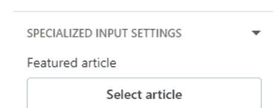

图 6.20 – `article` 专用输入类型的示例

由于 `article` 输入值返回一个对象值，我们已经完全访问了文章对象，并且可以轻松检索我们可能需要的任何属性：

```

```

正如我们所见，现在 `article` 输入返回一个对象，访问对象本身并检索任何属性的值几乎毫不费力。现在让我们深入研究使用文章句柄检索文章对象的过时方法。


如前所述，在 Shopify Unite 2021 活动之前，文章输入值返回的是句柄字符串。要访问文章对象，我们需要将所访问对象名称变为复数形式，然后加上方括号 `[]` 表示法，这与我们在第 2 章“Liquid 的基本流程”中对产品句柄所做的操作类似：

```liquid

```

我们现在可以访问文章对象，并轻松地将任何类型的文章内容输出到商店的任何位置。请注意，虽然这两种方法产生的结果相同，但通过句柄恢复与页面相关的输入对象的第二种方法现已弃用。

### 博客输入

博客类型输入的工作方式与之类似，因为它为我们提供了一个特殊的博客选择器字段，通过该字段我们可以访问商店中所有可用的文章：

```json
{
  "type": "blog",
  "id": "featured_blog",
  "label": "Featured blog"
}
```

访问特色博客时，如果尚未定义该值，则始终返回博客对象或 nil：

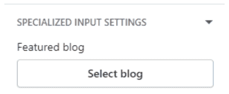

图 6.21 – 博客专用输入类型示例

与文章对象类似，我们可以直接访问博客对象，或使用方括号 `[]` 表示法来检索它。唯一的区别是对象关键字发生了变化：

```liquid



```

一旦我们恢复了博客对象，就可以使用 `for` 标签遍历所选博客中的所有文章，并正确渲染它们。

### 集合输入

集合类型输入为我们提供了一个特殊的集合选择器字段，通过该字段我们可以访问所选集合中的所有可用产品：

```json
{
  "type": "collection",
  "id": "featured_collection",
  "label": "Featured Collection"
}
```

与之前的设置类型类似，如果尚未选择集合，则返回值为 nil。否则，返回值将是一个对象值，我们可以用它来检索任何对象属性值：

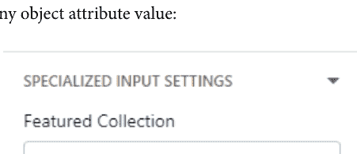

图 6.22 – 集合专用输入类型示例

此外，我们可以直接访问 `collection` 对象，或者通过将对象名称变为复数形式，然后加上方括号 `[]` 表示法来访问：

```liquid

```

有了集合对象，我们现在可以轻松地访问所有集合属性。

### 页面输入

页面类型输入为我们提供了另一个特殊的选择器字段，允许我们访问在商店后台的 **页面** 部分中预先创建的所有页面：

```json
{
  "type": "page",
  "id": "featured_page",
  "label": "Featured page"
}
```

访问 **特色页面** 值时，如果尚未定义该值，则始终返回对象值或 nil：

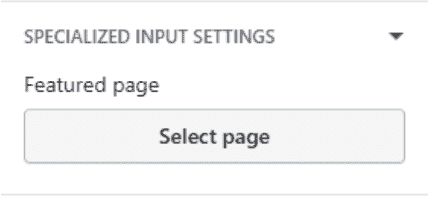

图 6.23 – 页面专用输入类型示例

我们可以直接访问页面对象，或通过方括号 `[]` 表示法访问：

```liquid

```

使用声明的页面变量，我们现在可以访问页面对象，并由此进一步访问特定页面的任何属性。

### 产品输入

顾名思义，product 为我们提供了一个产品输入选择器，我们可以用它来访问产品对象：

```json
{
  "type": "product",
  "id": "featured_product",
  "label": "Featured product"
}
```

与之前的设置类似，访问时，如果尚未定义该值，则返回 nil，否则我们会得到一个对象值：

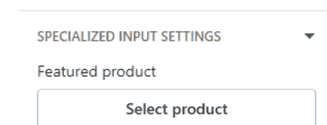

图 6.24 – 产品专用输入类型示例

我们可以使用返回的对象值来访问属性值，或者使用产品对象的方括号 `[]` 表示法通过已弃用的方法来检索对象：

```liquid

```

通过产品变量，我们现在可以访问所选产品对象中的所有属性。

到目前为止，我们已经了解了所有不同类型的输入设置，无论是基本输入类型还是专用输入类型，如何访问它们，每种设置可以包含哪些额外属性，以及我们可以期望从它们那里获得什么类型的值。然而，如果这些设置没有顺序，简单地在单个类别中堆叠大量设置可能会令人不知所措。

## 组织主题编辑器

在上一节中，我们学习了不同类型的可配置设置，这些设置使我们能够通过一系列基本或专用输入选择器轻松更新其值。现在我们将学习一组不同的设置：侧边栏设置。侧边栏设置将允许我们将每个类别中的设置划分到其他单独的块中。

侧边栏设置不持有任何值，也无法通过主题编辑器进行配置。它们的唯一用途是为我们提供附加信息，并帮助我们将不同的输入设置组组织成单独的块，以便更直接地导航。

在侧边栏设置下，我们可以使用以下选项：

- `header`
- `paragraph`

与基本和专用输入设置不同，`header` 和 `paragraph` 只能包含以下标准属性：

- 顾名思义，`type` 属性允许我们设置设置类型，其值可以是 `header` 或 `paragraph` 设置。对于 `header` 和 `paragraph`，`type` 属性都是必需的。
- 虽然侧边栏设置不能包含任何值，但我们可以使用 `content` 属性向主题编辑器输出特定信息。对于 `header` 和 `paragraph`，`content` 属性同样是必需的。
- 最后一个属性 `info` 允许我们提供有关 `header` 类型设置的附加信息。请注意，`info` 不是必需属性，我们只能将其用于 `header` 类型设置。

现在我们已经掌握了有关不同类型的侧边栏设置及其属性的所有必要信息，让我们分别查看每种设置类型并学习如何使用它们。

### header 类型

`header` 类型设置，顾名思义，允许我们创建一个 header 元素，从而将所有设置输入类型分组到单个块内。请注意，引入 `header` 类型设置后，它会自动将该类别中的所有输入类型设置分组，直到遇到另一个 `header` 元素，或者当前类别中没有更多设置为止：

```json
{
  "type": "header",
  "content": "Newsletter settings",
  "info": "Enabling the popup feature will automatically trigger a newsletter popup on page load."
}
```

正如我们所见，使用 header 类型设置相对容易，而且我们获得的好处非常显著，因为现在我们可以轻松地对相关的输入设置进行分组。此外，通过包含可选的 `info` 属性，我们能够添加与该特定设置块相关的一些附加信息，如下面的截图所示：

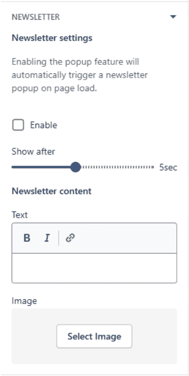

图 6.25 – header 侧边栏设置类型示例

### paragraph 类型

虽然我们不能包含额外属性，但我们可以使用 `content` 属性创建指向特定页面的直接链接，从而提供一些附加信息。我们可以通过以下格式包含所需信息来实现这一点：

```text
[link text](link url)
```

包含指向特定页面的直接链接将使我们的主题编辑器更加简洁。同时，它还允许我们包含使用它的人可能需要的所有必要信息：

```json
{
  "type": "paragraph",
  "content": "The paragraph type setting allows us to include a direct link to any page. [Learn more](https://shopify.dev/themes/architecture/settings/sidebar-settings#header)"
}
```

请注意，我们可以在任何接受 `info` 属性的设置类型中，于 `content` 和 `info` 属性内创建指向任何页面的直接链接。

现在我们已经了解了每种输入设置和侧边栏设置类型。然而，了解所有当前设置固然重要，但提及一些现已弃用但我们日常工作中仍可能遇到的设置也同样重要。

## 一瞥已弃用的设置

虽然以下设置已不再受支持，但我们很可能在商店所有者从未更新过的旧主题上遇到它们。由于这些设置不再受支持，我们将不会详细讨论它们的工作原理，但我们会提供一些一般性指导，以帮助识别它们及其作用。

### 字体输入

`font` 输入类型设置允许我们生成 Shopify 上可访问的字体文件候选列表：

```json
{
  "type": "font",
  "id": "body_font",
  "label": "Body font"
}
```


我们之前提到的 `font_picker` 输入类型的引入，使得 font 设置输入类型变得过时。

### snippet 输入

顾名思义，`snippet` 输入类型允许我们选择之前在主题中创建的任何 snippet 文件，并在特定位置执行其内容：

```json
{
  "type": "snippet",
  "id": "featured_products",
  "label": "Featured products"
}
```

`sections` 的引入（我们将在下一章中了解）使得 `snippet` 设置输入类型变得过时。

## 总结

在之前的章节中，我们没有逐一介绍每个特定选项，因此列出了一个需要学习的选项列表，以保持内容简洁切题。然而，在本章中，我们逐一介绍了每个选项，并仔细解释了如何使用它、何时使用以及预期效果，因为这些选项非常重要，我们在后续工作中会经常用到本章所学的知识。

我们学习了如何生成一些最基本的输入类型，这些输入类型可用于输出各种类型的内容和输入，从而让我们能够创建与特定内容相关的附加逻辑。此外，我们还学习了如何输出专门的输入类型，从而能够通过简单且可配置的界面创建复杂功能。

最后，我们学习了如何将 JSON 设置组织成独立的块，以提高可读性。本章所获得的知识将在下一章中得到应用和检验。

在下一章中，我们将学习分区和区块，并使用它们创建特定于分区/区块的设置，商家可以通过主题编辑器使用这些设置来创建可复用的分区。

## 问题

1. 输入设置的两种类型是什么？

2. 下面这段代码会导致错误的问题是什么？

```json
{
  "type": "text",
  "id": "header_announcement",
  "label": "Text",
}
```

3. 如何在 Shopify 中包含自定义字体文件，并在整个主题编辑器中使用它？

4. 哪两个问题会阻止我们执行以下代码？

```json
{
  "type": "range",
  "id": "number_of_products",
  "min": 110,
  "max": 220,
  "step": 1,
  "unit": "pro",
  "label": "Number of products",
  "default": 235
}
```
