# 使用静态和动态分区

在上一章中，我们熟悉了不同类型的输入，无论是基础的还是专门的，以及如何使用它们创建可通过主题编辑器轻松配置的全局设置。

在本章中，我们不仅会用到前面提到的输入，还会学习如何创建易于配置且可复用的分区，从而轻松更改页面甚至模板的布局。

在本章中，我们将学习以下主题：

-   静态分区与动态分区
-   使用分区 schema
-   使用区块构建
-   使用 JSON 模板增强页面
-   探索分区专用标签

完成本章时，我们将理解分区是什么、何时使用它们，以及如何创建分区。我们还将了解静态分区与动态分区之间的区别，以及如何通过主题编辑器配置它们。

通过学习分区 schema 以及我们可以使用的各种属性，我们还将学习如何在分区内创建可复用的区块模块，这些模块可以重复使用并产生不同的结果。在熟悉分区和区块之后，我们将通过学习 JSON 模板和内建元字段来进一步优化这些概念。最后，我们将学习可在分区文件中使用的各种专用标签，这将帮助我们创建可复用且动态的模块。

## 技术要求

虽然我们会解释每个主题并配有相应的图形，但由于 Shopify 是一项托管服务，我们需要互联网连接才能完成本章所述的步骤。

本章的代码可在 GitHub 上获取：https://github.com/PacktPublishing/Shopify-Theme-Customization-with-Liquid/tree/main/Chapter07。

本章的 Code in Action 视频可在此处找到：https://bit.ly/3hQzhVg

## 静态分区与动态分区

在*第 1 章，Shopify 入门*中，讨论主题结构时，我们简要提到了分区文件，但*分区到底是什么？*

除了是主题文件中的目录名之一外，**分区**是一种文件类型，允许我们创建可通过主题编辑器自定义的可复用模块，正如我们之前所学。然而，与我们学到的全局设置不同，主要区别在于分区的 JSON 设置定义在每个分区文件内部，并且是分区专用的。

分区专用设置允许我们在页面上多次复用同一个分区模块，并为每次使用选择不同的选项集，这使得它成为一个非常强大的功能。例如，我们可以创建一个精选产品系列分区，并重复使用三次，以显示来自三个不同产品系列的三个产品。

在继续之前，让我们从代码编辑器中点击 **自定义（Customize）** 按钮进入主题编辑器，看看分区文件的实际效果。点击 **自定义** 按钮将自动打开主题编辑器，并将我们定位到主页，页面预览在右侧，侧边栏在左侧。在侧边栏中，我们可以看到该特定页面上可用的几个分区：

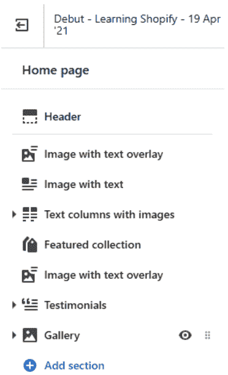

图 7.1 – 主题编辑器中的页面分区示例

乍一看，我们可以看到 Header 和 Footer 分区通过一条细边框与其余分区隔开。这告诉我们，Header 和 Footer 分区是静态分区，我们无法在主题编辑器内更改它们的位置。

与 snippet 文件类似，静态分区是我们可以在主题文件中手动插入的分区，这可以使用 section 主题标签来完成：

```liquid

```

通过包含 section 标签，我们会自动将分区内容渲染到包含该标签的位置，并可以使用其 JSON 设置进一步自定义它。请注意，由于这是我们手动包含在主题文件中的静态分区，因此通过主题编辑器应用于此特定分区的任何设置，都会在我们包含了此分区的所有页面上可见。

例如，主题开发者已将 header 和 footer 分区文件包含在 `theme.liquid` 布局文件中，即我们的主题主文件，这意味着 header 和 footer 分区将在我们商店的任何页面上可见。另一方面，如果我们在主题编辑器中导航到不同的页面，我们会看到 header、footer 以及位于它们之间的一组完全不同的分区，而不是之前在主页上看到的分区。

通过将 header 和 footer 分区包含在 `theme.liquid` 文件中，我们使它们在主题内的任何页面上可见。然而，我们不会将全部分区都包含在 `theme.liquid` 文件中，因为没有必要。相反，我们会将某些特定于模板的分区包含在各自的模板文件中，这样只有在访问分配了该特定模板的页面时才能访问它们。

假设我们想在产品页上包含相关产品分区。此时，我们可以导航到 `product.liquid` 模板，并在任意位置包含 `section` 标签，这样相关产品分区就会在使用此特定模板的任何产品上可见。

回顾*第 4 章，深入 Liquid 核心：对象*中的*`content_for_layout` 对象小节*，我们提到过，`content_for_layout` 布局对象通过将动态生成的内容（包括来自其他模板的分区文件）加载到 `theme.liquid` 文件中，从而允许我们将其他模板连接到 `theme.liquid` 文件。

由于 `content_for_layout` 输出所有其他模板的内容，通过将其放在 header 和 footer 分区之间，我们确保了来自其他模板文件的所有分区文件都将位于 header 和 footer 分区之间。让我们看一下 `theme.liquid` 布局文件；我们会注意到，我们将 `content_for_layout` 放在了 header 和 footer 分区之间，如下代码块所示：

```liquid

<div class="page-container drawer-page-content"
     id="PageContainer">
  <main class="main-content js-focus-hidden"
        id="MainContent" role="main" tabindex="-1">
    {{ content_for_layout }}
  </main>
  
```


请注意，在多个模板中包含同一个区块文件会导致该内容在所有模板中都可见。通过主题编辑器配置静态区块，我们可以将所选数据保存到 `settings_data.json` 文件中，该文件会为同一区块的任何出现返回完全相同的数据。

如果我们需要以不同内容多次重复静态区块，则需要使用不同的名称创建一个新的区块文件：

```
```liquid


```
```

到目前为止，我们已经了解了静态区块是什么以及如何使用它们来创建基于模板的可配置布局。但我们也可以使用动态区块，而无需每次手动重新定位区块时都包含它们。

顾名思义，**动态区块**是一组区块，我们可以从主题编辑器中添加、删除、重新定位或以不同内容重复任意次数，而无需触碰一行代码。让我们返回主题编辑器中的主页并查看一些现有的动态区块：

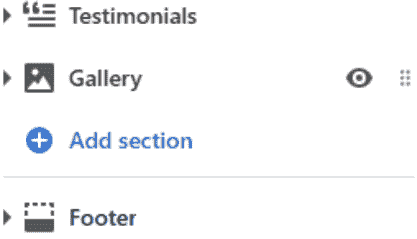

*Figure 7.2 – Example of page sections within the theme editor*

我们可以通过简单地将鼠标悬停在区块本身上来轻松区分静态区块和动态区块。我们会注意到在动态区块名称右侧有两个图标——一个 *eye* 图标和 *六个点*。悬停时会看到眼形图标可让我们切换区块的显示与隐藏。通过点击并按住六个点图标，我们可以通过将其移至其他区块之上或之下来重新定位该区块。

此外，在动态区块底部，我们会看到一个 **Add section** 按钮，点击后会显示一个下拉菜单，我们可以通过简单地点击来包含商店中存在的任意数量的区块。通过 **Add section** 按钮添加到主题的任何区块都允许我们为每次出现包含不同的内容，并且我们可以按需重复此操作任意多次。

直到最近，主页是我们唯一可以使用动态区块的地方。对于所有其他模板，我们必须依赖使用静态区块。然而，自 Shopify Unite 2021 大会以来，Shopify 引入了 JSON 类型模板，我们在 *Chapter 1, Getting Started with Shopify* 中简要提到了它。我们将在本章后面更详细地了解 JSON 模板，JSON 模板为任何页面添加了动态区块，并将商店的整体功能提升到了全新水平。

现在我们已经了解了区块是什么以及如何使用它们，是时候学习如何创建它们了。

## Working with the section schema

在上一章中，我们学习了如何使用 JSON 创建全局设置，其格式与区块文件的 JSON 类似。然而，区块 JSON 有一些明显的不同。

第一个主要区别是我们需要在区块文件内部定义 JSON，而不是在 `settings_schema.json` 文件中。为此，我们需要引入 `schema` 标签：

```

```

`schema` 标签是一个 Liquid 标签，本身没有输出。它只是允许我们在区块文件内编写 JSON 代码。请注意，每个区块文件只能包含一个 `schema` 标签，且必须独立存在。它不能嵌套在任何其他 Liquid 标签内。

一旦 `schema` 标签就位，我们就可以开始熟悉可在 `schema` 标签内使用的属性类型。

### The name attribute

顾名思义，name 属性允许我们设置区块名称，我们稍后将在主题编辑器中使用它来标识该区块：

```

{
  "name": "Announcement bar"
}

```

至此，我们已经学会了如何定义区块文件的名称，但如果我们想创建一个国际化商店，能够轻松翻译不仅商店内容，还包括主题编辑器内的商店设置标签，该怎么办？

我们可以通过在 name 属性值中包含翻译键来轻松翻译 `schema` 标签内的大多数属性：

```

{
  "name": {
    "cs": "Panel oznámení",
    "da": "Meddelel seslinje",
    "de": "Ankündigungsbereich",
    "en": "Announcement bar"
  }
}

```

第一个值代表 Locales 目录中文件的名称，而第二个值代表翻译后的值。通过引入翻译键，我们确保一旦更改商店语言，name 值将自动调整并呈现当前所选语言文件的值。

请注意，我们可以为不同类型的属性包含翻译键，包括我们在上一章中学习的一些输入设置。我们可以使用翻译键的属性包括 name、info、label、group、placeholder、unit、content 和 category。

请注意 name 是必填属性。然而，name 属性不必与其他区块相比是唯一的，因此在创建新区块时应注意避免混淆。

### The class attribute

class 是一个简单的属性，允许我们在包裹区块内容的 div 元素上添加额外的类：

```

{
  "name": {
    "cs": "Panel oznámení",
    "da": "Meddelelseslinje",
    "de": "Ankündigungsbereich",
    "en": "Announcement bar"
  },
  "class": "homepage-section desktop-only"
}

```

通过此可选属性，我们可以轻松地在包裹我们区块的父元素中包含任意数量的类，如以下代码块所示：

```
<div id="shopify-section-[id]" class="homepage-section desktop-only">
</div>
```

请注意，虽然我们可以包含任意数量的类，但我们无法动态修改它们，因为 class 属性只接受字符串值。

### The settings attribute

使用 settings 属性，我们可以创建区块特定的设置，从而允许我们使用主题编辑器配置该区块：

```

{
  "name": {
    "cs": "Panel oznámení",
    "da": "Meddelelseslinje",
    "de": "Ankündigungsbereich",
    "en": "Announcement bar"
  },
```

```
```text
"class": "homepage-section desktop-only",
"settings": [
]
}

```
```

一旦我们定义了 settings 属性，我们就可以开始包含任何输入设置，无论是基础还是专业的，我们之前学过的内容，以创建我们需要的流程。由于我们正在创建公告栏，我们可以包含以下输入：

```
```liquid

{
  "name": {
    "cs": "Panel oznámení",
    "da": "Meddelelseslinje",
    "de": "Ankündigungsbereich",
    "en": "Announcement bar"
  },
  "class": "homepage-section desktop-only",
  "settings": [
    {
      "type": "text",
      "id": "announcement-text",
      "label": "Text"
    },
    {
      "type": "color",
      "id": "announcement-text-color",
      "label": "Text color",
      "default": "#000000"
    }
  ]
}

```
```

通过引入 settings 和输入设置，我们已成功创建了第一个区块，其文本和文本颜色值可以在主题编辑器中进行调整。如果我们尝试将此区块作为静态区块包含，我们之前创建的两个输入设置会立即在相应区块下可见：

```

```

然而，如果我们导航到主页并通过 Add section 按钮包含公告区块，我们将找不到它。我们仍然缺少一个属性，该属性对于创建可以动态添加到主页的区块是必需的。

### The presets attribute

presets 属性允许我们定义区块的默认配置，从而使区块可从 Add section 下拉菜单中访问。presets 属性可以包含以下属性：

- name 属性是强制性的，将定义区块在 Add section 下拉菜单下的显示方式。
- category 属性不是强制性的。我们可以使用它将不同区块分组到单个类别下，以便更轻松地导航。

请注意，建议为 presets 区块使用唯一名称以避免混淆，即使 Shopify 并未严格要求。否则，我们可能会出现多个名称相似的区块：

```

{
  "name": {
    "cs": "Panel oznámení",
    "da": "Meddelel seslinje",
    "de": "Ankündigungsbereich",
    "en": "Announcement bar"
  },
  "class": "homepage-section desktop-only",
  "settings": [
    {
      "type": "text",
      "id": "announcement-text",
      "label": "Text"
```


我们还可以加入一些额外的文本输入选项，以便创建多个公告，但这需要我们在每次需要添加额外公告时手动编辑 JSON 代码。*如果我们想要创建一个部分，可以在不每次都修改 JSON 代码的情况下添加任意数量的公告，该怎么办？* 对于这种情况，我们可以使用 `blocks` 属性。

## 使用 blocks 构建

`blocks` 属性是 Shopify 中最强大的工具之一。通过使用它，我们可以创建可重复使用任意次数的模块，并从主题编辑器中重新排列部分内容。此时，这可能会让人感到困惑，因为它听起来与我们刚刚学到的关于动态部分的内容相似。然而，关键区别在于 `blocks` 部分允许我们在部分内部重新排列内容，而不是部分本身，这使我们能够创建更复杂的功能。

此外，我们可以将 `blocks` 属性与静态部分结合起来，创建一个动态部分功能，其效果类似于我们当前在主页上看到的，然后将其包含在任何页面中。但是，我们将重新排列的是 blocks，而不是部分。

`blocks` 属性允许我们使用对象格式创建不同类型的 blocks，在此格式下，每个对象类型将充当一个独特的模块。在这里，我们可以在这些模块中的每一个下包含不同的输入设置选项。

以下是创建和使用 `blocks` 模块的步骤：

- 1. 让我们学习如何通过引入 `blocks` 属性来修改之前创建的公告栏部分。此外，我们将删除某些功能，例如翻译键和 `class` 属性，以便代码保持简洁易读：

```
{ % schema % }
{
  "name": "Announcement Bar",
  "settings": [
    {
      "type": "text",
      "id": "announcement-text",
      "label": "Text"
    },
```
```
{
    "type": "color",
    "id": "announcement-text-color",
    "label": "Text color",
    "default": "#000000"
}
],
"blocks": [
],
"presets": [
    {
        "name": "Announcement bar",
        "category": "Text"
    }
]
}

```

像创建部分一样，blocks 属性有一组自己的属性，我们需要使用它们来创建不同的模块：

- - name 属性允许我们设置 blocks 模块的名称，并决定该 block 在主题编辑器中如何显示。name 属性是强制性的。
- - type 属性是强制性属性，接受字符串值，我们可以在其中定义 block 类型。请注意，type 属性没有预定义的值集。相反，我们可以使用任何字符串值来定义 block 类型。
- - 使用 limit 属性，我们可以限制特定 block 类型可以重复的次数。limit 属性是可选的，仅接受数字类型值。
- - settings 属性允许我们包含 blocks 模块特定的设置。settings 属性是可选的。

请注意，blocks 模块的 name 和 type 属性需要在部分内保持唯一，而 id 属性需要在 blocks 模块内保持唯一。否则，我们将得到无效的 JSON 代码。

在 blocks 模块内使用文本输入后，我们可以动态重复整个 block 最多三次，从而创建三个单独的公告。

4. 让我们通过导航到主题编辑器并点击 Add section 按钮，在主页上包含公告栏部分来看看这是什么样子的。我们会注意到的第一件事是 Text color 选项，我们将其保留在 section settings 对象内：

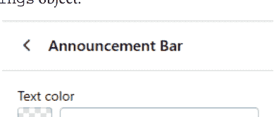

图 7.3 – 主题编辑器中部分的示例

由于我们仅迁移了文本输入，并将文本颜色输入保留在 section settings 对象内，因此我们可以使用它一次为所有 blocks 设置文本颜色。让我们点击公告栏标题左侧的箭头返回到上一个部分，看看我们的 blocks 模块的实际效果。

我们会注意到，除了 Add section 按钮外，我们还在创建的公告栏部分下还有一个 Add Announcement 按钮：

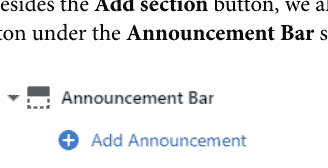

图 7.4 – 部分 block 模块的示例

5. 点击 Announcement Bar 将把我们带回上一页，在那里我们可以配置 section settings 对象中的设置，而点击 Add Announcement 按钮将自动包含一个 blocks 模块并立即将我们定位到该 block 中。在这里，我们可以定义公告文本输入。

- 6. 在定义 `blocks` 模块对象设置中的所有输入后，我们可以点击 **Announcement** 标题左侧的箭头返回到上一页，在那里我们可以包含额外的 `blocks` 模块。但是，请注意，由于我们引入了值为 3 的 `limit` 属性，因此我们只能重复 **Announcement** block 最多 3 次，如下所示：

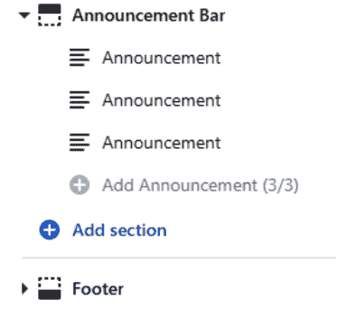

图 7.5 – 部分 block 模块数量有限的示例

一旦我们按照定义的值包含了最大数量的模块，**Add Announcement** 按钮将变灰，表明我们已达到 `blocks` 模块的最大数量。同样，与动态部分一样，将鼠标悬停在 `blocks` 模块上会显示两个图标。这些图标允许我们隐藏当前选定的 block 或使用拖放功能重新排列 block 的顺序。

现在我们已经学会了如何创建和使用 blocks 模块，我们需要学习如何输出 blocks 模块输入设置的 values：

- 1. 我们可以像访问 `section` 对象一样访问 `blocks` 模块的对象设置：我们需要使用 `section` 对象结合 `blocks` 属性。此 `section` 对象与 `blocks` 属性的组合将返回一个 sections blocks 数组，我们可以使用简单的 for 循环访问它：

```


```

- 2. 一旦我们创建了 `for` 循环，剩下的唯一要做的就是输出每个 block 的值，就像我们对 sections 所做的那样。唯一的区别是，这次我们将使用在 `for` 循环中定义的变量，而不是使用 `sections` 关键字：

```
```liquid

  {{ block.settings.announcement-text }}

```
```

到目前为止，我们已经学习了如何创建整个 section schema，通过它我们可以创建静态和动态部分并构建 blocks 模块。我们还学习了如何输出 `sections` 和 `blocks` 模块输入设置的 values。然而，在之前的示例中，我们只有一个类型的 block；*如果我们有多个 block 类型怎么办？*

section blocks 的真正强大之处在于，我们可以在单个 section 元素内创建多个 blocks 模块类型，我们可以通过简单地创建具有不同 type 值的多个 section blocks 对象来实现：

```
```json
"blocks": [
  {
    "name": "Product",
    "type": "product",
    "settings": [
      {
        "type": "product",
        "id": "featured-product",
        "label": "Product"
      }
    ]
  },
  {
    "name": "Collection",
    "type": "collection",
    "settings": [
      {
        "type": "collection",
        "id": "featured-collection",
        "label": "collection"
```
```
}
]
}
]
```

请注意，所有 name 和 type 属性值需要在整个 section 中保持唯一，而输入设置的 id 属性仅需要在单个 block 内保持唯一。

正如我们所见，创建多个 blocks 模块元素相对简单。虽然我们在示例中仅创建了两个简单的 blocks 模块，但我们可以创建任意数量的 blocks 模块，并通过主题编辑器重新排列它们以创建复杂的布局：

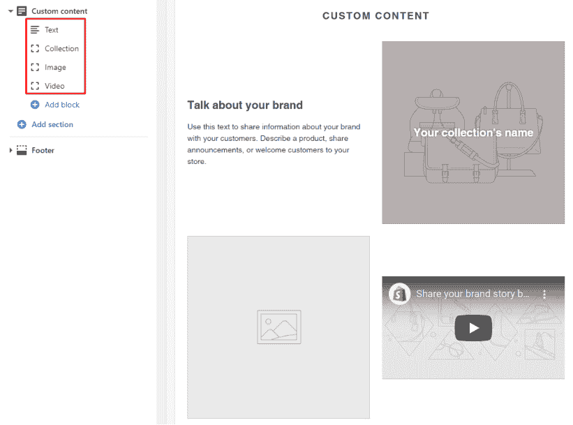

图 7.6 – 部分内多个 blocks 模块的示例

正如我们从示例中看到的，我们有四种不同类型的 blocks（**Text、Collection、Image 和 Video**），我们可以使用它们来创建商店所有者可以轻松配置的布局，而无需自行修改代码。


之前，我们学习了如何使用 for 标签遍历 section.blocks 返回的区块数组。然而，如果我们有多种 blocks 模块类型，就需要引入额外的步骤。

假设像前面的示例一样，我们有一个包含四种类型区块的 section。我们如何识别区块类型，并知道应该为哪个区块输出哪种布局？为了解决这个问题，我们可以使用 block 对象配合 type 属性，这样我们就能取回区块类型的值。

有关 block 对象的更多信息，请参阅 https://shopify.dev/api/liquid/objects/block。

一旦我们识别出每种区块类型，就可以使用 if 语句或 case/when 控制流标签为相应的值执行正确的代码。假设我们需要回顾如何使用 if 语句或 case/when 控制标签；我们可以回到第 3 章“使用标签深入探索 Liquid 代码”，并查阅“控制 Liquid 流程”一节，在那里我们概述了使用控制流标签的过程：

```liquid

  
    
      
    
      
    
      
  

```

在上面的示例中，我们结合使用 case/when 控制流标签和 block.type 来识别当前循环遍历的区块类型。识别出区块类型后，我们渲染了包含对应区块正确布局的片段文件。

请注意，我们将 block 对象传递给了每个片段文件。你可能还记得，片段文件是唯一能够访问父目录中定义的变量的文件类型。然而，即使是片段文件也不能自动访问这些变量。相反，我们需要将值作为参数传递。

假设我们需要回顾如何将值传递给片段文件；我们可以回到*第 3 章，使用标签深入探索 Liquid 代码*，并参阅*主题标签*部分下的*渲染标签*一节，在那里我们概述了使用片段文件的过程。

除了学习如何创建 `blocks` 模块外，我们还了解了 `limit` 属性，我们可以用它来限制某个特定类型的 `blocks` 模块可以重复多少次。当我们只有一种类型的区块时，这种方法效果很好。*但是，如果我们想要创建一个限制，使一个 section 内任意组合的区块数量达到最大值，该怎么办？*

### max_blocks 属性

`max_blocks` 属性与 `limit` 属性类似，允许我们限制在一个 section 内可以创建多少个 `blocks` 模块。但它们有一个显著的区别：`limit` 属性只允许我们限制特定区块类型的重复次数，而 `max_blocks` 属性允许我们将特定 section 中任意类型的区块数量限制为最大值。

请注意，max_blocks 属性是可选的，并且只接受数字数据作为其值：

```liquid

{
  "name": "Footer",
  "max_blocks": 5,
  "settings": [
  ],
  "blocks": [
  ]
}

```

max_blocks 属性最常见的用途是在页脚 section 中。有了它，店主可以轻松地以任何顺序重新排列区块，无论是重复使用同一个区块五次，还是使用五个不同的区块，同时确保整个 section 的布局保持合理的流程。

之前，我们学习了如何创建 `blocks` 模块，以及如何识别不同类型的区块类型并相应地访问每个区块对象。现在，我们已经学习了如何使用 `max_blocks` 来限制 section 内产品的数量，我们已经具备了构建任何类型的 `blocks` 模块所需的所有知识。

正如我们所见，blocks 非常强大，使我们能够创建从基本文本功能到复杂布局功能的任何内容，并与不同类型的区块交织在一起，店主可以用这些区块来讲述其产品的故事。

至此，我们了解了静态 section（可以手动嵌入任何页面）和动态 section（允许我们动态地向主页添加任意数量的 section）之间的区别。然而，正如我们在本章开头提到的，Shopify 最近为我们提供了一种通过 JSON 模板在任何页面上动态包含 section 的方式。通过使用 JSON 模板，我们可以将静态和动态 section 组合成一个新功能，并可以在主题编辑器中控制它。

## 使用 JSON 模板增强页面

在*第 1 章，Shopify 入门*中，讨论主题结构时，我们简单提到过 JSON 模板，*但它们到底是什么？*

`.json` 类型模板通常与其对应的 `.liquid` 模板具有相同的目的，因为它们都允许我们通过一个模板来创建和管理多个页面的外观。然而，两者之间的显著区别在于，`.liquid` 类型模板仅作为标记文件，而 `.json` 文件则作为数据类型文件，使我们可以轻松地在任何页面上添加、删除或重新排列 section，类似于我们在主页上可以做的操作。

`.json` 类型模板与 `Section` 目录文件也有相似之处，我们需要在 section 文件中包含有效的 schema 设置。`.json` 类型模板需要是有效的 `.json` 文件，JSON 代码定义在模板内部。虽然我们可以创建任意数量的 `.json` 类型文件，但模板文件名在 `.liquid` 或 `.json` 文件中必须是唯一的。例如，如果我们创建了一个 product `.json` 文件模板，就不能再创建 product `.liquid` 文件。

此外，JSON 文件有一个限制。每个模板最多可以渲染 20 个 section，每个 section 最多可以有 16 个区块，这是一个相当高的数字，但如果我们达到了这个限制，可能应该重新考虑页面布局。

既然我们已经对 JSON 类型模板是什么以及它们如何工作有了大致的了解，接下来让我们学习如何创建第一个 JSON 类型文件。

### 构建 JSON 模板结构

我们不会简单地列出创建文件所需的属性，而是通过将当前的 `product.liquid` 类型模板迁移到 JSON 模板来学习如何创建 JSON 模板。

让我们首先打开 Templates 目录，点击**添加新模板**按钮，创建一个 JSON 类型模板。此时会出现一个弹出窗口，我们可以选择要为哪个页面创建模板名称、模板类型和文件名。就我们的目的而言，我们将从页面选择下拉菜单中选择**产品**页面，并为**模板类型**选择 **JSON** 单选按钮。至于**文件名**，我们可以保留默认值，即 `alternate`：

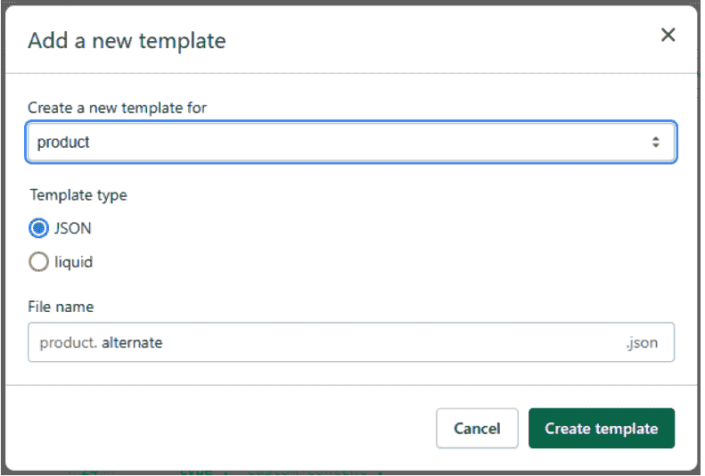

图 7.7 – 创建新 JSON 类型模板的示例

创建新的 JSON 文件后，Shopify 会自动将我们重定向到新创建的文件。我们将看到一个几乎为空的文件，只包含两个属性。那么，让我们开始创建必要的属性并开始我们的迁移过程。

如前所述，JSON 模板必须是有效的 JSON 文件，其根是一个对象，该对象可以包含以下一些属性：

- `name` 属性是必需的字符串类型属性，顾名思义，我们可以用它来定义模板的名称：

```json
{
  "name": "JSON product template"
}
```

- `layout` 属性是一个可选属性，根据我们要实现的目标，它接受两种类型的值：字符串或 false。字符串值应表示布局文件的名称，不带我们想要用于此特定模板的 `.liquid` 扩展名。如果你需要了解更多关于布局文件的信息，请重新阅读*第 3 章，使用标签深入探索 Liquid 核心*，我们在*主题标签*部分学习了布局标签。请注意，如果我们不包含 `layout` 属性，Shopify 将默认使用 `theme.liquid` 布局。但是，出于学习目的，我们将手动添加并选择主题布局：

```json
{
  "name": "JSON product template",
  "layout": "theme"
}
```

- `wrapper` 属性是一个字符串类型属性，允许我们选择要在模板中每个 section 周围包含的 HTML 包装器的类型。我们可以在这里使用以下 HTML 标签：

  - `div`
  - `main`
  - `section`

请注意，除了选择 HTML 包装器的类型外，我们还可以包含任何可能需要的附加属性，例如 `class`、`id` 或 `data`。请注意，wrapper 属性完全是可选的：

```json
{
  "name": "JSON product template",
  "layout": "theme",
  "wrapper": "div.product-wrapper[data-type=product]"
}
```


+   - sections 属性是一个必需的对象类型属性，它使用各分区的名称作为键，分区数据作为值。在 sections 对象中，我们可以定义希望在页面中包含哪些分区：

```
```json
{
  "name": "JSON product template",
  "layout": "theme",
  "wrapper": "div.product-wrapper[data-type=product]",
  "sections": {
  }
}
```
```

我们可能会好奇，为什么需要手动选择要包含哪些分区，因为动态分区的全部意义就在于避免这种操作。

sections 对象允许我们包含一个必需的静态分区，类似于我们的主页内容，但它更针对具体页面。首先，我们需要为想要包含的每个静态分区设置一个唯一 ID：

```
```json
{
  "name": "JSON product template",
  "layout": "theme",
  "wrapper": "div.product-wrapper[data-type=product]",
  "sections": {
    "main-block": {
    },
    "different-block": {
    }
  }
}
```
```

考虑到 sections 属性与我们之前学习的 section 属性使用相同的格式，我们还需要在 sections 对象中包含一些附加属性。例如，我们需要包含 type 属性，其值应为我们要包含的分区名称；如有需要，还应包含 settings 或 blocks 属性：

```
```json
{
  "name": "JSON product template",
  "layout": "theme",
  "wrapper": "div.product-wrapper[data-type=product]",
```
```

```
"sections": {
    "main-block": {
        "type": "name-of-the-section",
    },
    "different-block": {
        "type": "name-of-another-section"
    }
}
```

但是请注意，settings 或 blocks 属性不应包含输入类型设置。相反，我们应该将键值设为每个分区内现有输入的 ID，同时将该设置输入的值设为我们想要设定的值：

```
{
    "name": "JSON product template",
    "layout": "theme",
    "wrapper": "div.product-wrapper[data-type=product]",
    "sections": {
        "main-block": {
            "type": "name-of-the-section",
            "settings": {
                "show_discount": true,
                "gallery_type": "slider"
            },
            "blocks": {
            }
        },
        "different-block": {
            "type": "name-of-another-section"
        }
    }
}
```

现在，让我们更新前面的示例，加入我们当前在默认 Liquid 类型产品模板中使用的实际静态分区：

```
{
  "name": "JSON product template",
  "layout": "theme",
  "wrapper": "div.product-wrapper[data-type=product]",
  "sections": {
    "main": {
      "type": "product-template"
    },
    "recommendations": {
      "type": "product-recommendations"
    }
  }
}
```

请注意，我们使用的分区名称（main 和 recommendations）并不是预设值，我们可以将它们改为任意想要的名称。

在处理 sections 对象时，我们需要记住三个关键要点：

+   - 在 sections 对象中至少需要一个块集合。
+   - 整个 sections 对象中的所有块名称必须唯一。
+   - type 属性的值需要与我们要包含的分区名称相匹配。

通过在我们的新 JSON 模板中包含 main 和 recommendations 这两个分区，我们确保了在预览指定了特定 JSON 类型模板的页面时，这两个分区在主题编辑器中始终可见。不过，虽然这些分区被视为静态分区，但我们仍可以像动态分区一样隐藏并重新排列它们。

最后一个属性是 order 属性，它是一个必需属性。order 属性是数组类型的属性。在这里，我们可以包含之前在 sections 对象中设置的分区块 ID，并对它们进行排列：

```
{
  "name": "JSON product template",
  "layout": "theme",
  "wrapper": "div.product-wrapper[data-type=product]",
  "sections": {
    "main": {
      "type": "product-template"
    },
    "recommendations": {
      "type": "product-recommendations"
    }
  },
  "order": [
    "main",
    "recommendations"
  ]
}
```

有了 order 属性，我们的 JSON 模板就准备好了！让我们前往主题编辑器测试一下。

要测试新的产品模板，请按照以下步骤操作：

+   1. 从管理后台导航到 **产品**。
+   2. 点击任意产品，然后从 **模板后缀** 下拉菜单中选择新的模板名称，该下拉菜单位于 **主题模板** 区域下方。

> **重要提示：**
> **模板后缀** 下拉菜单只能读取当前在线主题中的值。这意味着，新建的模板文件在管理后台中不可见，除非我们将其发布或复制到线上，或者我们在当前在线主题中创建相同的模板文件。如果选择后者，请注意我们需要创建同名文件；不需要对文件内容做任何更改。

然而，使用这种新类型的模板，我们也有了一种预览模板的新方法。请注意，以下方法只允许我们预览模板。我们仍然需要通过导航到管理后台的产品页面并从下拉菜单中选择模板来分配模板：

+   1. 首先，进入主题编辑器，点击屏幕中间的下拉菜单，然后选择 **产品** 选项。这会显示我们当前正在处理的主题下已有的模板。让我们点击选择我们创建的新 JSON 类型模板：

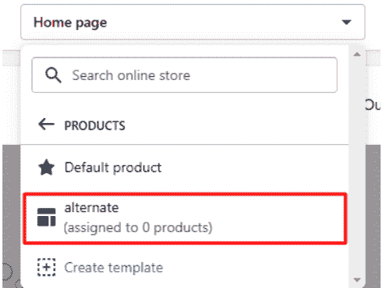

图 7.8 – 通过主题编辑器选择模板的示例

+   2. 点击 **备选** 模板将自动重定向到一个随机产品，以便我们预览所选模板。

> **重要提示：**
> 与主页上的动态分区类似，只有 sections schema 中存在预设属性的分区才会在 **添加分区** 下拉菜单中可见。

如果一切操作正确，我们应该会在左侧边栏中看到两个分区和 **添加分区** 按钮：

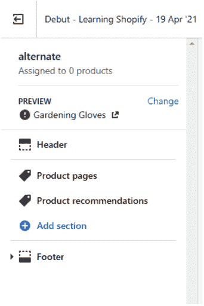

*图 7.9 – 在主题编辑器中预览 JSON 类型模板的示例*

+   3. 现在，尝试点击两个分区中的任意一个，更新任意设置，或通过 **添加分区** 按钮添加新分区，然后点击右上角的 **保存** 按钮。接下来，返回代码编辑器，点击我们创建的新 `.json` 类型模板名称旁边的 **X** 将其关闭，然后重新打开它。

我们会注意到 **Shopify** 已经更新了模板文件，现在它包含了所有设置及其值。

由于我们可以在模板文件中找到所有设置及其值，因此如果将 JSON 模板文件分配给多个产品，它们将使用具有相同设置的布局。如果我们想创建另一个 JSON 模板来创建不同的布局，我们可以手动创建一个新的 JSON 模板并复制代码，或者通过主题编辑器完成此操作。

3. 考虑到我们当前没有设置任何元字段，我们可以直接点击 **添加定义** 按钮。这将把我们重定向到一个可以创建元字段定义的页面。虽然你在*第 4 章，与对象一起深入 Liquid 核心*中学习元字段时，大多数字段应该已经很熟悉，但我们现在有一个新字段。让我们点击 **选择内容类型** 字段，它会显示一个下拉菜单，其中包含我们可以创建的所有可用元字段类型：

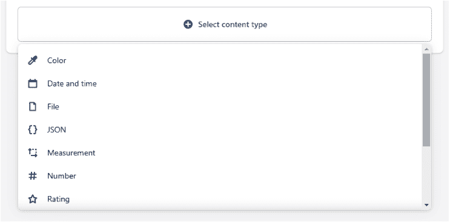

图 7.11 – 可用元字段类型字段的示例

请注意，每种元字段类型都会在我们的产品页面后台中创建一个选择器。我们可以选择文本输入，它会自动显示一组额外的设置。不过，我们现在不会更改这些设置。

4. 选择文本类型的元字段后，我们只需要设置其名称。出于我们的目的，我们将通过点击 **名称** 字段并选择 **产品副标题**，来选择一个预定义的元字段值，这将自动填充所有其他字段。请注意，我们需要点击 **保存** 按钮来保存新创建的元字段：

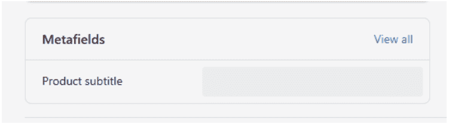

图 7.12 – 产品后台中的元字段示例


5. 既然我们已经创建了一个产品元字段，接下来点击管理后台左上角的**产品**链接，然后选择任意一个产品。如果我们滚动到页面底部，就会注意到我们创建的元字段现在已经出现在产品页面中。

6. 正如我们所看到的，只需创建一个产品元字段定义，系统就会自动将相同的元字段添加到每个产品中，从而让我们比使用第三方应用时更容易更新元字段的值。接下来，我们添加任意字符串值并点击**保存**按钮，来更新元字段的值。

7. 现在，返回主题编辑器，导航到 JSON 模板，并在可用的分区中找到任意文本输入类型。为了方便演示，我们添加了一个名为 `Image with text` 的新分区。

8. 查看该分区时，我们会注意到特定类型的字段旁边出现了新图标：

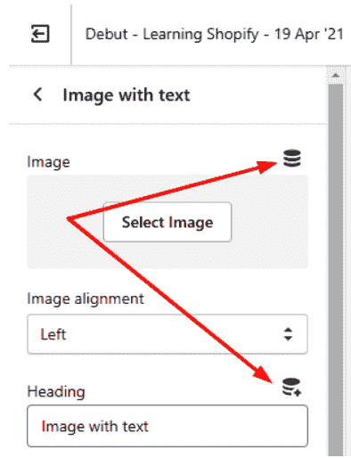

图 7.13 – 主题编辑器中元字段图标的示例

点击**标题**文本输入旁边的底部图标，系统会立即显示一个列表，列出我们可以从该特定产品中提取的所有元字段。

9. 选择我们之前选中的 Product subtitle 元字段，然后点击“插入”按钮。这将自动添加所选元字段的值，并将其输出到我们选择的输入字段中：

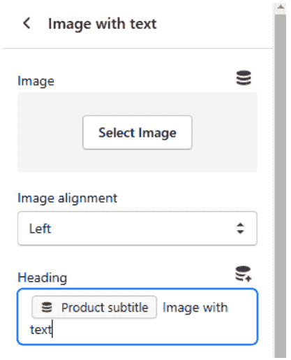

图 7.14 – 主题编辑器中元字段图标的示例

至此，我们学会了如何使用元字段动态更新分区设置的值，而无需为每个产品创建新的 JSON 模板。我们现在唯一要做的事情就是通过在 JSON 模板中排列必要的分区来创建合适的布局。

请注意，使用元字段可以更新各种类型的输入，例如图片、URL，甚至色板。但是，我们应该创建合适的元字段，以确保元字段的值与输入类型的值相匹配。

正如我们之前所见，仅使用分区本身就非常强大。将分区与 JSON 模板和元字段结合起来，会让它们更加强大。这样商家就可以轻松地单独配置每个页面，而无需为每个页面创建新模板或手动插入分区。

除了目前学到的内容之外，我们还知道 Shopify 还为我们提供了一些额外的分区专用标签，可以用来创建更强大的元素。

## 探索分区专用标签

虽然我们可以轻松地在主题对应的资源文件中定义样式或嵌入 JavaScript 代码，但 Shopify 还为我们提供了三种标签，可以让我们直接在分区文件中包含 CSS 和 JavaScript。

### stylesheet 标签

与 schema 标签类似，stylesheet 标签是一种 Liquid 标签，本身不会产生任何输出。它只是允许我们在分区文件中编写 CSS 代码。请注意，每个分区文件只能包含一个 stylesheet 标签，并且该标签必须独立存在，不能嵌套在其他任何类型的 Liquid 标签中：

```

```

```

```

虽然一开始这可能看起来不是一个好主意，因为 CSS 代码最终会分散在多个文件中，但 Shopify 会自动收集不同分区文件中的所有 CSS 文件，将它们合并为一个样式表文件，并通过 `content_for_header` 全局对象注入到主题文件中。

> **重要说明：**
> stylesheet 标签只接受 CSS 值。我们不能在标签内包含 Liquid 代码。

请注意，打包的资源并不是分区或块专用的。对于分区和块专用的样式表，我们需要使用 style 标签。

### style 标签

style 标签的工作方式与 stylesheet 标签类似，它允许我们直接将 CSS 代码写入分区文件。但是，与 stylesheet 标签相比，style 标签有两个显著的区别：

- 第一个区别是，style 标签等同于使用 HTML `<style>` 标签，这意味着 Shopify 不会收集和打包我们通过 style 标签包含的 CSS 代码。相反，Shopify 会在我们包含该标签的同一位置渲染 HTML style 标签及其内容：

```

```

```

```

- 第二个也是更重要的区别是，`style` 标签允许我们包含 Liquid 代码，我们可以利用这些代码通过主题编辑器动态修改 CSS 内容：

```

.featured-wrapper {
  background-color: {{ section.settings.background-color }};
}

  
    
      .featured-product {

        font-size: {{ block.settings.product-font-size }} px;
      }
    
      .featured-collection {
        font-size: {{ block.settings.collection-font-size }}px;
      }
  


```

请注意，与定义在 `settings_schema.json` 文件中的输入设置不同，后者的值可以在任何文件中全局访问，而分区和块的输入值只能在分区文件本身内部访问，或者在将值作为参数传递后，在代码片段文件中访问。

在前面的示例中，我们看到了如何输出分区输入值并使用它们来动态修改 CSS 代码。然而，在我们的示例中，我们使用了静态类，这意味着我们应用的 `background-color` CSS 会以同样的方式影响每个分区和块。但是，如果我们想为每个分区或块应用不同的颜色，该怎么办呢？

要为特定元素应用唯一样式，我们需要使用 `section` 或 `block` 对象，并结合 `id` 属性，创建一个以后可以调用的唯一标识符：

```
```liquid
<div class="featured-wrapper featured-wrapper-{{ section.id }}"></div>

  <div class="featured-collection featured-collection-{{ block.id }}"></div>

```
```

请注意，`section.id` 对于动态分区会返回一个动态生成的 ID，而对于静态分区则返回不带 Liquid 扩展名的分区文件名。`block.id` 总是返回一个动态生成的 ID。

现在我们已经生成了唯一的选择器，接下来要做的就是将相同的选择器包含在 `style` 标签中：

```
```liquid

.featured-wrapper-{{ section.id }} {
  background-color: {{ section.settings.background-color }};
}

  
    
      .featured-collection-{{ block.id }} {
        font-size: {{ block.settings.collection-font-size }}px;
      }
  


```
```

既然我们知道了如何生成和调用唯一选择器，就可以轻松地为分区和块元素创建不同的样式。请注意，也可以使用 `style` 属性在 HTML 中包含带有动态值的 CSS。

### javascript 标签

javascript 标签的工作方式与 stylesheet 标签相同。该标签本身不会产生任何输出；它只是允许我们直接在分区文件中编写 JavaScript 代码。我们只能在分区中包含一个 javascript 标签，并且该标签必须独立存在，不能嵌套在其他 Liquid 标签中：

```


```

同样，与 stylesheet 标签一样，javascript 标签只接受 JavaScript 代码。我们不能在标签内包含任何 Liquid 代码。此外，Shopify 会自动打包 javascript 标签内的任何代码，并通过 `content_for_header` 全局对象注入到主题文件中。

由于我们不能在 javascript 标签中使用 Liquid 代码，一种应用特定于分区的 JavaScript 的方法是使用数据属性，这些属性会输出特定的输入值，并稍后用 JavaScript 恢复该值：

```
<div class="rotating-announcement" data-speed="{{ section.settings.speed }}"></div>


var rotationSpeed = parseInt(document.querySelector('.rotating-announcement').dataset.speed);

```

考虑到打包的资源并不是分区或块专用的，如果我们需要创建一些分区或块专用的 JavaScript 代码，就需要使用 HTML `<script>` 标签。请注意，目前 Shopify 没有接受 Liquid 代码的 Liquid 标签。

使用 HTML `<script>` 标签，我们现在可以编写分区和块专用的 JavaScript，并直接包含输入设置值。但是请注意，在 JavaScript 中直接包含输入设置值时，应该使用空白控制来确保不包含多余的空白：

```
{{- section.settings.speed -}}
```

如果你需要回忆如何使用空白控制，请重新查看第 2 章“Liquid 的基本流程”，并参阅“控制空白”一节，我们在其中概述了控制空白的过程。


## 摘要

在本章中，我们学习了如何将之前掌握的基础输入和专用输入知识，与分区（section）模式结合起来。这使我们能够创建从简单到复杂的各种布局，并且可以轻松地在主题编辑器中配置这些布局。

通过学习静态分区和动态分区之间的区别，我们了解了如何扩展分区的功能，并使其在任何类型的页面上都能使用。此外，除了学习如何创建不同类型的分区，我们还掌握了如何创建不同类型的`blocks`模块，这将允许我们重新排列单个分区的布局，使其易于配置。

最后，我们学习了可以用于进一步开发分区内容的不同类型的分区专用标签，以及如何为特定分区甚至`blocks`模块打造独特体验。

在下一章中，我们将了解什么是 Shopify Ajax，以及如何利用它来实现高级功能，让商店更具动态性。

## 问题

- 1. 静态分区和动态分区的主要区别是什么？
- 2. 我们可以使用哪个对象来访问块输入值？编写一些代码，使我们能够访问特定的`blocks`模块输入值。
- 3. `limit`和`max_blocks`属性之间有什么区别？
- 4. 我们如何应用特定于分区的 CSS 样式？

## 熟能生巧

与前几章的项目一样，本章项目将包含我们需要完成的内容的详细信息，以及帮助您达成目标的相应说明。

我们建议您独立完成每个项目，而不是依赖前几章的项目，因为这样能确保您真正理解了目前所学的内容。

每个项目都没有绝对正确或错误的解决方案。不过，万一您遇到困难，随时可以参考本书末尾提供的项目解决方案。

## 项目 4

在我们的第四个项目中，我们将创建一个包含多种块类型的分区模式。虽然我们可以包含任意数量的块类型，但应确保包含以下类型：

- 文本类型：渲染一个富文本输入框
- 产品类型：渲染一个包含产品名称、价格、图片和链接的单一产品元素
- 列表类型：渲染一个可在“导航”管理区域配置的一级导航列表
- 视频类型：渲染来自 YouTube 或 Vimeo 视频平台的视频

以下是关于资源文件的说明：

- 1. 创建一个名为`featured-content.liquid`的新分区文件。
- 2. 为每个分区创建一个单独的代码片段文件，同时将适当的对象传递给每个代码片段。

以下是本作业的说明：

- 1. 包含动态分区所需的全部必要属性。
- 2. 按照上述规格创建四个块模块。
- 3. 将视频块类型限制为最多重复两次，而所有其他块应限制为仅出现一次。
- 4. 任意时刻的块总数不应超过四个。
- 5. 我们应该使用预定义的下拉值单独配置每个块的宽度，并通过类将所选宽度应用到每个块，而不是直接应用值。宽度值为 100%、50%、33.33% 和 25%。
- 6. 仅将分区或块专用的 CSS 包含在分区文件中。所有其他 CSS 样式应包含在主题相应的 CSS 文件中。
- 7. 在每个代码片段文件的分区块设置中定义以下输入设置：`font-size`、`font-family`、文本颜色和背景颜色。我们应该能够从 Shopify 字体库中选择字体族。
- 8. 在分区内创建一个文本输入元素，用于定义整个分区的 H1 标题。如果输入字段为空，我们应该隐藏 h1 HTML 元素。
- 9. 将整个项目迁移到`.json`页面类型模板中。

# 8
