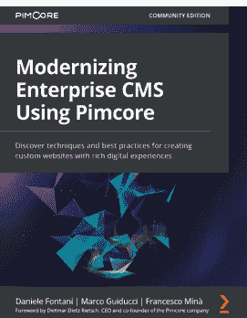

# 附录：常见问题解答

多年来在帮助开发者适应 Liquid 的过程中，出现了一些特定的情况和问题，其答案并不那么容易找到。现在，我们将列出最常见的情况，并提供一些建议，帮助你提升对 Shopify 和 Liquid 的理解，让你的工作更加轻松：

## 1. 是否可以在代码编辑器中找到特定代码的位置，而无需手动搜索每个模板、分区或代码片段？

开发者在开始使用 **Shopify** 时遇到的最大问题之一是，他们很难在不同模板、分区和代码片段中找到特定的代码段。虽然过一段时间后，我们确实会习惯更高效地查找内容，但一开始时可能会相当麻烦。

为了帮助我们解决这个问题，我们可以使用一个名为 **Shopify Theme Search by Bold** 的实用 **Chrome** 小插件。这个小插件在代码编辑器中提供了一个搜索输入框，可以输入我们想要查找的任何字符串。几秒钟后，它会高亮显示包含所搜索字符串的每个目录和文件。你可以通过 https://chrome.google.com/webstore/detail/shopify-theme-search-by-b/epbnmkionkpliaiogpemfkclmcndbfle 了解更多信息。

## 2. 无论我们创建多少个新的重复主题，出于某种原因，重复主题都没有保存之前的任何自定义设置。这种情况下我们该怎么办？

第二大常见问题出现在主题复制过程中。创建主题副本后，我们可能会注意到副本主题已被完全重置。它不包含我们之前在主题编辑器中设置的任何自定义内容。

问题出在 `settings_data.json` 文件中，如果我们打开它，会发现它是空的，在某些情况下，该文件甚至可能完全缺失。出现这种情况的原因很明显——Shopify 没有正确复制文件内容——但问题是*为什么？* 如果我们导航到最初创建副本的主题，打开 `settings_data.json` 文件，并尝试将其内容复制到新的重复主题中，我们会因为 JSON 文件中的错误而无法保存文件。如果我们尝试将复制的内容保存到新文件中，Shopify 将不允许这样做，而是会为我们提供一个包含问题值的错误代码。

要解决此问题，我们需要手动搜索错误中收到的每个值并进行相应更新。可能的问题包括：我们完全删除了某个特定分区块，却没有先从主题编辑器中移除该块。Shopify 会继续尝试加载该块。然而，由于我们已经将其删除，它无法加载，从而破坏了 JSON 文件。第二个常见问题出现在使用 `range` 输入类型时，输入的当前值超出了最小值和最大值之间的范围。只有解决了所有这些问题，我们才能正确保存文件。

## 3. 是否有可能恢复已删除的主题？

每个商店允许我们保留最多 20 个重复主题作为备份，而 **Shopify Plus** 套餐最多可保留 50 个重复主题。如果我们出于任何原因删除了主题文件，并且没有在 GitHub 或本地某处保存备份文件，该文件将永久丢失，我们无法以任何方式恢复它。

## 4. 我们如何知道某个商店正在使用哪个应用？

虽然不可能看到商店使用的每种类型的应用，但我们可以通过 **Shopify App Detector by Fera.ai** 或 **Koala Inspector - Inspect Shopify Shops** 的 Chrome 插件来获取大多数应用的名称。你可以通过以下链接找到关于 Shopify App Detector by Fera.ai 的更多信息： https://chrome.google.com/webstore/detail/shopify-app-detector-by-f/lhfdhjladfcmghahdbcmlceajdlbkale。

你可以通过以下链接找到关于 Koala Inspector - Inspect Shopify Shops 的更多信息： https://chrome.google.com/webstore/detail/koala-inspector-inspect-s/hjbfbllnfhppnhjdhhbmjabikmkfekgf。

## 5. 我们如何轻松识别导致商店变慢的 Liquid 代码？

为了帮助我们解决这个问题，Shopify 推出了一个名为 Shopify Theme Inspector for Chrome 的插件，我们可以使用它获取详细的渲染分析，帮助我们缩小导致最严重延迟的文件范围。你可以通过以下链接找到关于 Shopify Theme Inspector for Chrome 的更多信息： https://chrome.google.com/webstore/detail/shopify-theme-inspector-f/fndnankcflemoafdeboeboephmiijkgp。

## 6. 当我们尝试使用 Shopify 合作伙伴平台向客户发送协作者账户请求时，出于某种原因，我们一直收到提示说商店 URL 与商店不关联。我们该如何解决？

原因在于，大多数情况下，商店所有者设置了自定义域名，其 URL 与我们发送协作者账户请求所需的 myshopify.com URL 有很大不同，因此将 .com 替换为 .myshopify.com 并不能解决问题。我们可以通过导航到他们提供的 URL，打开检查器并在控制台中输入 Shopify 来轻松解决此问题，这会提示一组关于商店的各种信息。其中，我们会找到正确的 myshopify.com URL。请注意，Shopify 关键字区分大小写。

## 7. Shopify 代码编辑器有深色模式吗？

答案是有的！但它相当隐蔽。要显示它，请导航到代码编辑器，点击按钮展开编辑器屏幕。我们可以在编辑器屏幕的右上角找到它。展开编辑器屏幕后，我们会注意到右侧现在有两个滚动条。如果我们向下滚动到页面底部，会发现白色和黑色按钮，允许我们更改编辑器的颜色模式。但请注意，当我们关闭展开的编辑器视图时，编辑器将恢复为其默认颜色。

## 8. 有没有办法自动格式化 Liquid 文件中的代码？

答案是有的！我们可以使用 Ctrl + A 选中代码编辑器中的整个 Liquid 文件，然后按 Shift + Tab，即可自动格式化整个文件。然而，虽然自动格式化对大多数文件有帮助，但请注意，自动格式化对分区 schema 标签及其内容无效。

Packt.com

订阅我们的在线数字图书馆，即可访问超过 7,000 本图书和视频，以及行业领先的工具，帮助你规划个人发展并推进职业生涯。欲了解更多信息，请访问我们的网站。

# 为什么订阅？

- 利用来自 4,000 多位行业专业人士的实用电子书和视频，减少学习时间，增加编码时间
- 通过专为你设计的技能计划提升学习效果
- 每月免费获得一本电子书或视频
- 完全可搜索，便于快速访问重要信息
- 可复制、粘贴、打印和收藏内容

你知道吗，Packt 提供所有已出版图书的电子书版本，包括 PDF 和 ePub 文件？你可以在 packt.com 升级到电子书版本，作为印刷版图书客户，你有权享受电子书副本的折扣。请通过 customercare@packtpub.com 与我们联系以了解更多详情。

在 www.packt.com，你还可以阅读一系列免费技术文章，注册各种免费通讯，并获得 Packt 图书和电子书的独家折扣和优惠。

# 你可能还喜欢其他图书

如果你喜欢这本书，你可能对 Packt 的以下其他图书感兴趣：

## 使用 HTML5 和 CSS 进行响应式网页设计 - 第三版

Ben Frain

ISBN: 978-1-83921-156-0

- 将 CSS 媒体查询整合到你的设计中；为不同设备应用不同样式
- 根据屏幕尺寸或分辨率加载不同的图像集
- 利用可访问 HTML 模式的速度、语义和干净标记
- 将 SVG 实现到设计中以提供与分辨率无关的图像
- 应用 CSS 的最新功能，如自定义属性、可变字体和 CSS Grid
- 为 HTML 表单添加验证和界面元素，如日期和颜色选择器
- 了解使用滤镜、阴影、动画等方式增强界面元素的多种方法

## 使用 Pimcore 现代化企业 CMS

Daniele Fontani, Marco Guiducci, Francesco Minà

ISBN: 978-1-80107-540-4

- 为你的网页创建、编辑和管理 Pimcore 文档
- 使用数字资产管理（DAM）功能管理 Pimcore 中的 Web 资产
- 了解如何为你的网页创建布局、模板和自定义小部件
- 使用管理员界面（admin UI）管理 Pimcore 网站的第三方插件
- 探索将 Pimcore 用作产品信息管理（PIM）系统的实践
- 探索 Pimcore 的主数据管理（MDM）用于企业 CMS 开发
- 构建可复用的网站组件，并通过有效的技巧和窍门节省时间

# Packt 正在寻找像您这样的作者

如果您有兴趣成为 Packt 的作者，请访问 authors.packtpub.com 并立即申请。我们曾与成千上万的开发者和技术专业人士（就像您一样）合作，帮助他们与全球技术社区分享见解。您可以进行一般性申请、申请我们正在招募作者的特定热门主题，或提交您自己的想法。

# 分享您的想法

现在您已经完成了*使用 Liquid 定制 Shopify 主题*，我们很乐意听取您的想法！如果您从亚马逊购买了这本书，请点击此处直接前往这本书的亚马逊评论页面并分享您的反馈，或者在您购买本书的网站上留下评论。

您的评论对我们和技术社区都很重要，将帮助我们确保提供优质的内容。
