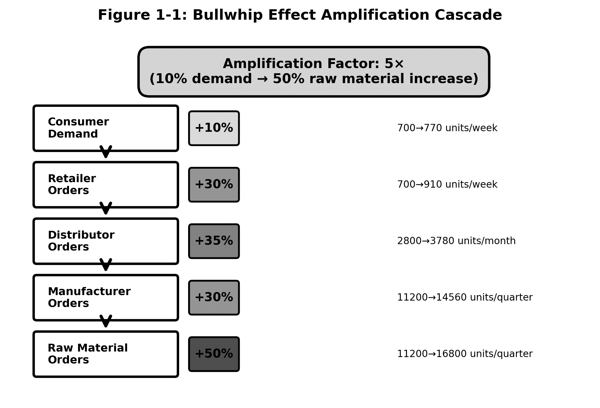
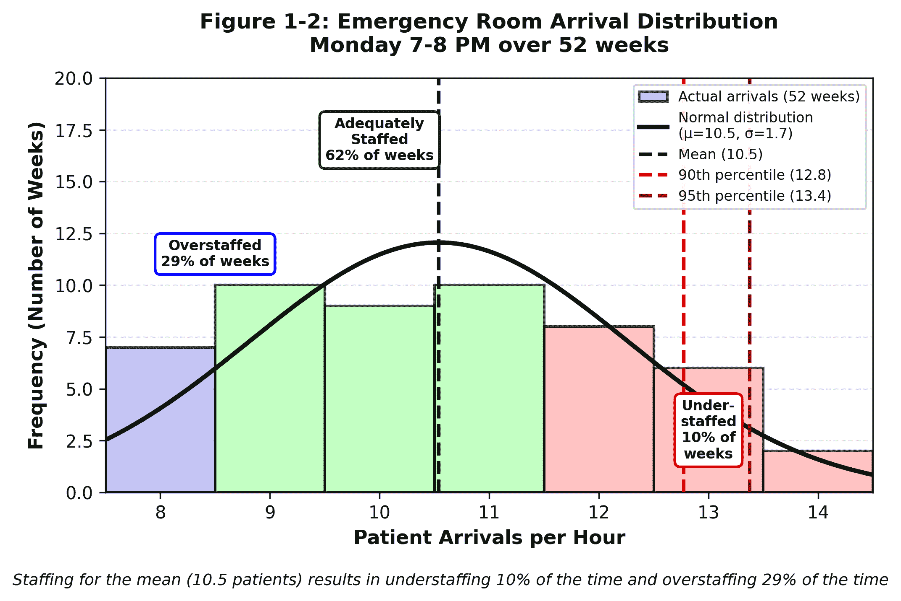
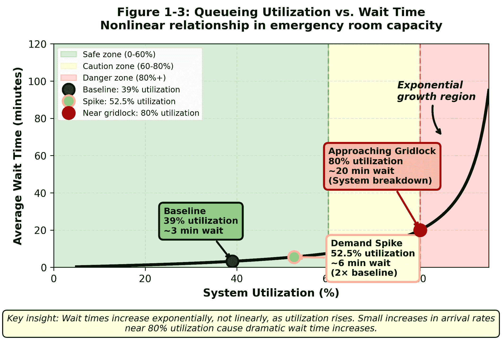
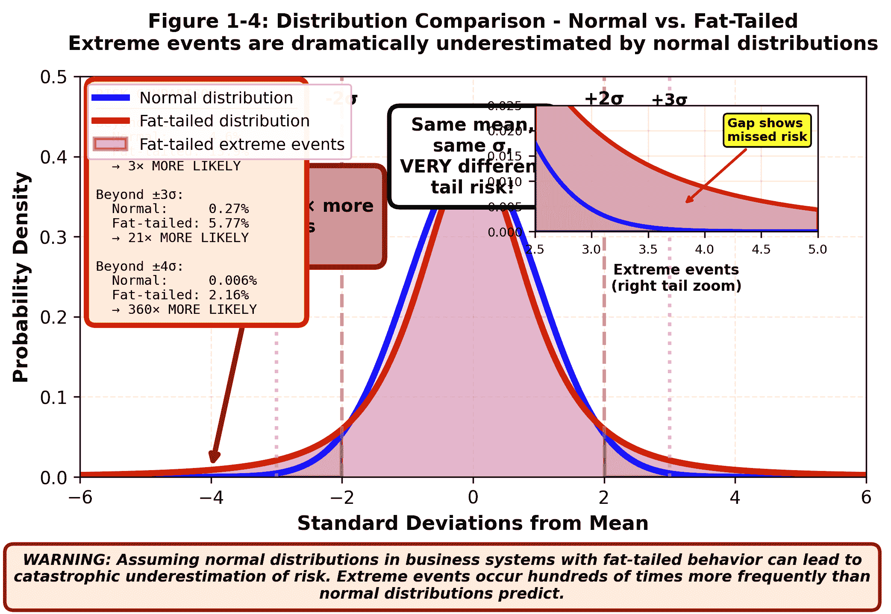
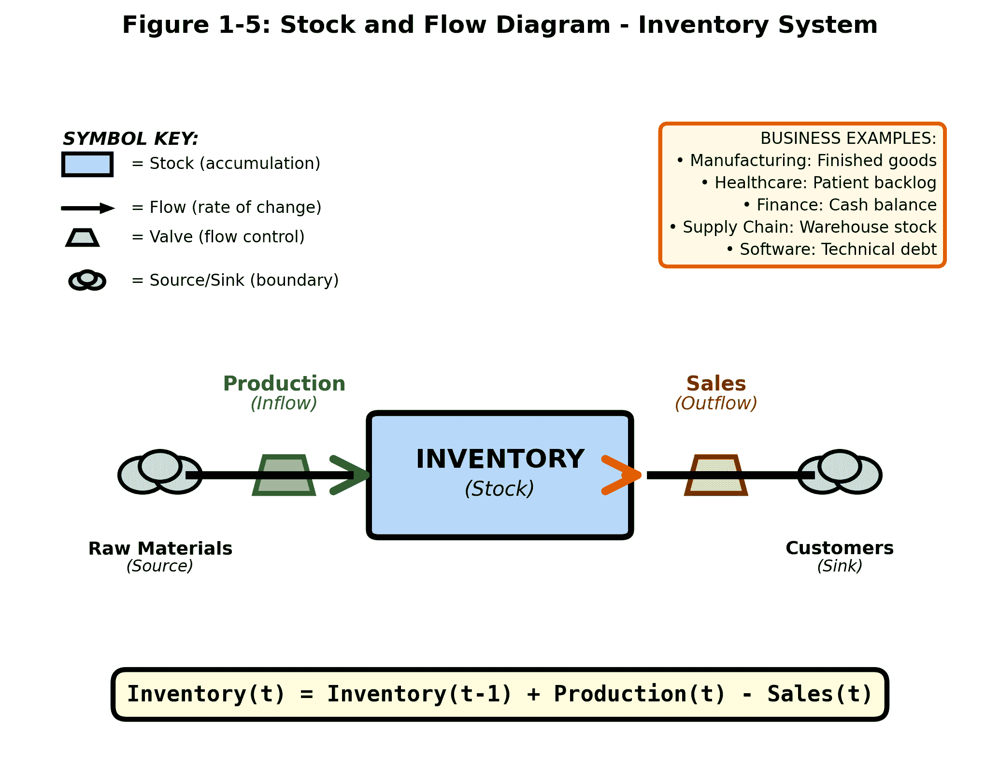
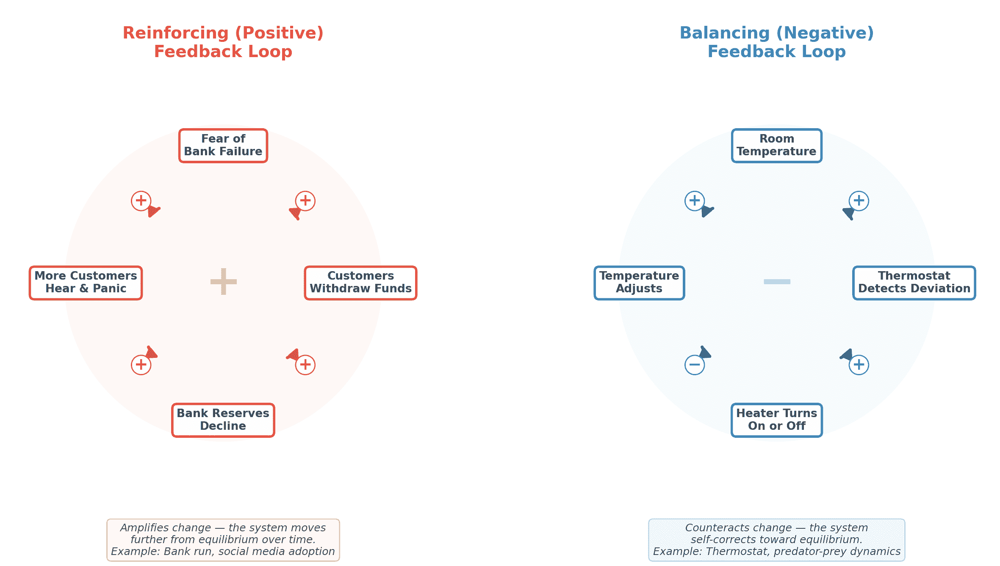
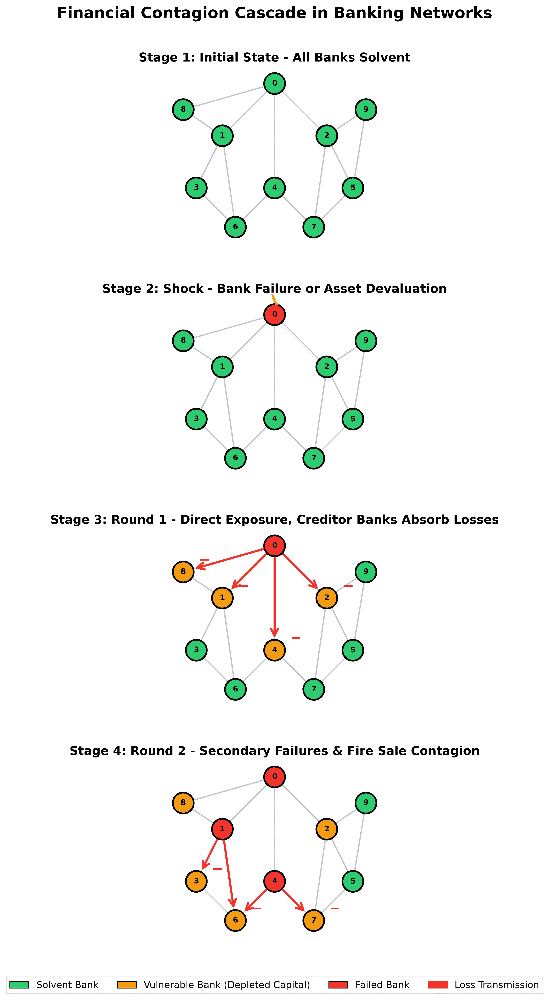
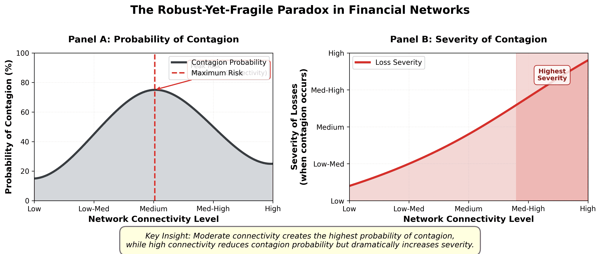

# Chapter 1. Why Use Simulation When You Have Data?

Data professionals have no shortage of tools, historical datasets, and predictive models, but we still struggle to understand complex business processes.

Consider supply chains. Small demand fluctuations can cascade into disproportionate order increases across retailers, distributors, and manufacturers. This is known as the bullwhip effect. This happens when each actor makes independent, rational decisions based on incomplete information, which can lead to system-wide disruptions.

Or consider capacity planning. Predictive models can fail to account for backlogs, randomness in arrival times, and phase transitions at critical thresholds where systems experience catastrophic gridlock.

Competitive pricing presents another challenge. Retailers can build price elasticity models based on historical data but cannot anticipate competitor reactions. This leaves them with static correlation analysis that offers little value for strategic decisions in dynamic markets.

Clearly, we are missing something in our data analytics and data science toolkit.

Simulation modeling fills those gaps in our suite of tools. A simulation model is an executable computer representation of a real-world system that defines the components of a system and describes rules that govern the interaction of those components. By considering both components and interactions, we can begin to understand how the system behaves over time and under different conditions. By modeling a large number of possible combinations of input parameters, we can reveal characteristics of novel situations that may not appear in historical data. By modeling components and interactions, we can discover feedback loops, time delays, and emergent properties that traditional statistical methods do not sufficiently model or predict.

Simulation modeling complements, it does not replace, statistical and machine learning techniques in data science. Statistical methods are essential for descriptive and predictive analysis, while machine learning methods help us identify patterns in large datasets. Simulation models are exploratory and forward looking. They allow us to identify causal relationships and develop more explanatory hypotheses for complex business processes.

This chapter begins with a quick look at why simulation is valuable today and how generative AI has revolutionized what data scientists can do. We then present an overview of complex business systems and why they are so hard to model and predict. We will look at three distinct business problems that highlight the challenges of analyzing complex systems.

Next, we will move on to look at the limits of traditional analytics methods. We’ll explore the benefits of adopting a “systems thinking” approach to understanding dynamic and complex systems.

Keeping in mind the aphorism that in theory, theory and practice are the same, but in practice they are not, we conclude the chapter with a case study. It describes a financial contagion that was not anticipated by traditional analytic tools but was elucidated by simulation modeling. This demonstrates the need for expanding our data science toolkit to include simulation.

## Why Simulation Now

If simulation is so useful, why haven’t data scientists and data analysts employed it more? And why should you be adopting it now?

There have been barriers to entry that have limited the adoption of simulation. Traditionally, simulation modeling required an understanding of specialized languages such as Simul8 and AnyLogic or the ability to code simulations in Python or R using specialized libraries. These are not the tools data professionals are used to working with, like SQL and Pandas. In addition, simulation modeling requires an understanding of probability distributions, statistical sampling methods, and queueing theory. Designing, building, and validating simulation could take a long time and can be hard to justify when using traditional simulation tools and software practices.

Generative AI and specification-driven development are fundamentally altering the simulation landscape. Large language models and large reasoning models are increasingly proficient at creating simulation code. Specification-driven development practices employ the rapid, exploratory nature of vibe coding but combine it with detailed requirements, technical architecture design, data models, API contracts, and security best practices.

The use of generative AI for simulation modeling is changing the scope of what data scientists can do. Today, a data scientist can use generative AI to help with the full lifecycle of simulation modeling, including:

*   研究并定义系统的组件及其交互规则
*   选择模拟方法，例如蒙特卡洛、离散事件、系统动力学或基于代理的建模
*   生成标准模拟代码，用于组件创建、资源分配、事件调度以及数据收集
*   构建统计分析脚本，以了解待建模系统中变量的概率分布
*   创建数据工程管道，从源系统提取数据，应用必要的转换，并将数据提供给模拟模型
*   为终端用户编写指南以及技术文档，例如 API 文档
*   生成验证测试以衡量模型的质量
*   定义敏感性分析测试的适当范围
*   为与模拟交互创建可视化和用户界面

现实的模拟过去需要数周的专业培训和数月的开发。今天我们可以使用生成式 AI 来帮助指定模型需求、理解基本数学原理并生成生产质量的代码。这种民主化并没有消除复杂模拟项目对专业知识和领域知识的需求，但它降低了许多用例的入门门槛。

电子表格使财务建模民主化，SQL 使数据分析民主化。现在，AI 辅助模拟使系统思维和假设分析变得触手可及，让能够清晰界定业务问题、识别适当建模技术并验证模型的数据专业人员和软件开发者受益。模拟不再是专门的利基能力；它是一种通用工具，应成为每个数据专业人员的工具箱的一部分。

本章首先概述复杂的业务系统，并讨论为什么它们如此难以建模和预测。我们将研究三个不同的业务问题，以突出分析复杂系统的挑战：供应链中的牛鞭效应、产能规划以及竞争市场的动态。接下来，我们将研究传统分析方法的局限性，其中包括对历史模式的依赖和新颖情况的问题、理解相关性但不理解因果关系、使用静态快照描述动态系统、关注中心趋势而对极端情况关注不足，以及不理解系统动态中的延迟和时滞的风险。这些问题促使我们采用系统思维方法来理解动态和复杂的系统。系统思维采用了多个构件，包括存量和流量、反馈回路、延迟和累积，以及涌现和非线性。系统思维和模拟建模一起为分析具有显著不确定性、涌现属性以及需要分析新颖的假设情景的问题提供了强大的工具。牢记这样一句格言：在理论中，理论和实践是相同的，但在实践中它们并非如此，我们以一个案例研究结束本章。它描述了一种传统分析工具未能预见但通过模拟建模得以阐明的金融传染。这证明了我们需要扩展数据科学工具包以包含模拟。

## 理解复杂的业务系统

有许多工具和技术可用于分析和理解数据。有时，很明显应为特定问题使用哪些工具。例如，如果你想比较两组客户，你可能会从关于每组客户的描述性统计开始，例如每个客户平均花费金额和每组中的客户数量。如果你想预测客户流失，你可能会从基于逻辑回归的基线机器学习模型开始，该模型训练速度快，可处理分类和数值特征，并输出概率。很多时候，我们没有这样明显的解决方案。让我们考虑数据科学家在物流、医疗保健和零售领域工作时可能遇到的三种此类场景。

### 供应链牛鞭效应

让我们从一个简单的问题开始，即供应链中一个部分的变动如何影响该供应链的其他部分。如果零售商决定增加其平均订单量，听起来合理的假设是这种变化将导致供应链其他部分出现线性变化。这通常并非如此。

零售商每天销售 100 件，标准差为 20。某一周，零售商每天销售 110 件，持续一周，本周共销售 770 件。这比预期多售出 70 件。零售商假设日均值在增加，并调整其向分销商的订单以适应新的增加水平，同时补充本周高于预期订单期间消耗的库存。

如果零售商假设新水平为每天 110 件，他们可能会增加手头的库存缓冲。这种对预期增长、补充库存和增加库存缓冲的叠加可能会导致向分销商订购的产品数量增加 30%——从每周 700 件增加到每周 910 件。

当分销商看到订单量的跃升时，他们可能会假设零售商将继续保持 30% 的增幅水平，从而触发分销商增加向制造商的订单。分销商将月订单从 2,800 件增加到 3,780 件（增加 35%）。制造商看到订单增加并遵循增加目标产量的模式。制造商必须订购原材料，并且他们的交货时间通常比零售商或分销商更长，因此他们会下大额材料订单，可能比零售商订单保持不变时要高出 50%——从每季度 11,200 件增加到每季度 16,800 件。

放大效应令人惊讶：零售需求的 10% 增长导致原材料订单增长 50%。放大系数为 5 倍，如图 1-1 所示。

现在想象一下，下一周零售商产品的需求回落到 100 时会发生什么。零售商有过剩库存，因此在消化手头库存的同时取消了一些订单。分销商看到订单大幅下降并取消了对制造商的未完成订单。制造商看到订单急剧下降并取消了一些生产计划。

零售商、分销商和制造商都在缺乏对他们所运营的更大业务系统状态的完整信息的情况下做出理性选择，其结果是高度破坏性的。这种现象在供应链中被称为牛鞭效应。其成因是多种因素的综合。

该系统中的每个参与者都有有限的信息。他们仅根据自己的订单信息行事，而非终端消费者的需求。当系统中的所有参与者每周下单而不是连续下单时，我们可能会出现同步效应，从而放大波动。此外，每个参与者都合理地决定囤积库存，而不是冒无法满足需求的风险。制造商和其他交货时间较长的参与者需要更大的库存头寸。这些多重因素相互作用，产生难以预测的结果，除非我们考虑影响结果的所有因素。

模拟是一种可以帮助我们更好地理解像牛鞭效应中放大现象这样的情况的工具。模拟在以下情况下尤其有帮助：

*   动态系统，例如一组参与者做出不同类型的选择
*   非线性影响，例如系统一个部分的小变化会触发系统其他部分更大的变化

*   维护状态信息并基于状态做出决策的参与者
*   在信息不完整的情况下同时做出决策的参与者
*   多个不确定性来源

供应链并不是唯一受到这些现象影响的业务流程。

### 产能规划：平均值是不够的

想象你是一家医疗保健公司的数据科学家。你被要求帮助为急诊室建模产能规划。你开发了一个模型来预测按小时、按天和按季节的平均患者到达量。你仔细研究了历史数据的变化，并考虑了流感季节、恶劣天气条件和当地高流量事件等因素。你也知道验证模型的重要性，因此你使用时间序列交叉验证并跟踪诸如平均绝对误差（`MAE`）、平均绝对百分比误差（`MAPE`）和均方根误差（`RMSE`）等指标。你的模型效果良好，日均预测 `MAPE` 为 8%，每小时到达预测 `MAPE` 为 15%。

验证结果很有前景，但它们与现实相比如何？让我们选一个时间段，比如周一晚上 7 点到 8 点，看看一年的数据是什么样子的。

图 1-2 显示了 52 周内周一 7 点到 8 点的实际到达人数。

| Week | Arrivals | Week | Arrivals | Week | Arrivals | Week | Arrivals |
| --- | --- | --- | --- | --- | --- | --- | --- |
| 1 | 12 | 14 | 9 | 27 | 11 | 40 | 8 |
| --- | --- | --- | --- | --- | --- | --- | --- |
| 2 | 11 | 15 | 13 | 28 | 10 | 41 | 12 |
| 3 | 10 | 16 | 8 | 29 | 14 | 42 | 9 |
| 4 | 13 | 17 | 12 | 30 | 9 | 43 | 11 |
| 5 | 9 | 18 | 10 | 31 | 13 | 44 | 10 |
| 6 | 11 | 19 | 11 | 32 | 8 | 45 | 13 |
| 7 | 8 | 20 | 9 | 33 | 12 | 46 | 9 |
| 8 | 12 | 21 | 13 | 34 | 10 | 47 | 11 |
| 9 | 10 | 22 | 8 | 35 | 11 | 48 | 8 |
| 10 | 14 | 23 | 12 | 36 | 9 | 49 | 12 |
| 11 | 9 | 24 | 10 | 37 | 13 | 50 | 10 |
| 12 | 11 | 25 | 11 | 38 | 8 | 51 | 11 |
| 13 | 10 | 26 | 9 | 39 | 12 | 52 | 9 |

你的模型预测该时段每小时平均 10.5 名患者。实际数据的平均值也是每小时 10.5 名患者。你的模型在平均值上是准确的。问题是“平均值”并不能说明全部情况。

在全年的 52 周中，急诊室有 10 或 11 名患者 32 次（占 62% 的周）。有 8 或 9 名患者 15 次（占 29% 的周），有 12、13 或 14 名患者 5 次（占 10% 的周）。如果急诊室按平均值配备人员，他们将有 10% 的时间人手不足，有 29% 的时间人手过剩。

这就是理解变异性变得至关重要的地方。到达人数的标准差为 1.7 名患者。如果我们希望 90% 的时间确保人员配备充足，我们需要计划大约每小时 12.7 名患者（均值 + 1.3 个标准差）。如果我们希望 95% 的覆盖率，我们需要计划每小时 13.3 名患者（均值 + 1.65 个标准差）。

但到达率只是故事的一部分。服务时间也会变化。如果平均服务时间为 45 分钟，标准差为 15 分钟，且有两名医生值班，排队理论告诉我们系统利用率为：

> 利用率 = （到达率 × 服务时间）/ 服务器数量 = （10.5 × 0.75）/ 2 = 0.39 或 39%

在 39% 的利用率下，平均等待时间是可以管理的。但当到达人数激增至每小时 14 名患者时会发生什么？利用率跃升至 52.5%，平均等待时间由于非线性排队效应而超过一倍。在 80% 的利用率下，系统接近瘫痪，等待时间可能超过数小时。

模拟可以帮助我们识别变异性的全范围，以便我们可以解决不同的多种可能情景，而不是只关注平均情景。

### 竞争市场动态

竞争动态为传统分析方法带来了另一个挑战。考虑一个零售定价问题。两家竞争商店销售类似产品。你拥有不同价格点的历史销售数据，并建立了价格弹性模型。你的模型表明，将价格下调 10% 将使销量增加 18%，从而使毛收入增加 6%。

你实施了降价并观察你的竞争对手。一周内，他们匹配了你的降价。你的销量仅增加 9% 而不是 18%，毛收入下降了 2%。你的模型未能考虑竞争反应。

让我们用一个简单的例子来量化这一点。假设两家商店目前每周各售出 1,000 件单位，单价为 $50，每周收入为 $50,000。以下是不同情景下发生的情况：

*   **基准**
    *   你的价格：$50
    *   竞争对手价格：$50
    *   你的销量：1,000
    *   竞争对手销量：1,000
    *   你的收入：$50,000
    *   竞争对手收入：$50,000
*   **你降价，他们维持**
    *   你的价格：$45
    *   竞争对手价格：$50
    *   你的销量：1,800
    *   竞争对手销量：600
    *   你的收入：$81,000
    *   竞争对手收入：$30,000
*   **你降价，他们匹配**
    *   你的价格：$45
    *   竞争对手价格：$45
    *   你的销量：1,090
    *   竞争对手销量：1,090
    *   你的收入：$49,050
    *   竞争对手收入：$49,050
*   **两者都提高**
    *   你的价格：$55
    *   竞争对手价格：$55
    *   你的销量：850
    *   竞争对手销量：850
    *   你的收入：$46,750
    *   竞争对手收入：$46,750

“你降价，他们匹配”情景说明了现实中发生的情况。竞争对手的理性反应是匹配你的降价以防止失去市场份额。结果是两家公司在较低价格点上赚取的收入更少。仿真建模可以帮助我们识别对我们行动的反应效果，并提供更现实的可能结果图景。

## 传统分析的局限性

为什么传统数据科学方法在这些业务问题上会遇到困难？局限性分为五类：依赖历史模式、将相关性与因果性混淆、动态系统的静态快照、关注中心趋势而忽视极端情况，以及对延迟和滞后的处理不足。

### 依赖历史模式和新情况的问题

机器学习模型是在历史数据上训练的。它们从过去学习模式并假设这些模式会延续到未来。当未来与过去相似时，这效果很好。当条件发生变化时就会失败。

考虑产能规划示例。如果我们根据历史急诊室到达数据训练模型，它将准确预测平均到达率。但如果附近开了一家新的急诊护理中心？或者一家大型雇主关闭，改变了该地区的 demographics？或者大流行改变了人们寻求医疗的行为模式？历史模式可能不再适用。

牛鞭效应示例说明了另一个局限性。历史数据可能显示需求模式稳定，因为供应链一直处于均衡状态。但当需求突然激增时会发生什么？如果没有历史的大需求冲击示例，预测模型就无法预见到放大效应。

仿真模型并不完全依赖历史模式。它们对产生结果的潜在机制进行建模。通过表示组件和交互规则，仿真可以探索从未在历史上发生过的情景。

### 理解相关性但不理解因果性

大多数预测模型在数据中识别相关性。这些相关性可能具有高度预测性，但可能并不反映因果关系。如果不了解因果关系，我们就无法可靠地预测干预的效果。

在定价示例中，历史数据显示了你的价格与销售量之间的相关性。但相关性并不能揭示竞争对手将如何反应。一种因果模型需要表示：

* 客户如何感知价值并做出购买决策
* 竞争对手如何监控市场状况并决定是否做出回应
* 市场份额如何基于相对定价发生转移
* 这些动态如何在时间上展开

传统的回归或机器学习模型将这些视为外生变量或完全忽略它们。仿真模型可以明确表示因果机制。

这种区别很重要，因为基于相关性的模型在我们干预系统时会失效。一个基于价格与销量历史相关性来预测销售的模型可能适用于预测，但它无法可靠地预测计划的价格变动效果，因为竞争对手会做出反应。

### 从静态快照描述动态系统

许多分析方法对系统采取快照式的视角。它们在某一时间点分析数据，或跨时间段汇总数据，从而丢失了关于动态的信息。

考虑急诊室容量规划问题。横截面分析可能会计算平均每日患者量和平均服务时间，然后基于这些平均值推荐人员配置水平。这种方法忽略了：

* 患者积压如何在繁忙期间累积
* 服务时间在员工不堪重负时如何增加
* 队列如何在较慢期间得以清除
* 日常或每周周期如何形成可预测的拥堵模式

动态系统具有记忆。时间 `t` 发生的事情不仅取决于时间 `t` 的状况，还取决于 `t-1`、`t-2` 以及更早发生的事情。积压会累积，反馈回路会运作，系统可能表现出滞后性，其中当前状态取决于到达该状态的路径。

仿真模型本质上是动态的。它们随时间推进，在每个时间步更新系统状态。这使我们能够观察系统如何演变以及干预如何影响轨迹。

### 过度关注集中趋势而忽视极端情况

大多数统计方法关注均值、中位数和其他集中趋势度量。这对于许多应用是合适的，但在极端情况很重要时可能具有误导性。

在急诊室示例中，按平均到达率进行规划会使系统在高峰期人手不足。患者经历长时间等待，员工不堪重负，护理质量受损。了解到达和服务时间的分布与了解均值一样重要。

风险管理需要理解尾部事件。在供应链中，需求高峰期间缺货的成本可能远高于持有额外库存的成本。在金融系统中，像市场崩盘或银行倒闭这样罕见但严重的事件可能摧毁的价值超过多年正常回报所创造的价值。

传统方法通常假设正态分布或依赖标准差等度量，这些度量可能无法完全描述尾部行为。胖尾分布，即极端事件比正态分布所暗示的更可能发生，在商业环境中很常见，但对于关注集中趋势的方法来说捕捉不佳。

仿真模型可以生成结果的完整概率分布。通过运行数千种具有不同输入的情景，我们可以了解可能结果的范围，识别极端情况，并量化尾部风险。

### 不理解系统动态中的延迟和滞后

许多商业流程涉及延迟。订单需要时间来履行。客户需要时间对价格变化做出反应。制造能力需要时间来增加。信息需要在组织中传播需要时间。

延迟会产生难以用静态方法分析的动态。在鞭 Bullwhip 效应示例中，原材料长交货期导致制造商在感知需求增加时过度订购。延迟放大了周期，因为制造商在需求下降时无法快速调整。

延迟会产生振荡，系统反复超出和低于均衡。它们会产生不稳定性，小扰动随时间增长。它们会产生相位偏移，系统从一种状态转变到另一种状态。

仿真模型明确表示延迟。我们可以建模信息延迟、运输延迟、生产延迟和决策延迟。通过观察这些延迟如何影响系统行为，我们可以设计更好的政策并识别能够抑制振荡或防止不稳定的干预措施。

## 系统思维：复杂系统的框架

传统分析的局限性促使我们采用不同的方法来理解复杂的商业系统。系统思维为推理动态、反馈和涌现提供了概念框架。仿真提供了实现和测试系统思维模型的计算工具。

系统思维采用几个关键构件：存量与流量、反馈回路、延迟与累积、涌现与非线性，以及假设情景。

### 存量与流量

存量是累积量。它们代表随时间积累或减少的数量。在供应链中，库存是一个存量。在医疗保健中，等待服务的患者积压是一个存量。在金融中，账户余额是存量。

流量是变化率。它们代表存量增加或减少的速度。客户订单是增加零售商库存的流量。销售是减少库存的流量。患者到达增加积压，而患者服务减少积压。

存量与流量之间的基本关系是：

> `Stock(t) = Stock(t-1) + Inflow(t) - Outflow(t)`

这个简单的方程捕捉了系统如何随时间积累或耗尽资源。当流入超过流出时，存量增长。当流出超过流入时，存量缩小。当它们平衡时，系统处于均衡。

许多商业问题涉及理解存量如何响应流量的变化。如果制造商增加生产（流入）的速度快于客户购买产品（流出）的速度，产成品库存（存量）就会累积。如果急诊室经历患者到达（流入）激增而服务能力（流出）保持不变，候诊室积压（存量）就会增长。

仿真使我们能够明确建模存量与流量并观察它们在不同条件下的演变。电子表格模型可以帮助我们理解某一时间点的存量-流量方程，但很难建模流入和流出如何根据系统状态动态变化。仿真模型让我们可以定义支配流量的规则，然后观察存量在数周、数月或数年内的行为。这在多个存量相互关联时尤其有用，例如当原材料库存、在制品和产成品通过共享流量相互作用时。

### 反馈回路

反馈回路发生在系统的输出影响其自身的输入时。正面反馈放大变化。负面反馈减弱变化并促进稳定。

鞭 Bullwhip 效应是正面反馈的例子。当零售商看到需求增加时，他们会增加向分销商的订单。分销商看到订单增加并放大向制造商的订单。系统超出需求，造成库存过剩。当需求下降时，反馈反向运作，造成缺货。

负反馈创造稳定性。恒温器是经典的例子。当温度上升到设定点以上时，恒温器会关闭加热。当温度下降到设定点以下时，它会打开加热。反馈回路使温度维持在设定点附近。

商业系统通常同时包含正反馈和负反馈回路。正反馈可以推动增长或衰退。负反馈可以创造稳定性或对变化的抵抗。多个反馈回路的相互作用可以产生复杂的动态，如果没有建模，很难预测。

仿真模型使反馈结构明确且可计算。我们可以观察变化如何在系统中传播，识别在任何给定时间哪个反馈回路占主导，并发现主导权从一个回路转移到另一个回路的临界点。系统的行为由其反馈结构决定，而仿真有助于使该结构可见。

### 延迟与累积

延迟在商业系统中无处不在。制造需要时间。运输需要时间。客户对营销做出反应需要时间。组织认识问题并实施解决方案需要时间。

延迟与反馈回路相互作用产生动态。负反馈回路中的长延迟会导致振荡。如果恒温器在感知温度和调节加热之间存在很长的延迟，系统将反复超出并低于设定点。

累积发生在流量持续存在于一段时间时。每日的小额存款会累积成大额余额。每日患者到达量超过服务能力的少量累积会形成大量积压。每日的小质量缺陷会累积成大额返工成本。

延迟与累积的结合造成了许多商业问题。库存因调整生产以匹配需求的延迟而累积。积压因增加产能以匹配工作量的延迟而累积。技术债务因重构代码的延迟而累积。

延迟和累积很难用直觉管理。我们可能会采取行动却看不到即时结果，于是采取额外行动，这可能导致过度纠正，因为原始干预还没有时间生效。仿真模型通过跟踪原因和结果之间的时间来明确延迟。我们可以尝试不同的延迟长度以了解其对系统稳定性的影响，测试旨在补偿已知延迟的政策，并识别系统中最关键需要减少的延迟。

### 涌现特性

当系统的组件相互作用时，我们可能会看到行为模式，这些模式仅从观察相互作用规则来看很难预测。以鸟群飞行为例。鸟类倾向于遵循一些简单的规则，如靠近其他鸟、避免碰撞、匹配其他鸟的速度。没有集中协调，但复杂的模式如群飞，鸟群一起俯冲、旋转和转向，可以涌现出来。

许多分析方法本质上是还原论的；它们关注单个组件，而忽略了特性如何从相互作用中涌现。用这些方法很难发现相变，尤其是如果历史数据中没有可能涌现模式的例子。

仿真模型通过定义组件及其相互作用规则，然后让我们观察系统随时间的表现，在这里有所帮助。观察组件相互作用时，我们可以看到只有在组件随时间相互作用时才显现的宏观模式。这在数据科学中有广泛的应用，例如理解供应链中的牛鞭效应放大、工作中累积的系统中的排队动态和相变，以及金融传染，如金融危机期间银行倒闭的蔓延。金融传染是金融困境从一个机构、市场或国家向其他机构、市场或国家的传播。

### 假设情景

当我们想要推理新颖情况时，仿真特别有用。按定义，新颖情况以前从未见过，因此我们没有可直接指导的历史数据。通过创建仿真，我们可以制作系统的模型并测试对系统输入的更改以及改变相互作用规则以了解这些更改的影响。无需在我们的企业或组织中做实验，我们可以仿真：

* 增加客服代理以协助客户，了解其对总销售额收入的影响
* 延长商店营业时间，变化幅度不同，以找到最佳营业小时数
* 产品延迟交付，了解其对商店收入的影响
* 结合多项更改，如增加客户助理数量并延长营业时间

当我们想要推理新颖情况时，仿真特别有用。统计和机器学习模型基于历史数据训练，因此当未来与过去相似时最可靠。但战略决策，如决定进入新市场、重组供应链或改变价格，都是未来肯定会与过去不同的情况。仿真模拟变化的机制而不是识别模式，使我们能够探索超出历史数据所涵盖的条件。

## 案例研究：预测银行网络中的金融传染

2008 年，全球经济经历了突然的衰退，触发因素是美国住房市场的崩溃。住房价值的积累加上风险的次级抵押贷款造成了市场泡沫。当泡沫破裂时，住房价值下跌，许多房主违约贷款。然而，这些违约的影响并不局限于发放原始贷款的银行。这是因为金融机构将一组抵押贷款打包成证券出售给投资者。这将违约风险扩散到更广泛的机构和投资者。

随着违约增加，这些证券的价值下降。这对持有这些证券并必须遵守一种称为按市值计价的会计方法的银行和其他机构来说是个问题。基本上，他们必须按当前市场价值而不是资产取得时的原始价值报告其资产价值，包括抵押贷款支持证券。2008 年，这导致许多银行报告亏损和不足以满足监管要求的资本。因此，这些银行面临额外的监管限制、监管机构的干预，在某些情况下还可能导致信心丧失，从而引发银行挤兑。

2008 年之前曾发生过银行危机，监管机构拥有评估金融机构韧性的工具，但这些工具未能识别出 2008 年金融体系韧性不足的问题。英格兰银行在 2010 年由 Prasanna Gai 和 Sujit Kapadia 进行的一项研究使用了仿真建模来理解导致金融体系处于低韧性状态并存在金融传染风险的组件和相互作用。Gai 和 Kapadia 的研究描述于[“金融网络中的传染”](https://www.financialresearch.gov/working-papers/files/OFRwp-2015-21_Contagion-in-Financial-Networks.pdf)。

该仿真基于复杂网络理论。它以索赔和义务的形式对银行和银行之间的关系进行建模。例如，如果银行 A 向银行 B 贷款，则银行 A 对银行 B 拥有索赔权，而银行 B 对银行 A 负有义务。银行之间的链接代表索赔和义务，并且这些链接根据索赔或义务的价值加权。

在网络理论的术语中，每家银行可以用两个度属性来描述：入度，即代表银行应收资产的 incoming 链接数量，以及出度，即代表银行对其他银行负债的 outgoing 链接数量。

除了对银行之间关系的建模外，研究作者还对每家银行的属性进行了建模。这些包括银行的资产和负债。资产被细分为两种类型：银行间资产，即对其他银行的债权，以及流动性差的外部资产，如抵押贷款。负债也分为两种形式：欠其他银行的负债和客户存款，即欠客户的资金。

银行的资本缓冲是银行资产价值与负债价值之间的差额。只要银行的资产大于负债，银行就被认为是有偿付能力的。当银行在银行间资产上的损失加上抵押贷款上的任何贬值超过其资本缓冲时，银行就会失败。作者还将银行定义为脆弱的，当它没有足够的资本缓冲来覆盖其邻近银行违约且无法向银行履行其义务时的损失时。

作者构建了一个由 1,000 家银行组成的基准网络，并在银行之间随机定义了链接。他们还对 10,000 家银行进行了建模，但节点数量的增加并没有改变研究的整体结果。然后他们运行了模拟，模拟从所有银行都有偿付能力开始，然后引入初始冲击。有两种类型的冲击。一种是单一银行失败。在本研究中，银行失败被建模为银行所有资产的损失。作者还对整体冲击进行了建模，在这种冲击中，所有银行都会经历外部资产价值的损失，例如抵押支持证券。这种第二种冲击模拟了在资产价值在整个市场普遍下降时，将资产价值按当前市场价值计价的影响。

该模型通过网络模拟金融传染，使用两种传播方法：对失败银行的直接风险敞口，以及通过银行持有的资产流动性损失而产生的间接传染。

当一家银行失败时，例如在模拟开始时，则其所有邻近的债权人银行都会遭受损失。债权银行损失了针对违约银行持有的所有银行间资产的价值。现在，债权银行必须更新其资本缓冲以反映这一损失。如果其资本缓冲不足以覆盖这一损失，则它们也会成为失败的银行。债权银行的失败会引发另一轮传染，可能导致其他银行失败。该过程一直持续到没有新的银行被拖入违约为止。

该模型还捕捉了与资产相关的传染的影响，即违约导致违约银行出售其资产。大量资产的突然抛售，被称为火<|message|> 销售，会导致价格下跌。当这种情况发生时，所有银行都必须按市价计价并调整其资本缓冲的价值。如果其缓冲下降过多，它们就会变得脆弱。

## 研究结果

通过多次模拟，作者能够识别出金融传染在网络中传播的许多重要特征。

最重要的发现是金融网络表现出“稳健但脆弱的倾向”。在高度互联的金融网络中，来自失败银行的大量链接使损失得以分配给更多机构。这提供了风险分担的好处，并导致传染的低概率。同时，高数量的链接增加了传染传播的可能性。这导致网络的脆弱性。传染的概率在中等水平的连通性时达到峰值，然后下降。随着网络互联性的增加，传染风险继续增加。这是因为银行面临多个互联银行的违约，增加了对第二轮违约的脆弱性，从而进一步耗尽资本缓冲。

总体结果是，高连通性降低了传染的概率，因为损失被广泛分摊，但如果连锁反应开始，它也会极大地增加违约事件的严重性，因为银行与许多其他银行相连，使它们在传染过程中容易受到多次打击。

在这项研究中，模拟使研究人员能够澄清并量化现实网络模型中传染的复杂、非线性动态。例如，它表明传染的概率与连通性不是单调相关的，而是传染的概率在中等水平的连通性时达到峰值，然后随着连通性的增加而下降。这反映了风险分散的影响，同时增加了传染传播的途径。总体而言，模拟的使用使作者能够生成定量且可检验的模型结果，捕捉到金融网络中运作的一些非线性、高复杂性过程。

### 建模方法的比较

不同的建模方法具有不同的优势和劣势。表 1-1 从多个维度比较了统计模型、机器学习方法和模拟建模，以帮助您为特定问题选择合适的工具。统计和机器学习方法擅长分析历史模式和预测已知结果。模拟建模非常适合探索新颖的情景、揭示因果机制以及发现涌现现象，如临界点和级联动态。

|  | 传统统计方法 | 机器学习方法 | 模拟建模 |
| --- | --- | --- | --- |
| **描述** | 回归分析、相关性研究、时间序列模型（`ARIMA`、`VAR`）、来自历史数据的概率分布 | 神经网络、随机森林、支持向量机、基于历史模式训练的深度学习模型 | 基于代理的模型、网络模拟、蒙特卡洛方法，重现系统动态并测试情景 |
| **数据需求** | 历史失败数据；银行间风险敞口；金融时间序列；监管报告 | 大型训练数据集；失败的标记示例；多个危机事件；特征工程数据 | 网络结构；资产负债表数据；行为规则/假设；参数估计 |
| **主要优势** | 理论成熟；结果可解释；假设明确；计算快速；置信区间；假设检验 | 捕捉复杂模式；非线性关系；处理大数据良好；随数据扩展 | 测试“what-if”情景；探索新颖情况；揭示因果机制；无需历史数据；建模涌现；可进行实验 |
| **主要局限** | 假设未来与过去相似；罕见事件未得到充分代表；线性关系；遗漏涌现行为；无法测试新情景；相关性而无因果见解 | “黑箱”决策；需要海量数据；过拟合风险；罕见事件表现不佳；外推能力差；无法解释“为什么” | 模型不确定性；参数估计；计算成本；验证挑战；需要领域专业知识；假设简化 |
| **最佳使用案例** | 分析历史模式；检验特定假设；衡量相关性；短期预测；数据充足时 | 模式识别任务；预测已知结果；大型数据集分析；实时风险评分；分类问题 | 新颖情景；政策实验；理解机制；罕见事件分析；网络结构效应 |

| **它能揭示什么** || 历史传染率；违约相关性；地理聚集 || 违约可能性；风险分类；早期预警信号 || 坚韧却脆弱悖论；临界点；网络脆弱性；连通性阈值；级联动态；干预效果 |

| **它不能揭示什么** || 相变；网络结构效应；非线性阈值 || 坚韧却脆弱悖论；最优连通性；因果路径 || N/A - 最适合用于发现新颖见解 |

## Summary

仿真建模通过能够分析表现出涌现行为、反馈回路和相变的复杂业务系统，从而补充了传统的数据科学技术。毫无疑问，统计方法对于描述性分析至关重要，而机器学习在识别历史数据中的模式方面表现出色。仿真为数据科学工具箱增加了其他重要能力。它允许数据专业人员探索从未发生过的、面向未来的、假设性场景。

传统分析方法并不总是足以理解复杂系统，因为它们依赖于历史模式，识别相关性而非因果关系，并提供动态系统的静态快照。它们还存在风险，即关注中心趋势而非极端情况，并且可能无法考虑动态过程中的延迟和滞后。供应链中的鞭子效应、医疗保健中的产能规划挑战以及竞争性定价动态都表明，小变化会级联成不成比例的系统范围效应，而传统方法无法轻易预测。

本章介绍了系统思维作为理解这些复杂动态的框架，通过存量和流量、反馈回路、延迟和累积，以及涌现和非线性。英格兰银行金融传染研究验证了仿真的有效性，显示出违反直觉的“坚韧却脆弱”特性，其中适度的网络连通性比高连通性更危险。仿真是对现有方法的补充而非替代，提供了一种探索性分析的重要工具，用于理解因果机制和测试新颖场景。
