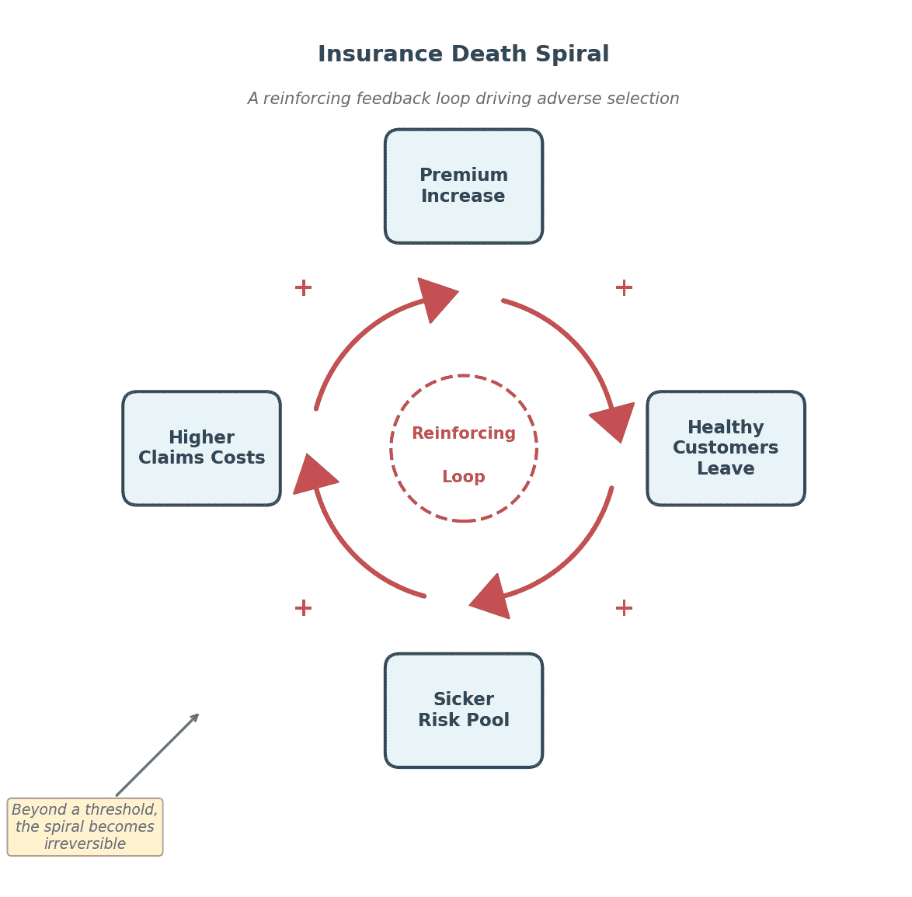
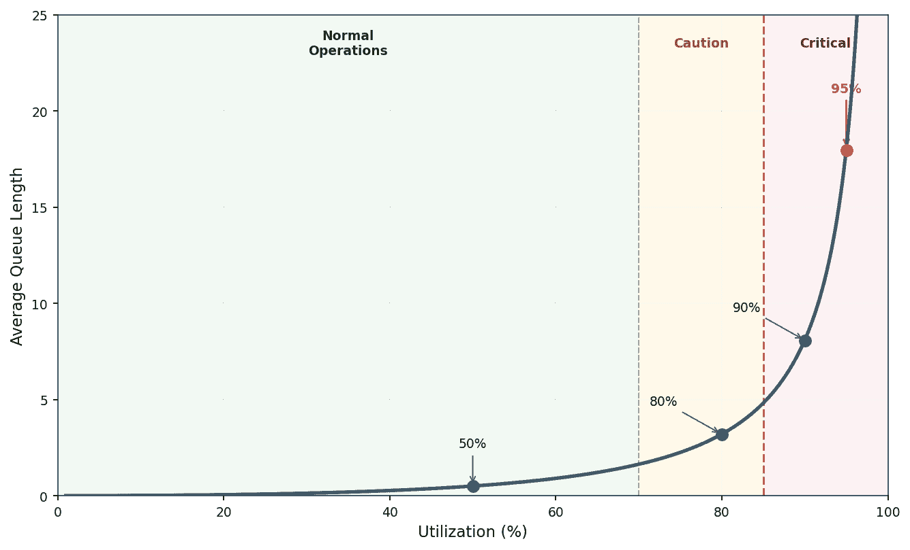
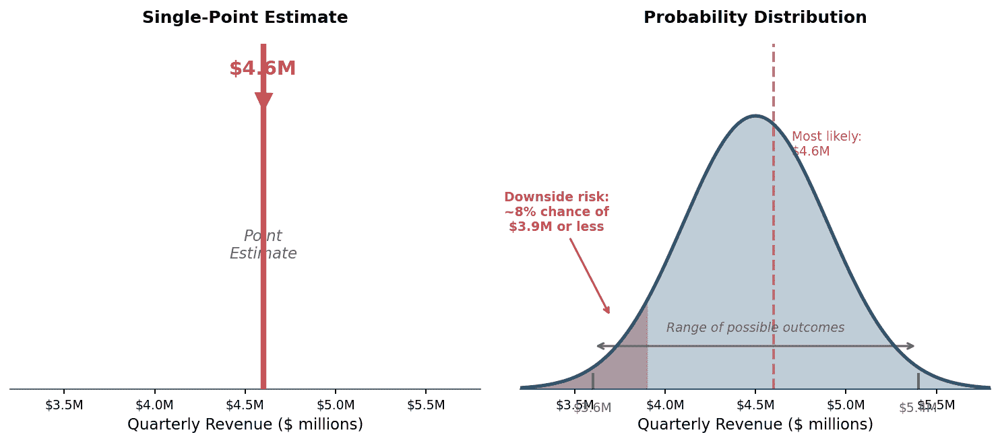
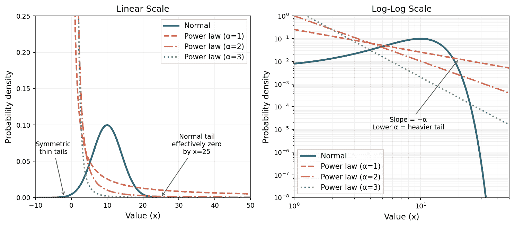

# Chapter 2. Building a Simulation Mindset: From Static Analysis to Dynamic Modeling

本书的动机源于一个单一的猜想：数据科学家需要各种工具来实现回顾性分析和前瞻性仿真。你可能会合理地问，为什么？毕竟数据科学作为一个命名学科已经存在至少 25 年，其根源可以追溯到统计学、计算思维、机器学习和数据库系统的更悠久历史。那些基础学科也为仿真建模做出了贡献，因此最好将仿真建模视为数据科学的一个方面，与统计学和机器学习并列。仿真建模是一套实践和方法，帮助我们解决传统分析以其回顾性方法并不适合的问题。

在本章中，我们将首先回顾数据科学家面临的主要挑战，这些挑战难以用传统分析方法进行分析，例如描述性统计、诊断分析以及预测分析/机器学习。参见表 2.1 传统分析 vs 仿真建模。然后我们将研究在你的组织中识别仿真机会的方法。这些包括识别传统分析不合适的早期预警信号，成功开发仿真模型的可行性，以及构建仿真商业案例的建议。本章最后将介绍构建仿真时使用的技术栈，包括 Python 和仿真相关库、大型语言和大型推理模型、规范驱动的开发方法、生产部署和运营基础设施，以及将仿真建模集成到现有数据工程管道的建议。

## Table 2-1. Traditional Analytics vs. Simulation Modeling

| 问题类型 || 传统分析 || 仿真建模 |
| --- | --- | --- |
| 发生了什么？ || ✓ 描述性统计 || 不需要 |
| --- | --- | --- |
| 为什么会发生？ || ✓ 回归、ML || ✓ 因果机制 |
| 会发生什么？ || ✓ 预测 || ✓ 动态投影 |
| 如果 X 发生变化会怎样？ || 有限（假设线性） || ✓ 完整场景探索 |
| 什么是最优的？ || ✓ 静态优化 || ✓ 动态优化 |
| 会涌现什么？ || ✗ 无法检测 || ✓ 揭示涌现行为 |

## What Is Challenging to Analyze with Traditional Analytics?

如果传统分析在我们作为数据科学家需要解决的问题方面存在不足之处只有一两个广泛领域，那么证明仿真建模需求将更容易。传统分析相对于我们需要解决的问题的局限性，更像是一系列系统特征的拼凑，这些特征与传统分析的假设不符。这些包括：

* 反馈回路
* 延迟
* 非线性效应和阈值
* 容量约束和资源竞争
* 不确定性和风险传播
* 自适应和战略行为
* 路径依赖和历史偶然性

与其试图找到涵盖所有这些的过于抽象的原则，让我们直接深入研究每个问题。

### Feedback Loops

反馈回路是一个过程，其中某些行动的结果会影响未来行动的结果。反馈回路在生物学中很常见，有助于生物体维持健康状态，但在商业中也很常见。

在第 1 章中，我们讨论了供应链中的鞭子效应，其中供应链中的每个参与者都基于其产品的需求和当前库存水平来制定订单。零售层面的小变化通过供应链传播，最终导致订购模式的振荡。商业中另一个众所周知的反馈回路被称为健康保险行业的死亡螺旋。

医疗市场中的死亡螺旋始于保险公司提高保费。当这种情况发生时，对价格敏感的健康客户会放弃保险或寻找更便宜的替代方案。这留下了一个投保人池，其平均健康状况比包含最近流失的健康客户的池更差。现在保险公司剩下的是平均医疗索赔更高的客户，从而推高成本。更高的成本推动保险费上涨，进而驱使其他客户离开。

如果我们使用线性回归等传统分析技术，我们可以建立一个模型来预测基于保费百分比增加的客户百分比减少。例如，我们可能会查看历史数据并估计保费上涨 10% 会导致付费客户数量减少 5%。这种预测对于第一轮客户放弃保险可能效果良好，但在第二次保费上涨后，我们可能会看到客户流失率达到 8%。假设这会触发另一轮保费上涨，我们可能会看到 12% 的客户流失。这一过程会继续，客户流失率加速增加。

模拟是理解死亡螺旋本质的更好方法。它使我们能够模拟客户如何权衡成本与风险承受度，以及投保人群构成的变化如何影响成本。模拟可以帮助我们识别阈值，例如当客户流失率过高时死亡螺旋变得不可逆转。我们还可以使用模拟来测试关于价格敏感度的不同假设，并引入新的产品功能，例如可以影响保险公司成本动态的健康激励措施。

营销活动中的反馈回路的另一个例子。零售商对不同营销渠道的使用方式发生变化可能会显示出初步成功。我们可能会衡量销售额增长了 5%，并合理地认为新的营销策略是原因。如果我们停留在这种分析水平，我们就会错过竞争对手的反应。如果我们不是在某一时间点衡量收入的变化，而是基于系统动力学构建模型，我们就可以更好地理解营销变化如何通过强化回路产生意想不到的结果，例如竞争对手降低价格。

### 延迟

模拟建模帮助我们理解完整的商业系统，而不仅仅是更大系统中的一个组件。销售点系统发生变化的即时影响可能很明显：我们减少了在线零售商的购物车放弃数量。为了了解变化的全部影响，我们应该了解它如何影响更广泛的商业系统中的其他组件和方面。为此，我们需要一种能够模拟随时间推移并跨系统不同组件展开的结果的方法。

让我们看一个在线零售商的基本 A/B 测试。零售商简化了结账流程，减少了客户完成购买所需点击的页面数量。几周后，零售商发现，相对于开始结账的数量，完成结账的数量增加了 15%。很好，零售商接受了这一成果并继续使用简化的结账流程。

更改几个月后，零售商注意到退货率增加。在结账更改之前，公司退货率为 5%。自更改以来，该比率一直在上升，现在接近 10%。零售商开始分析更改前后的销售数据，发现两个群体（更改前和更改后）存在差异。更改后，不正确的收货地址和错误的订单数量有所增加。这导致处理退货的人工成本增加、运费增加以及客户满意度下降。最终，零售商会看到客户评分下降，最终导致客户流失和净推荐值下降。

### 非线性效应和阈值

复杂系统的典型特征是系统状态突然发生变化，而这种变化无法由过去的行为预测。随着水冷却，它保持液态，直到达到冰点然后突然变成固体。从更液态到更固态之间没有线性进展，而是有突然的转变。这些转变发生在各种系统中。

#### 临界点的突然相变

排队系统广泛用于建模请求服务到达、可能等待、接受服务然后离开的过程。如果请求以固定的 10 分钟间隔到达并且处理始终需要 9 分钟，则不会发生等待。当请求到达时间或处理所需时间存在变异时，就会产生队列。当然，我们可以按比例扩展处理能力，以便无论请求多么频繁，我们都能跟上。这种峰值需求规模是浪费且低效的。排队背后的数学表明，随着队列长度接近 80-85% 的利用率，我们可以预期处理时间突然增加，而不管处理时间的历史平均值如何。

#### 递减和加速回报

线性思维很自然。如果我们将劳动力增加 10%，我们就会将产出增加 10%。在统计学的帮助下，我们经常可以找到诸如每位销售人员的收入或每单位生产成本之类的因素。将这些指标与一些基本的电子表格技能相结合，我们可以做出各种线性预测。这种推理有时在我们将自己限制在狭窄范围和理想情况下时会奏效。在现实世界的所有复杂性中，我们经常发现输入和输出之间的关系是非线性的。

考虑获取新客户的成本。一家新的直销零售商已做广告六个月。根据初始数据，公司确定获取一个客户的平均成本为 50 美元。管理层批准了 25 万美元的客户获取预算，预计这将使客户数量增加 5,000 人。2 个月后，预算耗尽，公司仅新增了 2,800 名客户。他们未能认识到，早期客户是最容易获取的。他们是那些最感兴趣并与公司互动的人，而后来获取的客户对广告的反应较差。

#### 资源之间的复杂交互

当我们需要多种资源来生产某种商品时，优化这些资源的分配可能具有挑战性。我们可能会认为，增加一种资源的 10% 将使我们的产出增加 10%（又是那种线性思维）。增加 10% 可能会增加一个组件的产出，但这种增加如何影响其他组件？如果一家制造商有 10 条生产线并增加一条生产线，他们很可能会使生产单元数量增加 10%。这似乎并不 unreasonable。问题是我们过早地停止思考过程。生产出的额外 10% 的单位会发生什么？如果它们被送到质量控制检查站，那么我们就有风险为检查员创建积压工作，这反过来又会产生待办工作队列。

#### 组件交互产生的涌现属性

涌现是处理复杂系统时最具挑战性的方面之一。涌现发生在系统中出现一种行为或特征，而这种行为或特征无法通过分析系统组件的交互模式来预测。当涌现发生时，系统不仅仅是其各部分的简单总和，它是更复杂的东西。这种现象在生物学中无处不在。心脏病专家可以解释心肌的工作原理，即当邻近细胞超过一定电压时，细胞会收缩，进入无法放电的时期（不应期），然后恢复。心脏中的数百万个细胞建立了主导节奏，使器官层面的放电过程同步，尽管单个细胞的放电速率不同。研究人员发现，具有相同细胞特性的两个心脏可能由于组织特征和器官先前状态而对正常放电产生不同的偏差。要理解器官层面的放电，我们必须对细胞或组织的集合进行推理，因为我们感兴趣的行为在那里涌现。

### 容量约束和资源竞争

过去并不总是未来的良好指标，尤其是在比较系统在正常运行期间和在压力下运行时。 如果我们试图将正常时期的原则推广到高压力时期，我们很可能会错过在资源受限时做出权衡的需要。

使外推失效的硬性限制
：

容量边界是硬性限制。无论我们多么努力，生产速度最高为每分钟 20 个单位的机器都不会生产出每分钟 30 个单位的产品，无论线性预测说什么。我们经常使用拟合历史数据的线性模型，假设趋势可以无限持续。实际上，当我们接近容量约束时，会遇到破坏流程并导致系统行为突然变化的不连续性。例如，一家货运公司每班可处理 15,000 至 25,000 个包裹。运送的包裹越多，每个包裹的运送时间就越长。基于历史数据的线性模型发现，每增加 1,000 个日包裹，耗时增加 0.2 小时。节假日高峰期某一天，公司一天处理了 32,000 个包裹。预测的交付时间为 8.6 小时，但实际交付时间接近 15 小时。问题在于该设施每班最多可处理 28,000 个包裹，因此有 4,000 个包裹留给了下一班。用于构建线性模型的数据并未反映超出容量时会发生的情况。

### 竞争共享资源

共享资源尤其容易在系统中引入难以建模的行为。当多个流程依赖于同一资源时，系统的输出就会受到对共享资源总需求的影响，以及到达时间、优先级规则和各种处理请求之间交互模式的影响。对共享资源的竞争会在系统中产生连锁反应。一个流程的需求激增会消耗共享资源的容量，从而阻碍其他依赖同一共享资源的独立流程。共享资源竞争的这类情况表现出所谓的路径依赖，即到达的顺序除了整体工作负载之外也会影响系统输出。

### 不确定性和风险传播

我们投入数据分析和决策支持的大部分精力都集中在降低不确定性上。执行决策者最后希望听到的是，对如何推进的提问的回答是“视情况而定”。同样，决策者也不希望被意想不到的风险打个措手不及。

#### 复合不确定性

我们习惯于在处理历史数据时使用单点估计。我们可以确定上季度的收入为 420 万美元。我们无法确定下季度的收入将为 460 万美元。我们能知道的更准确的描述是“我们预计下季度收入将在 390 万美元至 500 万美元之间，其中 460 万美元最有可能。” 除了提供虚假的确定性感之外，单点估计还会隐藏在可能值分布中潜藏的重要信息。例如，如果低估 20% 的负面影响大于高估 20%，那么决策者就需要知道各自的概率。单点估计并不能告诉我们太多关于分布尾部的<|message|>。我们可能预计下季度为 460 万美元，但达到仅 360 万美元的概率是多少？了解分布可以提供对可能结果范围的洞察，而不仅仅关注单一、最可能发生的事件。

下季度的实际收入将受到多个因素的影响，例如进入商店的客户数量、平均订单价值以及退货数量。每个因素最好用分布而不是单点估计来描述。蒙特卡洛模拟对于理解多种不确定性的组合如何影响感兴趣的结果，例如季度总收入，特别有帮助。（有关蒙特卡洛方法的更多信息，请参阅第 3 章。）

#### 脂肪尾分布和罕见事件

当我们提到“分布”这个词时，你可能会想到钟形、正态曲线。正态分布被假设用于许多统计检验，而且有充分的理由。现实生活中我们遇到的许多分布都是正态分布。正态分布的一个特征是值倾向于围绕中心值聚集。另一个特征是极值迅速递减。随着我们远离中心趋势的值，极值的可能性急剧下降。事实上，在正态分布中，分布的尾部呈指数衰减。这意味着这些极端范围内的事件极其罕见，可想而知是十亿分之一的机会。

另一类分布被称为脂肪尾分布。在这些分布中，极端事件发生的频率远高于正常情况。这是因为脂肪尾分布呈多项式衰减而不是指数衰减。许多现实世界现象表现出幂律分布，包括财富分布、城市人口、网站流量和图书销售。亿万富翁的数量不断增加，超级城市自然源于增长动力，少数网站主导网络流量，而畅销书的销量远高于大多数书籍。

正常和幂律分布尾部行为差异的实际意义在于，在正态分布下极其罕见或几乎不可能发生的事件，在幂律分布下是可能发生的，并且以可知的频率发生。2008 年金融危机就是历史数据分析未能预测到的幂律尾部事件的一个例子。

在构建模拟时，我们需要特别小心地选择分布。在幂律分布中，没有典型事件规模可供其他事件围绕其聚集。这意味着极值会强烈影响平均值，并误导我们对中心趋势的假设。在某些幂律分布中，标准差和方差可能为无穷大，因此这些统计数据对决策毫无用处。传统的置信区间假设分布的方差是有限的，并且存在中心趋势，而对于某些幂律分布来说，这两者都不成立。尽管常用的统计数据在处理幂律分布时没有帮助，但使用适当的幂律分布的模拟可以帮助我们更好地理解肥尾风险。

图 2.4 显示了正态分布如何形成对称的钟形曲线，其尾部很薄，在均值三倍标准差处消失。幂律分布则在小值处达到峰值，然后缓慢衰减，遵循公式：

> P(X>x)∼x−α

幂律分布中的参数 α（alpha）决定了尾部的厚重程度。α 值较低的幂律分布具有更重的尾部。

### 自适应行为

系统的自适应行为可能难以预测。当我们使用统计数据来理解过去的行为并将这些发现应用于对未来的期望时，我们隐含地假设驱动过去结果的因素将以类似的方式继续驱动未来的结果。在许多情况下这是合理的假设。如果一家分销商有 1 年的历史记录，显示零售商每周订购该产品的 1,000 至 1,100 个单位，那么假设这种模式将在下周继续是合理的。在这种情况下，系统中的参与者表现出易于预测的方式。零售商和分销商有共同的利益，双方都从可预测的协作行为中受益。这并不总是如此。

在竞争环境中，参与者有动机根据竞争对手的行为调整自己的行为。考虑股票市场中交易者的行为。高频交易者利用不同交易所股票价格的差异。例如，一家公司宣布超出预期的盈利，而该股票在某一交易所的价格上涨，而在另一交易所的价格在数分之一秒内并未上涨。高频交易算法检测到这种差异，在较慢的交易所买入股票，并在较快的交易所卖出。股票价格在不同市场之间存在差异的时间段被称为套利窗口。只要存在套利窗口，参与者就有动机调整行为以利用它。

客户会根据服务质量或成本的变化调整行为。如果一家流媒体公司将其高级服务的费用每月提高 3 美元，一些客户会承担成本，一些会取消，还有一些会降级到较低级别的服务。还可能存在次要影响，例如账户共享增加以及将观看时间转移到竞争对手的服务。这一变化也可能促使流媒体服务竞争对手向仍在为高级服务付费的客户提供特别折扣。价格变化的总体结果可能是短期内收入增加，但从长期来看，客户取消或降级服务的风险也存在，而留下的客户对服务的满意度可能更低。

### 路径依赖与历史偶然性

路径依赖描述了系统的状态是当前条件以及系统历史上发生的某些事件序列的结果。历史事件在当时可能看起来微不足道，但会使系统锁定在长期存在的轨迹中。例如，在 20 世纪 70 年代，两家公司开发了竞争的录像带格式：索尼创建了 Betamax，JVC 创建了 VHS。Betamax 提供了更好的画质和更小的磁带。VHS 提供了更长的录制时间，2 小时而不是 1 小时。此外，JVC 将 VHS 授权给竞争对手，而索尼对 Betamax 保持更严格的控制。JVC 的做法导致更多制造商销售 VHS 播放器，从而降低了成本。成本降低推动了消费者采用率的提高，而采用率的提高又促使工作室生产更多 VHS 格式的内容，这进一步激励了 VHS 格式的采用。这一例子表明，单一功能，即视频长度，会产生早期采用趋势，该趋势会因其他因素而得到强化，并导致竞争对手无法克服的压倒性领先优势。

其他路径依赖的例子发生在城市做出基础设施选择时。某个城市决定在市中心修建高速公路。这使得郊区更容易到达，从而促使企业将商店和办公室搬到郊区高速公路出口附近，那里的土地成本和租金更便宜。人们为了更大的房子和通勤到市中心工作的短途通勤而搬到郊区。随着时间的推移，城市从企业那里产生税收收入的能力下降。与此同时，另一个选择在公共交通站周围开发围绕步行友好社区的密集集群的城市，其税基随着时间的推移而增长，因为城市设施和服务提高了城市土地的价值。每个决定都是在某个时间点做出的，但对未来很长一段时间产生了持久影响。

传统分析，就像任何工具一样，对于其设计用途来说效果很好。当我们偏离这些工具的假设时，我们就会遇到问题。我们已经看到反馈循环如何产生线性模型无法捕捉的动态，以及延迟如何产生立即显现的成本。非线性效应可能导致相变，即系统状态突然而剧烈的变化，而容量限制可能在我们达到容量限制时使我们的预测失效。多种不确定性来源会加剧预测的困难，而适应性行为则削弱了过去是未来良好指标的假设。路径依赖可能使我们锁定在难以且代价高昂地逆转的轨迹中。幸运的是，模拟模型可以帮助我们理解受这些因素影响的系统。

## 如何在您的组织中识别模拟机会

到目前为止，很明显存在传统分析不合适的用例，但我们如何识别这些用例？在什么情况下我们应该考虑使用模拟模型来解决这些用例？要识别您组织中的模拟机会，您应该：

* 寻找传统分析不足的警告信号
* 评估决策环境特征和建模可行性
* 建立并评估模拟建模的商业案例

这些步骤将帮助我们了解问题的特征以及问题对我们组织的重要性。

### 识别模拟建模机会

我们通常可以通过考虑传统分析将面临挑战的用例，并寻找在模拟用例中常见出现的系统特征来找到模拟建模机会。传统分析将面临挑战的案例的一些例子包括：

* 如果您面临涉及从未在历史上观察到的条件的“假设”情景，您就有一个明显的案例，基于历史数据的分析将无济于事。
* 反馈效应影响结果的案例
* 具有容量限制和排队动态的资源分配问题

以下是一些表现出经典模拟指标的问题示例：
* 持续的繁荣-萧条周期，看起来不合理或不可预测
* 系统存在冗余但系统仍出现意外的脆弱性
* 系统开始接近容量时性能突然下降
* 出于好意的政策变化带来的 unintended 后果

一旦您有了候选问题，下一步就是评估模拟建模能否很好地解决该问题。

### 评估模拟适用性

要确定模拟建模是否会证明有用，我们需要考虑决策做出的环境。良好的候选问题是：

* 涉及高风险选择，错误答案将产生高成本的问题
* 系统在较长时间内运行，延迟和反馈很重要
* 您正在处理具有多个相互作用的利益相关者和相互竞争目标的复杂系统
* 没有在现实世界中测试或实验的选项

如果我们有一个适合模拟的问题，我们将希望确保我们实际上可以构建和评估模型。为此，我们需要：

* 对我们正在建模的系统中因果机制的充分理解
* 利益相关者参与该过程的承诺
* 可以帮助参数估计和验证的领域专家的访问

在您的组织中识别模拟机会的最后一步是建立商业案例。

### 建立商业案例

在利益相关者和专家投入时间进行仿真建模项目之前，他们会希望确保该项目物有所值且值得花费。我们需要能够为项目创建商业案例。这从量化仿真的价值开始，可以包括量化错误决策的成本与构建仿真的成本。仿真还可以帮助在不改变生产环境或在现实世界中进行昂贵实验的情况下对策略进行压力测试。如果我们构建复杂业务流程的仿真，我们可能会发现优化这些流程的竞争优势，而这些优势以前并不明显。寻找高影响力项目，例如传统分析失败的举措、需要频繁做出决策且足以证明仿真建模成本合理的业务需求，以及利益相关者对当前支持其决策制定的工具集感到沮丧的情况。

## 仿真技术栈概述

为了高效可靠地开发和部署仿真模型，我们需要利用一个健全的技术栈来支持仿真建模生命周期的所有阶段。在本书中，我们采取了一种有主见的方法，认为`Python`和 AI 工具结合规范驱动的开发方法是在各种仿真中构建的理想方式。在部署方面，我们可以利用容器、云基础设施和数据工程工作流，这些在许多分析和机器学习系统中都已得到良好验证。

### 基础：Python 数值计算库

#### NumPy 用于数值计算

`NumPy` 是一个用于科学和数值计算的数值 `Python` 包。它提供高效的实现和对大型多维数组和矩阵的支持，包括广泛的数学函数集合。`NumPy` 包含核心数据结构 `ndarray`，这是一种高效的数组结构。其关键特性之一是它能够一次性将计算应用于整个数组，而不是遍历单个元素。这被称为向量化操作。

对于构建仿真的数据科学家来说，使用 `NumPy` 有许多优势。对于构建仿真的数据科学家来说，向量化操作由编译的 C 语言代码执行。这使得仿真和其他计算密集型模型运行速度比使用纯 `Python` 快几个数量级。`NumPy` 的随机数生成模块支持仿真建模中广泛使用的多种概率分布。

#### SciPy 用于统计分布和优化

`SciPy` 是一个 `Python` 包，在 `NumPy` 的基础上增加了支持优化、积分、插值、信号处理、线性代数和统计的模块。`SciPy` 中的 `stats` 模块提供了与概率分布相关的[content]

在利益相关者和专家投入时间进行仿真建模项目之前，他们会希望确保该项目物有所值且值得花费。我们需要能够为项目创建商业案例。这从量化仿真的价值开始，可以包括量化错误决策的成本与构建仿真的成本。仿真还可以帮助在不改变生产环境或在现实世界中进行昂贵实验的情况下对策略进行压力测试。如果我们构建复杂业务流程的仿真，我们可能会发现优化这些流程的竞争优势，而这些优势以前并不明显。寻找高影响力项目，例如传统分析失败的举措、需要频繁做出决策且足以证明仿真建模成本合理的业务需求，以及利益相关者对当前支持其决策制定的工具集感到沮丧的情况。

## 仿真技术栈概述

为了高效可靠地开发和部署仿真模型，我们需要利用一个健全的技术栈来支持仿真建模生命周期的所有阶段。在本书中，我们采取了一种有主见的方法，认为`Python`和 AI 工具结合规范驱动的开发方法是在各种仿真中构建的理想方式。在部署方面，我们可以利用容器、云基础设施和数据工程工作流，这些在许多分析和机器学习系统中都已得到良好验证。

### 基础：Python 数值计算库

#### NumPy 用于数值计算

`NumPy` 是一个用于科学和数值计算的数值 `Python` 包。它提供高效的实现和对大型多维数组和矩阵的支持，包括广泛的数学函数集合。`NumPy` 包含核心数据结构 `ndarray`，这是一种高效的数组结构。其关键特性之一是它能够一次性将计算应用于整个数组，而不是遍历单个元素。这被称为向量化操作。

对于构建仿真的数据科学家来说，使用 `NumPy` 有许多优势。对于构建仿真的数据科学家来说，向量化操作由编译的 C 语言代码执行。这使得仿真和其他计算密集型模型运行速度比使用纯 `Python` 快几个数量级。`NumPy` 的随机数生成模块支持仿真建模中广泛使用的多种概率分布。

#### SciPy 用于统计分布和优化

`SciPy` 是一个 `Python` 包，在 `NumPy` 的基础上增加了支持优化、积分、插值、信号处理、线性代数和统计的模块。`SciPy` 中的 `stats` 模块提供了与概率分布相关的

模型很复杂，细节很重要。没有清晰认识到结构化开发方法必要性的无纪律的 vibe 编程将导致失败。在本书中，我们将使用规范驱动的开发方法来定义仿真模型。通过这种开发实践，我们定义模型应该做什么，而不是指定如何实现它。模型需求以自然语言和形式规范的组合来表达，自然语言用于描述系统组件及其关系，而形式规范则用于精确的规范，例如在指定数学公式时。有了定义良好的规范，大语言模型可以将规范翻译成可执行的仿真代码。大语言模型也可以根据模型规范创建单元测试和验证场景。规范驱动开发的另一个优势是规范也可以作为文档使用。

### 生产部署和运营基础设施

将仿真部署到生产环境需要可复现、可扩展且可靠的基础设施。这种非功能性需求的组合并非仿真技术栈中任何单一组件的结果，而是我们组合和使用仿真技术栈多个元素的方式的副产品。特别是，我们将在本书中看到我们如何使用以下方法来确保可靠且可扩展的生产环境。

*   `Docker` 容器打包仿真组件，包括 `Python`、库和配置文件。容器有助于保证在开发、测试和生产环境中的一致执行。
*   云服务提供商提供随可变仿真工作负载扩展的弹性计算资源。例如，你可以运行一个需要 10,000 次运行的蒙特卡洛仿真，可以将工作分布到大量服务器上，比在单台服务器上运行相同仿真所需的时间少得多。
*   编排工具帮助我们在规模上管理复杂性。`Kubernetes` 设计用于协调容器部署、扩展和失败部署的恢复。像 `Airflow` 这样的工作流管理器管理从数据摄取和预处理到模型执行和结果聚合，再到报告的复杂仿真管道。
*   可观测性工具包括指标和日志收集，提供对仿真运行状态的洞察。

仿真建模应利用您生产环境中已有的基础设施和工具。我们使用仿真建模的目标是扩展我们能够执行的分析范围，我们并不是试图增加您计算基础设施的复杂性。

## 总结

传统分析擅长描述过去，但在系统涉及反馈、延迟、非线性和涌现行为时却力不从心。作为数据科学家，当我们处理这些具有挑战性的动态时，需要将仿真建模纳入我们的工具箱。扩展的分析技术栈通过 AI 辅助开发和云部署使仿真变得可访问，同时与现有工作流程集成。在下一章中，我们将从一般的仿真领域转向理解如何通过使用蒙特卡洛仿真来分析存在多种不确定性的业务问题。
