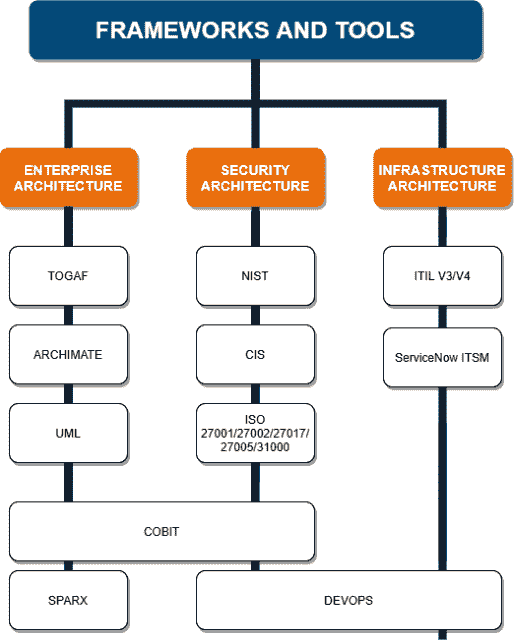
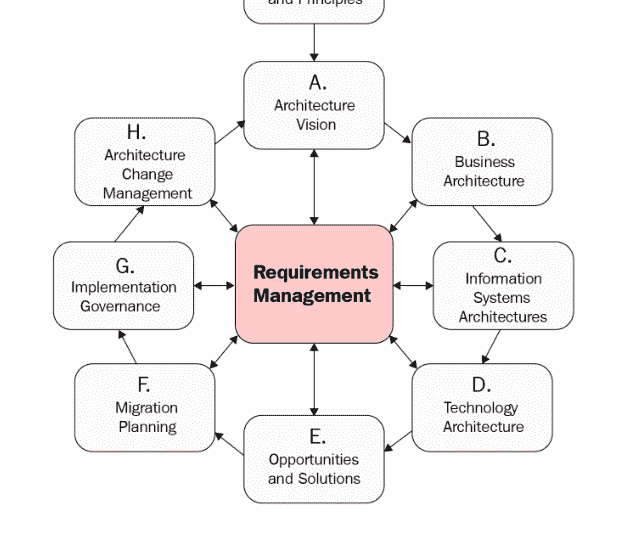
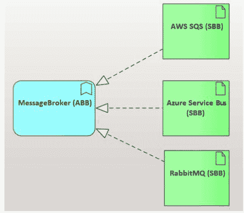
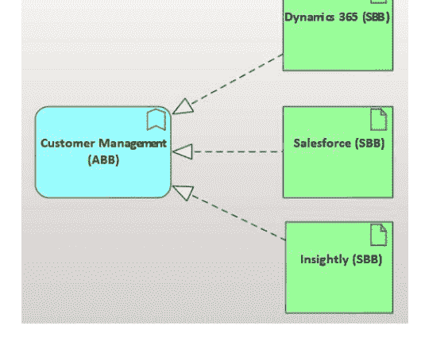
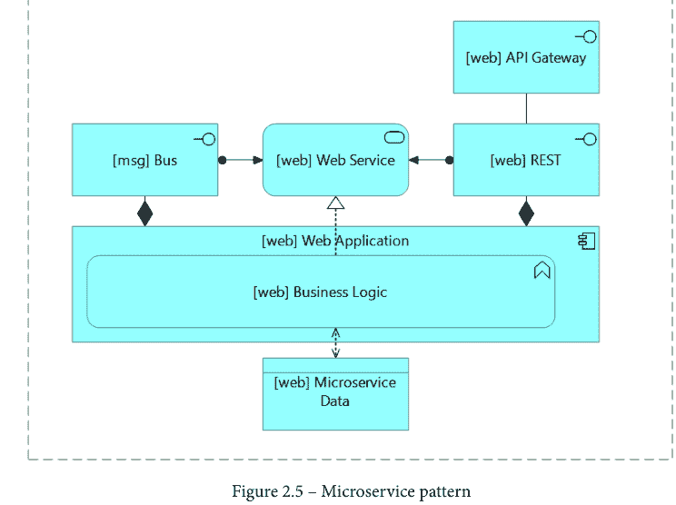
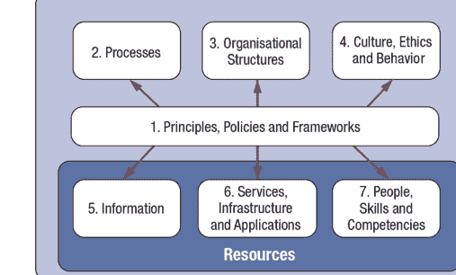

# 2
探索
架构
框架与
方法论

在本章中，我们将探索你在各种组织中通常会遇到的最广泛的框架。请注意，我仅仅介绍它们，因为其中大多数框架都值得用一本专著来阐述。我将努力突出每个框架的核心部分和背后的思维模式。

更具体地说，本章涵盖以下主题：

- 介绍框架与方法论
- 深入探讨开放组体系架构框架（TOGAF）、ArchiMate及相关工具——企业架构（EA）
- 介绍安全框架
- 信息技术基础设施库（ITIL）简述

到本章结束时，你应该能够更好地与那些为更广泛的IT格局做出贡献的利益相关者互动。理解他们的关注点是成长为一名架构师的关键。我鼓励你自行额外努力，以提升我们在本章中涉及的一些领域的技能。

### 介绍框架与方法论

IT行业中有许多框架、标准以及架构工具。框架本质上是一套最佳实践，应当对企业用户具有启发性。它们与标准的区别在于，它们不是规定性的。相反，标准是*规定性的*，你必须遵守其所有规则才能获得认证。下面的截图展示了按架构学科划分的一些常见框架、标准和工具：

图2.1 – 框架与工具

从左侧开始，我们看到EA实践，它主要使用TOGAF和**ArchiMate**建模语言进行。**Sparx Systems Enterprise Architect**是一种广泛使用的工具套件，可帮助你构建ArchiMate视角和**统一建模语言（UML）**图。ArchiMate用于绘制高层视角类型，而UML可用于绘制高层和低层视图类型。如果你坚持使用ArchiMate并且需求较低，可以考虑使用Archi（https://www.archimatetool.com/），这是一个免费的开源软件。

**信息及相关技术控制目标（COBIT）**可用于补充其他框架，具体取决于EA职能是否包含治理机构。COBIT主要用于在组织内建立和推行适当的治理。COBIT还有一个特定的安全相关对应物——即**COBIT for Risk**。

谈到安全，**美国国家标准与技术研究院（NIST）**和**互联网安全中心（CIS）**是安全架构师所熟知并遵循的。此外还有大量与安全相关的**国际标准化组织（ISO）/国际电工委员会（IEC）**标准，你可以据此获得认证。从基础设施的角度来看，历史领导者一直是ITIL，它可以通过利用ServiceNow **IT服务管理（ITSM）**平台来实际实施。现在让我们更仔细地看看EA。

### 深入探讨TOGAF、ArchiMate及相关工具 – EA

如第一章所述，EA职能的主要目的是将IT部门与不同的业务线连接起来，并确保IT投资和举措最终创造业务价值。大多数EA组织都基于TOGAF。

### 介绍TOGAF的ADM

架构开发方法（ADM）的目的是管理EA实践的开发生命周期。下面的截图展示了TOGAF提出的ADM：

图2.2 – TOGAF ADM

你可以遵循这一过程，以一系列逻辑步骤覆盖EA的全部范围。然而，由于TOGAF只是一个框架，你完全可以决定只使用该开发周期中的某些步骤。一旦你完成了预备步骤和架构愿景（图2.2中的步骤A），你就能更好地理解应用TOGAF的程度。如果只有一个必需的步骤，那就是这一步，因为它将帮助你塑造EA实践并决定你将考虑使用哪些其他步骤。然而，由于本书并非关于EA，我将只解释几个你在日常软件架构师工作中更可能遇到的重要概念。让我们从构建块开始。

### 构建块

构建块是一种业务或IT组件，可以与其他块组装以交付解决方案。你可能会遇到**架构构建块（ABB）**和**解决方案构建块（SBB）**。

根据TOGAF规范，ABB和SBB与技术相关，尤其是当它们用于描述应用程序格局时。下面的截图展示了ABB和SBB建模的示例：

图2.3 – ABB与SBB

ABB与具体实现无关。SBB对应于ABB的实现，但它们代表实际的解决方案。在图2.3中，我将**MessageBroker**定义为ABB，右侧的三个矩形则是满足该需求的解决方案。在业务环境中使用时，ABB描绘业务功能，而SBB则指定一个或多个服务于该业务功能的解决方案。

我们的目的不是列出所有可能的SBB，而是列出企业已选择和验证的那些，如下面的截图所示：

图2.4 – 业务环境中的ABB和SBB

我只是不想有所偏颇，或者给你留下你应该选择x或y来满足这种业务需求（客户管理）的印象。构建块的目的是表示业务和技术需求及其相关解决方案。它们将帮助你做出一致的选择，并防止购置（或构建）冗余的解决方案来服务相同的需求。

所有ArchiMate图和视角都是高层的，可以向任何利益相关者（管理层、IT等）展示。现在让我们探讨架构模式的概念。

### 架构模式

架构模式仍然是高层但已属于较低层次的图，更接近解决方案的技术实现。它们被称为模式，是因为它们可以在应用程序和解决方案之间复用。它们已在多个场合被证明是有价值的。作为软件架构师，你可能需要使用ArchiMate或UML对多种模式进行建模。下面的截图展示了一个微服务模式的示例：

图2.5 – 微服务模式

ArchiMate拥有大量代表对象类型和组件之间关系的符号。解释所有这些符号远远超出了本书的范围。简而言之，图2.5展示了微服务模式由一个Web应用程序组件构成，该组件包含业务逻辑（应用功能）。该Web应用程序本身由Web服务、表述性状态转移（REST）和消息传递接口组成。ArchiMate接口对象通过其棒棒糖形状的条易于识别。Web应用程序与微服务专用数据存储交互。REST接口本身与应用程序编程接口（API）网关关联，供客户端消费。

在这里，你同样可以组装经过验证的模式来构建新解决方案，这最终将帮助你节省时间。所谓经过验证的模式，是指已从非功能性需求（NFR）角度（安全性、可伸缩性等）评估过的模式。如果你还想构建更底层的图（如类图），则应考虑使用UML。

## EA 总结

EA 实践并不总是被其他利益相关者很好地理解。无论是业务部门还是其他 IT 团队，通常都会认为它带来的价值很低甚至没有价值。EA 架构师有时是象牙塔里的架构师，想得很多，但对解决方案的具体实现贡献不大（或效率不高）。为避免这种情况，你必须在架构愿景方面下功夫，确保它适合你所处组织的规模和类型。

作为一名软件架构师，如果 EA 实践得到恰当开展，你应当会接触到 EA 工件，因为一个良好的实践必须渗透到各个层级。如果你想了解更多关于 TOGAF 和 ArchiMate 的内容，我建议你阅读开放集团图书馆出版的 *ArchiSurance 案例研究*（https://publications.opengroup.org/y163）。如果你想免费开始使用 ArchiMate，可以下载免费的 **Archi** 工具（https://www.archimatetool.com/download/）。现在让我们来看一些安全框架。

## 安全框架简介

在探索安全框架之前，让我先描述一下安全架构师的典型职责。识别这些职责的最佳方法之一是查看 **注册信息系统安全专家（CISSP）** 认证，这是安全专业人士最追捧的认证。CISSP 考试涵盖以下主题：

- 安全与风险管理
- 资产安全
- 安全架构与工程
- 通信与网络安全
- **身份与访问管理（IAM）**
- 安全评估与测试
- **安全运营中心（SOC）**
- 软件开发安全

这份清单既包含 IT 主题，也包含技术安全主题。我不知道你怎么样，但作为云架构师，我大量接触安全需求，我认为能够说安全架构师的语言是克服某些障碍的关键资产。

一个运作良好的安全组织围绕着风险管理职能展开。能够评估与业务资产相关的风险，将使你理解应该应用哪些安全控制措施和流程。理解组织的风险偏好也很重要。有些组织厌恶风险（典型如银行业），而有些则偏好风险（典型如初创企业）。许多行业还受到特定法规（合规性）的约束。软件架构师必须能够评估其所在组织的安全文化，以便更有效地处理安全问题。

“左移”范式（即从一开始就集成安全）尚未成为主流。作为软件架构师，你主要会接触到软件开发安全。与其试图自己成为安全专家，不如倡导一个强大的**持续集成/持续交付（CI/CD）**工厂，其中包含静态代码安全扫描器，并将其作为质量门禁，将开发的组件从开发环境提升到更接近生产的环境。

这一步已经可以让安全组织放心，你确实在认真考虑安全问题。该工厂是**开发运维（DevOps）**工具链的一部分，有时甚至被称为**开发安全运维（DevSecOps）**或 **GitOps**，甚至 **GitSecOps**。当在中间加入 Sec 时，你明确强调了安全关切。如果你还不熟悉这种工作方式，请务必了解。

由于本书并非关于安全，我不会涵盖所有主题。然而，我承诺过会讨论一些框架，那么让我从 COBIT 5 for Risk 开始。

## COBIT for Risk

COBIT 由**信息系统审计与控制协会（ISACA）**组织维护（https://www.isaca.org/）。总体而言，我喜欢 COBIT 框架的一点是它与业务领域的贴近。COBIT 致力于创造业务价值。没有什么比为了做事而做事，却忘记你为谁工作（业务）更糟糕的了。忘记这些事情的人不是价值的推动者，而是恰恰相反。

COBIT 中的一切都在提醒你为谁工作、为什么这样做，这正是我喜欢它的原因。**COBIT for Risk** 是 COBIT 的补充，旨在与通用 COBIT 框架一起使用。下面的截图展示了 COBIT 和 COBIT for Risk 的关键部分之一，即七个使能器：

图 2.6 – COBIT 的七个使能器

这七个使能器是组织支柱，当你需要寻找有效管理事务的解决方案时，应该加以利用。请注意，你可以自由添加自己的使能器。

让我们逐一简要描述七个使能器，如下所示：

- **原则、策略和框架**：这可以概括为*想得清楚才能表达清楚*。你应该确定符合组织风险偏好的核心原则和策略。这些原则和策略稍后将在所有相关方之间共享和复用。
- **流程**：这些代表执行策略并将原则转化为切实成果的实际手段——例如，*MEA03.01* 流程（其中 MEA 代表 **监控、评估和评价**）帮助你应对不断变化的合规要求。COBIT 附带许多流程，为你提供了强大的结构化方法。
- **组织结构**：这些是推动组织业务和 IT 目标及风险管理实践的关键使能器——例如，聘请**数据隐私官（DPO）**是管理**通用数据保护条例（GDPR）**相关问题的直接使能器。DPO 可以依赖一些内置的 COBIT 流程，或添加自己的流程来控制 GDPR 相关事项。
- **文化、道德和行为**：公司的 DNA 通常体现在其员工和合作者身上，这既是好事也是坏事。好的一面是，认同公司 DNA 的人应当努力实现公司的目标。坏的一面是，如果 DNA 发生变化，这些人可能会成为阻碍进一步变革的因素——例如，从厌恶风险的文化转变为偏好风险的文化，或反之，并非易事。人们可能只是继续沿用过去十年一贯的工作方式，这会减缓你的变革雄心。任何重大变革都需要配套的适当变更管理计划。公司应当开展风险意识宣传活动，在员工队伍中培养特定的思维方式，因为他们是第一道防线。作为软件架构师，理解公司文化以优化你与同事和管理者的互动非常重要。
- **信息**：这个使能器利用现有信息——例如，你可以创建风险登记册并保持其更新。这应有助于你良好控制和监督整体风险。
- **服务、基础设施和应用程序**：这个使能器主要支持信息使能器。
- **人员、技能和能力**：没有合适的人员和合适的能力，你什么也实现不了。当你决定使用风险管理框架时，请确保相关人员能够学习它。

COBIT 的强大之处在于，你可以将上述七个使能器应用于任何主题，从全局治理到特定范围的风险管理职能。

在接下来的章节中，我只会强调 COBIT 在风险职能范围内的潜力，但我强烈建议你更深入地了解它，特别是如果你参与任何治理工作的话。

## 理解风险

回到正题，什么是风险？风险是不利事件发生的概率，并对资产或公司产生负面影响。大多数情况下，风险可以被避免或缓解。残余风险是在所有缓解措施到位后剩余的风险水平。风险评估的目的最终是评估还剩多少残余风险，并让业务据此做出明智决策。一个良好的安全实践旨在告知业务部门风险，而不是强加任何东西。

举一个极端的例子，如果合规成本高于不合规时公司会承受的罚款（及其他影响），业务部门可能会明智地决定违反某项法规。

*Figure 2.7* 中描述的风险场景属于 **投资组合建立与维护** 类别，该场景描绘了资源分配方面的问题。正如你所见，此风险与安全无关。相反，下面的截图展示了将相同的风险场景结构应用于技术主题：

| 风险场景标题 | 对称密钥被泄露 |
|---|---|
| 风险场景类别 | 基础设施被盗或破坏 |
| **风险场景描述** | 如果存储不当或被恶意使用，对称密钥可能会被泄露，从而使服务总线面临无人监管的访问。 |
| **风险场景组件** | |
| **威胁类型：** | 恶意 |
| **行为者：** | 内部恶意内部人员（最可能）。外部攻击者（可能性较小）。 |
| **事件：** | 盗窃 |
| **资产/资源（原因）：** | 流程 BAI10 未得到良好应用。 |
| **持续时间：** | 延长 |
| **发生：** | 时机非关键 |
| **检测：** | 很可能缓慢 |
| **滞后：** | 立即，因为攻击者可以立即对服务总线进行身份验证 |
| **可能的风险响应** | |
| **避免：** | 使用 Azure AD 进行身份验证并防止访问 *Root/Manage/SharedAccessKey* |
| **接受：** | N/A |
| **分担/转移：** | N/A |
| **缓解** | • 将密钥存储在密钥保管库中 • 频繁轮换密钥 • 监控 *get secret* 和 *list key* 操作 |

图 2.8 – 技术风险场景

*Figure 2.8* 中描述的风险场景说明了服务总线对称密钥可能被恶意使用的情况，该密钥用于对总线进行身份验证。持续时间、检测和滞后等参数有助于界定风险并识别其发生与其后果之间的时间间隔。这两个截然不同的示例展示了如何利用 COBIT 来为风险管理服务。两种风险均参考了 COBIT 预定义的类别和流程。你可以在自己的类别和流程中扩展 COBIT。将风险场景与其他 COBIT 工具相结合，例如利用 COBIT 使能因素，代表着一套强大的工具箱。

## COBIT 总结

作为一名软件架构师，你可能会遇到高度敏感的应用程序和系统。你可以使用风险场景，因为它们简单明了，便于正式描述风险并做出响应。我们尚未介绍其他 COBIT 工具，但请自行进一步探索。现在我已简要介绍了 COBIT，让我们来看 NIST。

## NIST

NIST 是一个广为人知的美国框架（https://www.nist.gov/），可用于任何技术相关主题。它附带了一个专门针对网络安全的框架——即 NIST 网络安全框架（NIST CSF）（https://www.nist.gov/cyberframework）。NIST CSF 涵盖了我之前在描述 CISSP 认证时介绍的所有职责。与 COBIT for Risk 一样，NIST CSF 也处理风险管理，但两个框架可以一起使用。我们不会再进一步研究 NIST，但我想确保你将其纳入关注范围，因为 NIST 组织发布的文章、参考架构等可能对软件架构师有用。我个人曾在云战略练习的云相关主题中使用过此类出版物。为了完成我们的框架之旅，让我们来看坚不可摧的 ITIL 框架。

## ITIL 简介

ITIL 是诞生于英国的框架。早在 1980 年代，英国政府意识到其内部 IT 服务管理相当混乱。他们决定清理并构建一个框架，将来自各地的最佳实践汇集到服务管理领域。从那时起，ITIL，目前为第 4 版（v4），已成为世界领先的 IT 服务管理框架。世界各地的基础设施和运营团队都在有意识或无意识地使用 ITIL。

ITIL 主要关注内部客户。例如，当你作为员工或合作者请求一台用于工作的公司笔记本电脑，或需要访问某个系统时，你就会求助于 ITSM。ITSM 涵盖了为客户（本例中为内部）交付价值的组织能力。基础设施部门和服务台职能是公司的后台办公室。它们保持系统运行，确保每个人都有必要的工具和访问权限开展工作。这项工作往往得不到认可，但对公司运营至关重要。

2018 年，ITIL v4 取代了使用已久的 ITIL v3，而许多组织至今仍在使用 ITIL v3。ITIL v4 改变了一些概念并将 ITIL 实践扩展到 ITSM 能力之外。然而，典型能力（请求管理、问题管理、事件管理等）仍在范围内，所有组织都需要这些能力。

作为软件架构师，你更有可能参与应用开发以响应 **功能需求（FRs）**。你也应部分参与 NFRs（我们下一章的主题），其中包括可扩展性、**高可用性（HA）** 等典型主题。许多 NFRs 不仅与代码相关，也与基础设施相关，因此你 *需要* 与基础设施架构师协作。你可能经历过开发团队与基础设施团队之间思维冲突和信息孤岛。这部分是由于这些团队的组织方式所致。大多数开发团队早已采用敏捷，而基础设施团队仍围绕 ITIL 组织。在 ITIL 中，没有即兴发挥；一切都提前经过深思熟虑并遵循清晰的生命周期和清晰的流程。

作为软件架构师，你应掌握 ITIL 的核心部分，以便更好地与基础设施架构师互动。ITIL 使你理解基础设施团队提供横向服务（邮件、文档管理、网络、企业设备等），其范围覆盖整个组织，而大多数应用程序的范围更窄。这些服务的规模部分解释了为何它们依赖于稳健的服务管理原则，因为它们根本承受不起中断。简而言之，ITIL 是关于服务设计和服务运营。ITIL 是关于 *衡量* 和 *管理* 你的 IT 服务。

ITIL 仍是 IT 格局的基石，但 DevOps 和 DevSecOps 试图占据一些空间，以使团队间的协作和工具链更高效。ITIL 倡导客户满意度，但现实世界的实施往往（过于）以 IT 为中心，而敏捷则更以业务为中心。DevOps 和 DevSecOps 的目标是弥合这两种观点，二者都是必要的。

## 总结

在本章中，我们浏览了 IT 行业中最广泛使用的一些框架。你了解到 TOGAF 和 ArchiMate 是企业架构师的语言。作为软件架构师，你可能会被要求绘制架构模式和一些 EA 构建块。随后我们回顾了 NIST 和 COBIT for Risk，它们有助于推动安全实践。最后我们探讨了 ITIL，即大多数组织使用的事实上的 ITSM 框架。通过理解这些框架的核心部分，你应该能够优化与其他利益相关者的互动。这些额外技能可能成为你与普通软件架构师之间的差异化因素。当然，我鼓励你进一步探索这些框架，因为在本章中它们只是被介绍。

在下一章，我将介绍一种我在不同地方使用过的软件架构方法论，你迟早会遇到它。
