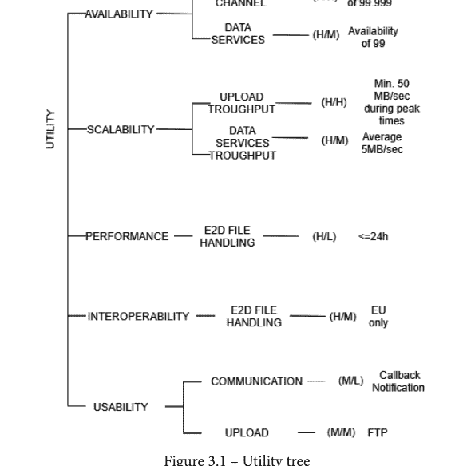
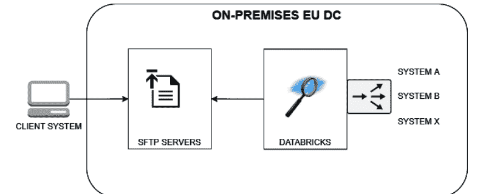
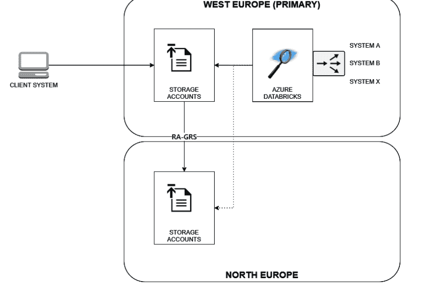

# 3
理解 ATAM 和软件质量属性

本章将为你概述架构权衡分析方法（ATAM），这是一种在组织中广泛采用的架构分析方法。正如引言章节所述，软件架构实践可能因公司或行业而异，但你迟早会在路上遇到 ATAM。本章我们希望让你理解 ATAM 的精髓。

在本章中，我们将更具体地涵盖以下主题：

- 介绍 ATAM
- 理解敏感点、权衡点、风险和非风险
- 探索质量属性

- 质量属性场景入门
- 实际用例
- ATAM 与规模化敏捷

## ATAM 简介

设计选择归根结底是权衡取舍。在许多企业和项目中，我们通常致力于设计和开发一流的软件，但最终结果可能出人意料。这些与最初预期的偏差，可能源于我们被迫采取的捷径、预算限制、永久性的范围变更、缺乏恰当的分析、缺乏深思熟虑的架构，等等。所有这些原因都可能导致某些设计选择，而这些选择反过来又会引发权衡取舍。如果没有识别这些权衡取舍的正式方法，组织就无法做出明智的决策，甚至在生产环境出现问题时也无法进行**根本原因分析（RCA）**。

捷径的一个例子是：预算不足以微调某些安全方面，但忽略了这一点，你可能会增加暴露给恶意用户的风险。对于处理公共数据的资产来说，这比处理**个人身份信息（PII）**数据的资产风险要低。类似地，如果一个系统的首要需求是可移植性，你可能会设想一个容器化平台，而不是编写一个利用 Windows 特定功能的普通 .NET 应用程序。

如你所见，这一切都关乎在特定情境下做出良好判断，而本质上这正是 ATAM 的全部意义所在。**ATAM** 帮助软件架构师通过对照软件质量属性评估设计选择，来兼顾一些通用和特定的关注点，从而达成某些质量目标。

这听起来可能显而易见，但质量——通常定义为*合乎目的*与*合乎使用*的结合——有时是软件正确运行或达到高行业标准的绝对要求。一份缓慢的报告或许会让最终用户感到不快，但在真正的实时系统中，无法在 3 毫秒内处理一个事件是不可接受的。

让我们回到“合乎使用”和“合乎目的”这两个概念上来。**合乎目的**意味着所开发的内容与功能需求相符，而**合乎使用**意味着所开发的内容能够可靠运行。这里有一个典型的例子可以说明这些概念：你对洗衣机有什么期望？你期望它能把衣服洗干净*并且*能可靠运行。的确，一台洗涤效果极佳但每两周就出一次故障的机器，会让人失望。这就是为什么质量是这两个概念的综合。

ATAM 的美妙之处在于，它迫使你去思考“合乎使用”和“合乎目的”，这会影响产品的最终质量。ATAM 将帮助你定义质量目标，并据此做出设计决策。它使你能够检测某个关注的质量属性是否受到一个或多个设计决策的影响，从而让你能够确定优先级，并专注于那些对你正在构建的产品的成功至关重要的关键因素。理想情况下，ATAM 应在实际实施之前进行，但你也可以在*棕地场景*中使用它来评估现有架构的适宜性。ATAM 应被视为灵感来源，并以务实的方式使用。你无需照本宣科。

现在，让我们来讲解 ATAM 的核心。

## 理解敏感点、权衡点、风险与非风险

如前文所述，做出设计选择往往会对一个或多个质量属性产生正面或负面影响。需要掌握的两个最重要概念是敏感点和权衡点，其次是风险与非风险。在进入更复杂的场景之前，我们先快速定义一下这些概念，如下所示：

- **敏感点**代表能够显著影响单个质量属性的架构选择——例如，维护活动可能会影响可用性这一质量属性。
- **权衡点**是可能影响至少两个敏感点的架构决策，因此需要权衡取舍，这意味着你可能不得不牺牲一个质量属性以成全另一个。例如，进行客户端加密会对安全性产生正面影响，但对性能产生负面影响。你可能会选择更好的安全性，但代价是较差的性能。
- **风险**是某些架构决策带来的后果。你和业务方可能会接受一定程度的残留风险——例如，你可能决定将资产托管在单个数据中心中。残留风险是，如果该数据中心遭遇重大灾难，你可能会经历完全停机。
- **非风险**是*好的*架构决策带来的机遇——例如，使用某种技术可能会让你开箱即用地获得额外的安全特性。

**敏感点**和**权衡点**告诉软件架构师应将注意力放在何处。它们有助于识别实现质量目标的关键所在。请记住，这些目标应源自业务目标。以下是几个敏感点的示例：

- **可扩展性**：并行度对消息代理中定义的队列和/或分区数量*可能敏感*。
- **性能**：延迟对我们选择的应用协议（例如，**超文本传输协议 1（HTTP/1）**或 HTTP/2）*可能敏感*。
- **安全性**：数据泄露风险对应用于静态数据的加密级别*可能敏感*。

在表达敏感点时，最好使用“*可能对……敏感*”或“*对……敏感*”这样的句式结构，以强调结果与原因之间的关系。一旦定义，敏感点便充当了可能影响最终质量的因素基线。因此，例如，以上述列表中的第二项为例，使用 HTTP/1 或 HTTP/2 在延迟（更优性能）方面存在天壤之别。然而，尽管延迟主要与所使用的协议有关，但其他方面（如负载均衡）也可能受到影响。

让我们再添加一个额外的敏感点来说明我们的目的，如下所示：

- **可用性**：后端对我们选择的应用协议（例如，HTTP/1 或 HTTP/2）*可能敏感*。

添加上述敏感点后，我们有两个不同的质量属性（性能和可用性）可能因我们选择的协议而受到显著影响。这就是一个*权衡点*，因为选择 HTTP/2 对性能有正面影响（改善延迟），但对可用性可能有负面影响。这背后的原因是，大多数负载均衡器仍停留在第四层（**传输控制协议/网际协议（TCP/IP）**），并不理解第七层（在我们的场景中即 HTTP/1 或 HTTP/2），这意味着它们将无法正确地对 HTTP/2（流行的**谷歌远程过程调用（gRPC）**在底层使用的协议）进行负载均衡，因为现有客户端会持续将请求发送到同一台后端服务器，而无论该后端是健康的还是即将变得不健康。

因此，在这种情况下要做出恰当的设计决策，我们还需要考虑负载均衡器，并确保它们与此类决策兼容。如果不兼容，我们可能需要重新考虑要使用的协议。如果我们不顾老旧的负载均衡器而继续使用 HTTP/2，我们最终会面临**风险**。ATAM 将风险定义为可能存在问题的设计决策，或尚未做出的决策。相反，**非风险**则基于某些假设。

例如，就同一话题而言，一个非风险的例子是：假设每分钟有 10 个并发用户，那么即使我们的第四层负载均衡器无法正确理解第七层协议，后端系统也应该仍能应对负载。因此，只要该假设仍然成立，这个非风险就是有效的。如果预期的用户规模显著增长，这个非风险将不再有效，或者必须重新验证。

另一种可能的非风险隐含在某些架构风格之中；例如，由于我们的服务网格技术能够感知第四层和第七层协议，无论在正常还是高负载情况下，系统都将始终与响应最快的后端服务通信。

如果你理解了这一节，那么你就理解了 ATAM 的精髓。它是一种方法，使你能够识别精心设计的软件架构的关键质量目标和成功因素，这样的架构既合乎目的，又合乎使用。现在，让我们来探索质量属性。

## 探索质量属性

在构建应用程序或系统时，你总是同时面对**功能需求（FRs）**和**非功能需求（NFRs）**。功能需求由业务用户和业务分析师提出，它们描述了必须开发或提供的功能特性。非功能需求在大多数情况下是被期望的，但并非由业务方直接表达。事实上，每个用户都希望拥有高性能、可靠且始终可用的应用程序。同样，每个用户都默认应用程序/系统是安全的，并尊重他们的隐私，但这一切都是有代价的，而你希望对这些非功能需求做出响应的程度，将影响成本和时间的维度。你所集成的系统、你选择用来托管资产的平台，以及许多其他因素，都可能使非功能需求难以实现。

质量属性的目的是表达非功能需求，并据此定义期望。软件质量属性的列表非常广泛；在维基百科的 `https://en.wikipedia.org/wiki/List_of_system_quality_attributes` 页面上，汇总了大约 80 个属性。因此，关键是要对它们进行筛选，挑选出那些最适合你以及你的特定业务场景或行业的属性。

确实，在某些行业中，不同资产之间可能存在一些共同之处，你可以从中提炼出质量属性基线。无论如何，无论你是否拥有基线，一个好的起点是获取业务方期望的**服务水平协议（SLA）**。在大型组织中，此类 SLA 已是主流做法，即使对内部客户也是如此。

作为 SLA 的一部分，通常会有 **恢复时间目标 (RTO)** 和 **恢复点目标 (RPO)** 的概念。简而言之，这两个目标说明了预期的可用性和弹性水平。RTO 为 2 个工作日时，我们可以清楚地理解业务对系统中断并不太在意。相反，RTO 为 30 分钟则直接将可用性质量属性设为高优先级。RPO 也是如此，业务可能承受一定数据丢失——例如当数据从主系统复制时。RPO 要求较低时，你就已经知道自己并不特别需要投资 **始终在线的结构化查询语言 (SQL) 集群** 或提供 **时间点恢复 (PITR)** 能力的数据服务。RTO 和 RPO 是非常结构化的问题。

除了 RTO、RPO 和 SLA 之外，你还应尝试预见业务增长、**上市时间 (TTM)**、**总拥有成本 (TCO)** 等，以细化和优先考虑产品质量属性。请注意，成本问题不是 ATAM 的一部分，但我们都知道预算在每个项目中都是关键。

在维基百科上列出的 80 个质量属性中，以下是常见的情况：

- **可用性**：你可以将可用性视为评估应用程序/系统是否适合用途的一种方式。这是少数关注功能的质量属性之一。
- **可用性和可靠性**：这两个属性 somewhat 相关。系统的可用性以“几个 9”表示——例如，可用性的最高 SLA 为 99.999，表示系统 99.999% 的时间可用。没有人会愚蠢到承诺 100% 可用。大多数情况下，99% 或 99.9% 的可用性已经非常好。也就是说，99.9% 的可用性意味着你每年可以承受约 8 小时 45 分钟的停机时间，但这并不意味着你可以连续停机 8 小时 45 分钟。这就是 RTO 发挥作用的地方。可靠性反映了系统按定义运行的能力。你在执行相同操作时不应观察到不同的行为。可用性不足对可靠性有强烈影响。
- **响应性**：此属性与性能相关。评估系统响应性的一种实用方法是测量其延迟。
- **可维护性**：此属性反映了系统吸收错误修复以及变更请求的能力。
- **可扩展性**：此属性反映了系统处理额外负载的能力。请注意，在大多数现代应用程序和系统中，它们通常至少被期望具有按需扩展，而不是预先扩展/扩展。扩展是指添加服务的额外实例/组件，而扩展是指为每个实例分配更多内存和 **中央处理单元 (CPU)** 功率。在无服务器架构中，你甚至会提到弹性，这意味着系统会动态自动扩展/缩减，以便按确切的资源消耗付费，而无需担心（除了成本，当然）。
- **可测试性和可部署性**：如今，许多企业已经采用或即将采用敏捷方法（大规模敏捷）。项目开展方式的这种变化影响了新功能开发和发布到生产环境的节奏。因此，通常需要拥有坚实的基础（**持续集成/持续交付**）（**CI/CD**）平台）使其成为可能。发布次数越多，需要执行的测试就越多。因此，系统的可测试性变得非常重要。
- **可移植性**：此属性要求系统能够在不同环境中工作。
- **安全性**：此属性不是维基百科列表的一部分，但在我们这个超互联的世界以及许多企业中不断扩大的云足迹中，它绝对重要。安全属性的目的是确保系统不会因内部和外部的恶意或意外行为而变得脆弱。

ATAM 并没有规定你应该或不应该使用哪些质量属性。所选的质量属性将根据你的用例和优先级而有所不同。现在让我们探索质量属性场景。

## 开始使用质量属性场景

一旦你确定了适用于系统的质量属性列表，你就可以定义质量属性场景。这些场景的目的是将事件、其结果以及架构的预期响应联系起来。ATAM 描述了以下三种类型的场景：

- 用例
- 增长
- 探索性场景

大多数时候，只考虑用例场景。它们旨在描述可能的用例以及架构的预期响应。增长和探索性场景旨在预测接下来可能发生的情况。适当场景的选择应与相关利益相关者达成一致，包括产品负责人和项目经理。虽然 ATAM 提供了诸如效用树之类的工具来将业务目标转化为质量属性，但现实表明，我们通常最终会得到一个 Excel 表格（或 Word 文档），汇总所有场景，并在架构师内部讨论。尽管如此，我们将在下一节看到一个效用树的示例。

## 实际用例

在本节中，我们将为了简洁起见，介绍一个非常简化的用例。以下是业务场景：

Contoso 需要为其客户提供数据上传通道。上传的数据文件可能包含错误，必须经过数据清洗和数据整理阶段。如果错误无法自动修复，应通过回调通知将错误文件返回给发送方。经过此第一次数据检查和转换阶段后，结果验证数据将被路由到相关系统进行进一步处理。此外，出于主权原因，客户要求数据只能在欧洲处理，并且他们习惯于 文件传输协议 (FTP) 系统。

上传通道应始终可用，而实际数据处理在系统中断时可能会被延迟。Contoso 的客户预计在 24 小时内收到通知。客户上传的数据总量约为每月 1 太字节 (TB)，在高峰时段，最多可有 250 名客户同时上传数据。出于监管原因，客户发送的原始文件的保留时间为 5 年。

从这个简化的用例中，业务已经提供了一些重要事项，概述如下：

- 上传通道应始终可用。
- 最多可有 250 名客户同时上传数据。
- 数据应在欧洲摄取和处理。也应存储 5 年。
- 端到端 (E2E) 文件处理时间不应超过 24 小时。

让我们现在根据我们的发现推导出一个效用树。

## 效用树

为了简洁起见，我们将跳过典型的质量属性，例如可用性、可部署性和可维护性，这些通常会成为练习的一部分，无论业务是否明确表达。

让我们专注于明确表达的内容，并构建以下效用树：

图 3.1 – 效用树

图 3.1 代表了我们可以从业务场景中捕获的简化视图。树的每个叶子代表一个架构重要需求 (ASR)。我们决定关注可用性、可扩展性、性能和互操作性。关于可用性，我们同时关注上传通道和数据服务。如你所见，上传通道标记为 (H/H) 注释，其中 H 代表高；可能的值为低、中和高。这种量化代表了对业务的影响（左侧）和对架构的影响（右侧）。

这具体意味着该需求对业务非常重要，并且对架构而言风险很高。换句话说，这不会是我们容易实现的目标，我们必须密切关注，因为实现起来不会容易。

相反，我们发现端到端（E2E）文件处理性能不佳，并且我们认为其风险较低。我们也保留了**可扩展性**，因为我们已经知道系统将被限制在高峰时段。**性能**也是其中的一部分，因为我们对客户有一个时间预期。最后，**互操作性**强调了所有组件必须位于欧洲这一事实。在正常情况下，效用树会比 *Figure 3.1* 中所示的丰富得多。

尽管如此，在生成效用树之后，我们确定了一些质量属性作为我们架构的主要业务驱动因素——即可用性、可扩展性、互操作性、可用性，以及（在较低程度上）性能。需要记住的关键是，所有利益相关者都应对所选择的质量属性有共同的理解。例如，一些利益相关者可能会被诱惑将数据主权归类在安全之下，这完全没问题，只要大家都达成一致。

换句话说，可以得出以下结论：

- 如果上传通道可用，系统至少是部分工作的。
- 如果上传通道可用且数据服务宕机，系统是部分工作的。
- 如果上传和数据服务都可用，系统是完全工作的。
- 如果数据发送者在 24 小时内收到答复，系统性能是正确的。
- 我们的组件托管平台必须位于欧洲。
- 大多数客户传统上通过 FTP 发送文件。

前述观察中有趣的一点是，我们已经确定了我们的关键任务服务：*上传通道*。识别此类服务始终很重要，因为我们不能合理地认为我们将为解决方案的每个服务/组件提供 99.999% 的可用性。追求这种可用性无疑会花费巨额资金，而大多数项目都负担不起；尽管 ATAM 本身不考虑成本，但我们都知道在现实世界中，它是一个非常重要的因素。现在我们有了主要驱动因素，让我们尝试识别一些场景。

## 质量属性场景

在某些组织中，你可能会看到在场景已知之前，某些架构方法已经摆在桌面上。当然，可以在之后识别场景，但这可能会导致场景存在偏见。由你决定以何种顺序展开该序列，但先进行场景的第一轮运行可能是更好的方法。

质量属性场景具有以下属性：

- 描述
- 质量属性
- 代表上下文的环境
- 刺激源，即事件的触发器（刺激）
- 刺激，即事件本身
- 工件，即相关组件
- 响应，即预期的系统行为
- 响应度量，即测量的行为

你可能会看到刺激源和刺激合并，以及响应和响应度量。环境也经常被跳过。其原因有时是缺乏时间。大多数质量场景以 Excel 表格或 Word 文档的形式呈现。有时，你甚至可能最终得到以下结构：

- 描述
- 质量属性
- 敏感点和权衡点
- 架构方法
- 风险和非风险

前述结构将问题、敏感点和权衡点以及潜在的解决方案/缓解措施合并在一起。这可以被视为某种 ATAM 快速版。请记住，重要的是要识别敏感点、权衡点和风险。

让我们针对我们的用例回顾一些质量属性场景。我们将从上一节创建的效用树中推断它们，但为了简洁起见，我们将限制为以下六个场景：

| S1 – Description | Operations on the platform must happen during planned downtime. The impact over the upload channel(s) should be minimal and short. |
|---|---|
| Attribute | Availability. |
| Business value/architectural impact | High/Medium. |
| Stimulus | Maintenance tasks. |
| Environment | Underlying upload channel infrastructure. |
| Artifact | Upload channels. |
| Response | Operations occur within an agreed timeframe and maintenance takes less than 2 hours. |

Table 3.1 – First scenario

| S2 – Description | Upload channel(s) outage |
|---|---|
| Attribute | Availability |
| Business value/architectural impact | High/High |
| Stimulus | Outage |
| Environment | Channel hosting platform |
| Artifact | Upload channel |
| Response | Automatic restore of upload channel within < 10 minutes |

Table 3.2 – Second scenario

| S3 – Description | Data service(s) outage |
|---|---|
| Attribute | Availability |
| Business value/architectural impact | Medium/Low |
| Stimulus | Outage |
| Environment | Data platform |
| Artifact | Data services |
| Response | Degraded user experience (UX) until service(s) is/are back up and running, with an RTO of a maximum of 6 hours |

Table 3.3 – Third scenario

| S4 – Description | Data sent by customers must be handled E2E within Europe. |
|---|---|
| Attribute | Interoperability. |
| Business value/architectural impact | High/Medium. |
| Stimulus | File transfer and handling. |
| Environment | At runtime. |
| Artifact | Customer data file. |
| Response | Requests are treated in Europe 100% of the time. |

Table 3.4 – Fourth scenario

| S5 – Description | Customers prefer to send files over FTP. |
|---|---|
| Attribute | Usability. |
| Business value/architectural impact | Medium/Medium. |
| Stimulus | File transfer. |
| Environment | At runtime. |
| Artifact | Customer data file. |
| Response | FTP Secure (FTPS)/Secure FTP (SFTP) channel(s) is/are exposed through port 21 or 22. |

Table 3.5 – Fifth scenario

| S6 – Description | During peak times, there could be up to 250 concurrent customers sending data files. |
|---|---|
| Attribute | Scalability. |
| Business value/architectural impact | High/High. |
| Stimulus | Increase in memory, CPU, and input/output (I/O). |
| Environment | In normal circumstances and during peak times. |
| Artifact | Upload channel. |
| Response | Provisioned channels will be able to ingest 5 megabytes (MB)/second; additional capacity will be made available to accommodate 50 MB/second during peak times. |

Table 3.6 – Sixth scenario

可以制定许多其他场景，但上述六个场景是最相关的。我们跳过了性能方面，因为没有真正严格的约束，我们也排除了安全性。

## 已识别的敏感点

从上一节列出的场景中，我们可以推断出一些敏感点，如下所示：

- **SP1**：上传通道的可用性 *对* 运营维护的数量和持续时间 *敏感*。
- **SP2**：上传通道的可用性 *对* 冗余级别 *极其敏感*。
- **SP3**：可扩展性，尤其是最大入口吞吐量 *对* 并发上传通道的数量 *敏感*。
- **SP4**：可用性 *对* 上传方法 *敏感*。
- **SP5**：互操作性 *对* 托管平台位置 *敏感*。

现在我们有了场景列表和一些敏感点，让我们尝试用一些架构方法做出回应并评估其影响。在对所提出的架构进行初步分析后，我们应该会看到权衡点出现。

## 架构方法

在深入研究不同方法之前，让我们先看一下以下简化图表，展示不同的组件和流程：

从左到右，客户端系统将数据文件发送到上传通道。文件会被我们的数据服务拾取以进行数据清洗和数据整理。 resulting data 根据输入数据的性质路由到不同的系统。请注意，我们完全排除了与其他系统的集成，而在现实中，这肯定会对架构产生很大影响。让我们专注于数据摄取和数据处理方面。

## 方案 A – 本地基础设施

Contoso 已经拥有一些本地 SFTP 服务器，可用于接收客户数据。Contoso 是一家美国公司，并在欧洲设有一个数据中心。Contoso 团队集思广益后提出了以下方案：

图 3.3 – 高层架构方案：第一种选项

除了具备 SFTP 容量外，他们还拥有本地 Databricks 集群，可以处理数据清理和数据整理操作。在审视质量属性场景后，他们发现对之前识别的敏感点存在一些潜在影响，具体如下：

- SP1：修补 SFTP 服务器的维护窗口非常短，Contoso 要找到一种路径并操作这一数量可能庞大的服务器群将具有挑战性。
- SP2：由于 Contoso 在欧洲只有一个数据中心，如果发生重大数据中心事件，他们将无法规避灾难恢复（DR）风险。因此可用性面临风险，因为另一个数据中心没有冗余。
- SP3：他们仍需进行估算，但发现要在高峰时段容纳 5 MB/秒和 50 MB/秒的入站流量具有挑战性。此外，他们意识到每月 1 TB、持续 5 年（保留期）意味着需要 60 TB 的存储。他们必须与存储团队核实，但乍一看这一数字非常庞大。

这里识别出一个权衡点（TP1）：如果他们还能依赖美国的数据中心，就可以解决 SP1 和 SP2。遗憾的是，这会对 SP5 产生负面影响。

在与法务部门核实后，显然 SP5 是一项绝对要求，因此不允许采用 TP1。于是他们提出了方案 B。

## 方案 B – 基于云的架构

由于 Contoso 在欧洲仅有一个数据中心，其容量受限，他们开始构想基于云（Azure）的架构，并提出了以下方案：

图 3.4 – 高层架构方案：第二种选项

这一次，他们利用了欧洲的两个不同数据中心。他们发现该方案与大多数敏感点保持一致。在审查过程中，他们意识到了以下内容：

- SP1：使用完全托管的存储账户不存在风险，因为维护完全透明且由云提供商执行。此外，得益于启用读取访问异地冗余存储（RA-GRS），数据会复制到次要区域，一旦发生区域性故障（这是罕见事件），可以启动故障转移。然而，启用 RA-GRS 的账户提供的可用性仍为 99.99%，而不是预期的 99.999%，因此这里存在风险。
- SP2：一个存储账户将代表一个具有高并发上传支持能力的单一上传通道。冗余已内置于服务中。
- SP3：文档显示，单个存储账户可处理每秒 10 千兆字节（GBps）的吞吐量，约为 1.25 GB/秒，远高于所需吞吐量。
- SP5：他们符合在欧盟（EU）边界内处理所有数据的要求。

尽管该方案似乎更合适，但他们还是识别出一个权衡点（TP1）：虽然上传通道方法对多个敏感点有积极影响，但它对可用性质量属性（SP4）有负面影响，因为客户传统上使用 SFTP 或 FTPS 传输文件。

因此，这里我们再次面临权衡。实际上，你很可能最终会面临多个权衡点和残余风险。

现在让我们总结这个用例。

## 用例总结

我们必须在这里结束用例，但你可以想象，类似但不同的方法都应该经过分析，一旦所有权衡点都被识别和评估，就应该选择最佳方案。可能的替代方案包括：

- 云数据中心与本地数据中心的组合
- 基于云的主备（active-active）设置，使用不同的存储账户和不同的 Databricks 集群
- 发布建议征求书（RFP），让供应商提交方案

我们希望你已经理解了各种机制，包括分析业务需求、识别质量目标、编写业务场景，以及提取敏感点、权衡点、风险和非风险。目标是在选择目标解决方案之前，进行多次迭代并审查多个选项。你很可能最终会有一些需要向业务部门报告的残余风险。

我们没有关注与代码相关的非功能需求（NFR），例如可维护性、可读性和可升级性，因为大多数关键 NFR 属于基础设施和安全领域，而且我们只会在第 5 章“设计模式与整洁架构”中专注于代码。

现在让我们看看如何在敏捷驱动型组织中处理 ATAM。

## ATAM 与大规模敏捷

如前所述，许多公司倾向于在其数字化转型过程中采用敏捷方法论。你可能想知道 ATAM 在敏捷组织中是否适用。这个问题值得提出，并且可能没有确切的答案。

不过，让我试着分享我的观点。总体而言，敏捷方法论旨在以及时且具有成本效益的方式交付增量业务价值。这里的关键词是“增量”。敏捷拥抱最小可行产品（MVP）的概念，简而言之，MVP 是一个生产级应用程序，具备最少的功能数量，这些功能足以让业务方认为其可行，从而吸引早期采用者并在竞争对手之前将产品推向市场。这个 MVP 的定义明确针对功能特性，而并非真正针对 NFR。虽然这种增量工作方式对于尚未开发的功能来说完全可行，但对于诸如系统整体安全性之类的 NFR 却很难适用。

例如，传输中加密要么启用，要么未启用；静态数据要么加密，要么未加密。很难找到介于两者之间、被认为既最小又可接受的情况。抛开安全性不谈，一种出路可能是也将 MVP 概念应用于前面描述的 RTO 和 RPO。如果你能降低期望值，那么就可以同时使用 ATAM 来打造更具未来适应性的架构，以满足完整产品的需求。即便如此，敏捷方法论通常对与代码相关的质量属性（如可维护性、可测试性和可部署性）有着非常积极的影响，因为它们往往依赖于强大的 CI/CD 平台，在这些平台上，代码扫描和自动化测试是一等公民。

然而，作为软件架构师，你有责任告诉业务方，在 MVP 阶段，他们很可能不会受益于高度弹性的架构。换句话说，在一个完全由敏捷驱动的项目/计划中，目标架构不太可能从第一天起就可用。你还应致力于提升架构的成熟度水平。

## 总结

读完整章后，你应该已经掌握了 ATAM 的要点及其主要目的：发现敏感点、权衡点、风险和具有影响力的质量属性，以帮助你做出明智的决策。我强烈建议你对 ATAM 采取务实（而非教条）的态度，因为并非所有资产都需要同等程度的关注。然而，在关键任务项目中，ATAM 被证明是高效的，并且可以归功于在正确的时间提出正确的问题。错误架构决策导致的缺陷在后续阶段很难修复和调整。请注意，我说的是缺陷，而不是成熟度水平。你可以以增量方式工作，但应确保最终不会在架构中出现真正的设计缺陷。ATAM 应该为你提供保护，避免此类不利情况。在下一章中，我们将回顾从几十年前到如今的各种架构风格。

