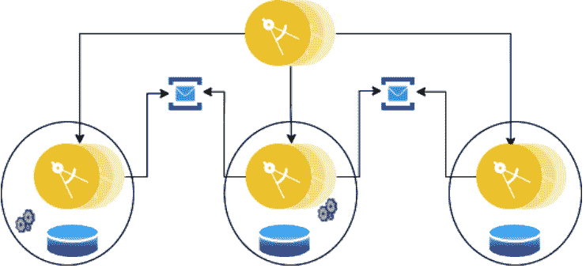

# 4 回顾历史架构风格

在本章中，我们将回顾一些现有的架构风格。我决定只按时间顺序关注少数几种风格，从单体架构到微服务，但架构风格的列表远不止这些。还有更多的风格和模式，但我选择的这些既代表了遗留系统，也代表了现代系统，你在软件架构师的职业生涯中一定会遇到它们。

以下是我们将重点关注的主题：

- 介绍架构风格
- 从单体架构开始
- 继续探讨**面向服务的架构（SOA）**
- 最后介绍微服务

读完本章后，你应该能够理解单体架构、SOA 和微服务的优缺点。你应该足以识别你所面临的架构风格，并将所学技能应用到自己的情境中。

### 介绍架构风格

架构风格是影响应用程序设计、构建和托管方式的高层设计选择。做出这样的选择会迫使你遵循该风格附带的标准实践。有些架构风格的作用层级高于其他风格。

例如，三层架构基于三个不同的层——表示层、业务层和数据层——这三者在物理上是分离的。在三层架构中，表示层不能直接与数据层通信。应强制实施网络策略以防止此类情况发生。如你所见，这种架构不仅影响托管环节，还影响你组织不同组件开发的方式。相反，模型-视图-控制器（MVC）模式同样基于三层，但所有层都可以部署到单个服务器上。这里不需要物理拆分。然而，选择 MVC 会迫使你相应地拆分代码，并可能推动你使用某个 MVC 框架。

同样，事件驱动架构（EDA）和发布/订阅模型会要求你遵循消息驱动架构特有的概念，例如基于队列的负载均衡模式、声明检查模式和竞争消费者模式等。

为了与我们在前一章讨论的 ATAM 联系起来，某些架构风格会直接影响质量属性。它们可能带来固有的风险和非风险，进而可能对质量属性产生正面或负面影响。我将在后续章节中用斜体字突出说明这一点。

要判断某种架构风格在你的情境中是否合理，你必须了解每种风格的优缺点。你还必须评估你的组织（或客户）采用某种风格的能力，以及这种风格对现有技术格局的颠覆程度。

我决定聚焦单体架构、SOA 和微服务的原因在于，这些风格至今仍然活跃，你在日常软件架构实践中很可能遇到其中之一。另一个原因是它们紧密相关，并在某种程度上反映了 IT 行业的时间演进。我们大概是无意识地始于单体架构，然后尝试用 SOA 解决单体架构的问题，最终用微服务解决 SOA 的问题。同样值得注意的是它们各自的关注范围。对于单体架构，应用程序是核心，因为你倾向于忽略其周围的一切。对于 SOA，企业是核心，应用程序必须符合企业层面定义的内容。对于微服务，我们再次回到应用程序，但将其细化为领域和子领域。

正如你将在后续章节中看到的，每种架构风格都有一系列优点和缺点。每种风格可能会在 IT 格局中存在相当长的时间，即使是所谓的单体架构也是如此，我们将在下一节中看到。

### 从单体架构开始

我想你一定已经熟悉单体架构了，因为它们似乎已经成了纯粹的邪恶之物。然而，冒着让你震惊的风险，我要说单体架构可能会永远存在，并且有一些有趣的好处。在查看它们的优缺点之前，让我们先看看单体架构是什么样的：

图 4.1 – 单体架构的字面含义

上图展示了单体架构的真正含义。它就像是某种单块岩石，你无法从中取出任何一块，至少无法徒手做到。这是一件难以操作、对变化有一定抵抗力的东西。然而，虽然上图所示的单体似乎很难操作，但下图中的那些看起来就容易得多：

图 4.2 – 小型单体架构

是的，你猜对了：*对于单体架构，规模确实很重要！* 单体架构的问题在于它们会随着时间推移而增长。当你从一个微小的应用程序开始时，仍然可以及时调整它，而无需承担太多风险。随着时间流逝，这个小单体往往会变大，最终变成图 4.1 中那样几乎无法操作的单体。

那么，你是怎么走到这一步的？可能是因为你没有选择适当的架构风格，或者可能是因为你没有遵循一些基本的开发原则，又或者是因为你没有考虑我们在前一章讨论的质量属性。

如果你不在软件中强制分层，或者如果你的层彼此紧密耦合，你最终将不可避免地得到单体架构。话虽如此，并不是每个应用程序都会随时间增长，这就是为什么有意识地选择单体架构在某些情况下仍然可以接受。例如，如果你有一个一次性的任务型程序，你可以决定以单体方式开发它。这是因为你知道它不会随时间演进，而且这可能对你来说是最直接的开发方式。

在微观层面，从单个应用程序的角度来看，单体架构在某种程度上促进了敏捷性，因为它倾向于忽略企业格局中存在的任何事物。开发单体架构的团队根本不在乎周围有什么；他们只做需要做的事情。为了达成项目特定目标，他们会毫不犹豫地与其他应用程序或数据库进行点对点连接。这使得团队获得了速度和自主性，但如果应用程序随时间增长，就有可能变成图 5.1 所示的大型单体。

在宏观层面，多个小型单体的增多可能会形成企业级单体，这更成问题。如果整个企业技术格局变成了一盘意大利面，就再也没有人敢改动任何微型应用程序了，因为级联副作用的风险增加了。所以，你可能已经猜到了，应尽可能避免单体架构。尽管如此，让我们看看它们提供了哪些好处。

### 单体架构的优点

可能很难相信，但单体架构也有优点。以下是一些优点：

- 开发单体架构很容易。你不需要学习任何软件架构方法论。它们的简单性可能正是它们如此之多的原因。
- 它们部署简单。由于大多数情况下它们被打包成单个包，重新部署应用程序只需部署单个包即可。
- 它们易于监控。同样，单体应用程序通常部署在单台机器上，旁边是一个数据库服务器。在某些情况下，你可能会有多个前端/应用服务器，但在排查问题时，需要查看的地方并不多。

关键词是*简单性*，至少只要应用程序保持轻量级。现在，让我们看看一些缺点。

### 单体架构的挑战

诚然，单体架构的缺点多于优点：

- 添加新功能和修复错误变得复杂。如前所述，大多数单体架构被打包成单个包。虽然这可以被视为一种简单的部署方式，但每一个功能或错误修复都会导致你重新部署整个应用程序，这将造成暂时（希望如此）的中断，并需要大量回归测试。这损害了*可测试性*，并最终损害了*可部署性*这一质量属性。随着时间的推移，团队将缺乏敏捷性，这会影响*可升级性*。

- 代码通常高度耦合。大多数大型单体应用中的类与子组件相互交织，违反了单一职责原则。这损害了*可维护性*和*可读性*等质量属性。
- 缺乏细粒度的*可扩展性*。由于单体应用是单块岩石，必须作为一个整体进行扩展/扩容，尽管并非应用的每个部分都会以同等强度被使用。这长期来看会造成基础设施资源的浪费。
- *可用性*面临风险。由于应用是原子性的，特定模块中的任何问题都可能导致整个应用中断。
- 技术债务风险更高。因为变更随时间推移变得问题重重，团队不愿升级到最新的框架和技术。这使技术债务更加深重，并使应用面临失去支持和安全漏洞的风险。使用单体应用的后果是它们通常对*可支持性*和*安全性*产生负面影响。

上面的列表并非详尽无遗，但它让你清楚了解编写单体应用时承担的风险。不过，正如我们之前提到的，对于不打算增长的程序/应用，它们仍然可能是完美的选择。现在，让我们看看 SOA 如何试图防止企业级单体应用。

## 继续探讨面向服务的架构（SOA）

SOA 通过以服务形式暴露业务能力，在整个企业范围内促进可重用性。SOA 出现于上世纪最后十年，旨在解耦应用。在 SOA 之前，客户端应用直接相互连接，或连接到具有读写权限的共享数据库，这种情况非常普遍。这导致了严重问题，并形成了前文所述的企业级单体应用，以至于更改任何内容都可能给许多应用带来问题，导致缺乏敏捷性，并且进行小改动所需的时间不断增加。

最终对 SOA 不利的因素之一是**简单对象访问协议（SOAP）**，最初版本如此，后来简称为 SOAP，它在 SOA 兴起时非常主导。SOAP 用于以结构化方式交换数据。它由**可扩展标记语言（XML）**支持，并以**网络服务描述语言（WSDL）**的形式定义了网络服务契约。虽然 SOAP 最初设计用于无状态服务，但实际上在数据交换时大多用于有状态通信。SOAP 也是一个相当重量级的协议。它的元数据信封消耗了大量带宽，使其成为*事实上的*标准，同时在某些情况下并不合适。SOAP 之后不久出现了**表述性状态转移（REST）**，它回归 HTTP 的根源，以缓解 SOAP 的大部分问题。然而，REST 并非为 SOA 设计，尽管可以将 RESTful 服务与遗留 SOA 结合。

REST 变得非常流行，与此同时，基于 Web 的应用和轻量级 Web API 成为主流甚至主导。对 REST 兴趣的日益增长敲响了 SOA 的丧钟。然而，SOA 尚未完全消亡，因为公司对其投入巨大，这意味着它还会存续一段时间。

让我们来看看 SOA 的优点和缺点。

## SOA 的益处

SOA 具有以下好处：

- 有助于解耦应用和服务，从而实现更好的互操作性。
- 对 IT 和业务资产进行更好的治理。在一定程度上，SOA 旨在提供单一事实来源。
- 促进企业范围内的*可重用性*。
- 帮助识别企业级业务资产。
- 技术无关，尽管系统性地使用专有 ESB 仍会导致一定程度的供应商锁定。
- 改进*可扩展性*，因为服务是独立的，可以根据自身需求进行扩展。

上面的益处列表并非详尽无遗，但基本就是实施 SOA 所能获得的好处。现在，让我们回顾 SOA 的一些挑战。

## SOA 的挑战

SOA 最大的挑战如下：

- 缺乏敏捷性。因为 SOA 倾向于治理整个企业版图，并且 ESB 被用作其基石，每个团队和项目都必须与 ESB 集成/遵从 ESB。
- 复杂性增加。
- 成本增加，尤其是设置和配置 ESB 的成本。
- *可用性*可能面临风险。ESB 是单点故障。ESB 的任何中断都会级联到所有相连的服务和应用。
- SOA 未能自我革新。

请注意，这些缺点并非特别是 SOA 本身固有的，而是通常其实施方式导致的。大多数大型企业采用了自上而下的 SOA 方法。大多数大型企业以非常高的成本从大型供应商那里购买了专有软件。因此，SOA 往往导致*一刀切*的做法，这从来不是好主意，并且扼杀了敏捷性。另一个对 SOA 不利的因素是云平台的兴起。SOA 与云并非不兼容，但云和云原生平台形成了一种范式转变，强烈促进敏捷性，这对 SOA 并不完全友好。现在，让我们探讨微服务。

## 微服务

微服务在过去几年变得流行，但仍然不太容易找到关于它们是什么的共同定义。在我看来，微服务可以看作 SOA 的强化版，范围限定在单个应用内。微服务架构完全基于服务，但与 SOA 相比，最大的区别在于它们的粒度级别、分解程度和范围。SOA 最大化企业范围内的可重用性，而微服务关注有界上下文，这些上下文可能因应用而异。

以下是微服务架构的高层示意图：

图 4.5 – 微服务架构

前图中的每个外圈代表一个由微服务形成的独立有界上下文。在一个微服务内部，你可能有一个或多个组件以及一个专用的数据存储。微服务之间的通信通过发布/订阅机制异步完成。每个微服务可能暴露一个公共 API，供客户端或其他服务使用。不鼓励跨微服务进行同步通信，因为它可能导致通信过于频繁的系统，这类系统的可扩展性和性能较差。同步通信只能从客户端应用（如用户界面或移动应用）或从**面向前端的后端（BFF）**使用，因为它们是基于请求/响应模型的面向用户的组件。最后，**gRPC** 应优先用于同步通信，因为它比传统的基于 HTTP/1 的 REST 通信性能更高。请注意，基于 HTTP/2 的 REST 与 gRPC 一样快，但在数据序列化方面仍然性能较低，而数据序列化基于**协议缓冲区**（https://developers.google.com/protocol-buffers）。

与先入之见相反，各个服务的大小并不重要。它们往往很小，因为它们具有单一职责，但一个纳米服务如果承担过多职责或处理属于另一个领域的事务，完全可能违反微服务原则。

虽然益处很多，微服务也带来了众多挑战。

## 微服务的挑战

另一方面，微服务也带来了一些严重的挑战：

- 识别合适的有界上下文可能是微服务最具挑战性的部分。上下文过小可能导致贫血服务，没有业务价值。有界上下文过宽可能会导致单个上下文包含过多业务逻辑和过多概念，从而增加其成为单体应用的风险。
- 由于微服务的分布式特性，单个事务往往涉及多个服务，导致基于编排器和基于编舞的 Saga（一系列操作），这增加了复杂性。
- 由于微服务拥有自己的数据库，你可能不得不对其他有界上下文中发生的数据事件做出反应，以复制你本地感兴趣的数据。这导致了**最终一致性**，即数据只会在一定时间后变得一致。最终一致的系统通常以牺牲准确性为代价来优化读操作。因此，在某些情况下，并不适合将一个有界上下文中的某些数据更改复制到另一个有界上下文，因为这会形成最终一致的系统。这可能并不适合所有情况。例如，如果你想知道银行账户余额，你希望确保第一次就得到正确的数字。相反，你上一篇博客文章获得的点赞数并不太重要，因此在刷新博客文章页面时不需要绝对准确。
- 由于分布式税，可能存在*性能*影响。在单体世界，一次调用就足以完成整个任务，而在微服务世界，你往往需要进行多次调用，可能导致网络耗尽，或至少性能下降。像断路器这样的模式有助于防止此类网络饱和。当然，最好的选择是尽可能依赖异步模式。
- 失去全面的监督。由于职责和所有权的稀释，随着应用的增长，很难掌握哪个服务在做什么。
- 更难监控。同样，由于服务可能使用不同的技术和数据存储，一致且连贯地监控它们通常更具挑战性。此外，由于不同的团队负责不同的服务，他们可能缺乏处理异常和记录日志的通用方式。

-   更难保障安全。同样，这主要是因为不同的团队可能使用不同的技术、工具和框架，这些技术、工具和框架可能带有不同类型的漏洞。一个良好的 CI/CD 工厂有助于缓解其中一些问题，它会静态扫描你的代码以及你依赖的开源库。
-   与现有环境的集成变得更加困难，因为大多数企业都拥有大量遗留系统，这些系统不可能在眨眼间迁移到微服务。这可能迫使微服务设计者构建防腐层，以使他们的限界上下文免受遗留系统中发生的情况的影响。

正如你所看到的，微服务是复杂的，你当然不应该默认采用它们。对于复杂的领域和快速发展的业务，你应该求助于微服务。另一方面，如果你构建的是分布式单体而不是真正的微服务，结果复杂性仍然会更高，但你会自动获得敏捷性、可伸缩性和韧性。底线是，就非功能需求而言，分布式单体虽然更复杂，但仍然比单体更好。你将最大限度地增加获得一个*适合使用*的系统的机会。现在，让我们看看我们有哪些微服务托管选项。

## 托管微服务

微服务是云原生的*典范*。然而，你可以将微服务架构托管在本地，因为尽管这听起来矛盾，云原生并不需要云基础设施。我们将在*第 6 章，云对软件架构实践的影响*中再讨论这一点。大多数真正的微服务架构都托管在容器化平台上。这并不是绝对的要求，但它会让你的生活更轻松。以下是 **Kubernetes (K8s)** 非常适合微服务的一些原因：

-   **可伸缩性**：在 K8s 中，每个微服务对应一个部署。每个部署都可以开箱即用地指定自己的伸缩需求。
-   **韧性**：如前所述，使用微服务可以提高应用的韧性，因为单个服务的失败不应影响所有其他服务。借助 K8s，你可以利用自愈功能，这意味着 K8s 会尝试重启失败的容器。
-   **可部署性**：每个微服务都可以使用金丝雀发布、蓝绿部署、滚动更新等部署技术独立部署。
-   **可用性**：由于每个微服务彼此分离，我们可以轻松识别关键任务服务，并使用 **PodDisruptionBudget** 资源类型，它可以防止意外中断，包括计划维护期间的中断。
-   **对多语言架构的支持**：如前所述，微服务是多语言的，因为不同的团队可以使用不同的技术，只要底层托管平台支持即可。容器编排器就是这种情况。

为了补充 K8s，你还可以依赖 **Linkerd**、**Istio** 和 **Open Service Mesh** 等服务网格，因为它们可以改善全局监控，带有更智能的负载均衡器（这些负载均衡器是第 7 层协议感知的），并提供 **mTLS**，从而在不同微服务之间提供某种一致性。

## 微服务实战

如果你想看到微服务的实际应用，我建议你查看位于 https://github.com/dotnet-architecture/eShopOnContainers 的开源示例应用程序，或其变体 https://github.com/dotnet-architecture/eShopOnDapr，它模拟了一个在线 eShop。第二个链接还介绍了**分布式应用运行时（Dapr）**，它有助于服务发现以及与底层数据存储的通信。Dapr 是厂商中立的，并且有连接到数十种系统的连接器。我相信 Dapr 将在未来 5 年内成为大多数微服务架构的一部分，但当然，我没有水晶球。

现在，让我们总结一下这一章。

## 总结

我希望，在了解了我们在本章讨论的这三种架构风格之后，你会感到更加轻松。作为软件架构师，你通常可以在单体架构或微服务架构之间做出选择。你不太可能有权自行选择 SOA，因为 SOA 是企业层面的工作，而不是一个人的表演。然而，你现在应该明白，在一个 SOA 驱动的企业中选择非 SOA 将是相当具有挑战性的。

尽管架构风格是高层级的，但它们对软件质量属性有着重大的正面或负面影响。

在下一章中，我们将考虑更低级别的设计选择，并更深入地研究软件开发者实现的代码设计模式。
