# 5 设计模式与整洁架构

虽然软件架构不仅仅是编码，软件架构师仍然需要具备关于开发（尤其是设计模式）的广博知识。在本章中，我们将探讨一些最常见的设计模式。我们将仔细研究代码相关的关注点。

我们将更具体地介绍以下主题：

-   理解设计模式及其目的
-   回顾四人帮（GoF）
-   深入研究最常见的模式，并将它们应用于用例场景
-   了解整洁架构
-   我的十大代码坏味

本章应帮助你掌握最常见的几种设计模式，以及如何在你的软件架构实践中使用它们。这些模式必须被充分理解，因为它们影响着可修改性、可扩展性、可靠性、可维护性、可测试性、可伸缩性以及与性能相关的一切等质量属性，正如我们在第 3 章《理解 ATAM 和软件质量属性》中所见。

现在让我们回顾一下技术要求。

### 技术要求

为了使一些抽象的概念更加具体，一些设计模式将用 .NET 代码示例来说明。如果你想在本地测试这些代码，你需要 **Visual Studio** 或 **Visual Studio Code (VS Code)**。两者都可以从微软网站免费下载。

请注意，这些代码仅用于说明目的。所有代码示例和图表都可以在 https://github.com/PacktPublishing/Software-Architecture-for-Humans 获得。

让我们从设计模式的定义和基本原理开始。

### 理解设计模式及其目的

**设计模式**是一种公认的最佳实践，用于解决常见问题。许多应用程序都面临同样的挑战，如下所示：

-   它们必须高性能。
-   它们必须是可测试的。
-   它们必须是可维护的，并且应该能够随着时间增长。
-   它们必须具有一定程度的可移植性。
-   它们必须高效地管理内存和**中央处理器（CPU）**。
-   它们必须能够扩展。
-   它们必须支持并发（线程安全）。

上述列表只是典型的*横切关注点*的一个子集。设计模式的目的是找到处理常见问题的最佳方法，而不管使用什么编程语言。

设计模式具有启发性，并不特别规定详细实现应该如何完成。设计模式仍然是高层级的，它们旨在提高代码质量，并最终遵循 **SOLID** 原则，这是由 Robert C. Martin 创制的一套被广泛采用的原则。

SOLID 代表以下术语：

-   **单一职责原则（SRP）**：这一原则旨在掌控给定类的范围，并确保**关注点分离（SoC）**。
-   **开闭原则（OCP）**：这一原则背后的想法是促进代码扩展，同时防止对当前代码的修改。这可以通过接口和抽象类使用一定程度的抽象来实现。
-   **里氏替换原则（LSP）**：你可以找到许多关于这一原则的定义。掌握它的最佳方式之一是通过矩形和正方形示例。如你所知，在数学中，正方形也是矩形。假设我们有一个 `Rectangle` 基类，它有两个独立的 `SetWidth` 和 `SetHeight` 方法。现在，我们实现一个 `Square` 类，它是 `Rectangle` 的子类，这似乎是合适的，因为正方形是矩形。但因为我们知道正方形必须具有相等的高和宽，所以我们重写基类的方法，以便在设置宽度时调整高度，反之亦然。这样做时，以下构造将导致问题：

    ```csharp
    Rectangle rect = new Square();
    rect.setWidth(10);
    rect.setHeight(5);
    Assert.Equal(50, CalculateArea(rect));
    ```

    这是因为当传入正方形时，生成的面积在本例中将是 25 而不是 50。在这种情况下，我们不能再将矩形替换为正方形，因为正方形无法表现得像矩形。更一般地说，当基类和子类具有相互矛盾的约束时，破坏 LSP 原则的风险就会上升。在这种情况下，最好直接拆分 `Square` 和 `Rectangle`。破坏 LSP 最常见的（而且往往是无意的）可观察表现是著名的未实现异常，它实际上阻止了派生类对基类的任何替换。
-   **接口隔离原则（ISP）**：这一原则的目的是控制接口的范围，并确保接口客户端只实现其需求所必需的内容。因此，你应该尝试最大化接口的粒度。
-   **依赖倒置原则（DIP）**：DIP 的目的是确保类只依赖抽象，而不是具体类。我们将在本章后面重点探讨这一原则。

> **注意**
> 设计模式在 SOLID 创建之前很久就已经存在。因此，它们并非为遵循 SOLID 而创建，但由于最佳实践已融入这些模式，使用它们会增加按设计符合 SOLID 的机会。


软件架构师的角色是评估哪些模式对特定情况更有意义。在选择和应用这些模式进行开发时，你应始终牢记**架构权衡分析方法 (ATAM)** 的敏感性和权衡点。你不应教条主义，盲目地仅仅为了使用而应用某些模式。这样做被称为** cargo cult programming **，它包括在你的资产的上下文中毫无实际用途的模式的仪式性包含。这通常是误解这些模式的迹象，或者充其量反映了一种不成熟的态度。

软件架构师的存在是为了确保每种模式都以资产的利益为出发点并发挥实际作用。软件架构师应比任何人都更努力地为业务创造价值。实现这一目标的一种及时且成本效益高的方法是，在适用时依赖经过充分验证的现有解决方案/框架。打造自制框架并炫耀你能构建复杂事物会让你几乎不可替代，但不一定是一个好的软件架构师。这通常是不成熟态度的标志。你必须站在为你付费的业务的立场上思考。

如果允许我打个比喻，如果你最初要求的是房子，你就不想为一座摩天大楼付费，即使这座摩天大楼是用最先进和顶级的特性建造的。同样，你也不需要为一座普通的房子提供摩天大楼的基础。我想传达的信息是，你应该优先考虑效率而非有效性。用锤子杀死一只苍蝇是*有效*的，但不是*高效*的。这听起来可能很明显，但我见过无数开发者因为自己构建了别人不太理解的东西而非常自豪，而这不是你应该走的路。不要仅仅为了自豪而过度设计！让我们现在回顾著名的 GoF。

## 回顾 GoF

GoF 源自那本令人难忘的书籍，*Design Patterns: Elements of Reusable Object-Oriented Software*，于 1994 年出版，由四位作者撰写——因此得名。该书普及了设计模式的概念并提出了 23 种模式。此后又添加了许多其他模式。查看大多数可用模式的一个不错来源是这个维基百科页面：https://en.wikipedia.org/wiki/Software_design_pattern。在这里，你可以找到 GoF 提出的原始模式以及后来添加的模式。作为软件架构师需要知道的第一件事是设计模式的不同类别，概述如下：

- **Creational**：此类模式与对象的实例化相关。它们主要影响*性能*和*可扩展性*。它们有助于防止计算资源的浪费。创建型模式，尤其是**依赖注入 (DI)** 模式，还能改善代码的*可测试性*和*可维护性*。
- **Structural**：此类模式主要关注对象和类的组合。它们主要作用于代码的*可读性*和*可维护性*。
- **Behavioral**：行为设计模式的重点是处理对象间的通信。这些模式规定对象如何相互交互。行为模式对代码的*可修改性*有很大影响。

请注意，我已经在模式类别与 ATAM 中重要的某些质量属性之间建立了一些联系。如果我必须在代码审查期间或在开发任何东西之前对这些类别进行优先级排序，我会首先关注创建型，然后是行为型，最后是结构型模式。

其理由是，即使你在可读性和可维护性方面写出了糟糕的代码，这段代码仍可能完成预期的工作并符合**非功能性需求**（NFRs）如可扩展性和性能。在这种情况下，业务是满意的，因为应用程序是*适合目的*且*适合使用*的。相反，如果你写出了非常漂亮的代码但忽略了性能和可扩展性方面，应用程序可能*适合目的*但肯定不*适合使用*。请记住，质量的定义是同时满足这两个概念。我强烈建议你在审查或即将设计解决方案时思考这一点。毋庸置疑，所有设计模式的共同目标当然是提高可重用性并实现松耦合对象。

在它的页面上，维基百科还提出了其他类别，但对此没有共识。前述三个类别是普遍采用和理解的。维基百科页面还涵盖了一些**架构模式**，我们在上一章中讨论过。让我们现在深入研究最常见的模式。

## 深入最常见的模式并将其应用于用例场景

坦白说，我没有进行任何科学研究来评估哪些模式是最常用的。这基于在实地中的经验观察。在本节中，我们将重点关注最频繁使用的模式，无论构建何种类型的应用程序。在*第 6 章，云对软件架构实践的影响*，和*第 7 章，架构趋势和全球总结*中，我们将回顾与云原生和更新的架构趋势相关的模式，而当前章节则侧重于更传统的模式。

下图显示了我们将重点关注的一些模式：

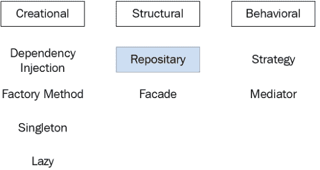

*Figure 5.1 – Design patterns we will focus on*

*图 5.1 – 我们将重点关注的设计模式*

如果你在想的话，**repository** 模式的背景是深色的，因为其确切定位存在争议。关于它属于哪个类别并没有真正的共识。该模式本身经常存在争议，但我将在本节后面再回来讨论。我不会触及每种模式的所有细节，而是尝试突出关键部分并确保你掌握需要记住的核心内容。

让我们从每位软件架构师都应该无疑了解的一种模式开始——即 DI。

### 理解 DI 模式

DI 的目的，作为创建型的一部分，是通过契约，即接口，将类解耦。具体的类实现接口，并且当在消费者类中遇到该接口时，会将给定接口的具体实现*注入*到客户端类中。这种方法有多种好处，如下所述：

- 可测试性得到改善，因为我们可以轻松地用相应的测试类替换具体实现。
- 代码更易于维护，因为多个具体类可以以不同的方式实现同一接口，从而增加了可能性范围。

下图说明了 DI：

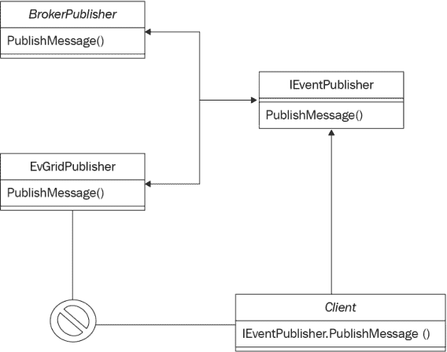

Figure 5.2 – DI diagram

图 5.2 – DI 图

*Figure 5.2* 显示 `IEventPublisher` 是我们的契约——即我们的接口。我们的 `Client` 类消费此接口。`BrokerPublisher` 和 `EvGridPublisher` 都是 `IEventPublisher` 的具体实现。DI 机制包括将契约的具体实现注入到消费者类中。这使得消费者类无需了解实现细节。

*Figure 5.2* 还显示我们可以无缝地将 `BrokerPublisher` 或 `EvGridPublisher` 注入到消费者中。消费者唯一确定的就是注入的具体对象（依赖项）实现了 `IEventPublisher` 契约。这允许更大的灵活性和可扩展性。在前面的示例中，我们可以扩展我们的消息发布者列表并拥有不同的实现，而不会影响消费者端。这种技术还极大地改善了*可测试性*，因为我们可以轻松地将模拟对象注入到单元测试中。注入可以通过以下两种方式实现：

- **Direct:** 这种类型的注入通常在单元测试中完成。
- **Indirect:** 这种类型的注入使用**DI container**完成。DI 容器的作用是在消费者类遇到该契约的实例时解析该契约的具体实现。在单元测试之外，这种类型的注入是首选方式。


在 `SendMessage` 方法的实际实现中，我们假装向总线发送消息，而该方法是契约的一部分。类似地，`IEventPublisher` 的另一个实现可以是这样：

```
public class EvGridPublisher: IEventPublisher{
    public async Task PublishMessage(string message){
        await Task.Run(() => {
            //SendMessageToGrid()
        });
    }
}
```

图5.6 – IEventPublisher 的另一个实现

这次，我们假装向事件管理器发送消息。这两种实现展示了使用接口的灵活性。现在，在应用程序编程接口（API）控制器中，我们让 DI 容器注入相关的映射具体类，如下所示：

```
[ApiController]
[Route("[controller]")]
public class DemoController : ControllerBase{
    private readonly IEventPublisher _evPublisher;

    public DemoController(IEventPublisher evPublisher){
        _evPublisher = evPublisher;
    }

    [HttpPost]
    public async Task<IActionResult> PublishMessage(string message){
        await _evPublisher.PublishMessage(message);
        return new AcceptedResult();
    }
}
```

图5.7 – DI 容器注入类

构造函数将 `IEventPublisher` 的一个实例作为参数，在本例中，该实例被替换为 `BrokerPublisher` 的实例，如启动类中所定义的那样。有可能同时存在多个实现同一契约的具体类，并将它们添加到集合中。在这个例子中需要记住的关键是，控制器并不知道实现细节。它将接收一个实现了特定契约的对象的具体实例。这使得编写单元测试更加容易，我们将在下一节中看到。

## DI 代码——直接模式

DI 最大的优势之一是其对可测试性质量属性的积极影响。让我们看看上一节中控制器的两种不同测试方式。仍然在 ASP.NET Core 中，以下方法使用了模拟框架：

```
[Fact]
0 references
public async Task PublishMessageTest()
{
    var _mockEventPub = new Mock<IEventPublisher>();
    var _demoController = new DemoController(_mockEventPub.Object);
    var actionResult = await _demoController.PublishMessage("test");
    Assert.IsType<AcceptedResult>(actionResult);
}
```

图5.8 – 模拟框架

如你所见，我们使用 `IEventPublisher` 契约的模拟表示直接实例化 `DemoController`。这使我们能够注入一个伪造对象，而不是我们之前使用的实际 `BrokerPublisher` 类。这样做的原因是你不希望在单元测试期间执行实际操作。请注意，使用模拟框架并不是必需的，但会让你的工作更轻松。下面是另一种实现：

```
[Fact]
0 references
public async Task PublishMessageTestWithBasicDirectInjection(){
    var _demoController = new DemoController(new TestPublisher());
    var actionResult = await _demoController.PublishMessage("test");
    Assert.IsType<AcceptedResult>(actionResult);
}
```

图5.9 – 替代的模拟框架

这次，我们注入一个 `TestPublisher` 的实例，其实现如下所示：

```
public class TestPublisher : IEventPublisher{
    public async Task PublishMessage(string message)
    {
        await Task.Run(() => {
            //test use case()
        });
    }
}
```

图5.10 – TestPublisher 实例

这只是 `IEventPublisher` 的另一种变体，借助 DI 模式，我们可以在这里模拟任何我们想要的行为。如你所见，在前面的示例中，我们通过构造函数注入技术直接注入了依赖。

## DI 模式总结

尽管我们已经看到了一种特定的实现类型，但请记住以下几点：

- DI 的详细实现并非规定性的。只要确保对象通过其中一种注入技术获得其依赖，任何实现都是可以的。
- 我们只涉及了构造函数注入，但还存在其他可能性，例如方法注入和属性注入，它们比构造函数注入提供更细粒度的控制。
- DI 在将具体类与其使用方解耦方面起着关键作用。不过，你应该保持较低的抽象层数量，以避免额外的复杂性和对可读性的负面影响。
- 我们在一个测试中使用了模拟框架，但完全由你自己决定要使用什么。

通常，我们做的每件事都有利弊，但 DI 并不适用这一点。毫无疑问，每个项目都强烈鼓励使用 DI。对于这一点，我允许你做个“货舱崇拜式开发者”。现在让我们探讨另一个著名的（反）模式——单例模式。

## 探索单例设计模式

单例模式属于创建型模式类别，但因其并未总是被恰当使用而经常引发争议。许多人甚至认为它是一种反模式。然而，对于重量级对象，这种模式有时是必要的。所谓重量级，我指的是初始化耗时较长或初始化时消耗大量资源的对象。

单例模式的目的是在每个应用程序域中仅实例化一次给定对象。这意味着该对象只会创建一次，并在应用程序的整个生命周期内共享，因此明智地使用它非常重要，因为随之而来的还有一大堆缺点。下图展示了在消费者之间共享的单个实例：

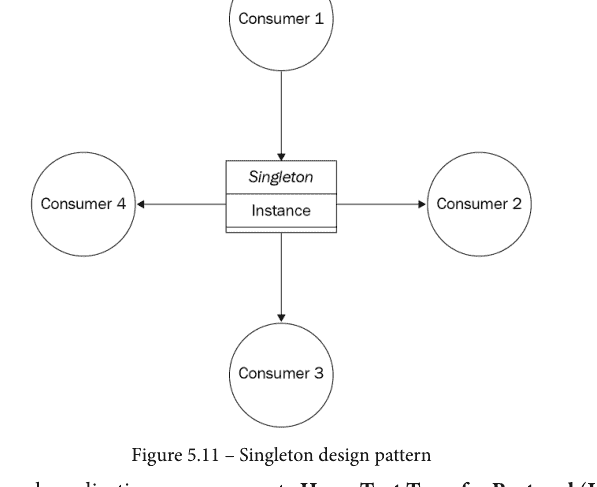

图5.11 – 单例设计模式

在 Web 应用程序中，每个独立的超文本传输协议（HTTP）请求都会命中同一个单例实例。现在让我们看看单例模式的实际应用。

正如它们的名称所示，一个实现是线程安全的，而另一个不是。通过这个示例，我想说明单例模式的主要缺点之一——线程安全性。在高负载下，如果不注意并发，最终可能会出现单例的多个实例，这会导致意外结果，因为单例的主要目的就是在任何情况下都只有一个实例。此外，这类初学者错误可能不会直接显现，而可能在应用程序已经投入生产后出现。排查起来并不容易，所以你最好尽早发现并解决这些问题。

回到示例，我们首先从非线程安全实现 `NotThreadSafeSingletonExample` 类开始。首先，我们看到 `_instance` 是一个私有类成员，当公共实例属性触发私有构造函数时，它会被设置。在 get 访问器中，如果 `_instance` 为 null，我们设置其值，然后返回它。

我添加了一个 sleep 语句来模拟初始化缓慢的对象。这段代码本应在任何情况下都创建单个实例。问题在于多个线程可以同时访问同一资源。在竞争条件下，如果没有同步机制，多个线程可能同时将 if 语句判断为 true，并创建一个实例，从而破坏了单例的概念。顺便说一句，单例并不是唯一容易出现并发问题的对象。每种内置集合也可能存在线程安全问题。

为了防止并发问题，你必须确保多个线程不能同时创建实例。实现这一点的方式通常取决于你所使用的编程语言。一些手动锁定技术（单锁和双锁）是可行的，但它们也有各自的注意事项，例如对性能产生负面影响。在 C#（这里特指 C#）中，有一种简单的方法可以解决这个问题，如下例所示：


```
class ThreadSafeSingletonExample{
    static readonly ThreadSafeSingletonExample _instance =
        new ThreadSafeSingletonExample();
    static Guid _id = Guid.Empty;
    static ThreadSafeSingletonExample(){
        _id = Guid.NewGuid();
        Thread.Sleep(100);
    }
    public static ThreadSafeSingletonExample instance{
        get{
            return _instance;
        }
    }
    public string identifier { get { return _id.ToString(); } }
}
```

Figure 5.14 – Thread-safe singleton implementation

乍一看，这段代码与图 5.13 中显示的代码非常相似，除了一个明显的区别：构造函数不仅是私有的，而且变成了静态的。C# 确保静态构造函数在每个应用程序域中只被调用一次。这个小的改动带来了巨大的不同。

下面是控制台程序执行时的输出截图：

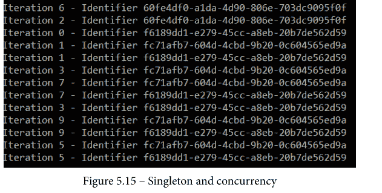

Figure 5.15 – Singleton and concurrency

如果你不相信，可以数一下，但报告 `fc71afb7-604d-4cbd-9b20-0c604565ed9a` **全局唯一标识符 (GUID)** 的行数正好有 10 行，这对应于我们的线程安全实现。对于非线程安全实现，我们统计到两个不同的 GUID：一个以 `60fe4df0` 开头，另一个以 `f6189dd1` 开头。这意味着我们确实从糟糕的实现中得到了两个不同的实例。

## Singleton pattern wrap-up

单例模式具有以下优点和缺点：

- 性能提升，尤其对于初始化缓慢且重量级的对象，这是一个有效的用例。
- 内存使用减少，因为单个实例当然比同一对象的多个实例消耗更少的内存。
- 线程安全默认情况下得不到保证，正如我们在上一节中所看到的。
- 更难应对生态系统变化，例如底层资源耗尽、安全令牌过期、网络连接丢失等。
- 它违反了单一职责原则 SRP，因为它同时处理自己的实例化和某些业务逻辑。

谨慎使用单例模式，并且仅在需要时使用。有效的用例包括横切关注点，例如记录器、**对象关系模型 (ORM)** 当它们保持线程安全时、第三方工厂等等。记住单例的缺点与优点同样重要，你应该始终仔细检查并发方面，以及如何检测/应对生态系统变化。当使用 .NET 等丰富的框架时，你也可以依赖内置的 DI 容器为一个并非本身设计为单例的类分配单例行为，同时确保永远只会创建一个实例。

## Factory method

工厂方法模式是创建型类别的一部分，也是更大工厂家族模式的一部分，例如 **静态工厂** 和 **抽象工厂**。总体而言，工厂模式在目的上与 DI 有些相似：解耦具体类与客户端消费者类。DI 和工厂模式之间有时会产生一些混淆，正是因为它们都是创建型的并且追求相同的目标。

然而，DI 和工厂模式之间存在明显的区别。一方面，使用工厂模式时，消费者类仍然自行触发创建过程，即使它被委托给其他类。另一方面，使用 DI 时，客户端类受益于控制反转 IoC 原则，并在运行时接收具体的实现。

下图说明了工厂方法模式：

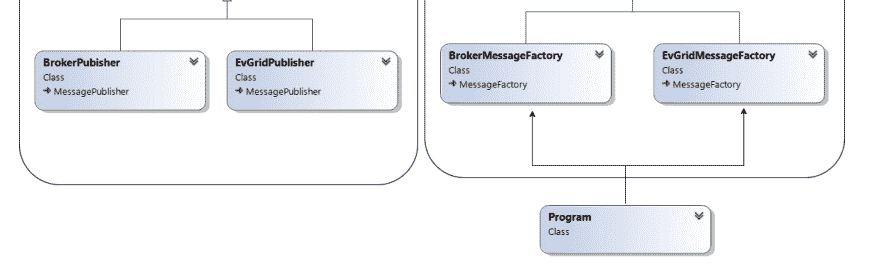

Figure 5.16 – Factory method pattern

在图 5.16 的左侧，你可以看到 MessagePublisher 的具体实现，它无非就是我们上一个示例中的契约，只是以抽象类的形式而不是接口的形式出现。

让我们看看工厂方法在实际中的运作。

## Factory method in action

为了说明工厂方法模式，我们将重用上一节的消息发布者。记住我们有两个不同的具体实现，它们以不同的方式实现相同的契约。这次，我们的契约由以下抽象类表示：

```
public abstract class MessagePublisher{
    4 references
    public abstract string ProviderName { get; }
    2 references
    public abstract Task PublishMessage(string message);
}
```

Figure 5.17 – The factory contract

这个抽象类声明了两个抽象成员：PublishMessage 和 ProviderName。以下是该抽象类的具体实现：

```
public class BrokerPublisher : MessagePublisher
{
    public override string ProviderName => "BusMessage";
    public override async Task PublishMessage(string message){
        await Task.Run(() => {
            //SendMessageToBus()
        });
    }
}
public class EvGridPublisher : MessagePublisher{
    public override string ProviderName => "EvGridMessage";
    public override async Task PublishMessage(string message)
    {
        await Task.Run(() => {
            //SendToGrid()
        });
    }
}
```

Figure 5.18 – Concrete implementations of the MessagePublisher class

这与我们在 DI 示例中所做的非常相似。不同之处在于这些具体类如何被消费者类间接使用。这是通过声明几个额外的类来实现的。第一个是抽象创建者类，如下所示：

```
public abstract class MessageFactory{
    public abstract MessagePublisher GetPublisher();
}
```

Figure 5.19 – Factory abstract creator class

MessageFactory 抽象类强制任何继承类实现 GetPublisher 方法，该方法返回 MessagePublisher 类型，我们的契约。GetPublisher 就是我们的工厂方法。现在来看实现了 MessageFactory 的具体创建者类，如下所示：

```
public class BrokerMessageFactory : MessageFactory{
    public override MessagePublisher GetPublisher(){
        return new BrokerPublisher();
    }
}
public class EvGridMessageFactory : MessageFactory{
    public override MessagePublisher GetPublisher(){
        return new EvGridPublisher();
    }
}
```

Figure 5.20 – Concrete creator classes

正如你可能猜到的，这些具体创建者类就是被我们的消费者类使用的，在本例中是一个控制台程序，如下所示：

```
static void Main(string[] args){
    Console.Write("Bus (1) or Event Grid (2): ");
    var choice = Console.ReadLine().Trim();
    switch(choice){
        case "1":
            Console.WriteLine(new BrokerMessageFactory().GetPublisher().ProviderName);
            break;
        case "2":
            Console.WriteLine(new EvGridMessageFactory().GetPublisher().ProviderName);
            break;
        default:
            Console.WriteLine("Oops, invalid choice");
            break;
    }
}
```

Figure 5.21 – Factory consumer program

我们提示用户在选项 1 和 2 之间进行选择。选项 1 会导致客户端类使用 BrokerMessageFactory 获取 MessagePublisher 的实例。下面是程序执行时的输出截图：

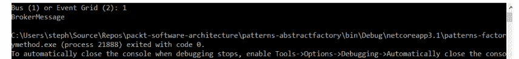

Figure 5.22 – Factory method program output

## Lazy loading in action

下面是在 C# 控制台程序中延迟加载模式的一个非常简单的示例：

```
static void Main(string[] args){
    Stopwatch sw = new Stopwatch();
    sw.Start();
    //does not cause a delay
    Lazy<DemoClass> _lazy = new Lazy<DemoClass>();
    Console.WriteLine(sw.ElapsedMilliseconds);
    //calling the object property causes its lazy loading
    Console.WriteLine(_lazy.Value.DemoProperty);
    Console.WriteLine(sw.ElapsedMilliseconds);
    Console.Read();
}
```

```
public class DemoClass{
    public readonly string DemoProperty = "a value";
    public DemoClass(){
        Thread.Sleep(5000);
    }
}
```

Figure 5.23 – Lazy loading in action

在我们的 DemoClass 对象中，我们通过添加 Thread.Sleep 语句来模拟缓慢的初始化。在控制台程序的 Main 方法中，我们使用 Stopwatch 对象计算不同指令之间的经过时间。前面程序的输出如下所示：

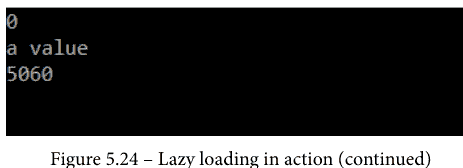

Figure 5.24 – Lazy loading in action (continued)


从图 5.24 可以看出，我们的 `Stopwatch` 对象启动与懒对象创建之间没有时间流逝。懒行为由 `Lazy` 关键字确保，它是 C# 的内置指令。然而，当我们通过 `_lazy.Value.DemoProperty` 显式调用 `DemoClass` 对象的属性时，可以看到第二次输出的已用时间显示为 5060 毫秒。这证明 `DemoClass` 对象的实际初始化被延迟到我们调用其属性之一时（当然，方法也是如此）。不使用懒模式的相同程序如下所示：

```
static void Main(string[] args){
    Stopwatch sw = new Stopwatch();
    sw.Start();
    DemoClass _notLazy = new DemoClass();
    Console.WriteLine(sw.ElapsedMilliseconds);
    Console.Read();
}
```

图 5.25 – 非懒初始化

现在，我们以常规方式实例化相同的 `DemoClass` 对象。以下截图显示了结果：

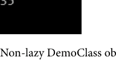

图 5.26 – 非懒 `DemoClass` 对象

## 懒加载总结

直接实例化会导致程序在提示用户输入按键之前花费大约 5 秒钟。由于懒模式非常简单，实际上没有必要添加总结部分，但我们仍来看一下它的一些优点和缺点，如下所示：

- 懒模式的主要优点是在不需要给定对象的具体实例时，防止资源浪费。
- 这一主要优点也可能成为其主要缺点。如果你对所有内容都使用懒加载，你就无法清楚了解应用程序完全正常运行所需的实际资源。在测试应用程序时，请务必评估这一点。

现在，让我们来看一些行为模式。

## 策略模式

策略模式属于行为类模式，用于让消费类从一系列相关算法中决定选择哪一种算法。此模式的目的是避免在客户端中直接使用 if-else 或 switch 结构来处理不同的实现，而是让它选择正确的策略。下面是要展示的示例类图：

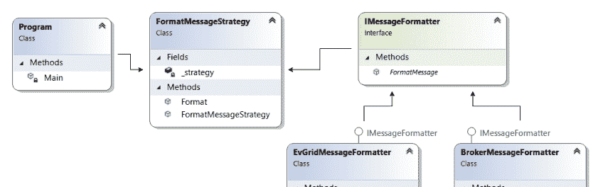

图 5.27 – 策略模式

`Program` 类是我们的消费者。`FormatMessageStrategy` 是我们的上下文类，它允许消费者在运行时指定要使用的策略。`IMessageFormatter` 是策略契约，而 `EvGridMessageFormatter` 和 `BrokerMessageFormatter` 是策略的不同实现。这类似于我们之前见过的情况，但我在此示例中添加了一些验证细节。在这里，我们有两种不同的具体策略，根据目标接收者来格式化消息。让我们在代码中看看策略模式。

### 策略模式实战

策略模式有助于防止消费者类中出现以下代码结构：

```
if (msg.MessageType == Message.MessageTypes.Bus){
    //write code to format bus messages
}
else if (msg.MessageType == Message.MessageTypes.Grid){
    //write code to format grid messages
}
```

图 5.28 – 策略模式防止内联决策

在这里，你通常会直接向客户端添加一些格式化逻辑。而策略模式的目标则是将这种逻辑委托给专门的策略，并在运行时选择适当的策略。下面是策略契约的代码：

```
public interface IMessageFormatter{
    string FormatMessage(string message);
}
```

图 5.29 – 策略契约

这是一个非常简单的契约，规定每个策略都应实现 `FormatMessage` 方法。在这里，我们可以看到两个实现该契约的策略：

```
public class EvGridMessageFormatter : IMessageFormatter{
    public string FormatMessage(string message){
        Console.WriteLine("in EvGridMessageFormatter");
        //let's pretend we formatted the message for evengrid
        return message;
    }
}
```

```
public class BrokerMessageFormatter : IMessageFormatter{
    public string FormatMessage(string message){
        Console.WriteLine("in BrokerMessageFormatter");
        //let's pretend we formatted the message for a bus
        return message;
    }
}
```

图 5.30 – 具体策略

我们假装根据策略以不同方式格式化消息。现在来看我们的上下文类，即被消费者类使用的那个类，如下所示：

```
public class FormatMessageStrategy{
    private IMessageFormatter _strategy;
    public FormatMessageStrategy(IMessageFormatter strategy){
        _strategy = strategy;
    }
    public string Format(string message){
        return _strategy.FormatMessage(message);
    }
}
```

图 5.31 – 上下文类

上下文类有一个 `IMessageFormatter` 类型的私有成员。其构造函数接收一个策略作为输入，并将其赋给私有成员。这允许消费者类在运行时指定要使用的策略。消费者类可以调用 `Format` 方法，它会进而调用传入策略的 `FormatMessage` 方法。现在，下一个代码块展示了如何在消费者类中使用该上下文类：

```
static async Task Main(string[] args){
    IEventPublisher brokerPublisher = new BrokerPublisher();
    await brokerPublisher.PublishMessage(
        new FormatMessageStrategy(new BrokerMessageFormatter()).Format("a message"));
    IEventPublisher gridPublisher = new EvGridPublisher();
    await gridPublisher.PublishMessage(
        new FormatMessageStrategy(new EvGridMessageFormatter()).Format("a message"));
    Console.Read();
}
```

图 5.32 – 策略消费者代码

我们随后调用这两种策略。下面的截图显示了控制台程序执行后的输出：

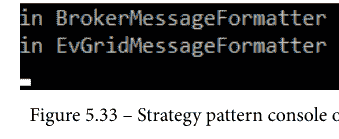

图 5.33 – 策略模式控制台输出

### 策略模式总结

你可能想知道 DI 方法与策略模式有何不同，你有这种疑问很合理。两种模式都使我们能够通过方法注入将具体对象传递给客户端类。策略模式与 DI 的一个很大区别在于它们所属的类别。请记住，DI 是创建型模式的一部分，因此它们在对象创建时发挥作用。

策略模式是行为类模式的一部分，因此它旨在实现多种行为以响应应用程序事件，例如用户输入或按钮点击。当你使用策略模式时，通常是为了实现某个契约的多个具体类，而仅使用 DI 时通常并不一定需要这样做（单元测试除外）。

参与通信的类都继承自 `Person`，而 `Person` 又持有对具体中介者的引用。大多数说明这种设计模式的示例看起来都很相似。我尝试稍微创新一下，但我们将在第 7 章“架构趋势与全局总结”中看到另一个关于将中介者模式与命令查询请求分离（CQRS）结合使用的示例。

### 中介者模式实战

一如既往，我们首先定义契约，如下所示：

```
interface IMediator{
    public abstract void Register(Person p);
    public abstract void Send(string from, string message, audience to);
}
```

图 5.35 – 中介者契约

契约可以是接口或抽象类。然后我们实现具体的中介者，正如下面所示：

```
class ConcreteMediator : IMediator{
    private Dictionary<string, Person> _persons =
        new Dictionary<string, Person>();
    public void Register(Person p){
        _persons.TryAdd(p.Name, p);
        p.concreteMediator = this;
    }
    public void Send(
        string from, string message, audience to){
        var persons = (audience.adult == to) ? _persons.Values.Where(
            p=>p.Name != from && p.GetType().Equals(typeof(Adult))) :
            _persons.Values.Where(p=>p.Name != from);
        if(persons.Count()>0)
            foreach (var person in persons)
                person.Receive(from, message);
    }
}
```

图 5.36 – 具体中介者


在具体中介者的 Register 方法中，我们将人员添加到字典中或替换他们。在 Send 方法中，我们处理业务逻辑以将消息转发给相关的接收者。坦白说，过滤逻辑并不健壮，因为名字不是一个好的 ID，但这对于模式演示来说无关紧要。我们还将当前的具体中介者传递给 Person 对象，如下所示：

```
class Person{
    public string Name { get; }
    public Person(string name) => this.Name = name;
    public ConcreteMediator concreteMediator { set; get; }
    public void Send(string message, audience to = audience.everyone){
        concreteMediator.Send(Name,message, to);
    }
    public void Receive(
        string from, string message){
        Console.WriteLine("{0} - received {1}: from {2}",
            Name,message,from);
    }
}
```

图 5.37 – Person 对象

前述代码块中重要的部分在 Send 方法中，Person 类在其中回调具体中介者以处理消息的发送。Send 方法还具有一个可选的 audience 参数，这使我们在发送消息时能够过滤目标接收者。以下代码显示了两种人员的变体：

```
class Adult : Person{
    public Adult(string name): base(name){}
}
class Child : Person{
    public Child(string name): base(name){}
}
```

图 5.38 – Person 变体

现在，从主程序开始，我们可以按如下方式使用我们的类：

```
static void Main(string[] args){
    ConcreteMediator cm = new ConcreteMediator();
    Person a1 = new Adult("adult 1");
    Person a2 = new Adult("adult 2");
    Person c1 = new Child("child 1");
    cm.Register(a1);
    cm.Register(a2);
    cm.Register(c1);
    a1.Send("Hello adults",audience.adult);
    a1.Send("Hello everyone");
    Console.Read();
}
```

图 5.39 – 消费者代码

注意我们如何将所有人员实例注册到具体中介者。以下是程序执行时的输出：

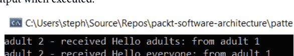

图 5.40 – 中介者模式程序输出

图 5.40 显示只有 adult 2 接收到了来自 adult 1 的消息，因为他们明确针对成年人。他们的第二条消息是给所有人的，因此 child 1 也收到了它。

## 中介者模式总结

中介者有一些优点和缺点，概述如下：

- 它确保一对一和一对多的通信过程。
- 它解耦了相互通信的对象。
- 它将通信逻辑隔离在具体中介者中。
- 作为缺点，如果具体中介者实现随着时间的推移变得复杂，SRP 可能会受到损害。

让我们现在来处理结构型设计模式。

## 外观设计模式

外观模式是结构型类别的一部分，通过向消费者类公开简单干净的接口来隐藏具体类的复杂性。它充当消费者和具体实现之间的代理。我们将在最后一章重新回到外观设计模式，以了解一种无代码的方法来应用它。与此同时，让我们看看存储库设计模式，这是一种数据特定的外观实现。

## 存储库设计模式

存储库设计模式是外观设计模式的数据特定实现。你将其用作 API 控制器和 ORM 使用的数据传输对象（DTO）之间的机制。存储库是对对象集合的抽象。虽然关于存储库模式带来的附加价值存在一些争议，但其主要目的是解耦数据和业务域世界。关于存储库模式有用性的争论在于，有时它被认为与 ORM 是冗余的。

在 .NET 世界中，主要的 ORM 是 Entity Framework，它自带内置存储库。有些人认为在其中添加自己的存储库是过度设计，而另一些人则认为它是不可或缺的。我不会在这场争论中做出决定，但使用存储库的主要论点是为了提高可测试性并用其保存业务逻辑。你可以在这里看到存储库模式的图表：

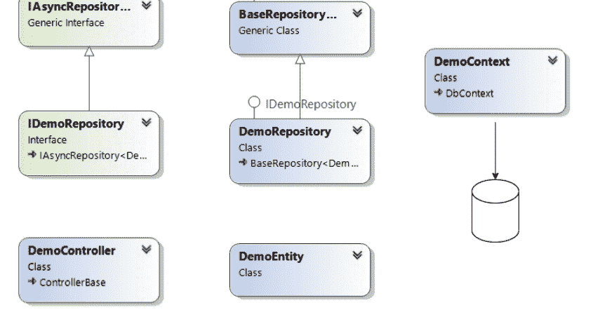

图 5.41 – 存储库模式图

在图 5.41 的左侧，你可以看到一个由 IAsyncRepository 表示的通用存储库和一个由 IDemoRepository 表示的业务特定存储库。DemoController 类通过 DI 获取 IDemoRepository 的实例，其具体类是 DemoRepository，它又继承自 BaseRepository 类。

BaseRepository 和 DemoRepository 都利用 DemoContext（ORM）与底层数据存储交互。最后，DemoEntity 只是数据实体的表示。由于我们之前已经涉及过 DI 和控制器，我只会在下一节中列出最重要的代码块。你可以在本章的技术要求部分所述的 GitHub 上找到所有代码。

## 存储库模式实战

让我们首先从我们的通用存储库开始，如下所示：

```
public interface IAsyncRepository<T> where T : class{
    Task<T> GetByIdAsync(Guid id);
    Task<IReadOnlyList<T>> ListAllAsync();
    Task<T> AddAsync(T entity);
    Task UpdateAsync(T entity);
    Task DeleteAsync(T entity);
}
```

图 5.42 – 通用存储库

存储库是泛型的，因为它接受 T 作为输入，这是 .NET 处理泛型的方式。接口中声明的所有方法也是泛型的，因为它们不服务于任何特定的业务目的。它们只是代表典型的创建、读取、更新和删除（CRUD）操作。

这个通用存储库正是存储库模式备受争议的原因。如果你只坚持这种实现，你只是在添加冗余代码，因为默认情况下，ORM 也自带对对象集合的此类默认 CRUD 操作。

有些人可能会争辩说，通用存储库也给了你抽象掉 ORM 的机会，以防你在未来更改它。这种抽象级别也由 *整洁架构* 推荐，我们将在下一节讨论。这就是你必须运用良好判断并识别权衡以确保你不会过度设计解决方案并且它在你自己的上下文中是有意义的地方。

但当然，还有更多内容，那就是特定业务域存储库，其契约如下所示：

```
public interface IDemoRepository : IAsyncRepository<DemoEntity>{
    Task<IEnumerable<DemoEntity>> ListOnlyOddEntities();
}
```

图 5.43 – 领域级存储库

之所以它是业务特定的，是因为它指定了一个额外的非通用方法，看起来像一个特定查询。这种类型的存储库开始带来价值，因为它保存了业务逻辑。现在让我们看看 BaseRepository 类的截断（为简洁起见）版本，如下所示：

```
public class BaseRepository<T> : IAsyncRepository<T> where T : class{
    protected readonly DemoContext _dbContext;

    public BaseRepository(DemoContext dbContext) {
        _dbContext = dbContext;
    }

    public async Task<IReadOnlyList<T>> ListAllAsync(){
        return await _dbContext.Set<T>().ToListAsync();
    }
    other methods
}
```

图 5.44 – 基础存储库类

我们的 BaseRepository 类也是泛型的，可以接受任何实体。它实现了 IAsyncRepository<T>，我们的通用存储库契约。如你所见，它接受一个 DemoContext 对象的实例，这不过是我们 ORM 的入口点。现在来看看我们量身定制的存储库，如下所示：

```
public class DemoRepository : BaseRepository<DemoEntity>, IDemoRepository
{
    public DemoRepository(DemoContext dbContext) : base(dbContext) { }
    public async Task<IEnumerable<DemoEntity>> ListOnlyOddEntities(){
        return await Task<IEnumerable<DemoEntity>>.Run(() => {
            return _dbContext.DemoEntities.ToList().Where((c, i) => i % 2 != 0)
                as IEnumerable<DemoEntity>;
        });
    }
}
```

图 5.45 – 量身定制的存储库

DemoRepository 派生自 BaseRepository 并传入 DemoEntity 类型。它还通过 ListOnlyOddEntities 方法的具体实现实现了 IDemoRepository。如果你对 .NET 有一点了解，你可能已经在这里识别出一个代码异味。奇偶检查是在内存中完成的，导致 ORM 生成一个 SELECT * FROM ... 语句，这在性能上从来都不是好的。我故意这样做是为了向你展示编写非常可扩展的代码是多么容易，但也会留下这种糟糕的结构。在本章结束时，我会告诉你我认为在代码审查轮次中需要捕捉的最重要的事情。

## 存储库模式总结

使用存储库模式时需要考虑以下几点：

- 不要只坚持通用存储库。你应该努力将业务逻辑封装到更具体的存储库中。
- 不要抽象掉 ORM，它本身就是底层数据存储的抽象。可能 99.99% 的时间里，你将只在应用程序的生命周期内坚持使用单一 ORM。
- 存储库有助于提高可测试性。
- 保持抽象层的数量可控。我将留给你来评估什么是可控的。

让我们现在通过一个小的用例来看看你是否能应用你刚刚学到的关于设计模式的知识。


## 设计模式用例

让我们回顾一下我们在第 3 章《理解 ATAM 和软件质量属性》中使用的相同场景，但这次，不要关注 NFR。尝试评估对于以下场景，哪些代码设计模式可能在范围内：

> Contoso 需要为其客户提供一个数据上传通道。上传的数据文件可能包含错误，必须经过数据清洗和数据整理阶段。如果错误无法自动修复，应通过回调通知将错误文件返回给发送方。经过此第一次数据检查和转换阶段后，结果验证数据将被路由到相关系统进行进一步处理。此外，出于主权原因，客户要求数据只能在欧洲处理，并且他们习惯使用文件传输协议（FTP）系统。

> 上传通道应始终可用，而实际的数据处理在系统中断时可能会被延迟。Contoso 的客户期望在 24 小时内收到通知。客户上传的数据总量约为每月 1 太字节（TB），在高峰时段，同时上传数据的客户可能多达 250 个。出于监管原因，客户发送的原始文件的保留时间为 5 年。

我没有改动一个逗号。老实说，如果我面对这个场景，我会直接尝试依赖专门的数据服务来处理数据清洗和数据整理活动，但为了本次练习，让我们假设 Contoso 没有任何这些工具。Contoso 只能依靠一名软件架构师和几名开发人员来实现解决方案。在阅读下一段之前，尝试思考哪些模式可能在该场景中发挥作用。仅限于本章讨论的模式。

好——让我们尝试寻找答案。如果我们排除 NFR， 这里有几个我们可以考虑的元素：

- 输入数据必须经过验证。由于可能存在不同类型的验证，使用策略模式的验证策略可能是有意义的。
- 由于每个用例都必须处理依赖关系，你当然应该考虑使用 DI 模式。如前所述，DI 是显而易见的，应该始终使用。
- 因为你想简化 Contoso 客户的生活，你可能希望为他们提供一个单一的端点来上传文件。如果是这种情况，你很可能依赖于 *facade* 设计模式。我在本章中没有对此展开太多，但我所做的定义足以认为它可能是此场景的有用模式。
- 必须处理许多文件。因此你应该考虑以异步方式处理它们。可以 *mediator* 或其变体来解耦接收过程和处理过程。

让我们看看我为什么 *尚未* 选择其他模式，如下所示：

- **Repository**：尚不清楚我们是否只处理数据并将其路由，还是需要在数据存储中持久化某些内容。可能需要持久化一些审计跟踪信息，但这尚不明确。
- **Singleton, lazy, and factory**：在现阶段，尚无任何迹象表明单例或工厂是必需或有用的。我们需要更深入地调查才能决定。

当然，我们都知道魔鬼在细节中，但如果我只能给你一个建议，那就是在深入实施考虑之前先从高层次入手。让我们总结设计模式部分。

## 设计模式总结

在本章中，我们只涉及了几种设计模式，但你可能已经注意到，它们都为应用程序带来了一定程度的抽象，以促进可扩展性、可维护性和可测试性。如果你只能记住一个模式，你无疑应该选择 DI，因为在我看来，这是最重要的概念之一。

请注意，虽然抽象对于可扩展性是好的，但有时也可能带来自身的弊端，例如如果抽象层数过高，会增加复杂性。实施模式时要考虑的另一个方面是应用程序中创建的对象数量，因为它也可能对系统性能产生负面影响。

我想传达的信息是，你应该始终在可扩展性、可读性、可维护性和可测试性与性能和效率之间取得平衡。*不要成为 cargo cult 开发者。* 要思考，不要盲目遵守可能不适合你的上下文的规则！让我们现在来看干净架构。

## 审视干净架构

除了代码设计模式本身之外，你还可以依赖更结构化的基础。干净架构（https://blog.cleancoder.com/uncle-bob/2012/08/13/the-clean-architecture.html），由 Robert C. Martin 提出，也被称为 Uncle Bob，质疑框架和技术选择对所追求的业务意图的盛行。干净架构汇集了六边形架构（https://en.wikipedia.org/wiki/Hexagonal_architecture_(software)）和洋葱架构（https://jeffreypalermo.com/2008/07/the-onion-architecture-part-1/）的精华。本质上，干净架构将业务逻辑与所有其他内容解耦，并在应用程序中添加更多层。干净架构的目标是使业务层免受应用程序其他地方发生的更改的影响。业务层只有在有真正的业务需求需要覆盖时才应更改。干净架构确保业务层保持可持续的稳态。以下图表显示了干净架构的结构（Uncle Bob 的原始绘图可在其网站 https://blog.cleancoder.com/uncle-bob/2012/08/13/the-clean-architecture.html 上获得）：

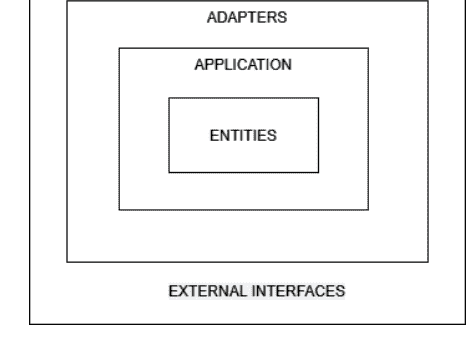

图 5.46 – 干净架构

只有外部边界应该知道内部边界，而不是相反。内部边界托管核心业务逻辑，而外部边界是设施和实现细节。当此规则得到尊重时，内部边界不会受到外部边界发生的更改的影响，因为它们对它们一无所知。跨边界通信主要由我们之前看到的 DI 和 IoC 确保。

从概念上讲，干净架构是一种 *domain-centric software architecture*。这种类型的架构赋予 *fit-for-purpose* 问题很高的（太高？）重要性。框架、数据库引擎、工具等被视为 *implementation details*。然而，虽然我理解这种雄心，但有些人将其推得太远，简单地忽略所谓的细节，只关注 *业务逻辑*。

请记住，质量的定义是 *fit for purpose* 和 *fit for use*。一些干净架构爱好者认为，在一栋房子里，唯一重要的事情是空间、可用性、舒适度等等，而用于建造它的材料（砖、瓷砖等）只是 *implementation details*。我完全不同意这种说法。

Uncle Bob 本人指出，*你使用的数据库引擎是一个细节*，*网络本身是一个细节*，基本上所有不直接服务于业务逻辑本身的东西都是细节。虽然他从业务角度来看是正确的，但这些 *细节* 是我们日常的现实，我们不能就这样摆脱它们。相反——这些细节有时有助于提高生产力，而且是的：我们可能会有意识地将自己紧密耦合到特定的技术框架和工具，因为它们也为我们带来回报。我们生活在一个高度技术化的行业。如果每个工具、每个框架、每个数据库引擎都只是细节，任何人都可以处理它们。你不需要雇佣开发人员、**信息技术（IT）** 专业人员等等。也许，业务人员会自行设计和开发解决方案。

回到房屋比喻，在我们的 *fit-for-use* 追求中，房屋必须能够抵抗风暴、暴雨、潮湿等，否则你可能会最终拥有一栋非常舒适的房子，但被迫在几年后搬走，因为它在期间变得无法居住。当然，这些因素取决于上下文，*一如既往*。如果你住在从不下雨的地区，你不会投资最耐用的瓷砖。同样，如果你从不滑雪，你不太可能为特定的滑雪保险付费。好吧，所有这些似乎都是常识，但这并不是我在现场特别注意到的。

这种向领域中心架构和概念方法（如 **领域驱动设计（DDD）**）的趋势当然是一件好事，前提是你做好功课，这包括与业务分析师和业务架构师一起进行适当的业务分析，以把握你正在构建解决方案的业务领域。即使如此，你仍不应忽视 *细节*。

这些领域中心架构只有在满足该前提条件时才证明其价值，并且只有在业务需求快速变化时才值得。 我见过无数次团队急于采用干净架构和/或 DDD，而不管他们要做什么，同时对业务真正重要的事情一无所知。在这种情况下，这些模式被滥用，往往造成混乱而不是带来解决方案。说清楚，我们不应该从一个极端走向另一个极端。我们不应该忽视我们的技术基础，因为我们有时已经因技术细节而忽视或限制了所追求的业务价值。顺便说一下，我们不应将技术细节与业务价值对立起来。


让我们记住，数字原住民利用技术作为实现新业务视角的推动力。正是这些技术细节，使得开发者和软件架构师与业务分析师不同。让我们也记住，代码并不是唯一需要考虑的东西。云原生应用就是一个真实的例子——它们利用容器（纯基础设施的东西）和编排器来构建弹性解决方案，从而利用这些系统能力。

在一次演讲中（https://www.youtube.com/watch?v=yPvef9R3k-M），提出 DDD 概念的 Eric Evans 承认，微服务可以代表有界上下文的物理边界。再一次，容器平台在很大程度上支持微服务架构，尽管它们不是唯一的选择。我坚信生态系统在软件架构中占据着非常重要的位置，而你自己开发的代码往往变得越来越小。是否应该使用整洁架构取决于你构建的资产以及关于该资产的 ATAM 评审。

如果你发现某些质量属性，如可用性、可升级性和可维护性，优先于安全性、可扩展性等等，那么你确实可以认为采用整洁架构是合适的，否则你也可以认为它对你的用例来说是过度设计。让我们现在看看我在代码评审练习中认为重要的内容。

## 我的十大代码坏味道

**代码坏味道**是指可能导致应用程序崩溃或遇到意外问题的代码结构。正如我在仓储模式部分所示，将垃圾留在设计良好的设计模式中是很容易的。必须承认，大多数现代 **持续集成/持续交付 (CI/CD)** 工厂都配备了代码分析工具，如 *SonarQube*，它们可以分析代码并自动检测代码坏味道。尽管如此，以下是我在评审代码或评估此类工具产生的结果时考虑的十大事项：

- 1. **内存泄漏肯定会导致进程崩溃**：越早检测到越好。
- 2. **未正确释放的对象**：内存泄漏虽然令人烦恼，但很容易排查。相反，被释放后仍在某处被使用的对象更难找到，并且经常导致不稳定的行为。
- 3. **ORM 使用**：抽象底层数据存储是很好的，但在某些情况下（**输入/输出 (I/O)** 密集型用例等），最好完全跳过 ORM，或者至少仔细检查生成的查询/命令。我在仓储示例中包含的糟糕代码结构就是资源浪费的良好例证。
- 4. **安全漏洞**：在我们的 API 驱动的世界中，由于开发人员忘记强制执行授权，常常会发现端点意外地对全世界开放。
- 5. **线程安全**：正如我们之前在单例示例中看到的那样，我们很容易陷入线程安全无法保证的情况。重要的是在应用程序生命周期的早期就追踪这个问题，因为在生产环境中后期排查会非常困难。
- 6. **对象生命周期**：重要的是检查对象是否被正确作用域化。创建本可以共享的对象的新的实例无疑会导致 CPU 和内存使用增加。相反，不应共享的对象当然不应被用作单例（或静态对象）。
- 7. **SOLID 合规性**：这意味着检查代码是否遵循 SOLID 原则，其中包括确保依赖项得到妥善处理。无论你是否采用整洁架构，依赖项都应始终得到优雅处理。
- 8. **适当的异常处理**：尽管本书中提出的代码示例都没有适当的异常处理，但正确管理异常是关键。同样重要的是遵循约定，例如在开发 API 时返回合适的 HTTP 代码。
- 9. **可扩展性**：处理可扩展性有多种方式，其中之一当然是使用 pub/sub 等机制，并在可能时利用异步模式。这主要适用于预期高负载/高流量的业务资产。
- 10. **内存缓存、会话状态等**：我尽量避免这些，就像瘟疫一样，因为它们与扩展部署的故事并不契合。我们将在下一章看到，云和云原生应用从这个角度来看是游戏规则的改变者。

正如你所见，我更关注性能/安全/可靠性方面，而不是可读性和可扩展性。我首先关注这些的原因是，此类问题的可见表现通常出现在生产环境或系统在高负载下时，这使得排查更加棘手。这个十大列表不是一成不变的，可能会根据解决方案而有所变化。

## 总结

不言而喻，设计模式必须被软件架构师掌握，因为它们是他们的工具箱的一部分。然而，我也试图强调，你应该始终在自己的特定环境中运用自己的判断。我倡导务实的软件架构实践。记住，与整洁架构的某些喧嚣相反，代码并不是唯一需要关注的地方。一个好的软件架构师旨在实现 *适合目的*（整洁架构当然可以发挥作用），和 *适合使用*，后者通常由非代码层来保证。

在下一章中，我们将看到大多数现代应用程序通常高度分布式并依赖现有组件。这就是我所说的生态系统重要性日益增长。
