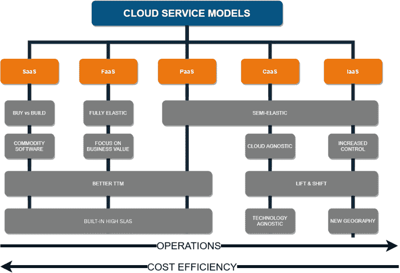
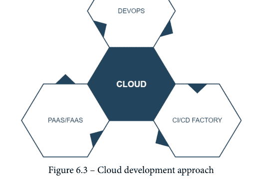
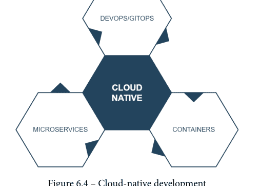
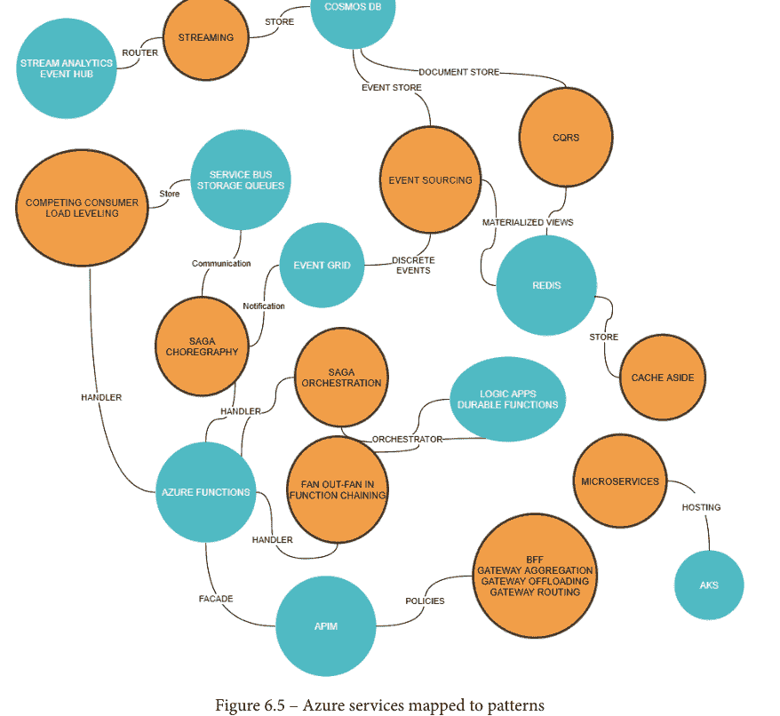
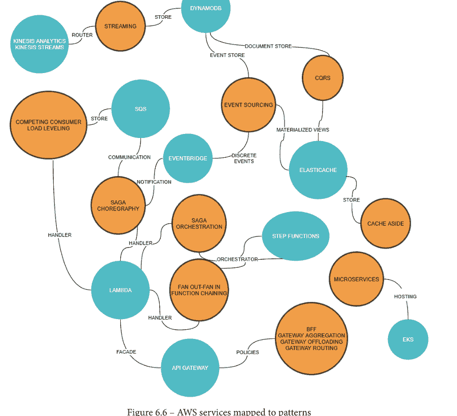
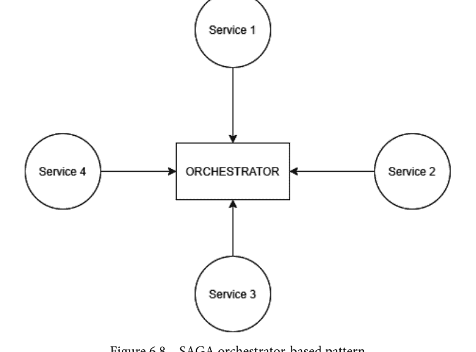
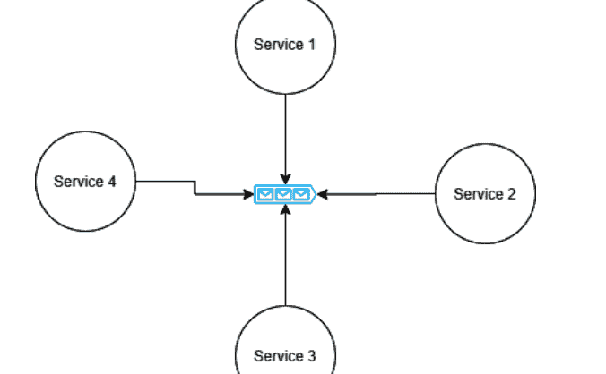
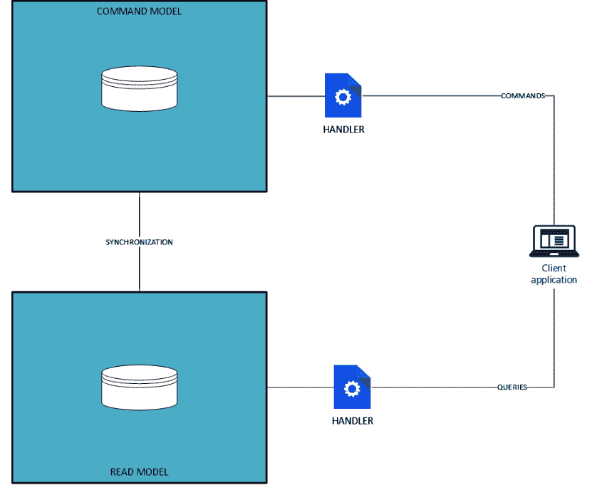
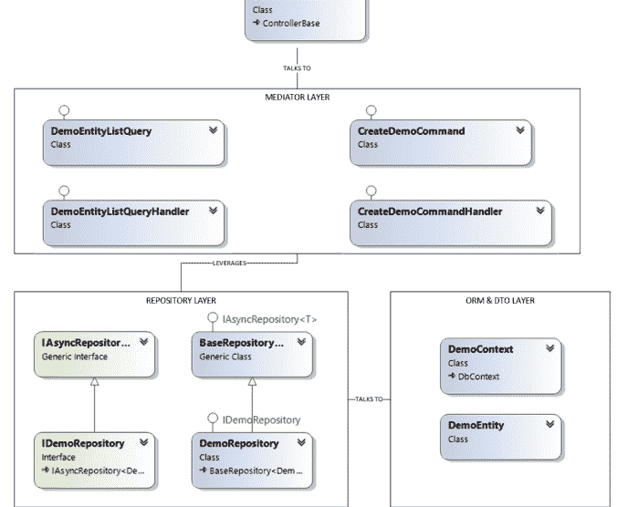
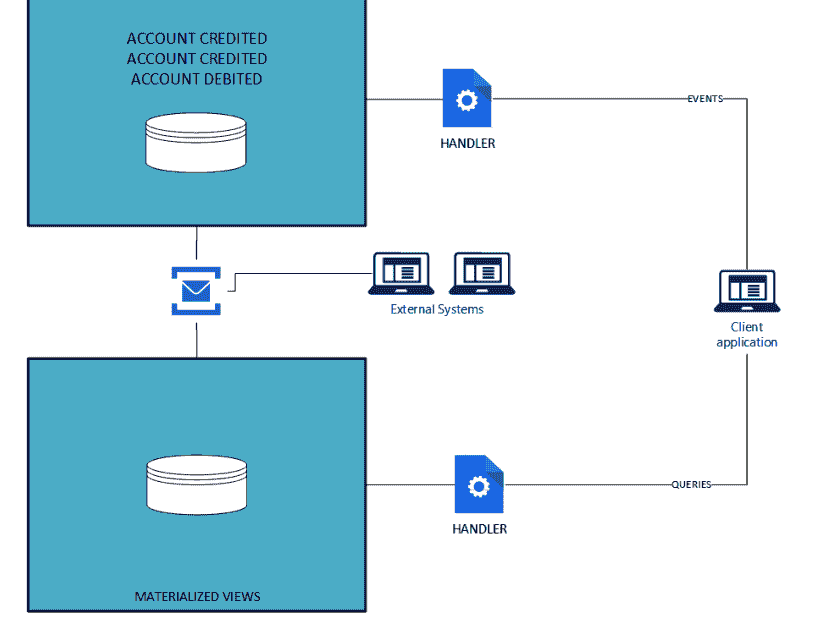

# 6
云对软件架构实践的影响

在本章中，我们将重点关注过去十年最反复出现的话题之一——云。云是 IT 格局中的游戏规则改变者，也是更大数字化转型的推动者，这通常像风暴一样冲击组织。除了技术之外，云和云原生方法需要组织变革和适当的文化来利用其所有优势。但这远远超出了本章的范围，在本章中，我们将把自己限制在评估云对软件架构的影响上。

更具体地说，我们将涵盖以下主题：

- 介绍云服务模型、云和云原生系统
- 将云服务映射到架构风格和模式
- 评审云原生模式

到本章结束时，你应该对云和云原生方法有更好的理解，这些方法每年都在变得越来越流行。对于软件架构师来说，加入这一趋势并把握不断增长的生态系统的重要性已变得至关重要。

## 技术要求

如果你想练习本章提供的解释的实现，你将需要 **Visual Studio 2019** 来打开 GitHub 上提供的解决方案。

本章的所有代码示例和图表均可在 https://github.com/PacktPublishing/Software-Architecture-for-Humans/tree/master/CHAPTER%206/ 获取。

## 介绍云服务模型、云和云原生系统

云生态系统的普及是一个游戏规则的改变者，如果你设想云作为托管平台，那么你在设计应用程序时就应该从一开始就考虑到这一点。根据我的实际观察，这一事实经常被软件架构师误解或忽视，他们倾向于忽视代码运行的生态系统，而过于关注代码本身。理解生态系统很重要的原因在于它附带了预构建的服务和功能，可以提高你的生产力。你工作的服务模型类型往往会引导你的设计选择。以下图表显示了最重要的服务模型：

在上图中，从左到右，运维操作水平逐渐增加。例如，**软件即服务（SaaS）** 模式是一种完全托管的现成软件产品，内置功能特性，且运维成本非常低。在另一端，你会看到**基础设施即服务（IaaS）**，我称之为云中的*一切照常*，其运维水平*几乎*等同于本地部署系统。成本效益（TCO）也是如此，但方向相反，从右到左，IaaS 并不是特别节省成本，而 SaaS 是满足横向（通用）企业需求的最具成本效益的方式。现在，让我们从技术角度审视这些不同的模型。

## 软件即服务（SaaS）

SaaS 平台附带许多 API，便于实现集成场景。**Office 365**、**Salesforce** 等都提供了丰富的 API。SaaS 通常回答了“*购买还是自建*”的问题，即购买 SaaS 几乎总是比尝试在内部构建同等功能要好。除 SOC（安全运营中心）会主动监控 SaaS 平台的使用情况、致力于防止数据泄露外，运维水平几乎为零。

许多组织投资于云访问安全代理（CASB），以应对 SaaS 的泛滥，并控制用户对 SaaS 平台的行为。对于 SaaS 系统，挑战在于组织适当的变更管理，并确保员工和协作者不会意外泄露公司信息。软件架构师可以尽可能地将 SaaS 平台作为应用构建块来复用。例如，Office 365 的 Teams 频道可以被最终用户用作入口，而 Office 365 的 Graph API 可以被自定义组件利用。目标是在更大的解决方案中集成和复用一些 SaaS 组件。

## 函数即服务（FaaS）

FaaS 也称为无服务器，我们将在下一章更深入地讨论。FaaS 最初以无状态函数（如 Azure Functions、AWS Lambda 等）起步，这些函数在共享的多租户基础设施上执行。如今，FaaS 已扩展到远不止函数本身，它是云计算中最具弹性的一种形式。虽然基础设施完全外包给云提供商，但相关成本是根据实际资源消耗计算的。FaaS 在众多场景中都是理想选择：

- **事件驱动架构**：订阅事件发布者并相应触发活动。例如，一个函数可以由消息代理上消息的到达触发，解析它，并在需要时通知其他进程如何处理该消息。
- **批处理作业**：你可以以无服务器的方式触发一次性容器，来处理周期性活动。容器完成后，底层无服务器服务可以将其完全销毁。
- **各种异步场景**：FaaS 特别适合异步活动，因为它们不需要极低的延迟。事实上，FaaS 的一个缺点是云提供商必须在需要时动态分配必要的计算资源，这可能会导致短暂的初始化延迟。在异步场景中，较高的延迟通常是可以容忍的，所以我们可以接受这个缺点。
- **不可预测的系统资源增长**：当你无法预先知道应用程序的使用情况，但又不想在底层基础设施上投入过多时，FaaS 有助于以付费的方式吸收这种突发的资源增长。这就是我说 FaaS 完全弹性的意思：你可以从 0 扩展到所需规模，然后再回到 0。

- **随时随地、任意设备场景：** 云提供商通常提供高 SLA 和多种不同形式，开箱即用即可支持任何设备在任何时间、任何地点使用。

PaaS 还能提高生产率和上市时间，因为开发人员和架构师可以复用现有的构建块，并组装、整合到他们的应用程序中。

## 容器即服务（CaaS）

容器化已成为主流，云提供商不会错过这趟列车。CaaS 就是向云消费者提供诸如 K8s 和 Red Hat OpenShift 等编排平台。此外，云提供商还提供专有产品，如 **Azure 容器实例（ACI）** 和 **AWS Elastic Container Service（ECS）**。

CaaS 适用于以下场景：

- **直接迁移（Lift-and-shift）：** 在向云迁移的过程中，公司可能希望直接提升并转移其资产，即以容器形式迁移它们。大多数资产都可以打包为容器，而无需重构。
- **云原生工作负载：** 你可以利用最前沿、最顶尖的 K8s 功能和插件。我们将在下一节介绍云原生。
- **批处理、异步或计算密集型任务：** 例如，ACI 和 ECS 都可以承载批处理作业。
- **可移植性：** CaaS 提供了比其他任何方式都更强的可移植性，并在一定程度上帮助降低供应商锁定风险。
- **服务网格：** 大多数微服务架构依赖服务网格，而现代的服务网格又依赖于容器化平台。
- **现代部署：** CaaS 提供了现代部署技术，如 A/B 测试、金丝雀发布和蓝绿部署。这些技术通常可以预防和减少停机时间。

CaaS 更接近基础设施，通常比 FaaS 和 CaaS 的托管程度更低。云消费者需要承担更多的运维工作，例如升级集群版本、修补节点等。这因云提供商而异。

## 基础设施即服务（IaaS）

IaaS 是干扰最小的服务模型。它是向云提供商租用数据中心的过程。这是在云中的“一切照常”。IaaS 不是实现数字化转型的首选服务模型，但尽管如此，它在众多场景中仍然非常有用：

- **直接迁移（Lift-and-shift）：** 由于本地系统也普遍使用虚拟化，因此将现有应用程序部署到云端非常容易，而无需对应用程序本身进行任何修改。
- **高性能计算（HPC）：** 大多数云提供商都拥有令人印象深刻的高性能计算能力，这些能力可以立即使用，并且规模远超大多数公司本地部署所能承受的水平。
- **合规要求高的小公司：** 对于不想投资自建数据中心的小型公司来说，如果它们有无法通过其他服务模型满足的高合规性要求，IaaS 是一个很好的选择。
- **灾难恢复：** IaaS 非常适合灾难恢复，因为云提供商提供了便于实现此类场景的工具。
- **计算资源短缺或硬件生命周期结束：** 当您自己的数据中心计算资源不足，或面临硬件生命周期结束时，采用 IaaS 路径可能更简单、更快。
- **新地理区域：** 如果您的业务扩展到新的地理区域，在云端启动可能更快，同时继承了云提供商对当地法规的合规性。

在成本和运维方面，IaaS 几乎等同于本地部署，尽管很难比较 IaaS 和本地部署的 TCO。

当然，设施、数据中心的物理访问等都由云提供商管理。您不再需要自己购买和管理硬件。

## 一切即服务（XaaS 或 *aaS）

其他服务模型也纷纷出现，例如**身份即服务（IDaaS）**和**数据库即服务（DBaaS）**，以至于缩写**XaaS**或***aaS**在2016年前后诞生，用来指代所有可能的服务模型。对于软件架构师来说，理解这些不同的模型非常重要，因为它们服务于不同的目的，需要不同的技能，并直接影响您构建的应用程序。这些服务模型还可能影响某些软件质量属性，我们将在下一节中看到。

## 服务模型与软件质量属性

选择服务模型并非中性。正如我们在前面章节中所见，它会影响成本、运营、所需技能，以及是否能够实现某些技术模式。它同样影响软件质量属性。下表展示了FaaS、PaaS和CaaS对一些常见属性的影响：

|  | FaaS | PaaS | CaaS |
|---|---|---|---|
| 可扩展性 | +++ | ++ | +++ |
| 可用性 | +++ | ++ | ++ |
| 可部署性 | + | + | +++ |
| 可移植性 | - | - | +++ |
| 可测试性 | + | + | ++ |
| 安全性（控制） | - | + | ++ |
| 可审计性 | + | + | + |
| 可靠性 | ++ | ++ | ++ |
| 可管理性 | +++ | +++ | + |

图6.2 – 服务模型对质量属性的影响

我们可能不需要说明，+号表示正面影响，–号表示负面影响。诚然，这个属性列表并不详尽，得分也可能存在争议，但无论如何，这都不是中立的。你可以根据自己的情况完善或扩充这个列表。你必须结合每种服务模型相关的运营和成本水平来权衡。现在我们已经回顾了最重要的服务模型，接下来看看云和云原生意味着什么。

## 云与云原生

让我们首先介绍你可能不熟悉的云和云原生开发的概念。云是一个具有独特能力的特殊生态系统。如果我们想利用这些能力，就必须重新思考设计应用程序的方式以及我们应该考虑的框架类型。

让我直接将IaaS排除在外，因为正如我们之前所述，IaaS是云中的常规运作。它是在云中复制你的本地系统。许多本地应用程序被限制在N层架构中，包含前端、后端和数据库，运行在少数服务器上。我们控制整个代码库和底层系统，因为所有事情都由我们自己完成。我们编写自定义的内部框架来处理横切关注点，如日志记录、异常处理等。我们的内部框架过一段时间就会变成单体。从这个角度来看，IaaS没问题，但绝不是云或云原生。你可以像设计本地应用程序一样为IaaS设计应用程序。IaaS不带有任何特定约束或预构建功能，这就是为什么它对软件架构没有影响。云和云原生方法意味着思维模式的转变，而IaaS既不需要也不促进这种转变。

澄清一下，开始使用云和云原生方法时面临的最大挑战之一是应用程序是*分布式的，并且依赖于现有服务*。在传统IT中，我们仍然有许多单体，或者在最坏的情况下，我们使用**面向服务的架构（SOA）**，这我们在*第4章，回顾历史架构风格*中讨论过。SOA已经证明了其价值，而且肯定仍然具有未来性，但一如既往，IT世界已经发展，新的范式已经出现。

对于云和云原生应用，我们倾向于更多地依赖现成的框架、服务和生态系统。我们*组装*现有的云服务，并在其之上添加我们的代码。有些服务带有大量内置功能。例如，存在许多主流人工智能服务，可用于应用程序中执行图像识别、文本提取等操作。其他服务还带有更多技术特性。例如，**API管理**解决方案开箱即用地提供API限流、JWT令牌验证和许多其他功能。此外，这类服务从一开始就设计为具有韧性和健壮性。如果你固执地自己开发，充其量只能创建一个苍白的副本。

要采用云或云原生方法，你需要对现有资产进行现代化改造/重构，或者从绿地（greenfield）状态开始。作为软件架构师，你必须思考生态系统如何帮助你更快、更好地实现更多目标。作为软件架构师，你必须将*可重用性*质量属性卸载给提供商。你必须特别留意，不要重新发明轮子。

尽管对于云和云原生开发可能没有统一定义，但让我分享我的定义。**云开发方法**如下所示：

图6.3 – 云开发方法

云开发依赖于三大支柱：

- **开发运维（DevOps）**：这是我们组织团队协作开发产品的方式。除了技术细节，它还涉及组织层面，如虚拟团队的概念、产品负责人、**最小可行产品（MVP）**、用户故事、冲刺等。DevOps的目的是增强协作并协调不同利益相关者。有一句名言反映了这种心态：*你构建它，你运行它！*
- **持续集成/持续交付（CI/CD）**：自动化工具链在让一切步入正轨方面起着至关重要的作用。**基础设施即代码（IaC）**方法是云和云原生开发不可或缺的一部分。软件架构师必须掌握IaC的能力，并确保基础设施架构师也掌握它。
- **平台即服务/函数即服务（PaaS/FaaS）**：我在前一节中解释了这些托管模型。它们允许我们利用IaC来提高生产力。借助合适的自动化工具链，我们可以轻松创建或删除新环境。我们不再需要依赖传统的**开发测试验收生产（DTAP）**环境。我们可以根据需要快速创建和删除环境。在心态上，你必须接受自己无法控制一切。作为软件架构师，你分析生态系统并尽可能利用它。当然，你可以尝试在代码中增加一些抽象层以防止供应商锁定，但不应滥用它们。在云和云原生方面，*利用胜过抽象*。

**云原生开发方法**如下所示：

图6.4 – 云原生开发

乍一看，它非常相似，因为*它确实*非常相似：

- **开发运维（DevOps）/GitOps**：文化方面保持不变，但工具链有所不同。
  大多数云原生组织依赖GitOps而非DevOps。GitOps革新了基础设施和应用程序的部署方式。它针对Kubernetes等容器平台。
- **CaaS/容器**：它们代表了云和云原生方法之间的主要区别。奇怪的是，如果你拥有自己的K8s或OpenShift集群，并且这些集群本身可以完全自动部署和配置，那么你也可以在本地以云原生方式工作。
- **微服务**：在*第4章，回顾历史架构风格——单体、SOA和微服务*中，我们解释了微服务通常基于容器平台，因为它们提供最好的支持。*这并不意味着非微服务应用程序不能是云原生的*，但利用容器平台的微服务在设计上就是云原生的。

容器和工具链是云和云原生方法之间最大的区别。然而，它们有着相同的基因。它们都旨在更快部署、获得敏捷性和自主性，同时优化成本。它们都需要思维模式的转变，尤其是在大规模运行时。它们对传统IT实践和软件架构都具有很强的颠覆性。它们都迫使软件架构师将生态系统视为实现更快更好结果的推动力。最后，它们都对许多质量属性产生积极影响。现在，让我们将一些云服务映射到架构风格和模式。

## 将云服务映射到架构风格和模式

为了确保你意识到生态系统的重要性，我将一些典型的云架构风格和设计模式映射到了某些云服务上。这些服务帮助你更快、更好地取得成果。你可以依赖它们来提高生产力，并开箱即用地满足许多非功能需求（NFRs）。这并不意味着你不能在本地使用类似模式，也不意味着你仅限于*图6.5和图6.6*中描绘的服务，但这应能为你提供一个坚实的概览。

为了说明模式与服务之间的映射，我考虑了 Microsoft Azure 和 Amazon Web Services (AWS)，因为它们是撰写本文时两大领先的云服务提供商：

图 6.5 – Azure 服务到模式的映射

粗边框的圆圈是模式，其他圆圈代表云服务。例如，如果必须以编排（choreography）模式构建 SAGA（我将在下一节解释），你可以依赖 Azure Service Bus 和/或 Azure Event Grid 来处理不同 SAGA 参与者之间的通信。如果理解这一点，你应该能轻松读懂前面的图。我也对 AWS 做了同样的练习，如下图所示：

图 6.6 – AWS 服务到模式的映射

代码会检查给定值是否在缓存中。如果不在缓存中，它将访问数据存储并更新缓存以供将来使用。如果该项已在缓存中，则不会访问数据存储。Cache-Aside 模式也能提高性能。在上面的图中，我们有一个数据存储，但你也可以单独使用缓存存储。现在，让我们看看云中另一个常见模式，即 SAGA 模式。

## 理解 SAGA 模式

**SAGA** 模式处理分布式事务。这意味着在考虑事务完成时涉及多个参与者。在**原子性、一致性、隔离性、持久性（ACID）**的世界中，事务是一组原子操作。它们要么全部成功，要么全部失败。这适用于单体架构，即单个后端写入 SQL 数据库时，但不适用于涉及更多组件才能完成事务的分布式应用。对于微服务而言，服务之间职责的划分和隔离本身就导致事务在设计上是分布式的。此外，大多数时候，每个微服务都有自己的数据存储，甚至可能基于不同的引擎。在这样的架构中，已经不可能再依赖 ACID。

此外，云和云原生实现通常依赖 FaaS 和 PaaS 服务，这些服务有时甚至不包含事务概念。因此，如果无法使用数据库级事务，就必须依赖不同的机制，例如 SAGA 模式。与 ACID 不同，SAGA 不能因为一次操作失败就简单地回滚整个事务；相反，它引入了补偿事务的概念。本地服务已经提交的本地事务，已经持久化到各自的数据存储中。如果某个参与者失败，补偿事务机制应使它们已提交的内容失效，或恢复到某个序列项。

SAGA 是一种基于编排器（orchestrator）或基于编排（choreography）的模式。下图展示了基于编排器的模式：

图 6.8 – 基于编排器的 SAGA 模式

编排器处于主导地位，编排作为事务一部分的不同参与者。每个服务都不知道其他服务在做什么，只有编排器知道进行中事务的实际状态。如果某个本地步骤失败，编排器将根据需要触发一个或多个补偿事务，以使之前的步骤失效。

在基于编排（choreography）的模式中，如下图所示，服务通过发布/订阅（pub/sub）机制连接在一起，每个服务发布其结果（成功或失败），由一个或多个订阅者捕获，这些订阅者随后再发布关于自身结果的事件：

图 6.9 – 基于编排（choreography）的 SAGA 模式

如果其中一个参与者失败，它会发布其失败事件，其他参与者将捕获该事件以使自己的本地事务失效。然而，当单个事务涉及许多参与者时，编排（choreography）模式使理解全貌变得更加困难。你可以访问 https://github.com/Azure-Samples/saga-orchestration-serverless 查看一个使用 Azure 服务的 SAGA 示例。现在，让我们看看 CQRS。

## 命令查询请求分离（CQRS）

简而言之，CQRS 是一种将命令（改变状态的操作）和查询（返回数据但不改变状态的操作）分离的模式。CQRS 经常与命令查询分离（CQS）混淆。后者是上述定义的严格版本。这是因为即使在面向同一数据存储时，你也可以分离查询和命令。真正的 CQRS 意味着请求分离，这意味着非常不同的系统和数据存储可以处理请求和命令。这使你能够提高写入和读取操作的速度，并能够独立扩展它们。通过拆分数据存储（或设置只读和只写分区），繁重的读取操作不会影响写入性能，反之亦然。

你可能已经猜到，使用不同的数据存储自动意味着最终一致性，因此真正的 CQRS 并不适合所有应用程序，因为并非所有应用程序都支持最终一致性。我看到许多开发人员和软件架构师用 CQS 取代普通的**创建、读取、更新、删除（CRUD）**模式（尽管他们认为自己使用的是 CQRS），但这带来的价值较低，而且往往是大材小用，因为单纯的 CRUD API 在大多数情况下已经能完美工作。然而，CQS 和 CQRS 方法都迫使你提前思考命令和查询需求，这反过来有助于你恰当地设计数据库。这一点对 NoSQL 存储尤其适用，因为通常更难正确设计。下图展示了一个简化的 CQRS 实现：

图 6.10 – CQRS 模式

在这里，你有命令模型和读取模型，两者都依赖各自的数据存储。客户端应用程序在查询数据或改变状态时会与不同的通道通信。命令模型和读取模型之间会发生同步过程，该过程根据需求而变化。在非常基础的场景中，如果只是想拆分读和写，可以使用数据库只读副本，让数据库引擎为你同步数据。在更高级的场景中，读取模型由**物化视图**组成，这些视图是由同步过程预先计算好的查询结果。查询非常快，因为结果是针对查询特定需求定制的。以这种方式应用时，CQRS 模式就体现了其价值。正如我之前提到的，云应用本质上是分布式的，这就是为什么 CQRS 在云中比在本地环境更常用。

单个应用程序可能会提供只读 API 和仅命令 API。你可以将请求和命令重新组合到同一个 API 下，但这需要首先通过 CQS 方法拆分命令和查询，然后让每种模式与自己的数据存储通信，从而将 CQS 转换为 CQRS。在*第 5 章“设计模式与整洁架构”*中，我们学习了如何将仓库与 ORM 结合使用。当将 CQRS 应用于单个 API 时，你可以结合**中介者**和**仓库**模式。下图展示了各个组件的组装情况：

图 6.11 – 中介者与仓库结合，通过单个 API 实现 CQS 或 CQRS

如果查询相关仓库与读取模型通信，命令相关仓库与写入模型通信，那么你就实现了 CQRS。当然，每当数据发生变化时，读取模型也应该更新。请参阅上一节中描述的服务映射（图 6.5 和图 6.6），以确定哪些服务可以帮助你构建 CQRS 模式。你还可以访问“技术要求”部分提到的 GitHub 仓库，查看一个完整的 CQS 实现。

## 事件溯源

事件溯源总是与 CQRS 结合使用，因为每个实现都会利用物化视图作为读取模型。因此，写入和读取再次被分离，但追求的目标不同，因为事件溯源的主要目的是提供审计追踪和极致的可扩展性。由于事件是不可变的，我们可以在任何时间点了解数据的完整历史。更棒的是，我们可以通过从事件存储中重放事件来重建实际的数据状态。下面是一个简单的事件溯源图：

图 6.12 – 事件溯源图

