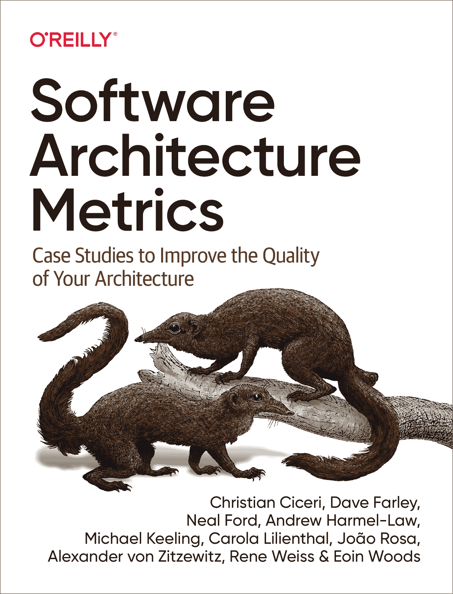

# 软件架构度量案例研究：提升你的架构质量

## 前言

软件架构度量用于衡量软件项目的可维护性和架构质量，并在流程早期提供有关任何危险的架构或技术债务累积的警告。在本书中，10 位领先的实践者（Christian Ciceri, David Farley, Neal Ford, Andrew Harmel-Law, Michael Keeling, Carola Lilienthal, João Rosa, Alexander von Zitzewitz, Rene Weiss, 和 Eoin Woods）介绍了每个软件架构师都应了解的关键软件架构度量。该团队中的架构师都已发表过著名的软件架构文章和书籍，定期参加国际活动，并举办实践工作坊。

我们都努力在理论和实践之间取得平衡。然而，本书并非关于理论；而是关于实践和实施，关于已经尝试过且行之有效的内容，以及宝贵的经验和案例研究。我们不仅关注提高架构质量，还关注将客观度量与业务成果相关联，以考虑您自身的情况和所涉及的权衡。

我们进行了一项调查，发现对软件架构度量资源的需求很强，但可用的资源却很少。我们希望这一贡献能够有所作为，并帮助您设定正确的 KPI 并准确、深入地衡量结果。

我们感谢全球软件架构峰会，它使我们重新聚首，并给了我们一起撰写软件架构度量书籍的想法。书中所有章节和案例研究都与作者本人一样各不相同：我们特意使用了来自不同行业和挑战的示例，以便每位读者都能找到解决方案或灵感。

## 您将学到什么？

读完本书后，您将了解如何：

* 衡量您的软件架构满足目标的程度
* 将架构引导向可测试性和可部署性
* 优先考虑软件架构工作
* 从可观测性中创造可预测性
* 为您的软件项目确定关键 KPI
* 构建并自动化度量仪表板
* 分析并衡量项目或流程的成功
* 构建以目标为驱动的软件架构

## 本书适合谁

本书由软件架构师撰写并面向软件架构师。如果您渴望探索成功的案例研究并了解更多关于决策和衡量有效性的知识，无论您是在软件开发公司内部工作还是作为独立顾问，本书都适合您。

10 位作者都是经验丰富的实践者，分享他们的建议和智慧，呈现多样化的观点和想法。随着您从事不同项目，您可能会发现某些章节比其他章节更相关。您可能会定期使用本书，也可能只使用一次来设定 KPI，然后稍后再回来教授和激励新团队成员。

拥有正确的软件架构度量和工具可以使架构检查更快、成本更低。它可以让您在软件项目的整个生命周期中进行检查，从一开始就开始。度量还有助于您在每个冲刺中评估软件架构，以确保其不会漂移至难以维护。它们还可以帮助您比较架构，以选择最符合项目需求的架构。

## 本书使用的惯例

本书使用以下排版惯例：

*斜体*

:

表示新术语、URL、电子邮件地址、文件名和文件扩展名。

`Constant width`

:

用于程序列表，以及在段落中引用程序元素，如变量或函数名、数据库、数据类型、环境变量、语句和关键字。

**提示**：此元素表示提示或建议。
**注意**：此元素表示一般性说明。
**警告**：此元素表示警告或注意。

## 使用代码示例

PROD: 请联系作者确认他们是否会将代码示例上传到 oreilly.com 或其自己的网站（例如 GitHub）。如果没有代码下载，请删除整个章节。如果有，在向 digidist 发送邮件并附上链接时，请告知他们您填写的 `title_title`（应尽可能接近书名，例如 `learning_python_2e`）。此信息将决定 digidist 加载文件的位置。
补充材料（代码示例、练习等）可在 https://github.com/oreillymedia/title_title 下载。
如果您在使用代码示例时有技术问题或遇到困难，请发送电子邮件至 bookquestions@oreilly.com。
本书旨在帮助您完成工作。一般而言，如果本书提供了示例代码，您可以在自己的程序和文档中使用它。除非您复制了代码的很大一部分，否则无需联系我们获得许可。例如，使用本书中若干代码片段编写程序不需要许可。出售或分发 O’Reilly 书籍中的示例则需要许可。通过引用本书并引用示例代码来回答问题不需要许可。将大量示例代码纳入您产品的文档中则需要许可。
我们感谢但通常不要求署名。署名通常包括书名、作者、出版商和 ISBN。例如：“Software Architecture Metrics by Christian Ciceri et al. (O’Reilly). Copyright 2022 Apiumhub S.L., 978-1-098-11216-5。”
如果您认为对代码示例的使用超出了合理使用范围或上述许可，请随时联系我们 permissions@oreilly.com。

## O’Reilly 在线学习

## 注意
四十多年来，O’Reilly Media 一直为企业提供技术和商业培训、知识和见解，帮助企业取得成功。
我们独特的专家和创新者网络通过书籍、文章和我们的在线学习平台分享知识和专业技能。O’Reilly 的在线学习平台为您提供按需访问实时培训课程、深入学习路径、交互式编程环境，以及来自 O’Reilly 和 200+ 其他出版商的庞大文本和视频收藏。更多信息请访问 https://oreilly.com。

## 如何联系我们

请将有关本书的评论和问题发送给出版商：
* O’Reilly Media, Inc.
* 1005 Gravenstein Highway North
* Sebastopol, CA 95472
* 800-998-9938（在美国或加拿大）
* 707-829-0515（国际或本地）
* 707-829-0104（传真）
我们为本书提供了一个网页，在此列出勘误、示例和任何其他信息。您可以通过 https://oreil.ly/software-architecture-metrics 访问该页面。
请不要忘记更新上面的链接。
发送电子邮件至 bookquestions@oreilly.com 以对本书发表评论或提出技术问题。
有关我们的书籍和课程的新闻和信息，请访问 https://oreilly.com。
在 LinkedIn 上找到我们：https://linkedin.com/company/oreilly-media。
在 Twitter 上关注我们：https://twitter.com/oreillymedia。
在 YouTube 上观看我们：https://www.youtube.com/oreillymedia。

## 致谢

本书若没有作者、O’Reilly 编辑和 Apiumhub 的贡献就不可能实现，他们将我们聚集在一起。我们还想额外感谢：
* Apiumhub 首席营销官 Ekaterina Novoseltseva，她负责本书的撰写过程以及与 O’Reilly 的出版工作，并撰写了导言
* O’Reilly 高级收购编辑 Melissa Duffield，她照顾了我们，使我们在 O’Reilly 的体验顺畅愉快
* O’Reilly 发展编辑 Sarah Grey，她构建了我们的内容，使其易于阅读
* O’Reilly 生产团队：Katherine Tozer、Adam Lawrence、Steve Fenton、Gregory Hyman 和 Kristen Brown，他们对本书进行了校对和发行

## Christian Ciceri
我要感谢 Ekaterina Novoseltseva 和 Apiumhub 给予我撰写这本书的机会，这一直是我的梦想。感谢 Global Software Architecture Summit 让我结识这些软件架构师，他们推动我前进并引发有趣的讨论。感谢 VYou app，让我创新并实施新的软件架构指标。还要特别感谢我的猫，它始终陪伴在我身边，在任何情况下都支持我。

## Dave Farley
感谢 Apiumhub 和 O’Reilly 的同事们为驯服“猫群”并组织我以及其他人，使本书成为可能。

## Neal Ford
感谢 Ekaterina 和 Apiumhub 的其他同事们做了实现这一切所需的“猫群管理”。感谢我的雇主 Thoughtworks 以及所有员工，他们总以在技术世界中的热情和投入程度让我惊讶。最后并且始终，感谢我的妻子 Candy 忍受我所有的写作，这让我远离了她和我们正在长大的小猫。

## Andrew Harmel-Law
感谢我的妻子和孩子们容忍我，也感谢 Thoughtworks 的同事们激励我并让我将这种方法推向逻辑的结论。
如果我没有机会在一个真正理解并信任我的组织中将这一切付诸实践，本章中的论断可能只是一半理论。Open GI 是英国和爱尔兰保险行业的专业 SaaS 提供商，是那家客户，感谢我在那里工作的每一个人。我的共同开发者/同谋 Pete Hunter 值得特别提及。他立即理解了我们在做什么，不懈地倡导它，不懈地改进它（我们在每一步都结对进行），并教会了我很多关于如何使其发挥作用的知识。
最后感谢 Ekaterina 和 Apiumhub 邀请我参与，催促我，并回答我所有的愚蠢问题。

## Michael Keeling
我衷心感谢 Anastas Stoyanovsky、Colin Dean、George Fairbanks、Joe Runde 和 Ricky Kotermanski，他们都帮助审阅了早期章节草稿。此外，感谢我所有同事，无论是现任还是前任，我有幸与他们共事。像本书中这样的经验报告只能由敢于冒险并尝试新想法的团队撰写！永远不要停止寻求变得比现在更出色的办法！
Marie，我的女王，感谢你帮我抽出时间从事像这样写作项目。Owen，谢谢你。Finn，saaanoot！

## Carola Lilienthal

# 致谢

我要感谢我在职业生涯中有幸合作的众多优秀科学家和计算机科学家。其中许多人是我的公司 WPS（Workplace Solutions）的同事，或是在会议上结识、并在讲座和讨论中向其学习的人。我还要感谢我的家人，在需要撰写书籍或文章时，他们总是鼓励并支持我。

## João Rosa

没有我妻子 Kary 的支持，我的任何项目都不可能实现。你和我们可爱的小宝贝是我生命的中心。谢谢！特别感谢 Xebia 在这段旅程中对我的支持。分享知识是我们 DNA 的一部分。我还要感谢我们的技术审阅者，即 Ruth Malan、Anna Shipman、Steve Pereira 和 Nick Tune；感谢 Apiumhub 促使我撰写这一章节；以及 Fai Fung、Thijs Wesselink 和 Kenny Baas-Schwegler 审阅了章节草案的早期版本。最后说明，对于这里未提及的各位：我的记忆很糟糕，记不起你们所有人的名字。你们以某种方式影响了我的职业生涯，我对此心怀感激。

## Alexander von Zitzewitz

我要感谢我的妻子 Charmaine、我的儿子们，以及 hello2morrow 的优秀团队，他们始终支持我，用智慧、良好的建议和大量的耐心支持我的项目。没有他们的持续支持，我在这本书上的工作以及生活中的其他成就都不可能实现。

## Rene Weiss

对我来说这是一个非常特别的时刻，因为这是我首次为书籍做出贡献。在我的职业生涯中，我有机会与许多激励我的人合作。我想在这里介绍其中两位，他们对我思考软件架构的方式产生了重大影响。这两位是来自 embarc（德国）的 Stefan Toth 和 Stefan Zörner，他们是优秀的软件架构师、培训师和教练。在与他们合作期间，我接触到了演进式架构的思想，这个“种子”最终促成了本章中分享的想法。如果你有机会在会议上见到他们，或读到他们其中一本著作（目前仅有德文版），我强烈推荐。

最后，我想感谢我的女友兼伴侣 Anna。她始终支持我在职业生涯中的转变和想法，没有她，我不可能走到今天。谢谢。

## Eoin Woods

我想感谢我的家人对我所有耗时专业的项目给予持续的支持。我还要感谢 Chris Cooper-Bland 和 Nick Rozanski 对我章节早期版本的深入而富有洞见的审阅，这使我能够显著改进它。我们的技术审阅者以及 O’Reilly 的优秀团队对本书质量做出了巨大贡献，所以也要感谢你们所有人。最后，感谢 Endava 的同事们，他们创造了如此 collegiate 的工作环境，同时不断挑战我做到“the best that I can be.”
