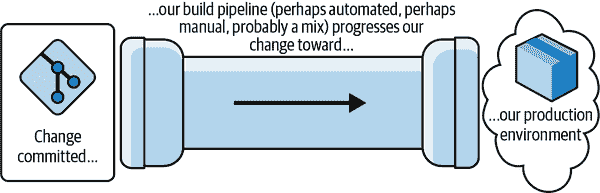
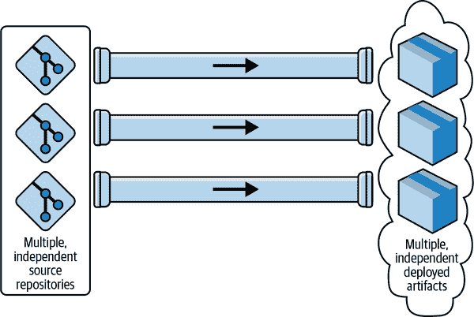
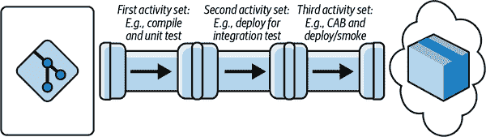
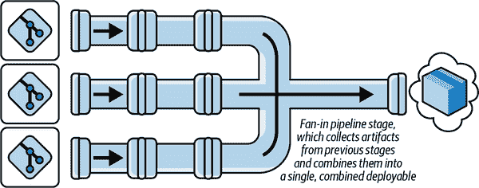
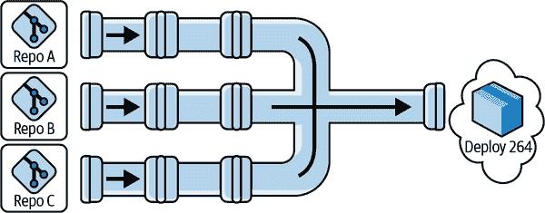
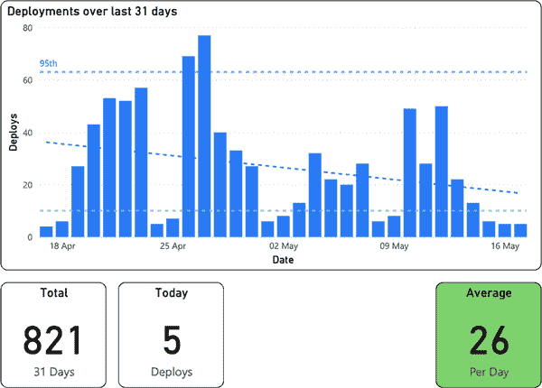
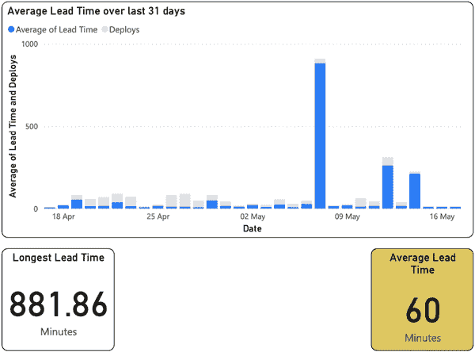
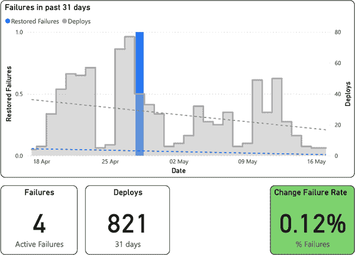
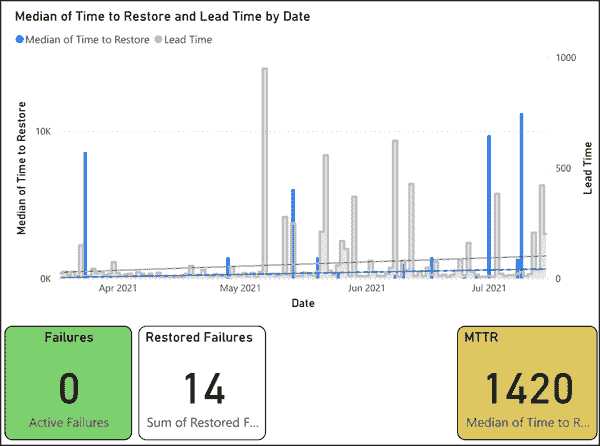

# 第 1 章 四大关键指标的释放

Andrew Harmel-Law

你可能会认为 Nicole Forsgren 博士、Jez Humble 和 Gene Kim 的开创性著作 *Accelerate*（IT Revolution Press，2018）既是关于如何通过简单而强大的四大关键指标来转变软件交付绩效的开端，也是终结。

我将我的转型工作建立在他们书籍的许多建议之上，我当然不会对其中任何内容有异议。但与其说它消除了对更详细内容的需要，我认为这本书应该得到进一步的讨论和分析，以便分享经验并聚集一群希望改进的实践架构师社区。我希望本章能为此讨论做出贡献。

我见过，当以本章后面描述的方式使用时，四大关键指标——部署频率、变更交付前置时间、变更失败率和服务恢复时间——会促进学习的蓬勃发展，并使团队理解对高质量、松耦合、可交付、可测试、可观测且可维护的架构的需求。有效部署时，四大关键指标可以让你作为架构师松开对舵柄的抓握。不是去指令和控制，你可以用四大关键指标与团队成员展开对话，并激发超越自身的整体软件架构改进欲望。你可以逐步迈向更具可测试性、连贯且内聚、模块化、容错且云原生、可运行且可观测的架构。

在接下来的章节中，我将展示如何让你的四大关键指标运行起来，以及（更重要的是）你和你的软件团队如何最好地使用这些指标来聚焦持续改进工作并跟踪进展。我的重点在于四大关键指标心智模型的实际可视化方面，获取所需的三个原始数据点，然后计算和展示四个指标。但不用担心：我也会讨论运行在生产环境中的架构的好处。

## 定义与实施

> 范式是系统的来源。从它们，从关于现实本质的共同社会协议中，产生系统目标和信息流、反馈、存量、流量以及关于系统的所有其他内容。
>
> Donella Meadows, *系统思考：入门*^(1)

支撑 *Accelerate* 的心智模型产生了四大关键指标。我从这里开始，因为在阅读本章时必须牢记这个心智模型。在最简单的形式中，该模型是一个活动管道（或“流程”），每当开发人员将代码变更推送到版本控制时开始，并在这些变更被吸收到团队正在工作的运行系统中时结束，向其用户交付运行服务。你可以在 图 1-1 中看到这个心智模型。

为了清晰起见，让我们可视化这四个关键指标在该模型中衡量什么：

Deployment frequency
: 随时间推移从管道末端流出的单个变更的数量。这些变更可能由“部署单元”组成：代码、配置，或两者结合，包括例如新功能或错误修复。

Lead time for changes
: 开发人员完成的代码/配置变更通过管道并流出另一端所需的时间。

Taken together, this first pair measures *development throughput*. This should not be confused with *lean cycle time* or *lead time*, which includes time to write the code, sometimes the clock even starting when the product manager first comes up with the idea for their new feature.
合在一起，这第一对指标衡量 *开发吞吐量*。这不应与 *精益周期时间* 或 *前置时间* 混淆，后者包括编写代码的时间，有时甚至从产品经理首次提出新功能想法时就开始计时。

Change failure rate
: 从管道流出的变更中导致我们运行服务出现故障的比例。（“故障”的具体定义稍后会介绍。现在只需将故障视为阻止服务用户完成其任务的事情。）

Time to restore service
: 在服务出现故障后，成为意识到它并交付恢复服务的修复所需的时间。^(2)

Taken together, this second pair gives an indication of *service stability*.
合在一起，这第二对指标提供了 *服务稳定性* 的指示。

The power of these four key metrics is in their combination. If you improve an element of development throughput but degrade service stability in the process, then you’re improving in an unbalanced way and will fail to realize long-term sustainable benefits. The fundamental point is that you keep an eye on all of the four key metrics. Transformations that realize predictable, long-term value are ones that deliver positive impact *across the board.*
这四个关键指标的力量在于它们的组合。如果你改进了开发吞吐量的某个要素，但在此过程中降低了服务稳定性，那么你的改进是不平衡的，将无法实现长期可持续的收益。根本点在于你要关注全部四个关键指标。实现可预测、长期价值的转型是那些在 *全方位* 带来积极影响的转型。

现在我们已经明确了指标的来源，我们可以通过将通用心智模型映射到你的实际交付流程来使事情变得更复杂。我将在下一节中展示如何执行这种“心智重构”。

## 重构你的心智模型

定义每个指标*针对你的实际情况*至关重要。正如你很可能已经猜到的那样，前两个指标的基础是你在 CI 管道中发生的事情，而后一对指标则需要跟踪服务中断和恢复情况。

在进行这种心智重构时请仔细考虑范围。你是在查看组织中所有软件的所有更改吗？还是只考虑你工作项目中的那些？你是在包含基础设施更改还是只观察软件和服务的更改？所有这些可能性都是可以的，但请记住：*你考虑的范围必须对四个指标都相同。* 如果你在前置时间和部署频率中包含基础设施更改，也要包含由基础设施更改引起的中断。

## 将管道作为首要切入点

你应该考虑哪些管道？你需要的管道是那些监听目标范围内源代码库中的代码和配置更改、作为后果执行各种操作（例如编译、自动化测试和打包），并将结果部署到生产环境的管道。你不想包含用于诸如数据库备份之类的 CI 实现任务。

如果你只有一个代码仓库由一条端到端管道提供服务（例如，存储在单体仓库中的单体应用并直接部署，且在一组活动中部署到生产环境），那么你在这里的工作就很简单。这种模型的示例如 图 1-2 所示。

不幸的是，虽然这与我们的基本心智模型完全相同，但在现实中我很少见到这种情况。我们很可能需要对心智模型进行更广泛的重构，才能得到一个代表你实际情况的模型。

接下来最容易衡量且是我们第一次重要的心智重构的是这些端到端管道的集合，每个构件或仓库一条（例如，每个微服务一条），每个管道都完成自己的所有工作，并且再次以生产环境结束（图 1-3）。例如，如果你使用 Azure DevOps，创建这些管道就很简单。^(3)

这两种管道形状最可能*相似*于你所拥有的，但我猜你的这个图示版本会稍微复杂一些，需要再重构一次，拆分为一系列子管道（图 1-4）。让我们考虑一个示例，展示三个这样的子管道，它们端到端配合以将更改交付到生产环境。

也许第一个子管道监听对仓库的推送并进行编译、打包以及单元和组件测试，然后发布到二进制构件仓库。也许随后是一个第二个独立的子管道，将这个新发布的构件部署到一个或多个测试环境。可能第三个子管道由类似 CAB 流程^(4)触发，最终将更改部署到生产环境。

希望你已经确定了自己的实际情况。但如果没有，还有第四种主要的管道类型，我们的最后一次心智重构步骤将带我们到达：多阶段扇入，如 图 1-5 所示。这里我们通常会为第一阶段找到每个仓库一个单独的子管道，然后“扇入”到一个共享的子管道或一组子管道，将更改带到生产环境的其余部分。

## 定位你的仪器化点

除了有四个指标外，我们还有四个仪器化点。现在让我们在心智模型中定位它们，无论你的模型是什么形式。我们到目前为止一直关注管道，因为它们通常提供其中两个点：提交时间戳和部署时间戳。第三和第四个仪器化点来自于服务降级被检测到时以及被标记为“已解决”时创建的时间戳。我们现在可以详细讨论每个点。

### 提交时间戳

在考虑团队的工作实践时，这里不可避免地会出现细微差别。他们是否按功能分支？他们是否进行拉取请求？他们是否混合使用不同的实践？理想情况下（正如 *Accelerate* 的作者所建议的），只要任何开发人员变更集被认为已完成并被提交，无论在哪里，你的计时器就开始计时。如果团队这样做，请注意：这种在分支上保留更改的做法不仅延长了反馈周期，还增加了你的工作负担和基础设施需求。（我将在下一节中介绍这些。）

由于这种复杂性，有些人选择使用从合并到 main 触发管道作为代理触发点或提交时间戳。我理解这听起来可能像是面对次优实践的认输，^(5) 但如果你选择代理触发，我知道你会感到内疚（因为你知道自己没有遵循标准最佳实践）。无论我们是否包含额外的等待时间，指标都会为你带来许多其他好处，即使你给自己放个假，在代码到达 main 时才开始早期采样。如果这些代理最终被证明是显著交付次优化的来源，*Accelerate* 为你提供了建议（例如主干开发和结对编程），^(6) 这些建议通过将更改到达 main 的时间作为你想要启动计时器的时间，影响了你的提交时间戳。到那时，你将开始看到指标的好处，并希望改进它们的捕获。

### 部署时间戳

在解决了提交时间后，你会很高兴听到时钟的“停止”要简单得多：就是执行最终部署到生产环境的管道完成时。这难道不给那些在*事后*进行手动冒烟测试的人一个喘息的机会吗？是的，但我再次把这留给你自己的良心，如果你真的想包含这个最终活动，你总可以在管道末尾放置一个手动检查点，由 QA（或检查部署的人）在他们确信部署成功后按下。

### 多阶段和扇入管道带来的复杂性

鉴于这两个数据源，你可以计算我们从管道中需要的信息，那就是*总运行时间*：时钟开始和时钟停止之间的经过时间。如果你有我们之前讨论的较简单管道场景之一，即不进行扇入的场景，那么这相对容易。拥有一个或多个端到端管道的人最容易。^(7)

如果你不幸拥有多个子管道（如我们在 图 1-4 中看到的），那么你需要对包含在“开始”时间戳和“部署”到生产环境中的变更集进行额外的数据收集。鉴于这些数据，你可以进行一些处理来计算每个单独更改的总运行时间。

如果你运行扇入设计（见 图 1-5），此处理过程可能会更复杂。为什么？正如你在 图 1-6 中看到的，你需要知道变更部署编号 264 的来源（Repo A、Repo B 或 Repo C），以便获取该变更的“开始”时间戳。如果你的部署聚合了多个变更，那么你需要分别追溯每个变更以获取其“开始”时间。

显然，在所有情况下，无论你的流水线多么复杂，你只想统计那些向用户部署服务更新的构建。确保你只测量这些。^(8)

在继续之前，还有一点关于从流水线捕获数据需要说明，那就是要统计哪些流水线运行？再次，*Accelerate* 在这一点上没有明确说明，但你只关心成功的运行。如果构建启动但在编译步骤失败，它会以人为正向的方式扭曲你的前置时间，因为你只是加入了一个非常快的构建。如果想作弊（而四项关键指标的最大好处之一是它们不可被操纵，至少在我所知范围内），那么你只需提交大量你知道会失败的构建，最好是 *really* 快速失败。

## 服务故障监控

虽然在流水线周围的测量上保持准确相对简单，但第三个也是最后一个原始信息来源则更具解释性。

困难在于定义“生产环境中的故障”。如果发生了故障但无人察觉，它真的存在吗？每当我使用四项关键指标时，我的答案是否定的。我将“生产环境中的故障”定义为任何使服务消费者无法、甚至不愿继续完成其试图执行的任务的行为。外观缺陷不计入服务故障，但“工作系统”缓慢到导致用户异常流失的情况显然正在经历服务故障。这其中有判断的成分，这没问题：选择一个让你安心的定义，并在坚持时对自己诚实。

你现在需要记录服务故障，这是我们的第三个也是最后一个检测点，通常通过“变更失败”工单来实现。该工单的开启为另一个时钟提供开始时间数据点；关闭它则给出相应的结束时间。开始和结束时间加上工单数量，就是你所需的所有剩余数据点。工单应在服务恢复时关闭。这可能与解决故障根本原因不对应；没关系。我们谈论的是服务稳定性。回滚以便在线并为客户提供服务在这里是可以接受的。^(9)

但如果你们不在生产环境呢？首先，你还没尝试开始转向持续部署吗？你真的应该这么做。但第二，这个选项并非人人可用。虽然不理想，但在这些情况下你仍然可以使用四项关键指标。为此，你需要定义你的“最高环境”：所有团队都在交付的、距离生产环境最近的共享环境。它可能被称为 SIT（系统集成）、pre-prod 或 staging。关键在于，当你接受变更时，你相信将变更推向生产环境的最后一步不再需要任何工作。

鉴于所有这些考虑，你需要将此“最高环境”视为生产环境。将测试人员和协作团队视为你的“用户”。他们有权定义服务故障。将测试失败视为与真实故障同等严重。假装此环境是生产环境并不完美，但总比没有好。

## 捕获与计算

> 系统建模者说，我们通过构建系统的模型来改变范式，这让我们置身系统之外并迫使我们看到整体。
>
> Donella Meadows, *Thinking in Systems*^(10)

现在你有了定义，就可以开始捕获和计算了。虽然自动化此捕获过程是理想的，但手动执行完全可以接受。^(11) 事实上，每次我推广四项关键指标时，我都是从这里开始的，并且经常不仅限于我们的初始基线。你将在接下来的几段中理解手动捕获和计算为何可行。

捕获指标可能是一项简单或复杂的任务，这取决于流水线的性质。无论如何，四项关键指标将使用来自四个检测点的四组数据计算得出：成功的变更部署次数、每个变更运行流水线（s）的总时间、变更失败工单的数量以及变更失败工单保持开放的时间长度。这些捕获的数据集本身不足以获得你的指标；你仍需进行计算，因此让我们逐一查看这些内容：

部署频率
:
这是一个频率，而不是计数，因此你需要给定时间段内的成功部署总数（我发现一天效果很好）。如果你有多个流水线，无论是否扇入，你都希望将它们的所有部署数量相加。

凭借这些数据，按日记录和汇总（记住要包含无部署日的“零”汇总），就可以得到你的第一个核心指标。使用最新的日数据或过去 24 小时的数据（根据我的经验）会遭受太多波动。最好显示更长时间段的平均值，例如过去 31 天。

变更前置时间
: 这是 *触发开始的任何单个变更* 的经过时间。这可能会波动，因此不要只报告最新部署的最新的数值。如果你有多个（包括扇入）流水线，这种波动会更大，因为由于阻塞，有些构建运行得 *lot* 更快。你想要一些更稳定的东西，反映总体状况，而非最新的异常值。因此，我通常取每个单独的前置时间测量值并计算一天内所有测量值的平均值。报告的数值是过去 31 天所有前置时间测量值的平均值。^(12)

变更失败率
:
这是已解决变更失败工单的比例，具体来说是导致故障的部署数量占同一期间总部署数量的比例。例如，如果你一天有 36 次部署，并且在同一天内解决了 2 个变更失败，那么当天的变更失败率为 2/36，即 5.55555556%。

要获得你的报告指标，请查看同一时间段内的该比率：过去 31 天。这意味着你将过去 31 天内恢复的故障数量相加，然后除以同一期间的总部署次数。

你会注意到这里有一个信任的跳跃。我们假设故障是不同的 *并且* 单个故障由单个部署引起。为什么？因为在我看来，将故障追溯到单个构建太困难了，而且在绝大多数事件中，这两个假设成立，至少足以使它们值得以保真度的损失为代价。如果你有能力对此更聪明，恭喜你！

敏锐的人也会注意到，我们只是在谈论 *已解决* 的故障。为什么不包括仍处于开放状态的故障？因为我们希望在全部四个指标上保持一致，并且恢复服务时间只能考虑已解决的故障。^13 如果我们不能对某件事统计未解决的故障，就不想对另一件事统计它们。但请放心：我们仍然拥有开放故障的数据，并且我们不会隐瞒这一点，正如你在接下来的章节中会看到的那样。

## 恢复服务时间

这是变更失败工单从创建到关闭所需的时间。*Accelerate* 的作者称之为 *平均恢复服务时间*，不过在早期的 *State of DevOps* 报告中，它只是 *恢复时间*，而在 Google 的 *Four Keys* 项目的 [`METRICS.md`](https://oreil.ly/VlSgn) 文件中，它是 *中位恢复时间*。我同时使用过 *平均值* 和 *中位数*；前者对异常值敏感，有时在学习过程中你恰恰想看到这一点。

平均值和中位数都很容易从你的变更失败工单的解决时间数据中计算出来。无论哪种方式，你都希望在一段数据范围内选择输入。我通常最终使用最近 120 天。取该期间内所有失败解决时间，计算其平均值，并将其报告为此指标。

这可能又需要一次信任的飞跃：当你手动上报变更失败时，通过将工单开启时间推迟到发现的即时点之后，有可能扭曲这些数据。说实话，即使人们出于最好的意愿，扭曲也会发生。然而你仍然能获得足够好的数据来保持关注并推动改进。

无论你如何捕获为这些计算提供数据的来源，都要确保所有事情都在公开中进行。首先，鼓励开发团队阅读有关四个关键指标的信息。你的努力不应有任何秘密。

其次，提供所有原始数据和计算结果，以及计算出的主要数据。这在后面会变得很重要。

第三，确保你对每个指标具体应用的定义，以及你如何处理这些定义，都 *与数据本身一起* 可用。这种透明度将加深理解并提高参与度。^14

请注意这个问题，即访问（对数据、计算和可视化的访问），因为如果你的四个关键指标没有与每个人共享，那么你就错过了它们的最大优势。

## 显示与理解

> \[So\] 你如何改变范式？...你不断指出旧范式中的异常和失败。你不断地从新范式出发，大声而坚定地言行。
>
> Donella Meadows, *系统思考*^15

每当我部署四个关键指标时，我通常会从一个 *最小可行仪表板* (`MVD`) 开始，^16 这是维基页面的一个响亮名称，其中包含以下内容：

* 四个关键指标各自的当前计算值
* 每个指标的定义，以及我们计算它们的期间
* 数据的历史值

我还会标记数据源，以便每个人都能参与其中。

## 目标受众

指标就像所有统计数据一样讲述一个故事，而故事有受众。四个关键指标的目标受众是谁？主要是交付软件的团队，如果他们想看到指标改善，实际会做出改变的人。

因此，你希望确保无论你选择在哪里以及如何展示，都需要放在这些个人和群体 *主要* 能够轻松访问的地方。“轻松”很重要。查看指标并深入挖掘以了解更多信息必须非常简单，通常是他们拥有的服务特定的那些数据点。

四个关键指标还有其他受众，但这些是次要的。一个次要受众可能是高级管理层或执行管理层。他们查看指标是可以的，但指标需要汇总且只读。如果执行管理层想要了解更多细节，那么他们将下来向团队获取，这正是你希望发生的事情。

理想情况下，一旦你的 `MVD` 上线，你就可以开始自动化收集和计算的工作。在我撰写本文时，有各种选择。也许你最终会使用来自 Google 的 [Four Keys](https://oreil.ly/BPRaw)、来自 Thoughtworks 的 [Metrik](https://oreil.ly/1EDTb)，或针对平台的各种扩展，例如 [Azure DevOps](https://oreil.ly/vMSBR)。我没有使用过任何一个，虽然我确信它们都适合我们的目的，但我会分享我手工制作一个的经验带来的好处，希望它能帮助你评估是否想要使用现成的东西，还是投入时间和精力制作定制的解决方案。

## 可视化

一次自制的工作成果是我曾经使用过的功能最全面的仪表板。它是用 Microsoft PowerBI 构建的（因为客户完全使用 Azure DevOps）。在与日期和时间一番搏斗后，我们捕获了原始数据，进行了计算，并着手创建图表和其他视觉显示元素。

### 部署频率

对于这些数据，我们选择了条形图（图 1-7），x 轴为日期，y 轴为部署次数。每个条形代表当天的总数，我们将关键统计数据提取到汇总数字中。

平均每日部署次数显示了部署频率关键指标，我们在关键指标中用绿色突出显示，以表示 Accelerate 精英-低软件交付绩效量表上的“精英”。^17 为了增加透明度，我们显示了当前日的部署次数以及图表期间（31 天）的部署总次数。最后，我们在图表上以虚线绘制了平均值、第 95 百分位和整体数据趋势。

### 变更前置时间

图 1-8 中的条形图显示了我们的变更前置时间数据，x 轴仍为日期，y 轴上的条形现在为给定日的 *平均值* 前置时间。

与之前一样，我们突出了屏幕的关键指标，这里是所示期间前置时间的平均值，并在关键指标中突出显示以表示精英-低绩效量表上的“低”。我们还发现突出显示我们最长的单个前置时间很有用（参见左下角的框）。^18

我们意识到我们一直在问：“那天我们部署了很多吗？”与其添加更多趋势线，我们在前置时间旁边以浅灰色阴影绘制了部署次数。

### 变更失败率

图 1-9 显示了变更失败率的另一个条形图，但该指标的表现相当不同。正如 y 轴所示，我们通常在给定的 24 小时内要么没有失败，要么只有一个失败。^19 因此，当我们出现问题时 *非常明显*。

其上的所有内容都是上下文。共同绘制部署次数让我们可以快速回答问题：“这也许是因为那天部署活动很多吗？”

最后，和往常一样在底部，你可以看到我们的关键指标：在该时间段内失败次数占总部署次数的百分比。再次伴随此指标的是一些其他重要统计数据：活动失败的数量和所示时间段内的总部署次数。

### 恢复服务时间

最终指标“恢复服务时间”的呈现是我们花费最多时间来适应的——但一旦我们理解并稳定了部署频率和前置时间，这一指标就成为我们的主要关注点。^(20) 再次，我们有一个时间序列条形图（图 1-10），但现在的值绘制在比其他指标更长的时间尺度上（120 天，以便更好地了解上下文），这样我们就可以比较我们相对于一个应该数据点要少得多的指标的改进情况。同样，我们叠加绘制了变更的前置时间以提供一些上下文。

最后，如同往常一样，在右下角，你可以看到我们的关键指标：在给定期间内已恢复故障的所有恢复时间的中位数。[content]
最终指标“恢复服务时间”的呈现是我们花费最多时间来适应的——但一旦我们理解并稳定了部署频率和前置时间，这一指标就成为我们的主要关注点。^(20) 再次，我们有一个时间序列条形图（图 1-10），但现在的值绘制在比其他指标更长的时间尺度上（120 天，以便更好地了解上下文），这样我们就可以比较我们相对于一个应该数据点要少得多的指标的改进情况。同样，我们叠加绘制了变更的前置时间以提供一些上下文。

最后，如同往常一样，在右下角，你可以看到我们的关键指标：在给定期间内已恢复故障的所有恢复时间的中位数。陪伴其左右的还有其他关键统计数据：所示时间段内活跃故障的数量以及恢复故障的总数。

## 首页

我们还没完。我们的 PowerBI 报表还包含一个“四大关键指标”首页，其中包括来自每个单独统计页面的关键指标数字，以及部署频率和前置时间的图表。目标是让人们能够*实时*快速、准确地了解统计数据。随着我们关注点的变化，我们可能会推广其他图表。

正如我所建议的，我们现在有能力释放四大关键指标的真正威力。让团队访问这些指标并确保他们理解这些指标，以及支撑它们的模型和系统，如果你想获得它们的真正益处，这是至关重要的。这正是让他们能够讨论、理解、拥有并改进你交付的软件的原因。

## 讨论与理解

> 没有任何物理上的、昂贵的或甚至缓慢的东西存在于范式转变的过程中。在个人身上，它可以在一毫秒内发生。只需要思维中的一次点击，眼前的云雾散去，一种新的看待方式。
>
> Donella Meadows, *Thinking in Systems*^(21)

我们是如何最终得到这些可视化、额外细节和特定时间段的？我们通过迭代，不断根据需要进行增添和改进。

每周我们都会集体讨论即将到来的峰值和架构决策记录（ADRs）^(22)并查看四大关键指标。早期，讨论围绕每个指标的含义展开。随后几周的讨论集中在数字为何处于其所在的位置（例如，数字是否过高或过低，数据是否缺失等），然后是如何改进它们。慢慢地但肯定地，团队成员习惯了四大关键指标的思维模式。允许团队实时自助获取数据并仅查看其管道的数据（这都由 PowerBI 仪表板变得容易）帮助极大。添加趋势线也同样有帮助，我们随后补充了查看比默认 31 天更长时间尺度的能力。

我对这些专注、开明且跨职能的讨论的价值感到惊讶。作为一名架构师，这些问题和难题以前都只能由我独自发现、理解、分析和解决。现在，团队正在自行发起并推动解决方案。

## 拥有权与改进

每当团队开始承担责任时，我一次又一次地见证了以下情况。首先是来自最容易的需求，即现代化流程和工作方式：“我们可以改变发布的节奏吗？” 接下来，团队开始更关心质量：“让我们将测试左移”和“让我们增加更多自动化”。^(23) 然后是改变团队构成的需求：“我们可以转向跨职能（或流对齐）的团队吗？”

总会有权衡、失败和需要学习的经验，但*改变会自行驱动*。随着你对*端到端*视图的好处关注度提高并更好地理解，你会发现自己在不断修改和调整关注点和解决方案。

所有这些变化迅速汇聚到一个地方：它们揭示了架构问题。也许这些问题存在于白板上的设计中。也许白板没问题，但最终进入生产环境的实现却不行。无论如何，你都有需要解决的事情。其中一些包括耦合没有你认为的那样松散；域边界没有最初看起来那么清晰；框架阻碍团队而不是帮助他们；模块和基础设施可能没有你希望的那样容易测试；或者微服务在运行真实流量时变得无法观察。这些是你作为负责架构师通常必须处理的问题。

## 结论

现在你面临一个选择。你可以继续单打独斗，保持双手放在舵上，独自指挥，尽你所能地驾驶架构之船。或者你可以利用团队内部的这种蓬勃发展。你可以逐渐放开舵手，利用四大关键指标所释放的对话和动力，慢慢朝着共同目标迈进：更可测试、解耦、容错、云原生、可运行且可观察的架构。

这正是四大关键指标跻身最有价值的架构指标之列的原因。我希望你能与你的合作伙伴一起使用它们，共同交付你见过的最好的架构。

^(1) Donella Meadows, *Thinking in Systems: A Primer*, ed. Diana Wright (Chelsea Green Publishing, 2008), p. 162.

^(2) 这不一定是代码修复。我们在这里谈论的是服务恢复，所以像自动故障转移这样停止时钟滴答的东西完全没问题。

^(3) 事实上，这正是微软希望你采用的模型。

^(4) CAB 代表“变更咨询委员会”。最著名的例子是定期召开会议批准代码和配置发布的团体，出现在经典书籍 [*The Phoenix Project*](https://oreil.ly/b5609)（IT Revolution Press, 2018）中，由 Gene Kim、Kevin Behr 和 George Spafford 撰写。

^(5) 尤其是如果你有长期存在的分支或永无止境的拉取请求，但我敢打赌你已经意识到这些了，而且单独量化它们也不困难。

^(6) 请参阅 [文档](https://oreil.ly/L5cs0) 了解有关 trunk-based development 的所有你想知道的内容。参阅 [极限编程](https://oreil.ly/pGAfY) 了解结对编程的原始定义。

^(7) 如果这让你认为拥有多个独立管道——每个工件一个——是个好主意，恭喜你：你提醒了自己微服务的关键原则之一——独立部署性。如果这让你怀念单体架构，那么请记住微服务带来的其他好处，其中一些我们将在本章末尾讨论。

^(8) 有时会出现这样的问题：“基础设施构建怎么办？” 我见过它们被包含在“四大关键指标”计算中，但如果不包含我也不会介意。至于由时间而非变更触发的管道？不要计算它们。它们不会导致部署，因为没有任何变化。

^(9) 再次，有些人会指出，票据的开启时间并不等于服务故障首次发生的时间。正确。也许你想将监控与这些票据的创建联系起来以规避这个问题。如果你有这种手段，恭喜你：你可能正处于四大关键指标采用的“微调”阶段。大多数人，至少在起步时，只能梦想这种准确性，因此，鉴于此，如果你从手动票据开始就足够了。

^(10) Meadows，第 163 页。

^(11) 确保你对自己诚实：收集你应该收集的所有构建，不要挑拣。也要尽可能准确地记录你的数据，如果你需要猜测，请估计你的准确程度。

^(12) 注意！在不引入问题的情况下不能对平均值进行平均，因此最好避免这样做。我们进行每日汇总，以便在指标后面有一个漂亮的图表，我们稍后会讲到。

^(13) 因为未解决的失败，遗憾的是，没有“已解决”时间戳。

^(14) 这甚至可能让你收到关于计算错误的几份错误报告——我关于四项关键指标的许多最佳学习就是这样获得的。

^(15) Meadows，第 163 页。

^(16) 向 Matthew Skelton 和 Manuel Pais 致敬，他们的“最小可行平台”想法启发了这一点。

^(17) 请参阅 *加速* 中的图 2-2 和图 2-3，以及最新 [DORA *DevOps 现状* 报告](https://oreil.ly/IetZp) 中的更及时的表格。

^(18) 我们有一个被阻塞的构建。很容易发现。我们还使用了“average”而不是“mean”这个词，以使其更易于理解。

^(19) 有时我们看到多个失败，但这种情况非常不寻常。

^(20) 根据经验，我敢打赌这也会成为你的关注重点。

^(21) Meadows，第 163 页。

^(22) 术语 `ADR` 最早由 Michael Nygard 提出。

^(23) 这让 QA 和运维人员非常高兴。我经常看到 QA 使用四项关键指标来推动变革，就像我作为架构师一样。
