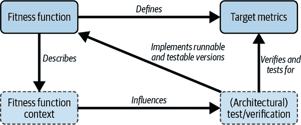
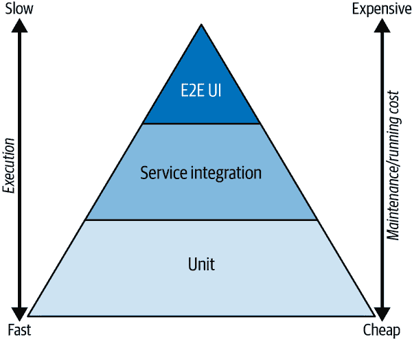
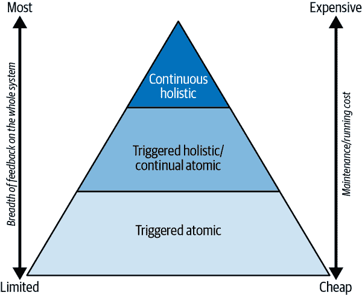

# 第 2 章. 适应度函数测试金字塔：架构测试和指标的类比

Rene Weiss

适应度函数是一个源自进化计算的概念，也是一种简洁的方法，可用于定义软件系统指标。本章将展示适应度函数如何帮助你为系统定义量身定制的指标，并利用它们改进系统的架构，无论你当前是在构建新系统还是改进现有系统。将适应度函数和指标与测试金字塔概念相结合，可以帮助你定义、优先排序和平衡指标，并能够衡量实现目标的进展。

## 适应度函数和指标

在他们的书 *构建进化式架构* 中，Neal Ford、Rebecca Parsons 和 Patrick Kua 将适应度函数定义为“用于总结预期设计方案实现既定目标的接近程度的目标函数”。^(1) 这样的函数通常输出一个离散值，即你试图实现或改进的指标。为了知道是否达到目标，你需要一种测试或验证机制来衡量所需的指标。理想情况下，你希望它能自动化，但这并不是适应度函数的必要条件！

我喜欢使用适应度函数来创建目标指标的想法，因为它们非常灵活。你也可以使用适应度函数来描述和集成典型的指标（如代码覆盖率或代码结构指标如圈复杂度），^(2) 但它们的开放性使你能够根据系统和上下文定制架构指标。

图 2-1 中的概念图说明了适应度函数与目标指标之间的关系。适应度函数定义目标指标并描述相关上下文，我称之为 *适应度函数上下文*。这可能包括影响测试的环境、定义和限制的额外信息；我将把这些信息分为若干类别，并在后面更详细地描述。



*架构测试* 生成目标指标。通常，这类测试还会直接验证创建的指标是否高于（或低于）某个阈值。通常，这些测试是自动化的，并在持续集成 (`CI`) 工作流的一部分中执行。有些甚至可以在没有特定触发器的情况下持续运行和验证。我使用 *架构测试* 和 *架构验证* 这些术语来明确将其与功能测试区分开来。例如，功能测试可能会查看是否能在系统中正确创建新客户；而架构测试可能会查看是否能在实现架构或质量目标的同时创建 10 个客户。例如，此场景中的架构测试为这 10 个客户的创建速度创建了一个指标，并验证是否在 10 毫秒以内。

适应度函数、其上下文和实际目标指标紧密相关。我们在 *设计时* 定义这三者。架构测试是在之后创建的，不是适应度函数及其指标定义的一部分。

如果架构测试是自动化的，我强烈推荐，实施后，指标将自动生成。你可能需要在系统或架构中更改某些内容，评估新工具和框架，并在实施测试时在“工程”方面发挥创造力。所有这些都是在你定义目标和指标之后完成的。何时以及如何定义适应度函数并实施架构测试是 “开发你的适应度函数和指标” 的一部分。

简而言之，适应度函数充当你对“好”的定义。让我们看一些例子。

### 适应度函数：测试覆盖率

在这个假设系统中，保持单元测试覆盖率高于 90%的阈值至关重要。^(3) 自动集成测试的目标是高于 50%的行覆盖率。让我们看看如何将这两个目标描述为具有上下文的适应度函数（示例 2-1 和 2-2）。

#### 示例 2-1. 一个适应度函数

```
Unit Test Coverage > 0.9; 
Execute on each CI Build; Fail when below target coverage
```

#### 示例 2-2. 一个适应度函数

```
Integration Test Coverage > 0.5; 
Execute on each nightly integration test build; 
Fail when below target coverage
```

正如这些简单示例所示，适应度函数定义了需要满足的目标指标（测试覆盖率）、与指标相关的上下文（要执行的测试类型以及执行时间）以及自动验证指标所需的额外上下文信息。

实际实现（如在测试执行期间测量代码覆盖率，如 示例 2-1 中所述；或设置特定测试环境、执行测试并验证结果，如 示例 2-2 所述）是实施架构测试的一部分。

### 适应度函数：具有网络延迟的集成测试

你正在测试的系统正在使用 `REST/JSON API` 与第三方系统集成。如果该 API 缓慢或无响应，你自己的系统的稳定性和性能将会下降，因此你希望验证你的系统是否能正确处理此类事件并按预期执行。以下是适应度函数可能的样子（示例 2-3）。

#### 示例 2-3. 一个适应度函数

```
Integration test errors = 0% (when network latency is 10s for third-party API call); 
Execute on each nightly integration test build; Fail when integration test fails
```


在本示例中，适应度函数的各个部分可能不如前两个示例那样明显。需要达到的指标是 0% 测试错误（无错误），前提条件是模拟第三方 API 调用在执行集成时的 10 秒网络延迟。

实际的测试实现负责设置环境，为第三方 API 调用模拟 10 秒的网络延迟，每晚执行集成测试构建，并在这些集成测试引发的任何错误时失败。

对 示例 2-3 的一种变体是在网络延迟为 10 秒的情况下，将相同上下文与额外指标（如系统的整体吞吐量）结合起来，从而测试某个回退机制是否正常工作（示例 2-4）。

### 示例 2-4. 一个适应度函数

```
Integration test errors = 0% (when network latency is 10s for third-party API call); 
Execute on each nightly integration test build; Fail when integration test fails; 
Fail when test execution duration is > 10 minutes (standard execution time,
without network latency is below 5 minutes)
```

对于此变体，我增加了一个额外指标：也应达到一定的性能目标。前提条件仍是指定 10 秒的网络延迟，我们验证系统的回退机制是否有效，并且整个系统仍在一定的时间范围内运行（与标准网络延迟相比，执行时间最多翻倍）。

## 适应度函数类别简介

适应度函数涵盖许多类别（我也喜欢称它们为 `dimensions`，并将在本章中同义使用这两个术语）。在我看来，这些维度应指导开发人员为其软件系统定义最有用的适应度函数。适应度函数始终存在于此处所列维度的组合中；不过请注意，并非所有这些类别的随机组合都是可能或有意义的。

Ford、Parsons 和 Kua 提供了这些类别的非常好的描述性列表，其中大部分我将在此处重用。我还在此基础上扩展了他们认为重要的额外类别。

在创建和定义适应度函数及目标指标时，以及在随后实现创建和验证目标指标的最终测试时，将这些维度用作指导和输入以考虑所有相关方面是一个好主意。您可以将维度用作目录，从中为您的系统和上下文挑选合适的组合（稍后我会简要概述）。正如软件开发中始终如此，只使用为使用它们的团队或团队提供具体信息、方向和意义的类别。

接下来，我们将查看我认为强制性的六个类别，然后是四个可选类别。

## 强制性适应度函数类别

以下六个类别对我来说是强制性的，因为使用这些类别对于软件开发工作始终是有意义的。因此，如果在开发适应度函数期间没有考虑它们，指标及其测试将导致不理想的定义，缺少适应度函数定义的一些重要方面。

### 反馈是原子的还是整体的？

在测试以创建指标时，系统中涉及多少部分？在现实世界中，这一类别更像是一个连续体而非二元对立，但为了便于理解，我们将该连续体的两端视为两个不同的类别。

`Atomic` 适应度函数仅验证系统的部分或有限方面。因此，正面的验证不一定提供整个系统性能的反馈——仅限于系统的该部分。典型示例包括执行静态代码分析，例如测量圈复杂度作为可维护性的指标，或测量单元测试覆盖率作为可维护性和可测试性的指标。

`Holistic` 适应度函数另一方面提供更广泛的反馈。来自整体适应度函数的正面验证意味着系统的很大一部分按预期运行，并且最终用户可以按预期使用系统。整体函数往往更难构建和维护。

### 什么触发测试执行？

除了手动执行测试外，您通常会开发测试以通过特定触发器自动执行，例如由开发人员操作触发的 `CI workflow` 或计划的测试运行（例如，`nightly`）。相比之下，持续的适应度函数会持续评估，与开发活动无关（例如指标及其阈值的恒定验证）。持续反馈通常与在生产环境中执行的实际测量以及在系统运行期间收集的指标评估相关联。属于持续类别的适应度函数通常也属于系统监控（工具）的技术领域；例如，监控某项服务的响应时间可能就是这样的适应度函数。

### 测试在哪里执行？

相关测试是在测试系统还是生产环境中执行？另一个选项是在持续集成/持续交付（`CI/CD`）管道中运行测试（例如，直接在 `CI/CD` 系统的主机上测量单元测试代码覆盖率）。该函数可在测试系统（例如性能或负载测试）中进行评估。在某些情况下，测试甚至可以直接从生产系统派生。这些分类可能重叠：例如，如果性能测试在测试环境中运行，而 `CI/CD` 管道启动测试执行。此类别决定测试的执行位置，是否需要额外硬件，以及测试是否会影响正在运行的生产系统。

### 指标类型

指标类型是一个相当明显需要考虑的问题。架构测试产生什么类型的值？它只是真/假陈述（“所有测试均为绿色”），还是产生数值？此外，您还应考虑所产生的指标是否会被存储并在时间序列中可视化，其中时间序列提供了有价值的输出。

### 自动化与手动

手动执行某些测试可能是有用的。这通常在自动化需要太多精力、成本太高或根本不可行时发生。例如，针对法律要求的测试可以表示为适应度函数，但对其进行自动化是没有意义的。^(4) 总体而言，软件架构师喜欢自动化事物，以便我们可以尽可能轻松、频繁地运行测试。

### 质量属性要求

对我来说，最重要的类别是为软件系统定义 `quality attributes`（也称为质量属性 `requirements` 或 `quality goals`）。一般而言，开发软件架构时有三个关键驱动因素：功能需求、质量属性和约束。质量目标定义了事物必须工作的程度。它们概述了整体产品的功能需求必须如何协同工作，并对系统提出额外的定性要求（例如，调整系统某部分的难易程度）。根据 Bass、Clements 和 Kazman 的说法，质量目标因此在软件架构的开发中非常重要。^(5)

国际标准化组织（`ISO`）标准 `25010` 提供了质量属性的示例目录。它列出了产品质量的八个主要特征，然后将其细分为更具体的子属性（参见 表 2-1）。

表 2-1. 质量属性和子属性^(a)

| 属性  || 子属性 |


| --- | --- |
| **功能适用性** || 功能完整性 |
| --- | --- |
| 功能正确性 |
| 功能适当性 |
| **性能效率** || 时间行为 |
| 资源利用率 |
| 容量 |
| **兼容性** || 共存 |
| 互操作性 |
| **可用性** || 适当性可识别性 |
| 可学习性 |
| 可操作性 |
| 用户错误保护 |
| 用户界面美观性 |
| 可访问性 |
| **可靠性** || 成熟性 |
| 可用性 |
| 容错性 |
| 可恢复性 |
| **安全性** || 保密性 |
| 完整性 |
| 不可否认性 |
| 问责性 |
| 真实性 |
| **可维护性** || 模块化 |
| 可复用性 |
| 可分析性 |
| 可修改性 |
| 可测试性 |
| **可移植性** || 可适应性 |
| 可安装性 |
| 可替换性 |
| ^(a) ISO/IEC 25010、ISO 25000，访问于 2022 年 3 月 28 日，`https://oreil.ly/Q3yst`. |
| --- |

ISO 规范并不是对软件质量特性进行分类的唯一方法；[惠普开发了另一种名为 FURPS 的系统](https://oreil.ly/hAWgp)（用于功能性、可用性、可靠性、性能和支持性）。然而在本章中，我将使用 ISO 属性。

无论您在与利益相关者讨论质量目标时使用何种模板、目录或规范，请记住质量目标是系统架构开发的主要驱动因素之一，因此在我们努力定义健身函数和指标时，它们也应成为主要驱动因素。

只对对整体目标产生重大影响的属性投入时间和精力才有意义。因此，在 “开发您的健身函数和指标” 中，将质量目标与关键利益相关者保持一致并对其进行定义，是创建相关健身函数及其指标的第一步。

## 可选的适应度函数类别

以下类别可以提供额外的指导，可能与您和您的上下文相关。我认为它们是可选的，因为它们并不总是相关。其中一些与通常仅在更大规模的项目中才会出现的额外沟通和文档要求相关联。

### 适应度函数是临时的还是永久的？

如果健身函数的用途和有效性在设计上是有限的，您可以明确将其标记为临时；其他健身函数被归类为永久。这里的“永久”是指该函数并非设计为有特定的结束日期，并不意味着它会“永远”持续：该函数可以像软件开发中的所有其他事物一样被更改或放弃。

专门的、持续时间较长的更改或重构活动是临时健身函数的一个良好示例。在重构进行期间，临时健身函数和指标可提供额外帮助。一旦该工作完成，它们将被退役。

### 适应度函数是静态的还是动态的？

*静态* 健身函数，或更准确地说，静态健身函数的指标，对目标指标具有静态定义。然后验证是针对此静态指标进行的。例如，您在示例 2-1 和 2-2 中见过此类健身函数，其中我们检查代码覆盖率是否始终高于某个静态值。

另一方面，*动态* 健身函数定义目标指标相对于另一个值处于某个范围内。例如，您可以根据系统中当前活跃的用户数量为响应时间定义一个目标范围。在此示例中，您可以根据在线用户数量在 10,000 到 100,000 用户范围内，将目标响应时间范围定义为 50 到 100 毫秒。

对于这种动态定义，创建（自动化）测试会更复杂。但这种定义也可以比静态定义更好地适应实际使用案例，因此根据您的使用案例，可能提供更有价值的输出。

### 目标受众是谁？

您的健身函数和指标的目标受众可能包括软件开发人员、运维人员和产品经理，以及其他利益相关者。在需要额外文档和沟通的大型环境中，定义受众是有用的。提前了解目标受众对于决定如何以及在何处可视化输出并提供访问权限非常重要。

### 您的函数和指标将在何处应用？

如果您拥有大型系统或多个系统，可能有必要将健身函数及其指标的有效性和执行范围限制在单个系统、子系统或服务上。这通常也伴随着额外的文档和沟通需求，而这些需求存在于更大规模的软件开发项目中。或者，您可能希望将给定的健身函数限制在系统或子系统内的特定技术中，例如为用 JavaScript 编写的 前端 要求一种类型的代码覆盖率，而为用 Java 编写的 后端 要求另一种类型。

## 适应度函数类别：目录概览

最后，表 2-2 和 2-3 提供了类别及其可能值的简明概述，作为您创建第一个健身函数时的参考。

表 2-2. 强制性健身函数类别

| 类别 || 可能的值 |
| --- | --- |
| 反馈广度 || 原子性或整体性 |
| --- | --- |
| 测试执行触发 || 触发式或连续式 |
| 执行位置 || CI/CD、测试环境、生产系统等。 |
| 指标类型 || 真/假、离散值、时间序列/历史值 |
| 自动化 || 自动化或手动 |
| 质量属性 || ISO 属性：功能适用性、性能效率、兼容性、可用性、可靠性、安全性、可维护性、可移植性 |

表 2-3. 可选的健身函数类别

| 类别 || 可能的值 |
| --- | --- |
| 临时或永久 || 临时或永久 |
| --- | --- |
| 静态或动态 || 静态或动态 |
| 目标受众 || 由您指定；例如，开发人员和产品负责人 |
| 适用性 || 由您指定；例如，某些技术（仅 JavaScript）或系统的某些区域（服务 A 或服务 B） |

现在您对我们的类别有了了解，让我们将它们应用于测试金字塔框架。

## 测试金字塔

测试金字塔是一个广为人知且被接受的概念，用于将不同类型的自动化功能测试分类为三层。^(6) Martin Fowler 将其描述为“一种思考如何使用不同类型的自动化测试来创建平衡投资组合的方式”。^(7) 在此上下文中，*平衡* 指的是自动化功能测试的投资组合，它在执行时间和运行及维护成本与自动化测试提供的信心之间取得平衡。通常，测试越多，您对应用程序按预期工作应获得的信心就越大。但这通常伴随着这些测试更高的运行和维护成本的缺点。

图 2-2 显示了一个具有三层的基本测试金字塔。每层提供不同质量的反馈。



基础层
: 基础层由我们执行的最简单的测试组成：单元测试。如果单元测试失败，问题所在非常明确：它必须在被测试的单元内部。当单元测试失败时，该单元可能导致问题的真实使用案例，以及最终用户会注意到错误行为的情况，通常并不能轻易推导出来。

中间层


中间层描述了服务和集成测试。（有时组件和 API 测试也会放在这里。）

### 顶层
在顶层是端到端（E2E）测试，通常直接通过应用程序的用户界面（UI）层执行。如果这些测试失败，很容易看出真实使用场景会受到负面影响；然而，由于在这个层面上有很多组件协同工作，更难追踪导致错误的组件。

金字塔底部的测试通常执行速度快，且维护和运行起来容易且成本低。金字塔越往上，测试的执行速度越慢，开发和维护成本也越高。因此，在三个层级之间平衡测试数量至关重要，以实现最佳结果：拥有一个可维护的测试集，能够最大程度地保证系统按预期运行。

当然，这是一个可用于确定测试和自动化工作放置位置的模型，但这个理想化模型并不总是正确。例如，在中间层可能需要使用大量集成测试；对于没有用户界面的不同系统，顶层可能没有任何测试。

在我研究如何将此金字塔结构适配以对适应性函数进行分类之前，让我们快速深入探讨一些有助于定义适应性函数的类别。

## 适应度函数测试金字塔
*适应性函数测试金字塔* 的概念与功能测试金字塔的概念密切相关。我已将主要概念适配用于适应性函数和架构指标，以便在架构测试中重复使用以实现平衡（这一思想在架构验证中同样重要）。

统计学家 George Box 曾写道：“所有模型都是错误的”，但补充说“但有些仍然有用”。^(8) 我希望本文介绍的模型属于有用这一类。

与功能金字塔一样，最容易且最便宜的测试位于金字塔底部，更高级的测试位于中间，而应提供“最佳”真实世界反馈的最复杂测试位于适应性函数测试金字塔的顶部。

适应性函数始终是在多个类别中创建的，我已在上一节中介绍过。虽然所有强制性类别都与描述有用的适应性函数相关，但只有少数类别与适应性函数测试金字塔层级的分类相关。因此，我鼓励你使用适应性函数测试金字塔概念来创建一套平衡的架构测试，在执行时间、运行和维护成本与这些（大多是自动化的）架构测试提供的信心之间取得平衡。

我会将执行（快与慢）仅在某些环境中视为适应性函数测试金字塔层级分类的相关因素。将适应性函数及其测试实现分类到金字塔某一层级的两个最相关类别是反馈广度（原子与整体）和执行触发，如 图 2-3 所示。^(9)

只有整体适应性函数才会出现在金字塔的顶层。至于执行，持续运行的测试和验证更难实现，尤其是在整体反馈方面。因此，这些类别相互作用以决定每个层级中出现的内容。



## 顶层
顶层测试是整体性的，并为系统健康状况及其对终端用户的功能提供最复杂的反馈。因此，这些指标和验证最接近真实使用场景。

然而，它们通常是最难构建和维护且成本最高的测试。在某些情况下，它们更可能出现非确定性行为，因为涉及大量组件且测试了系统的广泛部分。我们积极努力为整个系统提供整体反馈，但也必须考虑更难隔离的意外错误。

总结来说，顶层测试复杂且难以构建和维护，它们发现的问题有时很难追溯到根本原因。因此我们在努力平衡投入与产出时只选择少数“好的”测试（金字塔顶部应包含的测试更少）。

作为顶层整体测试的示例：对于在线商店，可以不断测量关键指标，如每分钟结账率、每分钟收入或每分钟登录次数，如果它们落在定义为目标走廊的预期范围内。偏差可能突出需要解决的潜在技术问题（或可能由最新部署引入）。顶层还包括 *混沌工程*，^(10) 即在生产环境中引入错误以测试系统弹性的做法，同时衡量系统对终端用户的整体健康状况和就绪程度。

## 中间层
中间层，如 图 2-3 所示，由触发式整体或持续原子适应性函数组成。这些适应性函数对整个系统健康状况提供广泛反馈，但不会持续运行；它们由专门的开发操作触发。

一个触发式整体指标可能是作为集成测试构建的一部分进行测试、执行和评估，或利用自动化部署管道中的测试系统或阶段进行评估。使用多个测试用例的集成测试运行也可以通过模拟其他系统部分或第三方系统的故障来提供关于整个系统性能、事务行为或弹性的可靠反馈。适应性函数示例 2-3 和 2-4 可被视为中间层的测试。

一个在生产系统中持续评估的简单原子适应性函数也属于这一层：例如，对原子值（如交易持续时间或终端用户性能，例如 Web 应用程序的浏览器加载时间）进行实时监控和测量。

## 底层
我们适应性函数测试金字塔的底部包含“触发式原子”适应性函数。它们通常易于实现且运行成本低廉。由于其简单性，这些通常已得到很好的建立并已集成在 CI/CD 管道中。它们构成了我们定义有用指标努力的基础。此层可能包括代码覆盖率指标、如圈复杂度之类的静态代码分析，或简单的性能测试。

我建议为底层构建一个宽广的基础，然后在上层采用平衡的方法。你可以在不创建任何顶层测试（甚至中间层测试）的情况下使用适应性函数。同样，可能甚至存在需要将金字塔倒置的情况，即大量持续的整体度量，而触发式原子类别只有少数。这始终高度依赖于上下文和目标，但通常我建议遵循金字塔的形状，底部测试最多，上层测试逐渐减少。

然而，当我们思考在基础层应有多少测试时，这个类比就会失效。通常没人会考虑限制单元测试的数量，如果它们对这种粒度有价值的话。相比之下，对于适应性函数测试金字塔的基础，我不建议尽可能创建尽可能多的测试，因为它们都会产生额外的开销。

## 示例及其完整分类


现在你已经了解了适应度函数可能性的广度，让我们重用之前的两个示例并推导出它们对应的分类，以使理论介绍栩栩如生。

我们之前定义了适应度函数的第一个版本，用于测试单元测试覆盖率，见示例 2-1。

以下是该适应度函数的分类分解：
* 反馈广度：原子性
  * 单元测试覆盖率仅为我们提供了对整个系统功能的有限反馈。
* 执行触发：触发式
* 执行位置：CI/CD
  * 执行在每次推送到源代码控制系统时触发，并将执行单元测试并测量单元测试覆盖率。
* 指标类型：特定值（> 90%）
* 自动化
  * 适应度函数将自动评估。
* 质量属性要求：可维护性
  * 通过此适应度函数，我们追求保持系统在一定水平上的可维护性；我们将良好的测试覆盖率视为系统更易于维护（适配、更改、改进）的指标。
* 静态或动态：静态

示例 2-2（集成测试覆盖率）的分类相同。适应度函数将位于金字塔的底层。

我们之前定义了适应度函数的第一个版本，用于在网络延迟情况下测试特定功能（示例 2-3）。

以下是该适应度函数的分类分解：
* 反馈广度：原子性/整体性
  * 判断其是否符合整体适应度函数更难分类；它主要取决于执行的测试以及第三方系统对我们系统的重要性。
  如果第三方系统在我们系统的许多用例中使用，则可以将其分类为整体适应度函数；否则，我更愿意将其分类为原子性。
* 执行触发：触发式
* 执行位置：CI/CD 和测试环境
  * 执行在 CI 工作流中每晚触发，但测试是在测试环境中执行。
* 指标类型：0/1（如果所有测试均通过）
  * 我们也可以认为我们对所有测试的阳性率感兴趣，但由于我们要求所有测试都通过，因此这是一个 0 或 1 的决策。
* 自动化
  * 适应度函数将自动评估并每晚运行。
* 质量属性要求：可靠性
  * 通过此适应度函数，我们追求即使在第三方接口响应缓慢的情况下也保持系统可靠性高的目标。
* 静态或动态：静态

以下是示例 2-4 的分类分解：

反馈广度（原子性或整体性）：可能是两者之一
: 是否将此特定适应度函数更好地归类为原子性或整体性，主要取决于执行的测试、第三方系统对我们系统的重要性以及系统的整体性能。如果你的系统对多个用例使用第三方系统，它会影响整个系统的性能，因此你可以将其分类为整体适应度函数。

执行触发和位置：触发式，以及 CI/CD 和测试环境
: 执行在 CI 工作流中每晚触发，但测试是在测试环境中执行。

指标类型：两种类型
: 第一种类型，如果通过所有测试，则为 0/1。你也可以认为你对所有测试的阳性率感兴趣，但由于所有测试都必须通过，因此这是一个 0 或 1 的决策。第二种是性能测量的特定值：在本例中，快于 10 分钟。

自动化：是
: 适应度函数将自动评估并每晚运行。

质量属性要求：可靠性、性能效率
: 通过此适应度函数，我们追求即使在第三方接口响应缓慢的情况下也保持系统可靠性高且性能处于适当水平的目标。

静态或动态：静态
: 这是一个静态函数，因为两个指标在这里是静态定义的，目标值不依赖于另一个适应度函数的输出

如前所述，我会将示例 2-3 和 2-4 放在适应度函数测试金字塔的中间层。

## 完全分类顶层示例

在这里你可以找到两个顶层适应度函数示例的完整定义。更复杂的示例 2-5 和 2-6 展示了适应度函数的完整分类，这些函数位于适应度函数测试金字塔的顶部或接近顶部。

### 示例 2-5. 一个适应度函数（在线商店）

```
Measure revenue per minute throughout the day. Fail when revenue per minute, 
based on current time, is out of the corridor provided by the following table:

Time frame of day     Min revenue (per min)
01:00 AM – 05:00 AM   € 200
05:01 AM – 07:00 AM   € 400
07:01 AM – 09:00 AM   € 600
09:01 AM – 11:30 AM   € 900
11:31 AM – 01:30 PM   € 1100
01:31 PM – 05:30 PM   € 950
05:31 PM – 07:30 PM   € 1500
07:31 PM – 09:00 PM   € 750
09:01 PM – 00:59 AM   € 300
```

让我们将示例 2-5 中的适应度函数分解为其类别：

反馈广度（原子性或整体性）：整体性
: 该度量是对整个系统性能的直接测量。

执行触发和位置：持续，生产环境
: 适应度函数的评估在生产环境中持续进行。

指标类型：离散值
: 该值是收入。需要验证该值是否高于阈值。

自动化：是
: 适应度函数将自动评估。

质量属性要求：多个
: 包括可靠性、性能效率、可用性等。由于我们测量的是整个系统，示例显示了对多个质量属性的直接验证。

静态或动态：动态
: 该适应度函数将位于金字塔的顶层。

### 示例 2-6. 一个适应度函数（在线商店可靠性）

```
Deploy the new release to our production system (at night, 01:00 AM). 
While the release is rolled out, constantly perform the regression test set 
containing the 5 main end user use cases (login, put item to cart, 
remove item from cart, view cart, checkout). The system performs all actions 
and responds within 100ms. Fail when test case fails; 
Fail when system doesn’t perform actions and respond < 100ms
```

让我们将示例 2-6 中的适应度函数分解为其类别：

反馈广度（原子性或整体性）：整体性
: 该度量是在部署期间对整个系统的直接测量，而不是所有在线节点。

执行触发和位置：触发式，生产环境
: 适应度函数的评估在生产环境中使用离散触发器（每晚 01:00）进行。

指标类型：两种类型
:
第一种类型是离散值（性能），验证该值是否高于阈值。
第二种值是 0/1：系统在部署期间可用，且测试不会失败。

自动化：是
: 适应度函数将自动评估。

质量属性要求：多个
: 包括可靠性和性能效率。

静态或动态：静态
: 该适应度函数将位于金字塔的顶层。


正如示例所示，现实世界示例的分类对于每个类别来说并不总是非黑即白的决定。但这也不是类别的目标。类别或维度首先应作为健身函数及其度量重要方面的目录使用。第二个目标是它们帮助软件架构师识别当前未覆盖的领域，帮助他们决定是否需要额外的努力。

# 开发你的适应度函数和度量

让我们看看我如何开发健身函数，并在初始集合实施后继续进行持续的迭代工作。对我来说，与软件架构工作相关的所有活动的[content]
正如示例所示，现实世界示例的分类对于每个类别来说并不总是非黑即白的决定。但这也不是类别的目标。类别或维度首先应作为健身函数及其度量重要方面的目录使用。第二个目标是它们帮助软件架构师识别当前未覆盖的领域，帮助他们决定是否需要额外的努力。

# 开发你的健身函数和度量

让我们看看我如何开发健身函数，并在初始集合实施后继续进行持续的迭代工作。对我来说，与软件架构工作相关的所有活动的[content]
正如示例所示，现实世界示例的分类对于每个类别来说并不总是非黑即白的决定。但这也不是类别的目标。类别或维度首先应作为健身函数及其度量重要方面的目录使用。第二个目标是它们帮助软件架构师识别当前未覆盖的领域，帮助他们决定是否需要额外的努力。

# 开发你的健身函数和度量

让我们看看我如何开发健身函数，并在初始集合实施后继续进行持续的迭代工作。对我来说，与软件架构工作相关的所有活动的[content]
正如示例所示，现实世界示例的分类对于每个类别来说并不总是非黑即白的决定。但这也不是类别的目标。类别或维度首先应作为健身函数及其度量重要方面的目录使用。第二个目标是它们帮助软件架构师识别当前未覆盖的领域，帮助他们决定是否需要额外的努力。

# 开发你的健身函数和度量

让我们看看我如何开发健身函数，并在初始集合实施后继续进行持续的迭代工作。对我来说，与软件架构工作相关的所有活动的[content]
正如示例所示，现实世界示例的分类对于每个类别来说并不总是非黑即白的决定。但这也不是类别的目标。类别或维度首先应作为健身函数及其度量重要方面的目录使用。第二个目标是它们帮助软件架构师识别当前未覆盖的领域，帮助他们决定是否需要额外的努力。

# 开发你的健身函数和度量

让我们看看我如何开发健身函数，并在初始集合实施后继续进行持续的迭代工作。对我来说，与软件架构工作相关的所有活动的[content]
正如示例所示，现实世界示例的分类对于每个类别来说并不总是非黑即白的决定。但这也不是类别的目标。类别或维度首先应作为健身函数及其度量重要方面的目录使用。第二个目标是它们帮助软件架构师识别当前未覆盖的领域，帮助他们决定是否需要额外的努力。

# 开发你的健身函数和度量

让我们看看我如何开发健身函数，并在初始集合实施后继续进行持续的迭代工作。对我来说，与软件架构工作相关的所有活动的[content]
正如示例所示，现实世界示例的分类对于每个类别来说并不总是非黑即白的决定。但这也不是类别的目标。类别或维度首先应作为健身函数及其度量重要方面的目录使用。第二个目标是它们帮助软件架构师识别当前未覆盖的领域，帮助他们决定是否需要额外的努力。

# 开发你的健身函数和度量

让我们看看我如何开发健身函数，并在初始集合实施后继续进行持续的迭代工作。对我来说，与软件架构工作相关的所有活动的[content]
正如示例所示，现实世界示例的分类对于每个类别来说并不总是非黑即白的决定。但这也不是类别的目标。类别或维度首先应作为健身函数及其度量重要方面的目录使用。第二个目标是它们帮助软件架构师识别当前未覆盖的领域，帮助他们决定是否需要额外的努力。

# 开发你的健身函数和度量

让我们看看我如何开发健身函数，并在初始集合实施后继续进行持续的迭代工作。对我来说，与软件架构工作相关的所有活动的[content]
正如示例所示，现实世界示例的分类对于每个类别来说并不总是非黑即白的决定。但这也不是类别的目标。类别或维度首先应作为健身函数及其度量重要方面的目录使用。第二个目标是它们帮助软件架构师识别当前未覆盖的领域，帮助他们决定是否需要额外的努力。

# 开发你的健身函数和度量

让我们看看我如何开发健身函数，并在初始集合实施后继续进行持续的迭代工作。对我来说，与软件架构工作相关的所有活动的[content]
# 开发你的健身函数和度量

让我们看看我如何开发健身函数，并在初始集合实施后继续进行持续的迭代工作。对我来说，与软件架构工作相关的所有活动的[content]
正如示例所示，现实世界示例的分类对于每个类别来说并不总是非黑即白的决定。但这也不是类别的目标。类别或维度首先应作为健身函数及其度量重要方面的目录使用。第二个目标是它们帮助软件架构师识别当前未覆盖的领域，帮助他们决定是否需要额外的努力。

# 开发你的健身函数和度量

让我们看看我如何开发健身函数，并在初始集合实施后继续进行持续的迭代工作。对我来说，与软件架构工作相关的所有活动的[content]
让我们看看我如何开发健身函数，并在初始集合实施后继续进行持续的迭代工作。对我来说，与软件架构工作相关的所有活动的[content]
对我来说，与软件架构工作相关的所有活动的主要起点都是系统的质量目标。
[/content]

That works? Let's test.

[content]
对我来说，与软件架构工作相关的所有活动的主要起点都是系统的质量目标。


^(9) Ford、Parsons 和 Kua 将这两个类别称为自然的“mash-up”，因为在定义现实世界的适应度函数、指标和测试方面，这两者密切相关；当然，其他类别也可能产生影响，但这在很大程度上取决于具体的用例。供参考，这两者也由 Ford、Parsons 和 Kua 提出为自然的“mash-ups”。

^(10) 例如，参阅 [“混沌工程原则”](https://principlesofchaos.org) 和 Netflix 的 [混沌猴](https://oreil.ly/4i0Z1) 以了解更多关于混沌工程的内容。

^(11) 这是一个非常简化的表格，仅用于上面的示例；现实世界的版本将具有更细粒度的结构，或时间与预期收入之间更复杂的关联。

^(12) 这是一个可靠性测试，用于验证在执行滚动更新时系统仍处于运行状态。测试验证系统在部署期间提供零停机时间；此外，它可能表明如果节点因任何原因宕机，整个系统仍然响应并按预期运行。

^(13) Ford、Parsons 和 Kua，“第 2 章：适应度函数”，*Building Evolutionary Architectures*。
