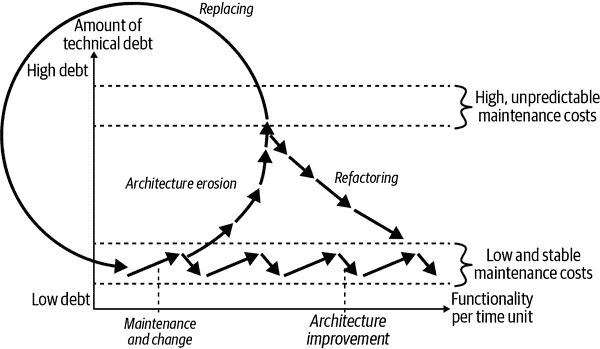
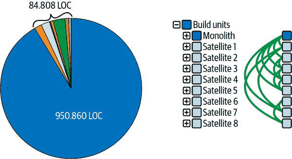
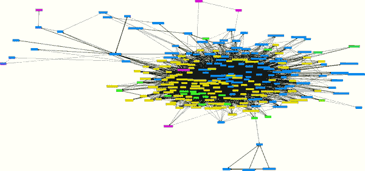
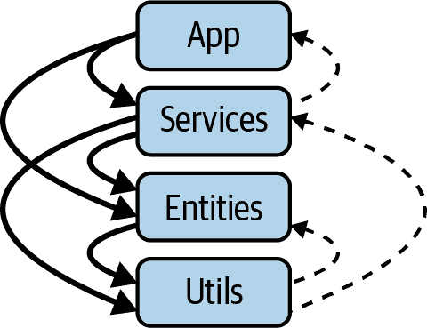
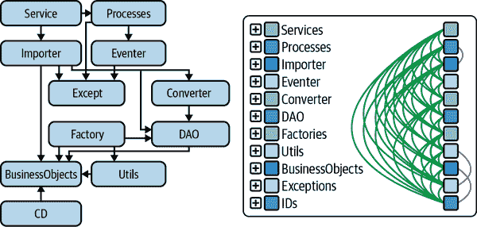
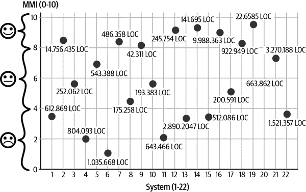
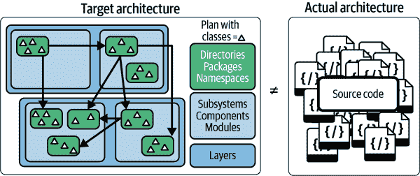
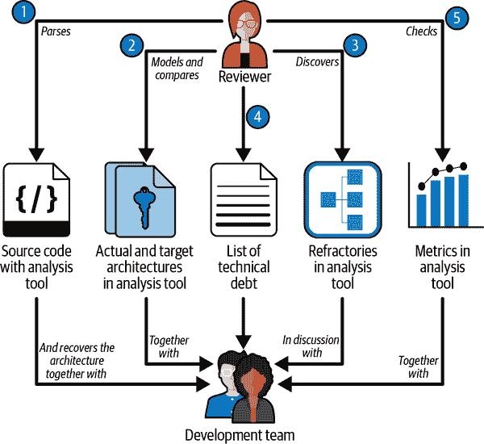

# 第 4 章. 使用模块化成熟度指数改进你的架构

Dr. Carola Lilienthal

在过去 20 年里，大量时间和金钱投入到了使用现代编程语言（如 Java、C#、PHP 等）实现的软件系统中。开发项目的重点往往在于功能的快速实现，而非软件架构的质量。这种做法导致技术债务——不必要的复杂性，会额外增加维护成本——随着时间的推移不断累积。今天，这些系统不得不被称为遗留系统，因为它们的维护和扩展成本高、繁琐且不稳定。

本章讨论如何使用模块化成熟度指数（MMI）衡量软件系统中的技术债务量。代码库或 IT 景观中不同应用的 MMI 为管理层和团队提供了指导，以决定哪些软件系统需要重构、哪些应该替换、哪些无需担心。目标是找出应解决哪些技术债务，以便架构变得可持续且维护成本更低。

## 技术债务

*技术债务* 一词由 Ward Cunningham 于 1992 年提出：“Technical debt arises when consciously or unconsciously wrong or suboptimal technical decisions are made. These wrong or suboptimal decisions lead to additional work at a later point in time, which makes maintenance and expansion more expensive.”^(1) 在做出错误决策时，你就开始累积技术债务，如果不想最终负债累累，就需要连本带息地偿还。

在本节中，我将列出两种技术债务类型，重点关注通过架构评审可以发现的技术债务：

实现债务

## 实现债务
源代码中包含所谓的代码坏味道，例如过长的方法和空的 catch 块。实现债务现在可以利用各种工具以高度自动化的方式在源代码中发现。每个开发团队都应在日常工作中逐步解决这一债务，而无需额外预算。

## 设计与架构债务
类、包、子系统、层和模块的设计及其之间的依赖关系不一致且复杂，与计划的架构不符。这种债务无法通过简单的计数和测量来确定，需要进行广泛的架构评审，该内容在 “确定 MMI 的架构评审” 中介绍。

其他也可视为软件项目债务的问题领域，例如缺少文档、测试覆盖率差、可用性差或硬件不足，在此被排除，因为它们不属于技术债务的范畴。

# 技术债务的起源
让我们来看技术债务的起源和影响。如果在软件开发项目的开始设计了高质量的架构，那么可以假设软件系统在开始时可以轻松维护。在此初始阶段，软件系统处于低技术债务的走廊中，维护工作量相同，如 图 4-1 所示。
如果系统在维护过程中不断扩展以集成变更，技术债务不可避免地会产生（图 4-1 中向上箭头所示）。软件开发是一个持续的学习过程，其中解决方案的第一次尝试很少是最终的。架构的修订（架构改进，以向下箭头表示）必须定期进行。这形成了一个持续的维护/变更与架构改进的序列。

如果团队能够永久地遵循扩展和架构改进的恒定序列，系统将保持在低且稳定的维护成本走廊中。不幸的是，架构改进的这一方面直到近年才真正成为许多预算管理者的现实——对于大多数始于 2000 年代初的系统来说为时已晚。
如果开发团队不被允许持续减少技术债务，随着时间的推移，架构侵蚀不可避免地会发生，如 图 4-1 中离开低且稳定维护成本走廊的上升箭头所示。此过程称为 *架构侵蚀*。一旦技术债务累积起来，维护和更改软件变得越来越昂贵，因果错误也越来越难以理解，以至于每次更改都成为一种痛苦的努力。图 4-1 通过向上箭头不断变短的事实清楚地表明了这种缓慢的衰退。随着债务的增加，每单位时间内可实现的功能越来越少。

摆脱这种技术债务困境有两种方法：

### 重构
你可以从内部开始重构遗留系统，从而再次提高开发速度和稳定性。在这通常艰难的道路上，系统必须逐步重新进入低且稳定的维护成本走廊（参见 图 4-1 中标记为“重构”的下降箭头）。

### 替换
或者可以用技术债务更少的软件替换遗留系统（参见 图 4-1 中的圆圈）。

当然，也可能在开发开始时现场没有能力强的团队。在这种情况下，技术债务在开发开始时就被承担并持续增加。可以说这样的软件系统是在恶劣条件下成长起来的。无论是软件开发人员还是管理层，从长远来看都不会喜欢处于这种状态的系统。
这种对技术债务的看法对于大多数预算管理者来说是可理解的。没有人愿意累积技术债务并在开发中慢慢陷入困境，直到每次调整都成为无法估算的成本负担。需要持续工作以在软件整个生命周期内保持技术债务较低这一方面也可以很好地传达。大多数非 IT 人士现在都清楚地了解这个问题，但你如何实际评估软件系统中的债务呢？

# 使用 MMI 进行评估
我关于架构和认知科学的博士论文，以及超过三百次架构评估的结果，使我和我的团队能够创建一个统一的评估方案，名为 MMI，用于比较各种系统中架构中累积的技术债务。
认知科学告诉我们，在进化过程中，人类大脑获得了处理复杂结构的一些令人印象深刻的机制，例如政权组织、城镇和国家的布局、谱系关系等等。软件系统无疑也是复杂结构，因为它们的大小和所包含的元素数量。在我的博士论文中，我将认知心理学关于大脑处理复杂性的三个机制（分块、构建层级和构建图式）的发现与计算机科学中重要的架构和设计原则（模块化、层级和模式一致性）联系起来。在本章中，我只能提供这些关系的简要解释。完整的细节，特别是关于认知心理学的部分，可以在我的书中^(2)找到，该书源于我的博士论文。
这些原则具有突出的特性，即它们有利于大脑处理复杂结构的机制。遵循这些原则的架构和设计被人们视为统一且易于理解，从而更容易维护和扩展。因此，这些原则必须在软件系统中使用，以便维护和扩展可以快速且无太多错误地进行。目标是我们能够在很长一段时间内使用不断变化的开发团队继续开发我们的软件系统，同时保持相同的质量和开发速度。

# 模块化
在软件开发中，*模块化* 是 David Parnas 在 1970 年代引入的原则。Parnas 认为模块应只包含一个设计决策（封装），并且该设计决策的数据结构应封装在模块本地。^(3)
在现代编程语言中，模块是软件系统内的单元，例如类、组件或层。我们的脑喜欢在不同单元层面上对系统进行推理，以实现记忆容量的提升。这里的关键点是，我们的大脑只有在细节可以表示为形成有意义事物的连贯单元时才能从这些单元中受益。因此，结合任意无关元素的程序单元是没有意义的，也不会被我们的大脑接受。因此，具有连贯且有意义程序单元的模块化系统将具有低技术债务和低不必要的复杂性。
程序单元是否代表软件架构中连贯且有意义的元素只能通过定性评估来判断。这种定性评估得到各种测量和检查的支持：

### 通过耦合实现内聚

### 单位
单位应包含属于一起的子单元，这意味着它们彼此之间的内聚性应高，而与外部的耦合应低。例如，如果某个模块的子模块与其他模块的耦合度高于与其“姐妹兄弟”的耦合度，那么它们彼此之间的内聚性就低，模块化做得也不好。与内聚性不同，耦合是可以度量的。

### 名称
如果系统的程序单元是模块化的，你应该能够针对每个单元回答以下问题：它的任务是什么？这里的关键点在于程序单元确实只有一个任务，而不是几个。判断职责不清的一个好线索是单元的名称，名称应描述其任务。如果名称含糊不清，就应该审视它。不幸的是，这无法度量。

### 良好平衡的比例
处于同一层级的模块化程序单元，如层、组件、包、类和方法，应具有良好的平衡比例。这里值得检查非常大的程序单元，以确定它们是否适合分解。一个极端的例子可以在图 4-2 中看到。在左侧图表中，你可以看到系统九个构建单元在饼图中的大小：团队告诉我们，构建单元反映了系统的计划模块。其中一个构建单元代表饼图的最大部分，为 950.860 行代码（`LOC`）。其他八个构建单元加起来只有 84.808 `LOC`，极不平衡。在图 4-2 的右侧，你可以看到系统的架构，其中九个构建单元以正方形表示，构建单元之间的关系以弧线表示。系统的一部分称为“`Monolith`”，它是饼图中的大块。它使用八个小的构建单元，我们在这里称之为“`Satellite X`”。与卫星的浅色阴影相比，`Monolith`正方形的深色阴影表明，就像饼图一样，这里集中了大部分源代码。该系统的模块化并不平衡。该指标是可以度量的。

你可以对所有层级进行类似的评估来检查系统的模块化。每个要点对 `MMI` 计算的影响请参考层次结构和模式一致性的说明。

# 层次结构
层次结构在感知和理解复杂结构以及存储知识方面发挥着重要作用。如果知识以层次结构呈现，人们就能很好地吸收、再现并在其中找到方向。层次结构的形成在编程语言中通过 `contain-being relationships` 得到支持：类位于包中，包又位于包中，最终位于项目或构建产物中。这些层次结构符合我们的认知机制。

与 `contain-being relationship` 不同，`use and inherit relationships` 可以以不创建层次结构的方式使用：我们可以使用使用和/或继承关系将源代码库中的任何类和接口链接起来。这样，我们就创建了完全非层次化的交织结构。在我们的领域中，我们随后谈论类循环、包循环、模块之间的循环以及架构层之间的向上关系。在我的架构评审中，我看到了整个范围，从很少的循环结构到庞大的循环怪物。

图 4-3 显示了一个包含 242 个类的类循环。每个矩形代表一个类，它们之间的线条代表它们的关系。该循环分布在 18 个目录中，它们都需要彼此来完成任务。

产生图 4-3 中循环的系统总共有 479 个类。因此，这里超过一半的类（242 个）彼此直接或间接需要对方。此外，该循环在中心有很强的集中度，卫星很少。没有自然分解该循环的可能性，但重新设计这些类的工作量很大。最好从一开始就确保不会出现如此大的循环。幸运的是，大多数系统都有更小且集中度更低的循环，可以通过几次重构来分解。

图 4-4 显示了架构层级上的非层次结构。一个小型应用系统（80,000 `LOC`）的四个技术层——`App`、`Services`、`Entities` 和 `Util`——层层叠加并相互使用，正如预期，主要从上到下（左侧的向下箭头）。一些回溯引用（右侧的向上箭头）已渗入层级之间，导致层级之间的循环，从而造成架构违规。

这种分层架构中的违规仅由 16 个类引起，且很容易解决。同样，对于这类循环或分层违规，发现并重构得越早越好。

好消息是，循环在所有层级上都很容易度量，因此可以精确检查系统的层次结构。每个要点对 `MMI` 计算的影响请参考模式一致性的说明。

# 模式一致性
人类用来构建复杂关系的最有效机制是图式。图式将相似事物或连接的典型属性概括为抽象。例如，如果你被告知某人是一名教师，那么在抽象层面上，你的图式包含有关相关活动的不同假设和想法：教师受雇于学校，他们没有八小时的工作日，并且必须批改课堂测试。具体来说，你会记住自己的老师，你将他们存储为教师图式的原型。

如果你对生活中的某个情境有图式，那么你可以在没有图式的情况下更快地理解和处理问题和问题。例如，软件开发中广泛使用的设计模式利用了人类大脑处理图式的优势。如果开发人员已经使用过设计模式并从中创建了图式，他们就能更快地识别和理解使用该设计模式的程序文本和结构。

图式的应用为我们在日常生活中理解复杂结构提供了决定性的速度优势。这也是模式多年前进入软件开发的原因。对于开发人员和架构师来说，模式的存在、能在源代码中找到并且被一致使用是很重要的。因此，一致应用的模式帮助我们应对源代码的复杂性。

图 4-5 在左侧显示了一张图表，团队开发了该图表以在工具中记录他们的设计模式，该工具允许他们将一个模式的类收集到一层中。在右侧，源代码被划分为这些设计模式，你可以看到轴左侧有很多弧线，它们向下延伸以符合图表。轴左侧的弧线向下，轴右侧的弧线则违背分层向上。轴右侧有几条弧线违背分层从下到上。这很典型；设计模式形成层次结构。该系统的设计模式实现得很好，因为主要是左侧弧线（从上到下的关系），右侧弧线（从下到上、违背模式给出的方向的关系）很少。

检查源代码中的模式通常是架构评审中最令人兴奋的部分。在这里，你必须把握开发团队实际工作的层面。实现各个模式的类通常分布在包或目录中。通过对右侧所示的 图 4-5 中的模式进行建模，可以使架构的这一层面变得可见且可分析。

模式一致性不像层次结构那样可以直接度量，但在下一节中，我们将汇总一些用于在 MMI 中评估模式一致性的度量。

# 计算 MMI

MMI 是根据各种标准和指标计算得出的，我们试图通过这些标准和指标映射模块化、层次结构和模式一致性这三个原则。在 MMI 的整体计算中，这三个原则以百分比形式包含在内，并针对它们使用 表 4-1 中的说明计算出不同的标准。模块化对 MMI 具有最强的影响，占比 45%，因为模块化也是层次结构和模式一致性的基础。这也是 MMI 名称的由来。^(4)

表 4-1 中的标准可以通过指标工具、架构分析工具或评审员的判断来确定（参见“确定方式”列）。有许多指标工具可以测量精确值，但为了 MMI 的可比性，必须考虑特定工具中使用的每个指标的实现方式。评审员的判断无法度量，但由评审员自行决定。架构分析工具是可以度量的，但很大程度上取决于评审员的见解。

为了评估我工作场所中这些不可度量的标准，评审员依赖于与开发人员和架构师的讨论。这在现场或远程研讨会中进行。我们还借助架构分析工具，从各种架构视角讨论系统。^(5) 为了确保最大的兼容性，我们总是成对进行评审，然后在更大的架构评审员组中讨论结果。

### 表 4-1. 模块化成熟度指数

| 类别 || 子类别 || 标准 || 确定方式 |
| --- | --- | --- | --- |
| 1\. 模块化 (45%) ||  ||  ||  |
| --- | --- | --- | --- |
|  || 1.1. 领域和技术模块化 (25%) ||  ||  |
|  ||  || 1.1.1. 源代码分配到领域模块占总源代码的百分比 || 架构分析工具 |
|  ||  || 1.1.2. 源代码分配到技术层占总源代码的百分比 || 架构分析工具 |
|  ||  || 1.1.3. 领域模块的大小关系 \[(LoC max/LoC min)/number\] || 指标工具 |
|  ||  || 1.1.4. 技术层大小关系 \[(LoC max/LoC min)/number\] || 指标工具 |
|  ||  || 1.1.5. 领域模块、技术层、包、类具有明确的职责 || 评审员 |
|  ||  || 1.1.6. 通过包/命名空间或项目映射技术层和领域模块 || 评审员 |
|  || 1.2. 内部接口 (10%) ||  ||  |
|  ||  || 1.2.1. 领域或技术模块具有接口（% 违规） || 架构分析工具 |
|  ||  || 1.2.2. 通过包/命名空间或项目映射内部接口 || 评审员 |
|  || 1.3. 比例 (10%) ||  ||  |
|  ||  || 1.3.1. 大类中源代码的 % || 指标工具 |
|  ||  || 1.3.2. 大方法中源代码的 % || 指标工具 |
|  ||  || 1.3.3. 大包中类的 % || 指标工具 |
|  ||  || 1.3.4. 系统中具有高圈复杂度的方法的 % || 指标工具 |
| 2\. 层次结构 (30%) ||  ||  ||  |
|  || 2.1. 技术和领域分层 (15%) ||  ||  |
|  ||  || 2.1.1. 技术分层中的架构违规数量 (%) || 架构分析工具 |
|  ||  || 2.1.2. 领域模块分层中的架构违规数量 (%) || 架构分析工具 |
|  || 2.2. 类和包循环 (15%) ||  ||  |
|  ||  || 2.2.1. 循环中的类数量 (%) || 指标工具 |
|  ||  || 2.2.2. 循环中的包数量 (%) || 指标工具 |
|  ||  || 2.2.3. 每个循环的类数量 || 指标工具 |
|  ||  || 2.2.4. 每个循环的包数量 || 指标工具 |
| 3\. 模式一致性 (25%) ||  ||  ||  |
|  ||  || 3.1. 源代码分配到模式占总源代码的百分比 || 架构分析工具 |
|  ||  || 3.2. 模式关系无循环（% 违规） || 架构分析工具 |
|  ||  || 3.3. 模式的显式映射（通过类名、继承或注解） || 评审员 |
|  ||  || 3.4. 领域和技术源代码的分离（DDD、Quasar、Hexagonal） || 评审员 |

MMI 是通过使用 表 4-2 为每个标准确定 0 到 10 之间的数字来计算的。每个部分的所得数字相加并除以 表 4-1 中所涉及的标准数量。结果以相应原则的百分比记录在 MMI 中，以便确定 0 到 10 之间的数字。

### 表 4-2. MMI 的详细计算说明

| 节 || 0 || 1 || 2 || 3 || 4 || 5 || 6 || 7 || 8 || 9 || 10 |
| --- | --- | --- | --- | --- | --- | --- | --- | --- | --- | --- | --- |
| 1.1.1 || <=54% || >54% || >58% || >62% || >66% || >70% || >74% || >78% || >82% || >86% || >90% |
| --- | --- | --- | --- | --- | --- | --- | --- | --- | --- | --- | --- |
| 1.1.2 || <=75% || >75% || >77.5% || >80% || >82.5% || >85% || >87.5% || >90% || >92.5% || >95% || >97.5% |
| 1.1.3 || >=7.5 || <7.5 || <5 || <3.5 || <2.5 || <2 || <1.5 || <1.1 || <0.85 || <0.65 || <0.5 |
| 1.1.4 || >=16.5 || <16.5 || <11 || <7.5 || <5 || <3.5 || <2.5 || <2 || <1.5 || <1.1 || <0.85 |
| 1.1.5 || 否 ||  ||  ||  ||  || 部分 ||  ||  ||  ||  || 是，全部 |
| 1.1.6 || 否 ||  ||  ||  ||  || 部分 ||  ||  ||  ||  || 是 |
| 1.2.1 || >=6.5% || <6.5% || <4% || <2.5% || <1.5% || <1% || <0.65% || <0.4% || <0.25% || <0.15% || <0.1% |
| 1.2.2 || 否 ||  ||  ||  ||  || 部分 ||  ||  ||  ||  || 是 |
| 1.3.1 || >=23% || <23% || <18% || <13.5% || <10.5% || <8% || <6% || <4.75% || <3.5% || <2.75% || <2% |
| 1.3.2 || >=23% || <23% || <18% || <13.5% || <10.5% || <8% || <6% || <4.75% || <3.5% || <2.75% || <2% |
| 1.3.3 || >=23% || <23% || <18% || <13.5% || <10.5% || <8% || <6% || <4.75% || <3.5% || <2.75% || <2% |
| 1.3.4 || >=3.6% || <3.6% || <2.6% || <1.9% || <1.4% || <1% || <0.75% || <0.5% || <0.4% || <0.3% || <0.2% |
| 2.1.1 || >=6.5% || <6.5% || <4% || <2.5% || <1.5% || <1% || <0.65% || <0.4% || <0.25% || <0.15% || <0.1% |
| 2.1.2 || >=14% || <14% || <9.6% || <6.5% || <4.5% || <3.2% || <2.25% || <1.5% || <1.1% || <0.75% || <0.5% |
| 2.2.1 || >=25% || <25% || <22.5% || <20% || <17.5% || <15% || <12.5% || <10% || <7.5% || <5% || <2.5% |
| 2.2.2 || >=50% || <50% || <45% || <40% || <35% || <30% || <25% || <20% || <15% || <10% || <5% |
| 2.2.3 || >=106 || <106 || <82 || <62 || <48 || <37 || <29 || <22 || <17 || <13 || <10 |
| 2.2.4 || >=37 || <37 || <30 || <24 || <19 || <15 || <12 || <10 || <8 || <6 || <5 |
| 3.1 || <=54.5% || >54.5% || >59% || >63.5% || >68% || >72.5% || >77% || >81.5% || >86% || >90.5% || >95% |
| 3.2 || >=7.5% || <7.5% || <5% || <3.5% || <2.5% || <2% || <1.5% || <1.1% || <0.85% || <0.65% || <0.5% |
| 3.3 || 否 ||  ||  ||  ||  || 部分 ||  ||  ||  ||  || 是 |
| 3.4 || 否 ||  ||  ||  ||  || 部分 ||  ||  ||  ||  || 是 |

图 4-6 显示了我们在 5 年期间（x 轴）评估的 18 个软件系统的选择。对于每个系统，其大小以代码行数表示（点的大小），MMI 的范围为 0 到 10（y 轴）。

如果系统的评分为 8 到 10 之间，技术债务的占比很低。该系统处于维护和成本低且稳定的走廊中（见 图 4-1）。图 4-6 中评分为 4 到 8 之间的系统已经积累了相当多的技术债务。这里需要进行相应的重构以提高质量。低于 4 分的系统只能付出很大努力才能维护和扩展（参见 图 4-1 中维护成本高且不可预测的走廊）。对于这些系统，必须仔细权衡是否值得通过重构进行升级，还是应该替换系统。

## 用于确定 MMI 的架构评审

大多数开发团队可以立即列出他们正在开发的系统的设计和架构债务清单。该清单是分析技术债务的一个很好的起点。为了深入挖掘设计和架构债务，建议进行架构分析。架构分析可用于检查计划的目标架构在源代码中实现了多大程度（见 图 4-7），后者代表实际架构。目标架构是存在于纸上或架构师和开发者脑海中的架构计划。目前有多种良好的工具可用于此类目标与实际的对比，包括 Lattix、Sotograph/SotoArc、Sonargraph、Structure101 和 TeamScale。

通常，源代码中的实际架构与计划的目标架构不同。这有许多原因。偏差经常未被察觉，因为开发环境仅提供对当前处理的源代码的局部洞察，而不提供概览。开发团队对架构缺乏了解也会导致这种效应。在其他情况下，目标架构与实际架构之间的偏差是故意引入的，因为团队面临时间压力，需要快速解决方案。必要的重构随后会被无限期推迟。

图 4-8 显示了识别技术债务的架构分析流程。架构分析由评审员与系统的架构师和开发人员在研讨会中共同进行。研讨会开始时，使用分析工具对系统的源代码进行解析（1），并记录实际架构。现在在实际架构上建模目标架构，以便目标与实际可以进行比较（2）。

技术债务变得可见，评审员与开发团队一起寻找简单的解决方案，了解如何通过重构将实际架构调整到目标架构（3）。或者评审员和开发团队在讨论中发现源代码中选择的解决方案比原始计划更好。

有时，目标架构和偏离的实际架构都不是最佳解决方案，评审员和开发团队必须共同合作设计架构的新目标图景。在此类架构评审过程中，评审员和开发团队收集技术债务和可能的重构（4）。最后，我们查看不同的指标（5）以找到更多技术债务，例如大类、耦合过强、循环等等。

## 结论

MMI 决定了遗留系统中技术债务的程度。根据模块化、层次结构和模式一致性方面的结果，可以确定重构的需要或系统可能的替换。如果结果小于 4，必须考虑是否用技术债务较少的系统替换系统是有意义的。如果系统在 4 到 8 之间，更新通常比替换更便宜。在这种情况下，团队应与评审员合作定义和优先考虑减少技术债务的重构。逐步地，这些重构必须规划到系统的维护或扩展中，并且结果必须定期检查。这样，系统就可以逐渐转移到“维护恒定投入”的区域。

MMI 超过 8 的系统对评审员来说是一种极大的愉悦。通常我们注意到团队及其架构师做得很好，并为自己的架构感到自豪。在这种情况下，我们非常高兴能够用 MMI 对工作给予积极评价。

^(1) Ward Cunningham, “The WyCash Portfolio Management System: Experience Report,” OOPSLA ’92, Vancouver, BC, 1992.

^(2) Carola Lilienthal, “Sustainable Software Architecture” (博士论文, *Dpunkt.verlag*, 2019).

^(3) David Parnas, “On the Criteria to be Used in Decomposing Systems into Modules,” *Communications of the ACM* 15, no. 12 (1972): 1053–1058.

^(4) Lilienthal, “Sustainable Software Architecture.”

^(5) 在我的分析中我使用 Sotograph、Sonargraph、Lattix、Structure101 和 TeamScale。
