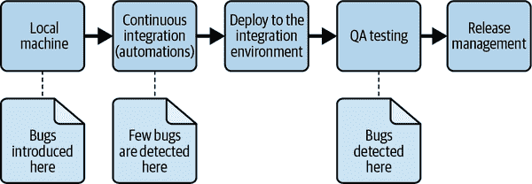
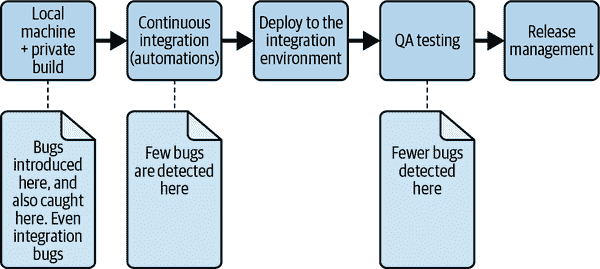

# 第 5 章. 私有构建和指标：应对 DevOps 转型的工具

Christian Ciceri

许多人认为软件架构是一门手艺，但我更将其理解为一门科学。科学家倾向于以进一步推理为基础来衡量事物。即使你无法获得精确的数字，软件架构的数学方法也依赖于可衡量的数量，如指标和指示符。有时这种方法取决于在特定情况下哪些指标有意义，哪些没有。你如何确保你的 KPI 能够为你的组织提供做出时间和精力投资决策所需的信息？

获得优秀的指标需要一个组装良好的系统和大量的工作。但事实是，你可能并不在组装良好的系统上工作，或者你的组织尚未投入实现基于 DevOps 最佳实践的出色指标所需的努力。DevOps 是一次文化转变；概念很容易被误解，公司并不总是完全致力于采用最佳实践。即使这是目标，学习和实施最佳实践也是一个需要时间的流程。现实并不总是最佳情况，标准指标也不总是反映真实问题。

那么当你想实施最佳实践但你的组织尚未准备好时，你能做什么？在这些不理想的情况下，我认为拥有可以帮助你“生存”过渡并保持生产力的一套实践和指标仍然是有用且重要的。这就是本章的内容。

我将向你展示在真实条件下进行的真实项目的一些案例研究——并为使用私有构建和指标来度过难关提出论据。你将看到指标和私有构建在处理以下情况时如何提供帮助：

*   DevOps 与 QA 团队之间的脱节
*   无效的反馈循环
*   过度依赖自动化而缺乏真正理解
*   对验证和自动化的所有权感丧失

作为顾问，我一次又一次地看到这些和其他“反模式”。它们并不理想，但也绝不罕见。本章介绍了一些指标，可以帮助处于类似情况的团队优先考虑需求，并制定改进开发流程而不至于太痛苦的路线图。

# 关键术语

敏捷运动的兴起，特别是极限编程（XP），将开发世界的焦点转向了自动化。其背后的思想，由 Martin Fowler 于 2011 年清晰地解释，^(1) 是那些“痛苦”的活动（即花费大量时间或精力）应尽可能频繁地进行，以便获得更多反馈和实践，并将工作分解成更小的块。这样的活动应被视为自动化的候选对象。^(2)

## CI/CD

Fowler 还在 2006 年主张持续集成（CI），他将其定义为一种开发 *practice*： “持续集成是一种软件开发实践，团队成员会频繁地集成他们的工作。通常每个人至少每天集成一次——导致每天多次集成。每次集成都由自动化构建（包括测试）验证，以便尽可能快地检测集成错误。”^(3)

Fowler 进一步讨论 CI 方法论作为一套实践，其中之一就是自动化。自动化也 *支持* 日常开发活动。这里的关键点，如我将在本章后面讨论的那样，是避免破坏这个共享的构建/代码线。

持续集成的概念已被扩展以包括持续交付（CD），通常一起被称为 CI/CD。^(4) CI 旨在仅为流程的 *第一* 部分，通常仅涉及开发团队。软件交付是一个复杂的过程，涉及利益相关者和其他技术团队（如运维和 QA）。CD 将他们全部聚集在自动化的轨道上。即便如此，自动化也仅 *支持* 流程。

在这里明确 CI/CD 的工作原理很重要，这样你就可以跟上案例研究，所以请允许我深入详细一些。因为现代软件通常分为组件，交付管道的后期阶段通常涉及运行复杂的交互测试以验证没有损坏。这些验证是自动或手动运行的。在这两种情况下，你检测缺陷越晚，修复它可能就越昂贵。极端情况是当终端用户在生产环境中报告缺陷时。发生这种情况时，支持团队介入：缺陷必须被报告并可能被分类，并且根据问题的紧迫性计划修复。

当缺陷直到生产环境才被发现时，它会损害组织的声誉。终端用户可能会对有缺陷的功能感到失望，尤其是如果它对他们或他们的业务带来严重后果。处理如此后期阶段的缺陷的整个过程，与另一个极端情况相比效率低下——在本地开发环境中尽早发现并修复缺陷，甚至在提交到共享主干之前。

## DevOps

*DevOps* 是“开发与运维合作”的混成词，由 Patrick Debois 于 2009 年创造并作为 Twitter 话题标签流行起来。其思想是消除开发人员和运营/系统管理员这两个世界之间传统的“信息孤岛”隔离。它也是敏捷概念减少问题引入与其发现之间时间的一种延伸。

DevOps 的一些主要思想包括：

Process
: 系统管理员和运营团队应完全整合到开发团队中。CI/CD 要求代码始终保持可交付状态。

Tools
: 对应用程序可交付状态负责的团队也负责选择适合工作的工具。这意味着开发人员和运维决定并共享整个工具链。

Culture
: 运维和开发团队的工作方式必须一致。例如，运维部分也需要放入版本控制系统中，就像代码一样（查看 *infrastructure as code* 和所有相关概念）。来自开发团队的自动化，如自动化测试或“私有构建”，必须通过自动化环境、部署和运行时 introspections 置于更广泛的背景中。

文化是 DevOps 为软件行业带来的最大变化。这种工作方式意味着开发人员和运维都必须跨越各自学科的边界：开发人员必须了解软件执行的环境，并能够在自动化和系统脚本中检测和修复问题。运维和系统管理员需要了解代码的编写方式、解决方案的架构，甚至关键点。他们应该能够编写单元测试并调试代码。他们应“拥有”可支持性，要求开发团队应用日志记录和 introspection 政策。

总之，DevOps 的主要焦点是一个 *culture*，工具和自动化应由此产生。

# “所有权转移”

在理想情况下，团队拥有所有管道，并且 DevOps 文化完全到位。没有信息孤岛阻碍沟通，团队构建并运行自己的代码。

然而，DevOps 理想与其实际实施之间往往存在显著差距。在许多组织中，DevOps 不再关乎文化——人们使用该术语来表示更像“现代 SysAdmin”的情况并不少见。“现代 SysAdmin”职位的招聘信息要求运维技能，例如自动化工具和系统脚本，但很少要求扎实的开发领域知识。在这些角色中工作的人花费大量时间构建和维护自动化，以至于“DevOps”一词往往成为一个拥有自己的工单工作流程的结构化自动化团队的名称。与此同时，开发团队几乎不知道部署在哪里以及如何进行。他们与自动化工作流程分离，但验证却委托给他们。QA 团队也单独运作。这只是让信息孤岛重现，重新引入本地开发环境与生产环境之间的“环境不匹配”。我将这种反模式称为 *ownership shift*。

# 再次赋能本地环境

Martin Fowler 对一项重要 CI 实践的表述被引用得相当多：“立即修复损坏的构建。”^(5) 在理想的 DevOps 世界中，这是很好的建议。但所有权转移的一个后果是开发团队不再拥有构建管道的机制。事实上，Fowler 的原则做出了几个假设，在不够理想的 DevOps 文化中，这些假设并非自动成立。例如，它假设：

*   破坏构建的唯一方式是通过向代码库引入更改——即向版本控制系统中的主干（或开发主线）提交的应用程序源代码，而不是脚本化基础设施；因此，你只需更改代码库即可修复构建。
*   团队成员能够自主调试构建问题，并拥有修复构建问题所需的访问权限和权限。

在我讨论的现实中，这些假设很少得到尊重。当构建损坏且原因在代码库中不明显时，开发团队对自动化几乎没有控制权。他们可能会把问题交给“DevOps 团队”，后者根据自己的日程和优先级对工单做出反应。交付流程被阻塞，单独的 QA 部门无法审查最新版本。因此，软件变得无法交付。

这里的概念性错误在于将 CI/CD 流水线（图 5-1），或一般意义上的转移自动化，视为验证过程的核心。由于所有权转移，如果你仅将所有验证委托给自动化，很可能会招致我刚才列出的所有低效和风险。

自动化是使验证变得廉价且可重复过程的必要步骤。它是*不*意味着要置于开发过程之外。我建议将验证的重点转移到问题引入的地方：本地开发环境。（通过*本地*，我的意思是通常引入更改的环境——不一定是开发人员的机器，即使这是一个常见且方便的选择。）

# 私有构建

在他们的书*持续集成*中，作者 Paul M. Duvall、Steve Matyas 和 Andrew Glover 介绍了“私有构建”的概念。他们认为“为了防止构建损坏，开发人员在完成单元测试后应在本地工作站 IDE 上模拟集成构建。”^(6) 接着，他们指出，“此构建允许你将新的工作软件与所有其他开发人员的工作软件集成，从版本控制仓库获取更改并在本地使用最新更改成功构建。因此，每个开发人员提交的代码都为更大的利益做出了贡献，且不太可能在集成构建服务器上失败。”^(7)

私有构建*旨在被自动化*，但现在由于自动化由拥有自己环境和计划的“DevOps 团队”拥有，因此变得不那么常见。这是因为通常没有可以轻松在本地机器上运行的共享集成测试脚本。

即使有容器和易于标准化的构建工具等技术的帮助，自动化仍然很困难，因为每个平台仍有其特定的问题。例如：

* 用于执行集成测试的数据集必须仔细选择，可能需要与 QA 部门持续沟通。
* 数据控制机制尚未得到有效标准化。
* 数据库迁移，如果存在，必须在构建过程中自动运行，通常与相应的生产机制不同。
* 应用程序通常被组件化，如现代微服务架构中。组件需要复杂的通信通道，如消息代理。
* 一些测试，如 E2E 测试，很难在本地机器上编写和执行（并且可能导致向 QA 团队的明确“所有权转移”）。

这些只是完全自动化的私有构建通常具有挑战性的几个原因，但该概念仍然有价值。重要的是记住私有构建的*目标*：防止问题进入通用代码库、主干或进一步的验证步骤（自动或手动）。（参见 图 5-2 以可视化使用私有构建启动 CI/CD 流水线。）

如果私有构建的某些步骤无法自动化，你将不得不至少暂时手动执行这些步骤。（我并不是说这是最好的方法，但手动总比没有好！）无论是否自动化，私有构建仍然是软件开发生命周期中的必要步骤。

私有构建可以在开发机器或某些专用基础设施中*本地*执行，例如专用云环境。开发环境可能不是物理机器，甚至不是完整的操作系统。*方便*的本地环境是完全由开发人员控制的环境——通常是开发人员的机器——以便他们能够快速轻松地验证更改。

然而，关于私有构建需要记住的重要一点是，它们是*私有*的。^(8) 也就是说，它们在更改进入共享主线之前在专用环境中执行。其目的是避免发布可能破坏共享构建或主干的更改。

# 案例研究：不稳定的主干

公司 A 有一个它称之为多学科的团队，但公司的敏捷实践尚未成熟，因此该团队在敏捷意义上并不是多学科的。该团队以可变长度的迭代工作，其成员代表独立的前端、后端、数据库管理（DBA）、DevOps 和 QA 团队。

QA 团队的一名成员报告说，每次他们测试最新版本时，软件都是损坏的。更糟的是，他们说，将修复引入新软件版本需要很长时间。团队决定进行根本原因分析，审查每个子团队的所有流程。他们创建了一张表来捕捉 QA 成员投诉的最重要方面，显示在 表 5-1 中。

表 5-1. 缺陷分析

| 缺陷 || 组件 || 可避免？ || 易于自动化？ || 原因？ |
| --- | --- | --- | --- | --- |
| **A1** || 前端 || 否 || 否 || 来自服务器的未检查、未定义值 |
| --- | --- | --- | --- | --- |
| **A2** || 后端 || 是（缺少测试） || 是 || 数据类型不适合 API |
| **A3** || 与真实数据集成 || 否 || 是 || 真实数据格式作为边界情况 |
| **A4** || 集成 || 否 || 否 || 向后兼容性问题 |

团队决定关注他们所称的*不可避免的缺陷*：那些无法避免的缺陷。

## 缺陷 A1

团队发现缺陷 A1 在未被发现的情况下被检入（发布到主干），因为前端开发人员在本地机器上将代码测试了“稳定”的后端 API。这是一种避免遇到 API 更改的合理方法，而且无论如何，前端开发人员并不知道如何管理后端 API 和测试数据。然而，如果他们在检入前运行后端 API 的最新版本，就很容易发现该问题。

团队决定教导其前端、DBA 和 DevOps 成员如何在本地机器上管理*整个*后端环境，包括管理并验证更新（从当前主干接收并集成其他团队成员的代码更改，类似于 `Git pull`）。学习者抱怨本地环境复杂难以管理——他们说没有参考数据和本地数据库运行很麻烦。虽然前端团队找到了一些创造性的方法来减少挫败感，但关于后端缺陷和 API 稳定的投诉仍然存在。

## 缺陷 A2

事实证明，后端团队没有自动化测试来检查 API 契约。他们的开发周期通常以测试驱动开发（TDD）为导向：他们编写单元和集成测试，编译它们，运行它们，并检查一切是否正常。然后他们自信地检入代码。后端团队成员指出，在项目此阶段没有时间或空间引入 API 契约测试。他们认为在本地测试前端和后端组件将有助于缺陷检测，因为涉及的手动用例将有限且易于运行。

他们请前端团队展示如何在本地机器上设置前端环境。他们承诺使用共享的手动测试用例运行私有构建，以确保 API 稳定性，至少在有进一步自动化的空间之前。

## 缺陷 A3

到目前为止，前端和后端人员已就一种方法达成一致，即在本地环境中，使用新版本的测试数据，在每次更新时手动测试应用程序。很快，他们开始抱怨测试数据的稳定性，并报告频繁出现令人困惑且看似不稳定的错误。他们不得不花费时间进行困难的调试，最终才明白引入了新的、有问题的测试数据。

他们要求 DBA 设置本地环境，并在提交之前在本地运行手动测试套件，作为手动私有构建。DBA 在每次数据变更时，在从仓库拉取更改之前和之后运行测试。当他们发现数据不兼容时，DBA 和后端开发人员会分别沟通。后端成员编写一个暴露不兼容性的集成测试，然后修复它。当他们提交数据和修复后，主干保持稳定。

## 缺陷 A4
在实施了手动私有构建后，*全部* 团队成员开始捕获集成错误。QA 成员转而将精力投入到功能检查和管理应用程序版本上。现在部署更加稳定了，需要的修复也合理地减少了。不过，测试修复仍然需要很长时间，因为自动化仍然不受控制。QA 成员决定要求 DevOps 改进部署时间。同时，他们向团队其他成员请求本地开发环境，以便即使没有最终部署版本也能继续进行功能验证。本地环境也有助于他们更深入地理解可能出现的问题并更精确地报告问题。在控制了本地环境后，QA 成员有更多空间进行主动活动，并可以开始为 E2E 测试编写自动化脚本。

团队更新了他们的缺陷分析表（表 5-2），以显示结果。

表 5-2. 转换后的缺陷分析

| 缺陷 || 组件 || 是否可通过私有构建避免？ || 是否易于自动化？ || 原因？ |
| --- | --- | --- | --- | --- |
| **A1** || 前端 || 是 || 进行中 || 来自服务器的未检查未定义值 |
| --- | --- | --- | --- | --- |
| **A2** || 后端 || 是 || 是 || 数据类型不适合 API |
| **A3** || 与真实数据集成 || 是 || 是 || 真实数据格式作为边界情况 |
| **A4** || 集成 || 是 || 否 || 向后兼容性问题 |

如图所示，各种问题会定期引入系统。你可以通过在合并到主分支之前在本地运行私有构建来减少它们的数量，确保上传的代码不会使主干不稳定。无论你在哪个团队，根据我的经验，运行自己的构建更有效，以确保至少你的功能部分正常工作并且不会破坏整体。

# 案例研究：受阻的顾问
一家咨询公司正在与 Company B 合作，Company B 是一家大型成熟的软件公司，正在拥抱新方法并推动自动化。Company B 的内部 DevOps 团队正在自动化交付管道，该管道复杂且仍在建设中。

咨询公司的开发人员开始交付功能，但他们依赖的用于部署测试环境的自动化不稳定。经常，当他们提交代码时，结果的测试部署无法工作。此外，他们没有任何手段来调试可能的集成问题。

在与 Company B 团队的讨论中，顾问发现了几个问题，包括以下内容：
*   测试数据已更改。
*   执行数据库迁移的机制暂时关闭。
*   后端运行的容器持续重启，很可能是系统问题。
*   由于迁移到另一个云系统，某些其他组件依赖的组件暂时断电。

在第一次开发迭代中，团队几乎无法交付任何功能增量，因为发现和管理这些问题极大地拖慢了他们的进度。在第二次迭代中，他们正式要求提供专用的测试环境。

与往常一样，该请求被接受，但满足该请求会干扰独立的 DevOps 团队的日程安排。他们估计需要两周时间来构建新环境，并归咎于内部官僚主义。与此同时，开发团队不知道如何为自己解开阻塞。他们开始仅基于单元/集成测试交付功能。

在咨询公司交付第一次迭代后，Company B 的内部利益相关者抱怨其功能，具体来说是缺少边界情况。还有一些影响与其他服务集成的关键错误。开发团队（由顾问和 Company B 员工组成）正在使用组件/契约 API 测试来防止这些问题，但内部 DevOps 团队太忙，无法将它们集成到管道中。

在第二次迭代期间，API 测试已编写，但尚未执行到管道中。就交付速度和质量而言，流程仍然效率低下，但没有任何变化；即使是修复也几乎没有保证。开发团队决定进行整体分析，以发现真正的问题并研究可能的解决方案。

由于 Company B 的现实情况不太可能迅速改变，他们需要一个权宜之计。他们同意 API 测试未被运行，因此被置于无人维护状态。他们决定开始在本地机器上*手动*执行所有 API 测试，*在每次更新之前和之后*。

这一决定是关于不依赖不受控制的自动化，并使他们回到本地环境：私有构建。再次，他们向自己承诺很快会自动化测试的执行，但现在他们依赖的是*流程*。不过，集成错误和功能边界情况仍不在范围内。

现在确信私有构建是最好的道路，团队决定将同一原则应用于其余验证。问题在于应用程序依赖于消费外部服务。他们决定构建*伪副本*的外部服务，这些服务他们无法依赖，以便可靠地测试应用程序。

在第三次迭代中，开发团队在本地检查所有干预措施，独立于 Company B 的内部自动化。他们变得更快，修复更有效，并且可以将时间花在自动化验证上，而不是管理阻塞。

总之，该团队通过恢复对本地开发环境验证的关注，实现了速度和可靠性。

# 指标
在这两个案例研究中，团队通过赋能本地环境来应对问题。他们接受了许多妥协，例如花费时间进行手动测试，他们本可以争辩说这“不是他们的责任”。他们*隐式地*评估了情况——基于指标。

你知道指标可以定性或定量使用。指标在接近目标时也可以是直接的或间接的。在本节中，我提出一些在评估开发流程时需要考虑的指标。

## 反馈时间
> 单位：定性
> 
> 类型：间接
> 
> 衡量：成本和上市时间

`Time to Feedback` 是一个衡量接收新功能实现反馈所需时间和精力的指标。它主要被认为是定性的，因为对其进行量化将取决于具体情况。事实上，有时反馈只是需要太长时间（自动化缓慢），而在其他情况下，问题是找到合适的人来接收正式反馈。

存在不同种类的功能反馈。反馈可能集中于集成问题或纯粹的功能验证。它可能来自利益相关者、API 消费者和终端用户。经验法则上，开发团队应优先处理阻碍其自身工作的反馈，例如集成和 QA 方面的反馈。

`Time to Feedback` 是一个间接指标。它可以预警问题，但无法提供对其根本原因的更深入见解。较长的功能反馈周期意味着流程中存在问题，但并不能指出具体问题是什么。

在我们第一个案例研究中的 A 公司，负责寻找集成反馈的 QA 成员因收到大量可避免的问题而不堪重负。当时团队无法更快地获得对其工作的反馈，这导致了主干不稳定。在 B 公司的案例研究中，反馈周期被完全委派，这干扰了日常工作。

## 每次迭代中已部署应用中的可避免集成问题

> 单位：定量
> 类型：间接
> 衡量：内部质量控制流程

该指标统计每次迭代中在已部署软件中发现的可避免或可规避的问题——那些在私有构建中通过自动或手动验证即可轻松检测到的问题。数量低或呈下降趋势表明流程更为成熟，在应用程序部署前捕获集成缺陷方面更为成功。

更经典的指标是 `number of bugs found in QA`，但这里的区别在于对问题进行分类的阈值：它们本可以通过之前的验证很容易避免。一般来说，不应将私有构建视为完美且完全的验证。

一个好的做法是接受对 API 契约测试的检查，以及对全局重要（例如登录）或受变更影响的功能区域的 happy-path 测试。该指标是间接的，因为它需要分析问题是否影响团队的特定部分或整个团队。

## 每次迭代中恢复主干稳定性所花费的时间

> 单位：定量
> 类型：直接
> 衡量：代码库的稳定性以及团队维护其的能力

这里的 `Trunk stability` 指的是代码库主干的稳定（或合理工作）状态。当主干不稳定时，通常一次更新（`Git pull`）会在本地环境中破坏应用程序的某些功能。

该指标衡量修复已签入主干并在本地机器更新后运行私有构建时发现的问题所花费的调试时间。它还包括修复破坏现有功能的问题所花费的时间。可以通过防止缺陷进入主干来确保主干稳定，或通过持续修复来恢复主干稳定。该指标旨在衡量以 *恢复* 稳定性所需付出的努力。

这是一个 *直接* 指标，因为它衡量的是在不引入功能的情况下花费在活动上的时间（从而产生成本）。与 `total debugging time` 或 `number of bugs` 等其他指标不同，它专门衡量本地私有构建中回归的有效性。与一般关于回归缺陷的指标不同，它考虑了开发期间稳定主干所花费的时间。

该指标的结果可能表明在执行本地私有构建时缺乏纪律，这可能是由于本地开发环境未标准化或开发人员未完全理解它所致。它们也可能表明测试自动化不足，在我们描述的情况下，这在很大程度上是意料之中的。

最后，主干稳定性对实现稳定版本和发布所需的工作量具有巨大而直接的影响。归根结底，主干稳定性是实现持续可部署软件的关键因素之一。

## 私有构建的成本

开发人员对重新赋能本地环境进行验证的第一个反对意见是它对其生产力和签入频率的影响，因为它要求他们花费更多时间维护本地环境。

这是一个合理的论点。然而，我的观点是，执行私有构建所涉及的努力是 *仍然* 远小于持续主干稳定、QA 往返以及工单管理所带来的成本。这是因为，如大量文献所述，从缺陷引入到被检测所需的时间越长，修复成本呈指数级上升。此外，手动集成验证应该是 *临时* 的。整个团队应迅速致力于自动化他们在私有构建期间反复进行的操作。（临时）手动测试阶段应接近简单且有针对性的“冒烟测试”，并应优化以保持尽可能便宜和简单。

## 实践中的指标

本章的最后一节提供了一些如何解读上一节提出的指标的示例。

## 反馈时间长、可避免集成问题多、恢复主干稳定时间短

这是本节中最常见的组合之一。将 `Time to Feedback` 指标与 `Evitable Integration Issues` 结合使用通常会提示可能的根本原因。事实上，`Evitable Integration Issues` 的高数值会支持反馈生命周期高的假设，因为大多数验证被转移到了自动化和 QA。`Time for Trunk Stability` 的低值与 `Evitable Integration Issues` 的高值相关，可能表明缺陷被签入主干而未在本地环境中被检测到。

为确认或排除该假设，你可以：
* 分析报告的集成问题的“可避免性”，例如在回顾会议期间。
* 确保团队中的每个人都能在本地环境中运行完整测试。
* 让团队在签入前共享一系列最小功能测试以供运行（手动或自动）。
* 要求团队在运行私有构建时保持纪律。
* 迭代。

## 反馈时间短、可避免集成问题多、恢复主干稳定时间短

`Time to Feedback` 是一个定性指标，因此有时会存在偏差。`Evitable Integration Issues` 的高数值会支持这一假设。如果是这种情况，情况与前一种相同。

如果 QA 团队成员在处理大量工作负载方面效率很高，掩盖了团队其他成员本地验证的低效，也可能出现这种情况。在这种情况下，要求团队其他成员更加自律。

## 反馈时间长、可避免集成问题少、恢复主干稳定时间短

由于 `Time to Feedback` 是一个间接指标，需要进一步分析。其他两个指标的低值可能暗示两种截然相反的情况。

第一种情况是总体 QA 流程不令人满意，缺陷在交付流程的后期才被发现。这可能是由于整体检测流程效率低下、自动化缓慢或不存在，或两者兼有。为排除该假设，你需要查看其他指标，如客户满意度和每次迭代引入的缺陷数量。

第二种可能的情况是，你拥有高主干稳定性和适当的流程，但官僚主义、DevOps 团队的日程安排以及不堪重负的 QA 团队都在导致自动化和 QA 反馈延迟。处理此案例时，应迅速消除开发、DevOps 和 QA 团队之间的障碍，因为开发团队在保持主干稳定性方面已非常高效。

## 可避免集成问题少且恢复主干稳定时间长

这种情况经常发生，当大量错误被提交到主干分支，但在集成/质量保证环境中却没有显现出来。可能是某些团队成员花费大量时间修复错误，而其他成员在运行私有构建方面缺乏纪律性和主动性。如果你发现团队为保持主干稳定而付出的努力存在如此显著的不平衡，请利用团队的内部回顾流程来解决这个问题。

你可能会想知道为什么这个组合没有提到 `Time to Feedback`。如果 `Time to Feedback` 的值很高，请像在上一段分析交付流程中的低效那样分析这种情况。

# 结论

在我们生活的这个不完美的世界里，软件组织并不总是具备所有最佳实践。原因有很多：也许对如何实施它们存在误解。采用它们的流程可能不完整。或者也许这在组织中根本不是一个高优先级。

本章专门聚焦于将 DevOps 文化作为最佳实践来看待时，该文化未被很好地整合到开发团队中的情况。这对团队生产力产生负面影响，最终影响质量保证。在这种情况下，重要的是要弥补因自动化团队与开发团队分离而造成的低效和风险。

许多团队在适应新方法或最佳实践时失败，因为他们试图改变一些他们不知道是否有效的事情。只有当你理解了情况时，才能应用改进并取得成果。

研究本章指标的目的是 *检测* 是否存在所有权转移的问题，并 *有选择地* 针对流程中的薄弱环节采取行动。虽然软件架构通常衡量系统的“静态”或“运行时”属性，但本章的指标侧重于构建软件的 *过程*（与设计或测量过程相对）。试图评估一个经常被破坏的系统的架构属性可能会导致错误的结论。这就是为什么主干稳定性控制应该是软件开发中的优先事项。

私有构建是在采用更好的团队集成组织方式的过程中，在保持合理效率和质量的同时“生存”下来的关键工具。私有构建最大限度地减少了将错误和缺陷提交到版本控制系统中的可能性，否则这些问题稍后才会被发现，从而导致更大的低效、成本和风险。对于与集成不同软件组件相关的错误而言尤其如此。

运行私有构建本身就是一种众所周知的最佳实践，但在自动化和验证与开发团队脱节时，它变得至关重要。再次赋能本地环境将交付可运行软件的责任重新转移回开发团队。在本地运行私有构建并密切关注指标，可以实现更快的交付周期、更便宜的开发流程和更好的软件质量——即使在不理想的情况下也是如此。

^(1) Martin Fowler, [“频率降低难度，”](https://oreil.ly/ANGbE) [*MartinFowler.com*](http://MartinFowler.com), July 28, 2011.

^(2) 自动化不仅仅涉及这些活动，当然，但它们是从中开始的良好指标。

^(3) Martin Fowler, [“持续集成，”](https://oreil.ly/BYuRW) [*MartinFowler.com*](http://MartinFowler.com), May 1, 2006.

^(4) In CI/CD, CD can mean either [持续交付或持续部署](https://oreil.ly/URy9a). Here, CD is intended to mean *持续交付*. You can learn more about the differences between the two concepts [在 Fowler 的博客上](https://oreil.ly/8Isic).

^(5) Fowler, “持续集成，” *https://oreil.ly/WXFrv*.

^(6) Paul M. Duvall, Steve Matyas, and Andrew Glover, *持续集成：改进软件质量并降低风险* (Addison-Wesley, 2007), p. 42.

^(7) Duvall, Matyas, and Glover, *持续集成*, p. 42.

^(8) 我不使用 *个人* 而不是 *私有* 这个词，即使它可能更清晰，只是因为个人按定义指的是一个人，而你可能正在应用结对或集体编程。无论如何，可以认为只要我们认为代码是从其中发布到共享主干的个人环境，那么私有构建就可以被称为个人构建。
