# 第 6 章. 扩展组织：软件架构的核心作用

João Rosa

我是社会技术系统和社会复杂性理论的学生。虽然我内心是一名软件工程师，但我热爱人们、技术和底层流程交叉所带来的挑战：*社会技术系统*。能够为我所参与的系统做出贡献并产生积极影响，这正是我每天起床的动力。我相信首席技术官（CTO）和首席产品与技术官（CPTO）应该理解并为其社会技术系统做出贡献，使他们周围的人和团队能够在其专业领域中出类拔萃。

我通过担任不同的角色，包括软件工程师、经理、软件架构师、顾问和 CTO，提炼出了我的软件架构实践。我专注于对人们的生活产生影响的数字公司。更具体地说，我主要与独角兽成长型公司合作，这些组织已证明其产品在市场上被接受，并希望扩展到多个市场或启动新产品。我戴着“CTO 眼镜”撰写本章，从战略实施的角度出发，以便将软件架构和指标的概念——即如何衡量你实现目标的进展——与它们影响的其他组织联系起来。这种整体方法旨在为整个组织提供连贯的体验，其中员工理解决策并得到不断变化的软件架构的支持（剧透提醒：不，架构不是静态的）。我希望我的章节能成为灵感的来源，因为它详细描述了一个虚构的旅程，其中“Anna”这一复合角色将软件架构与指标联系起来。我的意图并不是提供一个蓝图，因为每个上下文都是独特的，而是一种你可以用来提炼指标并将其与你自己的软件架构决策联系起来的方法。

*想象一位高级软件工程师 Anna，她最近加入了我们称之为 YourFinFreedom 的金融科技成长型公司的产品工程部门。产品工程部门希望更快地推进并为客户提供更好的质量。Anna 觉得自己在公司里很合适，她的技能受到了赞赏。*

*YourFinFreedom 的目标是利用欧洲联盟最近* [*开放银行立法*](https://oreil.ly/0FJKr) *(已知为第二支付服务指令，或 PSD2) 来创建一个服务，让人们能够从其金融服务中获得最佳利率。该公司位于比利时，并在比利时、荷兰和卢森堡拥有客户群。他们希望扩展到欧洲联盟的其余部分，因此他们的策略是在最大的欧洲国家提供服务，包括法国、德国和意大利。目前，YourFinFreedom 服务在可用性方面存在问题，导致终端用户投诉。这些问题是公司成功的效应。*

*这意味着服务需要比现在更具弹性，与更多金融机构交互，并扩展以满足预测的需求——同时改进产品功能并提高交付价值的速度。*

这里有多种商业力量在起作用，它们都影响着 YourFinFreedom 的软件架构。当然，这是一个简化的故事；每个情境都是独特的，并且总会有不同的力量在起作用（参见 图 6-1）。

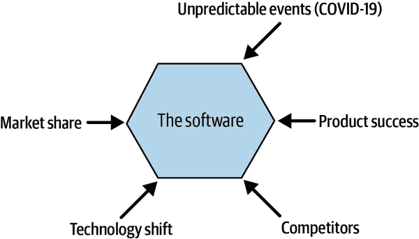

在我的职业生涯中，我观察到软件架构通常反映两个维度：公司的组织结构以及人们在该结构内的沟通方式。前者是显式的，通常可以在公司的组织架构图中找到。后者是隐式的，人们往往意识不到它对工作的影响，特别是对软件架构的影响。当软件架构不是有意设计的，也没有针对其应解决的挑战进行引导时，它会模仿人们（即团队和部门）的组织方式和沟通方式。这种现象被称为康威定律，以研究该现象的梅尔·康威命名。在一篇题为“How Do Committees Invent?”的 1968 年论文中，康威写道：“organizations which design systems (in the broad sense used here) are constrained to produce designs which are copies of the communication structures of these organizations.”^(1)

# YourFinFreedom 打破单体

*Keisha 产品工程部门负责人决定，最快的方式并提供更好质量的方法是采用微服务架构。现有的架构是一个单体，随着时间的推移不断增加各种功能和金融服务提供商的集成。随着部门向这种新的架构风格转型，它将从 3 个团队扩展到 10 个团队，每个团队负责自己的领域。Keisha 相信这种方法将使他们能够实现进入大型新欧洲市场的所需扩展。*

*在进行架构转型几个月后，Anna 觉得新的微服务架构不符合公司的业务需求，并且该项目可能会让公司失去一些市场机会。她向她的老板 Keisha 提出这个问题，但 Keisha 坚持要继续执行该计划并说服 Anna 配合。*

让我们聚焦于我在许多快速成长公司中观察到的两个常见场景（图 6-2）：首先，我们来看拆分单体，然后我们来看如何理清微服务网络。

单体和微服务架构是不同的架构风格，团队需要在集中式架构（单体）和分布式架构（微服务）之间做出权衡。这种选择对软件架构有影响，因为它会影响团队聚合对产品或服务至关重要的业务逻辑的方式。

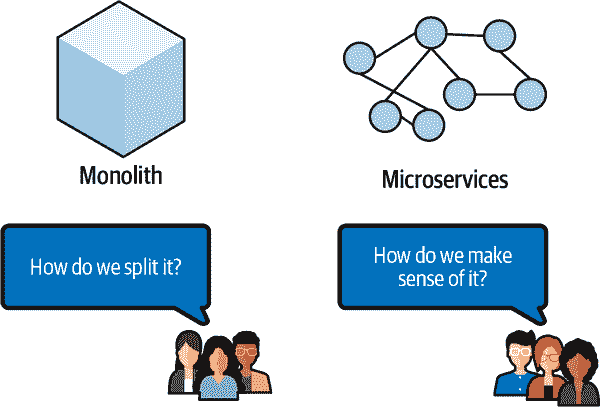

这些架构在正确实现的情况下都可以是合理的。然而，基于从商业力量到技术炒作等不同因素，单体架构常常会演变成架构师所称的 *大泥球*，而微服务架构则常常会演变成 *分布式大泥球*（图 6-3）。

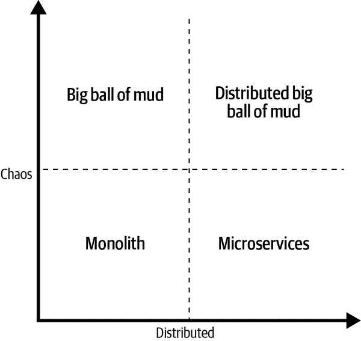

“大泥球”这一术语由 Brian Foote 和 Joseph Yoder 于 1999 年提出；他们将其描述为“haphazardly structured, sprawling, sloppy, duct-tape and bailing wire, spaghetti code jungle。”^(2) 在光谱的另一端，分布式大泥球具有相同的特征，外加一个新特征：它分布在网络上，给等式增加了更多复杂性。让我用两个例子及其后果来说明。

当一个组织采用单体架构并希望更快地将新功能推向市场时，它会招聘更多人员来组建产品工程团队。这些人员和团队开始在现有的集中式架构之上尝试不同的解决方案，向系统中引入 *偶然复杂性* 并形成大泥球。偶然复杂性可以理解为以依赖关系、某些文档不全或未经测试的代码，或无结构的软件设计形式引入系统的复杂性。这些通常发生在产品工程团队难以应对不同商业力量时。偶然复杂性会产生连锁反应，影响软件的可维护性、可运维性 和可变更性，最终使组织更难快速将新功能推向市场，正如 Frederick Brooks 所指出的那样。^(3)

在分布式大泥球光谱的这一侧，你有人员和团队试图理清微服务网络。这些系统通常对它们旨在解决的业务问题过度设计，以至于理解一次业务交易所需的 *认知负荷* 超出了人类大脑的承受能力。Matthew Skelton 和 Manuel Pais 将一个人的认知负荷定义为“limit on how much information they can hold in their brains at any given moment. The same happens for any one team by simply adding up all the team members’ cognitive capacities.”^(4)

# 实现分布式大泥球

*一年后，YourFinFreedom 拥有大量不同的微服务，包括单体的残余部分，均由 10 个产品工程团队管理。然而，新架构并未兑现更快行动并为客户提供更好质量的承诺。团队未能实现预期潜力，并且旗舰产品不断出现问题。*

*Anna 决定与 Keisha 以及产品工程管理团队的其他成员进行讨论，说明团队面临的日常障碍。这些包括以下内容：*

*   *团队必须在微服务之间进行发布编排，才能将特定区域的功能推向生产环境。*
*   *不同微服务之间存在功能重叠，使得团队难以承担所有权。*
*   *团队的生产力不如预期；Anna 指出部门的优先事项不断变化，导致大量工作被放弃。*
*   *产品不断出现问题，损害了士气并使员工失去动力。*
*   *团队成员不了解产品的方向以及他们如何为之做出贡献。*

*Anna 提出了一个潜在解决方案：在架构中实施指标和明确的边界可以为产品工程团队提供所需的方向，同时允许软件架构演进，以匹配公司扩张的雄心。*

*管理层对 Anna 坦诚的演示和提出的解决方案感到满意。他们一直怀疑转向微服务并未兑现其承诺，现在他们意识到在开始之前没有正确权衡取舍。Keisha 决定挑战 Anna：鉴于她在工程和领导方面的技能，她说，她正在考虑将 Anna 提升为部门内的新解决方案架构师职位。在这个新角色中，Anna 将推动产品工程团队的架构工作，并担任管家角色，促进公司技术生态系统的一致性。Keisha 邀请 Anna 考虑这次晋升。*

*几天后，Anna 在一个条件下接受了 Keisha 的提议：她希望获得完全的许可与公司各部门互动，以便了解他们的挑战。Keisha 同意了，Anna 感到受到支持。她职业生涯的新篇章开始了！*

Anna 的部门正在承受分布式大泥球的痛苦。她故事中描绘的障碍反映了架构的偶然复杂性。

YourFinFreedom 本意是在架构风格之间迁移，从单体架构到微服务，如 图 6-4 中线 1 所示。然而，没有由指标指导的明确方向，他们最终遵循了线 2，这导致他们陷入了分布式的大泥球。Anna 如何开始将事情重新引向正确的道路？

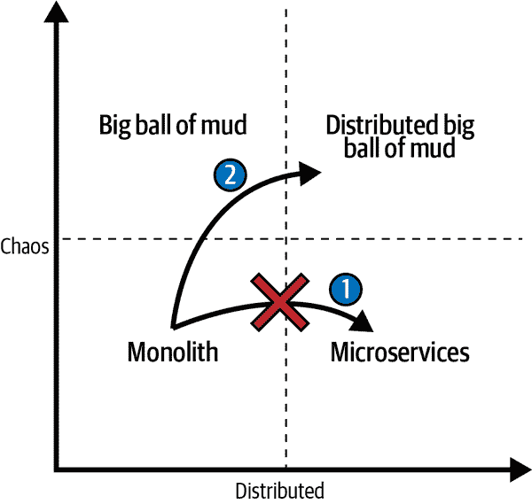

# 寻求方向

*Anna 被提升为解决方案架构师的消息公布了，她开始投入工作。为了更好地了解公司的方向，她开始与部门以外各业务职能的人进行交流。她希望了解同事们的日常挑战，以及这些挑战如何与她所在部门创建和维护的软件的整体情况相关联。*

*在一次这样的对话中，她了解到 YourFinFreedom 最近调整了公司的 KPI，以更好地与其使命保持一致：“让金融服务对每个人、在任何地方都可获取。”从公司的总体更新中，Anna 还知道高管层根据息税折旧摊销前利润（EBITDA）和客户生命周期价值来指导活动。她对组织的新 KPI——月活跃用户（MAU）感到好奇，MAU 衡量的是每月有多少用户与公司的服务和/或产品互动。这一 KPI 从所有举措（营销、销售、产品功能）中形成了反馈循环，以吸引客户。Anna 开始思考：这与软件架构有何关联？*

软件存在于解决特定上下文中的复杂问题。正如你刚才读到的，Anna 发现 YourFinFreedom 在组织层面上除了财务 KPI 外还有一个重要的 KPI（图 6-5）。在现实生活中，MAU KPI 的某种版本被社交媒体公司以及采用移动优先方式进入市场的公司广泛使用。在初创扩张的背景下，MAU 使公司能够利用营销、销售、客户联系中心或产品/服务中的功能等能力来引导增长。

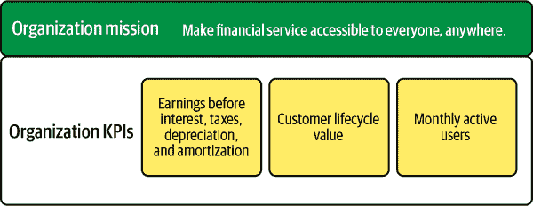

组织的软件架构需要与其使命和 KPI 相连接。如果 KPI 没有得到明确定义或人们不理解它们，软件架构就会与 KPI 产生冲突。这是康威定律的典型例子，说明了沟通如何影响软件架构。软件架构存在的目的是在不同软件组件的职责之间创建边界并定义其交互。它应尊重组织当前约束和周围环境（技术、人员、法规、市场等等）的限制，同时使业务保持敏捷。

# 从尽力而为到有意为之

*在反思利益相关者的请求和产品的当前架构状态时，Anna 注意到一个模式。每个人都在“尽力而为”的基础上工作，尽最大努力满足所有软件请求。她意识到团队中缺少软件架构的一个重要品质：他们的决策应该是故意的。*

*Anna 联系了不同的软件社区，了解其他人如何应对类似问题。她了解到 EventStorming，这是一种“用于协作探索复杂业务领域的灵活工作坊形式”^5，在领域驱动设计社区中被广泛用于可视化流程并推理边界和指标。她了解到，EventStorming 首先提供跨不同责任领域的整体背景图景，然后请来自不同领域的专家分享他们的工作方式。她决定尝试一下并学习如何主持工作坊。*

*Anna 从组织的不同领域召集人员参加一次整体图景 EventStorming 工作坊会议。^6 小组绘制了当前业务流程的地图。他们关注业务事件的流程和顺序，并创建边界以显示工作类型发生变化或流程结束的位置。他们的输出可视化了该流程，以及涌现的领域及其边界。*

*Anna 的工作坊产生了与 图 6-6 中类似的输出。小组在涌现的领域之间可视化了关键的领域事件（小方块）。理解创建软件（和软件架构）的目的至关重要，因此 Anna 的第一步是让小组识别每个区域的业务逻辑。*

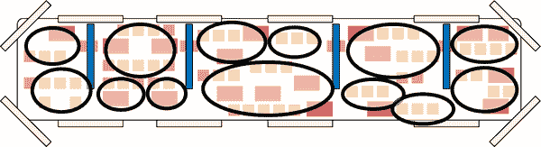

*在工作坊中软件工程师的帮助下，小组将当前软件组件映射到他们的整体图景 EventStorming 输出上（图 6-7）。在工作中，很明显流程与实现之间存在不匹配——这解释了为什么软件架构会漂移成分布式的大泥球。他们还映射了这些组件的所有权，在那时 Anna 确认了她对团队高认知负荷来源的怀疑。*

*将当前软件组件（微服务、单体架构或两者之间的任何形式）映射到新兴领域之上，使小组能够评估当前状况——并理解为什么 YourFinFreedom 难以演进其架构。他们可以看到软件组件位于涌现领域之上，以及这些组件的所有权（为简单起见，图 6-7 中仅显示了团队 A 的所有权）。有了这些信息，他们可以推理团队的认知负荷。Anna 理解到，拥有分布在整个环境中的不同软件组件对任何团队来说都是一个挑战：他们需要来自不同领域的知识来理解构建和架构软件的目的。*

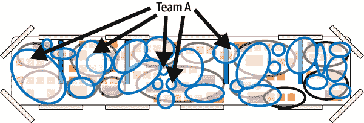

*工作坊产生了许多见解，并使小组能够讨论 YourFinFreedom 如何组织起来为客户创造价值。参与业务运营的人员现在了解了当前架构及其周围的约束；参与创建和维护软件的人员现在了解了业务运营的细节以及软件如何使之成为可能。*

*Anna 在结束工作坊前想再迈出最后一步：映射各领域的 KPI，利用房间里收集的知识（图 6-8）。小组很乐意这样做，领域专家阐述了某些 KPI 对其领域为何相关。他们分享了更多此前在组织中仅以隐式形式存在的知识。每个人对工作坊的结果都很满意，并对它在短时间内提供的信息量感到惊讶。*

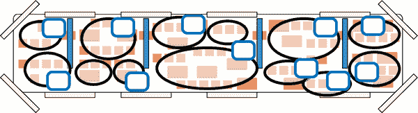

整体图景 EventStorming 使组织能够增强其原始记法并捕获特定上下文或案例所需的信息。它可以解锁关于系统当前状态以及 KPI 或指标相关性的重要知识和反思。映射 KPI 和指标并讨论其目的可以在组织的各个层面激发有力的对话。

例如，我可以分享一个客户的经历，其软件在税务机关和港口之间进行接口。该公司的 Big Picture EventStorming 会议包括来自不同业务职能的人员，从客户支持人员到税务律师。他们一起在公司的背景下可视化了工作流程，包括他们自己的互动。当客户支持领域专家解释客户支持代理有时会在船舶交易背景下更正税务文件时，税务律师警告说这与当地法律相冲突。及时发现这一点使公司能够纠正软件，避免了可能严重的财务和法律后果。该小组还利用这个机会反思如何改进客户支持工作流程，以及需要哪些 KPI 来验证拟议的改进。负责创建和维护该领域软件的团队对这些见解感到兴奋，这使他们能够优先处理积压工作。他们正忙于更新软件以处理新的脱欧规则，涵盖欧盟和英国之间的接口，因此这些见解出现的时机尤为关键。

我认为软件架构应该是故意的。为了做到有意，我们需要可视化工作流程以及我们如何使用软件来实现目标。将组织使命与其 KPI 协调起来，使公司能够通过权衡其中的取舍来塑造其软件架构。

# 以指标指导提升软件架构的有意性

*在研讨会之后，Anna 觉得自己走在正确的道路上——但她不能仅凭对每个流程的“直升机”视角继续前进。研讨会凸显了一些热点，以及流程与软件架构之间的一些不匹配。Anna 决定将她的地图深入一层。她希望在其中一个领域内映射一条运营价值流，并详细查看 KPI、热点以及运营价值流中的每一步。有了这些信息，她可以与产品工程团队合作，制定改进软件架构并使其与组织 KPI 保持一致的计划。*

*Anna 组织了一次新的研讨会，这次使用 Process Modeling EventStorming。在这次研讨会中，参与者将深入研究 Travel Insurance 领域中的一条运营价值流的细节，他们决定将其命名为“request travel insurance quote。”*^(8)

使用这两种流程提升软件架构的有意性，有助于人们不仅理解整体，也理解各个部分。这就是我所说的 *诱人知识*，我们可视化当前流程并映射约束。大多数组织都没有流程的详细图表（如果有，通常已过时）。使用 EventStorming 等视觉协作技术，可以可视化每个人头脑中的集体知识。

*在对当前软件架构做出决策之前，Anna 请小组为运营价值流添加关键 KPI。不同的人最终对 KPI 有不同的定义！Anna 利用这个机会在小组内达成共识并细化 KPI 定义。当他们意识到这将有助于使业务运营和产品工程保持一致时，小组中出现了成就感。*

*更进一步，Anna 请小组在 Process Modeling EventStorming 中映射当前热点。她的目标是了解不同同事日常工作中遇到的困难，以及当前解决方案如何使使用者受益或受限。她意识到了挑战，并对软件架构与正在分析的运营价值流之间的不匹配有了详细了解。最后但同样重要的是，可以清楚地看到 YourFinFreedom 如何为客户创造价值以及如何产生收入。在“request travel insurance quote”中，YourFinFreedom 对每份被激活的旅行保险单收取费用，并试图最大化激活的保单数量。从客户的角度来看，流程应尽可能无缝，提供旅行保险单的最佳价格和保险保障。*

在 Process Modeling EventStorming 研讨会中映射 KPI 提供了有关运营价值流中最重要的内容以及组织决定如何衡量价值的详细信息。^(9) 价值可以面向客户和/或组织。在这种详细程度下，我建议提问：“公司在哪里赚钱？” 在创建软件时，了解商业模式至关重要，而软件架构应促进价值创造。

花时间理解 KPI 并细化其定义至关重要。这些对话可能需要时间，因此你可能需要不止一次会议。Anna 的故事可能不是你的故事，我在职业生涯早期就以艰难的方式学到不要想当然地接受信息，也不要回避提出挑战性的问题。我使用的一个启发式是 *慢即是快*。在这种情况下，这意味着我们投入时间深入理解 KPI——从而理解软件需要工作的环境——将在创建软件架构时得到回报。

同样的思路也适用于热点。系统使用者目前面临哪些挑战？分析热点也可以帮助了解 *浪费* 在哪里。精益方法，特别是丰田生产方式中使用的定义，认为浪费是“当机器、设施和人员共同工作以增加价值而不产生任何浪费时，制造事物的理想条件就被创造出来了。”^(10) 浪费与流程效率相关，并将在交付给客户的价值中体现。Nawras Shkmot 写道，丰田生产系统确定了八种浪费，如 图 6-9 所示。

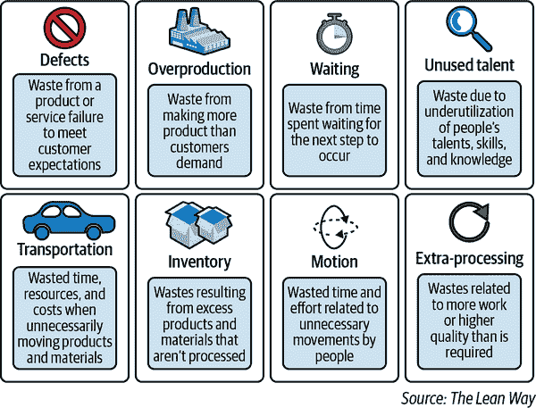

精益的细节超出了本章范围。然而，我强烈建议将精益原则作为你在权衡架构决策的取舍时产生有意性的透镜之一。它可以指导你放置架构边界的位置，使公司使命得以实现并支持其目标。

*接下来，Anna 主持了一次领域分解练习。小组讨论了 Travel Insurance 领域的成果和目标，然后分解目标以了解 KPI 如何转化为指标（图 6-10）。每个人都清楚地了解他们的工作如何相互关联，产品工程团队了解该领域的重要内容。这为 Anna 提供了拼图的最后一块。现在她可以开始指导软件架构的改进。*

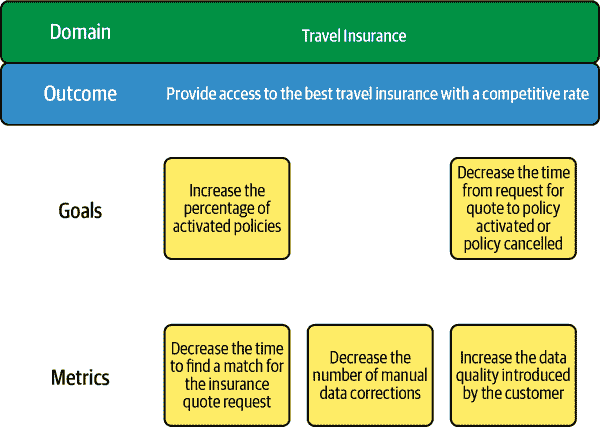

将领域的信息从成果分解到目标和指标，提供有关其目的和意图的更多细节。目标和指标会随着时间的推移而随软件架构一起在不同范围内发生变化。随着架构的变化，指标可能会更频繁地变化；目标的变化会更慢。商业力量在这里也发挥着重要作用。指标比目标更接近软件架构，但目标提供指导。

你也可以将指标作为 *fitness functions* 来实现，该术语在 *Building Evolutionary Architectures* 中引入。根据作者的说法，架构 fitness function “提供对某些架构特征的客观完整性评估。”^(12)

在掌握了所有信息后，Anna 和负责旅行保险领域的产品工程团队开始制定计划。他们思考中央客户信息微服务，并意识到它实际上根本不“微”。中央客户信息服务保存所有客户信息，包括所使用的金融服务。中央客户信息服务与旅行保险保单服务的架构相互纠缠。尽管中央客户信息服务由一个单独的产品工程团队负责，但发布编排依赖于中央客户信息服务。

该团队计划进行一系列实验。他们希望回答三个问题：
* 自包含的服务能否管理旅行保险保单？
* 在旅行保险领域范围内，将对中央客户信息服务的依赖迁移到旅行保险保单服务所需的工作量是多少？
* 将旅行保险保单信息从中央客户信息服务迁移到旅行保险保单服务所需的工作量是多少？

团队将第一次实验详细规划为一系列步骤以验证结果。他们计划创建一个自包含的服务来保存客户的旅行保险保单。该服务将作为当前中央客户信息服务的代理。新的旅行保险报价请求将同时存储在旅行保险保单服务和中央客户信息服务中。目标是证明旅行保险保单服务能够可靠地存储信息。

如果所有实验都成功，团队打算使旅行保险保单服务成为旅行保险领域的单一事实来源，从而消除对中央客户信息服务的依赖。结合在研讨会期间提炼出的信息，团队决定增加额外的指标。他们选择部署频率和变更失败率作为指标，以指导架构变更并证明架构方向。假设是创建旅行保险保单服务并将中央客户信息服务的旅行保险逻辑迁移过去将：（1）提高部署频率，（2）降低变更失败率，两者均针对中央客户信息服务。此外，该假设还包含对软件架构中边界的重新定义，这应有利于管理该架构的产品工程团队的自主性。

为了连接所有信息，Anna 使用 KPI 值树来可视化组织 KPI、领域 KPI 和支持指标之间的联系。在她在 YourFinFreedom 的职业生涯中，这是第一次，她对公司从使命到产品工程举措有了完整的概览。

图 6-11 中的 KPI 值树有三个层级。第一层由组织 KPI 组成，第二层是领域 KPI，第三层是指标。如你所见，组织 KPI 较为宽泛，用于衡量公司的健康状况。大多数情况下它们与财务结果相关，例如 EBITDA 和客户生命周期价值，但有时也包括以终端用户为中心的指标，例如月活跃用户。在这一层级，KPI 是 *滞后指标*：我们可以利用它们回顾过去，看看我们的行动是否产生了预期结果。

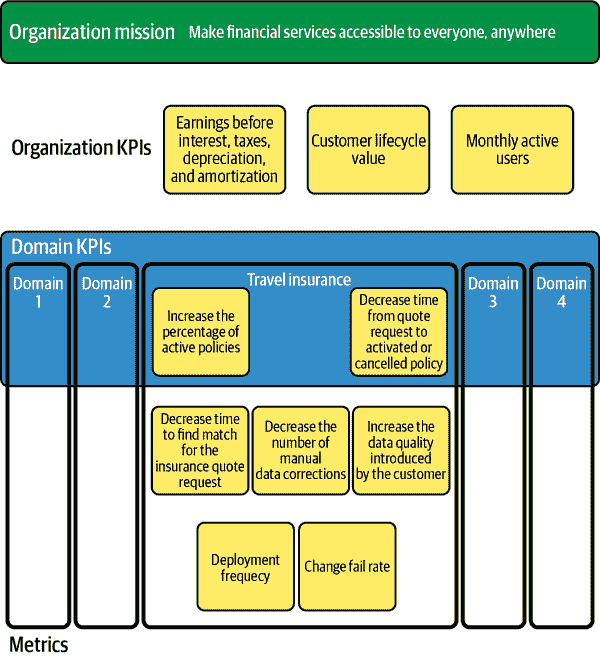

第二层级更专注于旅行保险领域。其 KPI 涉及提高已激活保单的百分比，并减少从报价请求到保单激活或保单取消的时间。这些 KPI 也是滞后指标。

第三层包含指标。指标可以是滞后指标，但它们也是 *领先指标*：强烈预测预期行动将产生预期结果。在此示例中，滞后指标是减少为保险报价请求寻找匹配所需的时间、减少手动数据修正的数量，以及​​提高客户引入的数据质量。领先指标是部署频率和变更失败率。

KPI 值树是某一时刻的快照。由于在商业中，如同在生活中一样，变化是唯一不变的，因此 KPI 值树需要随着对 KPI 和指标有用性的持续讨论而不断演进。持续讨论它们并根据需要进行调整非常重要，尤其是在产品工程团队中。

当公司规模扩大时，其周围的商业力量会发生变化——所涉及的技术也会随之变化。所有这些变化不可避免地会影响其软件架构。在旅程的每一步，都需要基于数据（例如来自 KPI 和指标）创建解决方案，以适应当前约束（技术、人员、法规、市场等）。

正如古德哈特法则所述，“当一项衡量标准成为目标时，它就不再是一个好的衡量标准。”^(13) 请记住，*KPI 和指标应是指南和使能因素，而不是目标*；它们并非旨在规定行为！根据我的经验，如果人们开始说“我们没有达到 KPI X 或指标 Z”之类的话，这是一个很好的迹象，表明 KPI 被用作目标。如果你需要一个目标，那也没问题：称其为目标，但不要使用 *KPI* 或 *metric* 之类的术语。

在这方面，软件架构师可以向站点可靠性工程社区学习，该社区使用服务等级协议（SLA）。SLA 是特定服务或供应商在法律合同中规定的预期服务水平。当未达到该水平时，供应商通常会承担后果，通常是财务上的。如果你的团队支持具有 SLA 的软件，那么你的团队拥有目标是完全合理的。在这些情况下，可视化 KPI、指标、*和* 目标并思考它们如何相互连接是有用的。

*Accelerate*（IT Revolution Press，2018）由 Nicole Forsgren 博士、Jez Humble 和 Gene Kim 所著，对整个软件架构和软件工程领域产生了巨大影响。特别是它提出的四个软件交付和运营绩效指标（图 6-12）被广泛使用：*前置时间*、*部署频率*、*变更失败率* 和 *平均恢复时间*。这些指标是速度和稳定性的领先指标。作者的研究表明，这四个技术指标在高绩效团队中很常见。然而，每个团队都在其自身的环境中运作，产品工程团队可以使用也应该使用的其他相关指标。

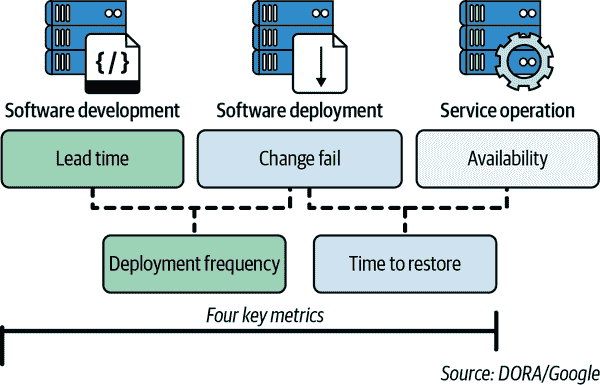

我还建议在具备适当的观测实践和工具时使用 *平均发现时间* 指标。平均发现时间是指 IT 事件发生时与有人发现它之间的平均时间。

鉴于产品工程团队在社会技术系统中运作，我还有其他常用指标。第一个是 *吞吐量*，它可以作为产品工程团队交付工作批次能力的基线。它源于精益社区，并被 DevOps 社区采纳作为促进持续改进的一种方式。我的第二个常用指标是 *员工净推荐值*®，它衡量员工幸福感并可推动更高的员工保留率。

虽然我经常使用上面提到的指标，但没有一种指标适用于所有使用场景。我并不是建议你不加思考地使用所有这些指标！本书分享了关于软件架构和指标的各种经验和做法，帮助你思考哪些可以或应该适用于自己的组织。最后但同样重要的是，使用这些指标比较团队的表现是适得其反的，因为每个团队都有知识领域、技能水平、技术和其他情境因素。

大约两年前，我参与了一家企业中的 DevOps 转型，该企业希望提高其软件开发生命周期的透明度。我在指导一个为零售银行开发移动应用的部门。该公司正在使用 DORA 的四项软件交付和运营绩效指标——到目前为止还不错。然而，有些人认为我们应该使用阈值并根据其“绩效”对整个组织中的团队进行分类。我用引号标注“绩效”这个词，因为团队所处的环境截然不同。正如你可能想象的那样，这个组织拥有各种技术，从大型机到云端的无服务器以及中间的一切。我解释说指标是情境依赖的，远不止观察 DORA 指标那么简单。

在软件行业中，一般认为应该提高部署频率。这样做的好处包括降低成本、恐惧和不确定性，并提高标准化、可预测性和自动化。然而，对于移动应用而言，多次部署会触发应用的更新通知，惹恼客户并降低公司的净推荐值®。该部门投资了随时部署的能力。他们决定采用 *部署环* 方法，设有三个环（alpha、beta 和生产），并自动将每次更改部署到 alpha 频道——这一能力符合他们的情境。这就是整体连接 KPI 和指标的力量。

连接 KPI 和指标在时间和人员投入方面可能是一项昂贵的练习。在 Anna 的故事中，KPI 价值树始于她本人，因为她在一家初创扩张公司工作，高层管理、架构和工程之间的沟通渠道很短。像 KPI 价值树这样的制品是一种持久且共享的方法，需要组织内不同职能之间的一致性，以及高层管理的认可（因为 KPI 价值树与组织 KPI 相连）。拥有明确的所有权以及符合组织情境和文化的流程，将增加 KPI 价值树产生持久积极效果的机会。

# 用沟通管理期望

*Anna 知道在实验期间，产品工程团队向旅行保险域交付功能的能力会下降。Anna 与 Keisha 会面，分享了研讨会的结果、KPI 价值树以及产品工程团队的计划。她详细说明了后果以及她想要学习的内容：如何在架构中使用杠杆点来降低当前复杂度。Keisha 支持该计划并承诺在向利益相关者传达信息时支持 Anna。管理期望很重要，她向 Anna 解释说，因此他们的沟通应明确说明可预见的后果、预期成果以及它将如何有助于 YourFinFreedom 成为欧洲联盟中的主要参与者的目标。*

*利益相关者赞赏 Anna 信息的诚实和清晰，并同意产品工程团队应运行实验并分享结果，以为其他域提供见解并解决共同的痛点。Anna 同意让所有人保持知情。*

*产品工程团队运行实验，将旅行保险保单服务投入使用，并为旅行保险域替换中央客户信息服务。实验成功了——指标证明了这一点。旧软件架构的边界放置不当，而在旅行保险域重新定义它们意味着其服务不需要使用发布编排。利益相关者对结果和沟通节奏感到满意，并在 Anna 提出对组织中的其他域采用相同方法时支持她。她开始使用相同的方法帮助产品工程团队在其他域设置类似实验，目标是创建具有清晰边界的软件架构。*

*与此同时，随着 YourFinFreedom 的增长和旅行保险域的 KPI 改善，该域的领导者意识到当前的指标虽然稳定并满足当前需求，可能不再足够。保险分析师指出指标“减少查找保险报价请求匹配所需的时间”，预测需要为旅行保险报价职位招聘更多人员，随着 YourFinFreedom 的市场份额增加，人数线性增长。然而，这将影响 EBITDA。该域的领导者与 Anna 会面，讨论减少创建旅行保险报价所需人工工作的可能性。Anna 提出更新软件架构以实现此目的，他们讨论了哪些指标最能支持这些变化。他们决定用“提高保险分析师提供的选项中首个被接受的旅行保险报价”替换指标“减少查找保险报价请求匹配所需的时间”（图 6-13）。*

*Anna 与产品工程团队合作设计架构变更。他们引入了一项服务，该服务接收并处理客户提供的信息，查询保险合作伙伴，并生成一些报价选项。这是一个面向保险分析师的决策支持系统，将节省他们现在花费在浏览保险合作伙伴系统上的时间。*

对于 KPI 价值树要发挥作用，它必须得到良好维护。随着业务力量的变化，软件架构必须随之改变以适应它。这是一种分形模式。当变化到来时，质疑 KPI 和指标的有用性至关重要。在 Anna 的故事中，产品工程团队成功地澄清并稳定了其域的边界，这使得该域能够演进。Anna 在旅行保险域的不同职能之间充当桥梁。然而，你可能有不同的运营模式，这完全没问题——再次强调，*你的情境很重要*。

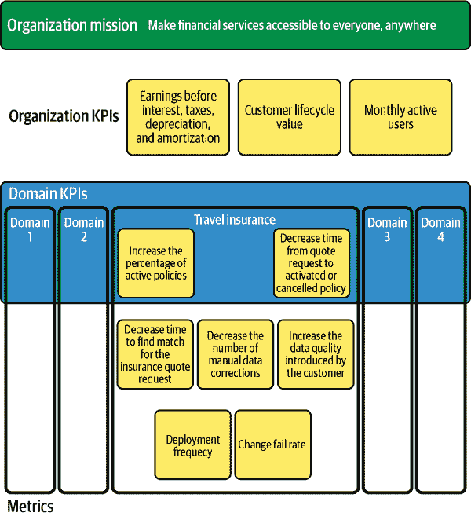

这里的经验是，软件架构的自然演进应由指标指导。当情况如此时，参与创建和维护软件的人员可以更有意地进行更改，即使这些更改高度实验性。创新是健康的，而清晰的边界使之成为可能，因为它尊重了架构中某些部分受益于稳定性，而其他部分受益于实验。

关于指标演进的另一个个人故事：我曾在一家将系统迁移到云端的电子商务组织担任技术团队负责人。该团队属于补货域，负责为买家生成产品补货提案。补货域的总体目标是在减少产品在仓库停留时间的同时最大化产品可用性。产品补货提案是基于销售预测为买家提供关于购买所需库存的决策支持系统；它包括供应商和定价信息。

作为云迁移的一部分，所有系统都需要适当的观测性。我们对一个服务的 API 进行了 instrumentation，该服务计算产品补货提案的最佳供应商（包括数量）。该服务封装了选择供应商的所有逻辑（其中有一些非常具体的规则，其中一些具有法律后果）。API 级别的 instrumentation 具有衡量调用成功率的指标，我们注意到失败调用的数量相对较高。进一步深入后，我们构建了一个将失败调用与正在补货的产品关联起来的指标。我们的业务分析师进一步深入，发现这些产品已处于生命周期末期，不再供应但尚未从系统中退役。当指标调整以纳入此信息时，API 错误降至几乎为零，端到端流程时间大幅改善。运行补货流程所需的产品更少，API 错误也更少。对指标如何与领域的目标和约束相连接进行推理，帮助我的团队创建了改进系统的指标。虽然这需要时间和领域知识，但对系统产生了长期积极影响。

# Learning and Evolving the Architecture

*随着 Anna 与其他领域合作，出现了三种不同的模式。第一，软件架构与领域边界不一致，与她在旅行保险领域发现的情况类似。第二，领域边界不正确，导致架构中出现偶然复杂性。第三，一些产品工程团队的认知负荷很高，因为他们拥有跨越领域边界或属于不同运营价值流的软件组件。*

*第二种模式的一个例子是中央客户信息服务：为所有金融领域保存所有信息需要为所有不同的金融领域模型管理不同的行为，这造成了复杂性。Anna 在负责客户入驻和计费领域服务的团队中观察到第三种模式。因为这些流程非常独特且无关，团队无法专注于单一的问题空间。*

*在她与 Keisha 的会议中，Anna 提出了应对这些挑战的想法。首先，她建议他们做与旅行保险领域类似的事情：将中央客户信息服务拆分为适当的金融领域，并为身份管理和账户管理领域信息创建新服务。她还建议重新思考软件组件的所有权，以在稳定领域边界的同时限制产品工程团队的认知负荷，并仔细解释对产品工程师的后果，以确保 Keisha 了解其影响。Keisha 对 Anna 在部门中的影响印象深刻：她的思考帮助 YourFinFreedom 变得更敏锐、更专注。*

那么故事的寓意是什么？*使用适合你上下文的指标*。同时记住，*指标的趋势有时比指标本身更重要*。

例如，发现平均时间的趋势是人们是否从过去学习的有趣代理。想象一下，随着时间的推移，发现平均时间增加。这里有两个潜在挑战。第一，软件架构由于业务因素而变得越来越复杂；第二，随着复杂性的增加，认知负荷也会增加，对员工参与度产生负面影响。将发现平均时间指标与变更失败率指标结合可以帮助你发现软件架构中的薄弱点。更重要的是，将变更失败率指标与员工净推荐值®结合可以帮助管理者支持员工。这个天真的例子说明了软件架构决策如何影响人们、团队以及公司的社会结构。

软件架构是一个持续的过程；随着我们生产新的制品并在生产中使用它们，格局发生变化，组织也在演进。过去有效的做法不一定在今天仍然有效。在我们的虚构例子中，Anna 的公司拥抱重新定义领域边界以及由此产生的软件架构边界的旅程。

当发生这样的变化时，管理每个人的期望至关重要。如故事所述，所产生的洞察导致了软件组件所有权的变更。这对团队产生影响，在技术和社会层面都有权衡和后果。必须向所有相关人员明确说明这一点，否则人们会失去焦点、感到沮丧，甚至离开公司。

软件架构、指标和 KPI 应支持组织的演进。组织领导者需要认识到，软件架构并非作为其战略的技术实现而孤立存在。事实上恰恰相反：软件架构使公司能够实现其战略。

我相信我们需要一代新的软件架构师，他们的训练不仅仅是为技术组件分组模式。他们需要知道如何主持研讨会、理解群体动态，并为整体业务战略做出贡献。理解技术决策对社会结构的影响将帮助他们创建人们乐于贡献的健全架构。每个人都受益。

## And What About Anna?

*在她漫长的旅程开始两年半后，Anna 坐在公司食堂，喝着水果茶阅读邮件。她看到了一封邀请：她被要求在一次软件架构会议的主旨演讲中分享她的故事。她反思自己的成功：组织正在超越目标，业务增长超过预期。公司的领导者们正在讨论通过探索其他业务线来利用他们新的社会技术架构技能。Anna 决定将她的演讲命名为“社会技术架构：超越软件架构”。你能想象她会分享什么吗？*

## Conclusion

软件架构和指标是令人兴奋的话题。我在本章中尝试通过 Anna 的故事分享我的经验。作为技术人员，我们倾向于关注技术的方方面面，并过度设计和过度工程化我们的解决方案。这是偶然复杂性在软件架构中体现的一种方式。组织的社会结构会产生后果，因为期望不匹配可能导致沮丧（至少）。近年来，我观察到 C 级别对社会技术架构的意识增强，并在做出技术决策时尝试更加有意。

拥有适合业务和组织规模的软件架构至关重要。这是一段旅程，随着组织的演进，软件架构也会演进。因此，跨组织的不同职能工作以理解流程和价值创造至关重要；通过这样做，你可以创建与软件架构相关且同时支持业务的指标。Anna 借助视觉协作技术使不同职能保持一致，产生了产品工程团队将其转化为 YourFinFreedom 战略计划的洞察。他们的软件架构演进并形成了一个反馈循环，使他们能够推理指标的有效性。这些协作技术不是一次性活动；你应不断努力保持所有人的一致。

上下文很重要，而找到合适的指标是旅程中的一步。复制其他组织使用的指标行不通，因为上下文不同。发现适合自己组织的指标是对有意为之的投入，随着组织的发展，这种投入会得到回报。

指标趋势至关重要，可以揭示超出技术层面的信号。它们与社会技术架构密切相关，因为归根结底，是人类设计、构建和维护软件。我真诚地相信，一代新的软件架构师正在崛起，他们具备应对这些社会技术挑战的技能。

^(1) Melvin E. Conway, “委员会如何发明？” *Datamation* (1968 年 4 月): 31, *https://oreil.ly/qFpIM*.

^(2) Brian Foote and Joseph Yoder, [“大泥球，”](https://oreil.ly/REEoZ) *The Laputan Press*, 1999 年 6 月 26 日.

^(3) Frederick P. Brooks Jr., *人月神话：软件工程论文集，纪念版* (Addison-Wesley, 1995).

^(4) Matthew Skelton and Manuel Pais, *团队拓扑* (IT Revolution Press, 2019), 第 11 页.

^(5) “事件风暴，” 2022 年 5 月 11 日访问, *https://www.eventstorming.com*.

^(6) 对于超出本章范围的 EventStorming 过程的详尽描述，请参阅 Alberto Brandolini, [“使用事件风暴发现有界上下文，”](https://leanpub.com/ddd_first_15_years) in *领域驱动设计：前 15 年* (Leanpub, 2020), pp. 37–53. 欲了解更多关于此和其他视觉协作技术的信息，请参阅 Kenny Baas-Schwegler 和 João Rosa, eds., [*视觉协作工具*](https://leanpub.com/visualcollaborationtools) (Leanpub, 2020)，其中涵盖了技术以及从业者的实地案例。

^(7) 来源致谢：Brandolini, “使用事件风暴发现有界上下文。”

^(8) 从整体图景事件风暴转向流程建模事件风暴的说明，聚焦于一个运营价值流，[可在网上获取](https://oreil.ly/Vc4y5)。

^(9) 带有 KPI 和热点区域的流程建模事件风暴输出的说明[可在网上获取](https://oreil.ly/IIVUI)。

^(10) “丰田生产方式，” Toyota, 2022 年 3 月 30 日访问, *https://oreil.ly/pLnAp*.

^(11) Nawras Skhmot, “精益的 8 大浪费，” *The Lean Way*, 2017 年 8 月 5 日, *https://oreil.ly/vCCY5*.

^(12) Neal Ford, Rebecca Parsons, and Patrick Kua, “第 2 章：适应度函数，” *Building Evolutionary Architectures*. 请参阅第 2 章和第 8 章以了解更多关于适应度函数的信息。

^(13) [“古德哈特法则，”](https://oreil.ly/ny7Qs) *Wikipedia*, 最后更新于 2022 年 3 月 8 日.
