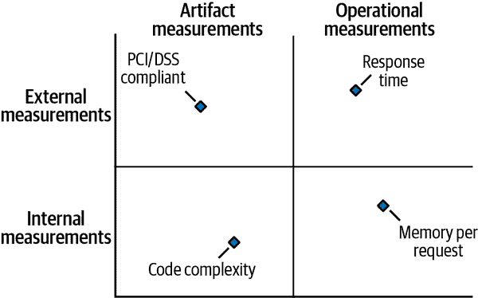

# 第 7 章. 软件架构中的度量作用

Eoin Woods

软件架构有很多定义，但在实践中，大多数具有架构意义的决策都与实现满足利益相关者的系统质量有关，包括性能、弹性 和 安全性。架构师通常将这些称为质量属性或非功能性质量。

这些重要而复杂的决策往往难以做出，因为它们涉及不同质量之间重大的权衡。例如，优先考虑弹性可能意味着降低性能。利益相关者常常难以确定自己需要哪些质量属性。

架构师过去解决这些复杂问题的方式是进行大量的“前期”设计和时间与磁盘使用。考虑何时可以执行每项工作以及它们能提供什么见解是有用的。图 7-2 显示了一些沿两个轴分类的度量示例：制品/运营和外部/内部度量。

*外部度量* 对系统交付和运营团队之外的人可见，或对其有直接影响。*内部度量* 对交付和运营团队可见，或对其有直接影响。在交付周期的不同点测量这些指标可提供不同类型的见解。让我们逐一查看每个象限：

### 外部制品度量

## 外部制品度量
通过设计文档衡量对标准或准则集的符合程度可能是最弱的度量类型，因为它基于判断，但它具有很大的优势，即可以在交付周期非常早的阶段进行，因为设计思路正在形成。外部制品度量对于建立利益相关者对系统将表现出某种特征（如 GDPR 合规性）或与某种特定最佳实践标准保持一致的信心非常有用。

## 内部制品度量
诸如代码复杂度、模块耦合度以及数据库模式元素数量之类的度量非常具体且准确，而且通常相当快速且 inexpensive。它们是可维护性和可扩展性等质量属性的有用指标，主要引起开发和运维团队的兴趣。这些度量的缺点是，你需要在度量的制品（通常是代码）完成后才能进行度量。

## 外部运行度量
这些度量是影响开发和运维团队之外的人员的系统的运行特征。许多经典的质量属性度量，如响应时间、吞吐量、从故障中恢复所需时间以及每月故障次数，都属于此类。与内部运行度量一样，这些度量在系统投入运行之前无法进行测量，但它们具有优势，即能够捕捉到一些最重要的利益相关者——用户——可能看到的体验。

## 内部运行度量
这些度量衡量开发和运维团队可见的系统的运行特征，例如内存使用量或数据库索引增长速率与数据增长的比较。这些度量也需要完全运行的系统，但提供了系统内部以及从用户角度来看其性能的有价值的现实检验。这些度量通常对于预测系统未来的问题很有用。

在交付生命周期的不同阶段，不同类型的度量将相关，但随着时间的推移，你会使用它们全部。

# 度量方法
拥有可靠且具有成本效益的度量方式非常重要。本节回顾了一些选项。

## 应用和基础设施的运行时度量
正如 Cindy Sridharan 在 *分布式系统可观测性*（O’Reilly，2018）中所述，当今可用的三种通用度量机制是日志、追踪和指标。*日志* 为我们提供带时间戳的事件记录序列，以显示技术组件随时间发生了什么。*追踪* 将这一想法扩展为直接相关的事件集合，记录软件内部的端到端跨组件场景，例如请求处理。*指标* 是系统特征在一段时间内的直接数值度量，例如虚拟机的 CPU 使用率或图像存储的存储大小。我们可以从系统基础设施和应用程序本身收集日志、追踪和指标。

通常从基础设施访问日志、追踪和指标更简单，因为大多数基础设施环境，例如公共云平台，都有复杂且功能齐全的信息收集系统，可以在不费太多功夫的情况下提供全部三种。应用程序日志、追踪和指标通常需要更多工作，因为你必须自己实现它们，要么直接实现，要么通过重用度量机制（如应用程序性能管理（APM）工具）来实现。然而，应用程序度量是特定上下文的，这可以提供大量关于利益相关者真正关心的特征（例如业务指标，如产生的收入，而非纯技术度量）的洞察。

## 软件分析
俗话说，“代码不会说谎。”编写完成后，代码可以成为丰富的度量来源。静态代码分析是一个高度发展的领域，拥有各种强大的工具；然而，它仅限于衡量常见编程错误和结构代码特征（如复杂度或耦合）的存在。这并不能帮助你评估除可维护性和可扩展性之外的许多架构质量。话虽如此，对于估计诸如安全性之类的质量，代码分析度量，例如发现的安全漏洞数量，可以是有用的代理度量。

## 设计分析
正如我之前提到的，代码分析的明显问题是你在代码编写之前无法使用它，因此它是回顾性而非预测性度量的来源。在实现之前捕获设计的一些方面使得可以使用设计分析来创建预测性度量，例如对标准的符合性，或可能的结构质量，例如可扩展性。我不建议制作过时的、详细的文档设计，因为它们一完成就过时了，但在实现之前捕获设计的最小但准确的表示可以允许对可能系统特征进行富有洞察的估计，以指导你的工作。

## 估计与模型
使用模型和估计来创建预测性度量可以在交付周期的早期指导架构工作，在编写大量代码之前。

你可以使用自己之前的经验结果、其他类似系统的度量以及已发布的基准或测试结果来创建数学模型，通常在电子表格中。这些模型试图捕捉操作参数（如数据库大小、请求量、请求类型、服务器数量和内存大小）与这些参数产生的质量属性值之间的基本关系。

这种预测性度量存在一些问题。首先，它最适用于可以用数字轻松表示的架构质量，例如可扩展性和性能。对于诸如安全性之类的质量，使用起来更困难。对于除最简单系统之外的任何系统，创建足够简单易懂且能产生可靠结果的模型也可能困难且昂贵。在系统构建之前，验证此类模型的预测能力也很困难，此时你可以直接测量它。确保你创建的是真正有用的东西。

## 适应度函数
Neil Ford、Rebecca Parsons 和 Patrick Kua 在他们的书 *构建演进式架构*（O’Reilly，2017）中提出了质量属性度量的“适应度函数”。而不是一种新的度量机制，*适应度函数* 是一种利用度量来监控系统的质量属性并确保其保持在可接受范围内的机制。有关适应度函数的更多信息，请参阅本书的 第 2 章 和 第 8 章。

适应度函数定义了一个或多个质量属性的可接受值或值集，以及如何检查系统是否至少表现出感兴趣的质量属性的该值。理想情况下，适应度函数应作为自动化流程实现，但许多有用的函数无法自动化，因此手动适应度函数，例如电子表格计算，仍然很有价值。以一个简单的例子来说，如果你知道特定类型的所有请求应在 100 ms 内处理，那么你可以在运行环境中创建一个自动化的适应度函数来监控请求时间，并在它们开始花费太长时间时提醒我们。

适应性函数并不会让质量属性度量的工作变得更容易。你仍然需要使用本节中概述的技术。但它们*可以*帮助你利用度量结果来指导和聚焦你的架构工作。

# 衡量系统质量

前一节中概述的通用技术可以应用于各种系统质量，但就度量而言，每种重要质量都有其自身的特点。在本节中，我们将更深入地探讨度量一些重要系统质量的具体细节。

## 性能

我所说的*performance*是指我们的系统处理特定工作负载的速度（例如响应 Web 请求、处理 API 调用、处理事件消息或完成批处理作业）。Performance 通常使用外部和运行时的度量来衡量，是较容易度量的质量属性之一，因为它可以在测试和运行中直接以数值方式度量，并且在一定程度上也可以通过模型进行估算。

衡量性能的两种典型方式是*latency*，即完成该项工作所需的时间，以及*throughput*，即系统在设定的时间内可以完成特定类型工作负载的实例数量。例如，如果处理入站事件消息，则延迟是指处理单条消息所需的时间，而吞吐量是指单个处理器在一分钟内可以处理的消息数量。这两个指标应该是反比例关系。

需要注意不要将性能与*scalability*（见下一节）混淆，后者是指系统应对工作负载增加的能力如何，但两者密切相关，性能下降通常是可扩展性问题的症状。

性能的两个主要决定因素是需要完成多少工作（例如处理入站事件消息）以及该工作可以多高效地完成（例如数据库访问是否使用索引）。

### 衡量性能时的注意事项

性能的关键度量是响应时间，你可以直接从测试环境或运行环境中测量，使用测试软件（例如用于 API 和 Web 界面的 [Gatling](https://gatling.io)）来创建合成测试工作负载，或通过在系统中构建日志记录以允许事后日志分析。单一测量很少有用，因为性能会在请求之间变化，因此应测量一组请求的响应时间分布，并使用其均值、中位数和标准分布来描述它。

一旦你对特定类型工作负载的性能进行了描述，就可将其与相应的需求进行比较，并根据差异的大小决定是否需要架构上的关注。

性能还存在成本权衡：通常可以通过“购买”更好的运行时资源来改善性能（更多内存、更快的 CPU、更快的存储），但这会更昂贵。

最后，正如前面提到的，请考虑使用定量模型（通常在电子表格中）来估算性能，而非直接测量。这些模型校准起来可能很棘手，以确保良好的预测能力，但在系统的某个方面可以被直接测量之前，这样的估算可以提供对其预期性能的一些见解。

### 衡量性能时常见的问题

衡量性能时需要注意的一些常见问题包括：

Testing versus reality

: 在许多情况下，很难创建一个性能度量测试环境，使其行为与运行环境相同。挑战包括创建逼真的存储数据、预测可能的工作负载模式、拥有完全相同的环境资源和配置等等。如果你不确定测试环境有多具代表性，就无法确定其度量的有用性。

Models versus reality

: 更复杂的是了解性能模型与真实系统相比的预测能力，从而了解其有用性。这意味着你应始终尽早测试以校准和验证你的模型。谨慎依赖它们。

Generating workload

: 即使你知道想要生成什么样的工作负载，生成高保真、可重复且有用的工作负载本身就是一项复杂任务。对于复杂业务领域尤其如此，在这些领域中，工作负载需要特定的请求或批处理模式与特定的数据模式交互。

Intermittent phenomena

: 分布式系统以复杂且有时不可预测的方式运行，导致难以重现的间歇性性能现象。虽然诱人忽略它们，但应抓住这些间歇性事件作为调查和学习的机会。你很可能会发现需要架构关注的问题。

Missing logging

: 许多应用程序在构建时并未充分考虑性能度量的日志记录。应在开发早期考虑此事，以避免日后需要大量事后工作。

Overwhelming logging

: 相反的问题是日志太多。进行大量日志记录（其中很大一部分往往是多余的）会产生大量数据，以至于难以处理以创建可靠的度量。清晰的日志策略和可配置的日志机制可以帮助避免这种情况。

## 可扩展性

可扩展性与性能密切相关，但关注的是系统如何响应工作负载的增加。这两个质量密切相关，因为可扩展性问题的第一个指标通常是性能下降，并且两者都受系统实现效率的影响。

可扩展性的关键关注点是系统的负载容量如何随可用资源（例如 CPU、内存、存储和网络容量）的变化而变化。理想情况下，系统应线性扩展，因此增加 50% 的资源可以处理 50% 更多的工作负载。但在实践中，这很少能实现。

可扩展性是一个多方面的关注点，可以从多个角度考虑，包括请求处理能力、批处理吞吐量、数据存储容量以及组织（人员和流程）能力，所有这些都可能影响系统处理不断增加的工作负载的能力。

### 衡量可扩展性时的注意事项

可扩展性也非常适合数值度量、实际测试和数值建模；通过度量来描述它并不困难，尽管总会存在一些复杂性。

可扩展性的关键度量是在特定资源水平下，系统在可接受的性能水平下可以处理多少工作负载。例如，对于给定的配置，你可以测量系统在 5 秒内可以处理的请求数量，平均响应时间为 0.5 秒，且 95% 的请求响应时间优于 2 秒。然后你可以逐步增加系统资源（例如每次增加 20%），再次测量吞吐量，并使用这些值之间的比率来描述系统相对于该工作负载所增加资源的扩展能力。

与性能一样，成本也是一个因素。你还可以估算实现给定工作负载容量所需的资源成本（例如硬件或云使用），以及随着工作负载增加的情况。

衡量存储及其成本也是衡量架构有效性的机会。此处的度量相对简单：满足特定需求所需的存储量（例如为支持性能而建立索引，或为支持法规而保留数据）以及该存储的成本。

## 可扩展性

系统的运营方面也提供了评估可扩展性的机会。例如，一个重要的度量可能是支持系统所需的员工数量，具体取决于工作负载水平（例如处理异常所需业务运营人员，或执行常规运营任务所需系统运营人员）。

当你确定一组用于衡量这些可扩展性因素的度量时，你就根据特定资源水平下的这些需求来描述系统的容量。将不同资源水平下的容量进行比较，有助于以对利益相关者有意义的方式理解其可扩展性特征。这使你能够评估可扩展性是否可接受或需要架构上的关注。随着时间的推移，它还可以帮助你了解可扩展性是变得更好还是更差。

### 衡量可扩展性时的常见问题

性能部分提到的许多常见问题也适用于可扩展性。还有一些额外的复杂性：

Unpredictable bottlenecks

: 在调查复杂分布式系统的可扩展性时，发现完全意外的瓶颈是非常常见的。在你发现并解决这些瓶颈之前，它们会大大降低可扩展性测量的有效性和实用性。尽可能多地对系统的可扩展性特征进行探索性测试，以学习如何创建有用的可扩展性测量。

Unpredictable nonlinear behavior

: 一个相关的问题是意外的非线性可扩展性行为，例如当系统无法处理预期的额外工作负载时，即使运行时资源增加也是如此。只要我们不知道它们发生的位置，这类行为就会使测量价值降低。在设计系统时投入时间避免这种情况几乎总是一个好主意，并进行探索性测试以了解更多信息。

Combining resources

: 对于某些类型的工作负载，增加更多容量只需添加一种计算资源（例如添加更多 CPU 容量以获得更计算密集的吞吐量）。然而，大多数工作负载需要多种资源组合（例如，扩展数据库通常需要内存以及 CPU 并且可能需要磁盘 I/O）。在你的可扩展性测量中要考虑这一点。例如，你可能希望有一个测量来关联 Web 请求处理所需的 CPU 和内存。

## 可用性

*可用性*是衡量在指定时间段内系统服务可用供使用的程度。它可能受到计划内不可用（例如系统维护）和计划外不可用（故障）的影响。

### 衡量可用性时的考虑因素

用于表征的经典可用性指标是平均故障间隔时间（`MTBF`），它衡量系统发生故障的频率（可靠性）。可用性的另一个方面是恢复故障所需的时间，通常称为平均恢复时间（`MTTR`）。John Allspaw 在 2010 年著名地指出，从事件中恢复所需的时间往往比事件发生的频率更重要，^(4)，这使该指标受到更多关注。

考虑 `MTTR` 的一个优点是，你可以在构建系统时为其设计、估算和测试，而 `MTBF` 只有在发生大量故障后才能估算。找到用于估算 `MTBF` 的合理参数通常很困难。一种实用方法是，在开发系统时对可能的或实际的 `MTTR` 进行建模和测试，使用这些值和 `MTBF` 的粗略估计来估算可用性，然后在获得实际测量结果后进行细化。

可用性的另一个方面是考虑潜在的数据丢失。这需要在包括 `MTTR` 在内的其他目标之间进行权衡。为此，你将使用指标恢复点目标（`RPO`）和恢复时间目标（`RTO`）。`RPO` 定义了你准备丢失的数据量（通常以时间或事务衡量，如“10 分钟的更新”或“100 笔交易”）。`RTO` 定义了在故障后你准备等待数据可用多长时间。当然，`RTO` 影响 `MTTR`，但它不同。例如，系统可能能够仅在部分数据可用时恢复服务，从而导致 `RTO` 长于 `MTTR`。`RPO` 和 `RTO` 通常成反比。如果你可以接受 `RPO` 为无穷大（即你可以丢失所有数据），你通常可以实现接近零的 `RTO`——而如果每个字节都很重要，`RTO` 可能会长得多。

你可以在开发期间对 `RPO` 和 `RTO` 进行建模和测试，然后在任何运营事件后测量实际值。

### 衡量可用性时的常见问题

让我们看看衡量可用性时经常出现的问题：

Measuring `MTBF`

: 虽然我们可以设计系统以满足 `MTTR`、`RPO` 和 `RTO` 目标，通过定量模型估算它们，并通过测试测量它们，但 `MTBF` 更难处理。你只能通过可靠性模型（对于估算软件故障没有多大用处）或在运营中当实际故障发生时（我们所有人都试图避免的情况）来真正估算它。唯一真正解决这个问题的方法是从你有权访问的其他系统（可能在同一组织中）收集故障信息，并将它们用作 `MTBF` 值的代理，直到你拥有自己的宝贵数据。

Varying failure modes

: 如前所述，像 `MTTR` 和 `RPO` 这样的度量对于衡量单个原子软件组件来说概念上相当简单。问题是实际系统有许多组件可以以创造性的方式失败。这意味着对于任何实际系统，你都需要考虑一组 `MTTR`、`MTBF`、`RPO` 和 `RTO` 测量，然后以某种方式将它们组合起来以获得宏观视图。这特定于你的环境，我的建议是仔细思考系统不同部分的指标如何组合形成整个系统的集合。

The tyranny of “the nines”

: 传统上，软件行业专注于系统的单一可用性指标：*可用性百分比*。这通常以“九”的数量来衡量：例如，99.99%，或“4 个九”，相当于每周不可用 1 分钟。问题是这种对可用性的看法过于简单。诸如故障模式和时间等因素对其影响有很大影响，而该测量并未考虑。此外，经常要求的高可用性百分比（例如“5 个九”——99.999%，或每天不可用 1 秒）与 100% 过于接近，以至于相当没有意义。要警惕以“九”表示的要求。相反，使用故障场景来了解业务需求，并找出如何估算和衡量系统每个部分的临界可用性指标。

## 安全性

安全性是一种复杂且多方面的质量，体现在许多地方，包括基础设施、应用程序软件以及我们系统周围的人类流程。它既至关重要，又非常难以衡量。一个细微的错误可能潜伏不动，直到有人发现它造成的漏洞并决定利用它；突然你就有了高影响的安全问题。

然而，你可以衡量安全性的某些方面，以更好地了解当前情况以及将架构关注点集中在哪里。

### 衡量安全性时的考虑因素

安全性的明显衡量标准是系统遭受的安全事件数量。但不要等到发生事件才评估安全性！你可以在系统的开发和运营过程中持续进行代理测量。这些包括：

Static code analysis

: 这会识别代码中潜在安全漏洞的数量。

### Dynamic analysis
: 自动渗透测试（也称为动态分析）以及手动渗透测试会在部署在测试或运行环境中的系统中发现并统计漏洞。

### Infrastructure scanning
: 基础设施扫描测试会揭示基础设施平台（同样是在测试或运行环境中）的潜在漏洞。

我们可以根据风险对这些度量进行加权，包括其发生的可能性以及如果发生时的潜在影响，并将它们用作安全性的代理度量指标的汇总值。当然，这意味着衡量的是测试过程的结果而不是系统的实际安全性。但这种代理度量指标是我们所知道的衡量安全性和判断其是变好还是变坏的最佳方式。

### Common problems when measuring security
需要了解安全度量时应注意的一些事项：

#### Environment consistency
: 如果您在测试环境以及运行环境中测试安全性，请确保对其进行相同的配置（或至少尽可能相同），以避免结果不一致。

#### Security identities
: 通常在测试和运行环境中使用相同的身份标识（用于用户、证书等）是不明智的。您可能无法实现这种特定类型的跨环境一致性，因此在分析安全测试结果时请注意这一点。

#### False positives
: 许多安全工具，特别是用于静态扫描的工具，可能产生大量误报结果。最好不要将这些纳入安全度量中，因为它们会扭曲结果，使情况看起来比实际情况更糟。

#### Adjusting for risk
: 并非所有潜在的安全问题严重程度都相同，但要了解如何根据其风险水平对其进行加权（同样包括可能性和影响）可能很困难。对此没有简单的答案；请咨询专家，随着经验的积累，您的判断会有所提高。

#### Knowing when to stop
: 很难知道测试是否足够，因为你无法证明某事物的不存在（如安全性）。鉴于安全失败可能造成的严重影响以及难以知道潜在安全问题所在的位置，这一问题尤其困难。解决方案是基于良好数据并源自系统化和一致的方法来应用专家判断。

# Getting Started
我希望我已经说服你将度量纳入交付周期并使用结果来评估和指导你的软件架构工作的重要性。下一步是在自己的项目中应用它，那么你应该从哪里开始？

不幸的是，我没有一个确定的答案给你，因为这确实取决于你的环境、你的优先事项以及系统的特征。我会对一个已经运行多年成熟的企业 Java 系统的工作人员给出的建议，与我会对一家争相将首批运行服务推向关键规模的金融科技云原生初创公司所做的建议不同。

然而，我可以在你开始思考如何将度量应用于项目时提供一些普遍有用的指导：

#### Start small
: 总是很容易想先收集大量数据并衡量所有可以轻松衡量的内容。这看起来像是取得了很大进展，但需要花费大量时间和精力，而且不太可能产生有用的度量。最好先确定一些能够促成行动的具体事项，并从这些事项开始，以尽早展示真正的进展。

#### Measure something that matters
: 只有能够帮助你获得洞察并指导工作的事物才值得衡量。*容易*的起点是选择容易衡量的东西。*正确*的起点是确定对工作有实际影响的度量并找到实现方法。这将有助于在流程早期展示度量的价值。

#### Act on what you measure
: 通过度量获得一些洞察后，确保你能明显地利用这些洞察来推动行动，例如确定下一步要工作的质量属性的优先级。这同样有助于展示度量的价值。

#### Start early
: 如我之前所述，长期以来一直很常见的做法是将度量推迟到流程相当晚的时候，等系统已经在生产环境中运行了一段时间。我希望我已经说服你，通过使用多种类型的度量，你可以比这更早地开始，并在整个交付生命周期中获得价值。留出时间从流程开始就纳入度量。

#### Make measurement visible
: 为了让度量得到重视和优先考虑，处于影响力位置的人需要了解正在进行哪些度量以及其产生的影响。因此不要只藏着自己！定期报告你的度量活动，并在项目环境中使输出可见。这有助于每个人从你的度量工作中受益并理解其价值，并可能激励他人加入并开始衡量对他们重要的内容。

#### Make measurement continuous
: 我鼓励你将度量整合到交付周期的常规节奏中，以便在人们构建系统每个部分时，他们会思考哪些度量是有用的以及如何构建正确的机制。

如果你能遵循这些指导原则，它们将使你能够以实用且增量的方式将度量纳入架构工作中，并在尽可能早的时候从中获得价值。

# Hypothetical Case Study
让我们通过一个基于真实经历的虚构示例来看看在实践中向项目引入度量是怎样进行的。

我们的示例系统是一个名为 Civis 的新“公民参与平台”，面向一个 12 万人口社区的地方政府机构。该组织希望为公民创建一个统一的数字界面，以便获取信息、向地方政府部门提出请求并申请服务。

作为该平台的开发人员，我们不确定哪些服务会受欢迎。我们计划从小规模开始，首先提供一些关键服务，但需要快速添加新服务（也许还会删除现有服务），具体取决于公民认为哪些服务有用。我们也不太清楚会有多少用户参与其中。因此我们有很多未知数。我们需要采用探索性和增量的方式来构建平台。

该平台将使用经过验证的技术：一组在公共云平台的容器中运行的 Java 服务，使用云提供商托管的关系数据库服务（未来可能还有其他云服务）。我们将把服务置于 API 网关之后，并创建 Web 界面、Android 移动应用和 iOS 移动应用。

当我们开始设计平台时，我们意识到数据库的大小因多种原因很重要，包括成本、性能和灵活性。我们创建了一个简单的电子表格模型来估算表数、每个重要数据库表中预期的行数以及在不同使用场景下预计需要的数据库存储量。（我们会保留此电子表格以便以后再次使用。）这些内部制品度量和估算是我们第一组度量。其目的是帮助我们了解在此阶段是否需要优化数据库设计。

# 示例

随着我们开始构建平台，我们知道需要关注代码质量和可维护性。毕竟，这个平台未来可能需要大量变更。因此我们实现了一个静态分析工具，并在交付流水线中使用它来创建代码复杂度度量。我们将其封装在一个适应性函数中（此时它只是一个简单的 Python 脚本，当复杂度过高时会中断构建），并从流水线中的一个操作调用它。这一内部制品度量指示我们何时需要花时间进行重构或重新思考架构结构。

由于这是一个面向公众的系统，其中包含一些敏感信息，我们决定开始衡量安全性。我们还未准备好进行渗透测试，但可以进行一些静态安全分析，因此我们将其添加到流水线中。我们得出一个聚合的“漏洞”指标，并在每次流水线运行时存储它，以查看随着代码变更引入的漏洞趋势。这一内部制品度量充当安全意识的代理，并会提醒我们代码中需要更多关注安全的区域。我们目前尚未为此度量添加自动化的适应性函数，因为我们认为该指标在一段时间内会不稳定。

可用性和性能是关键的运营关注点，因此我们希望尽早在关键使用场景中开始衡量它们。

我们创建了一组响应时间度量，并将其封装成一个性能指标，同时配备了一套可在持续集成环境中运行的自动化测试。我们将监控该指标的趋势。我们还将其封装在自动化的适应性函数中，以便在指标超出可接受范围时发出警报。这一外部运营度量提醒我们在系统层面审查性能，以确保架构仍能满足我们的性能要求。我们也很快会在运营环境中使用这些测试。

我们编写了一些恢复时间测试，以便开始估算从不同故障中恢复所需的时间，从而得出系统的预期可用性。这一内部和外部运营度量的组合会在我们需要审查恢复方法并在必要时重新设计时发出警报。我们创建了一个电子表格模型作为一种手动适应性函数来帮助我们完成此工作。

一旦我们开始在生产环境中运行代码，我们立即希望开始对其进行度量。终于，我们的初始代码被真正使用了！我们通过移动应用和 Web 请求进行正常的用量度量，但也开始监控数据库的大小以及每个主要表中的项目数量，绘制这些趋势并将其与项目开始时创建的估算电子表格进行比较。我们使用这一内部运营度量来估算数据库可能如何增长以及我们可能需要在优化其存储大小方面集中注意力的地方。

随着时间的推移，生产环境确实会出现偶尔的故障，因此我们手动记录故障间隔时间和恢复时间统计数据。我们计算系统的实际可用性，并几乎实时地向我们的利益相关者（包括地区居民）报告。这项外部运营度量提醒我们在可用性成为危机之前就主动关注可用性。

随着平台的开发继续，我们在交付周期中继续添加，并在某些情况下移除度量。这就是我们了解系统是否满足其关键质量属性要求、我们的架构是否有效以及在何处集中注意力以获得最大影响的方法。

因此，我们从一开始就使用度量来提高软件架构工作的有效性。我们在项目早期以简单的方式开始，然后在过程中逐步添加更多度量，以指导我们集中时间和注意力。

虽然这是一个完全虚构的示例，但它反映了我在使用软件架构工作中应用度量的一般经验。也许它会激发一些想法，说明你如何将度量应用于自己的项目。

## 陷阱

在本节中，我简要总结了应用度量时的常见错误和问题。了解这些陷阱将有助于你在工作中避免它们：

### 关注机制而非度量

设计和实现度量机制可能是一项复杂且令人着迷的任务，有陷入实现细节而非关注度量本身的危险。这会导致令人印象深刻的度量基础设施，但有用度量相对较少。从最小的、最简单的机制开始，随着度量工作开始产生价值后再增加复杂性。

### 基于易于度量的内容选择度量

有些事物难以度量，存在一种可以理解的倾向，即开始度量那些易于度量的事物，比如代码大小和响应时间。在流程早期进行一些直接的度量以快速获得一些结果 certainly 值得做，但要产生较大影响，你需要度量对系统最重要的内容——即使它很困难。

### 过度关注技术而非业务度量

几乎总是更容易度量技术方面的内容（如数据库的恢复时间），而不是业务相关的内容（如每小时总收入）。然而，如果你只集中在技术度量上，业务利益相关者不太可能理解或重视度量工作。为了确保你优先考虑正确的事情，请考虑所有利益相关者的观点。思考业务领域度量以及纯技术度量。

### 未采取行动

很容易做出良好的度量，确定如何优先安排工作，然后什么都不做。总是会有危机需要处理。然而，如果度量要具有价值，你需要一种使用其结果的方法。优先考虑由此发现产生的结果。一实现方式是在每个冲刺中包含一定比例的时间用于 *optimization work* 或根据度量工作的发现采取行动。

### 过度优先考虑准确性而非有用性

作为受过训练的工程师和科学家，我们倾向于强烈希望改进度量的准确性。这是一种良好的直觉，但通常存在一个点，超出该点后进一步的准确性不会改善你的决策。请记住注意该点，以避免浪费时间和精力。

### 度量过多

相关的一点是知道要做多少度量。今天的复杂平台能够以可接受的成本进行大量度量。逐步从小处开始的一部分是防止你的度量工作变成一个怪物，产生大量数据——以及数十个价值有限的度量。随着时间的推移，审查你的度量，并不断询问它们是否仍然都有用，或者是否可以关闭一些。

避免这些常见陷阱将增加使你的度量工作有价值且可持续的机会。

## 结论

本章探讨了度量为何是软件架构工作的重要组成部分。你已了解到：

* 衡量我们系统的质量属性是我们判断架构工作是否有效的方式之一。
* 度量使我们能够了解在何处需要更多架构关注，从而帮助我们优先安排工作，并在不同类型的架构工作之间做出艰难但理性的选择。
* 度量还迫使我们找到使质量属性可度量的方式，并对我们的需求做出具体说明。（有时它清楚地揭示了这不可行。）这种具体性有助于产生质量属性需求并改善与利益相关者的沟通。

一旦你理解了系统需要实现的质量属性，就能识别出能够提供这些特征度量的机制，并据此设计具体的实现。

正如你之前所学，存在不同类型的度量。有些关注系统本身，有些关注构建系统所涉及的制品，有些度量质量属性的外部可见方面，有些则度量系统的内部方面。在确定你想要进行的度量时，对其进行分类以了解每种度量的价值（以及局限性）。

一旦你的度量机制就位，你就可以开始将度量结果输入到你的持续架构周期中，并与需求进行比较（在可能的情况下通过适应度函数）。这个反馈循环会突出系统未达到需求且需要架构关注的领域。以这种方式使用度量将使你能够清晰地解释不同类型架构工作的价值，并让你确信自己正在从事最重要和最有益的事情。

^(1) 参见 Jez Humble 和 David Farley, *持续交付* (Addison-Wesley, 2010).

^(2) 参见 Eltjo R. Poort 和 Hans van Vliet, “RCDA: 作为风险和成本管理学科的架构设计,” *系统与软件期刊* 85 (2012): 1995–2013.

^(3) 参见 Murat Erder, Pierre Purer, 和 Eoin Woods, *实践中的持续架构* (Addison-Wesley, 2021).

^(4) John Allspaw, “MTTR 比 MTBF 更重要（对于大多数类型的故障）,” *厨房肥皂*, 2010 年 11 月 7 日, `https://oreil.ly/NFLYz`.
