# 第 8 章. 从度量到工程的进展

Neal Ford

我在大学里走了迂回的道路，一路上涉猎了许多不同的专业。数年间，我勤勉地追求着通往机械工程的教育路径。我获得了物理学的两年学位，并在附近一所主要工程大学开始了课程。 一年后，我决定转到计算机科学（我喜欢而不是忍受的课程），并永远离开物理工程世界。

然而，我花了足够的时间学习该学科，以欣赏物理学的基础数学与它演变成机械工程这一现实世界学科之间的差异。数学构成了度量，但直到工程师弄清楚该数学如何反映现实世界，他们才能利用这些知识来建造事物。

架构师和开发者与度量的关系与工程师与物理学的关系相同：度量形成衡量，但在一个有用的上下文中评估该衡量就将度量转化为工程实践。架构师和开发者几十年来一直使用度量来验证架构的某些部分，但通常是临时性的。我们需要一种一致的方法来利用度量以支持工程。虽然软件工程远不及物理工程发展成熟，但我们正在学习如何将测量转化为工程实践。

## 通往适应度函数之路

在我与 Patrick Kua 和 Rebecca Parsons 合著的《构建演进式架构》中，我们定义了架构适应度函数的概念。Rebecca Parsons 曾有设计遗传算法的经验，遗传算法会产生一个结果，然后自我变异，产生另一个结果，如此反复直到某种终止条件出现。例如，一种变异技术被称为轮盘赌变异：如果算法使用一个或多个常量值，该变异会随机选择一个新值，就像从轮盘赌轮中抽取一样。

在设计此类算法时，创建者可能希望影响变异。例如，也许他们注意到较低或负值会产生更理想的结果。因此设计者使用一种称为*适应度函数*的机制，这是一个有助于确定设计适用性的目标函数。

在《构建演进式架构》中，我们将软件架构治理的概念与适应度函数结合起来定义了架构适应度函数：“架构适应度函数是为架构特征提供客观评估标准的任何机制。”^(1)

该定义中有几个值得注意的术语。让我们按出现的逆序查看它们：

Architecture characteristic(s)

: 架构师可以将设计的结构部分分为*领域*和*架构特征*。*领域*是编写软件的动机，即问题域。*架构特征*（也称为非功能需求、横切需求、系统质量属性等）是非领域设计考虑因素：性能、可扩展性、弹性、可用性等等。适应度函数主要关注架构特征，因为我们已经拥有成熟的领域测试工具：单元、功能、用户验收测试等。然而，直到现在，架构特征的验证是临时的，分散在构建时检查、生产监控、取证日志记录以及大量其他工具中。适应度函数将这些验证统一在单一伞下——这些事物一直相关（验证架构特征），但并未得到统一对待。

Objective evaluation criteria

:

架构特征存在许多不同的定义，由于软件开发生态系统的变化速度，行业从未成功定义出标准列表。例如，Web 应用程序的性能度量不适用于移动应用程序——随着生态系统的变化，我们所度量的事物类型也在变化。然而，无论架构特征是什么，架构师都必须能够客观地度量它以验证它。

一些架构特征过于宽泛，例如*可靠性*，它可能包括可用性、数据完整性等许多方面。这些被称为*复合架构特征*，由其他可客观度量的值组成。因此，如果架构师无法确定如何度量某事物，也许它是复合的，需要进一步分解。

Any mechanism

: 开发者习惯于为其平台使用单一的测试工具。例如，对于 Java 平台，存在许多与平台绑定的测试框架。然而，架构超越了单一平台，并涵盖了许多不同类型的行为。因此，架构师和开发者必须使用多种工具来实现项目的适应度函数：测试库、性能监控、混沌工程等等。

架构师必须拓宽对验证构成的看法，超越领域使用的测试工具，如图 8-1 所示。

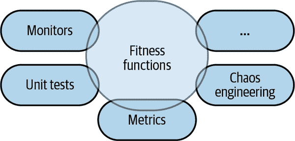

如图 8-1 所示，适应度函数与单元测试重叠。两者都在单元测试和专用库中使用代码级度量，以及度量评估工具，如[SonarQube](https://www.sonarqube.org)、用于操作架构特征的监控器、全面的压力测试框架，如 Netflix 的[Simian Army](https://oreil.ly/08qk4)，等等。

*适应度函数*是架构师验证架构各部分的各种方式的统一术语，但只有在自动化下，这种实践才成为工程。

## 从度量到工程

度量如何成为适应度函数？这通过常规应用实现，优先在每次代码更改时自动执行，模仿单元测试和其他类型的领域测试。


许多团队使用工具，例如前面提到的 `SonarQube`，将其集成到构建中以创建仪表板和其他代码质量度量。事实上，本书充满了架构验证的优秀候选者。然而，如果团队不采取额外步骤定期运行指标并设定客观阈值，那么收集到的指标就变成了事后证据，而非主动力量。

这里有一个例子：组件循环检查。这是一种常见的代码级指标，几乎适用于所有平台。请考虑 图 8-2 中的三个组件。

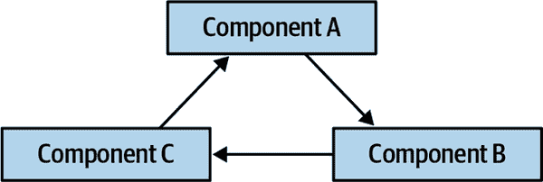

图 8-2 中显示的循环依赖被视为反模式，因为当开发者尝试重用其中一个组件时会带来困难——每个纠缠的组件都必须一并带来。因此，通常情况下，架构师希望保持循环数量尽可能低。然而，宇宙正通过便利工具积极地与架构师防止此问题的愿望作斗争。当开发者在现代 IDE 中引用一个尚未引用其命名空间/包的类时会发生什么？它会弹出一个自动导入对话框以自动导入必要的包。

开发者对这种便利功能如此习以为常，以至于他们像条件反射一样将其挥开，根本没有真正注意。大多数情况下，自动导入是一种极大的便利，不会造成任何问题。然而，有时它会创建组件循环——架构师如何防止这种情况？

请考虑 图 8-3 中说明的包集合。

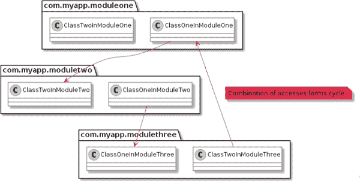

[`ArchUnit`](https://www.archunit.org) 是一款受 `JUnit` 启发（并使用其部分功能）的测试工具，但用于测试各种架构特性，包括在特定范围内检查循环的验证，如 示例 8-1 所示。

### 示例 8-1. ArchUnit 包含检测组件循环的能力

```
public class CycleTest {
    @Test
    public void test_for_cycles() {
        slices().
          matching("com.myapp.(*)..").
          should().beFreeOfCycles()
}
```

示例 8-1 中的测试是一种在各种工具中广泛使用的常见指标——它如何转化为工程实践？通过自动化持续应用，如 图 8-4 所示。

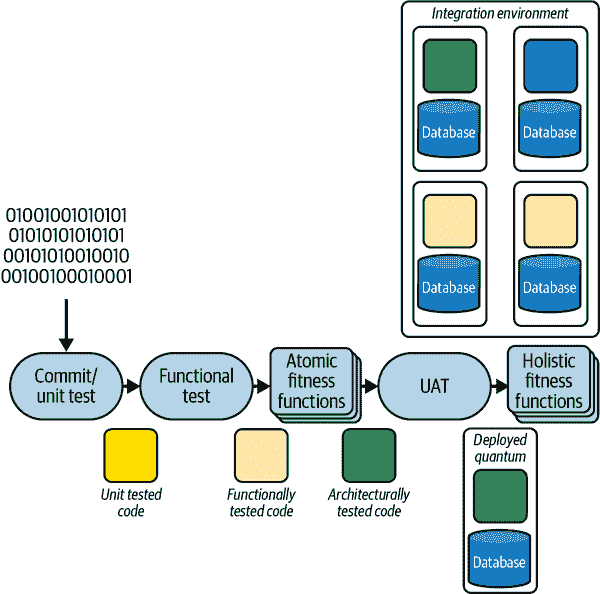

如 图 8-4 所示，适应度函数与项目中已有的验证机制并行，例如单元测试、功能测试和用户验收测试。适应度函数的持续执行确保架构师能够尽快发现治理违规。

# 自动化使指标得以操作化

在 1990 年代初期，Kent Beck 领导了一组开发者，他们发现了随后三十年软件工程进步的驱动力之一。他和一群具有前瞻性的开发者参与了 `C3` 项目。团队成员对当前软件开发流程趋势十分熟悉，但并不印象深刻：似乎当时流行的流程没有任何一种能带来持续的成功。因此，Kent 提出了 *极限编程*（XP）的理念：基于过往经验，团队将他们知道有效的做法以最极端的方式实施。例如，他们的共同经验是测试覆盖率较高的项目往往具有更高质量的代码。他们创建了 *测试驱动开发*，它保证所有代码都被测试，因为测试先于代码。

他们的一个关键观察围绕集成展开。当时，常见做法是大多数软件项目都有一个集成阶段。开发者被期望在数周或数月的时间内孤立地编码，然后在项目的集成阶段合并他们的更改。事实上，当时流行的许多版本控制工具（如 ClearCase）强制在开发者层面进行这种隔离。这种做法基于常用于软件的众多制造隐喻。XP 开发者注意到过去项目的相关性：更频繁的集成导致问题更少，这促使他们创建了 *持续集成*：每个开发者每天至少向开发主线提交一次。

*持续集成* 以及许多其他 XP 实践所展示的是自动化和增量变更的力量。使用持续集成的团队不仅在定期执行合并任务上花费的时间更少，而且在 *整体* 上花费的时间更少。当团队使用持续集成时，合并冲突会在出现时尽快得到解决，至少每天一次。当项目改用最终集成阶段时，它们会让合并冲突的组合数量增长成一团泥球，必须在项目结束时将其理清。

自动化不仅仅对集成很重要，而且是工程的优化力量。在持续集成之前，团队要求开发者反复花费时间执行手动任务（集成和合并）；持续集成（及其相关节奏）自动化了大部分痛苦。

我们在 2000 年代初期，在 DevOps 革命期间重新学习了自动化的好处。团队在运营中心奔波，安装操作系统、应用补丁和其他手动任务，导致重要问题被忽视。随着 Puppet 和 Chef 等工具带来的自动化机器配置的出现，团队可以自动化基础设施并强制执行一致性。

在 *构建演进式架构* 中，我们观察到了同样的现象：架构师试图通过代码审查、架构评审委员会和其他手动、官僚流程来执行治理检查。通过将适应度函数与持续集成绑定，架构师可以将指标和其他治理检查转化为定期应用的完整性验证。

示例 8-1 中的循环适应度函数体现了自动化治理的优势。否则架构师如何防止组件循环？代码审查和其他手动验证需要干预并延迟治理检查。部署自动化的适应度函数测试可以防止有害代码进入代码库，而无需架构师付出超人的细心。

# 案例研究：耦合

开发者应寻找特定平台的适应度函数框架，但如果特定工具不存在也不应气馁。以下是关于结构指标测试的一个例子，首先使用现有工具，然后在必要时自行构建。

内部组件结构是架构的一个常见方面，可通过指标进行治理检查。考虑常见的架构风格——分层架构，如 图 8-5 所示。

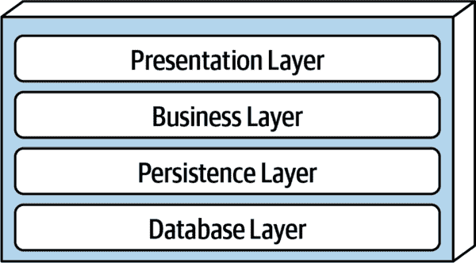

架构师设计 图 8-5 中显示的分层风格以确保关注点分离。然而，一旦架构师设计了此架构，他们如何确保开发团队会正确实现它？团队可能不了解隔离的重要性，或者架构师可能在一种组织中工作，在那里先斩后奏比先征求许可更受欢迎。


在任何情况下，架构师都可以通过使用 `ArchUnit` 为此拓扑定义结构测试来确保其设计得到正确实现。请考虑 图 8-6 中说明的包结构。

架构师可以通过单元测试来定义治理规则，以保留 图 8-6 中显示的架构结构，其中包括来自 `ArchUnit` 框架的以下内容。

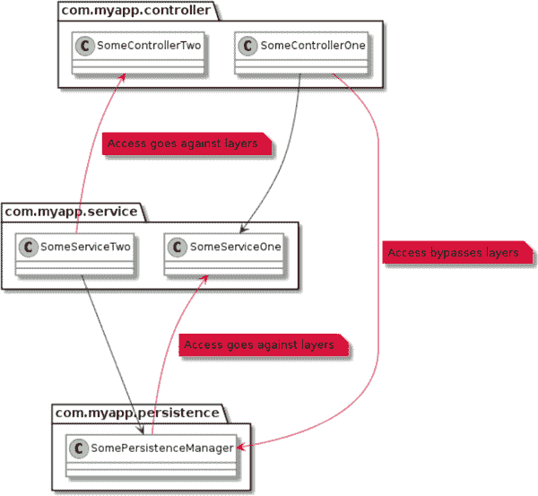

使用 示例 8-2 中的代码，架构师可以使用 `ArchUnit` 中包含的 `Hamcrest` 匹配器来编写类似英语的单元测试，以定义层关系，从而防止不良耦合。

### 示例 8-2. 用于验证分层架构的 ArchUnit 单元测试

```
  layeredArchitecture()
    .layer("Controller").definedBy("..controller..")
    .layer("Service").definedBy("..service..")
    .layer("Persistence").definedBy("..persistence..")
  
    .whereLayer("Controller").mayNotBeAccessedByAnyLayer()
    .whereLayer("Service").mayNotBeAccessedByAnyLayer("Controller")
    .whereLayer("Persistence").mayNotBeAccessedByAnyLayer("Service")
  
```

使用诸如 `ArchUnit` 之类的工具非常方便——但仅适用于 `Java` 平台上的团队，并且仅用于编译时验证。类似的工具 [NetArchTest](https://oreil.ly/CUako) 可用于 `.NET` 平台。那么不同平台怎么办？更重要的是，对于微服务等分布式架构的同类验证怎么办？

通常，架构解决方案需要手工打造。大多数架构并非通用，而是好/坏、旧/新以及自选/强加的工具、框架、包等的拼凑组合。然而，通过使用标准工具，架构师可以构建简单的适应性函数来实现相同的目的。

例如，请考虑 图 8-7 中说明的微服务拓扑。

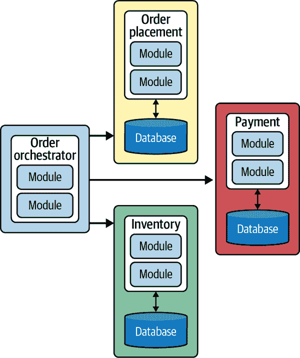

在 图 8-7 中，最左边的服务充当编排器，协调右侧三个领域服务的工作流。作为架构师，我希望确保领域服务之间不会相互交互——只有编排器。

虽然此问题与 图 8-6 中显示的层拓扑问题相似，但由于分布式架构之间可能存在差异，构建此类工具几乎不可能，因此没有单一工具可以管理它。这是一个很好的例子，说明架构师必须使用其技术组合可用的功能自行拼凑的必要工具。

架构师可以实现一个适应性函数来验证编排器通信，如 示例 8-3 中的伪代码所示。

### 示例 8-3. 用于验证允许的编排器通信的伪代码适应性函数

```
def ensure_domain_services_communicate_only_with_orchestrator
  list_of_services = List.new()
                        .add("orchestrator")
                        .add("order placement")
                        .add("payment")
                        .add("inventory")
  list_of_services.each { |service|
    service.import_logsFor(24.hours)
    calls_from(service).each { |call|
      unless call.destination.equals("orchestrator") 
          raise FitnessFunctionFailure.new()
    }
   }
end
```

在 示例 8-3 中，架构师定义了服务列表和期望的通信规则。然而，与 `ArchUnit` 的情况不同，没有框架可以为您的特定架构验证这些规则。因此，架构师必须编写代码来发现构建验证所需的必要信息。在此示例中，我们假设每个服务都为其在特定时间快照中进行的每个服务调用提供日志记录。适应性函数的主体为每个服务加载过去 24 小时的日志，然后解析每个日志以确定调用目标。如果目标与规则不同，代码会引发异常以指示失败。

架构师可以以多种方式实现 示例 8-3 中显示的适应性函数。例如，如果团队使用监视器而不是取证日志记录，适应性函数将连接到有关服务调用的实时信息，并且适应性函数将利用事件处理程序来调查并在出现错误调用时触发警报。

如果架构师无法立即找到可下载的现成工具来实现适应性函数，重要的是不要绝望。现代开发生态系统中存在的许多工具允许小型临时适应性函数将它们的输出粘合在一起。

# 案例研究：零日安全检查

架构师通常将指标视为代码的低级评估，基于众多的现有示例。然而，与适应性函数结合使用时，其范围可以像组织所需的那样广泛。

2017 年 9 月 7 日，美国一家主要的信用评分机构 Equifax 宣布发生数据泄露。问题追溯到对 `Java` 生态系统中流行的 `Struts` Web 框架的黑客利用（`Apache Struts` v`CVE-2017-5638`）。Apache 基金会已于 2017 年 3 月 7 日发布声明宣布该漏洞并发布了补丁。美国国土安全部随后在第二天联系了 Equifax 和类似公司警告他们此问题，并在 2017 年 3 月 15 日运行扫描，发现了大多数受影响系统……*most* of them。因此，关键补丁直到 2017 年 7 月 29 日才应用于许多旧系统，当时 Equifax 的安全专家发现了导致 2017 年 9 月发生数据泄露的黑客行为。

想象一个替代世界，其中每个项目（即使处于空闲状态）都有一个部署管道，并且安全团队在每个团队的部署管道中都有一个“插槽”，可以在其中部署适应性函数，如 图 8-8 所示。

大多数情况下，图 8-8 中显示的安全阶段将执行防止开发人员将密码存储在数据库中以及类似常规治理任务等保护措施的平凡检查。然而，当零日漏洞出现时，拥有相同的机制允许安全团队在每个项目中插入一个测试，检查特定框架和版本号，并启动项目的构建。如果发现危险版本，它将使构建失败并通知安全团队。如果 Equifax 的架构师让所有项目仍然使用部署管道，即使是未处于积极开发中的项目，也将实现自动化治理。团队配置部署管道以对生态系统的任何更改做出响应：代码、数据库模式、部署配置和适应性函数。这使企业能够普遍自动化重要的治理任务，其范围远比人们通常对指标的思考更广。

适应性函数为架构师提供了许多好处，其中最不重要的就是再次进行一些编码的机会！架构师的普遍抱怨之一是他们不再经常编码——但适应性函数通常就是代码。通过构建架构的可执行规范，任何人都可以随时通过运行项目的构建来验证它，架构师必须很好地理解系统及其持续演变，这与跟上项目代码增长的核心目标重叠。

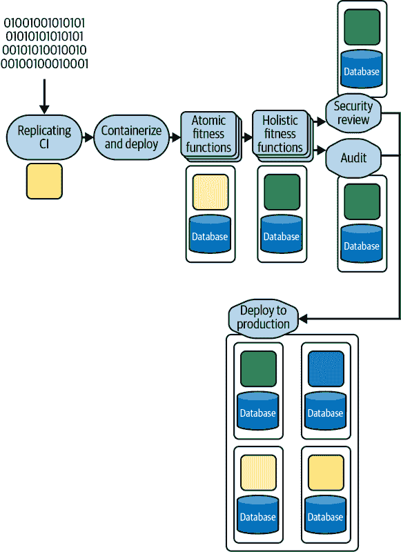


# 案例研究：保真度健身函数

一个*保真度健身函数*，它允许团队比较新旧版本，展示了将指标与工程实践相结合的威力。 一个常见的困境是，许多现实世界的架构师面临的问题是：“我如何用新系统替换旧系统，同时确保新系统产生与旧系统相同的结果？” 换句话说，架构师如何保证两个实现之间的保真度？ 答案是一个保真度健身函数。

最后一个案例研究，“Move Fast and Fix Things,”^(2) 来自 GitHub 工程博客，将进化式架构定义中的许多方面联系在一起。 这个案例研究也戳破了这样一种常见论点，即诸如持续部署等激进的敏捷工程实践会使风险增加到不可接受的程度。 实际上，现实表明，使用这些工程实践的团队找到了减轻风险的方法。

GitHub 是一个相当激进的工程组织。 它使用持续部署——当开发人员在其代码库中进行更改时，这些更改会通过部署管道进行，如果没有错误，就会进入生产环境。 GitHub 平均每天部署 60 次，但其运营规模如此之大，以至于边缘情况几乎会立即出现。

正如博客文章所述，GitHub 解决的问题与合并有关，过去合并是通过执行使用命令行 `Git` 合并文件的 shell 脚本完成的。 虽然这能完美运行，但扩展性并不特别好。 为提高性能而进行的替代方案是博客文章的主题。

该团队构建了新的内存中合并功能并对行为进行了测试，以确保其正确执行。 然而，在某个时候，他们必须将其部署到生产环境中，这就是可怕的部分：如果它破坏了某些东西会怎样？ 如果合并代码失败已经够糟糕了，但如果旧合并代码中存在一些以前未知的耦合点，导致更灾难性的故障会怎样？ 这就是让许多团队不敢采用现代技术的恐惧。

GitHub 团队所做的是（他们将其开源供大家受益）创建了工具 [Scientist](https://oreil.ly/0AF3j)，它允许团队在架构内安全地进行实验，而不会让用户暴露于错误中。

`Scientist` 工具允许开发人员创建实验，每个实验包含两个子句：`use` 和 `try`。 `use` 子句包含他们要替换的旧代码，而 `try` 子句包含新行为。 对于合并实验，实验被封装在 `create_merge_commit` 方法中，显示在 示例 8-4。

### 示例 8-4. 包含 `science` 块的 `commit` 方法

```
def create_merge_commit(author, base, head, options = {})
  commit_message = options[:commit_message] || "Merge #{head} into #{base}"
  now = Time.current

  science "create_merge_commit" do |e|
    e.context :base => base.to_s, :head => head.to_s, :repo => repository.nwo
    e.use { create_merge_commit_git(author, now, base, head, commit_message) }
    e.try { create_merge_commit_rugged(author, now, base, head, 
        commit_message) }
  end
end
```

在 示例 8-4 中，`science` 块充当两个子句 `use` 和 `try` 的调度器。 对于每次调用，`use` 子句始终执行，并且该输出始终返回给用户。 因此，用户永远不会意识到自己是实验的一部分。 架构师还配置框架以确定还应执行 `try` 块的频率——在合并实验中，它运行了 1% 的请求。 当 `use` 和 `try` 都执行时，框架：

* 随机化 `use` 和 `try` 的顺序以防止时序异常
* 比较两次调用的结果以检查保真度
* 吞掉但记录 `try` 块引发的任何异常
* 将结果发布到仪表板，显示在 图 8-9

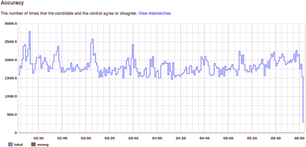

图 8-9 中的仪表板显示 GitHub 在 02:20 进行了略多于两千次合并。 然而，由于 GitHub 的运营规模如此之大，错误在该视图中并不容易出现。 图 8-10 显示同一时间段内的错误。

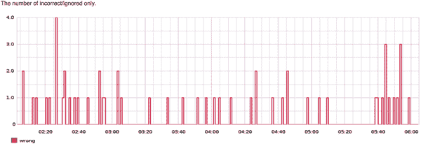

如 图 8-10 所示，他们的新代码中存在错误。 然而，由于 scientist 框架，用户看不到这些错误。 相反，开发人员修复问题并重新部署——请记住，在此期间，持续部署对该实验和其他代码都继续进行。

实验的目标之一是提高性能，我们可以在 图 8-11 中的图表中看到成功。

GitHub 架构师运行了四天的实验，直到他们有 24 小时没有不匹配或缓慢的情况，此时他们移除了旧的合并代码并保留了新代码。 在这四天里，他们进行了超过 1000 万次实验，使他们对新代码的正确运行充满信心。

`Scientist` 是一个保真度健身函数，使用功能开关和性能指标实现。 这种方法展示了工程与指标之间的协同作用如何带来项目的超能力。

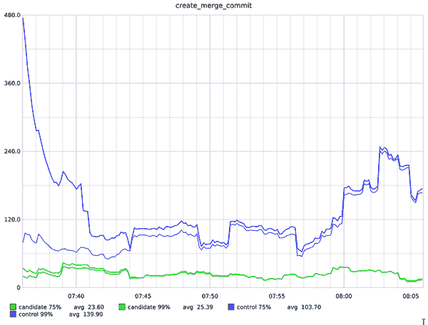

## 结论

无论健身函数多么强大，架构师都应避免过度使用。 架构师不应结成小团体，退回到象牙塔中构建一个不可能复杂、相互交织的健身函数集合，只是让开发人员和团队感到沮丧。 相反，健身函数是架构师为软件项目构建可执行的重要但非紧急原则清单的一种方式。 许多项目淹没在紧迫性中，让一些重要原则被搁置。 这是技术债务的常见原因：“我们知道这很糟糕，但我们稍后再回来修复它”…而后来永远不会到来。 通过将关于代码质量、结构以及其他防止衰减的保护措施的规则编纂成持续运行的健身函数，架构师构建了一个开发人员无法跳过的质量清单。

Atul Gawande 的优秀著作 *A Checklist Manifesto*（Metropolitan Books，2009）强调了外科医生、航空飞行员等专业人士如何将清单作为他们工作的一部分（有时是法律强制的）。 这并不是因为他们不知道自己的工作或特别健忘——而是当专业人员反复执行相同的任务时，很容易在意外跳过时自欺欺人，而清单可以防止这种情况。 健身函数代表了由架构师定义并作为构建的一部分运行的重要原则清单，以确保开发人员不会意外地（或有意地，因为外部因素如进度压力）跳过它们。

指标（以及许多其他验证技术）与工程的结合使架构治理具有新的水平和能力，进一步推动了软件开发从神秘的手工艺向真正的工程学科的转变。

^(1) Ford、Parsons 和 Kua，“第 2 章：健身函数”，载于 *Building Evolutionary Architectures*。

^(2) Vicent Martí，“Move Fast and Fix Things”，GitHub 博客，2015 年 12 月 15 日，*https://oreil.ly/JXuEu*。
