# 第 9 章. 使用软件指标确保可维护性

Alexander von Zitzewitz

本章我将介绍几种有趣的软件度量，可用于项目治理。它们衡量诸如代码耦合、架构侵蚀、代码复杂度和设计质量等方面。在正确使用时，它们可以在保持高可维护性、降低整体开发和维护成本以及减轻项目风险方面发挥重要作用。定期跟踪度量将使您能够及早发现有害趋势，并在问题仍易于修复时加以解决。

# 使用度量的理由

每个制造复杂产品的行业都应使用度量来确保质量和可用性。在没有严格的质量测量下，现代制造业是不可想象的。就这一点而言，软件行业明显落后于其他行业，尽管它特别能从采用这种方法中受益。

使用度量的最佳方式是建立一个*基于度量的反馈循环*（参见图 9-1）。使用基于度量的反馈循环可确保产品达到可衡量的质量标准。这不仅提高了整体质量，还提高了软件的可维护性，从而提高了项目中每位开发人员的生产力。更好的可维护性使代码更易于阅读和理解，这也意味着开发人员花费在阅读代码上的时间更少，而花费在改进或添加代码上的时间更多。

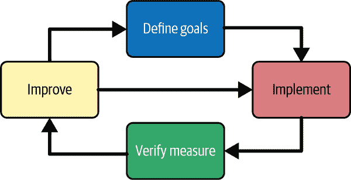

图 9-1 展示了一个基于度量的反馈循环。在这样的循环中，您首先定义可量化的目标，这些目标可使用一组度量进行衡量。然后您在实施产品时持续验证是否真正达到了目标。如果您未能达到目标，则改进实现，直到再次满足目标，然后继续工作。

在处理遗留软件系统时，应用标准度量目标可能非常困难，仅仅因为在系统首次实现时这些目标并不存在。这通常意味着会发现大量度量违规。在这种情况下，从一组更宽松、可以用合理努力实现的目标开始是明智的。否则，开发人员将被大量问题淹没，这可能会对士气产生负面影响。一旦这些目标实现，您就可以收紧要求，使目标稍微严格一些，以确保遗留代码库的持续改进。当然，这只有在您的遗留系统对运营仍然有价值并且正在开发中时才有用。改进静态代码库的度量几乎毫无用处。

## 熵正在杀死软件

在开发非平凡软件系统时，您最大的敌人是*熵*，也称为*结构侵蚀*。结构侵蚀的最终状态对大多数软件开发人员来说是众所周知的可怕的“大泥球”：这是对失去所有架构凝聚力的混乱代码库的代名词。该术语描述了一个高度耦合的系统，其中系统本应无关的部分之间存在大量不期望的依赖关系。典型的症状是，系统某一部分的更改可能会破坏完全无关的部分。

另一个症状是大量的循环依赖，导致出现大的循环组（图 9-2）。软件度量在衡量熵方面非常出色，使其成为缓解此问题的理想工具。

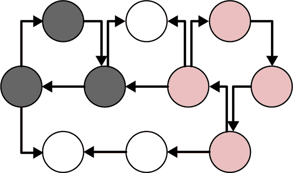

图 9-2 说明了循环组的概念。图中的节点可以是源文件、命名空间、包或软件系统的任何其他部分。箭头表示这些元素之间的依赖关系。在示例中，我们有两个循环组，以不同的灰色阴影突出显示。白色节点不参与任何循环依赖。

通过分析开源系统，我们可以观察到，一旦这些循环组达到一定规模，它们就会开始持续增长。Apache Cassandra 项目是这种现象的一个很好的例子。在版本 2 中，它已经有一个由约 450 个 Java 文件组成的循环组。在版本 3 中，该循环组增长到超过 900 个元素，在版本 4 中，达到超过 1,300 个元素。我喜欢将这些大型循环组称为“代码癌症”：它们会生长并吞噬代码库中越来越大的部分。在 Cassandra 版本 4 中，肿瘤甚至通过添加两个新的 143 和 31 个元素的组而转移。现在，约 75% 的所有元素都涉及大型循环组。

在包级别，情况甚至更糟。在 113 个 Java 包中，102 个涉及一个大的循环组（图 9-3）。由于包或命名空间非常适合表达架构分组和意图，因此更重要的是保持它们之间的依赖关系无循环。

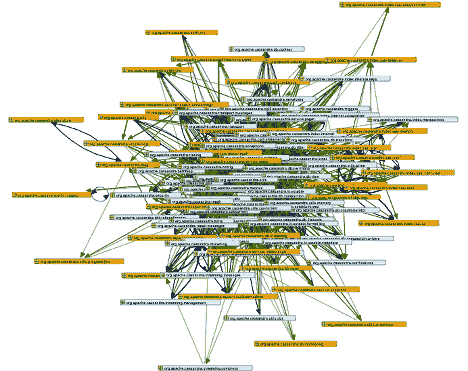

## 循环依赖的有毒性

为什么循环依赖是个坏事？毕竟 Cassandra 似乎运行得相当不错。好吧，首先，循环依赖使得无法独立测试代码段。它还使新开发人员更难理解代码，因为随机挑选的源文件可能直接或间接地依赖于几乎所有其他内容。

紧密耦合的另一个问题是无法在不进行耗时且有风险的全局更改的情况下隔离和替换某些功能。模块化变得不可能。你可以说开发人员将 Cassandra 的架构图简化为一个标记为“Cassandra”的框。虽然该图易于阅读，但它没有揭示软件内部结构的任何信息。

好消息是，可以打破所有循环依赖。例如，您可以应用“依赖倒置原则”，该原则最早由 Robert C. Martin 提出，并在其著作*Agile Software Development, Principles, Patterns, and Practices*（Pearson，2002）等地方进行了解释。使用此原则，您可以通过引入接口来反转循环组中的依赖关系，这通常会打破循环。打破循环还有其他几种技术，例如将循环依赖提升到更高级别的类中，该类依赖于循环中涉及的元素，从而使它们无需直接相互依赖。您也可以将循环降级为较低级别的类，该类处理循环元素之间的通信。或者，您只需在类之间移动某些功能即可打破循环。

换句话说，让代码癌症失控没有好的借口。避免大型循环组会使您的代码更好。它将更易于测试、理解和维护，更不用说重用了。

## 度量如何提供帮助

为了避免结构侵蚀，您可以使用度量来分析代码的依赖结构。例如，您可以使用的一个度量是源文件最大循环组中的元素数量。通过定义阈值，例如五，一旦循环组有六个或更多元素，您就会收到警告。您甚至可能决定超过此阈值将破坏构建。然后您可以更改代码以打破循环组，或至少确保其元素少于六个，修复警告，并使构建再次变绿。由于循环元素的数量仍然非常少，这种修复将易于快速实施。

当然，完全避免循环依赖会更好，但我在这里尝试保持务实。单个命名空间或包内的少量循环组并不会造成太多危害，只要阻止它们成长为怪物循环组即可。值得注意的是，每个循环都可以被打破，例如通过应用 Robert C. Martin 的 [依赖倒置原则](https://oreil.ly/erUlO)，该原则通过添加接口来反转依赖的方向（见 图 9-4）。这种反转对于打破循环非常有用。还有一些打破循环的技术，但它们超出了本章的范围。

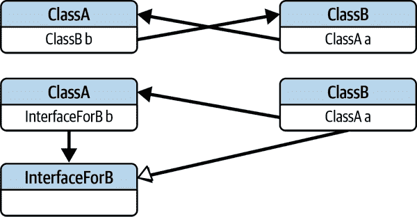

仅限制循环组的大小就能确保你的软件永远不会变成大泥球。在我多年的经验中，超过 10 万行代码的非平凡软件系统中有超过 80% 最终会变成大泥球。你只需分析一些随机挑选的开源系统即可轻松证实这一点。如果你的系统能避免这种命运，它就已经比同等规模和复杂度的 80% 系统做得更好了。我称之为低垂的果实——在新开发项目开始时很容易摘取。

有一些成功的项目通过遵循类似的规则避免了结构侵蚀的陷阱。一个流行且著名的例子是 Spring 框架，它结构良好、架构清晰，且只有很少数量的小型循环组。

现在，如果你同意限制循环依赖是个好主意，你可能会问如何做到。简短的回答是，你绝对需要工具。[Sonargraph-Explorer](https://oreil.ly/VVVCR)，例如，将为你提供基于循环组大小拆分构建的选项，并且对任何用途都是完全免费的。^(1)

# 为什么度量没有更广泛使用？

在刚刚论证了度量的有用性之后，很难理解为什么基于度量的反馈循环在软件行业中如此罕见。当我就此主题演讲并询问谁在使用度量时，在一百人的听众中最多只有一两个人会举手。我认为有几个重要原因：

* 许多开发人员和架构师对度量或如何使用它们知之甚少。即使你学习过计算机科学，软件度量很少是课程内容，最多也只是作为一个侧面话题。如果你没有学术背景，那么你正式学习过度量的可能性就更小了。
* 要使用度量，你需要工具来为你收集它们。这在软件工具中仍然是一个小众领域。虽然有很好的工具可用于此目的（如 Sonargraph-Explorer），但它们并不广为人知，而且仅覆盖 Java 或 C# 等主流语言。
* 大多数度量需要上下文和一定的专业知识才能有效使用。如果你只关注一两个基于度量的规则并为其选择了错误的度量，你将无法真正改进代码库；事实上，你可能会损害它。在这种情况下，只是训练开发人员满足度量可能会导致表面上的改进。
* 使用过多的度量规则可能会让你的开发人员感到厌烦，并在没有增加收益的情况下减慢进度。我认为最佳点大约是五到六条基于度量的规则。任何额外的规则都会导致收益递减。
* 由于许多组织已经在难以承受的技术债务水平下挣扎，往往没有剩余的精力用于流程改进。
* 基于度量的规则只有在规则违规触发操作时才有用。因此，要成功，你需要在此处实现自动化，这又需要时间来实现。

在本章末尾，我将提出一套一致的规则，任何遵循这些规则的项目都将极大地提高其技术质量。

# 用于收集度量的工具

在深入讨论不同度量的细节之前，让我们先解决工具问题。毕竟，这些度量需要以某种方式收集，而且在大多数情况下你不希望手动完成。当然，你可以尝试编写自己的工具来收集度量，但如果已有工具可用，这几乎总是一个坏主意。此外，编写自己的工具总是比购买商业解决方案更昂贵，尤其是在考虑长期维护时。如果语言中添加了新功能怎么办？你的工具需要跟上。此外，本章中描述的更高级的度量需要你构建整个应用程序的完整依赖模型。为此，你基本上必须实现编译器的解析和依赖解析阶段，这很困难、耗时且有风险。你最好把这段时间投资于改进代码和开发流程。表 9-1 显示了收集度量的流行工具的示例列表

表 9-1. 收集度量流行工具的采样及其部分关键功能

| 工具 || 功能 |
| --- | --- |
| [Understand](http://scitools.com) || 商业版，支持多种语言；主要为规模和复杂度度量 |
| --- | --- |
| [NDepend](http://ndepend.com) || 商业版，支持 .Net；主要为规模和复杂度度量 |
| [Source monitor](https://oreil.ly/GmGE3) || 免费，支持 C++、C、C#、VB.NET、Java、Delphi、Visual Basic (VB6) 和 HTML；仅规模和复杂度度量 |
| [SonarQube](http://sonarqube.org) || 部分语言免费，商业版功能更多；主要为规模和复杂度度量 |
| [Sonargraph-Explorer](https://oreil.ly/ILjMe) || Java、C# 和 Python 免费；完整的度量集，包括耦合、循环、规模和复杂度度量；商业版 Sonargraph-Architect 还支持变更历史度量（Git）和 C/C++ |

有些工具是免费的，所有商业工具都提供免费试用，因此我建议你尝试一下并选择你最喜欢的。一个重要的评估标准是能够在自动化构建中检查度量阈值。自动化确实是这里的关键成功因素。

# 有用的度量

现在让我们看看一些有用的度量类别。我将从用于衡量耦合和结构侵蚀的度量开始，因为从长远来看，这方面是保持软件可维护的最关键因素。然后我将查看规模和复杂度度量。接下来是变更历史度量。最后，我讨论一些既不属于上述类别的度量。

## 用于衡量耦合和结构侵蚀的度量

以下度量衡量耦合和结构侵蚀。

### 平均组件依赖、传播成本及相关度量

`Average component dependency` (`ACD`) 最早由 John Lakos 在 *大型 C++ 设计* (*Addison-Wesley, 1996*) 中描述。该度量告诉你，从依赖图中随机选择一个元素，它平均（包括自身）直接或间接依赖多少个元素。要理解该度量，让我们看看 图 9-5 中的依赖图。

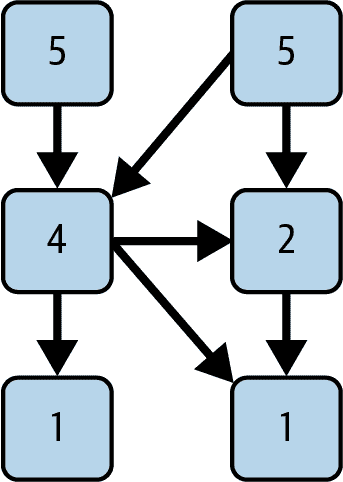

Lakos 将这些框称为 *组件*。在 C/C++ 中，一个组件由源文件及其关联的头文件组成；在其他语言中，如 Java，组件通常是单个源文件。

箭头表示有向依赖关系，而数字代表给定方框的 `Depends Upon` 指标值。例如，底部方框仅依赖于自身，因此它们的 `Depends Upon` 值为 1。右中组件仅依赖于其下方的组件，因此其值为 2。左中组件的值为 4，因为它依赖于右中元素、底部两个元素以及自身。顶层组件依赖于第一层和第二层上的所有内容以及自身，因此它们显示的值为 5。解释这些数字的另一种方法是计算可达节点的数量并在此基础上加一。在图论中，从给定节点可达的节点集合称为其 *closure*。

如果将方框中的所有值相加，就会得到一个称为 `Cumulative Component Dependency` (`CCD`) 的总和，在本例中为 18。现在将其除以方框数量，就得到 `ACD`——在本例中，18 除以 6（节点数）结果为 3。`ACD` 的最小值始终为 1，这描述的是没有任何依赖的系统。最大值等于节点数；在我们的示例中，该值为 6。

`Depends Upon` 指标有一个对应的指标称为 `Used From`。 图 9-6 显示了带有 `Used From` 指标值的相同图。

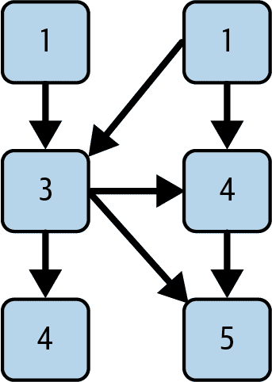

`Used From` 告诉你有多少个节点与所选节点存在直接或间接连接。如果将 `Used From` 和 `Depends Upon` 值相加，你总是会得到相同的数字。这必须成立，因为每个指标只是查看有向依赖的两端之一。

如果将每个节点的 `Depends Upon` 指标除以总节点数，就会得到一个新的节点指标，称为 `Fan Out`。例如，左上节点的 `Fan Out` 值为 1/6。如果对 `Used From` 做同样的操作，就得到 `Fan In`。平均 `Fan In` 等于平均 `Fan Out`，这也等于传播成本指标，正如你在本章后面将学到的。

有趣的是，将所有 `Fan Out` 值相加会得到与 `ACD` 相同的值。再次将该值除以节点数就会得到平均 `Fan Out`，即传播成本。对于 图 9-6 中的图，传播成本为 0.5，即 50%。

这些是用于计算更高级别指标的基础指标。它们也可以用于检测具有大量传入或传出依赖的组件。

何时使用 `ACD` 以及使用时需要考虑什么？在进行评估时，这是我首先查看的数字之一。它能让我很好地了解系统的耦合程度。当然，它需要与系统中的组件总数联系起来考虑。对于拥有 1,000 个组件的系统，100 的值是可以接受的，而对于只有 100 个组件的系统，相同的值将是毁灭性的。

指标 `Propagation Cost` (`PC`)^(2) 告诉你系统的耦合程度有多高。百分比越高，耦合越高。

你也可以通过再次将 `ACD` 除以节点数来计算 `PC`（在数学上，这等同于计算平均 `Fan In` 或平均 `Fan Out`）。这基本上将 `ACD` 归一化为更易于比较的值。在示例中，该值为 3/6，即 50%。换句话说，在此示例中，每次你修改某样东西，平均 50% 的所有组件都可能受到更改的影响。对于更大的系统，这将是一个非常糟糕的值；对于像这样的小示例，该值没有用处。

关于 `PC` 重要的是要理解，你也可以将其定义为 `CCD` 除以组件数 (`n`) 的平方。`ACD` = `CCD`/`n`，因此 `PC` = `CCD`/`n`²。所以，如果你的组件数量翻倍，系统的 `CCD` 必须增长 4 倍才能保持 `PC` 值不变。你总是希望最小化该指标，但如果它因系统添加了更多组件而下降，这不一定是好消息。在较大的系统（拥有 500 个或更多组件）中，我们通常会看到随着组件数量的增长 `PC` 下降，即使耦合非常高。这是因为你需要引入大量额外的耦合才能使 `CCD` 随组件数量的平方增长。

在排除这些注意事项后，以下是应如何使用 `PC` 的方法：

* 如果你的系统很小（`n` < 500），较高的 `PC` 值不太令人担忧。
* 对于中型系统（500 <= `n` < 5,000），`PC` 值超过 20% 令人担忧，而超过 50% 则表明存在大型循环组的严重问题。
* 如果你的系统非常庞大（`n` >= 5,000），即使是 10% 的值也已相当令人担忧。

如果同时查看 `ACD`，判断 `PC` 读数的 impact 会更容易。如果一个拥有 5,000 个组件的系统的 `PC` 为 10%，该系统的 `ACD` 将为 500。这绝对令人担忧，因为每次更改都可能影响平均 500 个组件。

### 循环性和相对循环性
通常，`ACD` 和 `PC` 的高值表明分析系统的依赖图中存在大型循环组。为了确定，你可以使用专门用于查看循环依赖的指标。本章前面我提到过一个简单但有用的指标：系统中最大循环组中的元素数量。该值可以针对任何类型的元素计算，但通常在组件和命名空间/包级别最有用。

最大循环组的规模也是我在分析系统时首先查看的数字之一。对于设计良好的系统的组件，该值应为 5 或更少。有时如果存在良好的技术原因，或者它们来自几乎从不更改的代码部分，则可以容忍更大的循环组。

无论如何，组件循环绝不应跨越一个以上的命名空间或包。对于命名空间/包循环组，我始终建议采取零容忍政策。也就是说，你的系统绝不应在命名空间或包之间存在循环依赖。

另一个有用的指标是 `Relative Cyclicity`，它通常按模块和整个系统计算。它基于一个称为 `Cyclicity` 的指标，定义为循环组中元素数量的平方。包含 5 个元素的循环组 `Cyclicity` 为 25。现在你可以将模块或整个系统的所有循环组的 `Cyclicity` 相加，取该值的平方根，然后除以系统或模块中的元素数量：

$relativeCyclicity = 100\*\\frac{\\sqrt{sumOfCyclicity}}{n}$ 

该指标相当有用。为了演示，让我们做一个小思想实验。假设我们有一个包含 100 个组件的系统，并且它们全部参与一个包含 100 个元素的单个大型循环组。循环组的 `Cyclicity` 将为 100²，即 10,000。公式的计算结果为 1，这意味着 100% `Relative Cyclicity`。这是最糟糕的值；我们的系统具有最糟糕的循环依赖。

现在假设我们不是有一个大型循环组，而是拥有 50 个各包含 2 个元素的微小循环组。在这种情况下，单个循环的 `Cyclicity` 为 2² = 4，系统的 `Cyclicity` 总和为 50 * 4 = 200。公式的计算结果为：

$100\\,\*\\,\\frac{\\sqrt{200}}{100} = 14.14$ 

或 14.14%。这是一个好得多的值，尽管每个组件仍然参与循环依赖。就循环组而言，越小越好，因为较小的循环组更容易打破。

### 结构债务指数

## 结构债务指数

虽然相对循环性对于判断系统受循环依赖影响的程度相当不错，但它有一个缺陷：它完全无法告诉你检测到的循环有多难拆分。为了更好地理解这个问题，让我们进行另一个思想实验。

设想一个包含 10 个源文件的简单系统。第一个文件依赖第二个，第二个依赖第三个，以此类推，直到第十个文件依赖第一个。这形成了一个包含 10 个元素的简单循环组，因此所有文件都参与了循环。该系统的相对循环性将为 100%。但这个特定的循环组只需切断或反转一个依赖关系即可轻松打破。因此，很容易将系统的相对循环性降至零。

当然，情况可能更糟。让我们看看另一个极端。同样，你有一个包含 10 个源文件的系统，但现在每个文件都与每个其他文件存在双向循环依赖，导致 90 个依赖关系 `(9 + 8 + 7 + ... + 1) * 2`。这里相对循环性也为 100%，但这时你至少需要打破或反转 45 个依赖关系才能消除所有循环依赖：比第一个例子要付出多得多的努力。

这就是我开发的指标 `Structural Debt Index` (`SDI`)。该指标让图算法在循环组上运行以检测最小拆分集，从而生成需要被打破的依赖关系列表。现在，如果你查看源文件之间的依赖关系，它们实际上可能包含许多使用关系。例如，如果类 `A` 调用类 `B` 的三种不同方法，则该依赖关系将由三个使用（或 *parser dependencies*）组成。你使用使用次数的数量作为链接的权重，以帮助算法优先切断权重较低的链接。然后你将像这样计算 `SDI`：

`SDI = 10 * number of Links To Cut + Σ weight Of Links To Cut`

对于第一个例子（10 个组件的简单循环），你只需要切断一个链接。假设该链接的权重为 1，则该系统的 `SDI` 值为 11（`10 * 1 + 1`）。

你现在将需要切断的链接数量乘以一个常数，因为对于每个链接，有人必须弄清楚如何打破这种依赖关系（例如，通过使用依赖倒置原则将其反转）。然后，当然，每个使用也可能产生一些额外的努力。该指标的想法是至少大致与打破循环组所需的工作量成比例。它针对每个循环组计算，然后累积到模块和系统级别。像 `Sonargraph-Architect` 这样的工具使用该指标的组件来按修复难易程度对循环组进行排名。

使用 `SDI` 指标的最佳方式是与相对循环性一起使用。你的目标应尽可能将其保持接近零。如果它持续增长，那就是系统内出现代码癌症的症状。

## 可维护性等级

在本节中，我将讨论我创建一种衡量代码可维护性和良好设计的新指标的历程：软件指标的圣杯。我与一位客户一起完成了这项工作，该客户提供了多种大型项目供测试。该指标的值或多或少会与开发者对其软件系统可维护性的自身判断相符。我们决定在夜间构建中跟踪该指标，并像煤矿里的金丝雀一样使用它：如果数值恶化，就该进行重构了。我们还计划用它来比较组织内所有软件系统的健康状况，并决定是重新从头编写软件更便宜还是重构它。

当我们踏上这段旅程时，我们已经研究了几种衡量耦合和循环依赖的指标。这个新实验性指标的想法是将它们凝聚成一个单一指标，可用作衡量项目良好设计的适应度函数。

所谓“良好设计”，我的意思是使用水平分层以及功能组件的垂直分离（或筒仓化）的设计。将软件系统按功能方面切分为部分是我所说的 *verticalization*。图 9-7 显示了这一点。

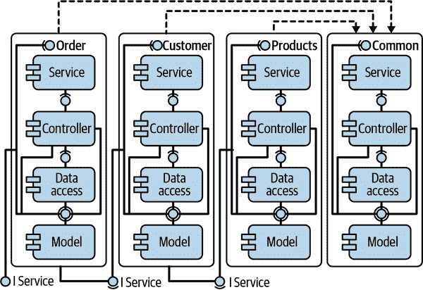

功能组件位于各自的筒仓内，它们的依赖关系不是循环的；筒仓之间存在清晰的层次结构。你也可以将其描述为垂直分层，或作为单体中的微服务。需要明确的是：对于任何架构风格，依赖管理都至关重要。如果你以微服务为目标，请确保将微服务之间的依赖关系视为更重量级的依赖形式，因为它们都依赖某种形式的进程间通信。微服务之间的通信与进程内函数调用相比始终具有更高的延迟，并且需要更大程度地关注错误处理。如果目标服务不可用或出现网络问题会怎样？

不幸的是，许多软件系统在垂直化方面失败了。主要原因是没有人强迫你将代码组织成筒仓。由于很难正确做到这一点，筒仓之间的边界变得模糊，本应驻留在单个筒仓中的功能被分散到多个筒仓中。这促进了筒仓之间循环依赖的产生，从此，可维护性以不断增加的速度直线下降。

现在，如何衡量垂直化？首先，你必须创建系统的组件的分层依赖图。但你的依赖图只有在组件之间没有循环依赖时才能正确分层。因此作为第一步，你将把所有循环组合并为单个节点。

在 图 9-8 所示的系统中，节点 `F`、`G` 和 `H` 形成一个循环组，因此你将它们合并为一个名为 `FGH` 的单个逻辑节点。这给你三个层级。底层只有传入依赖，顶层只有传出依赖。为了可维护性，你希望尽可能多的组件没有传入依赖，因为它们可以被更改而不会影响系统的其他部分。你还希望剩余的组件尽可能少地影响它们上层中的组件。

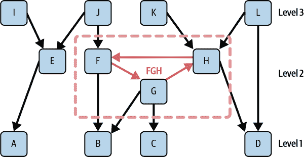

在我们的示例中，节点 `A` 仅影响节点 `E`、`I` 和 `J`（直接和间接）。另一方面，节点 `B` 影响第 2 层和第 3 层中的所有内容，除了 `E` 和 `I`。循环组 `FGH` 显然对该情况有负面影响。因此你可以说 `A` 比 `B` 对可维护性的贡献更大，因为它破坏上层中某物的概率更低。对于每个逻辑节点，你可以计算对估计可维护性的新指标的贡献值 `c[i]`：

$c_{i} = \frac{size\left( i \right)\*\left( 1 - \frac{inf\left( i \right)}{numberOfComponentsInHigherLevels\left( i \right)} \right)}{n}$

这里，`n` 是组件总数，`size(i)` 是逻辑节点中的组件数量（其值仅在由循环组创建的逻辑节点中大于 1），而 `inf(i)` 是受 `c[i]` 影响的组件数量。

例如，让我们为节点 `A` 计算此公式：

$c_{A} = \frac{1\*\left( 1 - \frac{3}{8} \right)}{12}$

这得到 ~0.052。将所有节点的 `c[i]` 相加得到新指标的第一个版本，我们称之为 `Maintainability Level` (`ML`)：

$ML_{1} = 100\*\sum_{i = 1}^{k}c_{i}$

# 可维护性等级度量

这里，`k` 是逻辑节点的数量，如果系统中的组件之间存在循环依赖，则它小于 `n`。在此示例中，`k` 为 10，而 `n` 为 12。将结果乘以 100 可得到百分比值。`ML` 值越高，可维护性越好。

对于 图 9-8 中的示例，`ML` 值为 53 除以 96 = 55%。由于我们讨论的是一个仅有 12 个编译单元的非常小的系统，该值并不是大问题。稍后，我将改进该度量以考虑小系统往往产生相对较差值这一事实。我们在 `Propagation Cost` 中也看到了同样的问题。由于小系统中元素的数量少，平均耦合度总是更高。解耦的重要性随着系统规模的增大而增加。

由于每个系统都会有依赖关系，除非系统中的组件没有任何传入依赖，否则不可能达到 100%。但最顶层的所有节点都会以其最大 `c[i]` 值贡献给度量。较低层节点的贡献会随着它们影响的上层节点数量的增加而减小。循环组会增加所有成员在上层受影响的节点数量，因此往往会对度量产生负面影响。

我们知道循环依赖会对可维护性产生负面影响，尤其是当循环组包含大量节点时。在 `ML` 的第一个版本中，我们意识到如果循环组创建的节点位于最顶层，就不会看到这种负面影响。因此，我们为包含超过五个节点的循环组添加了惩罚：

$penalty\\left( i \\right) = \\begin{cases} {\\frac{5}{size\\left( i \\right)},} & {\\text{if} size\\left( i \\right) > 5} \\\\ {1,} & \\text{otherwise} \\\\ \\end{cases}$

在这种情况下，惩罚值为 1 表示无惩罚。小于 1 的值会降低逻辑节点的贡献值。例如，如果你有一个包含 100 个节点的循环组，它仅贡献其原始贡献值的 5%。`ML` 的第二个版本（`ML[2]`）考虑了惩罚：

$ML\_{2} = 100\*\\sum\_{i = 1}^{k}c\_{i}\*penalty\\left( i \\right)$

该度量效果相当不错。当我们在设计良好的系统上运行它时，得到的值超过 90。对于没有可识别架构的系统，如 Apache Cassandra，我们得到的值在 20 多。

当我在客户项目上测试该度量时，我还做了两项需要调整的观察。首先，对于少于 100 个组件的小模块，它的效果并不好。这些模块往往产生相对较低的 `ML` 值，因为组件数量少会自然增加相对耦合度，而不会对可维护性产生负面影响。

第二个是一个客户的 Java 项目，其开发人员认为它的可维护性很差。然而该度量显示的值在 90 多。仔细检查后，我们发现该项目确实具有良好且几乎无循环的组件结构，但包结构却是一团糟。最关键模块中的几乎所有包都在同一个循环组中。这通常发生在没有明确的类到包分配策略时。这使得开发人员难以找到类。

第一个问题可以通过为 `ML` 添加滑动最小值来解决，如果要分析的模块或系统包含少于 100 个组件：

$ML\_{3} = \\begin{cases} {\\left( 100 - n \\right) + \\frac{n}{100}\*ML\_{2},} & {\\text{if} n < 100} \\\\ {ML\_{2},} & \\text{otherwise} \\\\ \\end{cases}$

这里，`n` 再次表示组件的数量。可以通过论证小系统本身更容易维护来为该变体辩护。因此，使用滑动最小值后，包含 40 个组件的系统永远不会低于 60。如果将 图 9-8 示例中 `ML[2]` 的值（55%）代入此公式，你会得到 94.6% 的值。如果考虑到像这样的小系统不会产生高可维护性负担，这一值似乎比 55% 更合适。

第二个问题更难解决。这里，我们决定基于为包/命名空间依赖计算的 `Relative Cyclicity`，或 `RCp`，计算一个替代值：

$ML\_{alt} = 100\*\\left( 1 - \\frac{\\sqrt{sumOfPackageCyclicity}}{n\_{p}} \\right)$

`ML` 为系统的每个模块计算。然后我们按模块中的组件数量对系统中所有较大的模块计算加权平均值。为了决定加权哪些模块，我们按递减的规模对它们进行排序，并将每个模块添加到加权平均值中，直到要么 75% 的所有组件已添加到加权平均值中，要么模块包含至少 100 个组件。其理由是操作通常发生在较大、更复杂的模块中。小模块不易维护，且对系统的整体可维护性影响很小。

为了获得良好的可维护性，组件结构和包/命名空间结构都必须设计良好。如果其中一个或两个遭受不良设计或结构侵蚀，可维护性也会下降。

Sonargraph（包括免费版本 Sonargraph-Explorer）目前是计算此实验性度量的唯一工具。如果你好奇你的代码表现如何，我建议[获取免费的 Explorer 许可证](http://www.hello2morrow.com)并在你的系统上运行它。

我们对 `ML` 的工作受到了关于另一种很有前景的度量 `Decoupling Level`（`DL`）的论文的启发。^(3) `DL` 基于 Drexel 大学和夏威夷大学的 Ran Mo、Yuangfang Cai、Rick Kazman、Lu Xiao 和 Qiong Feng 的研究工作。不幸的是，计算 `DL` 的算法的一部分受专利保护，因此在撰写本文时我们无法在工具中复制该度量。将这两个度量在不同项目上进行比较会很有趣。

## 用于衡量规模和复杂度的度量

下一类有用度量衡量代码规模和复杂度。限制复杂度在你希望保持代码可维护时很重要。开发人员花费大部分时间阅读代码，而复杂代码会使这变得困难得多。因此，使用复杂度阈值来避免过于复杂的代码是个好主意。

### 规模度量

让我们从一些简单的规模度量开始。最著名的规模度量可能是每个文件的 `Lines of Code`（`LoC`）。`LoC` 计算包含实际代码的每一行，并跳过空行和注释行。`Total Lines` 计算每一行，包括空行和注释行。你也可以计算注释行，但这里已经有点棘手了。源文件通常在文件开头有一个仅包含版权信息的头部注释。这些头部注释并不是对代码的注释，应从注释行中排除。

从某种意义上说，你已经可以将 `LoC` 用作复杂度度量。如果你的源文件有 5,000 行 `LoC`，它很可能是复杂的。我强烈建议将源文件的大小限制在约 800 行 `LoC` 左右。如果文件超过该大小，请考虑将其拆分为更小的文件。规模和复杂度度量的阈值大多是软阈值，尽管总会有一些合理的例外（只要确保例外不会失控）。

衡量函数和方法的大小的一个良好度量是 `Number of Statements`。名称本身就说明了该度量的工作原理，因为它只是计算方法中的语句数。保持函数和方法合理简短始终是个好主意，因此通过限制函数或方法中的 `Number of Statements`，你可以保持代码的可读性和可维护性。我建议的阈值为每个函数/方法 100 条语句。

## 圈复杂度

The `Cyclomatic Complexity` 指标最初由 Thomas McCabe 于 1976 年提出。它计算通过方法或函数可能的不同执行路径数量，这也是实现 100% 测试覆盖所需测试用例数量的下限。原始定义基于流图以及该图中的节点和边数。但其计算可以简化：从最小值 1 开始，然后对每个循环语句或条件语句加一。对于 switch 语句，我们加上 case 的数量。高 `Cyclomatic Complexity` 值往往与高度复杂且难以阅读的函数或方法相关。

该指标研究充分，我们知道所有超过 24 的值错误率都会迅速增加。我建议阈值设为 15，以保持安全。

该指标有几种变体。`Modified Cyclomatic Complexity` 对每个 switch 语句仅加 1，因为 switch 语句往往会大幅提高指标，而并未增加额外复杂度。`Extended Cyclomatic Complexity` 还对每个逻辑 `&&` 和 `||` 表达式加一，因为编译器对这些表达式的短路求值相当于一个额外的条件语句。

将数值汇总到类、包/命名空间和模块级别也是有意义的。该指标称为 `Average Cyclomatic Complexity`，应基于 `Cyclomatic Complexity` 指标的加权平均值。

`Number of Statements` 指标通常用作平均值的权重。使用加权平均可以确保许多小型方法（如 setter 和 getter）不会过度稀释长方法复杂度。

## 缩进债务

衡量复杂度的另一个好方法是查看函数和方法中的最大代码缩进级别。缩进越深，方法越复杂。该指标在发现复杂代码方面效果出奇地好。你也可以通过使用类或源文件中所有函数/方法的加权平均值轻松地将该指标汇总到类或源文件级别。与 `Average Cyclomatic Complexity` 一样，平均值应以 `Number of Statements` 加权。我建议最大缩进级别的阈值为 4。

## 变更历史指标

正如 Adam Tornhill 在其优秀著作 *你的代码如同犯罪现场*（Pragmatic Bookshelf，2015）中指出的那样，你的版本控制系统是一个宝贵的宝库，可以挖掘以了解哪些文件经常更改，多少人了解代码的某些部分，在给定时间范围内更改了多少代码等等。这很有价值，因为它可以帮助你找到代码中的热点，这些热点可能是重构的绝佳候选。

### 变更频率

了解给定源文件在给定时间范围内更改的频率很有趣，因为频繁更改可以指出软件设计中的不稳定性。这由指标 `Number of Changes(d)` 回答，其中 `d` 是以天为单位的时间范围。例如，`Number of Changes(30)` 回答文件在过去 30 天内更改的频率。

### 代码 churn

`Code Churn(d)` 回答在给定时间范围内向给定文件添加或删除了多少行的问题，其中 `d` 仍是以天为单位的时间范围。你也可以通过将 `Code Churn(d)` 指标除以文件中的行数来从该指标推导出 `Code Churn Rate(d)` 指标。假设 `Code Churn Rate(90)` 给出值为 2，可以解释为“该文件在过去 90 天内被重写了两次”。该指标比单纯计数更改次数提供了更多上下文，因为它统计了实际更改的行数。这也可以用来指出软件设计中的不稳定性。

### 作者数量

指标 `Number of Authors(d)` 告诉你在给定时间范围内有多少不同的人对给定文件进行了提交更改。这很有趣，因为它有助于发现知识垄断。例如，所有 `Number of Authors(365)` 的值为 1 的文件都是在过去一年内只有一个人提交更改的文件。很可能此人是唯一了解该文件的人。如果此人决定离职，这可能会给公司带来风险。

### 使用版本控制指标寻找重构的良好候选

正如我在本章开头所指出的，大多数项目在某种程度上都遭受结构侵蚀。结构侵蚀的一个症状是更改经常在看似无关的地方破坏事物。很可能此类问题是在复杂且经常更改的文件中引入的。通过寻找这些热点并思考如何通过重构代码来降低复杂度，你有很大的机会改善这种情况。通常，这些热点也是“瓶颈类”，即具有大量传入和传出依赖关系的类。

创新的可视化可以大大简化此任务。Apache Cassandra 中的“软件城市”可视化在 图 9-9 中使用 3D 可视化同时显示多个指标。

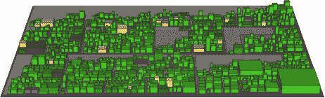

软件城市中的每座建筑代表一个源文件。源文件按模块和包或命名空间分组在一起。建筑物的占地面积与 `Lines of Code` 中的文件大小成正比。每座建筑的高度源于文件的平均复杂度；阴影由其过去 90 天的更改频率决定。例如，高大且颜色较暗的建筑将是重构的良好候选。看看 图 9-9 左侧较暗的建筑。它并不很高，但按 `Lines of Code` 计算是第三大文件——这从可视化中相对容易看出。较暗的颜色表示频繁更改。事实证明，相关文件包含类 `StorageManager`，显然对于非 SQL 数据库来说是一个重要的类。

这种可视化的好处是你可以在此组合任意的指标对：例如，建筑物的高度可以对应传入依赖的数量，而颜色由复杂度决定。这使你能够以很少的努力进行复杂的分析。

## 其他有用指标

还有两个我发现有用的指标，但它们超出了耦合和复杂度指标的范畴。

### 组件排名

`Component Rank` 指标基于 Google 的 `Page Rank` 指标。`Page Rank` 设计用于在互联网上查找热门页面，而 `Component Rank` 使用相同的算法在你的系统中查找“热门”类。`Page Rank` 算法首先选择一个随机页面。然后，以可配置的概率（默认为 80%），它会跟随一个随机的传出链接到另一个页面。对于最终页面，算法停止并增加计数器。其目标是计算每个页面成为最终页面的概率。这是通过反复运行算法直到每个页面的概率数字稳定下来来实现的。

相同的算法可以应用于类或源文件。不是使用链接，而是使用传出依赖关系。现在，你可能会问自己：为什么这会是有用的信息？好吧，假设你对一个项目不熟悉，并且必须接管一个复杂的模块以添加新功能。你从未见过代码。你从哪里开始阅读？一个好主意是从 `Component Rank` 最高的类开始。因为许多其他类引用它们，所以你很可能必须先理解它们。

图 9-10 计算图中每个节点成为访问会话中最终节点的概率，其中会话从随机节点开始，然后以 80% 的概率跟随随机链接，以 20% 的概率结束会话。

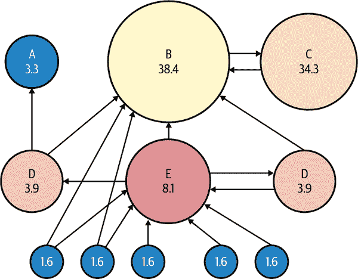

## LCOM4

`LCOM` 代表 `Lack of Cohesion of Methods`，而数字表示该指标的第四个版本。该指标的目的是判断一个类是否违反了 [单一职责原则](https://oreil.ly/Uq3A3)。它通过为类中的所有方法（除构造函数、重写或静态方法外）以及类中的所有字段（除静态字段外）创建依赖图来实现。该指标的值是彼此之间没有任何连接的子图（称为 *连通分量*）的数量。在理想情况下，所有类的该值都应为 1。如果值大于 1，则可以轻松地将该类拆分为几个较小的类。

在 图 9-11 中，该类中有两个连通分量，一个由 `x`、`f` 和 `g` 组成，另一个由 `h` 和 `y` 组成。这意味着我们可以轻松地将该类拆分为两个不同的类，一个由 `f`、`g` 和 `x` 组成，另一个由 `h` 和 `y` 组成。

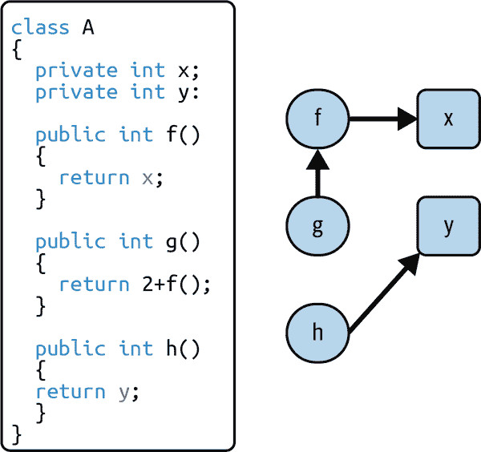

需要注意的是，当一个类调用或访问超类的方法或字段时，该指标通常会失效。它在类层次结构中效果不佳。另一方面，如果一个类不属于复杂的层次结构，该指标在查找同时做太多事情从而违反单一职责原则的类方面效果相当好。

# 架构适应性函数

架构适应性函数首次在 Neal Ford、Rebecca Parsons 和 Patrick Kua 所著的书籍 *构建演进式架构* 中引入。他们将架构适应性函数定义为“提供对某些架构特征的客观完整性评估”。^(5)（参见本书第 2 章和第 8 章。）

架构特征，也称为“-ilities”，是你希望通过架构实现的目标，例如稳定性、可扩展性、可维护性和敏捷性。适应性函数衡量你的架构在实现这些特征中的一个或多个方面做得如何。例如，你可以使用生产数据（如同时用户数和平均响应时间）来衡量可扩展性，或者可以使用 `Relative Cyclicity` 和 `Maintainability Level` 来衡量代码的可维护性。

软件架构师最重要的任务之一是做出权衡。如果不将复杂性增加到无法管理的程度，就无法在同一个软件系统中拥有所有理想的特征。因此，你必须优先考虑期望的特征，使其最好地反映业务目标，同时不增加不必要的复杂性。更糟糕的是，其中一些特征无法同时满足。例如，最大性能和最大安全性是相互矛盾的目标，因为安全性需要加密，而加密会消耗大量 CPU 功率。你必须在这两者之间找到合适的平衡。

最后，我建议最多优先考虑三个特征外加可维护性。可维护性不重要的用例非常少。使用适当的适应性函数衡量这些特征中的每一个。

你可以使用本章讨论的一些指标作为适应性函数来衡量可维护性，其中包括可理解性，例如：

* `Maintainability Level` 阈值为 75% 或更高
* 在包/命名空间和组件级别的 `Relative Cyclicity`，组件的阈值为 4% 或更低，包/命名空间为 0%
* 组件的 `Structural Debt Index`，阈值在 100 多的低位

你可以使用复杂性指标来确定源文件中被视为复杂的百分比。例如，你可以将平均缩进超过 3、或平均复杂度超过 10、或大小超过 800 `Lines of Code` 的每个文件定义为复杂文件。然后你可以将复杂文件的 `Lines of Code` 相加，并将其与系统中 `Lines of Code` 的总数进行比较。你可能会决定不希望代码的复杂部分超过 10%。

正如你所见，指标在正确使用时可以成为强大的工具。你可以利用对指标的了解并将其中几个结合起来形成有用的适应性函数。在 CI 构建中检查你的适应性函数，并在适应性函数目标被违反时中断构建，是确保你的系统永远不会变成令人恐惧的大泥球的强大方法。

# 如何随时间跟踪指标

要实现基于指标的反馈循环，你需要能够随时间跟踪指标。最好的做法是在自动化构建中每天收集一次指标，并将其输入到跟踪这些指标的工具中。

一旦拥有这些趋势数据，你就可以将其渲染为图表。图 9-12 例如，显示了过去 90 天内指标 `Lines of Code` 的增长情况。我建议跟踪所有适应性函数，并混合一些耦合和大小指标。拥有关键指标的图表可以让你及早发现有害趋势，以便在情况变得太糟之前做出反应。当然，你可以通过在适应性函数上设置一些硬阈值来实现同样的效果，但通常能够看到指标随时间的变化是有用的。（硬阈值在被违反时会中断构建。另一方面，软阈值在被违反时只会发出警告。）

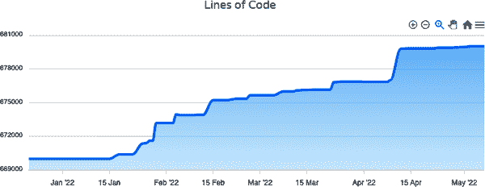

你有几种工具选项，其中一些是免费的。[SonarQube](http://sonarqube.org) 对某些语言免费，但指标选择有限。使用 Sonargraph SonarQube 插件可获得额外的指标。你可以使用 [Jenkins](http://jenkins.io) 与 Sonargraph-Explorer（免费）；它提供良好的指标选择但图表有限。Sonargraph-Enterprise 随 Sonargraph 的商业团队许可证提供。它具有良好的指标选择和灵活、可定制的图表。最后，当然，只要你有良好的数据源，构建自己的解决方案并不太难。

# 构建更好软件的几条黄金法则

我现在将与你分享我的黄金法则，以遏制结构侵蚀并确保你的软件具有模块化、可维护的设计。如果你开始一个新项目，从一开始就采用这些规则，你的软件将比 90% 的同等规模和复杂度的其他项目更好。如果你从现有代码库开始，首要目标是止住失血——也就是说，确保情况不会变得更糟。然后你可以设定每月或每季度的目标，将违规数量减少几个百分点。随着时间的推移，这会累积起来，并显著改善代码库的可维护性和可理解性。

现在是我的推荐规则：

* 拥有正式且可执行的架构模型，定义软件的不同部分以及它们之间允许的依赖关系。
该规则基本上是对控制和最小化耦合需求的逻辑结论，正如我深入讨论过的那样。拥有这样的模型可以为开发者提供更多上下文，并以可执行的方式阐明系统的架构设计。
* 避免在命名空间/包级别出现循环依赖。

* 在源文件/类级别限制循环依赖。任何包含超过五个元素的循环组都有很大可能变成代码癌症并进一步增长，直到变得非常难以理清混乱。如果可以，请避免即使是小的循环组。
* 避免代码重复（复制粘贴式编程）。我之前没有提到这一点，因为本章侧重于指标，但复制粘贴编程是一种典型的[代码坏味道](https://oreil.ly/xUtfn)。有时，复制代码可用于打破否则难以打破的循环，但我认为那是一种罕见的边缘情况。
* 将源文件的大小限制为 800 `LoC`（作为软阈值）。
* 将最大缩进限制为 4，`Modified Cyclomatic Complexity` 限制为 15（作为软阈值）。

所有这些规则都可以使用你在本章学到的内容来实现。实现它们的最佳方式是基于工具的方法，在 CI 构建中自动验证这些规则。跨组织实施这些规则也是一个好主意，这样所有开发人员都能熟悉它们。这样做几乎可以保证更好的可维护性、更好的代码质量，从而大幅提高开发人员生产力。我曾与多位客户合作实施这种基于规则的方法，可以确认它会随着时间的推移产生相当令人印象深刻的改进。

# 结论

你在本章学习了一些有用的指标，以及基于指标的反馈循环的概念。而且你现在知道结构性技术债务（或架构债务）会严重损害开发团队的生产力。

到现在为止，应该很清楚指标是一种强大的工具，可以帮助你及早发现有害趋势，确保你的软件项目永远不会变成一团乱麻。当然，为此你需要使用工具，其中一些甚至是免费的。如果你还不准备在更大范围内使用指标，我强烈建议专注于避免或至少限制代码库中的循环依赖。仅此一点就能阻止结构侵蚀的最坏副作用，并使你在今后更容易采用更严格的规则。

^(1) 不幸的是，截至 2022 年初，Sonargraph-Explorer 仅支持 Java、C# 和 Python。对于其他语言，你可能被迫自己编写工具或依赖商业解决方案。

^(2) 首先由 Carliss Baldwin、John Rusnak 和 Alan MacCormack 在“探索复杂软件设计的结构：开源与专有代码的实证研究”中描述，*Management Science* 52, 第 7 期 (2006): 1015–1030。

^(3) Ran Mo 等，[“解耦程度：架构维护复杂性的一个新指标，”](https://oreil.ly/3zsqS) ICSE ’16，2016 年 5 月 14–22 日，奥斯汀，TX。

^(4) “PageRank”，*Wikipedia*，最后更新于 2022 年 4 月 9 日，*https://oreil.ly/vrdFb*。

^(5) Neal Ford、Rebecca Parsons 和 Patrick Kua，“第 2 章：适应度函数”，载于 *Building Evolutionary Architectures*。
