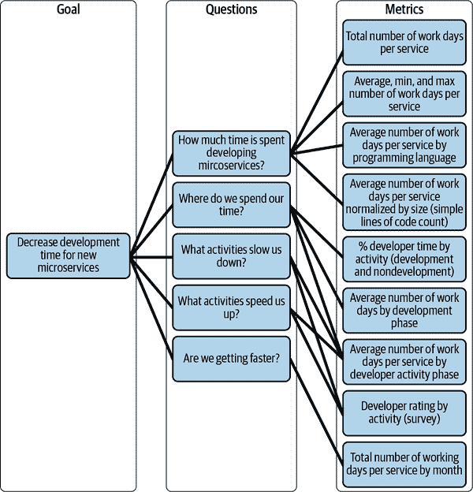
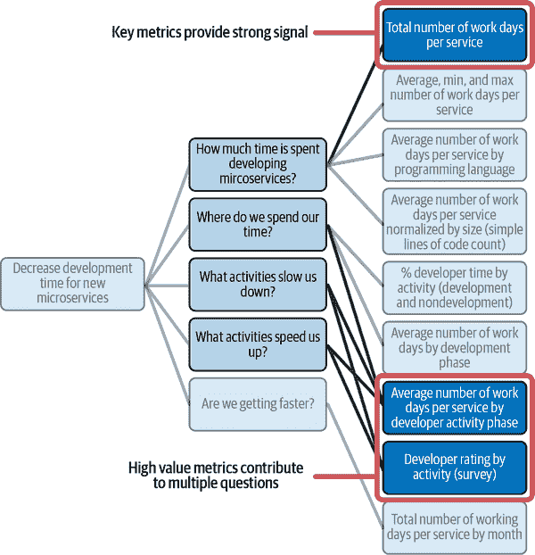
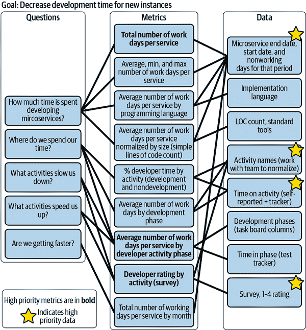
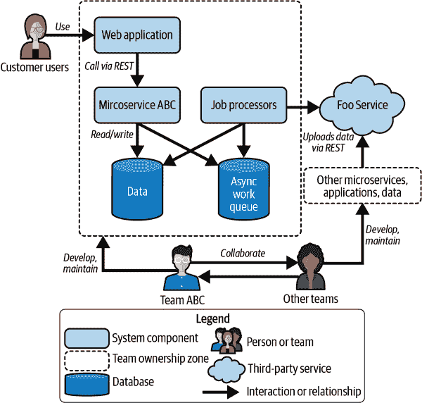
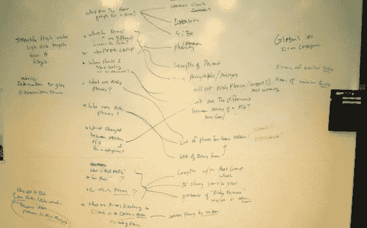

# 第 10 章. 使用目标-问题-度量方法衡量未知

Michael Keeling

在软件中，就像在生活中一样，最重要的事情往往是最具挑战性的衡量对象。系统中存在多少技术债务，应该在何处投资？已实现的架构在多大程度上满足了最重要的质量属性？团队的设计成熟度进展如何？对于这类大问题，很容易基于直觉做出猜测，而直觉可能存在偏见且不可靠。最好使用数据。当我需要为这类棘手、难以回答的问题定义指标时，我会转向目标-问题-度量（GQM）方法。

GQM 方法是一种分析技术，由 Victor Basili 和 David Weiss [提出](https://oreil.ly/SMvwj)，帮助团队弄清如何在软件开发中衡量和评估棘手问题。^(1) 该技术易于学习且直接应用。它可以单独使用，也可以作为协作研讨会的一部分。发现用于评估困难问题的正确指标仍然需要创造力和分析思维，但 GQM 提供了足够的结构来推动团队取得更好的成果。

在本章中，你将学习如何使用 GQM 方法并主持以 GQM 为核心的协作研讨会。你还将看到一个案例研究，介绍一个软件开发团队如何使用 GQM 评估和改进其架构中的差距。读完本章后，你将知道将 GQM 应用于团队所需的一切。

## 目标-问题-度量方法

GQM 背后的核心假设很简单：要很好地衡量某件事，你必须了解为什么要衡量它。理解 *why*——你想要实现的目标以及评估进展所需回答的问题——使你能够识别和选择最适合工作的指标。理解指标背后 *why* 的团队更有可能使用并信任这些指标来指导未来的决策。GQM 帮助我们将目标从关于我们欲望的模糊陈述转变为可量化、可验证的模型。

GQM 模型是分层的。如果将其想象成一棵树，目标位于根部。从目标出发，树分支到问题，然后再次分支到用于回答这些问题的指标。叶子是用于计算指标的数据。通过这种方式，GQM 创造了可追溯性：你可以从任何单个叶子（正在收集的数据）追溯到根部（收集数据的最初目的）。

### 创建 GQM 树

在 GQM 中，*goal* 是一个简单的陈述，描述你想要理解和衡量的事物。理想的目标陈述描述了目的、要衡量的对象、感兴趣的问题或主题，以及你考虑目标的观点。

以下是一些关注软件架构问题的目标示例：

* 从用户角度提高系统可用性。
* 从产品经理的角度减少新微服务的开发时间。
* 从软件开发人员角度减少架构中的技术债务。
* 减少发布到生产环境中的错误数量。
* 在用户之前检测到生产环境中更多的问题。
* 从用户角度提高机器学习模型的准确性。
* 从开发团队角度在架构中做出更好的设计决策。

在流程开始时提供目标至关重要。目标通过将注意力集中在特定的一组度量上来确立概念方向。目标可以关注任何感兴趣的对象，包括架构元素、软件开发流程、技术实验、设计工件，甚至团队和组织。定义要评估的对象使要衡量的内容与你需要衡量的原因保持一致。

目标通常会在分析过程中被修订，因为你对所衡量内容的理解会不断提高。即使是不完美的目标陈述，只要能抓住需要衡量的本质，也是有用的。

一旦你定义了目标，你就可以提出 *questions* 来探索和描述它。问题应具有操作性，并帮助你评估相对于目标的进展：你是在靠近还是远离目标？

好的问题可以阐明问题以及解决这些问题的潜在下一步。提出好问题需要好奇心。你必须愿意暂时放下实际问题，提出需要被提出的问题，即使你现在不确定如何回答。

以下是一些示例问题，可帮助评估从用户角度提高系统可用性的目标：

*   我们当前的可用性如何？
*   哪些组件或服务的可用性最好？最差的呢？
*   哪些组件或服务宕机的次数最多？
*   为什么组件或服务会变得不可用？
*   典型的停机时间有多长？
*   停机发生在什么时候？

要回答每个问题，你将定义一个或多个 *指标*。指标可以有多种形式，包括简单的评分标准、布尔值（是/否、真/假）、统计推断以及各种复杂度的方程。你计划使用的任何指标最终都需要一个清晰且精确的定义。每个指标至少与一个问题相关联。相同的指标有时可以用来回答多个问题。你可能需要多个指标来回答单个问题。

综合起来，你可以创建一个 GQM 树，如 图 10-1 所示。

我喜欢这种方法的一点是名称说明了一切：它只有三个步骤。识别一个 *目标*。列举用于评估目标的 *问题*。定义有助于回答问题的 *指标*。

嗯，名称 *几乎* 说明了一切。在定义指标之后，你必须决定如何收集计算它们所需的数据。

## 优先考虑指标并制定数据收集策略

仅仅知道你 *可以* 如何衡量目标是不够的。你还必须规划你 *将* 如何衡量它。如果你很好地头脑风暴了问题和指标，你的 GQM 树应该有几个分支。实际上，并非所有指标都能提供强信号；有些指标计算起来不切实际或成本高昂。在决定如何收集数据之前，稍微修剪一下你的 GQM 树是个好主意。

最好专注于提供强信号且计算成本低廉的指标。首先确定提供最强信号的关键指标。接下来，寻找任何可用于回答多个问题的指标。如果某些问题由多个指标回答，请仔细考虑是否需要所有指标。请记住，同时包含正向和负向指标是有用的——指示成功和指示失败的指标——以保持诚实。

接下来，考虑计算指标所需的数据。如果你尚未精确定义指标，现在就这样做。将 GQM 树扩展（如 图 10-2 所示），以可视化数据将被使用的地方。数据帮助计算的指标越多，该数据就越有价值。图 10-3 显示了一个扩展的 GQM 树，将数据与指标连接起来。能够为高价值指标提供数据且收集成本低廉的数据应为你的首要优先事项。

数据可以来自许多来源，具体取决于你正在衡量的内容。你可能需要对代码进行仪器化以记录必要的数据。关于开发流程或方法的数据可能来自调查或从任务数据库中收集。数据 *关于* 代码可以从源代码仓库中获取或使用静态分析工具提取。对于短期的快速实验，有时最简单且最便宜的方法是手动收集几天的数据。重要的是，你知道将从哪里获取计算指标所需的数据。

此时，你已拥有足够的信息来制定收集数据和计算指标的具体计划。根据目标，可能不需要计算所有指标或回答所有问题。决定你需要做的工作，例如记录和收集数据、计算指标以及构建仪表板。与团队和任何其他利益相关者分享计划，然后付诸行动。

# 案例研究：学会预见未来的团队

现在你已经了解了 GQM 方法背后的基本思想，让我们探索一个具体的案例研究，以展示如何在实践中使用它。

在本案例研究中，你将阅读一个开发团队面临的一对服务中断的故事。在对第一次事件进行事后分析期间，团队使用 GQM 识别出本可以让他们更早了解事件的指标。他们通过改进运营可见性并对架构进行重要更改做出回应。九个月后，当类似问题再次发生时，这些指标接受了考验。这一次，由于他们所做的更改，团队在用户之前就了解了问题，并轻松地将本可能成为重大停机的事件转变为短暂的不便。

## 系统上下文

本案例研究中的系统依赖第三方服务进行某些数据操作。其中一些第三方服务会施加 API 速率限制。架构使用队列来确保数据最终由第三方服务处理，并管理对这些服务的请求量。技术对于这个故事来说不如架构模式重要。图 10-4 显示了架构相关部分的上下文图。

在这个系统中，我称之为 Foo Service（并非其真实名称）的重要第三方服务施加了许可协议中定义的 API 请求限制。当发往 Foo Service 的请求数量超过许可协议中定义的阈值时，Foo Service 会拒绝请求并返回“速率限制超出”响应。后续请求将继续被拒绝，直到计算出的速率降至约定阈值以下。既有每小时速率限制，也有每日速率限制。请求大小和 Foo Service 使用的总计算负载也有限制。

异步工作队列是架构的重要组成部分。除了管理与第三方服务（如 Foo Service）的交互外，它们还驱动工作流程并管理其他数据分析。当队列变得过大时，内部用户可能会受到负面影响。队列被设计为具有弹性，例如，通过对某些类型的请求失败重试向第三方服务的请求。当出现临时中断时，只要队列和工作进程保持运行，系统最终就会达到正确且一致的状态。自校正是重要的系统属性，尤其是在 Foo Service 的情况下，因为很容易超出速率限制，但限制会快速重置。

## 事件 #1：向 Foo Service 发出太多请求

在某个星期一凌晨时分，Foo Service 开始因 API 速率限制超出而拒绝请求。由于 Foo Service 的速率限制是整个软件系统的共享预算，这同时影响了多个组件。几小时内，每个作业在工作队列中等待处理的时间急剧增加，用户开始感受到影响。

团队很快识别出问题。每个周末，都会有一批大量数据上传到 Foo Service，以便在星期一早上可供内部用户使用。存储解决方案中的故障，加上该批处理操作中的错误，造成了批处理操作积极重试向 Foo Service 的 API 请求的情况，最终超出速率限制。停止失控的批处理操作使系统能够缓慢恢复。一旦团队修复了存储解决方案，批处理操作就成功完成。

在本次事件的事后分析期间，开发团队决定修复批处理操作中的错误是一个明显且重要的行动项目。他们质疑：他们能否更早发现与 Foo Service 通信的问题？是否可能看到潜在事件逼近并在用户受影响前修复它？为回答这些问题，团队转向了 GQM。

### 失败是什么样的？

如果团队能更早被告知问题，他们或许能够更早响应并避免影响用户。团队需要想办法更好地识别潜在的故障场景，以便更早应对潜在的停机。

他们的目标很简单：在涉及 Foo Service 的问题影响用户之前更早发现并缓解或解决这些问题。理想情况下，用户会认为工程团队是由能预见未来的全能魔法师组成的。

带着这个目标，团队头脑风暴了有助于实现目标的问题和指标——这始终是一个混乱的过程。 随着他们对预见 Foo Service 故障的真正含义有了更深入的理解，问题和指标不断变化和演进。 他们使用共享文档收集问题，花了大约半小时反复迭代并对想法进行发挥。

表 10-1 总结了团队发现的内容。

表 10-1. 指标头脑风暴总结文档

| 目标：使用 Foo Service 发现问题，以便工程团队在问题影响用户之前缓解或解决它们。  |

| --- |

| 问题 || 指标 |

| 当前 Foo Service API 使用量是多少？ || 按 Foo Service 报告的 API 使用量 |

| --- | --- |

| 我们距离超出 Foo Service 速率限制还有多远？ || 剩余 API 调用次数（可用总配额 - 已报告使用量） |

| 所有组件剩余的 API 配额百分比（已报告使用量/总配额） |

| 每个组件剩余的 API 配额百分比（组件跟踪使用量/组件分配配额） |

| Foo Service 出问题了，还是我们连接 Foo Service 出问题了？ || 心跳成功（`Boolean` 指标，带容错以处理瞬时波动） |

| 合成流量按预期同步到 Foo 服务（`Boolean` 指标） |

| 15 分钟窗口内的超时请求百分比 |

| 15 分钟窗口内的认证错误请求百分比 |

| 作业是否按预期工作？ || 总请求数 |

| 正常、错误和超时响应的计数 |

| 15 分钟窗口内的错误响应百分比 |

| 我们能否跟上请求负载？ || 作业队列深度（待处理和进行中作业的计数） |

| 随时间推移的平均队列深度 |

| 平均、`p99`、`p95` 作业处理时间 |

| 平均作业吞吐量（作业数/时间） |

现在团队明白了需要哪些指标来发现 Foo Service 中的问题，他们将注意力转向了数据收集。 在此阶段，他们发现了架构中的一些缺陷。 首先，只有在系统负载下才会记录数据。 其次，架构中未明确分配处理失败和重试的责任。 第三，团队成员不确定如何应对问题。

## 操作可见性和架构改进

第一个问题直接与系统用于收集数据的仪器化方式有关。 没有流量，就不会有请求发送到 Foo Service。 没有请求，就无法知道 Foo Service 是否按预期工作。 如果在没人需要时 Foo Service 宕机也不会造成伤害，但团队希望有提前告知用户潜在问题的选择。 显然，团队无法修复 Foo Service，但他们可以利用这些信息预见其他在其控制范围内的潜在系统故障。

为了填补这个数据收集漏洞，团队在架构中引入了一个新的心跳组件来检查 Foo Service 的可用性。 幸运的是，Foo Service 提供了一个计量 API，以便客户检查当前的 API 使用情况并确认 Foo Service 可访问。 计量 API 提供的额外信息使管理整体 API 预算变得更容易。

接下来，团队通过将处理失败的责任分配给工作队列而不是作业来明确架构设计。 之前的设计将此决定留待开放。 因此，一些作业曾尝试重试对 Foo Service 的失败请求，这进一步加剧了事件的影响。

在停机事件期间，尝试自行恢复操作的作业运行时间更长。 这些作业最终会失败并再次进入队列以便稍后重试，这只会增加队列拥塞。 因此，随着时间的推移，发送到 Foo Service 的请求数量急剧增加。 在最坏的情况下，一些作业对 Foo Service 进行了 5 次失败尝试，并在永久失败前重试了 10 次，导致总共 50 次 API 请求！ 团队决定作业应快速失败，然后记录了一份 *架构决策记录*（ADR）来描述这一决定。

手握指标后，团队拥有形成明确行动计划所需的构建模块。 他们添加了警报，以便能够自动监控生产环境中已识别的指标。 对于每个指标，他们都编写了运行手册，以便每个人都知道如何应对潜在问题。 每个运行手册都引用了指标，以便更轻松地诊断问题并消除误报。 他们还创建了工具并添加了诊断 API 以协助恢复工作。

## 事件 #2：预见未来

团队中的一些成员质疑所有这些工作是否必要：毕竟，他们已经解决了根本原因。 大约九个月后，他们发现自己的指标和架构变更有多么宝贵。

在一个星期五凌晨的时分，一名 Foo Service 开发者部署了一项配置更改，导致系统完全中断。 在接下来的 14 小时里，Foo Service 完全不可用。

这次，团队已做好准备。 在 Foo Service 全球不可用后的 10 分钟内，他们收到了基于其中一个已识别指标的警报。 借助他们新的诊断 API，他们迅速确认问题出在 Foo Service 而不是他们能控制的事情上。 他们禁用了一些警报并监控指标，以 double-check 作业失败是否按 ADR 中所述使用指数退避进行重试。 一切按计划进行。

在工作日开始后不久，在任何用户注意到问题之前，团队发送了电子邮件告知内部用户该问题。 九个月前本会是关键的零优先级问题，现在已成为几乎不值得注意的事件（至少对这个团队而言！）。 当 Foo Service 恢复在线后，系统按设计自动纠正，团队在接下来的几个小时里监控系统指标，直至一切恢复正常。

## 反思

在本案例研究中，你看到了一个团队如何使用 GQM 方法来指导系统设计变更，从而更有效地应对一次重大系统中断。 团队在该过程中识别的指标成为其运营可见性和事件响应策略的关键部分。 此外，策略。 正如你所见，GQM 不仅可用于突出这些弱点，还可展示通往更好软件系统的路径。

# 运行 GQM 工作坊

GQM 是分析棘手问题的绝佳工具，可单独或在小团体中使用。 它也可以用作结构化、协作式的工作坊，让不同背景的利益相关者都能贡献意见。^(2) 在本节中，你将学习运行 GQM 工作坊的基础知识。

## 工作坊摘要

The goal of the workshop is to build consensus and shared ownership over metrics and data to be computed and collected for a particular purpose. By the end of the workshop, all participants should understand why particular metrics are necessary and how those metrics will be calculated.

## 益处
This workshop builds confidence in metrics and data collection plans by emphasizing stakeholder goals as the basis for measurement. Inviting stakeholder participation creates stronger buy-in for the eventual metrics and data collection plan and can lead to more thorough analysis.

The workshop itself is a chance to demonstrate the use of structured analysis to the group. Participants who have a positive experience often find opportunities to apply GQM in other situations.

## 参与者
Both technical and nontechnical stakeholders may participate in the workshop. Depending on the goal, nontechnical stakeholders may be *required*. For example, if the workshop will explore a goal focused on a particular business process, a subject-matter expert should participate. Likewise, if the goal will pertain to a product launch, then product management, marketing, design, and sales stakeholders should participate. At least one software developer should always participate.

This workshop works best in small groups of two to five people, but you can facilitate it with larger groups using breakout sessions. Don’t forget, GQM is also a great analysis technique to use by yourself!

## 准备工作和材料
Before the workshop, create a draft goal statement to be used to start the workshop. Knowing the goal to be explored also helps decide whether the right participants are invited.

If you and the workshop participants are on-site, all you need is a large whiteboard and whiteboard markers. Sticky notes are optional but can be used for brainstorming questions and metrics.

For a distributed, remote workshop, a virtual whiteboard (such as Miro) is preferable, but any shared document that all participants can edit (such as Google Docs or Dropbox Paper) can also work. In a pinch, simple screensharing can also work, but this makes it more difficult for stakeholders to participate.

## 成果
By the end of the workshop, you should have:
*   A goal phrase accepted by all stakeholders
*   A list of questions that characterize the goal
*   A prioritized list of metrics, with references to the questions they help answer
*   Metrics definitions (formal or informal)
*   A list of data necessary to compute the metrics

## 工作坊步骤
The following are general steps you can use to run the workshop:
1.  Start by introducing the workshop and sharing ground rules. For example, “Today we’re going to work together to define metrics needed to assess the upcoming product launch. Remember to please treat each other with kindness, consideration, and respect throughout the workshop.”
2.  Write down the goal statement so everyone can see it. If using a physical whiteboard, leave plenty of space to add questions and metrics.
3.  Invite participants to provide questions: “What questions would you need to answer to know whether we’ve met this goal?” Gather questions until you run out of time or the group stalls.
4.  Pick a question and invite the group to brainstorm metrics that would answer it. Capture metrics so everyone can see them. Draw a line from the metric to all questions that metric can answer. Remember, this is brainstorming. Encourage participants to get creative and not worry yet about how to compute the metric or collect the data. Continue to gather metrics until you run out of time or the group stalls.
5.  Once every question has at least one metric, go back to the goal and perform a sanity check. Do these metrics help evaluate this goal? Does the goal need to be rephrased? Are there new goals that should also be considered? Refine the goal statement if necessary.
6.  Identify the data needed to compute each metric. It may also be necessary to define metrics more precisely.
7.  Prioritize the metrics. There are several ways to do this. Common approaches include identifying “must-have” metrics, looking for “big bang for the buck” metrics that answer more than one question, dot voting, and sorting by value/effort. (You only need one prioritization technique.)
8.  Open the floor for final reflection and observations. Were there any surprises? Is there consensus about the most important metrics? Are there metrics that look problematic or costly?
9.  After the workshop, record the outcomes and share them with all participants. As homework, if necessary, prepare a report that describes the group’s findings.

## 引导指南和提示
Here are some guidelines and hints for facilitating the workshop:
*   When generating questions and metrics, participants can use sticky notes for brainstorming, one question per note. Once the brainstorming has concluded, ask a participant to read the sticky notes out loud. Cluster them and remove duplicates before moving on.
*   Identifying metrics can be tricky! If the group seems stuck, encourage “out-of-the-box” thinking by saying something like, “Let’s not worry yet about how we’ll get the data. Once we know what metrics we need, we can figure out how to compute them.”
*   Look for opportunities to reuse metrics or data. Metrics can be used to answer multiple questions, and the same data might compute multiple metrics.
*   For system-focused questions, the architecture will likely influence your ability to collect data. Someone knowledgeable about the architecture should participate in the workshop to help assess the cost of data collection.
*   Don’t forget to take a picture of the GQM tree! This is a quick and easy way to share the essence of the GQM analysis.

### 示例
You’ve already seen a few examples of GQM trees, goals, questions, and metrics throughout this chapter. 图 10-5 shows the GQM tree created during a colocated GQM workshop. The goal of this workshop was to identify analytics that could be used to flag records for fraud investigation. Notice that that GQM tree at this stage was fairly messy!

After the workshop, the facilitator prepared a written summary that precisely defined the metrics discussed. Stakeholders prioritized the metrics in a follow-up meeting. In this case, data collection and metrics computation were key system requirements that fed directly into the architecture design and project scope.

# 结论
In my first job after university, I joined a talented team responsible for assessing a complex, distributed, real-time, safety-critical system. We collected and used a ton of metrics during that assessment. Our team leader had a saying: “A metric by itself can only tell you something is wrong. It can’t tell you what to do about it.” GQM provides the necessary context for deciphering metrics in practice.

As a software architect, I am often in the best position to help teams measure what matters most to them, especially in situations when they know the least about what needs to be measured. From one week to the next, I might find myself contributing to strategic planning, crafting objectives and key results (OKRs), preparing for a product launch, assessing a software component’s quality, deciding what to do about technical debt, or helping teams design and measure a system architecture that achieves particular quality attributes.

GQM is a go-to method in my toolbox. It’s useful as an analysis tool by itself, a coaching tool for teams, and a workshop tool to create alignment among stakeholders. Whether the intent is to document metrics or simply to facilitate a discussion about measurement and data collection, GQM can help. Start with the goal. Ask questions that allow you to assess the goal. Brainstorm metrics that allow you to answer those questions.

很容易为你深入理解的事物发现好的指标，但最有用的指标能帮助你衡量尚未完全理解的事物。当然，我们不理解的事物也最难以衡量。GQM 可以帮助你在这片浑水中航行。

^(1) V. R. Basili 和 D. M. Weiss，“一种收集有效软件工程数据的方法”，载于 *IEEE 软件工程汇刊* SE-10, 第 6 期 (1984 年 11 月): 728–738, doi: 10.1109/TSE.1984.5010301.

^(2) 参见我的著作 *设计它！从程序员到软件架构师* (Pragmatic Bookshelf, 2017)。

# 索引

## 符号
* 4 个插桩点（参见四个插桩点）
* 4 个关键指标（参见四个关键指标）
* 四个九，测量可用性时的常见问题
* 软件设计的 5 个关键属性，可持续变革的工具
  * 可测试性与，可测试性：创建高质量系统
* 五个九，测量可用性时的常见问题

## A
* 抽象或信息隐藏，可持续变革的工具
  * 可测试性，可测试性：创建高质量系统
* Accelerate (Forsgren, Humble 和 Kim)
  * 关于讨论，释放四个关键指标
    * 支撑本书的心智模型，定义与插桩
  * 四个指标，以指标指导的软件架构意图增强
* 偶然复杂性，YourFinFreedom 打破单体，实现分布式的大泥球
* ADRs（架构决策记录），讨论与理解
* 敏捷运动与自动化，关键术语
* Agile Software Development, Principles, Patterns, and Practices (Martin)，循环依赖的有毒性
* Apache Cassandra 项目周期组，熵杀死软件
  * 可维护性等级值，可维护性等级
  * Sonargraph-Architect 可视化，使用版本控制指标寻找重构的良好候选者
* 应用运行时测量，应用程序和基础设施的运行时测量
  * 应用性能管理（APM），应用程序和基础设施的运行时测量
* 架构决策记录（ADRs），讨论与理解
* 架构特性，通往适应性函数的路径，架构适应性函数
  * （另见质量属性）
  * 复合架构特性，通往适应性函数的路径
* 架构适应性函数，通往适应性函数的路径-通往适应性函数的路径
  * 关于，通往适应性函数的路径，架构适应性函数
    * 检查清单，结论
    * 术语定义，通往适应性函数的路径
  * 适应性函数中的架构测试，适应性函数与指标
    * 指标类型，指标类型
  * 自动化使指标运作化，自动化使指标运作化
  * 案例研究
    * 耦合，案例研究：耦合-案例研究：耦合
    * 保真度适应性函数，案例研究：保真度适应性函数
    * 零日安全检查，案例研究：零日安全检查
  * 治理，架构适应性函数-架构适应性函数
  * 通过多种工具实现，通往适应性函数的路径
  * 指标成为适应性函数，从指标到工程-从指标到工程
    * 组件循环检查，从指标到工程
* 确定 MMI 的架构评审，确定 MMI 的架构评审-确定 MMI 的架构评审
* ArchUnit 工具，从指标到工程
  * 案例研究：耦合，案例研究：耦合
* 工件测量，向软件架构添加测量
* 指标的目标受众，目标受众
  * 适应性函数，目标受众是谁？
* 自动化
  * “有害”的活动，关键术语
  * CI 方法论，CI/CD，再次赋能本地环境
    * CI/CD 的持续交付，CI/CD
    * 本地环境被赋能，再次赋能本地环境
  * 数据收集，目标受众
  * 用于测量的适应性函数，适应性函数
  * 从指标到工程，从指标到工程
    * 自动化使指标运作化，自动化使指标运作化
  * 私有构建，私有构建
    * DevOps 文化，DevOps
  * 测试，可测试性：创建高质量系统
* 可用性
  * 关于，以指标指导的软件架构意图增强，可用性
    * 可用性百分比，测量可用性时的常见问题
  * 测量，可用性-测量可用性时的常见问题
    * 测量时的常见问题，测量可用性时的常见问题
    * 测量时的注意事项，测量可用性时的注意事项
* 平均组件依赖度（ACD），平均组件依赖度、传播成本及相关指标
* 平均圈复杂度，圈复杂度
* Azure DevOps (Microsoft)
  * 数据收集自动化，目标受众
  * 端到端流水线的收集，将流水线作为首选
  * 自制可视化，可视化-首页

## B
* Basili, Victor，用目标-问题-度量方法衡量未知

## B
* Bass, Len, 质量属性需求
* Beck, Kent, 自动化使指标可操作化
* Behr, Kevin, 将管道作为首要选择
* 大泥球, YourFinFreedom 打破单体
    * 分布式大泥球, YourFinFreedom 打破单体
        * 避免事件风暴, 从尽力而为到有意为之\-从尽力而为到有意为之
        * 实现, 实现分布式大泥球
    * 治理的敌人, 熵杀死软件, 指标如何提供帮助
* 全景事件风暴, 从尽力而为到有意为之\-从尽力而为到有意为之
* 使用 Docker、Kubernetes 和 Terraform 启动微服务（Davis）, 测试金字塔
* Box, George, 健身函数测试金字塔
* Brooks, Frederick P., Jr., YourFinFreedom 打破单体
* 缺陷
    * 案例研究：被阻碍的顾问, 案例研究：被阻碍的顾问
    * 在 QA 指标中发现的缺陷数量, 每次迭代中部署应用中可避免的集成问题
* 构建损坏，立即修复, 再次赋能本地环境
* 构建演进式架构（Ford、Parsons 和 Kua）
    * 架构健身函数, 通往健身函数的道路, 通往健身函数的道路, 架构健身函数\-架构健身函数
    * 自动化使指标可操作化, 自动化使指标可操作化
    * 健身函数与指标, 健身函数与指标, 开发你的健身函数和指标, 以指标指导提高软件架构的有意性
        * 健身函数类别, 健身函数类别介绍
        * 测试金字塔, 健身函数测试金字塔
    * 质量属性度量, 健身函数

## C
* CAB（变更咨询委员会）流程, 将管道作为首要选择
* 代码癌症, 熵杀死软件
    * 依赖倒置原则, 循环依赖的毒性
* 案例研究
    * 架构健身函数
        * 耦合, 案例研究：耦合\-案例研究：耦合
        * 保真度健身函数, 案例研究：保真度健身函数\-案例研究：保真度健身函数
        * 零日安全检查, 案例研究：零日安全检查
    * 全景事件风暴信息, 从尽力而为到有意为之
    * 指标演进, 用沟通管理期望
        * (另见组织扩展)
    * 目标-问题-指标方法, 案例研究：学会看见未来的团队\-反思
    * 度量, 假设案例研究\-假设案例研究
    * 私有构建
        * 被阻碍的顾问, 案例研究：被阻碍的顾问
        * 不稳定的主干, 案例研究：不稳定的主干\-缺陷 A4
    * 扩展组织（另见扩展组织）
* 变更失败率
    * 关于, 定义与仪器化
        * 四大关键指标, 四大关键指标 unleashed, 定义与仪器化
        * 服务中断与恢复, 重构你的心智模型
        * 服务稳定性, 定义与仪器化
    * 捕获与计算, 捕获与计算
    * 案例研究, 以指标指导提高软件架构的有意性\-以指标指导提高软件架构的有意性
    * 在仪表板上显示, 变更失败率
* 源文件的变更频率, 变更历史指标
* 变更咨询委员会（CAB）流程, 将管道作为首要选择
* 混沌工程, 顶层
* 清单宣言（Gawande）, 结论
* CI/CD（持续集成/持续交付）, CI/CD
    * 交付管道中的测试, CI/CD
* Ciceri, Christian, 前言
* Clements, Paul, 质量属性需求
* 代码癌症, 熵杀死软件
    * 依赖倒置原则, 循环依赖的毒性
* 代码 Churn 率, 代码 churn
* 代码复杂度指标, 健身函数与指标
* 认知负荷, YourFinFreedom 打破单体
* 内聚性, 可持续变革的工具
    * 模块化, 模块化
    * 可测试性, 可测试性：创建高质量系统
* 提交时间戳, 提交时间戳
* 沟通
    * 关于四大关键指标的讨论, 讨论与理解
    * 事件风暴, 从尽力而为到有意为之\-从尽力而为到有意为之
        * 指标指导, 以指标指导提高软件架构的有意性\-以指标指导提高软件架构的有意性
    * 期望管理, 用沟通管理期望, 学习与演进架构
    * 软件架构反映, 扩展组织：软件架构的核心作用
* 复杂性
    * 偶然复杂性, YourFinFreedom 打破单体, 实现分布式大泥球
    * 认知负荷, 学习与演进架构
    * 圈复杂度指标, 圈复杂度
    * 缩进债务指标, 缩进债务

* 代码行数指标，规模指标
  * 软件城市可视化，使用版本控制指标寻找重构的良好候选者
* 优先避免，架构适应性函数
* 组件循环检查，从度量到工程
* 组件排名指标，组件排名
* 复合架构特征，通向适应性函数的路径
* 上下文，以度量为指导提高软件架构的意图
  * 应用运行时测量，应用和基础设施的运行时测量
  * 适应性函数，适应性函数与度量
  * 度量依赖于上下文，学习与演进架构
    * 趋势有时更重要，学习与演进架构
  * 模式，模式一致性
* 持续反馈，什么触发测试执行？
* 持续架构，度量在软件架构中的作用
  * 用于度量，度量在软件架构中的作用
    * 添加度量，向软件架构添加度量-向软件架构添加度量
* 持续交付 (CD)，可部署性：扩展我们系统的开发
  * CI/CD，CI/CD
    * 交付管道中的测试，CI/CD
  * 持续架构，度量在软件架构中的作用
  * 持续交付与持续部署对比，CI/CD
* GitHub 的持续部署，案例研究：Fidelity 适应性函数
* 持续集成 (CI)
  * CI/CD，CI/CD
  * 根据 Fowler 的开发实践，CI/CD
  * 极限编程，自动化使度量操作化
* 持续集成（Duvall, Matyas, and Glover），私有构建
* Conway 定律，扩展组织：软件架构的核心作用
  * 示例，寻求方向
* Conway, Mel，扩展组织：软件架构的核心作用
* 耦合
  * 关于，可持续变革的工具
  * 案例研究，案例研究：耦合-案例研究：耦合
  * 循环依赖，从度量到工程，熵杀死软件
    * Apache Cassandra 项目，熵杀死软件
    * 循环组，熵杀死软件
    * 依赖倒置原则，循环依赖的有毒性
    * 有毒性，循环依赖的有毒性
  * 度量帮助，度量如何帮助，循环性与相对循环性
    * 有用度量，用于衡量耦合和结构侵蚀的度量-可维护性等级
  * 模块化，模块化
  * Sonargraph-Explorer 工具，度量如何帮助
  * 可测试性，可测试性：创建高质量系统
* DevOps 文化，DevOps
* 累积组件依赖 (CCD)，平均组件依赖、传播成本及相关度量
* Cunningham, Ward，技术债务
* 循环依赖，从度量到工程，熵杀死软件
  * 循环组，熵杀死软件
    * Apache Cassandra 项目，熵杀死软件
  * 依赖倒置原则，循环依赖的有毒性
  * 度量帮助，度量如何帮助，循环性与相对循环性
    * 有用度量，用于衡量耦合和结构侵蚀的度量-可维护性等级
  * Sonargraph-Explorer 工具，度量如何帮助
  * 有毒性，循环依赖的有毒性
* 循环性指标，循环性与相对循环性
* 圈复杂度指标，适应性函数与度量，圈复杂度

### D

* Davis, Ashley，测试金字塔
* Debois, Patrick，DevOps
* 解耦等级 (DL) 指标，可维护性等级
* 依赖关系（参见循环依赖）
* 依赖倒置原则，循环依赖的有毒性
* 依赖于指标，平均组件依赖、传播成本及相关度量
* 可部署性，可部署性：扩展我们系统的开发
* 部署频率指标
  * 关于，定义与仪器化
    * CI 管道，重构你的心智模型
    * 开发吞吐量，定义与仪器化
    * 四个关键指标，四项关键指标的释放，定义与仪器化
  * 捕获与计算，捕获与计算
  * 案例研究，以度量为指导提高软件架构的意图-以度量为指导提高软件架构的意图
  * 部署环，以度量为指导提高软件架构的意图
  * 在仪表板上显示，部署频率
  * 优缺点，以度量为指导提高软件架构的意图
* 部署管道，可部署性：扩展我们系统的开发
  * 范围，可部署性：扩展我们系统的开发
* 部署环，以度量为指导提高软件架构的意图
* 部署时间戳，部署时间戳
* 运行时测量的设计分析，设计分析
* 设计与架构债务，技术债务

### D
*   确定性, 可部署性：扩展我们的系统开发
*   开发流程指标, 指标\-私有构建的成本, 结论
    *   解释, 实践中的指标
*   开发吞吐量, 定义与仪器化
*   DevOps 转型生存
    *   关于, 私有构建与指标：DevOps 转型生存工具
        *   DevOps 定义, DevOps
    *   自动化
        *   令人“痛苦”的活动, 关键术语
        *   CI 方法论, CI/CD
        *   持续交付, CI/CD
        *   DevOps 文化, DevOps
        *   私有构建, 私有构建
    *   案例研究
        *   私有构建：受阻顾问, 案例研究：受阻顾问
        *   私有构建：不稳定主干, 案例研究：不稳定主干\-Bug A4
    *   关键术语
        *   CI/CD, CI/CD
        *   DevOps, DevOps
    *   开发流程指标, 指标\-私有构建的成本, 结论
        *   解释, 实践中的指标
    *   所有权转移, “所有权转移”
        *   本地环境获得授权, 再次赋能本地环境
    *   私有构建
        *   关于, 私有构建, 结论
        *   关于 DevOps, DevOps
        *   关于 DevOps 转型, 私有构建与指标：DevOps 转型生存工具
        *   自动化, 私有构建
        *   目标, 私有构建
        *   私有（个人）, 私有构建
    *   孤岛, DevOps
        *   所有权, “所有权转移”
        *   构建管道的所有权, 再次赋能本地环境
*   对四个关键指标的讨论, 讨论与理解
*   显示指标
    *   EventStorming, 从尽力而为到有意为之\-从尽力而为到有意为之
    *   自制可视化
        *   关于, 可视化
        *   变更失败率, 变更失败率
        *   部署频率, 部署频率
        *   首页, 首页
        *   变更前置时间, 变更前置时间
        *   服务恢复时间, 服务恢复时间
    *   软件城市可视化, 使用版本控制指标寻找重构的良好候选者
    *   目标受众, 目标受众
        *   适应性函数, 目标受众是谁？
    *   Wiki 页面, 显示与理解
*   分布式大泥球, YourFinFreedom 打破单体
    *   避免 EventStorming, 从尽力而为到有意为之\-从尽力而为到有意为之
    *   实现, 实现分布式大泥球
*   分布式系统可观测性（Sridharan）, 应用与基础设施的运行时测量
*   领域与架构特征对比, 通向适应性函数的路径
*   DORA DevOps 状态报告, 部署频率
*   Duvall, Paul M., 私有构建
### E
*   员工净推荐值®, 以指标指导提升软件架构的有意性
*   测试金字塔中的端到端（E2E）测试, 测试金字塔
*   基于指标的工程
    *   关于, 从指标到工程的进展
    *   架构适应性函数, 通向适应性函数的路径\-通向适应性函数的路径
        *   通过多种工具实现, 通向适应性函数的路径
        *   术语定义, 通向适应性函数的路径
    *   自动化实现指标, 自动化实现指标
    *   案例研究
        *   耦合, 案例研究：耦合\-案例研究：耦合
        *   保真度适应性函数, 案例研究：保真度适应性函数\-案例研究：保真度适应性函数
        *   零日安全检查, 案例研究：零日安全检查
    *   指标演变为适应性函数, 从指标到工程\-从指标到工程
        *   组件周期检查, 从指标到工程
*   Equifax 数据泄露案例研究, 案例研究：零日安全检查
*   EventStorming
    *   大图 EventStorming, 从尽力而为到有意为之\-从尽力而为到有意为之
    *   诱人知识, 以指标指导提升软件架构的有意性
    *   运营价值流的 KPI, 以指标指导提升软件架构的有意性
    *   指标指导, 以指标指导提升软件架构的有意性\-以指标指导提升软件架构的有意性
    *   流程建模 EventStorming, 以指标指导提升软件架构的有意性\-以指标指导提升软件架构的有意性
        *   在其中映射 KPI, 以指标指导提升软件架构的有意性
*   预期管理, 通过沟通管理期望, 学习与演进架构
*   扩展圈复杂度, 圈复杂度
*   外部测量, 向软件架构添加测量
*   极限编程（XP）自动化, 关键术语
    *   实现指标运营化, 自动化实现指标
### F
*   Farley, David, 前言

## 反馈
### 基于指标的反馈循环，使用指标的案例
#### 随时间跟踪指标，如何随时间跟踪指标
#### 为何未被更广泛使用，为何指标未被更广泛使用？
### 反馈时间指标，反馈时间

## 保真度适应度函数，案例研究：保真度适应度函数
### 案例研究，案例研究：保真度适应度函数-案例研究：保真度适应度函数
### Scientist 工具，案例研究：保真度适应度函数-案例研究：保真度适应度函数

## 文件变更频率指标，变更历史指标

## 适应度函数
### 关于，适应度函数测试金字塔：架构测试和指标的类比，适应度函数
#### 清单，结论
#### 定义，适应度函数和指标
### 架构适应度函数，通往适应度函数的路径-通往适应度函数的路径
#### （另见架构适应度函数）
### 原子适应度函数，反馈是原子的还是整体的？
### 案例研究，以指标为指导提高软件架构的意图性
### 类别或维度
#### 关于，适应度函数类别简介
#### 示例，示例及其完整分类-示例及其完整分类
#### 示例对顶层进行分类，完全对顶层示例进行分类-完全对顶层示例进行分类
#### 强制性，强制性适应度函数类别-质量属性要求，适应度函数类别：目录概览
#### 可选，可选适应度函数类别-适应度函数类别：目录概览
### 适应度函数的上下文，适应度函数和指标
### 持续适应度函数，什么触发测试执行？
### 开发，开发你的适应度函数和指标
### 示例，示例及其完整分类-示例及其完整分类
#### 示例对顶层进行分类，完全对顶层示例进行分类-完全对顶层示例进行分类
### 保真度适应度函数
#### 案例研究，案例研究：保真度适应度函数-案例研究：保真度适应度函数
#### Scientist 工具，案例研究：保真度适应度函数-案例研究：保真度适应度函数
### 整体适应度函数，反馈是原子的还是整体的？
#### 测试金字塔的顶层，适应度函数测试金字塔
### 具有网络延迟的集成测试，适应度函数：具有网络延迟的集成测试
### 指标和适应度函数，适应度函数和指标-适应度函数和指标
#### 产生目标指标的架构测试，适应度函数和指标，指标类型
#### 动态适应度函数，适应度函数是静态的还是动态的？
#### 适应度函数定义“好”，适应度函数和指标
#### 静态适应度函数，适应度函数是静态的还是动态的？
### 质量属性，质量属性要求-质量属性要求
#### FURPS 分类，质量属性要求
#### ISO 标准 25010 分类，质量属性要求-质量属性要求
### 运行时测量，适应度函数
### 测试覆盖率，适应度函数：测试覆盖率
### 测试金字塔，测试金字塔-底层

## 软件设计的五个关键属性，可持续变革的工具
### 可测试性与，可测试性：创建高质量系统

## 五个九，衡量可用性时的常见问题

## Foote, Brian，YourFinFreedom 打破单体

## Ford, Neal，前言，适应度函数和指标，适应度函数类别简介，适应度函数测试金字塔，开发你的适应度函数和指标，以指标为指导提高软件架构的意图性，适应度函数，通往适应度函数的路径，架构适应度函数

## Forsgren, Nicole，四项关键指标的释放，以指标为指导提高软件架构的意图性

## 四个仪器化点
### 关于，定位你的仪器化点
### 捕获和计算
#### 关于，捕获和计算
#### 变更失败率，捕获和计算
#### 部署频率，捕获和计算
#### 变更前置时间，捕获和计算
#### 服务恢复时间，捕获和计算
### 提交时间戳，提交时间戳
### 部署时间戳，部署时间戳
### 服务故障解决时间戳，监控服务故障
### 服务故障时间戳，监控服务故障

## 四个关键指标
### 关于，四项关键指标的释放，定义和仪器化，以指标为指导提高软件架构的意图性
#### CI 流水线与服务，重构你的心智模型
### 关于四项指标
#### 变更失败率，定义和仪器化

### F
* 部署频率, 定义和仪器化
* 变更前置时间, 定义和仪器化
* 服务恢复时间, 定义和仪器化
* 捕获和计算
  * 关于, 捕获和计算
  * 自动化, 目标受众
  * 变更失败率, 捕获和计算
  * 部署频率, 捕获和计算
  * 变更前置时间, 捕获和计算
  * 服务恢复时间, 捕获和计算
  * 透明度的重要性, 捕获和计算
* 案例研究, 以指标指导提高软件架构的意图性-以指标指导提高软件架构的意图性
* 定义指标的情况, 重构你的心智模型
* 开发吞吐量, 定义和仪器化
  * 运行总时间, 多阶段和扇入管道产生的复杂性
* 讨论与理解, 讨论与理解
* 显示与理解
  * 部署频率, 部署频率
  * 自制可视化, 可视化-首页
  * 变更前置时间, 变更前置时间
  * 目标受众, 目标受众, 目标受众是谁？
  * wiki 页面, 显示与理解
* 高绩效团队的采用, 以指标指导提高软件架构的意图性
* 仪器化点, 定位你的仪器化点
  * 提交时间戳, 提交时间戳
  * 部署时间戳, 部署时间戳
  * 服务故障解决时间戳, 监控服务故障
  * 服务故障时间戳, 监控服务故障
* 所有权和改进, 所有权和改进
* 管道, 管道作为你的首选-管道作为你的首选
  * 运行总时间, 多阶段和扇入管道产生的复杂性
* 服务稳定性, 定义和仪器化
  * 服务故障解决时间戳, 监控服务故障
  * 服务故障时间戳, 监控服务故障
* Four Keys 项目 (Google)
  * 自动化数据收集, 目标受众
  * 中位恢复时间, 捕获和计算
  * `METRICS.md` 文件, 捕获和计算
* 四个指标（参见四个关键指标）
* 四个九, 衡量可用性时的常见问题
* Fowler, Martin
  * 会“伤害”的活动, 关键术语
  * 持续集成, CI/CD
    * 持续交付与持续部署, CI/CD
  * 测试金字塔, 测试金字塔
  * “立即修复损坏的构建”, 再次赋能本地环境
* 功能需求和质量属性, 质量属性需求
* FURPS 质量属性分类, 质量属性需求

### G
* Gatling 测试软件, 衡量性能时的考虑
* Gawande, Atul, 结论
* 遗传算法, 通往适应度函数的路径
  * 架构适应度函数, 通往适应度函数的路径
    * （另请参见架构适应度函数）
* GitHub 保真度适应度函数案例研究, 案例研究：保真度适应度函数-案例研究：保真度适应度函数
  * Scientist 工具, 案例研究：保真度适应度函数-案例研究：保真度适应度函数
* 全球软件架构峰会, 前言
* 目标-问题-度量（GQM）方法
  * 关于, 用目标-问题-度量方法衡量未知, 结论
    * 核心假设, 目标-问题-度量方法
  * 案例研究：看见未来, 案例研究：学会看见未来的团队-反思
  * 如何操作
    * 创建 GQM 树, 创建 GQM 树-创建 GQM 树
    * 优先考虑指标, 优先考虑指标并制定数据收集策略-优先考虑指标并制定数据收集策略
    * 收集策略, 优先考虑指标并制定数据收集策略
  * 运行 GQM 研讨会
    * 关于, 运行 GQM 研讨会
    * 引导指南, 引导指南和提示
    * 涉及的步骤, 研讨会步骤
* 古德哈特法则, 以指标指导提高软件架构的意图性
* Google Four Keys 项目（参见 Four Keys 项目）
* Google PageRank 指标, 组件排名
* 治理
  * 架构适应度函数, 架构适应度函数-架构适应度函数
  * 黄金法则, 更好的软件的几个黄金法则
  * 指标的帮助, 指标如何提供帮助
    * 可维护性等级, 可维护性等级-可维护性等级
    * Sonargraph-Explorer 工具, 指标如何提供帮助, 可维护性等级
    * 收集指标的工具, 收集指标的工具
  * 所需的指标, 使用指标的理由-指标如何提供帮助
    * 大泥球, 熵杀死软件, 指标如何提供帮助
    * 循环组, 熵杀死软件

* 依赖倒置原则, 循环依赖的毒性
* 循环依赖的毒性, 循环依赖的毒性
* 指标：为何未被更广泛使用, 为什么指标未被更广泛使用？
* 随时间跟踪指标, 如何随时间跟踪指标
* 有用的指标
  * 组件排名指标, 组件排名
  * 耦合与结构侵蚀, 用于衡量耦合和结构侵蚀的指标-可维护性等级
  * 文件变更历史, 变更历史指标
  * LCOM 4 指标, LCOM4
  * 可维护性等级, 可维护性等级-可维护性等级
  * 规模与复杂性, 用于衡量规模和复杂性的指标-缩进债务

### H
* Harmel-Law, Andrew, 前言
* 层次结构
  * 评估技术债务, 层次结构-层次结构
    * 包含-存在关系, 层次结构
    * 使用与继承关系, 层次结构
* Humble, Jez, 释放四个关键指标, 以指标指导的软件架构意图增强

### I
* 实现债务, 技术债务
* 缩进债务指标, 缩进债务
* 基础设施运行时测量, 应用和基础设施的运行时测量
* 仪器化点（参见四个仪器化点）
* 隔离后代码的集成, 自动化使指标可操作
* 内部测量, 为软件架构添加测量
* ISO（国际标准化组织）质量属性, 质量属性需求-质量属性需求

### J
* Jenkins 与 Sonargraph-Explorer, 如何随时间跟踪指标

### K
* Kazman, Rick, 质量属性需求
* Keeling, Michael, 前言
* 软件设计的关键属性（参见软件设计的五个关键属性）
* 关键指标（参见四个关键指标）
* Kim, Gene, 释放四个关键指标, 管道作为首选, 以指标指导的软件架构意图增强
* 与软件架构相关的 KPI, 寻求方向, 从尽力而为到有意为之
  * 通过部署策略, 以指标指导的软件架构意图增强
  * EventStorming, 以指标指导的软件架构意图增强
    * 指标指导, 以指标指导的软件架构意图增强-以指标指导的软件架构意图增强
  * KPI 值树, 以指标指导的软件架构意图增强, 以指标指导的软件架构意图增强
    * 维护, 通过沟通管理期望
  * 指标指导演进, 通过沟通管理期望-通过沟通管理期望
* Kua, Patrick, 适应性函数与指标, 适应性函数类别介绍, 适应性函数测试金字塔, 开发你的适应性函数与指标, 以指标指导的软件架构意图增强, 适应性函数, 通往适应性函数的路径, 架构适应性函数

### L
* 方法缺乏内聚性（LCOM）4 指标, LCOM4
* Lakos, John, 平均组件依赖、传播成本及相关指标
* 大规模 C++ 设计（Lakos）, 平均组件依赖、传播成本及相关指标
* 延迟指标, 性能
* LCOM（方法缺乏内聚性）4 指标, LCOM4
* 变更前置时间指标
  * 关于, 定义与仪器化
    * CI 流水线, 重构你的心智模型
    * 开发吞吐量, 定义与仪器化
    * 四个关键指标, 释放四个关键指标, 定义与仪器化, 以指标指导的软件架构意图增强
  * 捕获与计算, 捕获与计算
  * 在仪表板上显示, 变更前置时间
* 遗留系统
  * 基于指标的反馈循环, 使用指标的理由
  * 重构遗留系统, 技术债务的起源
  * 技术债务, 技术债务-技术债务的起源
    * （另见技术债务）
* Lilienthal, Carola, 前言
  * “可持续软件架构”, 使用 MMI 评估
* 代码行数（LoC）指标, 规模指标
  * 软件城市可视化, 使用版本控制指标寻找重构的良好候选
* 日志
  * 性能测量, 测量性能时的常见问题
  * 运行时测量, 应用和基础设施的运行时测量

### M
* 可维护性
  * 架构适应性函数, 架构适应性函数-架构适应性函数
  * 黄金法则, 更好的软件的几个黄金法则
  * 指标帮助, 指标如何帮助
    * 可维护性等级, 可维护性等级-可维护性等级
    * Sonargraph-Explorer 工具, 指标如何帮助, 可维护性等级
    * 收集指标的工具, 收集指标的工具
  * 所需指标, 使用指标的理由-指标如何帮助

* 大泥球, 熵杀死软件, 度量如何提供帮助
* 循环组, 熵杀死软件
* 依赖倒置原则, 循环依赖的毒性
* 循环依赖的毒性, 循环依赖的毒性
* 度量：为何未被更广泛使用, 为何度量未被更广泛使用？
* 随时间跟踪度量, 如何随时间跟踪度量
* 有用的度量
    * 组件等级度量, 组件等级
    * 耦合与结构侵蚀, 用于衡量耦合和结构侵蚀的度量\-可维护性等级
    * 文件变更历史, 变更历史度量
    * LCOM 4 度量, LCOM4
    * 可维护性等级, 可维护性等级\-可维护性等级
    * 规模与复杂度, 用于衡量规模和复杂度的度量\-缩进债务
* 可维护性等级 (ML), 可维护性等级\-可维护性等级
* Martin, Robert C., 循环依赖的毒性
* Matyas, Steve, 私有构建
* McCabe, Thomas J., 适应性函数与度量, 圈复杂度
* 平均故障间隔时间 (MTBF), 衡量可用性时的注意事项
    * 测量, 衡量可用性时的常见问题
* 平均发现时间 (IT 事故), 以度量指导的软件架构意图增强
    * 趋势有时更重要, 学习与演进架构
* 平均恢复时间 (MTTR), 衡量可用性时的注意事项
* 平均服务恢复时间 (参见服务恢复时间)
* 软件架构中的度量
    * 关于持续架构, 软件架构中度量的作用
        * 用于测量, 软件架构中度量的作用
    * 添加度量, 向软件架构添加度量\-向软件架构添加度量
    * 度量方法, 度量方法
    * 案例研究, 假设案例研究\-假设案例研究
    * 入门, 入门
    * 陷阱, 陷阱
    * 系统质量度量
        * 可用性, 可用性\-衡量可用性时的常见问题
        * 性能, 性能\-衡量性能时的常见问题
        * 可扩展性, 可扩展性\-衡量可扩展性时的常见问题
        * 安全性, 安全性
    * 度量类型, 向软件架构添加度量
* 度量
    * 上下文相关, 以度量指导的软件架构意图增强
    * 开发流程, 度量\-私有构建的成本, 结论
    * 受度量支持的工程, 从度量到工程的进展
        * (另请参见度量到工程)
    * 适应性函数与, 适应性函数与度量\-适应性函数与度量
        * (另请参见适应性函数)
    * 四项关键度量, 四项关键度量 unleashed, 定义与仪器化
        * (另请参见四项关键度量)
    * 目标-问题-度量方法, 用目标-问题-度量方法衡量未知
        * (另请参见目标-问题-度量)
    * 治理, 使用度量的理由\-度量如何提供帮助
        * (另请参见治理)
    * 度量成为目标, 以度量指导的软件架构意图增强
    * 基于度量的反馈循环, 使用度量的理由
    * 运行时度量, 应用和基础设施的运行时度量
    * 故事的目标受众, 目标受众, 目标受众是谁？
        * (另请参见显示度量)
    * 收集工具, 收集度量的工具
    * 趋势有时更重要, 学习与演进架构
* 度量到工程
    * 关于, 从度量到工程的进展
    * 架构适应性函数, 通往适应性函数的路径\-通往适应性函数的路径
        * 通过多种工具实现, 通往适应性函数的路径
        * 术语定义, 通往适应性函数的路径
    * 自动化使度量成为操作, 自动化使度量成为操作
    * 案例研究
        * 耦合, 案例研究：耦合\-案例研究：耦合
        * 保真度适应性函数, 案例研究：保真度适应性函数\-案例研究：保真度适应性函数
        * 零日安全检查, 案例研究：零日安全检查
    * 度量成为适应性函数, 从度量到工程\-从度量到工程
        * 组件循环检查, 从度量到工程
* Metrik (Thoughtworks), 目标受众
* 从单体到微服务, YourFinFreedom 打破单体\-YourFinFreedom 打破单体
    * 分布式大泥球, YourFinFreedom 打破单体
    * 分布式架构的度量, 实现分布式大泥球
* Microsoft
    * Azure DevOps
        * 数据收集自动化, 目标受众
        * 端到端流水线的收集, 将流水线作为首选
        * 自制可视化, 可视化\-首页

### M
* PowerBI 用于可视化四个关键指标， 可视化\-首页
* 最小可行仪表板 (MVD)， 展示与理解
    * 自动化数据捕获和计算， 目标受众
* 公司使命和软件架构， 寻求方向
* MMI（参见模块化成熟度指数）
* 修改后的圈复杂度， 圈复杂度
* 模块化
    * 关于， 可持续变革的工具， 模块化
    * 评估技术债务， 模块化
        * 计算 MMI 中的模块化， 计算 MMI
        * 模块， 模块化
    * 循环依赖及， 循环依赖的有毒性
    * 可测试性， 可测试性：创建高质量系统
* 模块化成熟度指数 (MMI)
    * 关于， 使用模块化成熟度指数改进您的架构， 使用 MMI 进行评估
    * 评估技术债务
        * 关于， 使用 MMI 进行评估
        * MMI 的架构评审， 确定 MMI 的架构评审\-确定 MMI 的架构评审
        * 计算 MMI， 计算 MMI\-计算 MMI
        * 层级， 层级\-层级
        * 模块化， 模块化， 计算 MMI
        * 模式一致性， 模式一致性
    * 技术债务， 技术债务
        * 起源， 技术债务的起源
        * 解决， 技术债务的起源
* 模块， 模块化
* 从单体到微服务， YourFinFreedom 打破单体\-YourFinFreedom 打破单体
    * 大泥球， YourFinFreedom 打破单体
    * 实现分布式大泥球， 实现分布式大泥球
    * 分布式架构的指标， 实现分布式大泥球
* 月活跃用户 (MAU)， 寻求方向
* 遗传算法中的变异， 通往适应度函数的道路
* MVD（参见最小可行仪表板）

### N
* NDepend 工具， 收集指标的工具
* 员工净推荐值®， 以指标指导的软件架构有意性提升
* NetArchTest 工具， 案例研究：耦合
* 非功能特性， 测量在软件架构中的作用
    * （另见质量属性）
* 作者数量指标， 作者数量
* 变更次数指标， 变更频率
* 语句数量指标， 规模指标
* Nygard, Michael， 讨论与理解

### O
* 客观评估标准， 通往适应度函数的道路
* 在线书籍材料， 如何联系我们
* 开放银行立法（欧盟）， 扩展组织：软件架构的核心作用
* 运行测量， 向软件架构添加测量

### P
* Page Rank 指标， 组件排名
* 结对编程， 提交时间戳
* Pais, Manuel， 展示与理解， YourFinFreedom 打破单体
* Parnas, David， 模块化
* Parsons, Rebecca， 适应度函数与指标， 适应度函数类别介绍， 适应度函数测试金字塔， 开发您的适应度函数和指标， 以指标指导的软件架构有意性提升， 适应度函数， 通往适应度函数的道路， 架构适应度函数
* 源代码中的模式， 模式一致性
* 性能
    * 关于， 性能
    * 测量， 性能\-测量性能时的常见问题
        * 测量的常见问题， 测量性能时的常见问题
        * 测量时的注意事项， 测量性能时的注意事项
    * 与可扩展性对比， 性能， 可扩展性
* 《凤凰项目》（Kim, Behr, and Spafford）， 管道作为您的首选
* 管道
    * 关于类型， 管道作为您的首选\-管道作为您的首选
    * 提交时间戳， 提交时间戳
    * 部署管道， 可部署性：扩展我们的系统开发
        * 范围， 可部署性：扩展我们的系统开发
    * 部署时间戳， 部署时间戳
    * DevOps 与信息孤岛， “所有权转移”
        * 构建管道所有权， 再次赋能本地环境
    * 交付管道中的测试， CI/CD
    * 总运行时间， 多阶段和扇入管道产生的复杂性
* 公民参与度量平台案例研究， 假设案例研究\-假设案例研究
* PowerBI（Microsoft）用于可视化四个关键指标， 可视化\-首页
* 私有构建
    * 关于， 私有构建， 结论
        * 目标， 私有构建
    * 关于 DevOps， DevOps
    * 关于 DevOps 过渡， 私有构建和指标：应对 DevOps 过渡的工具
    * 自动化， 私有构建
        * DevOps 文化， DevOps
    * 案例研究
        * 受阻顾问， 案例研究：受阻顾问

* 不稳定主干，案例研究：不稳定主干\-Bug A4
* 私有（个人），私有构建
* 流程建模 EventStorming，通过指标指导提升软件架构的有意性\-通过指标指导提升软件架构的有意性
* 传播成本指标，平均组件依赖、传播成本及相关指标

### Q
* QA 发现的缺陷数量指标，每次迭代中已部署应用中的可避免集成问题
* 质量属性，质量属性需求\-质量属性需求
  * 架构适应性函数，通往适应性函数的路径，架构适应性函数
    * 复合架构特征，通往适应性函数的路径
  * 软件设计的五个关键属性，可持续变革的工具
  * FURPS 分类，质量属性需求
  * ISO 标准 25010 分类，质量属性需求\-质量属性需求
  * 软件架构定义，测量在软件架构中的作用
    * 用于测量的适应性函数，适应性函数

### R
* 恢复点目标（RPO），衡量可用性时的注意事项
* 恢复时间目标（RTO），衡量可用性时的注意事项
* 重构遗留系统，技术债务的起源
* 相对循环性指标，循环性和相对循环性
* 可发布性，可部署性：扩展我们的系统开发
* 可靠性，通往适应性函数的路径
* 响应时间性能测量，衡量性能时的注意事项
* 罗莎，乔昂，前言
* 遗传算法中的轮盘赌变异，通往适应性函数的路径
* 应用和基础设施的运行时测量，应用和基础设施的运行时测量

### S
* 可扩展性
  * 关于，可扩展性
  * 案例研究：扩展组织（参见扩展组织）
  * GitHub 合并功能，案例研究：Fidelity 适应性函数
  * 测量，可扩展性\-衡量可扩展性时的常见问题
    * 衡量时的常见问题，衡量可扩展性时的常见问题
    * 衡量时的注意事项，衡量可扩展性时的注意事项
  * 与性能对比，性能，可扩展性
* 扩展组织
  * 关于社会技术系统，扩展组织：软件架构的核心作用
    * 预期管理，通过沟通管理期望，学习和演进架构
    * 产品工程团队，通过指标指导提升软件架构的有意性
  * 打破单体，YourFinFreedom 打破单体\-YourFinFreedom 打破单体
    * 实现分布式的大泥球，实现分布式的大泥球
    * 分布式架构的指标，实现分布式的大泥球
  * 指标的上下文依赖性，通过指标指导提升软件架构的有意性，学习和演进架构
    * 趋势有时更重要，学习和演进架构
  * EventStorming，从尽力而为到有意努力\-从尽力而为到有意努力
    * 运营价值流的 KPI，通过指标指导提升软件架构的有意性
    * 指导指标，通过指标指导提升软件架构的有意性\-通过指标指导提升软件架构的有意性
    * 流程建模 EventStorming，通过指标指导提升软件架构的有意性\-通过指标指导提升软件架构的有意性
  * 作用于软件架构的力量，扩展组织：软件架构的核心作用
    * KPI 价值树，通过指标指导提升软件架构的有意性，通过指标指导提升软件架构的有意性，通过沟通管理期望
    * 与软件架构相关的 KPI，寻求方向，从尽力而为到有意努力
    * 指导指标，通过指标指导提升软件架构的有意性\-通过指标指导提升软件架构的有意性
    * 反映组织和沟通，扩展组织：软件架构的核心作用
  * 有意努力，从尽力而为到有意努力\-从尽力而为到有意努力
    * 指导指标，通过指标指导提升软件架构的有意性\-通过指标指导提升软件架构的有意性
  * 指导软件架构演进的指标，通过沟通管理期望\-通过沟通管理期望
    * 指标演进案例研究，通过沟通管理期望
    * 学习和演进架构，学习和演进架构\-学习和演进架构
* 模式，模式一致性
* Scientist 工具（GitHub），案例研究：Fidelity 适应性函数\-案例研究：Fidelity 适应性函数
* 第二支付服务指令（欧盟），扩展组织：软件架构的核心作用
* 安全
  * 案例研究：零日安全检查，案例研究：零日安全检查

* 测量，安全
  * 测量时的常见问题，测量安全时的常见问题
  * 测量时的考虑因素，测量安全时的考虑因素
* 关注点分离，可持续变革的工具
  * 可测试性，可测试性：创建高质量系统
* 服务稳定性，定义与仪器化
  * 服务故障时间戳，监控服务故障
    * 服务故障解决时间戳，监控服务故障
* Simian Army 工具，通往适应性函数的道路
* 单一职责原则，LCOM4
* 规模度量，规模度量
* Skelton, Matthew, 显示与理解, YourFinFreedom 打破单体
* 社会技术系统，扩展组织：软件架构的核心作用
  * 其中的产品工程团队，以度量为指导提高软件架构的意图性
* 运行时测量的软件分析，软件分析
* 软件架构
  * 关于，进化式架构：以可测试性和可部署性指导架构
  * 关于软件架构度量，前言, 本书适合谁
    * (另见软件架构度量)
  * 组件间的边界，寻求方向
  * 可部署性，可部署性：扩展我们系统的开发
  * DevOps 转型 (另见 DevOps 转型生存)
  * 五个关键属性，可持续变革的工具
  * 学习与发现，学习与发现的重要性
  * 发挥作用的组织力量，扩展组织：软件架构的核心作用
    * 反映组织和沟通，扩展组织：软件架构的核心作用
  * 软件城市可视化，使用版本控制度量寻找良好的重构候选
  * 技术债务，技术债务
    * (另见模块化成熟度指数)
  * 可测试性，可测试性：创建高质量系统
    * 为其设计软件，可测试性：创建高质量系统
    * 确定性，可部署性：扩展我们系统的开发
    * 手动与自动，可测试性：创建高质量系统
* 《软件架构实践》(Bass, Clements, and Kazman)，质量属性需求
* 软件架构度量
  * 关于，前言, 本书适合谁
  * 关于软件架构，进化式架构：以可测试性和可部署性指导架构
    * (另见软件架构)
  * 添加度量，向软件架构添加度量-向软件架构添加度量
    * (另见软件架构中的度量)
  * 四个仪器化点，定位你的仪器化点
    * (另见仪器化点)
  * 四个关键度量，四个关键度量 unleashed
    * (另见四个关键度量)
  * 功能需求、质量属性、约束，质量属性需求, 质量属性需求
  * 指导软件架构的演进，通过沟通管理期望-通过沟通管理期望
* Sonargraph-Architect，使用版本控制度量寻找良好的重构候选
* Sonargraph-Enterprise 工具，如何随时间跟踪度量
  * 团队许可，如何随时间跟踪度量
* Sonargraph-Explorer 工具，度量如何提供帮助, 收集度量的工具, 可维护性等级
  * Jenkins，如何随时间跟踪度量
  * SonarQube 插件，如何随时间跟踪度量
* SonarQube 工具，通往适应性函数的道路, 收集度量的工具, 如何随时间跟踪度量
* 源代码模式，模式一致性
* 源文件更改频率，更改历史度量
* Source Monitor 工具，收集度量的工具
* Spafford, George，管道作为首选
* Sridharan, Cindy，应用和基础设施的运行时测量
* 结构债务指数 (SDI)，结构债务指数
* 结构侵蚀，熵杀死软件
  * 重构候选，使用版本控制度量寻找良好的重构候选
  * 停止的黄金法则，更好的软件的几个黄金法则
  * 有助于避免的度量，度量如何提供帮助
    * 有用的度量，衡量耦合和结构侵蚀的度量-可维护性等级
* “可持续软件架构” (Lilienthal)，使用 MMI 进行评估

### T
* 度量的目标受众，目标受众
  * 适应性函数，目标受众是谁？
* 技术债务
  * 关于，技术债务
    * 设计和架构债务，技术债务
    * 实现债务，技术债务
  * 关于模块化成熟度指数，使用模块化成熟度指数改进架构, 使用 MMI 进行评估
  * 使用模块化成熟度指数评估
    * 关于，使用 MMI 进行评估
    * MMI 的架构评审，确定 MMI 的架构评审-确定 MMI 的架构评审
    * 计算 MMI，计算 MMI-计算 MMI

### T
* 层次结构, 层次结构\-层次结构
* 模块化, 模块化, 计算 MMI
* 模式一致性, 模式一致性
* 起源, 技术债务的起源
* 解决, 技术债务的起源
* 测试覆盖率定义, 健身函数：测试覆盖率
* 测试驱动开发 (TDD)
  * 案例研究：不稳定主干, Bug A2
  * 极限编程, 自动化使指标可操作
* 可测试性
  * 关于, 可测试性：创建高质量系统
  * 循环依赖和, 循环依赖的有毒性
  * 为之设计软件, 可测试性：创建高质量系统
    * 确定性, 可部署性：扩展我们的系统开发
  * 手动与自动化, 可测试性：创建高质量系统
* 通过私有构建自动测试, DevOps
* 测试金字塔, 测试金字塔\-测试金字塔
  * 健身函数测试金字塔, 健身函数测试金字塔\-底层
* Thoughtworks Metrik, 目标受众
* 吞吐量指标, 性能
  * 工作交付能力, 以指标指导提高软件架构意图性
* 反馈时间指标, 反馈时间
* 服务恢复时间指标
  * 关于, 定义和仪器化
    * 四个关键指标, 四个关键指标的释放, 定义和仪器化, 以指标指导提高软件架构意图性
    * 服务中断和恢复, 重构你的心智模型
    * 服务稳定性, 定义和仪器化
  * 捕获和计算, 捕获和计算
  * 在仪表板上显示, 服务恢复时间
* 时间戳仪器化点
  * 提交时间戳, 提交时间戳
  * 部署时间戳, 部署时间戳
  * 服务故障解决时间戳, 监控服务故障
  * 服务故障时间戳, 监控服务故障
* Tornhill, Adam, 变更历史指标
* 总行数指标, 大小指标
* 总运行时间指标, 多阶段和扇入管道产生的复杂性
* 跟踪, 应用程序和基础设施的运行时测量
* 趋势有时更重要, 学习和演进架构
* 主干稳定性, 每次迭代花费的时间恢复主干稳定性
  * 不稳定主干案例研究, 案例研究：不稳定主干\-Bug A4
* 基于主干的开发, 提交时间戳

### U
* Understand 工具, 收集指标的工具
* 测试金字塔中的单元测试, 测试金字塔
* Used From 指标, 平均组件依赖、传播成本及相关指标

### V
* 用于文件变更指标的版本控制系统, 变更历史指标
  * 重构候选, 使用版本控制指标找到良好的重构候选
* 垂直化, 可维护性级别
* 可视化指标（参见显示指标）
* von Zitzewitz, Alexander, 前言

### W
* 书籍网页, 如何联系我们
* Weiss, David, 用目标-问题-度量方法衡量未知
* Weiss, Rene, 前言
* 用于显示指标的 wiki 页面, 显示和理解
* Woods, Eoin, 前言

### Y
* Yoder, Joseph, YourFinFreedom 打破单体
* Your Code as a Crime Scene (Tornhill), 变更历史指标

# 关于作者
**Christian Ciceri** 是一名软件架构师，也是 [Apiumhub](https://apiumhub.com) 的联合创始人，该公司以软件架构卓越而闻名。他也是 [VYou](https://www.vyou-app.com/en) 的软件架构负责人，VYou 是一款客户身份和访问管理解决方案应用，同时也是 [Global Software Architecture Summit](https://gsas.io) 的主持人负责人。他在职业生涯初期就对面向对象设计问题有特别兴趣，对代码级和架构级的设计模式和技术进行了深入研究。他是敏捷方法论的前实践者，尤其擅长极限编程，拥有 TDD、持续集成、构建管道和演进式设计等实践经验。

他一直致力于广泛的技术知识；因此他探索了大量技术和架构风格，包括 Java、.NET、动态语言、纯脚本语言、原生 C++ 应用开发、经典分层、领域中心、经典 SOA 和企业服务总线。用他自己的话说：“软件架构师应该创建一个工作生态系统，让团队能够进行可扩展、可预测且成本更低的生产。”

**Dave Farley** 是持续交付的先驱，也是 CD、DevOps、TDD 和软件开发方面的思想领袖和专家实践者。

Dave 多年来一直是程序员、软件工程师、系统架构师，并在现代计算早期领导了成功的团队，将计算机和软件工作原理的基本原则转化为改变我们现代软件开发方法的基础性、创新性方法。Dave 挑战了传统思维，并领导团队构建世界级软件。

Dave 是获得 Jolt 奖的书籍 *持续交付* 的合著者，是受欢迎的会议演讲者，并运营着一个关于软件工程主题的成功且不断增长的 YouTube 频道。Dave 构建了世界上最快的金融交易所之一，是 BDD 的先驱，*现代软件工程*（Addison-Wesley，2021 年）的新畅销书作者，也是 *响应式宣言* 的合著者，并与 LMAX Disruptor 一起获得了 Duke’s Choice Award 开源软件奖。

Dave 热衷于通过他的咨询公司、YouTube 频道和培训课程分享他的专业知识，帮助世界各地的开发团队改进其软件的设计、质量和可靠性。

# 作者

## Neal Ford
Neal Ford 是 Thoughtworks 的总监、软件架构师和 meme wrangler，Thoughtworks 是一家全球性的 IT 咨询公司，专注于端到端的软件开发和交付。在加入 Thoughtworks 之前，Neal 曾担任 DSW Group Ltd. 的首席技术官，该公司是一家全国知名的培训和发展公司。

Neal 拥有佐治亚州立大学计算机科学学位，专攻语言和编译器，并辅修数学，专攻统计分析。他也是应用程序、教学材料、杂志文章和视频演示的设计者和开发者。此外，他是九本及以上的书籍作者，不包括像本篇这样的贡献。他的主要咨询重点是大规模企业应用的设计和构建。Neal 是一位享誉国际的演讲者，15 多年来在全球超过 1,000 场开发者大会上发表演讲。如果你对 Neal 有无穷的好奇心，请访问他的网站 [nealford.com](https://nealford.com)。他欢迎通过 nford@thoughtworks.com 反馈。

## Andrew Harmel-Law
Andrew Harmel-Law 是 Thoughtworks 极具热情、自主且负责任的技术负责人。Andrew 专注于 Java/JVM 技术、Agile 交付、构建工具和自动化以及领域驱动设计。他在软件开发生命周期的各个方面以及政府、银行和电子商务等多个行业拥有经验。激励他的是生产大规模软件解决方案，满足复杂的客户需求。他理解人员、工具、架构和流程在实现这一目标中都发挥着关键作用。Andrew 喜欢尽可能多地分享他的经验。这种分享不仅体现在正式的咨询工作中，也体现在非正式的指导、博客文章、会议（演讲和组织）以及开源代码中。你可以通过 Twitter ([@al94781](https://oreil.ly/PkpdE)) 联系他，在那里他喜欢聊软件和漫画的一切。

## Michael Keeling
Michael Keeling 是 Kiavi 的软件工程师，也是 *设计它！从程序员到软件架构师* 的作者。在加入 Kiavi 之前，他在 IBM 工作于 Watson Discovery Service，并拥有各种软件系统的经验，包括面向服务的架构、企业搜索系统，甚至战斗系统。Michael 是一位获奖演讲者，并定期参与架构和 Agile 社区。他拥有卡内基梅隆大学软件工程硕士学位和威廉玛丽学院计算机科学学士学位。他的当前研究兴趣包括软件设计方法、模式和软件工程的人因。你可以通过 Twitter ([@michaelkeeling](https://oreil.ly/QhdyQ)) 或他的网站 *https://www.neverletdown.net* 联系他。

## Dr. Carola Lilienthal
Dr. Carola Lilienthal 是 WPS（Workplace Solutions）的资深软件架构师兼董事总经理，热爱设计结构良好、寿命长的软件系统。自 2003 年以来，她和她的团队一直使用领域驱动设计（DDD）来实现这一目标。DDD 和可持续软件架构是她众多会议演讲的主题，包括在 O’Reilly 软件架构大会上。她将自己的经验浓缩在其著作 *可持续软件架构*（Rocky Nook，2019）中，并在 Vaughn Vernon 的著作 *领域驱动设计精粹*（Addison-Wesley，2016）中有所体现，该书由她翻译成德语。

## João Rosa
João Rosa 本质上是一名软件工程师，目前在荷兰的全球咨询公司 Xebia 工作。他是一名首席顾问，专注于社会技术系统。作为其咨询实践的一部分，他担任高管和高级经理的战略技术顾问，并担任临时职位，如 CTO 或 CPTO。他热爱分享知识并主持 [*软件工艺播客*](https://oreil.ly/3BPYl)，在其中他采访软件行业人士，从启发式方法或模式开始。与他的好朋友 Kenny Baas-Schwegler ([@kenny\_baas](https://oreil.ly/W3FIR)) 一起，他策划了书籍 [*视觉协作工具*](https://leanpub.com/visualcollaborationtools)，该书收集了来自世界各地从业者的实地故事。该书的收入用于支持促进包容性和多样性的 [科技倡议](https://oreil.ly/PkqWZ)。João 也是公众演讲者和培训师，你可以在 [他的网站](https://joaorosa.io) 上找到更多信息。

## Alexander von Zitzewitz
Alexander von Zitzewitz 是 hello2morrow 的联合创始人兼董事，该公司是 [Sonargraph](https://oreil.ly/apldy) 背后的公司，这是一款功能强大的静态代码分析器。他也是一位知名会议演讲者、培训师和顾问，专注于软件架构和软件度量。Alexander 自 1980 年代以来一直从事软件编写或开发团队管理。他认为遵循有关架构和度量的几条规则可以显著改善任何软件项目的成果。最近他开发了一些 [新的软件度量](https://oreil.ly/QACxH)，旨在尽早检测结构性软件衰退。他于 2008 年从德国搬到美国。他的爱好包括徒步旅行、策略游戏和爵士音乐。Alexander 拥有德国慕尼黑工业大学的计算机科学学位。

## Rene Weiss
Rene Weiss 是 Finabro 的 CTO。他在各种环境和行业中支持 Agile 软件开发工作已有 13 多年，担任的角色包括软件开发者、软件架构师、项目经理、Scrum Master、产品负责人和软件开发负责人。他是软件架构研讨会的培训师，并指导团队学习各种软件架构主题。当 Rene 不与客户合作时，他会撰写并演讲关于（演进式）软件架构以及如何通过适应性函数演进架构的内容。他是许多国际会议的演讲者，包括 O’Reilly 软件架构大会。

## Eoin Woods
Eoin Woods 是 Endava 的 CTO，在那里他指导技术战略、监督能力发展并指导新兴技术投资。Eoin 在研究和工业界都发表了大量著作，并是书籍 *软件系统架构*（Addison-Wesley，2011）和 *实践中的持续架构*（Addison-Wesley，2021）的合著者。2018 年，卡内基梅隆大学软件工程研究所授予他 Linda Northrup 软件架构奖。他是常驻会议演讲者，也是伦敦软件工程社区的活跃成员。他的主要技术兴趣是软件架构、DevOps、软件安全和软件能源效率。

# 后记

*软件架构度量* 封面上的动物是山鼩鼱（*Tupaia montana*），也被称为 tupaia。这些鼩鼱在婆罗洲岛的原生山地森林中十分常见，别处找不到。

山鼩鼱生活在社会群体中，可能由两只雄性主导。它们觅食节肢动物，如蜘蛛和甲壳类动物，以及水果。IUCN 在 2016 年发现山鼩鼱种群稳定，并将该物种评为无危。O’Reilly 封面上的许多动物都濒临灭绝；它们都很重要。

封面插图由 Karen Montgomery 绘制，基于 *Le Jardin Des Plantes* 中的一件古董线描版画。封面字体为 Gilroy Semibold 和 Guardian Sans。正文字体为 Adobe Minion Pro；标题字体为 Adobe Myriad Condensed；代码字体为 Dalton Maag 的 Ubuntu Mono。
