## 前言

本书是实现我最热爱的领域——计算机科学，特别是软件开发——发展贡献梦想的一部分。这些领域在相互连接和全球化的当下展现出非凡的重要性。我们每天都在人类活动的所有领域看到这些学科的惊人变革。但为什么要写关于微服务架构的书呢？当有许多其他主题可写时？

“微服务”一词有很多种解释。但在本書中，我将微服务定义为一种分布式、松耦合的软件服务，执行少量明确定义的任务。微服务作为单体应用的替代方案出现，以帮助对抗大型代码库中传统复杂性问题，通过将其分解为小而明确定义的块。

在 13 年的经验中，我致力于软件开发，使用不同的语言和不同类型的软件架构。当我开始时，我使用的架构今天几乎已经过时。当代世界迫使我们不断更新，而软件开发领域的创新以加速的速度推进。正因为这种对最新知识和实践的追求，我几年前决定投身微服务世界。从那时起，由于它提供的优势（例如可扩展性、速度和可维护性），它是使用最多的架构。成功涉足微服务领域促使我承担撰写本书的任务，作为系统化和分享我所学知识的机会。

作为一名软件开发者，我发现不断研究并将新知识应用于开发是多么重要。在着手本书之前，我决定分享我的发现，并在我家乡哥斯达黎加一家软件开发公司博客平台上开始发表微服务文章。在撰写这些文章时，我意识到我找到了职业生涯中的新热情和目标。在我写完其中一篇文章几个月后，我收到了 Manning Publications 的一封电子邮件，提供了撰写本书第二版的机会，即今天与大家分享的这本书。

本书第一版由拥有多年软件开发经验的资深专业人士 John Carnell 撰写。我在此基础上，结合自己的解读和理解撰写了第二版。《Spring Microservices in Action》第二版将允许你实现多样化的设计模式，帮助你使用 Spring 创建成功的微服务架构。它是一个框架，为微服务开发者在开发中遇到的许多常见问题提供了开箱即用的解决方案。现在，让我们开始这段进入 Spring 微服务世界的不可思议之旅。

最后但同样重要的是，我要感谢你们每一个人购买本书，让我有机会与你们分享我的知识。我希望你们阅读本书的乐趣与我撰写时的乐趣一样大。我希望它能成为你们职业生涯的宝贵贡献。

## 关于本书

《Spring Microservices in Action, Second Edition》是为需要关于如何构建和运营基于微服务的应用程序的实践建议和示例的 Java/Spring 开发者而写。我们撰写本书时，希望保持与第一版相同的核心思想。我们希望它基于与 Spring Boot 和 Spring Cloud 最新实践和示例一致的核心微服务模式。在几乎每一章中，你都会找到具体的微服务设计模式，以及 Spring Cloud 实现的示例。

## 谁应该阅读本书
- 你是一名 Java 开发者，拥有构建分布式应用程序的一些经验（1–3 年）。
- 你拥有 Spring 的一些背景（1+ 年）。
- 你有兴趣学习如何构建基于微服务的应用程序。
- 你有兴趣了解如何利用微服务构建基于云的应用程序。
- 你想知道 Java 和 Spring 是否是构建基于微服务应用程序的相关技术。
- 你有兴趣了解将基于微服务的应用程序部署到云中需要什么。


## 本书组织结构：路线图

本书包含 12 章和 3 个附录：

- 第 1 章介绍微服务架构为何是构建应用的重要且相关的方法，尤其是云原生应用。
- 第 2 章带你了解我们将使用的 Spring Cloud 技术，并提供一份遵循十二要素应用最佳实践构建云原生微服务的指南。本章还带你使用 Spring Boot 构建第一个基于 REST 的微服务。
- 第 3 章教你如何以架构师、应用工程师或 DevOps 工程师的视角来看待你的微服务，并提供一份在第一个基于 REST 的微服务中实施部分微服务最佳实践的指南。
- 第 4 章带你了解容器世界，突出容器与虚拟机（VM）之间的主要区别。本章还展示了如何使用多个 Maven 插件和 Docker 命令将你的微服务容器化。
- 第 5 章介绍如何使用 Spring Cloud Config 管理微服务的配置。Spring Cloud Config 有助于保证你的服务配置集中在单一仓库中，并对所有服务实例进行版本控制和重复使用。
- 第 6 章介绍服务发现路由模式。你将学习如何使用 Spring Cloud 和 Netflix 的 Eureka 服务将服务位置从消费它们的客户端中抽象出来。你还将学习如何使用 Spring Cloud LoadBalancer 和 Netflix Feign 客户端实现客户端侧负载均衡。
- 第 7 章关于在某一个或多个微服务实例宕机或处于降级状态时保护微服务的消费者。本章演示如何使用 Spring Cloud 和 Resilience4j 实现断路器、回退和舱壁模式。
- 第 8 章涵盖服务网关路由模式。使用 Spring Cloud Gateway，我们构建一个调用所有微服务的单一入口点。我们将演示如何使用 Spring Cloud Gateway 过滤器构建可对流经服务网关的所有服务强制执行的策略。
- 第 9 章介绍如何使用 Keycloak 实现服务认证和授权。本章涵盖 OAuth2 的一些基本原理，以及如何使用 Spring 和 Keycloak 保护你的微服务架构。
- 第 10 章介绍如何使用 Spring Cloud Stream 和 Apache Kafka 在微服务中引入异步消息传递。本章还展示了如何使用 Redis 缓存查询结果。
- 第 11 章展示如何使用 Spring Cloud Sleuth、Zipkin 和 ELK Stack 实现常见的日志模式，如日志关联、日志聚合和追踪。

- 第 12 章是本书的核心项目。我们将本书中构建的服务部署到 Amazon Elastic Kubernetes Service（Amazon EKS）。我们还讨论如何使用 Jenkins 等工具自动化微服务的构建和部署。
- 附录 A 展示了额外的微服务架构最佳实践并解释了 Richardson 成熟度模型。
- 附录 B 包含有关 OAuth2 的补充材料。OAuth2 是一个极其灵活的认证模型，本章简要概述了你可以使用 OAuth2 以不同方式保护你的应用及其对应微服务的方法。
- 附录 C 介绍了如何使用 Spring Boot Actuator、Micrometer、Prometheus 和 Grafana 等多种技术监控你的 Spring Boot 微服务。

总体而言，开发者应阅读第 1、2 和 3 章，这些章节提供了关于最佳实践以及使用 Java 11 的 Spring Boot 实现微服务的必要信息。如果你是 Docker 新手，我们强烈建议仔细阅读第 4 章，因为它简要介绍了本书通篇使用的所有 Docker 概念。

本书其余部分讨论了多种微服务模式，如服务发现、分布式追踪、API 网关等。本书的方法是按顺序阅读章节并跟随各章的代码示例。但如果有人想跳过示例，他们可以从 GitHub 仓库 https://github.com/ihuaylupo/manning-smia 下载代码。

## 关于代码

本书几乎每章都包含代码，既有编号的列表，也有与正文行内结合的代码。在这两种情况下，源代码都以等宽字体格式化，如此以区别于普通文本。所有代码示例都可在我的 GitHub 仓库 https://github.com/ihuaylupo/manning-smia 中获取。

仓库中每个章节都有不同的文件夹。还请注意，本书中的所有代码均构建为使用 Java 11 运行，Maven 作为主要构建工具，Docker 作为容器工具。在每个章节的 README.md 文件中，你可以找到以下信息：

- 对该章节的简要介绍
- 初始配置所需工具
- “如何使用”部分
- 示例的构建命令
- 示例的运行命令
- 联系和贡献信息

我们在整本书中遵循的一个核心概念是，每个章节中的代码示例应能够完全独立于任何其他章节运行。这是什么意思？例如，你应该能够获取第 10 章的代码并运行它，而无需遵循前几章的示例。你会看到每个章节中构建的每个服务都有对应的 Docker 镜像。每个章节使用 Docker Compose 执行 Docker 镜像，以保证每个章节都有可复现的运行环境。

在许多情况下，原始源代码已被重新格式化；我们添加了换行并重新调整了缩进以适应书中的可用版面。在极少数情况下，即使这样也不够，列表中包含行延续标记（ ）。此外，源代码中的注释在代码在正文中描述时经常从列表中删除。代码注释伴随许多列表，突出重要概念。

## liveBook 讨论论坛

购买《Spring Microservices in Action, Second Edition》可免费访问 Manning Publications 运营的私人网络论坛，在此你可以对本书发表评论、提出技术问题，并从作者和其他用户处获得帮助。要访问论坛，请前往 https://livebook.manning.com/book/spring-microservices-in-action-second-edition/discussion。你也可以在 https://livebook.manning.com/#!/discussion 了解更多关于 Manning 论坛和行为准则的信息。

Manning 对读者的承诺是提供一个场所，让个人读者之间以及读者与作者之间进行有意义的对话。这并不是对作者参与量的具体承诺，作者对论坛的贡献仍然是自愿的（且无偿）。我们建议你向他们提出一些具有挑战性的问题，以免他们的兴趣转移！只要本书仍在印刷，论坛和以往讨论的存档都可从出版商网站访问。

## 关于作者

John Carnell 是一名软件架构师，并领导 Genesys Cloud 的开发者参与团队。John 花费大部分时间教授 Genesys Cloud 客户和内部开发者如何交付基于云的呼叫中心和电话解决方案以及基于云开发的最佳实践。他亲手使用 AWS 平台构建基于电话的微服务。他的日常工作是设计和构建跨多个技术平台的微服务，包括 Java、Clojure 和 Go。John 是一位多产的演讲者和作家。他经常在本地用户组演讲，并在“The No Fluff Just Stuff Software Symposium”上定期演讲。在过去的 20 年里，John 撰写、合著并担任了多本基于 Java 的技术书籍和行业出版物的技术审阅者。John 拥有 Marquette University 的文学学士学位和 University of Wisconsin in Oshkosh 的工商管理硕士学位。John 是一位充满热情的技术人员，不断探索新技术和编程语言。当 John 不在演讲、写作或编码时，他与妻子 Janet、三个孩子 Christopher、Agatha 和 Jack，以及是的，他的狗 Vader 一起生活在北卡罗来纳州的 Cary。

Illary Huaylupo Sánchez 是一名软件工程师，毕业于 Cenfotec University，并持有哥斯达黎加拉丁美洲科技大学（ULACIT）以 IT 管理为重点的 MBA 学位。她的软件开发知识相当广泛。她拥有使用 Java 以及其他编程语言如 Python、C#、Node.js 的经验，并使用各种数据库、框架、云服务等其他技术。目前，Illary 在哥斯达黎加圣何塞的 Microsoft 担任高级软件工程师，她大部分时间都花在


她花时间研究和开发各种时尚且最新的项目。在她的专业履历中，我们还发现她拥有12年的Oracle认证开发人员经验，并曾在IBM、Gorilla Logic、Cargill和BAC Credomatic（一家知名的拉丁美洲银行）等大公司担任高级软件工程师。Ilary喜欢挑战，并且总是愿意学习新的编程语言和新技术。在空闲时间，她喜欢弹奏低音吉他，并与家人和朋友共度时光。可以通过illaryhs@gmail.com联系Ilary。

## 关于封面插图

《Spring Microservices in Action》封面上的图案是“来自克罗地亚的男人”。这幅插图取自Balthasar Hacquet的《西南和东部文德人、伊利里亚人和斯拉夫人的图像与描述》的近期再印版，该再印版由克罗地亚斯普利特的人种学博物馆于2008年出版。Hacquet（1739–1815）是一位奥地利医生和科学家，他花费多年时间研究奥地利帝国许多地区的植物学、地质学和人种学，以及威尼托、朱利安阿尔卑斯山和西巴尔干地区，这些地方过去居住着伊利里亚部落的人民。Hacquet发表的许多科学论文和书籍都配有手绘插图。Hacquet出版物中丰富的图画多样性，生动地展现了仅200年前的东阿尔卑斯和西北巴尔干地区的独特性和个性。

那时，相隔几英里的两个村庄的着装规范能明确地将人们区分为属于这一个或那一个村庄，而且社会阶层或行业成员可以通过他们的穿着轻易辨认。自那时起，着装规范已经改变，而当时如此丰富的地区多样性也已消失。如今，通常很难区分来自不同大陆的居民，而且今天斯洛文尼亚阿尔卑斯山风景如画的城镇和村庄或巴尔干沿海城镇的居民，与欧洲其他地区的居民并不容易区分。

我们Manning公司通过基于两个世纪前服饰的封面来庆祝计算机行业的创造力、主动性和乐趣，这些服饰通过诸如此类的插图而重现生机。

## 欢迎来到云端，Spring

本章涵盖

- 理解微服务架构
- 理解公司为何使用微服务
- 使用Spring、Spring Boot和Spring Cloud构建微服务
- 理解云和基于云的计算模型

实现任何新架构都不是一件容易的事；它伴随着许多挑战，如应用程序可扩展性、服务发现、监控、分布式追踪、安全性、管理等。本书将向你介绍Spring中的微服务世界，教你如何应对所有这些挑战，并展示在为企业应用程序考虑微服务时需要考虑的权衡。在学习过程中，你将学习如何使用Spring Cloud、Spring Boot、Swagger、Docker、Kubernetes、ELK Stack（Elasticsearch、Logstash和Kibana）、Grafana、Prometheus等技术构建微服务应用程序。

如果你是Java开发人员，本书将提供一条从构建传统Spring应用程序到可部署到云端的微服务应用程序的平滑迁移路径。本书使用实际示例、图表和说明性文字来进一步详细说明如何实现微服务架构。

最后，你将学会如何实现客户端负载均衡、动态扩展、分布式追踪等技术，并使用Spring Boot和Spring Cloud创建灵活、现代、自主的基于微服务的业务应用程序。你还将能够创建自己的构建/部署管道，通过应用Kubernetes、Jenkins和Docker等技术，实现持续交付和业务集成。

### 1.1 向微服务架构的演进

软件架构指的是建立软件组件之间结构、操作和交互的所有基本部分。本书解释了如何创建一个微服务架构，该架构由松散耦合的软件服务组成，这些服务执行少量明确定义的任务，并通过网络上的消息进行通信。让我们首先考虑微服务与其他一些常见架构之间的差异。

#### 1.1.1 N层架构

一种常见的企业架构类型是多层或N层架构。通过这种设计，应用程序被划分为多个层，每层都有自己的职责和功能，例如UI、服务、数据、测试等。例如，在创建应用程序时，你为UI创建特定的项目或解决方案，然后为服务创建另一个，再为数据层创建另一个，等等。最后，你将拥有几个项目，组合在一起创建一个完整的应用程序。对于大型企业系统，N层应用程序有许多优点，包括：

- N层应用程序提供了良好的关注点分离，使得可以分别考虑UI（用户界面）、数据和业务逻辑等领域。
- 团队很容易独立处理N层应用程序的不同组件。
- 由于这是一种被广泛理解的企业架构，相对容易为N层项目找到熟练的开发人员。

N层应用程序也有缺点，例如：

- 当你想要进行更改时，必须停止并重新启动整个应用程序。
- 消息往往在层间上下传递，这可能效率低下。
- 一旦部署，重构大型N层应用程序可能很困难。

尽管我们将在本书中讨论的一些主题直接与N层应用程序相关，但我们将更直接地关注将微服务与另一种常见的架构（通常称为单体架构）区分开来。

#### 1.1.2 什么是单体架构？

许多中小型基于Web的应用程序是使用单体架构风格构建的。在单体架构中，应用程序作为单个可部署的软件工件交付。所有UI、业务和数据库访问逻辑都打包到一个独特的应用程序中，并部署到应用程序服务器。图1.1显示了此应用程序的基本架构。

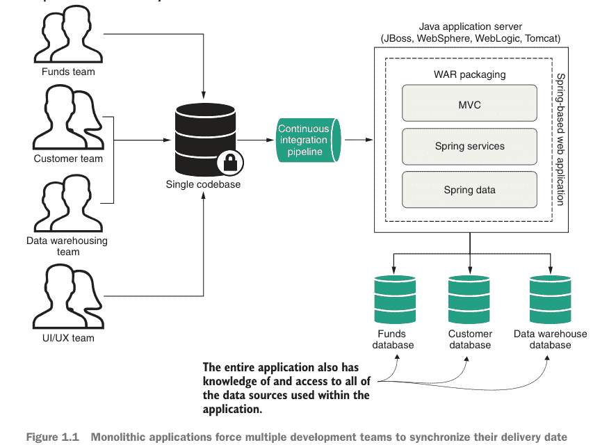

图1.1 单体应用程序迫使多个开发团队同步其交付日期，因为他们的代码需要作为一个整体进行构建、测试和部署。

虽然应用程序可以作为单个工作单元部署，但通常有多个开发团队在同一个应用程序上工作。每个开发团队负责自己的独立应用程序部分，通常针对特定客户。例如，设想一个场景，我们有一个内部定制的客户关系管理（CRM）应用程序，涉及多个团队的协调，包括UI/UX、客户、数据仓库和财务人员，甚至更多。

尽管单体应用程序有时会被微服务架构的支持者以负面方式描述，但它们通常是一个很好的选择。单体比N层或微服务等更复杂的架构更容易构建和部署。如果你的用例定义明确且不太可能更改，那么从单体开始可能是一个好的决定。

然而，当应用程序开始变得更大和更复杂时，单体可能变得难以管理。对单体的每次更改都可能对应用程序的其他部分产生级联效应，这可能耗时且昂贵，尤其是在生产系统中。我们的第三个选择，微服务架构，提供了更大的灵活性和可维护性的潜力。

#### 1.1.3 什么是微服务？

微服务的概念最初悄然进入软件开发社区的意识，直接回应了扩展大型单体应用程序（在技术上和组织上）所面临的许多挑战。微服务是一种小型、松散耦合、分布式的服务。微服务允许你将一个庞大的应用程序分解为易于管理的组件，并具有明确的职责。微服务通过将大型代码库分解为小的、明确定义的片段，帮助解决大型代码库中传统的复杂性问题。

在思考微服务时，你需要接受的关键概念是分解和解绑。应用程序的功能应完全相互独立。如果我们把之前提到的CRM应用程序分解为微服务，它可能看起来像图1.2。

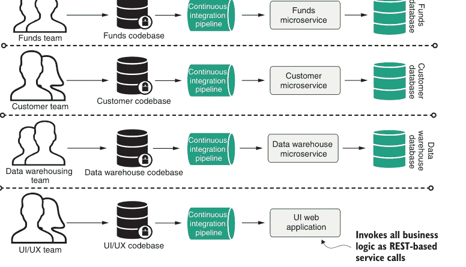

图1.2 使用微服务架构，CRM应用程序被分解为一组完全独立的微服务，允许每个开发团队按自己的节奏前进。


图 1.2 显示了每个团队如何完全拥有其服务代码和服务基础设施。由于其代码、源代码控制仓库以及基础设施（应用服务器和数据库）现在完全独立于应用程序的不同部分，因此它们可以彼此独立地构建、部署和测试。回顾一下，微服务架构具有以下特征：

- 应用程序逻辑被分解为粒度小、职责边界明确且协调良好的组件。
- 每个组件具有较小的职责域，并且可以独立于其他组件进行部署。单个微服务负责业务域的一部分。
- 微服务采用轻量级通信协议，如 HTTP 和 JSON（JavaScript Object Notation），在服务消费者和服务提供者之间交换数据。
- 由于微服务应用程序始终以技术中立的格式进行通信（JSON 是最常见的），因此服务的底层技术实现无关紧要。这意味着使用微服务方法构建的应用程序可以用多种语言和技术构建。
- 微服务——由于其规模小、独立且分布式——使组织能够拥有规模较小的开发团队，并具有明确定义的职责区域。这些团队可能朝着一个共同目标努力，例如交付一个应用程序，但每个团队仅负责其正在处理的服务。

图 1.3 将单体设计与典型小型电子商务应用程序的微服务方法进行了比较。

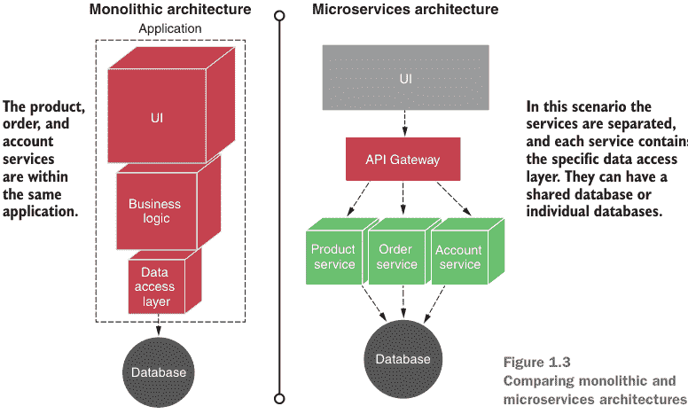

| 单体架构 | 微服务架构 |
| --- | --- |
| 产品、订单和账户服务位于同一个应用程序中。 | 在此场景中，服务被分离，每个服务包含特定的数据访问层。它们可以共享数据库或拥有各自的数据库。 |

图 1.3 比较单体和微服务架构

整个应用程序需要回滚扩展，即使只有应用程序的一小部分是瓶颈。有了小型服务，扩展是本地化的，成本效益更高得多。

为此，我们开始讨论微服务。在我们开始旅程时，请记住以下几点：

*小型、简单且解耦的服务 = 可扩展、 resilient 且灵活的应用程序*

重要的是要理解，系统和组织可以从微服务方法中受益。为了在组织中获得收益，我们可以反向应用 Conway 定律。该定律指出了可以改善公司沟通和结构的几点。

Conway 定律（首次出现在 1968 年 4 月，由 Melvin R. Conway 在文章《How Do Committees Invent》中撰写）指出，“设计系统的组织……受制于产生与这些组织沟通结构相复制的设计。” 基本上，这表明团队内部以及与其他团队的沟通方式直接反映在他们所产生的代码中。

如果我们反向应用 Conway 定律（也称为逆 Conway 手法）并基于微服务架构设计公司结构，通过创建松耦合且自主的团队来实现微服务，我们的应用程序的通信、稳定性和组织结构将得到改善。

## 1.2 使用 Spring 的微服务

Spring 已成为构建基于 Java 的应用程序最流行的开发框架。其核心，Spring 基于依赖注入的概念。依赖注入框架允许您通过约定（和注解）而非硬编码对象彼此“了解”来外部化应用程序中对象之间的关系，从而更高效地管理大型 Java 项目。Spring 充当您应用程序中不同 Java 类之间的中介并管理它们的依赖关系。Spring 本质上让您可以像乐高积木一样组装代码，积木之间可以相互拼接。

Spring 框架令人印象深刻之处，以及对其开发社区的证明，是其保持相关性并不断重新发明自己的能力。Spring 开发者很快意识到，许多开发团队正在远离单体应用程序，即将应用程序的表示层、业务层和数据访问逻辑打包在一起并作为单个工件部署。相反，他们注意到开发团队正在转向高度分布式模型，其中小型服务可以快速部署到云中。作为对这一转变的回应，Spring 开发者启动了两个项目：Spring Boot 和 Spring Cloud。

Spring Boot 是 Spring 框架的重新构想。虽然它拥抱了 Spring 的核心功能，但 Spring Boot 去除了 Spring 中许多“企业”功能，而是提供了一个面向基于 Java、REST 风格（Representational State Transfer）微服务的框架。通过几个简单的注解，Java

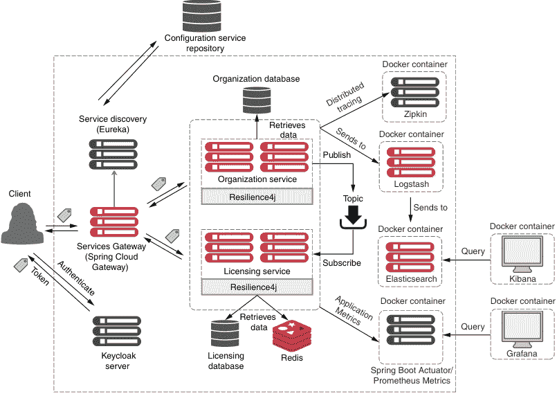

客户端首先需要使用 Keycloak 进行身份验证以获取访问令牌。一旦获得令牌，客户端就会向 Spring Cloud API 网关发出请求。API 网关服务是我们整个架构的入口点；该服务与 Eureka 服务发现通信以检索组织和许可服务的<|message|>
位置，然后调用特定的微服务。

请求到达组织服务后，它会验证访问令牌是否与 Keycloak 匹配，以查看用户是否有权限继续流程。验证后，组织服务会更新并从组织数据库中检索其信息，并以 HTTP 响应形式将其发送回客户端。作为替代路径，一旦组织信息更新，组织服务就会向 Kafka 主题添加一条消息，以便许可服务了解更改。

当消息到达许可服务时，Redis 将特定信息存储在 Redis 的内存数据库中。在整个过程中，架构使用 Zipkin 的分布式追踪、Elasticsearch 和 Logstash 来管理和显示日志，并使用 Spring Boot Actuator、Prometheus 和 Grafana 来公开和显示应用程序指标。

随着我们继续前进，我们将看到 Spring Boot、Spring Cloud、Elasticsearch、Logstash、Kibana、Prometheus、Grafana 和 Kafka 等主题。所有这些技术听起来可能很复杂，但随着我们阅读本书的进展，我们将看到如何创建和集成构成图 1.4 中图表的不同组件。

## 1.4 本书关于什么？

本书的范围很广。它涵盖了从基本定义到更复杂的实现以创建微服务架构的一切。

### 1.4.1 你将在本书中学到什么

本书是关于使用各种 Spring 项目构建基于微服务的应用程序，例如 Spring Boot 和 Spring Cloud，这些项目可以部署在公司运营的私有云中，或部署在 Amazon、Google 或 Azure 等公共云中。本书涵盖以下主题：

- 什么是微服务、最佳实践以及构建基于微服务的应用程序时需要考虑的设计因素
- 何时不应构建基于微服务的应用程序
- 如何使用 Spring Boot 框架构建微服务
- 支持微服务应用程序的核心运营模式，特别是基于云的应用程序
- Docker 是什么以及如何将其与基于微服务的应用程序集成
- 如何使用 Spring Cloud 实现本章后面描述的运营模式
- 如何创建应用程序指标并在监控工具中可视化这些指标
- 如何使用 Zipkin 和 Sleuth 实现分布式追踪
- 如何使用 ELK Stack 管理应用程序日志
- 如何将你所学到的知识应用并构建一个部署管道，可用于将服务部署到本地、私有内部管理的云或公共云提供商

读完本书后，你应该具备构建和部署 Spring Boot 微服务所需的知识。你还将了解运营化微服务所需的关键设计决策。你将了解服务配置管理、服务发现、消息传递、日志和追踪以及安全如何协同工作以提供强大的微服务环境。最后，你将看到你的微服务如何使用不同的技术进行部署。

### 1.4.2 为什么本书与你相关？

我怀疑如果你读到这里，是因为你

- 是 Java 开发者或对 Java 有深入了解
- 有 Spring 背景
- 有兴趣学习如何构建基于微服务的应用程序


- 对如何使用微服务构建云应用感兴趣
- 想知道Java和Spring是否是构建微服务应用的相关技术
- 想知道实现微服务架构的前沿技术有哪些
- 有兴趣了解将基于微服务的应用部署到云端需要什么

本书详细介绍了如何在Java中实现微服务架构。它提供了描述性和可视化信息以及大量动手代码示例，以编程方式指导你如何使用Spring Boot和Spring Cloud等不同Spring项目的最新版本实现此架构。

此外，本书介绍了微服务模式、最佳实践以及与此类架构相辅相成的基础设施技术，模拟了真实世界的应用开发环境。让我们暂时换个角度，逐步构建一个使用Spring Boot的简单微服务。

## 1.5 云和基于微服务的应用

在本节中，我们将了解如何使用Spring Boot创建微服务，并了解为什么云与基于微服务的应用相关。

### 1.5.1 使用Spring Boot构建微服务

本节不会详细讲解用于创建微服务的大部分代码，只是简要介绍如何创建一个服务，以展示Spring Boot是多么容易使用。为此，我们将创建一个简单的“Hello World”REST服务，其中有一个使用GET HTTP动词的主端点。此服务端点将接收请求参数和URL参数（也称为路径变量）。图1.5展示了REST服务将做什么，以及Spring Boot微服务处理用户请求的一般流程。

这个例子绝不是详尽无遗的，甚至也不能说明你应该如何构建生产级微服务，但它应该会让你停下来思考，因为编写它所需的代码量如此之少。在第二章之前，我们不会介绍如何设置项目构建文件或代码细节。如果你想查看Maven pom.xml文件和实际代码，可以在可下载代码的第1章部分找到。

> 注意 你可以从本书的GitHub仓库https://github.com/ihuaylupo/manning-smia/tree/master/chapter1 获取第1章的所有源代码。

在本例中，我们有一个名为Application的Java类，你可以在类文件com/huaylupo/spmia/ch01/SimpleApplication/Application.java中找到它。我们将使用这个类公开一个名为/hello的REST端点。

客户端使用GET HTTP动词发出一个HTTP请求，并通过pathVariable发送名字，通过requestParam发送姓氏。

对微服务http://localhost:8080/hello/illary?lastName=huaylupo 发起HTTP GET请求

HTTP状态：200
HTTP响应

```
{
"message" : "Hello illary huaylupo"
}
```

客户端以JSON形式从你的服务接收响应。调用的成功或失败以HTTP状态码返回。

一旦Spring Boot识别了路由，它就会将路由中定义的任何参数映射到一个将执行工作的Java方法。

一旦所有数据被映射，Spring Boot将执行业务逻辑。

Spring Boot将解析HTTP请求，并根据HTTP动词、URL以及为URL定义的潜在参数来映射路由。路由映射到Spring RestController类中的一个方法。

对于HTTP PUT或POST，HTTP主体中传递的JSON映射到Java类。

一旦业务逻辑被执行，Spring Boot会将Java对象转换为JSON。

路由映射、参数解构、JSON -> Java对象映射、业务逻辑执行、Java -> JSON映射、Spring Boot微服务流程

图1.5 Spring Boot抽象了常见的REST微服务任务（路由到业务逻辑、从URL解析HTTP参数、JSON与Java对象之间的映射），让开发者专注于服务的业务逻辑。此图显示了向控制器传递参数的三种不同方式。

以下清单显示了Application类的代码。

### 清单1.1 使用Spring Boot的Hello World：一个（非常）简单的Spring微服务

- 告诉Spring Boot此类是Spring Boot服务的入口点
- 告诉Spring Boot将此类的代码公开为Spring RestController
- 在此应用公开的所有URL前加上/hello前缀
- 公开一个基于GET的REST端点，该端点在其firstName（通过@PathVariable）和lastName（通过@RequestParam）中接受两个参数
- 将firstName和lastName参数映射到传递给hello函数的两个变量
- 返回我们手动构建的简单JSON字符串（在第2章中，我们不会创建任何JSON）
- 包含用户发送的JSON结构的字段

```java
import org.springframework.boot.SpringApplication;
import org.springframework.boot.autoconfigure.SpringBootApplication;
import org.springframework.web.bind.annotation.GetMapping;
import org.springframework.web.bind.annotation.PathVariable;
import org.springframework.web.bind.annotation.PostMapping;
import org.springframework.web.bind.annotation.RequestBody;
import org.springframework.web.bind.annotation.RequestMapping;
import org.springframework.web.bind.annotation.RequestParam;
import org.springframework.web.bind.annotation.RestController;

@SpringBootApplication
@RestController
@RequestMapping(value="hello")
public class Application {

public static void main(String[] args) {
SpringApplication.run(Application.class, args);
}

@GetMapping(value="/{firstName}")
public String helloGET(
    @PathVariable("firstName") String firstName,
    @RequestParam("lastName") String lastName) {
    return String.format(
        "{\"message\":\"Hello %s %s\"}",
        firstName, lastName);
}

class HelloRequest{
    private String firstName;
    private String lastName;
    public String getFirstName() {
        return firstName;
    }
    public void setFirstName(String firstName) {
        this.firstName = firstName;
    }
    public String getLastName() {
        return lastName;
    }
    public void setLastName(String lastName) {
        this.lastName = lastName;
    }
}
```

在清单1.1中，你基本上公开了一个使用GET HTTP动词的端点，它接受URL上的两个参数（firstName和lastName）：一个来自路径变量（@PathVariable），另一个作为请求参数（@RequestParam）。该端点返回一个简单的JSON字符串，其有效负载包含消息"Hello firstName lastName"。要调用你的服务上的GET端点 /hello/illary?lastName=huaylupo，返回调用将是

```
{"message":"Hello illary huaylupo"}
```

让我们启动Spring Boot应用。为此，让我们在命令行上执行以下命令。这个Maven命令使用pom.xml文件中定义的Spring Boot插件，通过嵌入式Tomcat服务器启动应用。一旦执行mvn spring-boot:run命令并且一切正常启动，你应该会在命令行窗口中看到图1.6所示的内容。

```
mvn spring-boot:run
```

> 注意 如果你从命令行运行此命令，请确保你在根目录中。根目录是包含pom.xml文件的目录。否则，你将遇到此错误：当前项目和插件组中找不到前缀为'spring-boot'的插件。

### Java与Groovy以及Maven与Gradle

Spring Boot框架同时支持Java和Groovy编程语言。Spring Boot也同时支持Maven和Gradle构建工具。Gradle引入了基于Groovy的DSL（领域特定语言）来声明项目配置，而不是像Maven那样使用XML文件。尽管Gradle功能强大、灵活且评价很高，但Maven仍被Java开发者社区使用。因此，本书只包含Maven示例，以保持可管理性和材料聚焦，并旨在覆盖尽可能多的受众。

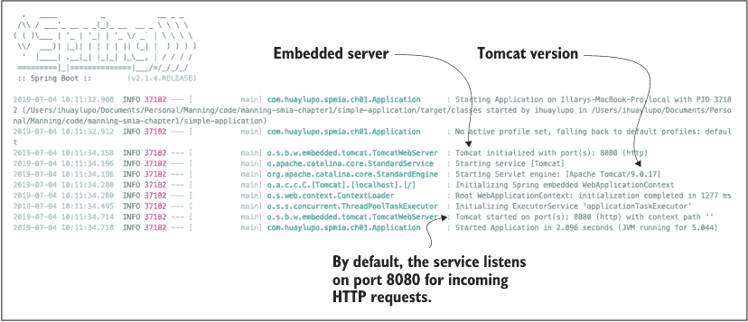

图1.6 Spring Boot服务通过控制台通告服务端口。

要执行这些服务，你需要使用基于浏览器的REST工具。你会发现许多工具，包括图形化和命令行，用于调用基于REST的服务。对于本书，我们将使用Postman（https://www.getpostman.com/）。图1.7和1.8显示了两个不同的Postman调用，以及从服务返回的结果。

图1.8展示了一个使用POST HTTP动词进行调用的简短示例。必须指出，这仅用于演示目的。在后面的章节中，你会看到当涉及在我们的服务中创建新记录时，首选POST方法。

这个简单的示例代码并不能展示Spring Boot的全部功能，也不是创建服务的最佳实践。但它表明，你可以用几行Java代码编写一个完整的HTTP JSON REST服务，并包含URL和参数的路由映射。尽管Java是一种强大的语言，但与其他语言相比，它一直以冗长著称。然而，使用Spring，我们可以用几行代码完成很多工作。接下来，让我们探讨为什么以及何时微服务方法适合构建应用。


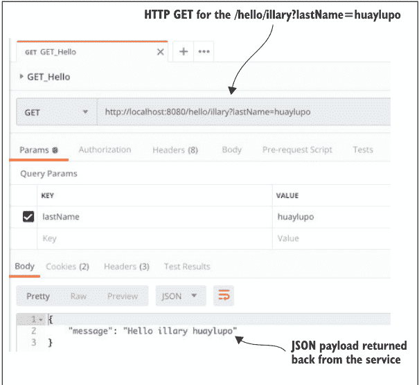

图 1.7 来自 GET /hello 端点的响应显示了您请求的数据，以 JSON 负载的形式表示。

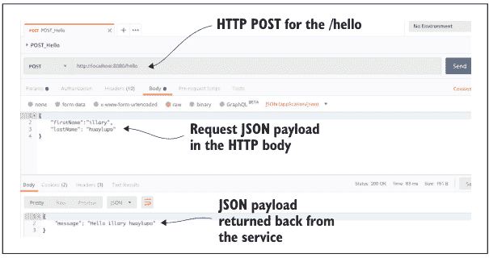

图 1.8 来自 POST /hello 端点的响应显示了请求和响应数据，以 JSON 负载的形式表示。

## 1.5.2 什么是云计算？

云计算是通过互联网提供计算和虚拟化 IT 服务——数据库、网络、软件、服务器、分析等——以提供灵活、安全且易于使用的环境。云计算在公司的内部管理中具有显著优势，例如初始投资低、易于使用和维护、可扩展性等。

云计算模型让用户可以选择对信息和服务控制的程度。这些模型以其缩写命名，通常统称为 XaaS——意为“一切即服务”。下面列出了最常见的云计算模型。图 1.9 显示了这些模型之间的差异。

- *基础设施即服务 (IaaS)*—供应商提供的基础设施让您能够访问计算资源，例如服务器、存储和网络。在此模型中，用户负责与基础设施维护和应用程序可扩展性相关的所有事项。

  IaaS 平台包括 AWS (EC2)、Azure 虚拟机、Google Compute Engine 和 Kubernetes。
- *容器即服务 (CaaS)*—IaaS 与 PaaS 之间的中间模型，指的是一种基于容器的虚拟化形式。与 IaaS 模型不同，在 IaaS 模型中开发人员管理服务部署到的虚拟机，而在 CaaS 中，您将微服务部署到轻量级、可移植的虚拟容器（如 Docker）中，然后部署到云提供商。云提供商运行容器所在的虚拟服务器，以及用于构建、部署、监控和扩展容器的综合工具。

  CaaS 平台包括 Google Container Engine (GKE) 和 Amazon 的 Elastic Container Service (ECS)。在第 11 章中，我们将看到如何将您构建的微服务部署到 Amazon ECS。
- *平台即服务 (PaaS)*—此模型提供平台和环境，让用户专注于应用程序的开发、执行和维护。应用程序可以使用供应商提供的工具创建（例如操作系统、数据库管理系统、技术支持、存储、托管、网络等）。用户无需投资物理基础设施，也无需花费时间管理它，从而能够完全专注于应用程序的开发。

  PaaS 平台包括 Google App Engine、Cloud Foundry、Heroku 和 AWS Elastic Beanstalk。
- *函数即服务 (FaaS)*—也称为无服务器架构，尽管名称如此，并不意味着在没有服务器的情况下运行特定代码。其含义是在云中执行功能的一种方式，供应商提供所有必需的服务器。无服务器架构使我们能够仅专注于服务的开发，而无需担心扩展、配置和服务器管理。相反，我们只需专注于上传我们的函数，而无需处理任何管理基础设施。

  FaaS 平台包括 AWS (Lambda)、Google Cloud Function 和 Azure functions。
- 软件即服务 (SaaS)—也称为按需软件，此模型允许用户使用特定应用程序而无需部署或维护它。在大多数情况下，通过 Web 浏览器访问。应用程序、数据、操作系统、虚拟化、服务器、存储和网络都由服务提供商管理。用户只需租用服务并使用软件即可。

  SaaS 平台包括 Salesforce、SAP 和 Google Business。

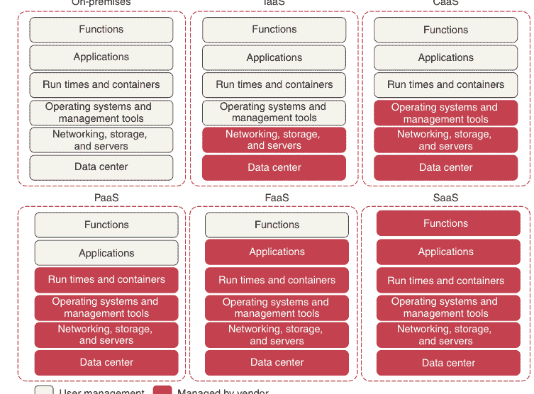

图 1.9 不同的云计算模型归结为谁负责什么：用户管理或云供应商。

NOTE 如果不注意，基于 FaaS 的平台可能会将您的代码锁定到云供应商平台，因为您的代码部署到供应商特定的运行时引擎上。使用基于 FaaS 的模型，您可能使用通用编程语言（Java、Python、JavaScript 等）编写服务，但您仍然将自己绑定到底层供应商的 API 和运行时引擎，而您的函数将被部署到该引擎上。

## 1.5.3 为什么是云和微服务？

微服务架构的核心概念之一是每个服务都作为自己的离散且独立的构件进行打包和部署。服务实例应能快速启动，并且彼此不可区分。在编写微服务时，早晚您必须决定服务将部署到以下其中之一：

- 物理服务器—虽然您可以将微服务构建并部署到物理机器上，但很少有组织这样做，因为物理服务器受限。您无法快速提高物理服务器的容量，并且在多个物理服务器上水平扩展微服务可能会变得极其昂贵。
- 虚拟机镜像—微服务能够快速启动和关闭实例以响应可扩展性和服务故障事件，这是其关键优势之一。虚拟机（VM）是主要云提供商的核心。
- 虚拟容器—虚拟容器是部署微服务到 VM 镜像的自然扩展。与将服务部署到完整的 VM 相比，许多开发人员将服务作为 Docker 容器（或等效容器技术）部署到云中。虚拟容器在 VM 内部运行，使用虚拟容器，您可以将单个 VM 划分为一系列自包含的进程，这些进程共享相同的镜像。微服务可以被打包，然后服务的多个实例可以快速部署并启动在 IaaS 私有或公有云中。

云原生微服务的优势围绕弹性概念。云服务提供商允许您在几分钟内快速启动新的 VM 和容器。如果您的服务容量需求下降，您可以关闭容器以避免额外成本。使用云提供商部署微服务可为您的应用程序提供显著更高的水平可扩展性（添加更多服务器和服务实例）。

服务器弹性还意味着您的应用程序可以更具弹性。如果您的某个微服务出现问题并发生故障转移，启动新的服务实例可以让您的应用程序保持足够长的时间，以便开发团队优雅地解决问题。

对于本书，所有微服务和相应的服务基础设施都将部署到基于 CaaS 的云提供商，使用 Docker 容器。这是微服务的常见部署拓扑。CaaS 云提供商最常见的特征如下：

- *简化的基础设施管理*—CaaS 云提供商为您提供更多控制服务的机会。新的服务可以通过简单的 API 调用启动和停止。
- *大规模水平可扩展性*—CaaS 云提供商允许您快速简洁地启动一个或多个服务实例。这种能力意味着您可以快速扩展服务并绕过行为异常或故障的服务器。
- *通过地理分布实现高冗余*—出于必要，CaaS 提供商拥有多个数据中心。通过使用 CaaS 云提供商部署微服务，您可以获得比在数据中心使用集群更高的冗余级别。

## 为什么不使用基于 PaaS 的微服务？

本章前面我讨论了五种类型的云平台——基础设施即服务（IaaS）、容器即服务（CaaS）、平台即服务（PaaS）、函数即服务（FaaS）和软件即服务（SaaS）。本书专门关注使用 CaaS 方法构建微服务。虽然某些云提供商会让您抽象掉微服务的部署基础设施，但本书将教您如何保持供应商独立并部署应用程序的所有部分（包括服务器）。

例如，Cloud Foundry、AWS Elastic Beanstalk、Google App Engine 和 Heroku 允许您在无需了解底层应用程序容器情况下部署服务。它们提供 Web 界面和命令行界面（CLI），让您将应用程序作为 WAR 或 JAR 文件部署。设置和调整应用程序服务器以及相应的 Java 容器对您来说是抽象的。虽然这很方便，但每个云提供商的平台都有与其各自 PaaS 解决方案相关的不同特殊性。

本书中构建的服务被打包为 Docker 容器；主要原因是 Docker 可部署到所有主要云提供商。在后面的章节中，我们将了解 Docker 是什么，并学习如何集成 Docker 来运行本书中使用的所有服务和基础设施。

## 1.6 微服务不仅仅是编写代码

虽然构建单个微服务的概念很容易理解，但在云中运行和支持强大的微服务应用程序涉及的不仅仅是编写服务的代码。图 1.10 显示了在编写或构建微服务时需要考虑的一些准则。


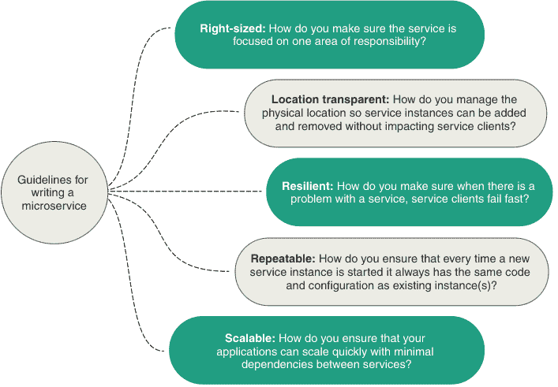

**图1.10** 微服务不仅仅是业务逻辑。你需要考虑运行服务所需的环境，以及服务如何扩展并保持韧性。

编写健壮的服务需要考虑几个方面。让我们更详细地查看图1.10中展示的各项内容：

- *规模适当*——你如何确保微服务的大小适当，从而避免某个微服务承担过多职责。记住，规模适当的服务使你能快速修改应用程序，并降低整个应用发生故障的总体风险。
- *位置透明*——你如何管理服务调用的物理细节。在微服务应用中，多个服务实例可以快速启动和关闭。
- *韧性*——你如何通过绕开故障服务并确保采用“快速失败”策略，来保护微服务消费者和应用程序的整体完整性。
- *可重复*——你如何确保服务的每个新实例都与生产环境中所有其他服务实例具有相同的配置和代码库。
- *可扩展*——你如何建立一种通信机制，以最小化服务之间的直接依赖，并确保你能优雅地扩展微服务。

本书采用基于模式的方法来更详细地研究这些内容。通过基于模式的方法，我们将介绍可用于不同技术实现的通用设计。虽然我们选择使用Spring Boot和Spring Cloud来实现本书中将要使用的模式，但你完全可以将这里所讲的概念应用于其他技术平台。具体来说，我们将涵盖以下微服务模式：

- 核心开发模式
- 客户端韧性模式
- 日志与追踪模式
- 构建与部署模式
- 路由模式
- 安全模式
- 应用度量模式

重要的是要理解，如何创建微服务并没有正式的定义。在下一节中，你将看到在构建微服务时需要考虑的常见方面列表。

## 1.7 核心微服务开发模式

核心微服务开发模式解决了构建微服务的基础问题。图1.11突出了我们将围绕基本服务设计展开的主题。

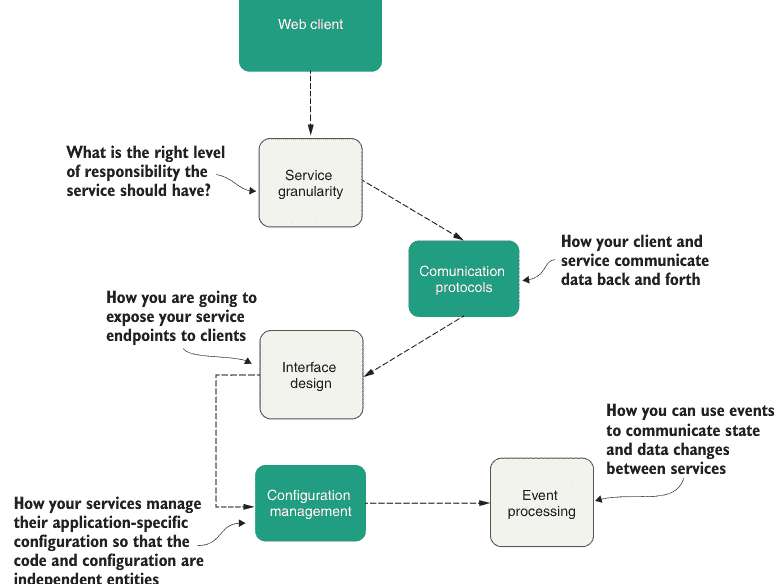

图1.11 在设计微服务时，你需要考虑服务将如何被消费以及如何与之通信。

以下模式（如图1.11所示）展示了构建微服务的基础：

- *服务粒度*——你如何将业务领域分解为微服务，使每个微服务具有适当的职责级别？服务粒度过粗，职责会重叠到不同的业务问题领域，导致服务难以长期维护和更改。服务粒度过细则会增加应用程序的整体复杂性，使服务变成一个“哑”数据抽象层，除了访问数据存储所需的逻辑外没有任何逻辑。服务粒度将在第3章中讨论。
- *通信协议*——开发者将如何与你的服务通信？第一步是确定你想要同步协议还是异步协议。对于同步通信，最常见的通信方式是基于HTTP的REST，使用XML（可扩展标记语言）、JSON（JavaScript对象表示法）或诸如Thrift之类的二进制协议来与微服务互相发送数据。对于异步通信，最流行的协议是AMQP（高级消息队列协议），使用一对一（队列）或一对多（主题）的消息代理，例如RabbitMQ、Apache Kafka和Amazon Simple Queue Service（SQS）。在后续章节中，我们将学习通信协议。
- *接口设计*——设计开发者用来调用你的服务的实际服务接口的最佳方式是什么？你如何组织你的服务？最佳实践是什么？最佳实践和接口设计将在接下来的章节中介绍。
- *服务的配置管理*——你如何管理微服务的配置，使其能够在云中的不同环境之间迁移？这可以通过外部化配置和配置文件来实现，如第5章所述。
- *服务间的事件处理*——你如何通过事件来解耦微服务，从而最小化服务之间的硬编码依赖并提高应用程序的韧性？我们将使用Spring Cloud Stream的事件驱动架构，如第10章所述。

## 1.8 微服务路由模式

微服务路由模式处理的是，想要消费微服务的客户端应用如何发现服务的位置并被路由到该服务。在基于云的应用程序中，可能有数百个微服务实例在运行。为了实施安全和内容策略，需要抽象这些服务的物理IP地址，并为服务调用提供单一入口点。怎么做？以下模式将回答这个问题：

- *服务发现*——借助服务发现及其关键特性——服务注册中心，你可以让你的微服务可被发现，使客户端应用无需将服务位置硬编码到应用程序中就能找到它们。怎么做？我们将在第6章中解释。请记住，服务发现是一种内部服务，而不是面向客户端的服务。

请注意，在本书中，我们使用Netflix Eureka服务发现，但还有其他服务注册中心，如etcd、Consul和Apache Zookeeper。此外，有些系统没有显式的服务注册中心，而是使用一种称为*服务网格*的服务间通信基础设施。

- *服务路由*——借助API网关，你可以为所有服务提供单一入口点，从而将安全策略和路由规则统一应用于微服务应用程序中的多个服务和实例。怎么做？通过Spring Cloud API Gateway，我们将在第8章中解释。

图1.12展示了服务发现和服务路由之间似乎存在硬编码的事件顺序（先有服务路由，然后有服务发现）。然而，这两种模式并不相互依赖。例如，我们可以不通过服务路由来实现服务发现，也可以不通过服务发现来实现服务路由（尽管后者的实现更加困难）。

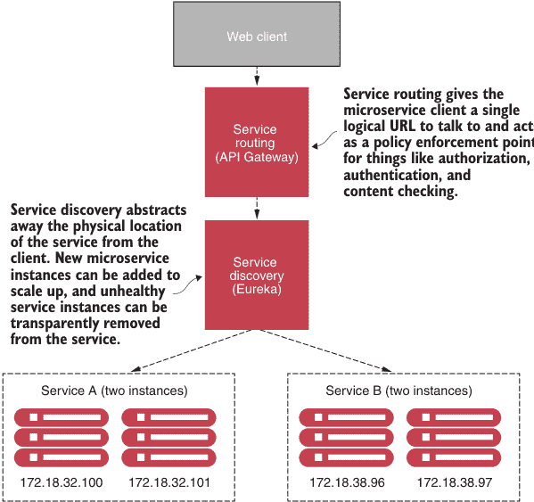

服务路由为微服务客户端提供了一个可用于通信的单一逻辑URL，并充当授权、认证和内容检查等策略执行点。

服务发现则向客户端抽象了服务的物理位置。可以添加新的微服务实例来进行扩展，不健康的服务实例可以被透明地从服务中移除。

图1.12 服务发现和服务路由是任何大规模微服务应用的关键部分。

## 1.9 微服务客户端韧性

由于微服务架构是高度分布式的，你必须非常谨慎地防止单个服务（或服务实例）中的问题级联扩散到该服务的消费者。为此，我们将介绍四种客户端韧性模式：

- *客户端负载均衡*——你如何在客户端缓存服务实例的位置，以便对微服务多个实例的调用能够负载均衡到该微服务的所有健康实例上。
- *断路器模式*——你如何防止客户端继续调用失败或出现性能问题的服务。当服务运行缓慢时，它会消耗调用它的客户端资源。你希望这些微服务调用快速失败，以便调用客户端能够快速响应并采取适当的措施。
- *回退模式*——当服务调用失败时，你如何提供一种“插件”机制，使服务客户端能够通过被调用微服务之外的替代方式来尝试完成其工作。
- *舱壁模式*——微服务应用使用多个分布式资源来执行其工作。该模式指的是你如何隔离这些调用，以使某个服务调用的不良行为不会对应用程序的其他部分产生负面影响。

图1.13展示了这些模式如何在服务行为异常时保护服务消费者免受影响。这些主题将在第7章中讨论。

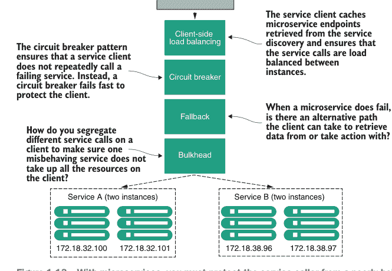

图1.13 使用微服务时，你必须保护服务调用者免受表现不佳服务的影响。记住，一个缓慢或宕机的服务可能造成超出该服务本身的破坏。

## 1.10 微服务安全模式

为了确保微服务不向公众开放，必须将以下安全模式应用于架构中，以确保只有经过授权且具有正确凭证的请求才能调用服务。图1.14展示了你如何


你可以通过实现以下三种模式来构建一个能够保护微服务的认证服务：

- *认证*—如何确定调用服务的服务客户端身份与其声称的身份一致。
- *授权*—如何确定调用微服务的服务客户端是否被允许执行其尝试执行的操作。
- *凭据管理与传播*—如何防止服务客户端在涉及事务的服务调用中不断出示其凭据。为此，我们将研究如何使用基于令牌的安全标准（如 OAuth2 和 JSON Web 令牌（JWT））获取一个令牌，该令牌可以在服务调用之间传递，以对用户进行身份验证和授权。

## 什么是 OAuth 2.0？

OAuth2 是一种基于令牌的安全框架，允许用户通过第三方认证服务进行身份验证。如果用户成功通过身份验证，他们将获得一个令牌，并且每次请求*必须*携带该令牌。

OAuth2 背后的主要目标是：当多次调用服务以满足用户请求时，用户无需向处理请求的每个服务出示凭据，即可由每个服务进行身份验证。虽然第9章会介绍 OAuth，但阅读 Aaron Parecki 的 OAuth 2.0 文档（https://www.oauth.com/）是值得的。

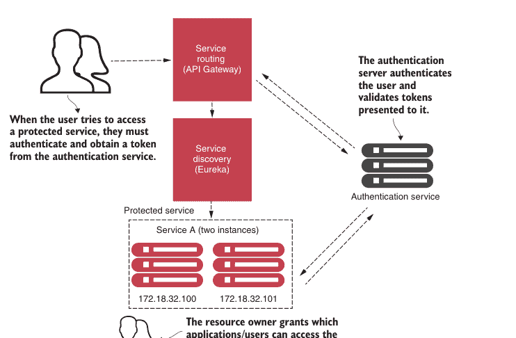

图1.14 使用基于令牌的安全方案，你可以在不传递客户端凭据的情况下实现服务认证和授权。

## 1.11 微服务日志记录与追踪模式

微服务架构的缺点是调试、追踪和监控问题变得更加困难，因为一个简单的操作可能触发应用程序内的多次微服务调用。后续章节将介绍如何使用 Spring Cloud Sleuth、Zipkin 和 ELK Stack 实现分布式追踪。为此，我们将研究以下三种核心日志记录与追踪模式来实现分布式追踪：

- 日志关联——如何将单个用户事务中服务之间产生的所有日志关联在一起。通过这种模式，我们将研究如何实现关联 ID，这是一个在事务操作中贯穿所有服务调用的唯一标识符，可用于将每个服务产生的日志条目关联起来。
- 日志聚合——通过这种模式，我们将研究如何将微服务（及其各个实例）产生的所有日志汇集到所有相关服务中的一个可查询数据库中，并了解事务中各服务的性能特征。
- 微服务追踪——我们将探讨如何可视化客户端事务在所有相关服务中的流转，并了解事务中所涉及服务的性能特征。

图1.15展示了这些模式如何协同工作。我们将在第11章更详细地介绍日志记录与追踪模式。

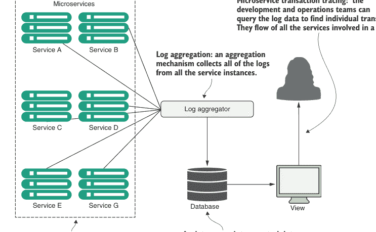

图1.15 经过周密规划的日志记录与追踪策略，可以简化跨多个服务的调试事务。

## 1.12 应用指标模式

应用指标模式处理应用程序如何监控指标并警告应用程序内可能的故障原因。该模式展示了指标服务如何负责获取（抓取）、存储和查询业务相关数据，以防止服务出现潜在性能问题。此模式包含以下三个主要组件：

- *指标*——如何创建有关应用程序健康状况的关键信息，以及如何公开这些指标
- *指标服务*——在何处存储和查询应用程序指标
- *指标可视化套件*——在何处可视化应用程序和基础设施的与业务相关的时间数据

图1.16 展示了微服务生成的指标如何高度依赖指标服务和可视化套件。如果无法理解和分析这些信息，那么生成和展示无限信息的指标将毫无用处。指标服务可以通过拉取或推送方式获取指标：

- 采用推送方式时，服务实例调用指标服务公开的服务 API，以发送应用程序数据。
- 采用拉取方式时，指标服务请求或查询某个函数以获取应用程序数据。

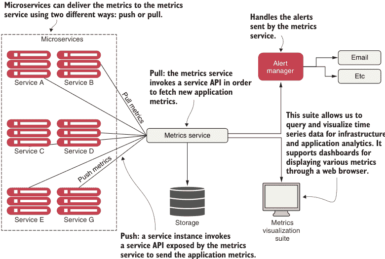

**图1.16** 指标从微服务中被拉取或推送，收集并存储在指标服务中，以便通过指标可视化套件和警报管理工具展示。

重要的是要理解，监控指标是微服务架构的一个基本方面，并且由于微服务架构的高度分布式特性，其监控需求往往高于单体架构。

## 1.13 微服务构建/部署模式

微服务架构的核心部分之一是，微服务的每个实例都应该与其所有其他实例保持一致。你不能允许发生*配置漂移*（服务器在部署后发生某些变化），因为这会给应用程序带来不稳定性。

该模式的目标是将基础设施的配置直接集成到构建/部署过程中，这样你就不再需要将 Java WAR 或 EAR 文件等软件工件部署到已经运行的基础设施上。相反，你希望在构建过程中构建并编译微服务以及运行它的虚拟服务器镜像。然后，当你的微服务被部署时，整个机器镜像（连同其上运行的服务器）会被部署。图1.17 演示了这一过程。在本书末尾，我们将研究如何创建你的构建/部署管道。在第12章中，我们将介绍以下模式和主题：

- **构建与部署管道**——如何创建一个可重复的构建与部署过程，强调一键构建和部署到组织中的任何环境。
- **基础设施即代码**——如何将服务的配置视为代码，可以在源代码控制下执行和管理。
- **不可变服务器**——一旦创建了微服务镜像，如何确保其在部署后永远不会被更改。
- **凤凰服务器**——如何确保运行各个容器的服务器定期被销毁，并从不可变镜像重新创建。服务器运行时间越长，发生配置漂移的机会就越多。当对系统配置进行临时更改而又未记录时，就会出现配置漂移。

我们使用这些模式和主题的目标是，尽可能在配置漂移影响上层环境（预发或生产）之前，毫不留情地暴露并消除它。

> **注意** 对于本书中的代码示例（第12章除外），一切将在你的桌面计算机上本地运行。前几章可以直接在命令行本地运行。从第3章开始，所有代码将作为 Docker 容器进行编译和运行。

现在我们已经覆盖了全书将要使用的模式，让我们继续到第二章。在下一章中，我们将介绍将要使用的 Spring Cloud 技术、设计云微服务应用的一些最佳实践，以及使用 Spring Boot 和 Java 创建第一个微服务的第一步。

- 不断演进的应用。最终，选择软件架构完全取决于你的项目规模、时间、需求等因素。
- Spring Boot 简化了基于 REST/JSON 的微服务的构建。其目标是让你只需少量注解即可快速构建微服务。
- 编写微服务很容易，但要使其完全投入生产需要额外的深思熟虑。微服务开发模式有几种类别，包括核心开发、路由模式、客户端弹性、安全、应用指标以及构建/部署模式。
- 微服务路由模式处理希望使用微服务的客户端应用如何发现服务位置并被路由到该服务。
- 为防止服务实例中的问题向上蔓延并波及服务的消费者，请使用客户端弹性模式。这些模式包括：断路器模式（避免调用失败的服务）、回退模式（在服务失败时创建替代路径以检索数据或执行特定操作）、客户端负载均衡模式（扩展并消除所有可能的瓶颈或故障点）以及舱壁模式（限制对服务的并发调用数，以防止性能不佳的调用对其他服务产生负面影响）。
- OAuth 2.0 是最常见的用户授权协议，是保护微服务架构的绝佳选择。
- 构建/部署模式允许你将基础设施的配置直接集成到构建/部署过程中，这样你就不再需要将 Java WAR 或 EAR 文件等软件工件部署到已运行的基础设施上。


## 探索
微服务世界
与 Spring Cloud

## 本章涵盖

- 了解 Spring Cloud 的技术
- 理解云原生应用的原则
- 应用十二要素应用最佳实践
- 使用 Spring Cloud 构建微服务

如果这些流程没有得到正确管理，设计、实现和维护微服务很快就会成为一个问题。当我们开始使用微服务解决方案时，至关重要的是要应用最佳实践，以保持架构尽可能高效且可扩展，从而避免性能问题、瓶颈或操作问题。遵循最佳实践也能让新开发者更快上手我们的系统。随着我们继续讨论微服务架构，重要的是要记住以下几点：

> 系统越分布式，故障点就越多。

我们的意思是，在微服务架构中，我们有更多的故障点。这是因为我们不再拥有单一的单体应用，而是拥有一个由多个相互交互的独立服务组成的生态系统。这就是为什么开发者在创建微服务应用或架构时经常会遇到不同的管理、同步挑战或故障点的根本原因。为了避免可能的故障点，我们将使用 Spring Cloud。Spring Cloud 提供了一套功能（服务注册与发现、断路器、监控等），让我们能够以最少的配置快速构建微服务架构。

本章简要介绍了我们将在本书中使用的 Spring Cloud 技术。这是一个高层次的概述；随着你使用不同的技术，我们会在需要时为你提供每个技术的细节。由于我们将在接下来的章节中全程使用微服务，因此理解微服务的概念、其优势以及开发模式至关重要。

## 2.1 什么是 Spring Cloud？

从零开始实现我们在第一章中解释的所有模式将是一项巨大的工作。幸运的是，Spring 团队已将大量经过实战检验的开源项目集成到一个单一的 Spring 子项目中，统称为 Spring Cloud（https://projects.spring.io/spring-cloud/）。

Spring Cloud 是一组工具，它将 VMware、HashiCorp 和 Netflix 等开源公司的成果封装到交付模式中。Spring Cloud 简化了项目的设置和配置，并为 Spring 应用中最常见遇到的模式提供了解决方案。然后我们可以专注于编写代码，而不是陷入为构建和部署微服务应用所需的基础设施配置细节中。图 2.1 将上一章中列出的模式映射到实现它们的 Spring Cloud 项目。

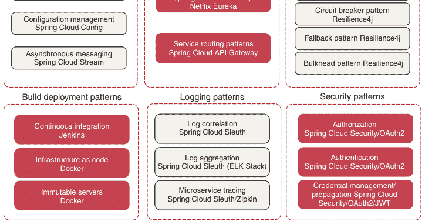

图 2.1 使用 Spring Cloud，我们可以将要使用的技术直接映射到迄今为止我们探索过的微服务模式。

LoadBalancer 项目使在你自己的微服务中使用这些功能变得非常简单。你可以在这里找到 Resilience4j 库：https://github.com/resilience4j/resilience4j。通过使用 Resilience4j 库，你可以快速实现服务客户端弹性模式，如断路器、重试、舱壁等。

虽然 Spring Cloud LoadBalancer 项目简化了与 Eureka 等服务发现代理的集成，但它也提供了从服务消费者进行调用的客户端负载均衡。这使得客户端即使在服务发现代理暂时不可用时也能继续进行服务调用成为可能。

### 2.1.4 Spring Cloud API Gateway

API 网关为你的微服务应用提供服务路由功能。正如名称所示，它是一个服务网关，代理服务请求并确保对微服务的所有调用都通过单一的“前门”后再调用目标服务。通过这种服务调用的集中化，你可以强制执行标准服务策略，如安全授权、身份验证、内容过滤和路由规则。你可以使用 Spring Cloud Gateway（https://spring.io/projects/spring-cloud-gateway）实现 API 网关。

> 注意 在本书中，我们使用的是用 Spring Framework 5 Project Reactor（允许与 Spring Web Flux 集成）和 Spring Boot 2 构建的 Spring Cloud API Gateway，以更好地集成我们的 Spring 项目。

### 2.1.5 Spring Cloud Stream

Spring Cloud Stream（https://cloud.spring.io/spring-cloud-stream）是一种使能技术，让你能够轻松地将轻量级消息处理集成到你的微服务中。使用 Spring Cloud Stream，你可以构建智能微服务，利用应用中发生的异步事件。你还可以快速将微服务与 RabbitMQ（https://www.rabbitmq.com）和 Kafka（http://kafka.apache.org）等消息代理集成。

### 2.1.6 Spring Cloud Sleuth

Spring Cloud Sleuth（https://cloud.spring.io/spring-cloud-sleuth/）让你能够在应用中使用的 HTTP 调用和消息通道（RabbitMQ、Apache Kafka）中集成唯一的跟踪标识符。这些跟踪编号有时被称为关联或追踪 ID，允许你在应用的不同服务中跟踪事务的流向。使用 Spring Cloud Sleuth，追踪 ID 会自动添加到你在微服务中进行的任何日志语句中。

Spring Cloud Sleuth 的真正美妙之处在于它与日志聚合技术工具如 ELK Stack（https://www.elastic.co/what-is/elk-stack）和跟踪工具如 Zipkin（http://zipkin.io）结合使用时。Open Zipkin 接收 Spring Cloud Sleuth 生成的数据，并允许你可视化单个事务涉及的服务调用流。ELK Stack 是三个开源项目的缩写：

```
```java
import org.springframework.web.client.RestTemplate;

@SpringBootApplication
@RestController
@RequestMapping(value="hello")
@EnableEurekaClient
public class Application {

    public static void main(String[] args) {
        SpringApplication.run(ContactServerApplication.class, args);
    }

    public String helloRemoteServiceCall(String firstName,String lastName){
        RestTemplate restTemplate = new RestTemplate();
        ResponseEntity<String> restExchange =
            restTemplate.exchange(
                "http://logical-service-id/name/" + "{firstName}/
                {lastName}", HttpMethod.GET, null, String.class,
                firstName, lastName);
        return restExchange.getBody();
    }

    @RequestMapping(value="/{firstName}/{lastName}",
        method = RequestMethod.GET)
    public String hello(@PathVariable("firstName") String firstName,
                       @PathVariable("lastName") String lastName) {
        return helloRemoteServiceCall(firstName, lastName);
    }
}
```
```

这段代码包含了很多内容，让我们逐步分析。记住，这个列表只是一个示例，并不在第 2 章 GitHub 仓库的源代码中。我们在这里包含它是为了让你先尝一下本书后面内容的味道。

首先要注意的是 @EnableEurekaClient 注解。这个注解告诉你的微服务向 Eureka 服务发现代理注册自己，因为你将使用服务发现来查找远程 REST 服务端点。请注意，配置发生在属性文件中，给这个简单服务提供 Eureka 服务器的位置和端口号。

第二件要注意的是 helloRemoteServiceCall 方法内部发生的事情。@EnableEurekaClient 注解告诉 Spring Boot 你正在启用 Eureka 客户端。需要强调的是，如果你的 pom.xml 中已经有 spring-cloud-starter-netflix-eureka-client 依赖，则此注解是可选的。RestTemplate 类允许你传入要调用服务的逻辑服务 ID，例如：

```
```java
ResponseEntity<String> restExchange = restTemplate.exchange(
    http://logical-service-id/name/{firstName}/{lastName}
```

```


在底层，`RestTemplate` 类会联系 Eureka 服务，并查找一个或多个指定服务实例的物理位置。作为服务的消费者，你的代码不需要知道该服务位于何处。

`RestTemplate` 类还会使用 Spring Cloud LoadBalancer 库。该库会检索与某个服务关联的所有物理端点列表。每当客户端调用该服务时，它会在不同的服务实例之间进行“轮询”调用，而无需经过集中式负载均衡器。通过消除集中式负载均衡器并将其移至客户端，你可以消除应用程序基础设施中的另一个故障点（负载均衡器宕机）。

我们希望你现在已经印象深刻：你仅用几个注解就为微服务添加了大量功能。这就是 Spring Cloud 背后真正的魅力所在。作为开发者，你可以利用来自 Netflix 和 Consul 等一流云公司的久经考验的微服务能力。Spring Cloud 将它们的用法简化得几乎只需几个简单的注解和配置项即可。在我们开始构建第一个微服务之前，让我们先了解一下实现云原生微服务的最佳实践。

## 2.3 如何构建云原生微服务

在本节中，我们将暂停一下，了解设计云微服务应用程序的最佳实践。在上一章中，我们解释了云计算模型之间的区别，但云到底是什么？云不是一个地方；相反，它是一种技术资源管理系统，让你能够通过使用虚拟基础设施来替代本地机器和私有数据中心。云应用程序有几个级别或类型，但在本节中，我们只关注两种类型的云应用程序——云就绪（cloud-ready）和云原生（cloud-native）。

云就绪应用程序是曾经在计算机或本地服务器上使用的应用程序。随着云的出现，这类应用程序已从静态环境迁移到动态环境，目的是在云中运行。例如，一个不适合云的应用程序可能是一个本地部署的应用程序，它只包含一个特定的数据库配置，必须在每个安装环境（开发、测试、生产）中进行定制。为了使这样的应用程序做到云就绪，我们需要将应用程序的配置外部化，使其能够快速适应不同的环境。通过这样做，我们可以确保应用程序在构建过程中无需更改任何源代码即可在多个环境中运行。

云原生应用程序（图 2.2）是专门为云计算架构设计的，以利用其所有优势和服务。在创建此类应用程序时，开发人员将功能划分为微服务，并使用容器等可扩展组件，使这些微服务能够在多台服务器上运行。随后，这些服务通过 DevOps 流程和持续交付工作流由虚拟基础设施进行管理。

为了应对创建云原生微服务所面临的挑战，我们将使用 Heroku 的最佳实践指南——称为*十二因素应用*（the twelve-factor app）——来构建高质量的微服务。十二因素应用（https://12factor.net/）使我们能够构建和开发云原生应用程序（微服务）。我们可以将此方法论视为一系列开发和设计实践的集合，这些实践在构建分布式服务时侧重于动态扩展和基本要点。

该方法论由几位 Heroku 开发人员于 2012 年创建。其主要目标是在构建微服务时提供 12 项最佳实践。我们选择十二因素文档，因为它是创建云原生应用程序时最完整的指南之一。该指南不仅为现代应用程序开发中观察到的最常见问题提供了通用词汇，还提供了解决这些问题的稳健方案。图 2.3 显示了十二因素宣言所涵盖的最佳实践。

**注意** 在本章中，我们将对每项最佳实践进行高层概述，因为在继续阅读时，你会看到我们打算如何在整个过程中使用十二因素方法论。此外，我们还将把这些实践应用到 Spring Cloud 项目和其他技术的示例中。

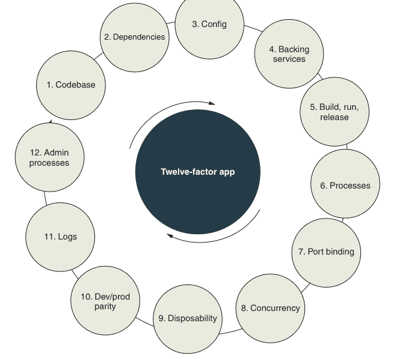

*图 2.3 十二因素应用最佳实践*

### 2.3.1 代码库

根据这项实践，每个微服务应该有一个单一的、受源代码控制的代码库。此外，必须强调服务器配置信息也应该纳入版本控制。请记住，版本控制是对一个文件或一组文件更改的管理。

代码库可以有多个部署环境的实例（例如开发、测试、预发布、生产等），但不能与任何其他微服务共享。这是一条重要的指导原则，因为如果我们为所有微服务共享代码库，最终会产生大量属于不同环境的不可变发布版本。图 2.4 显示了一个具有多个部署的代码库。

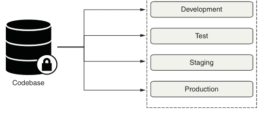

*图 2.4 一个代码库对应多个部署*

### 2.3.2 依赖

这项最佳实践通过 Maven 或 Gradle（Java）等构建工具显式声明应用程序使用的依赖。第三方 JAR 依赖应使用其特定的版本号进行声明。这使你始终能够使用相同的库版本来构建微服务。

如果你不熟悉构建工具的概念，图 2.5 可以帮助你理解构建工具的工作原理。首先，Maven 读取存储在 `pom.xml` 文件中的依赖项，然后在本地仓库中搜索这些依赖项。如果没有找到，则继续从 Maven 中央仓库下载依赖项，并将其插入本地仓库以供将来使用。

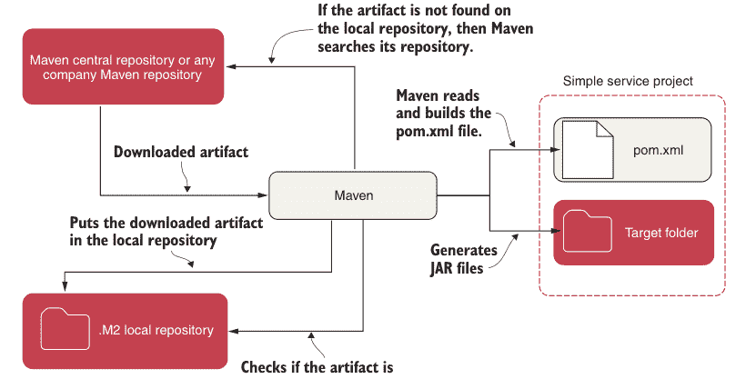

*图 2.5 Maven 读取存储在 `pom.xml` 文件中的依赖项，然后在本地仓库中搜索它们。如果未找到依赖项，Maven 会从 Maven 仓库下载依赖项，并将其插入本地仓库。*

### 2.3.3 配置

这项实践涉及如何存储应用程序配置（尤其是特定于环境的配置）。绝不要将嵌入式配置添加到源代码中！相反，最好将配置与可部署的微服务完全分离。

想象一下这个场景：你想要更新一个已在服务器上复制了 100 次的特定微服务的配置。如果你将配置打包在微服务内部，就需要重新部署所有 100 个实例才能进行更改。然而，微服务可以加载外部配置，并使用云服务在运行时重新加载该配置，而无需重启微服务。图 2.6 显示了你的环境应有的示例。

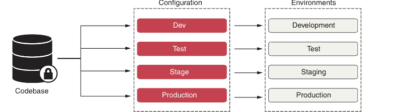

*图 2.6 外部化特定于环境的配置*

### 2.3.4 支持服务

你的微服务通常会通过网络与数据库、RESTful API 服务、其他服务器或消息系统通信。当它这样做时，你应该确保可以在本地连接和第三方连接之间交换部署实现，而无需更改任何应用程序代码。在第 12 章中，我们将看到如何将微服务从本地管理的数据库迁移到由 Amazon 管理的数据库。图 2.7 显示了一些我们的应用程序可能拥有的支持服务示例。

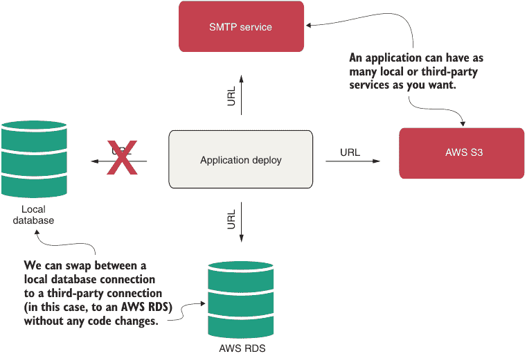

*图 2.7* 支持服务是应用程序通过网络使用的任何服务。在部署应用程序时，你应该能够在不更改任何代码的情况下将本地连接替换为第三方连接。

### 2.3.5 构建、发布、运行

这项最佳实践提醒我们将应用程序部署的构建、发布和运行阶段完全分离。我们应该能够构建独立于其运行环境的微服务。一旦代码构建完成，任何运行时更改都需要回到构建流程并重新部署。构建完成的服务是不可变的，不能更改。

发布阶段负责将构建的服务与每个目标环境的特定配置相结合。当我们不分离各个阶段时，可能会导致代码中的问题和差异难以追踪，或者充其量也很难追踪。例如，如果我们修改了一个已经部署在生产环境中的服务，


该更改不会记录在仓库中，并且可能出现两种情况：更改会随着服务的更新版本而丢失，或者我们被迫将更改复制到服务的新版本中。图 2.8 显示了此最佳实践的高级架构示例。

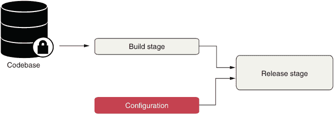

**图 2.8** 我们在最佳实践中应严格区分微服务的构建、发布和运行阶段。

## 2.3.6 *进程*

你的微服务应始终无状态，并且只包含执行所请求事务所需的必要信息。微服务可以随时被终止并替换，而不必担心服务实例的丢失会导致数据丢失。如果有特定的要求需要存储状态，则必须通过内存缓存（如 Redis）或后端数据库来完成。图 2.9 显示了无状态微服务的工作方式。

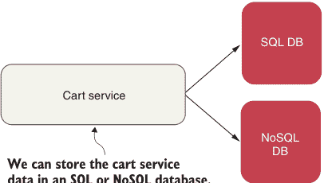

**图 2.9** 无状态微服务不会在服务器上存储任何会话数据（状态）。这些服务使用 SQL 或 NoSQL 数据库来存储所有信息。

**我们可以将购物车服务数据存储在 SQL 或 NoSQL 数据库中。**

## 2.3.7 *端口绑定*

端口绑定意味着通过特定端口发布服务。在微服务架构中，微服务完全自包含，服务的运行引擎被打包在服务可执行文件中。你应该在无需单独的 Web 或应用服务器的情况下运行服务。服务应通过命令行自行启动，并可立即通过公开的 HTTP 端口访问。

## 2.3.8 并发

并发最佳实践说明，云原生应用应使用进程模型进行扩展。这是什么意思？让我们想象一下，与其让单个重要进程变得更大，我们可以创建多个进程，然后将服务的负载或应用在不同进程之间进行分配。

垂直扩展（scale up）是指增加硬件基础设施（CPU、RAM）。水平扩展（scale out）是指添加更多应用实例。当你需要扩展时，启动更多微服务实例并进行水平扩展而不是垂直扩展。图 2.10 显示了两种扩展类型的区别。

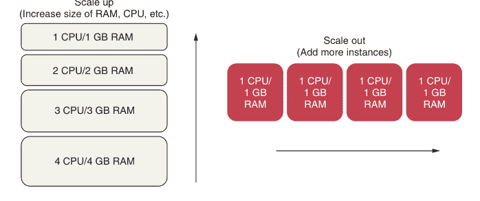

## 2.3.9 可丢弃性

微服务是可丢弃的，可以按需启动和停止，以便实现弹性扩展并快速部署应用代码和配置更改。理想情况下，从执行启动命令到进程准备好接收请求，启动时间应为几秒钟。

我们所说的可丢弃是指我们可以移除出现故障的实例并用新实例替换，而不会影响任何其他服务。例如，如果微服务的其中一个实例因底层硬件故障而出现故障，我们可以在不影响其他微服务的情况下关闭该实例，并在需要时在其他地方启动另一个实例。

## 2.3.10 开发/生产环境一致性

此最佳实践是指使不同环境（例如开发、暂存、生产）尽可能相似。环境应始终包含已部署代码的相似版本，以及基础设施和服务。这可以通过持续部署来实现，持续部署尽可能自动化部署过程，使微服务能够在短时间内在环境之间部署。

代码一旦提交，就应进行测试，然后尽快从开发一直推广到生产。如果我们想避免部署错误，这一准则至关重要。拥有相似的开发和生产环境使我们能够控制部署和执行应用时可能出现的各种场景。

## 2.3.11 日志

日志是事件流。随着这些日志的写入，日志应由 Logstash（https://www.elastic.co/logstash）或 Fluentd（https://www.fluentd.org/）等工具管理，这些工具收集日志并将其写入中央位置。微服务永远不应关心其发生的机制。它只需要专注于将日志条目写入标准输出（stdout）。

在第 11 章中，我们将演示如何提供自动配置以将这些日志发送到 ELK Stack（Elasticsearch、Logstash 和 Kibana）。图 2.11 显示了使用该堆栈的微服务架构中日志的工作方式。

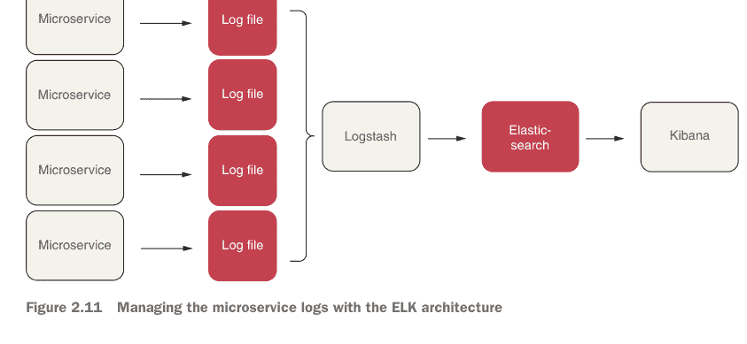

图 2.11 使用 ELK 架构管理微服务日志

## 2.3.12 管理进程

开发人员经常需要为其服务执行管理任务（例如数据迁移或转换）。这些任务绝不应是临时性的，而应通过由源代码仓库管理和维护的脚本来完成。脚本应可重复且不变（脚本代码不会针对每个环境进行修改），并且可在其运行的每个环境中通用。重要的是要定义我们在运行微服务时需要考虑的任务类型，这样如果我们有多个具有这些脚本的微服务，就能够在无需手动操作的情况下执行所有管理任务。

**注意** 如果你有兴趣阅读更多关于 Heroku 的十二要素宣言的内容，请访问十二要素应用网站（https://12factor.net/）。

在第 8 章中，我们将解释如何使用 Spring Cloud API Gateway 实现这些功能。现在我们已经了解了最佳实践是什么，我们可以继续下一节，在那里我们将开始使用 Spring Boot 和 Spring Cloud 构建我们的第一个微服务。

## 2.4 确保我们的示例相关

我们希望确保本书提供的示例是你日常工作中可以关联的。为此，我们围绕一家名为 Optima Growth 的虚构公司的软件产品，构建了本书的章节和相应的代码示例。

Optima Growth 是一家软件开发公司，其核心产品 Optima Stock（我们称之为 O-stock）提供企业级资产管理应用。它涵盖了所有关键要素：库存、软件交付、许可证管理、合规性、成本和资源管理。其主要目标是使组织能够获得其软件资产的准确即时视图。该公司大约有 12 年历史。

该公司希望重建其核心产品 O-stock。虽然应用的大部分业务逻辑将保留，但应用本身将从单体架构分解为更小的微服务设计，其各个部分可以独立部署到云端。O-stock 的重新平台化可能是该公司的“成败”时刻。

> **注意** 本书中的示例不会构建整个 O-stock 应用。相反，我们将从所涉及的问题域中构建特定的微服务，并创建支持这些服务的基础设施。我们将通过使用各种 Spring Cloud（以及一些非 Spring Cloud）技术来实现这一点。

成功采用基于云的微服务架构将影响技术组织的所有部分，包括架构、工程（开发）和运营团队。需要每个团队的投入，最终，这些团队可能需要重新组织，因为团队在这种新环境中重新评估其职责。让我们以 Optima Growth 为起点，开始识别和构建 O-stock 中使用的多个微服务的基础工作。然后我们将使用 Spring Boot 构建这些服务。

> **注意** 我们理解资产管理系统架构的复杂性。因此，在本书中，我们将只使用其一些基本概念，重点是使用简单系统作为示例来创建一个完整的微服务架构。创建完整的软件资产管理应用超出了本书的范围。


## 2.5 使用 Spring Boot 和 Java 构建微服务

在本节中，我们将为上一节提到的 Optima Growth 公司构建一个名为 *licensing service* 的微服务的骨架。我们将使用 Spring Boot 创建所有微服务。

Spring Boot，如前所述，是 Spring 库之上的一层抽象层，它允许我们以比在完整的 Spring 应用中更少的仪式感和配置，快速构建基于 Groovy 和 Java 的 Web 应用和微服务。对于许可服务示例，我们将使用 Java 作为核心编程语言，Apache Maven 作为构建工具。在接下来的章节中，我们将

- 1. 创建微服务的基本骨架以及构建应用的 Maven 脚本
- 2. 实现一个 Spring 启动类，该类将启动微服务的 Spring 容器并启动该类的任何初始化工作的启动

### 2.5.1 设置环境

要开始构建我们的微服务，您应具备以下组件：

- - Java 11 (http://mng.bz/ZP4m)
- - Maven 3.5.4 或更高版本 (https://maven.apache.org/download.cgi)
- - Spring Tools 4 (https://spring.io/tools) 或您可以在所选的集成开发环境（IDE）中下载它
- - IDEs 例如
  - Eclipse (https://www.eclipse.org/downloads/)
  - IntelliJ IDEA (https://www.jetbrains.com/idea/download/)
  - NetBeans (https://netbeans.org/features/index.html)

> **NOTE** 从现在开始的所有代码列表都将使用 Spring Framework 5 和 Spring Boot 2 创建。重要的是要理解，我们不会解释 Spring Boot 的所有功能，我们只会突出创建微服务所需的核心功能。另一个重要事实是，我们将在本书中使用 Java 11，以便尽可能覆盖最多的受众。

### 2.5.2 使用骨架项目开始

首先，您将使用 Spring Initializr 为 O-stock 的许可服务创建一个骨架项目。Spring Initializr (https://start.spring.io/) 使您能够使用从广泛列表中选择的依赖项创建一个新的 Spring Boot 项目。此外，它还允许您更改即将创建的特定项目配置。图 2.12 和 2.13 显示了许可服务的 Spring Initializr 页面应如何显示。

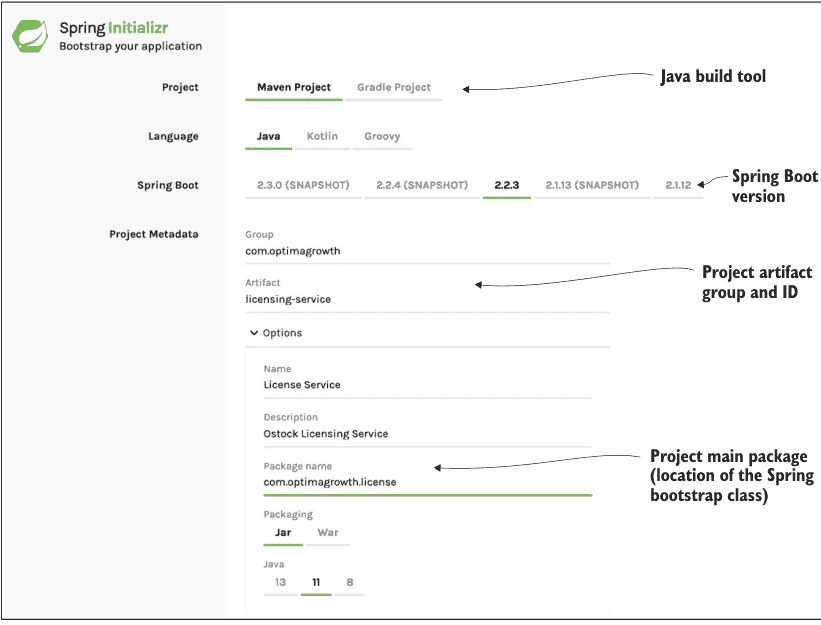

图 2.12 许可服务的 Spring Initializr 依赖项

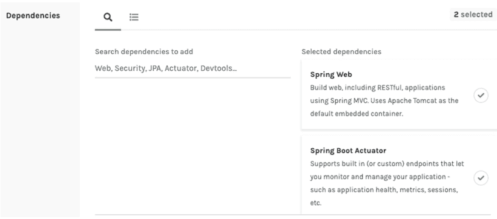

图 2.13 许可服务的 Spring Initializr 配置

NOTE 您也可以从 GitHub 仓库 here 拉取源代码：https://github.com/ihuaylupo/manning-smia/tree/master/chapter2。

一旦您将项目作为 Maven 项目导入到首选的 IDE 中，让我们添加以下包：

```
com.optimagrowth.license.controller
com.optimagrowth.license.model
com.optimagrowth.license.service
```

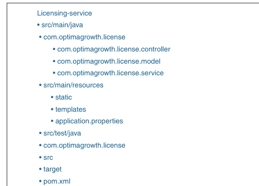

图 2.14 O-stock 的许可项目结构，包含引导类、application properties、tests 和 pom.xml

NOTE 对如何测试我们的微服务的深入讨论超出了本书的范围。如果您有兴趣深入了解如何创建单元、集成和平台测试，我们强烈推荐 Alex Soto Bueno、Andy Gumbrecht 和 Jason Porter 的书籍《Testing Java Microservices》（Manning, 2018）。

# Listing 2.2 许可服务的 Maven pom 文件

```
<?xml version="1.0" encoding="UTF-8"?>
<project xmlns="http://maven.apache.org/POM/4.0.0"
        xmlns:xsi="http://www.w3.org/2001/XMLSchema-instance"
        xsi:schemaLocation="http://maven.apache.org/POM/4.0.0 https://maven.apache.org/xsd/maven-4.0.0.xsd">
    <modelVersion>4.0.0</modelVersion>
    <parent>
        <groupId>org.springframework.boot</groupId>
        <artifactId>
            spring-boot-starter-parent
```

1 指示 Maven 包含 Spring Boot starter kit 依赖项

```
[INFO] --- maven-dependency-plugin:3.1.1:tree (default-cli) @ licensing-service ---
[INFO] com.optimagrowth:licensing-service:jar:0.0.1-SNAPSHOT
[INFO] +- org.springframework.boot:spring-boot-starter-hateoas:jar:2.2.3.RELEASE:compile
[INFO] |  \- org.springframework.hateoas:spring-hateoas:jar:1.0.3.RELEASE:compile
[INFO] |  +- org.springframework:spring-aop:jar:5.2.3.RELEASE:compile
[INFO] |  +- org.springframework:spring-beans:jar:5.2.3.RELEASE:compile
[INFO] |  +- org.springframework:spring-context:jar:5.2.3.RELEASE:compile
[INFO] |  +- org.springframework.plugins:spring-plugin-core:jar:2.0.0.RELEASE:compile
[INFO] |  \- org.slf4j:slf4j-api:jar:1.7.30:compile
[INFO] +- org.springframework.boot:spring-boot-starter-actuator:jar:2.2.3.RELEASE:compile
[INFO] |  +- org.springframework.boot:spring-boot-starter:jar:2.2.3.RELEASE:compile
[INFO] |  |  +- org.springframework.boot:spring-boot-autoconfigure:jar:2.2.3.RELEASE:compile
[INFO] |  |  +- org.springframework.boot:spring-boot-starter-logging:jar:2.2.3.RELEASE:compile
[INFO] |  |  |  +- ch.qos.logback:logback-classic:jar:1.2.3:compile
[INFO] |  |  |  |  \- ch.qos.logback:logback-core:jar:1.2.3:compile
[INFO] |  |  |  +- org.apache.logging.log4j:log4j-to-slf4j:jar:2.12.1:compile
[INFO] |  |  |  \- org.apache.logging.log4j:log4j-api:jar:2.12.1:compile
[INFO] |  |  \- org.slf4j:jul-to-slf4j:jar:1.7.30:compile
[INFO] |  +- jakarta.annotation:jakarta.annotation-api:jar:1.3.5:compile
[INFO] |  +- org.yaml:snakeyaml:jar:1.25:runtime
[INFO] +- org.springframework.boot:spring-boot-actuator-autoconfigure:jar:2.2.3.RELEASE:compile
[INFO] |  +- org.springframework.boot:spring-boot-starter-actuator:jar:2.2.3.RELEASE:compile
[INFO] |  +- com.fasterxml.jackson.core:jackson-databind:jar:2.10.2:compile
[INFO] |  +- com.fasterxml.jackson.core:jackson-annotations:jar:2.10.2:compile
[INFO] |  +- com.fasterxml.jackson.core:jackson-core:jar:2.10.2:compile
[INFO] |  \- com.fasterxml.jackson.datatype:jackson-datatype-jsr310:jar:2.10.2:compile
[INFO] |  \- io.micrometer:micrometer-core:jar:1.3.2:compile
[INFO] |  +- org.hdrhistogram:HdrHistogram:jar:2.1.11:compile
[INFO] |  \- org.latencyutils:LatencyUtils:jar:2.0.3:compile
[INFO] +- org.springframework.boot:spring-boot-starter-web:jar:2.2.3.RELEASE:compile
[INFO] |  +- org.springframework.boot:spring-boot-starter-json:jar:2.2.3.RELEASE:compile
[INFO] |  |  +- com.fasterxml.jackson.datatype:jackson-datatype-jdk8:jar:2.10.2:compile
[INFO] |  |  +- com.fasterxml.jackson.module:jackson-module-parameter-names:jar:2.10.2:compile
[INFO] +- org.springframework.boot:spring-boot-starter-tomcat:jar:2.2.3.RELEASE:compile
[INFO] |  +- org.apache.tomcat.embed:tomcat-embed-core:jar:9.0.30:compile
[INFO] |  +- org.apache.tomcat.embed:tomcat-embed-el:jar:9.0.30:compile
[INFO] |  \- org.apache.tomcat.embed:tomcat-embed-websocket:jar:9.0.30:compile
[INFO] +- org.springframework.boot:spring-boot-starter-validation:jar:2.2.3.RELEASE:compile
[INFO] |  +- jakarta.validation:jakarta.validation-api:jar:2.0.2:compile
[INFO] |  \- org.hibernate.validator:hibernate-validator:jar:6.0.18.Final:compile
[INFO] |  +- org.jboss.logging:jboss-logging:jar:3.4.1.Final:compile
[INFO] |  \- com.fasterxml:classmate:jar:1.5.1:compile
[INFO] +- org.springframework:spring-web:jar:5.2.3.RELEASE:compile
[INFO] +- org.springframework:spring-webmvc:jar:5.2.3.RELEASE:compile
[INFO] |  \- org.springframework:spring-expression:jar:5.2.3.RELEASE:compile
[INFO] +- org.springframework.boot:spring-boot-starter-test:jar:2.2.3.RELEASE:test
[INFO] |  +- org.springframework.boot:spring-boot-test:jar:2.2.3.RELEASE:test
[INFO] |  +- org.springframework.boot:spring-boot-test-autoconfigure:jar:2.2.3.RELEASE:test
```

Maven 依赖树显示了当前项目中使用的所有依赖项的树。

Tomcat 9.0.30 版本

Spring framework 5.2.3.RELEASE 版本

图 2.15 O-stock 的许可服务的依赖树。依赖树显示了在服务中声明和使用的所有依赖项。

## 2.5.3 启动 Spring Boot 应用：编写引导类

本节的目标是让一个简单的微服务在 Spring Boot 中运行，然后对其进行迭代以提供一些功能。为此，您需要在许可服务微服务中创建两个类：

- - 一个 Spring 引导类，Spring Boot 用它来启动和初始化应用
- - 一个 Spring 控制器类，它公开可在微服务上调用的 HTTP 端点

正如您很快会看到的，Spring Boot 使用注解来简化服务的设置和配置。这在查看以下代码列表中的引导类时变得明显。您会发现此引导类位于 src/main/java/com/optimagrowth/license 中的 LicenseServiceApplication.java 文件中。


## 清单2.3 引入@SpringBootApplication注解

```java
package com.optimagrowth.license;

import org.springframework.boot.SpringApplication;
import org.springframework.boot.autoconfigure.SpringBootApplication;

@SpringBootApplication
public class LicenseServiceApplication {

    public static void main(String[] args) {
        SpringApplication.run(
            LicenseServiceApplication.class, args);
    }
}
```

这段代码中首先要注意的是使用了`@SpringBootApplication`注解。Spring Boot使用这个注解来告诉Spring容器，这个类是bean定义的来源。在Spring Boot应用中，你可以通过以下方式定义Spring bean：

1. 用`@Component`、`@Service`或`@Repository`注解标记一个Java类
2. 用`@Configuration`标记一个类，然后用`@Bean`为每个想要构建的Spring bean定义一个带有`@Bean`标签的工厂方法

**注意** Spring bean是Spring框架在运行时通过控制反转（IoC）容器管理的对象。它们会被创建并添加到一个“对象仓库”中，以便你之后获取。

在底层，`@SpringBootApplication`注解将清单2.3中的应用类标记为配置类，然后开始自动扫描Java类路径上的所有类以寻找其他Spring bean。

清单2.3中要注意的第二件事是`LicenseServiceApplication`类中的`main()`方法。`main()`方法中的`SpringApplication.run(LicenseServiceApplication.class, args)`调用会启动Spring容器，并返回一个Spring `ApplicationContext`对象。（我们没有对`ApplicationContext`做任何操作，所以代码中没有显示。）

关于`@SpringBootApplication`注解和相应的`LicenseServiceApplication`类，最容易记住的是它是整个微服务的引导类。服务的核心初始化逻辑应该放在这个类中。

既然我们知道了如何为微服务创建骨架和引导类，让我们进入下一章。在下一章中，我们将解释在构建微服务时需要考虑的一些关键角色，以及这些角色如何参与O-stock场景的创建。同时，我们还将介绍一些额外的技术，使我们的微服务更加灵活和健壮。

## 小结

- Spring Cloud是一系列来自Netflix和HashiCorp等公司的开源技术。这一技术通过Spring注解进行“包装”，极大地简化了这些服务的设置和配置。
- 云原生应用由容器等可扩展组件构建，以微服务形式部署，并通过具有持续交付工作流的DevOps流程在虚拟基础设施上进行管理。
- DevOps是开发（Dev）和运维（Ops）的缩写。它指的是一种软件开发方法论，关注软件开发人员与IT运维之间的沟通、协作和集成。主要目标是以较低成本自动化软件交付和基础设施变更的过程。
- 由Heroku提出的十二要素应用宣言提供了构建云原生微服务时应实施的最佳实践。
- 十二要素应用宣言的最佳实践包括：代码库、依赖、配置、后端服务、构建、发布、运行、进程、端口绑定、并发、可处置性、开发/生产环境一致性、日志和管理进程。
- Spring Initializr允许你创建一个新的Spring Boot项目，同时从广泛的依赖列表中选择依赖。
- Spring Boot是构建微服务的理想框架，因为它允许你通过几个简单的注解构建一个基于REST的JSON服务。

## 使用Spring Boot构建微服务

**本章涵盖内容**

- 理解微服务如何融入云架构
- 将业务领域分解为一组微服务
- 理解构建微服务应用的视角
- 学习何时不使用微服务
- 实现微服务

要成功设计和构建微服务，你需要像警探询问案件目击者一样来处理它们。虽然每个证人看到了同一事件，但他们对案件的解读会受到自身背景、对他们重要的事物（例如，什么激励他们）以及他们目击事件时所承受的环境压力的影响。每个证人对他们认为关键的内容都有自己的视角（和偏见）。

就像努力查明真相的成功警探一样，构建成功微服务架构的旅程需要整合你的软件开发组织中多个个人的视角。因为交付整个应用需要的不只是技术人员，我们认为成功的微服务开发基础始于三个关键角色的视角：

- *架构师*——看到全局，将应用分解为单个微服务，然后理解微服务之间如何交互以交付解决方案。
- *软件开发人员*——编写代码，并理解如何使用语言和开发框架来交付微服务。
- *DevOps工程师*——决定服务在生产和非生产环境中如何部署和管理。DevOps工程师的关键词是*一致性*和*可重复性*，在每一个环境中都如此。

在本章中，我们将从每个角色的视角演示如何设计和构建一组微服务。本章将为你提供所需的基础，帮助你识别自己业务应用中潜在的微服务，并理解部署微服务所需具备的运维属性。到本章结束时，你将拥有一个可以使用第2章创建的骨架项目打包并部署到云端的服务。

### 3.1 架构师的故事：设计微服务架构

架构师在软件项目中的角色是为需要解决的问题提供一个工作模型。架构师提供了开发者在其上构建代码的脚手架，使应用的所有部分能够组合在一起。当构建微服务时，项目架构师关注三个关键任务：

- 分解业务问题
- 确定服务粒度
- 定义服务接口

#### 3.1.1 分解业务问题

面对复杂性时，大多数人会试图将正在处理的问题分解为可管理的块。他们这样做是为了不必把所有问题细节都记在脑子里。他们可能会将问题分解为几个基本部分，然后寻找这些部分之间存在的关系。

在微服务架构中，过程大致相同。架构师将业务问题分解为多个块，这些块代表不同的活动领域。这些块封装了与业务领域特定部分相关的业务规则和数据逻辑。例如，架构师可能会查看一个需要通过代码执行的业务流程，并意识到它同时需要客户和产品信息。

**提示** 存在两个独立的数据域是多个微服务在起作用的良好迹象。业务事务的两个不同部分如何交互，通常成为微服务的服务接口。

分解业务领域是一种艺术形式，而不是非黑即白的科学。你可以使用以下指南来识别业务问题并将其分解为微服务候选：

- *描述业务问题，并注意描述时使用的名词。*在描述问题时反复使用相同的名词，通常是核心业务领域以及微服务机会的良好迹象。O-stock应用的目标名词示例可能包括*合同*、*许可证*和*资产*。
- *注意动词。*动词突出行动，通常代表问题领域的天然轮廓。如果你发现自己说“事务X需要从事物A和事物B获取数据”，这通常意味着有多个服务在起作用。
- 如果将此方法应用于O-stock应用，你可能会寻找这样的表述：“当桌面服务部门的Mike设置一台新PC时，他会查找软件X可用许可证的数量，如果有许可证可用，则安装该软件。然后他会更新跟踪电子表格中已使用的许可证数量。”这里的关键动词是*查找*和*更新*。
- *寻找数据内聚性。*当你将业务问题分解为离散的部分时，寻找彼此高度相关的数据片段。如果在交谈过程中，你突然读取或更新了与之前讨论完全不同的数据，那么你可能有了另一个服务候选。微服务必须完全拥有它们的数据。

让我们将这些指南应用于一个真实世界的问题，比如用于管理软件资产的O-stock软件。（我们在第2章首次提到这个应用。）

提醒一下，O-stock是Optima Growth的单体Web应用，部署在客户数据中心内的Java EE应用服务器上。我们的目标是将现有的单体应用拆分为一组服务。为了实现这一目标，我们将从访谈O-stock应用的用户和一些业务利益相关者开始，讨论他们如何与应用交互和使用应用。图3.1总结并突出显示了与不同业务客户的一些对话中的许多名词和动词。


和


## 3.2.2 服务器或容器蔓延

微服务最常见的部署模型之一是将一个微服务实例部署在一个容器中。在大型基于微服务的应用中，最终可能会有50到100个服务器或容器（通常是虚拟的）需要单独在生产环境中构建和维护。即使在云端运行这些服务的成本较低，管理和监控这些服务的运维复杂性也可能是巨大的。

> 注意：微服务的灵活性必须与运行所有这些服务器的成本进行权衡。你也可以有其他选择，例如考虑像lambda这样的功能开发，或者在同一台服务器上添加更多的微服务实例。

## 3.2.3 应用类型

微服务面向可重用性，对于构建需要高度弹性和可扩展性的大型应用非常有用。这也是许多基于云的公司采用微服务的原因之一。如果你正在构建小型的、部门级应用，或者用户群较小的应用，那么构建像微服务这样的分布式模型所带来的复杂性可能会产生超过其价值的费用。

## 3.2.4 数据事务与一致性

当你开始考虑微服务时，需要仔细思考服务和服务消费者的数据使用模式。一个微服务封装并抽象了少量表，非常适合执行“操作性”任务，如对数据存储进行创建、添加以及执行简单（非复杂）查询。

如果你的应用需要在多个数据源之间进行复杂的数据聚合或转换，微服务的分布式特性将使这项工作变得困难。你的微服务将不可避免地承担过多责任，也可能容易出现性能问题。

## 3.3 开发者的故事：使用Spring Boot和Java构建微服务

在本节中，我们将探讨开发者在从O-stock领域模型构建许可微服务时的优先事项。

> 注意：我们在上一章中创建了许可服务的骨架。如果你没有按照那一章的代码清单操作，可以从 https://github.com/ihuaylupo/manning-smia/tree/master/chapter2 下载源代码。

在接下来的几节中，我们将：

- 1. 实现一个Spring Boot控制器类，用于映射端点以暴露许可服务的端点
- 2. 实现国际化，使消息可以适应不同的语言
- 3. 实现Spring HATEOAS，以提供足够的信息，使用户能够与服务器交互

### 3.3.1 构建微服务的入口：Spring Boot控制器

现在我们已经解决了构建脚本（参见第2章）并实现了一个简单的Spring Boot引导类，你可以编写第一个具有实际功能的代码了。这个代码就是你的控制器类。在Spring Boot应用中，控制器类暴露服务端点，并将传入的HTTP请求中的数据映射到处理请求的Java方法上。

#### 赋予它REST风格

本书中的所有微服务都遵循Richardson成熟度模型（http://mng.bz/JD5Z）。你将构建的所有服务都具有以下特征：

- - 使用HTTP/HTTPS作为服务的调用协议——HTTP端点暴露服务，HTTP协议携带进出服务的数据。
- - 将服务的行为映射到标准的HTTP动词——REST强调让服务将其行为映射到HTTP动词POST、GET、PUT和DELETE。这些动词映射到大多数服务中的CRUD功能。
- - 使用JSON作为进出服务的所有数据的序列化格式——这不是基于REST的微服务的硬性规定，但JSON已成为微服务提交和返回数据序列化的“通用语言”。你也可以使用XML，但许多基于REST的应用都使用JavaScript和JSON。JSON是基于JavaScript的Web前端和服务所消费数据进行序列化和反序列化的原生格式。
- - 使用HTTP状态码来传达服务调用的状态——HTTP协议使用丰富的状态码来表示服务的成功或失败。基于REST的服务利用这些HTTP状态码和其他基于Web的基础设施，如反向代理和缓存。这些可以相对容易地与你的微服务集成。

HTTP是Web的语言。使用HTTP作为构建服务的哲学框架是在云端构建服务的关键。

你可以在 `src/main/java/com/optimagrowth/license/controller/LicenseController.java` 中找到你的第一个控制器类。`LicenseController` 类暴露了四个HTTP端点，它们将映射到POST、GET、PUT和DELETE动词。

让我们浏览这个控制器类，看看Spring Boot如何提供一组注解，帮助你将暴露服务端点所需的工作量降至最低，并让你专注于构建服务的业务逻辑。我们将从查看基本的控制器类定义开始，此时还没有任何类方法。下面的清单显示了O-stock许可服务的控制器类。

### 清单 3.1 将 `LicenseServiceController` 标记为 Spring `RestController`

```java
package com.optimagrowth.license.controller;

import java.util.Random;

import org.springframework.http.ResponseEntity;
import org.springframework.web.bind.annotation.PathVariable;
import org.springframework.web.bind.annotation.PostMapping;
import org.springframework.web.bind.annotation.PutMapping;
import org.springframework.web.bind.annotation.RequestBody;
import org.springframework.web.bind.annotation.RequestMapping;
import org.springframework.web.bind.annotation.RequestMethod;
import org.springframework.web.bind.annotation.RestController;

import com.optimagrowth.license.model.License;

@RestController
@RequestMapping(value="/v1/organization/{organizationId}/license")
public class LicenseController {
}
```

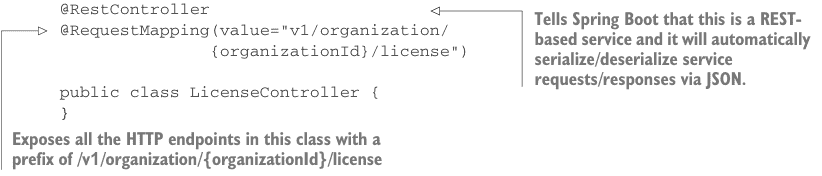

我们将从 `@RestController` 注解开始探索。`@RestController` 是一个类级别的Java注解，告诉Spring容器这个Java类将用于基于REST的服务。这个注解会自动处理传入服务的数据的序列化，可以是JSON或XML（默认情况下，该类将返回的数据序列化为JSON）。与传统的Spring `@Controller` 注解不同，`@RestController` 不要求你从控制器类的方法中返回ResponseBody类。所有这些都由 `@RestController` 注解的存在来处理，该注解包含 `@ResponseBody` 注解。

> **为什么微服务使用JSON？**
> 
> 我们可以使用多种协议在基于HTTP的微服务之间发送和接收数据。但JSON已成为事实上的标准，原因如下：
> 
> - 与其他协议如基于XML的SOAP（简单对象访问协议）相比，JSON非常轻量。你可以在没有太多文本开销的情况下表达数据。

### 清单 3.2 探索许可模型

```java
package com.optimagrowth.license.model;

import lombok.Getter;
import lombok.Setter;
import lombok.ToString;

@Getter @Setter @ToString
public class License {
    private int id;
    private String licenseId;
    private String description;
    private String organizationId;
    private String productName;
    private String licenseType;
}
```

一个包含许可信息的普通Java对象（POJO）。

### Lombok

Lombok是一个小型库，允许我们减少项目中Java类中编写的样板Java代码量。Lombok会生成诸如getter和setter、字符串方法（如`toString`）、构造函数等代码。

在本书中，我们将在所有代码示例中使用Lombok，以使代码更具可读性，但不会深入探讨如何使用它。如果你有兴趣了解更多关于Lombok的信息，我们强烈推荐你阅读以下Baeldung.com文章：

- - https://www.baeldung.com/intro-to-project-lombok
- - https://www.baeldung.com/lombok-ide

如果你希望在Spring Tools Suite 4上安装Lombok，你必须下载并执行Lombok，并将其链接到IDE。

下面的清单显示了我们将使用的服务类，用于开发我们将在控制器类中创建的不同服务的逻辑。

### 清单 3.3 探索 LicenseService 类

```java
package com.optimagrowth.license.service;

import java.util.Random;

import org.springframework.stereotype.Service;
import org.springframework.util.StringUtils;

import com.optimagrowth.license.model.License;
```


```java
@Service
public class LicenseService {

    public License getLicense(String licenseId, String organizationId){
        License license = new License();
        license.setId(new Random().nextInt(1000));
        license.setLicenseId(licenseId);
        license.setOrganizationId(organizationId);
        license.setDescription("Software product");
        license.setProductName("Ostock");
        license.setLicenseType("full");

        return license;
    }

    public String createLicense(License license, String organizationId){
        String responseMessage = null;
        if(license != null) {
            license.setOrganizationId(organizationId);
            responseMessage = String.format("This is the post and the object is: %s", license.toString());
        }

        return responseMessage;
    }

    public String updateLicense(License license, String organizationId){
        String responseMessage = null;
        if (license != null) {
            license.setOrganizationId(organizationId);
            responseMessage = String.format("This is the put and the object is: %s", license.toString());
        }

        return responseMessage;
    }

    public String deleteLicense(String licenseId, String organizationId){
        String responseMessage = null;
        responseMessage = String.format("Deleting license with id %s for the organization %s", licenseId, organizationId);
        return responseMessage;
    }
}
```

这个服务类包含一组示例服务，返回硬编码的数据，让你了解微服务的骨架应该是什么样子。继续阅读时，你将继续完善这个服务，我们也会深入探讨如何构建它。现在，让我们先为控制器添加第一个方法。该方法实现 REST 调用中使用的 GET 动词，并返回单个 License 类实例，如下一个代码清单所示。

在方法的参数上使用语法。对于清单 3.4 中的 GET 服务，我们将 URL 中的两个参数（`organizationId` 和 `licenseId`）映射到方法中的两个参数级变量，如下所示：

```
@PathVariable("organizationId") String organizationId
@PathVariable("licenseId") String licenseId
```

最后，让我们检查一下 `ResponseEntity` 返回对象。`ResponseEntity` 表示整个 HTTP 响应，包括状态码、响应头和响应体。在前面的清单中，它允许我们将 `License` 对象作为响应体返回，并将 200（OK）状态码作为服务的 HTTP 响应。

现在你已了解如何使用 HTTP GET 动词创建端点，接下来我们继续添加 POST、PUT 和 DELETE 方法，以创建、更新和删除 `License` 类实例。下面的清单展示了如何实现。

## 清单 3.5 暴露单个 HTTP 端点

```java
package com.optimagrowth.license.controller;

import org.springframework.beans.factory.annotation.Autowired;
import org.springframework.http.ResponseEntity;
import org.springframework.web.bind.annotation.DeleteMapping;
import org.springframework.web.bind.annotation.PathVariable;
import org.springframework.web.bind.annotation.PostMapping;
import org.springframework.web.bind.annotation.PutMapping;
import org.springframework.web.bind.annotation.RequestBody;
import org.springframework.web.bind.annotation.RequestMapping;
import org.springframework.web.bind.annotation.RequestMethod;
import org.springframework.web.bind.annotation.RestController;

import com.optimagrowth.license.model.License;
import com.optimagrowth.license.service.LicenseService;

@RestController
@RequestMapping(value="v1/organization/{organizationId}/license")
public class LicenseController {

    @Autowired
    private LicenseService licenseService;

    @RequestMapping(value="/{licenseId}",method = RequestMethod.GET)
    public ResponseEntity<License> getLicense(
        @PathVariable("organizationId") String organizationId,
        @PathVariable("licenseId") String licenseId) {

        License license = licenseService.getLicense(licenseId, organizationId);
        return ResponseEntity.ok(license);
    }

    @PutMapping
    public ResponseEntity<String> updateLicense(
        @PathVariable("organizationId")
        String organizationId,
        @RequestBody License request) {
        return ResponseEntity.ok(licenseService.updateLicense(request, organizationId));
    }

    @PostMapping
    public ResponseEntity<String> createLicense(
        @PathVariable("organizationId") String organizationId,
        @RequestBody License request) {
        return ResponseEntity.ok(licenseService.createLicense(request, organizationId));
    }

    @DeleteMapping(value="/{licenseId}")
    public ResponseEntity<String> deleteLicense(
        @PathVariable("organizationId") String organizationId,
        @PathVariable("licenseId") String licenseId) {
        return ResponseEntity.ok(licenseService.deleteLicense(licenseId, organizationId));
    }
}
```

- PUT 方法用于更新许可证
- 将 HTTP 请求体映射到 License 对象
- POST 方法用于插入许可证
- DELETE 方法用于删除许可证

在清单 3.5 中，我们首先使用方法级的 `@PutMapping` 注解来标注 `updateLicense()` 方法。这个注解是 `@RequestMapping(method = RequestMethod.PUT)` 的快捷方式，而我们还没有使用过后者。

接下来需要注意，我们在 `updateLicense()` 方法的参数中使用了 `@PathVariable` 和 `@RequestBody` 注解。`@RequestBody` 将 HTTP 请求体映射到一个传输对象（在本例中是 `License` 对象）。在 `updateLicense()` 方法中，我们将来自两个参数（一个来自 URL，另一个来自 HTTP 请求体）的值映射到 `createLicense` 方法中的两个参数级变量：

```
@PathVariable("organizationId") String organizationId
@RequestBody License request
```

最后，在清单 3.5 中注意我们使用了 `@PostMapping` 和 `@DeleteMapping` 注解。`@PostMapping` 注解是方法级注解，是以下写法的快捷方式：

```
@RequestMapping(method = RequestMethod.POST)
```

`@DeleteMapping(value="/{licenseId}")` 也是方法级注解，是以下写法的快捷方式：

```
@RequestMapping(value="/{licenseId}",method = RequestMethod.DELETE)
```

## 端点命名很重要

在深入编写微服务之前，请确保你（以及组织中可能涉及的其他团队）为要通过服务暴露的端点建立标准。微服务的 URL（统一资源定位符）应清晰地传达服务的意图、服务管理的资源，以及服务内所管理资源之间的关系。我们发现以下指南对于命名服务端点非常有用：

- *使用清晰的 URL 名称*，明确服务所代表的资源。为定义 URL 建立规范格式，有助于让 API 更直观、更易用，并保持命名约定的一致性。
- *使用 URL 建立资源之间的关系。* 很多时候，微服务中的资源之间存在父子关系，子资源在父资源上下文之外是不存在的。因此，你可能不必为子资源单独创建微服务。使用 URL 来表达这些关系。如果你发现 URL 趋于冗长和嵌套，那可能意味着微服务承担的职责过多。
- *尽早为 URL 建立版本化方案。* URL 及其对应端点代表了服务提供方与服务消费方之间的契约。一种常见模式是为所有端点加上版本号前缀。尽早确定版本化方案并坚持执行。当已有多个消费者在使用 URL 时，再想为 URL 添加版本化（例如在 URL 映射中使用 `/v1/`）将极其困难。

此时，你已经有了几个服务。在命令行窗口中，进入项目根目录（其中可以找到 `pom.xml`），然后执行以下 Maven 命令。（图 3.4 展示了该命令的预期输出。）

```
mvn spring-boot:run
```

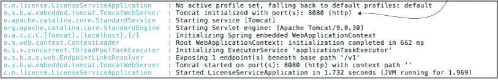

许可证服务器在端口 8080 上启动

图 3.4  显示许可服务成功启动的输出


服务启动后，您可以直接选择暴露的端点。我们强烈建议使用基于 Chrome 的工具（如 Postman 或 cURL）来调用服务。图 3.5 展示了如何在一个端点上调用 GET 和 DELETE 服务。

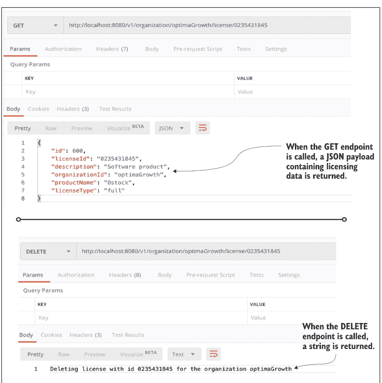

**图 3.5** 使用 Postman 调用您的许可服务的 GET 和 DELETE 服务

图 3.6 展示了如何使用 http://localhost:8080/v1/organization/optimaGrowth/license 端点调用 POST 和 PUT 服务。

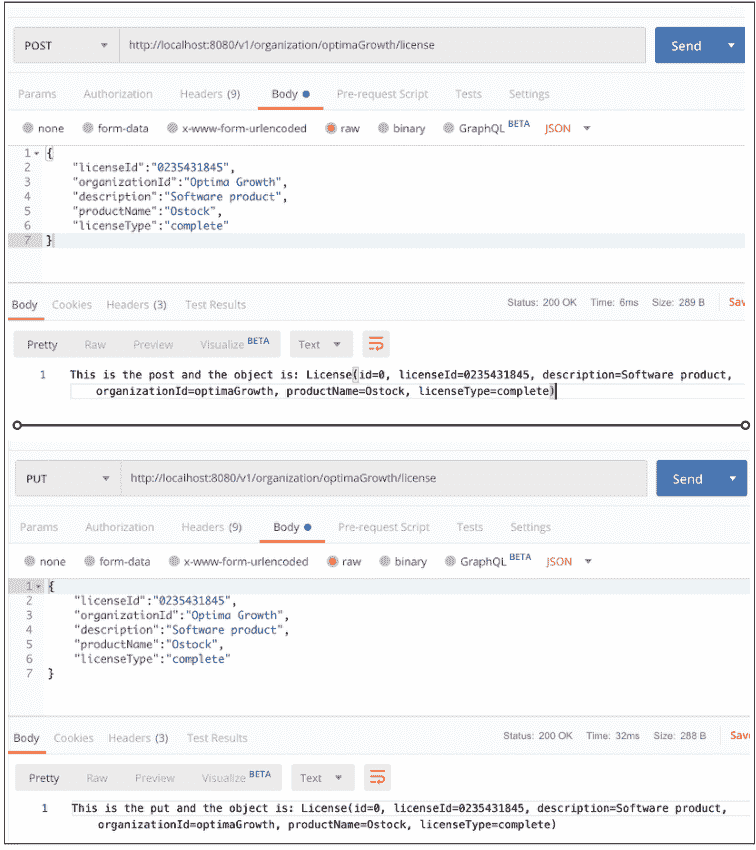

**图 3.6** 使用 Postman 调用您的许可服务的 POST 和 PUT 服务

一旦我们实现了 PUT、DELETE、POST 和 GET 这些 HTTP 动词对应的方法，就可以继续进行国际化。

## 3.3.2 向许可服务添加国际化

国际化是使应用程序能够适应不同语言的基本要求。这里的主要目标是开发能够以多种格式和语言提供内容的应用程序。在本节中，我们将解释如何向之前创建的许可服务添加国际化。

首先，我们将更新启动类 `LicenseServiceApplication.java`，为许可服务创建一个 `LocaleResolver` 和一个 `ResourceBundleMessageSource`。以下清单展示了启动类应有的样子。

**清单 3.6** 为启动类创建 Bean

```java
package com.optimagrowth.license;

import java.util.Locale;

import org.springframework.boot.SpringApplication;
import org.springframework.boot.autoconfigure.SpringBootApplication;
import org.springframework.context.annotation.Bean;
import org.springframework.context.support.ResourceBundleMessageSource;
import org.springframework.web.servlet.LocaleResolver;
import org.springframework.web.servlet.i18n.SessionLocaleResolver;

@SpringBootApplication
public class LicenseServiceApplication {

    public static void main(String[] args) {
        SpringApplication.run(LicenseServiceApplication.class, args);
    }

    @Bean
    public LocaleResolver localeResolver() {
        SessionLocaleResolver localeResolver = new SessionLocaleResolver();
        localeResolver.setDefaultLocale(Locale.US);
        return localeResolver;
    }
    @Bean
    public ResourceBundleMessageSource messageSource() {
        ResourceBundleMessageSource messageSource =
            new ResourceBundleMessageSource();
        messageSource.setUseCodeAsDefaultMessage(true);
        messageSource.setBasenames("messages");
        return messageSource;
    }
}
```

- 将美国设置为默认区域设置。
- 设置语言属性文件的基本名称。
- 如果找不到消息，不会抛出错误；而是返回消息代码。

清单 3.6 中首先要注意的是，我们将 `Locale.US` 设置为默认区域设置。如果在检索消息时没有设置 `Locale`，则 `messageSource` 将使用 `LocaleResolver` 中设置的默认区域设置。接下来，请注意以下调用：

```java
messageSource.setUseCodeAsDefaultMessage(true);
```

当找不到消息时，此选项会返回消息代码 `license.create.message`，而不是类似这样的错误：

```text
"No message found under code 'license.create.message' for locale 'es'"
```

```java
return responseMessage;
}

public String updateLicense(License license, String organizationId) {
    String responseMessage = null;
    if (license != null) {
        license.setOrganizationId(organizationId);
        responseMessage = String.format(messages.getMessage(
                "license.update.message", null, null),
                license.toString());
    }

    return responseMessage;
}
```


清单 3.9 中的代码有三个重要的点需要强调。首先，我们可以从控制器本身接收 `Locale`。其次，我们可以使用作为参数接收到的区域设置调用 `messages.getMessage("license.create.message", null, locale)`；第三点需要注意的是，我们可以在不发送任何区域设置的情况下调用 `messages.getMessage("license.update.message", null, null)`。在这种特定场景下，应用程序将使用我们之前在启动类中定义的默认区域设置。现在，让我们更新控制器上的 `createLicense()` 方法，以从请求的 `Accept-Language` 头中接收语言，代码如下：

```java
@PostMapping
public ResponseEntity<String> createLicense(
    @PathVariable("organizationId") String organizationId,
    @RequestBody License request,
    @RequestHeader(value = "Accept-Language", required = false)
        Locale locale){
    return ResponseEntity.ok(licenseService.createLicense(
            request, organizationId, locale));
}
```

这段代码中需要注意几点：这里我们使用了 `@RequestHeader` 注解。`@RequestHeader` 注解将方法参数与请求头值映射。在 `createLicense()` 方法中，我们从请求头 `Accept-Language` 中获取区域设置。这个服务参数不是必需的，因此如果未指定，我们将使用默认区域设置。图 3.7 向您展示了如何从 Postman 发送 `Accept-Language` 请求头。

> **注意** 关于如何使用区域设置并没有一个明确定义的规则。我们的建议是分析您的架构，选择最适合您的方案。例如，如果前端应用程序处理区域设置，那么在控制器方法中接收区域设置作为参数是最好的选择。但如果您在后端管理区域设置，则可以使用默认区域设置。

```json
"deleteLicense" : {
    "href" : "http://localhost:8080/v1/organization/optimaGrowth/license/0235431845"
}
```

在本节中，我们将向您展示如何在许可服务中实现 Spring HATEOAS。要在响应中发送与资源相关的链接，我们首先必须将 HATEOAS 依赖添加到我们的 `pom.xml` 文件中，如下所示：

```xml
<dependency>
    <groupId>org.springframework.boot</groupId>
    <artifactId>spring-boot-starter-hateoas</artifactId>
</dependency>
```

一旦有了依赖，我们就需要更新 `License` 类，使其继承自 `RepresentationModel<License>`。以下清单展示了如何做到这一点。

**清单 3.10** 从 RepresentationModel 继承

```java
package com.optimagrowth.license.model;

import org.springframework.hateoas.RepresentationModel;

import lombok.Getter;
import lombok.Setter;
import lombok.ToString;

@Getter @Setter @ToString
public class License extends RepresentationModel<License> {

    private int id;
    private String licenseId;
    private String description;
    private String organizationId;
    private String productName;
    private String licenseType;

}
```

`RepresentationModel<License>` 使我们可以向 `License` 模型类添加链接。现在我们已经完成了所有设置，让我们创建 HATEOAS 配置，以获取 `LicenseController` 类的链接。下一个清单展示了如何完成此操作。在本例中，我们只更改 `LicenseController` 类中的 `getLicense()` 方法。

```java
@RequestMapping(value="/{licenseId}", method = RequestMethod.GET)
public ResponseEntity<License> getLicense(
        @PathVariable("organizationId") String organizationId,
        @PathVariable("licenseId") String licenseId) {

    License license = licenseService.getLicense(licenseId,
                                      organizationId);
    license.add(linkTo(methodOn(LicenseController.class)
            .getLicense(organizationId, license.getLicenseId()))
            .withSelfRel(),
        linkTo(methodOn(LicenseController.class)
            .createLicense(organizationId, license, null))
            .withRel("createLicense"),
        linkTo(methodOn(LicenseController.class)
            .updateLicense(organizationId, license))
            .withRel("updateLicense"),
        linkTo(methodOn(LicenseController.class)
            .deleteLicense(organizationId, license.getLicenseId()))
            .withRel("deleteLicense"));
    return ResponseEntity.ok(license);
}
```

`add()` 方法是 `RepresentationModel` 的一个方法。`linkTo` 方法会检查 `LicenseController` 类并获取根映射，而 `methodOn` 方法通过对目标方法进行虚拟调用来获取方法映射。这两个方法都是 `org.springframework.hateoas.server.mvc.WebMvcLinkBuilder` 的静态方法。`WebMvcLinkBuilder` 是一个用于在控制器类上创建链接的实用工具类。图 3.8 展示了 `getLicense()` 服务响应体中的链接。要获取这些链接，您必须调用 GET HTTP 方法。

至此，您已经拥有一个可运行的服务骨架。但从开发的角度来看，这个服务并不完整。一个好的微服务设计不会回避将服务划分为定义良好的业务逻辑层和数据访问层。随着后续章节的深入，您将继续迭代此服务，并进一步探究如何构建它。现在，让我们切换到最后一个视角：探索 DevOps 工程师如何将服务运维化并将其打包部署到云端。


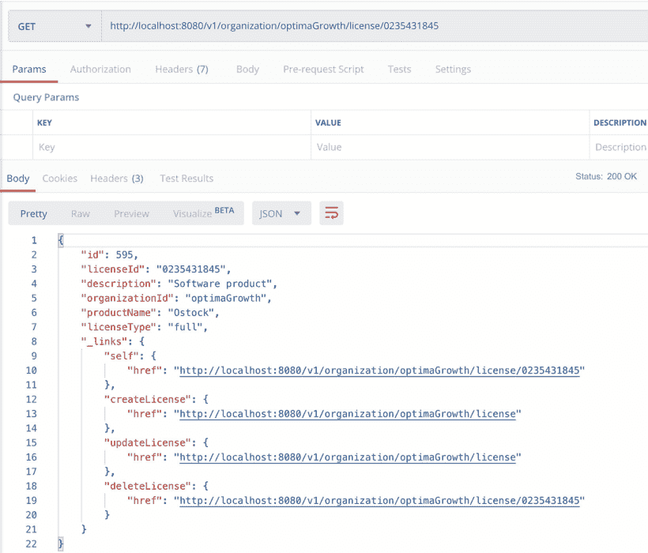

## 3.4 DevOps 故事：为运行时的严苛要求而构建

虽然 DevOps 是一个丰富且新兴的 IT 领域，但对于 DevOps 工程师而言，微服务的设计完全关乎服务投入生产后的管理。编写代码往往是容易的部分。让它持续运行才是困难的部分。我们将从四个原则开始微服务开发工作，并在本书后续部分在此基础上展开：

- *微服务应是自包含的。* 它还应能够独立部署，通过单一软件构件启动和终止多个服务实例。
- *微服务应可配置。* 当服务实例启动时，它应从集中位置读取所需配置数据，或将配置信息作为环境变量传入。配置服务无需人工干预。
- *微服务实例对客户端应透明。* 客户端永远不应知道服务的确切位置。相反，微服务客户端应与服务发现代理通信。这样应用程序即可在不知道其物理位置的情况下定位微服务实例。
- *微服务应传达其健康状态。* 这是云架构的关键部分。微服务实例会失败，而发现代理需要绕过不良的服务实例。在本书中，我们将使用 Spring Boot Actuator 来显示每个微服务的健康状态。

这四个原则揭示了微服务开发中可能存在的悖论。微服务在规模和范围上更小，但其使用会在应用程序中引入更多活动部件，因为微服务是分布式的，并在各自的容器中独立运行。这引入了高度的协调性，并为应用程序带来了更多故障点。

从 DevOps 角度来看，你必须在前期解决微服务的运营需求，并将这四个原则转化为每次微服务构建并部署到环境时都会发生的标准生命周期事件集。这四个原则可映射到以下运营生命周期。图 3.9 显示了这四个步骤如何协同工作。

- *服务组装*——如何打包和部署你的服务以保证可重复性和一致性，从而使相同的服务代码和运行时以完全相同的方式部署。
- *服务引导*——如何将应用程序和环境特定配置代码与运行时代码分离，以便能够在任何环境中快速启动和部署微服务实例而无需人工干预。
- *服务注册/发现*——当新的微服务实例部署时，如何使新服务实例可被其他应用程序客户端发现。
- *服务监控*——在微服务环境中，由于高可用性需求，运行多个相同服务的实例很常见。从 DevOps 角度来看，你需要监控微服务实例并确保任何故障都能绕过失败的服务实例，并将这些实例关闭。

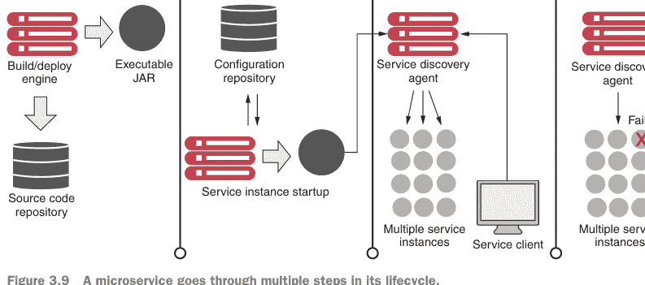

### 3.4.1 服务组装：打包和部署你的微服务

从 DevOps 角度来看，微服务架构背后的关键概念之一是，可以根据应用程序环境的变化快速部署多个微服务实例，例如用户请求的突然激增、基础设施中的问题等。为此，微服务需要被打包并作为单个构件安装，其所有依赖项均已定义在其中。这些依赖项还必须包括托管微服务的运行时引擎，例如 HTTP 服务器或应用程序容器。

一致地构建、打包和部署的过程即为服务组装，图 3.9 中的步骤 1。图 3.10 显示了此步骤的更多细节。

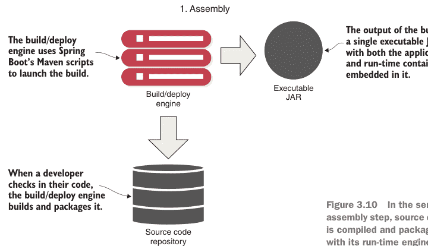

幸运的是，几乎所有 Java 微服务框架都会包含可与代码一起打包和部署的运行时引擎。例如，在图 3.10 中的 Spring Boot 示例中，Maven 和 Spring Boot 构建了一个可执行的 Java JAR 文件，其中已嵌入 Tomcat 引擎。在以下命令行示例中，我们将许可服务构建为可执行 JAR，然后从命令行启动 JAR：

```
mvn clean package && java -jar target/licensing-service-0.0.1-SNAPSHOT.jar
```

对于某些运维团队而言，将运行时环境直接嵌入 JAR 文件的概念是部署应用程序方式的重大转变。在传统的 Java Web 应用程序中，应用程序部署到应用程序服务器。这种模式意味着应用程序服务器本身就是一个实体，通常由系统管理员团队管理，他们独立于部署到其上的应用程序管理服务器配置。

将应用程序服务器配置与应用程序分离会在部署过程中引入故障点。这是因为在许多组织中，应用程序服务器的配置并未纳入源代码控制，而是通过用户界面和自制管理脚本组合管理。配置漂移很容易渗入应用程序服务器环境，并突然导致表面上看似随机的中断。

### 3.4.2 服务引导：管理微服务的配置

服务引导，图 3.9 中的步骤 2，是微服务首次启动并需要加载其应用程序配置信息时发生的。图 3.11 为引导过程提供了更多上下文。

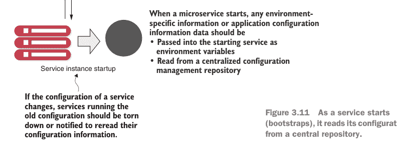

### 3.4.3 服务注册/发现

地址）和应用程序可用于查找服务的逻辑名称。某些服务发现代理还要求向注册服务发送回 URL，服务发现代理可使用该 URL 执行健康检查。然后服务客户端与发现代理通信以查找服务的位置。

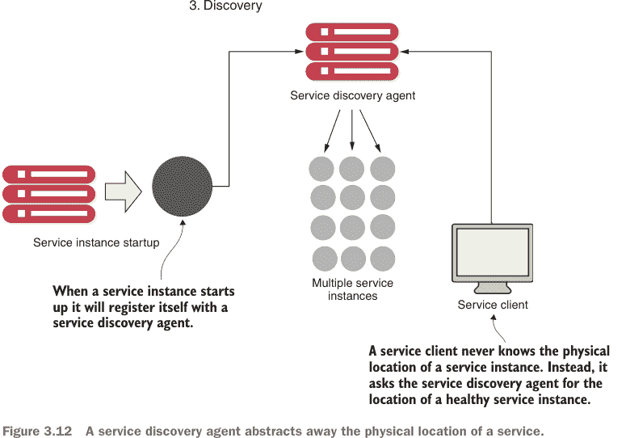

### 3.4.4 传达微服务的健康状态

服务发现代理不仅仅充当引导客户端前往服务位置的交通警察。在基于云的微服务应用程序中，你通常会有多个运行中的服务实例。迟早其中一个服务实例会失败。服务发现代理监控其注册的每个服务实例的健康状态，并将任何失败的服务实例从其路由表中移除，以确保客户端不会被发送到已失败的服务实例。

微服务启动后，服务发现代理将继续监控并 ping 健康检查接口，以确保该服务可用。这是图 3.9 中的步骤 4；图 3.13 为此步骤提供了上下文。

4. 监控

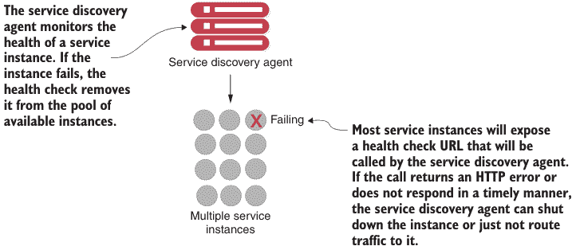

**图 3.13** 服务发现代理使用公开的健康 URL 检查微服务状态。

通过构建一致的健康检查接口，你可以使用基于云的监控工具检测问题并做出适当响应。如果服务发现代理发现服务实例存在问题，它可以采取纠正措施，例如关闭不健康的实例或启动额外的服务实例。

在使用 REST 的微服务环境中，构建健康检查接口最简单的方法是公开一个可返回 JSON 负载和 HTTP 状态码的 HTTP 端点。在非 Spring Boot 的微服务中，通常由开发人员负责编写返回服务健康状态的端点。

在 Spring Boot 中，公开端点非常简单，只需修改 Maven 构建文件以包含 Spring Actuator 模块即可。Spring Actuator 提供了开箱即用的操作端点，帮助你了解和管理服务的健康状况。要使用 Spring Actuator，你需要在 Maven 构建文件中包含以下依赖项：

```xml
<dependency>
    <groupId>org.springframework.boot</groupId>
    <artifactId>spring-boot-starter-actuator</artifactId>
</dependency>
```

如果访问许可服务上的 `http://localhost:8080/actuator/health` 端点，你应该会看到返回的健康数据。图 3.14 提供了返回数据的示例。


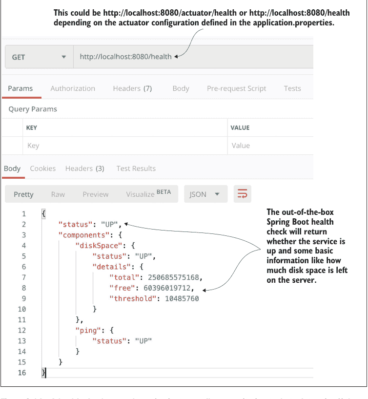

图 3.14 对每个服务实例进行健康检查可让监控工具确定服务实例是否正在运行。

如你在图 3.14 中所见，健康检查不仅仅是“正常”与“异常”的指示器。它还可以提供有关微服务实例所运行服务器状态的信息。Spring Actuator 允许你通过 application properties 文件更改默认配置。例如：

```
```properties
management.endpoints.web.base-path=/
management.endpoints.enabled-by-default=false
management.endpoint.health.enabled=true
management.endpoint.health.show-details=always
management.health.db.enabled=false
management.health.diskspace.enabled=true
```
```

- 从开发者的角度来看，微服务通常采用 REST 风格设计，以 JSON 作为发送和接收服务数据的负载。
- 国际化的主要目标是开发能够以多种格式和语言提供内容的应用程序。
- HATEOAS 代表 Hypermedia as the Engine of Application State。Spring HATEOAS 是一个小型项目，允许我们创建遵循 HATEOAS 原则的 API，即为给定资源显示相关链接。
- 从 DevOps 的角度来看，微服务如何打包、部署和监控至关重要。
- 开箱即用，Spring Boot 允许你将服务作为单个可执行 JAR 文件交付。生成的 JAR 文件中的嵌入式 Tomcat 服务器托管该服务。
- Spring Actuator 是 Spring Boot 框架的一部分，它公开了有关服务运行状况的信息以及有关服务运行时的信息。

## 欢迎使用 Docker

**本章涵盖**

- 理解容器的重要性
- 认识容器如何融入微服务架构
- 理解虚拟机与容器之间的差异
- 使用 Docker 及其主要组件
- 将 Docker 与微服务集成

为了继续成功构建我们的微服务，我们需要解决可移植性问题：我们如何在不同的技术位置执行我们的微服务？*可移植性*是指将软件用于不同环境或在不同环境之间移动的能力。

近年来，容器的概念变得越来越受欢迎，从“锦上添花”发展到软件架构中的“必备”。使用容器是一种敏捷且有用的方式，可将任何软件开发从一个平台迁移到另一个平台并在其中执行（例如，从开发人员的机器迁移到物理或虚拟企业服务器）。我们可以用更小、更具适应性的虚拟化软件容器取代传统的 Web 服务器模型，这些容器为我们的微服务提供速度、可移植性和可扩展性等优势。

本章使用 Docker 对容器进行简要介绍，我们选择该技术是因为它可与所有主要云提供商一起使用。我们将解释 Docker 是什么、如何使用其核心组件以及如何将 Docker 与我们的微服务集成。到本章结束时，你将能够运行 Docker，使用 Maven 创建自己的镜像，并在容器内执行微服务。此外，你会注意到你不再需要担心安装微服务运行所需的所有先决条件；唯一的要求是你的环境已安装 Docker。

> **注意** 在本章中，我们只会解释我们在全书中将使用的内容。如果你有兴趣了解有关 Docker 的更多信息，我们强烈建议你查阅优秀书籍《Docker in Action》第 2 版，由 Jeff Nickoloff、Stephen Kuen zli 和 Bret Fisher 合著（Manning，2019）。作者提供了关于 Docker 是什么以及其工作原理的详尽概述。

## 4.1 容器还是虚拟机？

在许多公司中，虚拟机（VM）仍然是软件部署的事实标准。在本节中，我们将研究 VM 与容器之间的主要差异。

VM 是一种软件环境，允许我们在另一台计算机内模拟计算机的运行。这些基于超visor，它模拟完整的物理机器，分配所需数量的系统内存、处理器核心、磁盘存储以及网络、PCI 扩展等其他技术资源。另一方面，容器是一个包，其中包含一个虚拟操作系统（OS），允许我们在隔离且独立的环境中运行应用程序及其依赖元素。

这两种技术有相似之处，例如存在超visor 或容器引擎来允许执行这两种技术，但它们实现方式的不同使得 VM 和容器非常不同。在图 4.1 中，你可以看到 VM 与容器之间的主要差异。

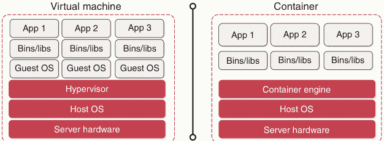

**图 4.1** VM 与容器之间的主要差异。容器不需要客户机 OS 或超visor 来分配资源；相反，它们使用容器引擎。

如果我们分析图 4.1，乍一看，似乎并没有太大区别。毕竟，在容器中只有客户机 OS 层消失了，超visor 被容器引擎取代。然而，VM 与容器之间的差异仍然巨大。

在 VM 中，我们必须预先设置需要多少物理资源；例如，我们将使用多少个虚拟处理器或多少 GB 的 RAM 和磁盘空间。定义这些值可能是一项棘手的任务，我们必须注意以下几点：

- 处理器可以在不同的 VM 之间共享。
- VM 中的磁盘空间可以设置为仅使用所需的部分。你可以定义磁盘最大大小，但它只会使用机器上实际消耗的空间。
- 保留的内存是固定的，不能在 VM 之间共享。

对于容器，我们也可以使用 Kubernetes 设置所需的内存和 CPU，但这不是必需的。如果不指定这些值，容器引擎将为容器正常运行分配必要的资源。因为容器不需要完整的 OS，而是可以重用底层 OS，所以这减少了物理机器必须支持的负载，以及使用的存储空间和启动应用程序所需的时间。因此，容器比 VM 轻得多。

最终，这两种技术各有利弊，最终决定取决于你的具体需求。例如，如果你想处理多种操作系统、在单个服务器上管理多个应用程序，并执行需要 OS 功能的应用程序，VM 是更好的解决方案。

在本书中，我们选择使用容器，这是由于我们正在构建的云架构。与 VM 方法虚拟化硬件不同，我们将使用容器仅虚拟化 OS 层，这比我们能够在本地和每个主要云提供商上运行的方案更轻、更快。

如今，性能和可移植性是公司决策的关键概念。因此，了解我们将使用的技术的优势非常重要。在这种情况下，使用容器与我们的微服务，我们将获得以下优势：

- 容器可以在任何地方运行，这促进了开发和实施并提高了可移植性。
- 容器提供创建完全隔离于其他应用程序的可预测环境的能力。
- 容器可以比 VM 更快地启动和停止，这使其成为云原生可行的方案。
- 容器可扩展，可以主动调度和管理以优化资源利用率，从而提高应用程序的性能和可维护性。
- 我们可以在最少的服务器上实现最大数量的应用程序。


现在我们了解了 VM 和容器之间的区别，让我们更仔细地看看 Docker。

## 4.2 什么是 Docker？

Docker 是一个基于 Linux 的流行开源容器引擎，由 dotCloud 的创始人兼 CEO Solomon Hykes 于 2013 年 3 月创建。Docker 最初是一种锦上添花的技术，负责在我们的应用程序中启动和管理容器。这项技术使我们能够将物理机的资源与不同的容器共享，而不必像 VM 那样暴露不同的硬件资源。

像 IBM、Microsoft 和 Google 这样的大公司对 Docker 的支持，使得一项新技术转变为软件开发人员的基础工具。如今，Docker 仍在不断发展，目前已成为在任何服务器上使用容器部署软件的最广泛使用的工具之一。

DEFINITION *容器* 代表一种逻辑打包机制，为应用程序提供运行所需的一切。

要更好地理解 Docker 的工作原理，必须注意 Docker Engine 是整个 Docker 系统的核心部分。什么是 Docker Engine？它是一个遵循客户端-服务器模式架构的应用程序。该应用程序安装在主机机器中，包含以下三个关键组件：服务器、REST API 和命令行界面（CLI）。图 4.2 说明了这些 Docker 组件以及其他组件。

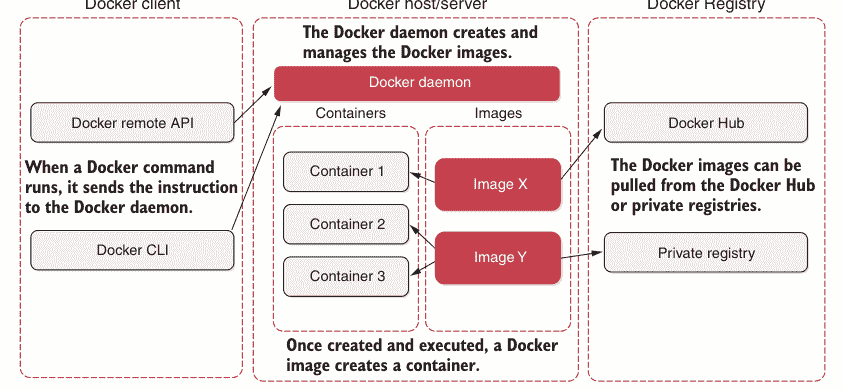

图 4.2 由 Docker 客户端、Docker 主机和 Docker Registry 组成的 Docker 架构。

Docker Engine 包含以下组件：

- *Docker daemon*—一个名为 dockerd 的服务器，允许我们创建和管理 Docker 镜像。REST API 向守护进程发送指令，而 CLI 客户端输入 Docker 命令。
- *Docker client*—Docker 用户通过客户端与 Docker 交互。当运行 Docker 命令时，客户端负责将指令发送给守护进程。
- *Docker Registry*—Docker 镜像存储的位置。这些注册表可以是公共的也可以是私有的。Docker Hub 是公共注册表的默认位置，但你也可以创建自己的私有注册表。
- *Docker images*—这些是只读模板，其中包含创建 Docker 容器的多个指令。镜像可以从 Docker Hub 拉取，你可以原样使用，也可以通过添加额外指令进行修改。此外，你还可以使用 Dockerfile 创建新镜像。稍后在本章中，我们将解释如何使用 Dockerfile。
- *Docker containers*—一旦使用 docker run 命令创建并执行，Docker 镜像就会创建一个容器。应用程序及其环境在此容器内运行。为了启动、停止和删除 Docker 容器，你可以使用 Docker API 或 CLI。
- *Docker volumes*—Docker 卷是存储由 Docker 生成并由 Docker 容器使用的数据的首选机制。它们可以使用 Docker API 或 Docker CLI 进行管理。
- *Docker networks*—Docker 网络允许我们将容器附加到任意多个网络。我们可以将网络视为与隔离容器通信的手段。Docker 包含以下五种网络驱动类型：bridge、host、overlay、none 和 macvlan。

图 4.3 显示了 Docker 工作原理的图表。请注意，Docker daemon 负责容器所有的操作。如图 4.3 所示，我们可以看到守护进程接收来自 Docker 客户端的命令；这些命令可以通过 CLI 或 REST API 发送。在图中，我们可以看到注册表中的 Docker 镜像如何创建容器。

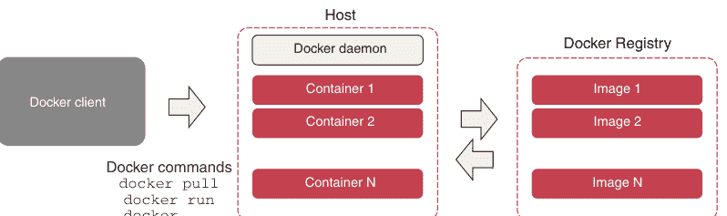

**图 4.3** Docker 客户端向 Docker daemon 发送 Docker 命令，Docker daemon 基于 Docker 镜像创建容器。

NOTE 本书不会教你如何安装 Docker。如果你尚未在计算机上安装 Docker，我们强烈建议你查看以下文档，其中包含在 Windows、macOS 或 Linux 上安装和配置 Docker 的所有步骤：https://docs.docker.com/install/。

在下一节中，我们将解释 Docker 组件的工作原理以及如何将其与我们的许可证微服务集成。如果你在第 1 章和第 3 章中没有跟随示例，你可以将我们即将解释的内容应用到任何 Java Maven 项目中。

## 4.3 Dockerfiles

Dockerfile 是一个简单的文本文件，其中包含 Docker 客户端调用以创建和准备镜像的指令和命令列表。该文件可为你自动化镜像创建过程。Dockerfile 中使用的命令与 Linux 命令类似，这使得 Dockerfile 更易于理解。

以下代码片段简要展示了 Dockerfile 的外观。在第 4.5.1 节中，我们将向你展示如何为自己的微服务创建自定义 Dockerfile。图 4.4 显示了 Docker 镜像创建工作流应有的样子。

```
FROM openjdk:11-slim
ARG JAR_FILE=target/*.jar
COPY ${JAR_FILE} app.jar
ENTRYPOINT ["java","-jar","/app.jar"]
```

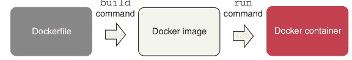

图 4.4 一旦 Dockerfile 创建完成，你运行 docker build 命令来构建 Docker 镜像。然后，一旦 Docker 镜像准备就绪，你使用 run 命令来创建容器。

表 4.1 显示了我们在 Dockerfile 中会使用的最常见的 Dockerfile 命令。另请参阅列表 4.1 中的示例 Dockerfile。

### 表 4.1 Dockerfile 命令

| 命令 | 描述 |
|---|---|
| FROM | 定义一个基础镜像以开始构建过程。换句话说，FROM 命令指定你在 Docker 运行环境中使用的 Docker 镜像。 |
| LABEL | 向镜像添加元数据。这是一个键值对。 |
| ARG | 定义用户可以使用 docker build 命令传递给构建器的变量。 |
| COPY | 从源复制新文件、目录或远程文件 URL，并将它们添加到我们正在创建的镜像的文件系统中，指定目标路径（例如，COPY ${JAR_FILE} app.jar）。 |
| VOLUME | 在容器中创建挂载点。当我们使用同一镜像创建新容器时，我们将创建一个新的卷，该卷将与之前的一个隔离。 |
| RUN | 采用命令及其参数以从镜像运行容器。我们经常使用它来安装软件包。 |
| CMD | 为 ENTRYPOINT 提供参数。此命令类似于 docker run 命令，但此命令仅在容器实例化后执行。 |
| ADD | 将文件从源复制并添加到容器内的目标。 |
| ENTRYPOINT | 配置将作为可执行文件运行的容器。 |
| ENV | 设置环境变量。 |

## 4.4 Docker Compose

Docker Compose 通过允许我们创建脚本来简化 Docker 的使用，从而促进服务的设计和构建。有了 Docker Compose，你可以作为单个服务运行多个容器，也可以同时创建不同的容器。要使用 Docker Compose，请按照以下步骤操作：

- 1. 如果尚未安装，请安装 Docker Compose。你可以在 https://docs.docker.com/compose/install/ 访问此工具。
- 2. 创建一个 YAML 文件来配置你的应用程序服务。你应该将此文件命名为 docker-compose.yml。
- 3. 使用以下命令检查文件的有效性：docker-compose config。
- 4. 使用以下命令启动服务：docker-compose up。

docker-compose.yml 文件应如下所示的列表。稍后在本章中，我们将解释如何创建我们的 docker-compose.yml 文件。

### 列表 4.1 一个示例 docker-compose.yml 文件

```
version: <docker-compose-version>
services:
  database:
    image: <database-docker-image-name>
    ports:
      - "<databasePort>:<databasePort>"
    environment:
      POSTGRES_USER: <databaseUser>
      POSTGRES_PASSWORD: <databasePassword>
      POSTGRES_DB:<databaseName>

  <service-name>:
    image: <service-docker-image-name>
    ports:
      - "<applicationPort>:<applicationPort>"
    environment:
```


```yaml
PROFILE: <profile-name>
  DATABASE_SERVER_PORT: "<databasePort>"
container_name: <container_name>
  networks:
    backend:
      aliases:
        - "alias"

networks:
  backend:
    driver: bridge
```

表4.2展示了我们将在docker-compose.yml文件中使用的指令。表4.3则列出了本书后续会用到的Docker Compose命令。

**表4.2 Docker Compose指令**

| 指令 | 描述 |
|---|---|
| version | 指定Docker Compose工具的版本。 |
| services | 指定要部署的服务。服务名称会成为Docker实例启动时的DNS条目，也是其他服务访问它的方式。 |
| image | 指定使用特定镜像运行容器的工具。 |
| ports | 定义启动的Docker容器对外暴露的端口号。映射内部端口和外部端口。 |
| environment | 将环境变量传递给启动的Docker镜像。 |
| networks | 指定自定义网络，允许我们创建复杂的拓扑结构。默认类型是bridge，因此如果我们不指定其他类型的网络（host、overlay、macvlan或none），就会创建一个bridge网络。bridge网络允许我们保持容器连接到同一个网络。注意，bridge网络仅适用于运行在同一Docker守护进程主机上的容器。 |
| aliases | 为网络中的服务指定一个备选主机名。 |

**表4.3 Docker Compose命令**

| 命令 | 描述 |
|---|---|
| `docker-compose up -d` | 为你的应用程序构建镜像并启动你定义的服务。该命令会下载所有必要的镜像，然后部署这些镜像并启动容器。-d参数表示在后台运行Docker。 |
| `docker-compose logs` | 让你查看最新部署的所有信息。 |
| `docker-compose logs <service_id>` | 让你查看特定服务的日志。例如，要查看许可服务的部署情况，请使用此命令：`docker-compose logs licenseService`。 |
| `docker-compose ps` | 输出你在系统中部署的所有容器列表。 |
| `docker-compose stop` | 使用完毕后停止你的服务。这也会停止容器。 |
| `docker-compose down` | 关闭所有内容并删除所有容器。 |

## 4.5 将Docker与我们的微服务集成

现在我们了解了Docker的主要组件，接下来将Docker与我们的许可微服务集成，以创建一个更具可移植性、可扩展性和可管理性的微服务。为了实现这种集成，我们首先将Docker Maven插件添加到上一章创建的许可服务中。如果你没有跟随那里的代码清单操作，可以从以下链接下载第3章中创建的代码：

https://github.com/ihuaylupo/manning-smia/tree/master/chapter3

### 4.5.1 构建Docker镜像

首先，我们将Docker Maven插件添加到许可服务的pom.xml中，从而构建一个Docker镜像。该插件允许我们通过Maven的pom.xml文件管理Docker镜像和容器。下面的清单展示了你的pom文件应该是什么样子。

```xml
<build>
    <plugins>
        <plugin>
            <groupId>org.springframework.boot</groupId>
            <artifactId>spring-boot-maven-plugin</artifactId>
        </plugin>
        <!-- This plugin is used to create a Docker image and publish
             it to Docker Hub -->
        <plugin>
            <groupId>com.spotify</groupId>
            <artifactId>dockerfile-maven-plugin</artifactId>
            <version>1.4.13</version>
            <configuration>
                <repository>${docker.image.prefix}/${project.artifactId}</repository>
                <tag>${project.version}</tag>
                <buildArgs>
                    <JAR_FILE>target/${project.build.finalName}.jar</JAR_FILE>
                </buildArgs>
            </configuration>
            <executions>
                <execution>
                    <id>default</id>
                    <phase>install</phase>
                    <goals>
                        <goal>build</goal>
                        <goal>push</goal>
                    </goals>
                </execution>
            </executions>
        </plugin>
    </plugins>
</build>
```

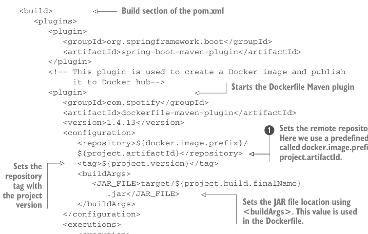

既然我们的pom.xml文件中已经有了这个插件，我们可以继续创建前面代码清单①中提到的docker.image.prefix变量。这个变量将指明我们的镜像使用什么前缀。下面的清单展示了如何将该变量添加到pom.xml中。

**清单4.3 添加docker.image.prefix变量**

```xml
<properties>
    <java.version>11</java.version>
    <docker.image.prefix>ostock</docker.image.prefix>
</properties>
```

为docker.image.prefix变量设置值。

定义docker.image.prefix变量值的方法有几种。清单4.3只展示了其中一种。另一种方法是直接在Maven的JVM参数中使用-D选项发送该值。请注意，如果你没有在pom.xml的`<properties>`部分创建这个变量，当执行打包和创建Docker镜像的命令时，会抛出以下错误：

```
Failed to execute goal com.spotify:dockerfile-maven-plugin:1.4.0:build
(default-cli) on project licensing-service: Execution default-cli of goal
com.spotify:dockerfile-maven-plugin:1.4.0:build failed: The template variable
'docker.image.prefix' has no value
```

既然我们已经将插件导入到pom.xml中，接下来继续向项目添加Dockerfile。在接下来的小节中，我们将展示如何创建基本的Dockerfile和多阶段构建Dockerfile。请注意，这两种Dockerfile都可以使用，因为两者都能让你执行微服务。它们的主要区别在于：使用基本的Dockerfile，你需要复制整个Spring Boot微服务的JAR文件；而使用多阶段构建，只需复制应用程序所需的基本内容。在本书中，我们选择使用多阶段构建来优化我们将创建的Docker镜像，但你也可以自由选择最适合自己需求的方案。

**基础Dockerfile**

在这个Dockerfile中，我们将Spring Boot的JAR文件复制到Docker镜像中，然后执行应用程序的JAR。下面的清单展示了如何通过几个简单的步骤实现这一点。

**清单4.4 一个基础Dockerfile**

```dockerfile
#Start with a base image containing Java runtime
FROM openjdk:11-slim

# Add Maintainer Info
LABEL maintainer="Illary Huaylupo <illaryhs@gmail.com>"

# The application's jar file
ARG JAR_FILE

# Add the application's jar to the container
COPY ${JAR_FILE} app.jar

#execute the application
ENTRYPOINT ["java","-jar","/app.jar"]
```

指定在我们的Docker运行时使用的Docker镜像（本例中为openjdk:11-slim）。

定义由dockerfile-maven-plugin设置的JAR_FILE变量。

将JAR文件复制到镜像中名为app.jar的文件系统。

当容器创建时，在镜像中定位许可服务应用程序。

**多阶段构建Dockerfile**

在本节的Dockerfile中，我们使用多阶段构建。为什么要多阶段？这允许我们丢弃对应用程序执行不必要的内容。例如，对于Spring Boot，我们不需要将整个target目录复制到Docker镜像中，只需要复制运行Spring Boot应用程序所必需的内容。这种做法将优化我们创建的Docker镜像。下面的清单展示了你的Dockerfile应该是什么样子。

**清单4.5 使用多阶段构建的Dockerfile**

```dockerfile
#stage 1
#Start with a base image containing Java runtime
FROM openjdk:11-slim as build

# Add Maintainer Info
LABEL maintainer="Illary Huaylupo <illaryhs@gmail.com>"

# The application's jar file
ARG JAR_FILE

# Add the application's jar to the container
COPY ${JAR_FILE} app.jar

#unpackage jar file
RUN mkdir -p target/dependency &&
    (cd target/dependency; jar -xf /app.jar)

#stage 2
#Same Java runtime
FROM openjdk:11-slim

#Add volume pointing to /tmp
VOLUME /tmp
```

将之前复制的app.jar解包到构建镜像的文件系统中。

这个新镜像包含Spring Boot应用的不同层，而不是完整的JAR文件。


#Copy unpackaged application to new container
ARG DEPENDENCY=/target/dependency
COPY --from=build ${DEPENDENCY}/BOOT-INF/lib /app/lib
COPY --from=build ${DEPENDENCY}/META-INF /app/META-INF
COPY --from=build ${DEPENDENCY}/BOOT-INF/classes /app

#execute the application
ENTRYPOINT ["java","-cp","app:app/lib/*","com.optimagrowth.license.LicenseServiceApplication"]

将不同层从名为 build 的第一个镜像复制过来

在容器创建时定位镜像中的许可服务

我们不会详细讲解整个多阶段 Dockerfile，但会指出几个关键区域。在阶段 1，使用 FROM 命令，Dockerfile 从为 Java 应用优化的 openJDK 镜像创建名为 build 的镜像。该镜像负责创建并解包 JAR 应用文件。

> NOTE 我们使用的镜像已预装 Java 11 JDK。

接下来，Dockerfile 获取我们在 pom.xml 的 <configuration> <buildArgs> 部分中设置的 JAR_FILE 变量的值。然后，我们将 JAR 文件复制到镜像文件系统作为 app.jar 并解包，以暴露 Spring Boot 应用包含的不同层。不同层暴露后，Dockerfile 会创建另一个仅包含这些层而非完整应用 JAR 的镜像。之后，在阶段 2，Dockerfile 将不同层复制到新镜像中。

> NOTE 如果我们不更改项目的依赖项，BOOT-INF/lib 文件夹不会发生变化。该文件夹包含运行应用所需的所有内部和外部依赖项。

最后，ENTRYPOINT 命令允许我们在容器创建时定位新镜像中的许可服务应用。要了解更多关于多阶段构建过程的信息，你可以通过在微服务的 target 文件夹上执行以下命令来查看 Spring Boot 应用 fat JAR 的内部结构：

```
jar tf jar-file
```

例如，对于许可服务，该命令应如下所示：

```
jar tf licensing-service-0.0.1-SNAPSHOT.jar
```

如果 target 文件夹中没有 JAR 文件，请在项目 pom.xml 文件的根目录上执行以下 Maven 命令：

```
mvn clean package
```

现在我们已经设置好了 Maven 环境，让我们构建 Docker 镜像。为此，你需要执行以下命令：

```
mvn package dockerfile:build
```

NOTE 验证你的本地机器上是否至少安装了 18.06.0 或更高版本的 Docker Engine，以确保所有 Docker 代码示例都能成功运行。要查找你的 Docker 版本，请执行 docker version 命令。

Docker 镜像构建完成后，你应该会看到类似图 4.5 所示的内容。

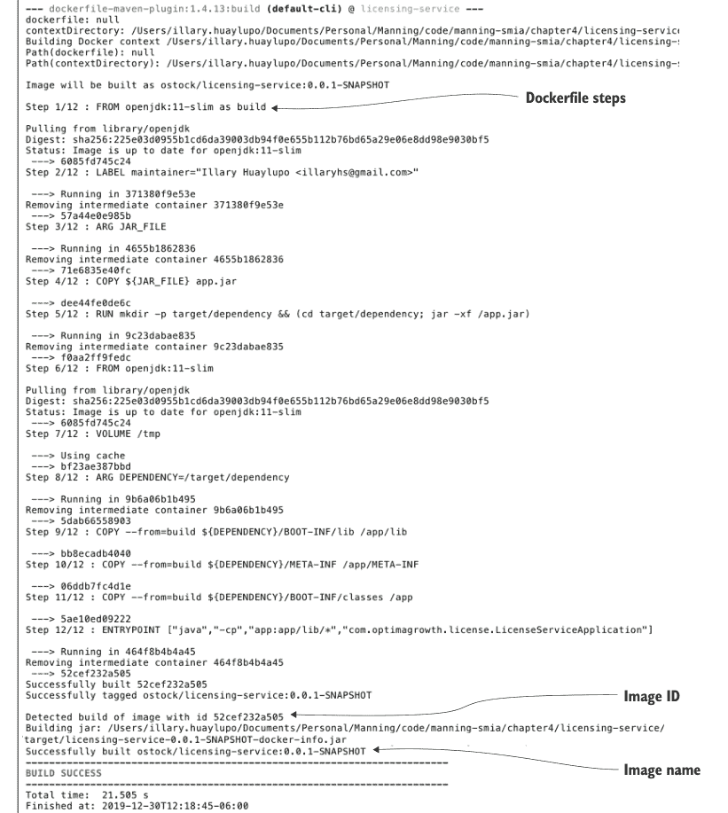

现在我们有了 Docker 镜像，我们可以在系统 Docker 镜像列表中看到它。要列出所有 Docker 镜像，我们需要执行 docker images 命令。如果一切运行正常，你应该会看到类似以下内容：

```
REPOSITORY          TAG                 IMAGE ID       CREATED         SIZE
ostock/licensing-service 0.0.1-SNAPSHOT  231fc4a87903  1 minute ago  149MB
```

一旦我们有了 Docker 镜像，就可以使用以下命令运行它：

```
docker run ostock/licensing-service:0.0.1-SNAPSHOT
```

你也可以在 docker run 命令中使用 -d 选项在后台运行容器。例如，像这样：

```
docker run -d ostock/licensing-service:0.0.1-SNAPSHOT
```

此 docker run 命令启动容器。为了查看系统中所有正在运行的容器，你可以执行 docker ps 命令。该命令会打开所有正在运行的容器及其对应的 ID、镜像、命令、创建时间、状态、端口和名称。如果需要停止容器，可以使用对应的容器 ID 执行以下命令：

```
docker stop <container_id>
```

## 4.5.2 使用 Spring Boot 创建 Docker 镜像

在本节中，我们将简要介绍如何使用 Spring Boot v2.3 中发布的新功能创建 Docker 镜像。请注意，为了使用这些新功能，你必须

- 安装 Docker 和 Docker Compose。
- 在你的微服务中拥有 Spring Boot 版本等于或高于 2.3 的 Spring Boot 应用。

这些新功能有助于改进 Buildpack 支持和分层 JAR。要使用新功能创建 Docker 镜像，请添加以下内容。确保你的 pom.xml 文件包含 spring-boot-starter-parent 版本 2.3 或更高。

```
<parent>
<groupId>org.springframework.boot</groupId>
<artifactId>spring-boot-starter-parent</artifactId>
<version>2.4.0</version>
<relativePath/> <!-- lookup parent from repository -->
</parent>
```

## BUILD PACKS

Buildpacks 是提供应用和框架依赖的工具，将我们的源代码转换为可运行的应用镜像。换句话说，Buildpacks 检测并获取应用运行所需的一切。

Spring Boot 2.3.0 引入了使用 Cloud Native Buildpacks 构建 Docker 镜像的支持。此支持已添加到 Maven 和 Gradle 插件中，使用 Maven 的 spring-boot:build-image 目标和 Gradle 的 bootBuildImage 任务。更多信息请参阅以下链接：

- Spring Boot Maven Plugin at https://docs.spring.io/spring-boot/docs/2.3.0.M1/maven-plugin/html/
- Spring Boot Gradle Plugin at https://docs.spring.io/spring-boot/docs/2.3.0.M1/gradle-plugin/reference/html/

在本书中，我们只解释如何使用 Maven 场景。要使用此新功能构建镜像，请从 Spring Boot 微服务的根目录执行以下命令：

```
./mvnw spring-boot:build-image
```

命令执行后，你应该能看到与以下代码片段类似的输出：

```
[INFO]      [creator]      Setting default process type 'web'
[INFO]      [creator]      *** Images (045116f040d2):
[INFO]      [creator]      docker.io/library/licensing-service:0.0.1-SNAPSHOT
[INFO]
[INFO] Successfully built image 'docker.io/library/licensing-service:0.0.1-SNAPSHOT'
```

如果你想自定义创建的镜像名称，可以将以下插件添加到 pom.xml 文件中，然后在 configuration 部分下定义名称：

```
<plugin>
    <groupId>org.springframework.boot</groupId>
    <artifactId>spring-boot-maven-plugin</artifactId>
    <configuration>
        <image>
            <name>${docker.image.prefix}/${project.artifactId}:latest</name>
        </image>
    </configuration>
</plugin>
```

镜像成功构建后，你可以执行以下命令通过 Docker 启动容器：

```
docker run -it -p8080:8080 docker.io/library/licensing-service:0.0.1-SNAPSHOT
```

## LAYERED JARs

Spring Boot 引入了一种新的 JAR 布局，称为 layered JARs。在此格式中，/lib 和 /classes 文件夹被拆分并分类为层。这种分层是为了根据构建之间变化的可能性对代码进行分离，同时保留构建所需的信息。这是另一种在不想使用 Buildpacks 时的优秀选择。要提取我们微服务的层，让我们执行以下步骤：

- 1. 将层配置添加到 pom.xml 文件中
- 2. 打包应用
- 3. 使用 jarmode 系统属性以 layertools JAR 模式执行
- 4. 创建 Dockerfile
- 5. 构建并运行镜像

第一步将层配置添加到 pom.xml 中的 Spring Boot Maven 插件，例如：

```
```xml
<plugin>
    <groupId>org.springframework.boot</groupId>
    <artifactId>spring-boot-maven-plugin</artifactId>
    <configuration>
        <layers>
            <enabled>true</enabled>
        </layers>
    </configuration>
</plugin>
```
```

在 pom.xml 文件中设置好配置后，我们可以执行以下命令重新构建 Spring Boot JAR：

```
```bash
mvn clean package
```
```

JAR 文件创建后，我们可以在应用根目录执行以下命令以显示层及其应添加到 Dockerfile 中的顺序：

```
```bash
java -Djarmode=layertools -jar target/
  licensing-service-0.0.1-SNAPSHOT.jar list
```
```

执行后，你应该会看到与以下代码片段类似的输出：

```
```
dependencies
spring-boot-loader
snapshot-dependencies
application
```
```

现在我们有了层信息，让我们继续第四步，即创建 Dockerfile。以下列表展示了如何操作。


```
- "SPRING_PROFILES_ACTIVE=dev"

networks:
  backend:
    aliases:
      - "licenseservice"

networks:
  backend:
    driver: bridge
```

将环境变量传递给启动的 Docker 镜像。在此情况下，在启动的 Docker 镜像上设置 SPRING_PROFILES_ACTIVE 环境变量。

命名服务所属的网络

指定服务在网络上的替代主机名

创建一个名为 backend 的自定义网络，使用默认类型 bridge

现在我们有了 docker-compose.yml，我们可以通过在 docker-compose.yml 文件所在的目录中执行 docker-compose up 命令来启动我们的服务。执行后，你应该会看到类似图 4.6 所示的结果。

NOTE 如果你还不熟悉 SPRING_PROFILES_ACTIVE 变量，不用担心。我们将在下一章介绍这一点，在那里我们将管理微服务中的不同配置文件。

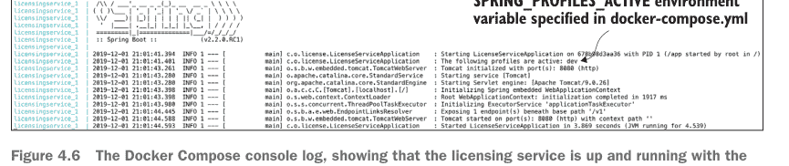

在 docker-compose.yml 中指定的 SPRING_PROFILES_ACTIVE 环境变量

图 4.6 Docker Compose 控制台日志，显示许可服务已启动并运行，且 SPRING_PROFILES_ACTIVE 变量已在 docker-compose.yml 中指定

启动容器后，你可以执行 docker ps 命令来查看所有正在运行的容器。

NOTE 本书中使用的所有 Docker 容器都是临时的——它们在启动和停止后不会保留状态。请记住这一点，如果你开始尝试代码并在重启容器后看到数据消失。 如果你有兴趣了解如何保存容器状态，请查看 docker commit 命令。

现在我们知道了容器是什么以及如何将 Docker 与我们的微服务集成，让我们继续下一章。在下一章中，我们将创建我们的 Spring Cloud 配置服务器。

## Summary

- 容器允许我们在任何环境中成功运行我们正在开发的软件——从开发人员的机器到物理或虚拟企业服务器。
- 虚拟机（VM）允许我们在另一台计算机内模拟计算机的运行。这基于一个超visor，它模拟完整的物理机器，分配所需数量的系统内存、处理器核心、磁盘存储以及网络、PCI 附加组件等其他资源。
- 容器是另一种操作系统（OS）虚拟化方法，允许你在隔离且独立的环境中运行应用程序及其依赖元素。
- 使用容器通过创建轻量级 VM 来降低总体成本，从而加快运行/执行过程，因此降低每个项目的成本。
- Docker 是一个流行的基于 Linux 容器的开源容器引擎。它由 dotCloud 的创始人兼 CEO Solomon Hykes 于 2013 年创建。
- Docker 由以下组件组成：Docker Engines、客户端、注册表、镜像、容器、卷和网络。
- Dockerfile 是一个简单的文本文件，其中包含 Docker 客户端调用以创建和准备镜像的指令和命令列表。该文件自动化了镜像创建过程。Dockerfile 中使用的命令与 Linux 命令相似，这使得 Dockerfile 命令更容易理解。
- Docker Compose 是一个服务编排工具，允许你将服务定义为一组，然后作为单个单元一起启动。
- Docker Compose 作为 Docker 安装过程的一部分进行安装。
- Dockerfile Maven 插件将 Maven 与 Docker 集成。

## Controlling your configuration with the Spring Cloud Configuration Server

- **本章涵盖**
- 将服务配置与服务代码分离
- 配置 Spring Cloud 配置服务器
- 将 Spring Boot 微服务与配置服务器集成
- 加密敏感属性
- 将 Spring Cloud 配置服务器与 HashiCorp Vault 集成

软件开发人员总是听到保持应用程序配置与代码分离的重要性。在大多数情况下，这意味着不要在代码中使用硬编码值。忘记这一原则会使更改应用程序变得更加复杂，因为每次对配置进行更改时，应用程序都必须重新编译和/或重新部署。

完全将配置信息与应用程序代码分离，允许开发人员和运维在不经过重新编译过程的情况下更改其配置。但它也引入了复杂性，因为现在开发人员有另一个需要与应用程序一起管理和部署的构件。

许多开发人员转向属性文件（YAML、JSON 或 XML）来存储其配置信息。在这些文件中配置应用程序变得非常简单，以至于大多数开发人员从未做过超过将配置文件置于源代码控制下（如果有的话）并作为其应用程序的一部分部署文件。这种方法在处理少量应用程序时可能有效，但在处理包含数百个微服务的云应用程序时很快就会失效，其中每个微服务反过来可能有多个服务实例在运行。突然间，一个简单直接的过程变得非常重要，整个团队必须与所有配置文件作斗争。

例如，让我们想象一下我们有数百个微服务，并且每个微服务对三个环境包含不同的配置。如果我们不在应用程序之外管理这些文件，每次更改时，我们都必须在代码库中搜索文件，遵循集成过程（如果有的话），并重启应用程序。为了避免这种灾难性场景，作为云微服务开发的最佳实践，我们应考虑以下几点：

- 完全将应用程序的配置与实际部署的代码分离。
- 构建不可变的应用程序镜像，这些镜像在通过你的环境推广时永远不会更改。
- 在服务器启动时通过环境变量或微服务在启动时读取的集中式存储库注入任何应用程序配置信息。

本章向你介绍管理云微服务应用程序中应用程序配置数据所需的核心原则和模式。我们将构建一个配置服务器，将服务器与 Spring 和 Spring Boot 客户端集成，然后学习如何保护我们更敏感的配置。

### 5.1 On managing configuration (and complexity)

管理应用程序配置对于在云中运行的微服务至关重要，因为微服务实例需要以最少的人工干预快速启动。当一个人需要手动配置或触及服务才能部署它时，这就成为配置漂移、意外停机以及在应用程序的可扩展性挑战中响应滞后的机会。让我们通过确立我们想要遵循的四个原则来开始我们关于应用程序配置管理的讨论：

- **Segregate**—我们需要完全将服务配置信息与服务的实际物理部署分离。事实上，应用程序配置不应与服务实例一起部署。相反，配置信息应作为环境变量传递给启动的服务，或在服务启动时从集中式存储库读取。
- **Abstract**—我们还需要通过服务接口抽象对配置数据的访问。不要编写直接读取服务存储库的代码，无论是基于文件还是 JDBC 数据库，我们都应使用基于 REST 的 JSON 服务来检索应用程序的配置数据。
- **Centralize**—由于基于云的应用程序可能 literally 有数百个服务，最大限度地减少用于保存配置数据的不同存储库的数量至关重要。将应用程序配置集中到尽可能少的存储库中。
- **Harden**—由于你的应用程序配置信息将完全与已部署的服务分离并集中化，因此至关重要的是你使用的解决方案和实现的解决方案具有高度可用性和冗余。

需要记住的一件关键事情是，当你将配置信息与实际代码分离时，你正在创建一个需要管理和版本控制的外部依赖。我们不能强调这一点的重要性，应用程序配置数据需要被跟踪和版本控制，因为管理不善的应用程序配置是难以检测的错误和计划外停机的肥沃温床。

### 5.1.1 Your configuration management architecture

正如你从前几章中记得的那样，微服务的配置管理加载发生在微服务的引导阶段。作为提醒，图 5.1 显示了微服务生命周期。

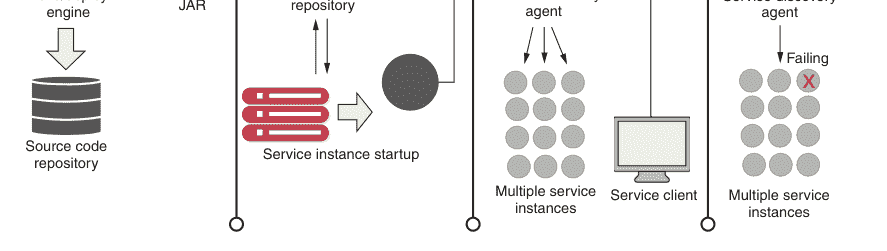

图 5.1 当微服务启动时，它会经历其生命周期中的多个步骤。应用程序配置数据在服务的引导阶段读取。


让我们回顾一下我们在第 5.1 节中列出的四个原则（隔离、抽象、集中化和加固），并看看这些原则在服务启动时如何应用。图 5.2 更详细地展示了启动过程，并显示了配置服务在此步骤中发挥的关键作用。

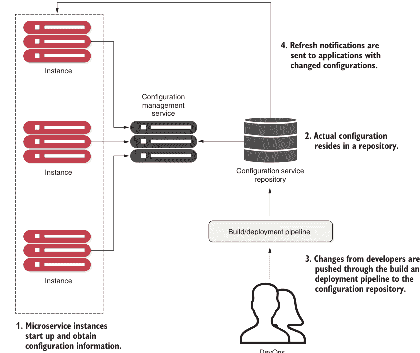

图 5.2 配置管理概念架构

在图 5.2 中，正在进行多个活动。以下是图中每一步的概述：

+   1. 当微服务实例启动时，它会调用一个服务端点来读取其配置信息，该信息特定于其运行的环境。配置管理的连接信息（连接凭据、服务端点等）随后在微服务启动时传递给微服务。

实际配置存储在存储库中。根据配置存储库的实现方式，您可以选择不同的方式来保存配置数据。这可以包括源代码控制下的文件、关系数据库或键值数据存储。

应用程序配置数据的实际管理与应用程序的部署方式无关。对配置管理的更改通常通过构建和部署管道处理，其中修改可以标记版本信息并部署到不同的环境（开发、 staging、生产等）。

当配置管理发生变化时，使用该应用程序配置数据的服务必须被通知该更改并刷新其应用程序数据的副本。

到目前为止，我们已经研究了说明配置管理模式不同组件及其如何协同工作的概念架构。现在我们将查看实现配置管理的不同解决方案，然后再查看具体的实现。

## 5.1.2 实现选择

幸运的是，您可以从大量经过实战检验的开源项目中选择来实现配置管理解决方案。让我们来看一下可用的几种不同选择并进行比较。表 5.1 列出了这些选项。

**表 5.1 用于实现配置管理系统 的开源项目**

| 项目名称 | 描述 | 特征 |
|---|---|---|
| etcd | 用 Go 编写。用于服务发现和键值管理。使用 raft 协议（https://raft.github.io/）作为其分布式计算模型。 | 非常快且可扩展；可分发；命令行驱动；易于使用和设置 |
| Eureka | 由 Netflix 编写。极其经过实战检验。用于服务发现和键值管理。 | 分布式键值存储；灵活但设置需要一些精力；开箱即用提供动态客户端刷新 |
| Consul | 由 HashiCorp 编写。与 etcd 和 Eureka 类似，但使用不同的算法作为其分布式计算模型。 | 快速；提供原生的服务发现，可直接与 DNS 集成；开箱即用不提供客户端动态刷新 |
| Zookeeper | Apache 项目。提供分布式锁定功能。常被用作配置管理解决方案来访问键值数据。 | 最老、最经过实战检验的解决方案<br>使用最复杂<br>可用于配置管理，但仅在您已在架构的其他部分使用 Zookeeper 时才考虑 |
| Spring Cloud Configuration Server | 开源项目。提供通用的配置管理解决方案，具有不同的后端。 | 非分布式键值存储<br>为 Spring 和非 Spring 服务提供紧密集成<br>可使用多个后端存储配置数据，包括共享文件系统、Eureka、Consul 或 Git |

表 5.1 中的所有解决方案都可以轻松用于构建配置管理解决方案。本章中的示例，以及本书其余部分的示例，我们将使用 Spring Cloud Configuration Server（通常称为 Spring Cloud Config Server 或简称为 Config Server），它非常适合我们的 Spring 微服务架构。我们选择此解决方案的原因是

- Spring Cloud Configuration Server 易于设置和使用。
- Spring Cloud Config 与 Spring Boot 紧密集成。您只需使用几个简单易用的注解即可读取应用程序的所有配置数据。
- Config Server 为存储配置数据提供多个后端。
- 在表 5.1 的所有解决方案中，Config Server 可以直接与 Git 源代码控制平台和 HashiCorp Vault 集成。我们将在本章后面解释这些主题。

在本章的其余部分，我们将执行以下操作：

+   1. 设置一个 Spring Cloud Configuration Server。我们将演示三种提供应用程序配置数据的不同机制——一种使用文件系统，另一种使用 Git 仓库，另一种使用 HashiCorp Vault。
+   2. 继续构建许可服务以从数据库检索数据。
+   3. 将 Spring Cloud Config 服务连接到您的许可服务以提供应用程序的配置数据。

## 5.2 构建我们的 Spring Cloud Configuration Server

Spring Cloud Configuration Server 是一个基于 REST 的应用程序，构建在 Spring Boot 之上。Config Server 不作为独立服务器提供。相反，您可以选择将其嵌入到现有的 Spring Boot 应用程序中，或启动一个新 Spring Boot 项目并将服务器嵌入其中。最佳实践是保持分离。

构建配置服务器的第一件事是使用 Spring Initializr（https://start.spring.io/）创建一个 Spring Boot 项目。为此，我们将在 Initializr 的表单中实现以下步骤。填写后，您的 Spring Initializr 表单应如下图所示 5.3 和 5.4 所示。在表单中，您将

+   1. 选择 Maven 作为项目类型。
+   2. 选择 Java 作为语言。
+   3. 选择最新或更稳定的 Spring 版本。
+   4. 将 `com.optimagrowth` 写为 group，将 `configserver` 写为 artifact。
+   5. 展开选项列表并写入。
      a. `Configuration Server` 作为其名称。
      b. `Configuration server` 作为其描述。
      c. `com.optimagrowth.configserver` 作为其包名。
+   6. 选择 JAR Packaging。
+   7. 选择 Java 11 作为 Java 版本。
+   8. 添加 Config Server 和 Spring Boot Actuator 依赖项。

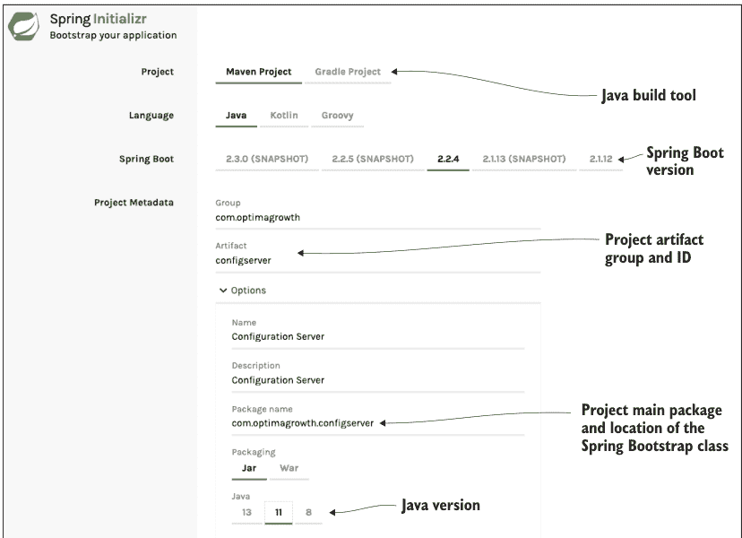

图 5.3 Spring Configuration Server 的 Spring Initializr 配置

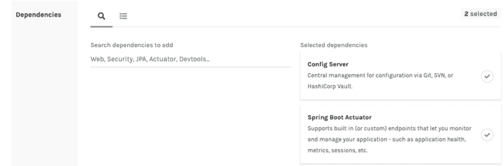

# 图 5.4 Spring Initializr Config Server 和 Spring Boot Actuator 依赖项

一旦您创建并将表单作为 Maven 项目导入到您喜欢的 IDE 中，您应该在 config server 项目目录的根目录中有一个 pom.xml 文件，其内容如下所示。

### 列表 5.1 Spring Configuration Server 的 Maven pom 文件

```
<?xml version="1.0" encoding="UTF-8"?>
<project xmlns="http://maven.apache.org/POM/4.0.0"
xmlns:xsi="http://www.w3.org/2001/XMLSchema-instance"
xsi:schemaLocation="http://maven.apache.org/POM/4.0.0 https://maven.apache.org/xsd/maven-4.0.0.xsd">
    <modelVersion>4.0.0</modelVersion>
    <parent>
        <groupId>org.springframework.boot</groupId>
        <artifactId>spring-boot-starter-parent</artifactId>
        <version>2.2.4.RELEASE</version>
        <relativePath/> <!-- lookup parent from repository -->
    </parent>
    <groupId>com.optimagrowth</groupId>
    <artifactId>configserver</artifactId>
    <version>0.0.1-SNAPSHOT</version>
    <name>Configuration Server</name>
    <description>Configuration Server</description>
    <properties>
        <java.version>11</java.version>
        <spring-cloud.version>
            Hoxton.SR1
        </spring-cloud.version>
    </properties>
    <dependencies>
        <dependency>
            <groupId>org.springframework.cloud</groupId>
            <artifactId>spring-cloud-config-server</artifactId>
        </dependency>
        <dependency>
            <groupId>org.springframework.boot</groupId>
```

Spring Boot 版本

要使用的 Spring Cloud 版本

运行 ConfigServer 所需的 Spring Cloud 项目和其他依赖项


```
<artifactId>spring-boot-starter-actuator</artifactId>
</dependency>
<dependency>
    <groupId>org.springframework.boot</groupId>
    <artifactId>spring-boot-starter-test</artifactId>
    <scope>test</scope>
    <exclusions>
        <exclusion>
            <groupId>org.junit.vintage</groupId>
            <artifactId>
                junit-vintage-engine
            </artifactId>
        </exclusion>
    </exclusions>
</dependency>
</dependencies>
<dependencyManagement>
    <dependencies>
        <dependency>
            <groupId>org.springframework.cloud</groupId>
            <artifactId>spring-cloud-dependencies</artifactId>
            <version>${spring-cloud.version}</version>
            <type>pom</type>
            <scope>import</scope>
        </dependency>
    </dependencies>
</dependencyManagement>

<build>
    <plugins>
        <plugin>
            <groupId>org.springframework.boot</groupId>
            <artifactId>spring-boot-maven-plugin</artifactId>
        </plugin>
    </plugins>
</build>
</project>
```

Spring Cloud BOM (Bill of Materials) 定义

注意 所有 pom.xml 文件都应包含 Docker 依赖项和配置，但为了节省空间，我们不会在代码列表中添加这些行。如果您想查看配置服务器的 Docker 配置，请访问 GitHub 仓库中的第 5 章文件夹：https://github.com/ihuaylupo/manning-smia/tree/master/chapter5。

我们不会详细讲解整个 pom 文件，但我们会先指出几个关键部分。在列表 5.1 中的 Maven 文件中，我们可以看到四个重要部分。第一个是 Spring Boot 版本，接下来是我们将使用的 Spring Cloud 版本。在此示例中，我们使用的是 Spring Cloud 的 Hoxton.SR1 版本。列表中突出的第三点是我们将在服务中使用的特定依赖项，最后一点是我们将使用的 Spring Cloud Config 父 BOM（Bill of Materials）。

此父 BOM 包含云项目中使用的所有第三方库和依赖项，以及构成该版本各个项目的版本号。在此示例中，我们使用之前在 pom 文件的 <properties> 部分中定义的版本。通过使用 BOM 定义，我们可以保证使用 Spring Cloud 中子项目的兼容版本。这也意味着我们不必为子依赖项声明版本号。

## 来吧，搭上列车，搭上发布列车

Spring Cloud 使用一种非传统的机制来标记 Maven 项目。因为 Spring Cloud 是一组独立的子项目，Spring Cloud 团队通过他们所称的“发布列车”来发布项目的更新。构成 Spring Cloud 的所有子项目都打包在同一个 Maven BOM 下并作为一个整体发布。

Spring Cloud 团队使用伦敦地铁站的名称作为其发布的名称，每个主要发布都以下一个字母最高的伦敦地铁站命名。已经有多个发布，从 Angel、Brixton、Camden、Dalston、Edgware、Finchley 和 Greenwich 到 Hoxton。Hoxton 是最新的发布，但它仍然为其内部的子项目有多个发布候选分支。

需要注意的一点是，Spring Boot 是独立于 Spring Cloud 发布列车发布的。因此，不同版本的 Spring Boot 与不同版本的 Spring Cloud 不兼容。您可以通过参考 Spring Cloud 网站（http://projects.spring.io/spring-cloud/）来查看 Spring Boot 和 Spring Cloud 之间的版本依赖关系，以及发布列车中包含的不同子项目版本。

创建 Spring Cloud Config Server 的下一步是设置一个额外的文件来定义服务器的核心配置，以便它可以运行。这可以是以下其中之一：application.properties、application.yml、bootstrap.properties 或 bootstrap.yml。

bootstrap 文件是特定于 Spring Cloud 的文件类型，并在 application.properties 或 application.yml 文件之前加载。bootstrap 文件用于指定 Spring 应用名称、Spring Cloud 配置 Git 位置、加密/解密信息等。具体来说，bootstrap 文件由父 Spring ApplicationContext 加载，而该父上下文在加载使用 application 属性或 YAML 文件的上下文之前加载。

至于文件扩展名，.yml 和 .properties 只是不同的数据格式。您可以选择自己喜欢的一种。在本书中，您会看到我们将使用 bootstrap.yml 来定义 Config Server 和微服务的配置。

现在，继续，让我们在 /src/main/resources 文件夹中创建我们的 bootstrap.yml 文件。此文件告诉 Spring Cloud Config 服务监听哪个端口、应用名称、应用配置文件以及我们将存储配置数据的位置。您的 bootstrap 文件应如下所示的列表。

## 列表 5.2 创建我们的 bootstrap.yml 文件

```
spring:
  application:
    name: config-server
server:
  port: 8071
```

- Config Server 应用名称（在本例中为 config-server）
- 服务器端口

列表 5.2 中有两点需要重点说明。第一点是应用名称。为我们架构中将要创建的所有服务命名对于服务发现至关重要，我们将在下一章中描述这一点。第二点需要注意的是 Spring 配置服务器将监听的端口，以便提供请求的配置数据。

## 5.2.1 设置 Spring Cloud Config bootstrap 类

创建 Spring Cloud Config 服务的下一步是设置 Spring Cloud Config bootstrap 类。每个 Spring Cloud 服务都需要一个 bootstrap 类，我们可以用它来启动服务，正如我们在第 2 章和第 3 章中解释的那样（我们在其中创建了许可服务）。

记住，此类包含几个重要部分：一个充当服务启动入口的 Java main() 方法，以及一组 Spring 注解，告诉启动的服务 Spring 将为该服务启动何种行为。以下列表显示了我们的 Spring Cloud Config Server 的 bootstrap 类。

## 列表 5.3 设置 bootstrap 类

```
package com.optimagrowth.configserver;

import org.springframework.boot.SpringApplication;
import org.springframework.boot.autoconfigure.SpringBootApplication;
import org.springframework.cloud.config.server.EnableConfigServer;

@SpringBootApplication
@EnableConfigServer
public class ConfigurationServerApplication {
    public static void main(String[] args) {
        SpringApplication.run(ConfigurationServerApplication.class, args);
    }
}
```

- 我们的 Config 服务是一个 Spring Boot 应用，因此必须用 @SpringBootApplication 注解标记它。
- 使服务作为 Spring Cloud Config 服务启用
- main 方法启动服务并启动 Spring 容器。

下一步是定义配置数据的搜索位置。让我们从最简单的示例开始：文件系统。

## 5.2.2 使用文件系统与 Spring Cloud Config Server

Spring Cloud 配置服务器使用 bootstrap.yml 文件中的条目来指向保存应用配置数据的仓库。设置基于文件系统的仓库是最简单的方法。为此，让我们更新我们的 bootstrap 文件。以下列表显示了为设置文件系统仓库所需的文件内容。

```
spring:
    application:
        name: config-server
    profiles:
        active: native

cloud:
    config:
        server:
            # Local configuration: These locations can either be
            # classpath or locations in the filesystem.
            native:
                # Reads from a specific filesystem folder
                search-locations:
                    file:///{FILE_PATH}
server:
    port: 8071
```

- 设置与后端仓库关联的 Spring 配置文件（文件系统）
- 设置配置文件存储的搜索位置

因为我们将使用文件系统来存储应用配置信息，所以必须告诉 Spring Cloud Config Server 使用 native 配置文件。记住，Spring 配置文件是 Spring 框架提供的核心功能。它允许我们将 bean 映射到不同的环境，例如 dev、test、staging、production、native 等。

> **注意** 记住，`native` 只是为 Spring Cloud 配置服务器创建的一个配置文件，表示配置文件将从类路径或文件系统检索或读取。

当我们使用基于文件系统的仓库时，我们也会使用 native 配置文件，因为它是在 Config Server 中的一个配置文件，不使用任何 Git 或 Vault 配置。相反，它直接从本地类路径或文件系统加载配置数据。最后，列表 5.4 中显示的 bootstrap.yml 的最后一部分提供了 Spring Cloud 配置，其中包含应用数据所在的目录。例如：

```
server:
    native:
        search-locations: file:///Users/illary.huaylupo
```


配置条目中的重要参数是 `search-locations`。该参数提供了一个以逗号分隔的目录列表，每个应用程序的这些目录中的属性都将由 Config Server 管理。在之前的示例中，我们使用了文件系统位置（`file:///Users/illary.huaylupo`），但我们也可以指定一个特定的类路径来查找我们的配置数据。这是通过以下代码设置的：

```
server:
  native:
    search-locations: classpath:/config
```

> **NOTE** classpath 属性会导致 Spring Cloud Config Server 在 `src/main/resources/config` 文件夹中查找。

现在我们已经设置了 Spring Configuration Server，让我们来创建我们的许可服务属性文件。为了使此示例简单，我们将使用前述代码片段中设置的类路径搜索位置。然后，像之前的示例一样，我们将在 `/config` 文件夹中创建许可属性文件。

## 5.2.3 为服务设置配置文件

在本节中，我们将使用本书前几章开始的许可服务示例。它将作为使用 Spring Cloud Config 的示例。

> **NOTE** 如果您没有按照上一章的代码列表进行操作，您可以从以下链接下载第 4 章中创建的代码：https://github.com/ihuaylupo/manning-smia/tree/master/chapter4。

再次，为了保持此示例简单，我们将为三种环境设置应用程序配置数据：我们在本地运行服务时使用的默认环境、dev 环境和生产环境。

使用 Spring Cloud Config，一切都基于层次结构。您的应用程序配置由应用程序名称表示，然后为每个要配置的环境提供一个属性文件。在这些环境中的每一个中，我们将设置以下配置属性：

- 将直接被我们的许可服务使用的示例属性
- 我们将在许可服务中使用的 Spring Actuator 配置
- 许可服务的数据库配置

图 5.5 说明了我们将如何设置和使用 Spring Cloud Config 服务。需要提及的一个重要点是，当您构建 Config 服务时，它将是您环境中运行的另一个微服务。一旦设置完成，可以通过基于 HTTP 的 REST 端点访问服务的内容。

应用程序配置文件命名约定为 *appname-env.properties* 或 *appname-env.yml*。正如您从图 5.5 中看到的，环境名称直接转换为将用于浏览配置信息的 URL。稍后，当我们启动许可微服务示例时，


# 图 5.5 Spring Cloud Config 将特定于环境的属性作为基于 HTTP 的端点公开。

我们希望运行服务所针对的环境由在服务启动时在命令行上传递的 Spring Boot 配置文件指定。如果在命令行上没有传递配置文件，Spring Boot 默认使用随应用程序打包的 application.properties 文件中的配置数据。

以下是我们将为许可服务提供的一些应用程序配置数据的示例。这是图 5.5 中提到的 config-server/src/main/resources/config/licensing-service.properties 文件中的数据。以下是该文件内容的一部分：

```
...
example.property= I AM THE DEFAULT
spring.jpa.hibernate.ddl-auto=none
spring.jpa.database=POSTGRESQL
spring.datasource.platform=postgres
spring.jpa.show-sql = true
spring.jpa.hibernate.naming-strategy =
    org.hibernate.cfg.ImprovedNamingStrategy
spring.jpa.properties.hibernate.dialect =
    org.hibernate.dialect.PostgreSQLDialect
spring.database.driverClassName= org.postgresql.Driver
```

```
```properties
spring.datasource.testWhileIdle = true
spring.datasource.validationQuery = SELECT 1
management.endpoints.web.exposure.include=*
management.endpoints.enabled-by-default=true
```
```

> **Think before you implement**

我们不建议对中等到大型云应用程序使用基于文件系统的解决方案。使用文件系统方法意味着您需要为所有想要访问应用程序配置数据的 Configuration Server 实现一个共享文件挂载点。在云中设置共享文件系统服务器是可行的，但这会将维护此环境的责任放在您身上。

我们展示文件系统方法作为在您开始使用 Spring Cloud Configuration Server 时最简单的示例。在后面的部分中，我们将向您展示如何配置 Config Server 以使用 GitHub 和 HashiCorp Vault 来存储您的应用程序配置。

继续，让我们创建一个 licensing-service-dev.properties 文件，其中仅包含开发数据。dev 属性文件应包含以下参数：

```
```properties
example.property = I AM DEV
spring.datasource.url = jdbc:postgresql://localhost:5432/ostock_dev
spring.datasource.username = postgres
spring.datasource.password = postgres
```
```

现在我们已经完成了足够的工作来启动 Configuration Server，让我们继续通过使用 `mvn spring-boot:run` 命令或 `docker-compose up` 命令来启动它。

> **NOTE** 从现在开始，您将在每个章节的存储库文件夹中找到一个 README 文件。该文件包含一个名为“How to Use”的部分。该部分描述了如何使用 docker-compose 命令一起运行所有服务。

服务器现在应该在命令行上使用 Spring Boot 闪屏启动。如果您将浏览器指向 `http://localhost:8071/licensing-service/default`，您将看到返回一个 JSON 有效负载，其中包含 licensing-service.properties 文件中包含的所有属性。图 5.6 显示了调用此端点的结果。

```
```json
// 20200201214255
// http://localhost:8071/licensing-service/default

{
  "name": "licensing-service",
  "profiles": [
    "default"
  ],
  "label": null,
  "version": null,
  "state": null,
  "propertySources": [
    {
      "name": "classpath:/config/licensing-service.properties",
      "source": {
        "example.property": "I AM THE DEFAULT",
        "spring.jpa.hibernate.ddl-auto": "none",
        "spring.jpa.database": "POSTGRESQL",
        "spring.datasource.platform": "postgres",
        "spring.jpa.show-sql": "true",
        "spring.jpa.hibernate.naming-strategy": "org.hibernate.cfg.ImprovedNamingStrategy",
        "spring.jpa.properties.hibernate.dialect": "org.hibernate.dialect.PostgreSQLDialect",
        "spring.datasource.driverClassName": "org.postgresql.Driver",
        "spring.datasource.testWhileIdle": "true",
        "spring.datasource.validationQuery": "SELECT 1",
        "management.endpoints.web.exposure.include": "*",
        "management.endpoints.enabled-by-default": "true"
      }
    }
  ]
}
```
```


**图 5.6** Spring Cloud Config 将特定于环境的属性作为基于 HTTP 的端点公开。

如果您想查看基于 dev 的许可服务环境的配置信息，请选择 GET `http://localhost:8071/licensing-service/dev` 端点。图 5.7 显示了调用此端点的结果。

> **NOTE** 端口是我们之前在 bootstrap.yml 文件中设置的一个。

如果我们仔细观察，我们会看到当我们选择 dev 端点时，Spring Cloud Configuration Server 返回了默认配置属性和 dev 许可服务配置。Spring Cloud Config 返回两组配置信息的原因是

```
// 20200201214259
// http://localhost:8071/licensing-service/dev
{
  "name": "licensing-service",
  "profiles": [
    "dev"
  ],
  "label": null,
  "version": null,
  "state": null,
  "propertySources": [
    {
      "name": "classpath:/config/licensing-service-dev.properties",
      "source": {
        "example.property": "I AM DEV",
        "spring.datasource.url": "jdbc:postgresql://localhost:5433/ostock_dev",
        "spring.datasource.username": "postgres",
        "spring.datasource.password": "postgres"
      }
    },
    {
      "name": "classpath:/config/licensing-service.properties",
      "source": {
        "example.property": "I AM THE DEFAULT",
        "spring.jpa.hibernate.ddl-auto": "none",
        "spring.jpa.database": "POSTGRESQL",
        "spring.datasource.platform": "postgres",
        "spring.jpa.show-sql": "true",
        "spring.jpa.hibernate.naming.strategy": "org.hibernate.cfg.ImprovedNamingStrategy",
        "spring.jpa.properties.hibernate.dialect": "org.hibernate.dialect.PostgreSQLDialect",
        "spring.database.driverClassName": "org.postgresql.Driver",
        "spring.datasource.testWhileIdle": "true",
        "spring.datasource.validationQuery": "SELECT 1",
        "management.endpoints.web.exposure.include": "*",
        "management.endpoints.enabled-by-default": "true"
      }
    }
  ]
}
```

当您请求特定于环境的配置文件时，请求的配置文件和默认配置文件都会被返回。

# 图 5.7 使用 dev 配置文件检索许可服务的配置信息

配置信息是 Spring 框架实现了用于解决问题的分层机制。当 Spring 框架执行此操作时，它首先查找默认属性文件中的属性，然后如果存在则用特定于环境的值覆盖默认值。具体来说，如果您在 licensing-service.properties 文件中定义了一个属性，而在其他任何环境配置（例如 licensing-service-dev.properties）中都没有定义它，Spring 框架将使用默认值。

> NOTE 这不是您通过直接调用 Spring Cloud Config REST 端点时看到的行为。REST 端点返回默认和所调用的特定于环境的值的全部配置值。

现在我们已经完成了 Spring Cloud Config 服务中的所有配置，让我们继续将 Spring Cloud Config 与我们的许可微服务集成。


## 5.3 将 Spring Cloud Config 与 Spring Boot 客户端集成

在前面的章节中，我们构建了许可服务的简单骨架，它除了返回一个表示单个许可记录的硬编码 Java 对象外什么都不做。在本节中，我们将使用 PostgreSQL 数据库构建许可服务来保存许可数据。

### 为什么使用 PostgreSQL？

PostgreSQL，也称为 Postgres，被认为是一个企业级系统，也是开源关系型数据库管理系统（RDBMS）中最有趣和先进的选择之一。与其他关系型数据库相比，PostgreSQL 有许多优势，但主要的有两点：它提供了一个完全免费且对任何人开放使用的单一许可证。第二大优势是，在其能力和功能方面，它允许我们处理更多的数据，而不会增加查询的复杂性。以下是 Postgres 的一些主要特性：

- Postgres 使用多版本并发控制，为每个事务添加数据库状态的映像，从而产生一致的事务并具有更好的性能优势。
- Postgres 在执行事务时不使用读取锁。
- Postgres 有一种称为热备的功能，允许客户端在服务器处于恢复或待机模式时在服务器中搜索。换句话说，Postgres 在不完全锁定数据库的情况下进行维护。

PostgreSQL 的一些主要特性如下：

- 它受 C、C++、Java、PHP、Python 等语言的支持。
- 它能够为许多客户端提供服务，同时从其表中提供相同的信息而不会阻塞。
- 它支持使用视图，因此用户可以以与存储方式不同的方式查询数据。
- 它是一个对象关系数据库，允许我们将数据视为对象，从而提供面向对象的机制。
- 它允许我们将 JSON 存储并查询为数据类型。

我们将使用 Spring Data 与数据库通信，并将许可表中的数据映射到保存数据的普通旧 Java 对象（POJO）。我们将使用 Spring Cloud Configuration Server 读取数据库连接和一个简单的属性。图 5.8 显示了许可服务和 Spring Cloud Config 服务之间将发生的情况。

当许可服务首次启动时，我们将向其传递三条信息：Spring 配置文件、应用程序名称以及许可服务用于与 Spring Cloud Config 服务通信的端点。Spring 配置文件映射到为 Spring 服务检索的属性的环境。

**图 5.8 使用 dev 配置文件检索配置信息**

当许可服务启动时，它将通过传递给它的 Spring 配置文件构建的端点联系 Spring Cloud Config 服务。然后 Spring Cloud Config 服务将使用配置的后端存储库（文件系统、Git 或 Vault）来检索特定于在 URI 上传入的 Spring 配置文件值的配置信息。然后将适当的属性值传回许可服务。然后 Spring Boot 框架将这些值注入到应用程序的适当部分。

### 5.3.1 设置许可服务 Spring Cloud Config 服务依赖项

让我们将焦点从 Spring Cloud Configuration Server 转向许可服务。你需要做的第一件事是在许可服务的 Maven 文件中添加几项条目。以下列表给出了我们需要添加的条目。

**列表 5.5 向许可服务添加 Maven 依赖项**

```xml
//Parts of pom.xml omitted for conciseness
<dependency>
    <groupId>org.springframework.cloud</groupId>
    <artifactId>
        spring-cloud-starter-config
    </artifactId>
</dependency>
<dependency>
    <groupId>org.springframework.boot</groupId>
    <artifactId>
        spring-boot-starter-data-jpa
    </artifactId>
</dependency>
<dependency>
    <groupId>org.postgresql</groupId>
    <artifactId>postgresql</artifactId>
</dependency>
```


第一个依赖项的 artifact ID，spring-cloud-starter-config，包含与 Spring Cloud Config Server 交互所需的所有类。第二个和第三个依赖项，spring-boot-starter-data-jpa 和 postgresql，导入 Spring Data Java Persistence API（JPA）和 Postgres JDBC 驱动程序。

### 5.3.2 配置许可服务以使用 Spring Cloud Config

在定义了 Maven 依赖项之后，我们需要告诉许可服务在哪里联系 Spring Cloud Configuration Server。在使用 Spring Cloud Config 的 Spring Boot 服务中，配置信息可以设置在这几个文件中之一：bootstrap.yml、bootstrap.properties、application.yml 或 application.properties。

正如我们之前提到的，bootstrap.yml 文件在任何其他配置信息之前读取应用程序属性。通常，bootstrap.yml 文件包含服务的应用程序名称、应用程序配置文件以及连接到配置服务器的 URI。任何你想要保留在服务本地（而不是存储在 Spring Cloud Config 中）的其他配置信息都可以设置在服务的本地 application.yml 文件中。

通常，你存储在 application.yml 文件中的信息是即使 Spring Cloud Config 服务不可用，你也可能希望服务可用的配置数据。bootstrap.yml 和 application.yml 文件都存储在项目的 src/main/resources 目录中。

为了让许可服务与你的 Spring Cloud Config 服务通信，这些参数可以在 bootstrap.yml 文件中、在许可服务的 docker-compose.yml 文件中定义，或通过启动服务时传递的 JVM 参数定义。以下列表显示了如果你选择此选项，bootstrap.yml 在你的应用程序中应如何显示。

```yaml
spring:
  application:
    name: licensing-service
  profiles:
    active: dev
  cloud:
    config:
      uri: http://localhost:8071
```

**NOTE** Spring Boot 应用程序支持两种定义属性的机制：YAML（YAML Ain’t Markup Language）和点分隔的属性名称。我们将选择 YAML 作为配置应用程序的手段。YAML 属性值的层次结构格式直接映射到这些名称：spring.application.name、spring.profiles.active 和 spring.cloud.config.uri。

spring.application.name 是你的应用程序的名称（例如，许可服务），必须直接映射到 Spring Cloud Configuration Server 中配置目录的名称。第二个属性，spring.profiles.active，告诉 Spring Boot 应用程序应以哪个配置文件运行。请记住，配置文件是一种区分 Spring Boot 应用程序所消耗的配置数据的机制。对于许可服务的配置文件，你将支持服务将直接映射到云配置环境的环境。例如，通过将 dev 作为配置文件传入，Config Server 将使用 dev 属性。如果你不设置配置文件，许可服务将使用默认配置文件。

第三个也是最后一个属性，spring.cloud.config.uri，是许可服务将查找 Config Server 端点的位置。在此示例中，许可服务在 http://localhost:8071 处查找配置服务器。

在本章后面，你将看到如何在应用程序启动时覆盖 bootstrap.yml 和 application.yml 文件中定义的不同属性。这允许你告诉许可微服务它应该在哪个环境中运行。现在，如果你使用相应的 Postgres 数据库在本地计算机上启动 Spring Cloud Config 服务，你可以使用其 dev 配置文件启动许可服务。这是通过更改到许可服务的目录并发出以下命令来完成的：

```
mvn spring-boot:run
```

**NOTE** 你首先需要启动配置服务器以检索许可服务的配置数据。

通过在未设置任何属性的情况下运行此命令，许可服务器会自动尝试使用端点（在本例中，我们的端点是 http://localhost:8071）和先前在许可服务的 bootstrap.yml 文件中定义的活动配置文件（dev）连接到 Spring Cloud Configuration Server。

如果你想覆盖这些默认值并指向另一个环境，你可以先将许可服务项目编译为 JAR 文件，然后使用 -D 系统属性覆盖运行 JAR。以下命令行调用演示了如何启动许可服务，通过 JVM 参数传递所有命令：

```
java -Dspring.cloud.config.uri=http://localhost:8071 \
-Dspring.profiles.active=dev \
-jar target/licensing-service-0.0.1-SNAPSHOT.jar
```


这个示例演示了如何通过命令行覆盖 Spring 属性。通过此命令行，我们覆盖了这两个参数：

```
spring.cloud.config.uri
spring.profiles.active
```

> 注意 如果你尝试使用之前的 Java 命令从桌面运行从 GitHub 仓库（https://github.com/ihuaylupo/manning-smia/tree/master/chapter5）下载的许可服务，它会失败，原因有两个。第一个原因是你没有运行桌面 Postgres 服务器，第二个原因是 GitHub 仓库中的源代码在 Config Server 上使用了加密。我们将在本章后面介绍加密的使用。

在示例中，我们将值硬编码以传递给 -D 参数值。在云中，你需要的绝大部分应用程序配置数据都将位于你的配置服务器中。

每个章节的所有代码示例都可以完全在 Docker 容器内运行。使用 Docker，你可以通过环境特定的 Docker Compose 文件模拟不同的环境，这些文件协调所有服务的启动。容器所需的环境特定值作为环境变量传递给容器。例如，要在开发环境中启动你的许可服务，dev/docker-compose.yml 文件包含许可服务的条目，如下一列表所示。

## 列表 5.7 Dev docker-compose.yml

```
licensingservice:
  image: ostock/licensing-service:0.0.1-SNAPSHOT
  ports:
    - "8080:8080"
  environment:
    SPRING_PROFILES_ACTIVE: "dev"
    SPRING_CLOUD_CONFIG_URI:
      http://configserver:8071
```

指定许可服务容器的环境变量的开始

将 SPRING_PROFILES_ACTIVE 环境变量传递给 Spring Boot 服务命令行，并告诉 Spring Boot 应运行哪个配置文件

Config 服务的端点

YML 文件中的环境条目包含两个变量的值：SPRING_PROFILES_ACTIVE，即许可服务将运行的 Spring Boot 配置文件，以及 SPRING_CLOUD_CONFIG_URI，它传递给你的许可服务并定义 Spring Cloud Configuration Server 实例，服务将在该实例中读取其配置数据。一旦你设置了 Docker Compose 文件，只需在 Docker Compose 文件所在的位置执行以下命令即可运行服务：

```
docker-compose up
```

由于你通过 Spring Boot Actuator 为所有服务增强了内省功能，你可以通过选择以下端点来确认你运行的环境：http://localhost:8080/actuator/env。/env 端点提供有关服务的完整配置信息列表，包括服务启动时使用的属性和端点（图 5.9）。

```
{
  "activeProfiles": [
    "dev"
  ],
  "propertySources": [
    {
      "name": "server.ports",
      "properties": {
        "local.server.port": {
          "value": 8080
        }
      }
    },
    {
      "name": "bootstrapProperties-classpath:/config/licensing-service-dev.properties",
      "properties": {
        "spring.datasource.username": {
          "value": "postgres"
        },
        "spring.datasource.url": {
          "value": "jdbc:postgresql://localhost:5433/ostock_dev"
        },
        "example.property": {
          "value": "I AM DEV"
        },
        "spring.datasource.password": {
          "value": "******"
        }
      }
    },
    {
      "name": "bootstrapProperties-classpath:/config/licensing-service.properties",
      "properties": {
        "management.endpoints.web.exposure.include": {
          "value": "**"
        },
        "spring.jpa.properties.hibernate.dialect": {
          "value": "org.hibernate.dialect.PostgreSQLDialect"
        },
      }
    }
  ]
}
```

图 5.9 你可以通过调用 /actuator/env 端点来检查许可配置服务。在代码中，你可以看到 licensing-service.properties 和 licensing-service-dev.properties 如何同时显示。

## 关于暴露过多信息

每个组织都会有不同的规则来实施其服务的保护。许多组织认为服务不应该广播有关自身的任何信息，并且不会允许诸如 /env 端点之类的东西在服务上处于活动状态。他们的信念（完全正确）是，这为潜在黑客提供了太多信息。

Spring Boot 提供了大量关于如何配置 Spring Actuator 端点返回的信息的能力。然而，这超出了本书的范围。Craig Walls 的优秀著作《Spring Boot in Action》（Manning，2016）详细介绍了这一主题。我们强烈建议你查看你的企业安全策略和 Walls 的书，以提供你希望通过 Spring Actuator 暴露的正确信息级别。

### 5.3.3 使用 Spring Cloud Config Server 接入数据源

此时，数据库配置信息直接注入到你的微服务中。数据库配置设置后，配置你的许可微服务就变成了一个使用标准 Spring 组件构建和检索 Postgres 数据库中的数据的练习。为了继续示例，我们需要将许可重构为不同的类，其中每个类都有单独的职责。这些类如表 5.2 所示。

## 表 5.2 许可服务类及位置

| 类名 | 位置 |
|---|---|
| License | com.optimagrowth.license.model |
| LicenseRepository | com.optimagrowth.license.repository |
| LicenseService | com.optimagrowth.license.service |

License 类是模型类，将保存从许可数据库检索的数据。以下列表显示了该类的代码。

## 列表 5.8 单个许可记录的 JPA 模型代码

```
package com.optimagrowth.license.model;

import javax.persistence.Column;
import javax.persistence.Entity;
import javax.persistence.Id;
import javax.persistence.Table;

import org.springframework.hateoas.RepresentationModel;

import lombok.Getter;
import lombok.Setter;
import lombok.ToString;

@Getter @Setter @ToString
@Entity
@Table(name="licenses")
public class License {

    @Id
    @Column(name = "license_id", nullable = false)
    private String licenseId;
    @Column(name = "description")
    private String description;
    @Column(name = "organization_id", nullable = false)
    private String organizationId;
    @Column(name = "product_name", nullable = false)
    private String productName;
    @Column(name = "license_type", nullable = false)
    private String licenseType;
    @Column(name="comment")
    private String comment;

    public License withComment(String comment){
        this.setComment(comment);
        return this;
    }
}
```


在列表中，License 类使用了几个 JPA 注释，这些注释将帮助 Spring Data 框架将 Postgres 数据库中 licenses 表中的数据映射到 Java 对象。@Entity 注释让 Spring 知道这个 Java POJO 将映射将保存数据的对象。@Table 注释告诉 Spring/JPA 要映射哪个数据库表。@Id 注释标识数据库的主键。最后，将从数据库映射到各个属性的每一列都用 @Column 属性标记。

> **提示** 如果你的属性与数据库列具有相同的名称，则无需添加 @Column 注释。

Spring Data 和 JPA 框架为访问数据库提供了基本 CRUD 方法（Create、Replace、Update、Delete）。表 5.3 显示了其中的一些。

**表 5.3 Spring Data 和 JPA 框架的 CRUD 方法**

| 方法 | 描述 |
|---|---|
| `count()` | 返回可用的实体数量 |
| `delete(entity)` | 删除给定的实体 |
| `deleteAll()` | 删除存储库管理的全部实体 |
| `deleteAll(entities)` | 删除给定的实体 |


**表5.3 Spring Data和JPA框架的CRUD方法**

| 方法 | 描述 |
|---|---|
| `deleteById(id)` | 删除具有给定ID的实体 |
| `existsById(id)` | 返回是否存在具有给定ID的实体 |
| `findAll()` | 返回该类型的所有实例 |
| `findAllById(ids)` | 返回具有给定ID的给定类型T的所有实例 |
| `findById(ID id)` | 根据ID检索实体 |
| `save(entity)` | 保存给定的实体 |
| `saveAll(entities)` | 保存所有给定的实体 |

如果你想要构建更多方法，可以使用Spring Data Repository接口和基本的命名约定来构建这些方法。在启动时，Spring会解析Repository接口中的方法名称，根据名称将它们转换为SQL语句，然后在底层生成动态代理类来完成这项工作。许可服务的Repository如下面的清单所示。

**清单5.9 定义查询方法的 `LicenseRepository` 接口**

```java
package com.optimagrowth.license.repository;

import java.util.List;
import org.springframework.data.repository.CrudRepository;
import org.springframework.stereotype.Repository;
import com.optimagrowth.license.model.License;

@Repository
public interface LicenseRepository extends CrudRepository<License, String> {
    public List<License> findByOrganizationId(String organizationId);
    public License findByOrganizationIdAndLicenseId(String organizationId,
                                                    String licenseId);
}
```

Repository接口`LicenseRepository`标有`@Repository`，这告诉Spring它应将该接口视为一个Repository，并为其生成动态代理。在这种情况下，动态代理提供了一组功能完备、现成可用的对象。

Spring为数据访问提供了不同类型的Repository。在本例中，我们使用Spring的`CrudRepository`基类来扩展我们的`LicenseRepository`类。`CrudRepository`基类包含基本的CRUD方法。除了从CrudRepository扩展的CRUD方法外，我们还在LicenseRepository接口中添加了两个自定义查询方法，用于从许可表中检索数据。Spring Data框架会解析方法名称以构建查询，从而访问底层数据。

> **注意** Spring Data框架为各种数据库平台提供了抽象层，并且不仅限于关系型数据库。NoSQL数据库（如MongoDB和Cassandra）也同样受支持。

与第3章中许可服务的先前版本不同，现在你已将许可服务的业务逻辑和数据访问逻辑从LicenseController中分离出来，放入一个名为LicenseService的独立Service类中。清单5.10展示了该许可服务。由于我们添加了数据库连接，这个LicenseService类与之前章节中看到的版本相比有许多变化。你可以随意从以下链接下载该文件：

https://github.com/jhuaweiupo/manning-smia/tree/master/chapter5/licensing-service/src/main/java/com/optimagrowth/license/service/LicenseService.java

**清单5.10 一个用于执行数据库命令的LicenseService类**

```java
@Service
public class LicenseService {

    @Autowired
    MessageSource messages;
    @Autowired
    private LicenseRepository licenseRepository;
    @Autowired
    ServiceConfig config;

    public License getLicense(String licenseId, String organizationId){
        License license = licenseRepository
            .findByOrganizationIdAndLicenseId(organizationId, licenseId);
        if (null == license) {
            throw new IllegalArgumentException(
                String.format(messages.getMessage(
                    "license.search.error.message", null, null),
                    licenseId, organizationId));
        }
        return license.withComment(config.getProperty());
    }

    public License createLicense(License license){
        license.setLicenseId(UUID.randomUUID().toString());
        licenseRepository.save(license);
        return license.withComment(config.getProperty());
    }

    public License updateLicense(License license){
        licenseRepository.save(license);
        return license.withComment(config.getProperty());
    }

    public String deleteLicense(String licenseId){
        String responseMessage = null;
        License license = new License();
        license.setLicenseId(licenseId);
        licenseRepository.delete(license);
        responseMessage = String.format(messages.getMessage(
            "license.delete.message", null, null), licenseId);
        return responseMessage;
    }
}
```

控制器、服务和Repository类通过标准的Spring @Autowired注解装配在一起。接下来，让我们看看在LicenseService类中读取配置属性。

## 5.3.4 使用@ConfigurationProperties直接读取属性

在LicenseService类中，你可能已经注意到，我们在`getLicense()`方法中使用了来自`config.getProperty()`的值来设置`license.withComment()`的值。相关代码如下所示：

```java
return license.withComment(config.getProperty());
```

如果查看`com.optimagrowth.license.config.ServiceConfig.java`类，你会看到该类使用了以下注解。（清单5.11展示了我们将使用的@ConfigurationProperties注解。）

```java
@ConfigurationProperties(prefix = "example")
```

**清单5.11 使用ServiceConfig集中管理应用属性**

```java
package com.optimagrowth.license.config;

import org.springframework.beans.factory.annotation.Value;
import org.springframework.stereotype.Component;

@ConfigurationProperties(prefix = "example")
public class ServiceConfig{
    private String property;
    public String getProperty(){
        return property;
    }
}
```

虽然Spring Data会“神奇地”将数据库的配置数据注入到数据库连接对象中，但所有其他自定义属性都可以通过@ConfigurationProperties注解进行注入。使用前面的示例，

```java
@ConfigurationProperties(prefix = "example")
```

会从Spring Cloud配置服务器中提取所有example属性，并将它们注入到ServiceConfig类的property属性中。

> **提示** 虽然可以直接将配置值注入到各个类的属性中，但我们发现将所有配置信息集中到一个配置类中，然后将该配置类注入到需要的地方会更有用。

## 5.3.5 使用Spring Cloud Config Server刷新属性

当开发团队想要使用Spring Cloud Configuration Server时，首先提出的问题之一是如何在属性发生变化时动态刷新他们的应用程序。请放心。Config Server始终提供属性的最新版本。通过其底层存储库对属性所做的更改将是最新的！

然而，Spring Boot应用程序只在启动时读取其属性，因此在Config Server中所做的属性更改不会被Spring Boot应用程序自动获取。但Spring Boot Actuator提供了一个@RefreshScope注解，允许开发团队访问/refresh端点，该端点将强制Spring Boot应用程序重新读取其应用程序配置。以下清单展示了这个注解的实际应用。

**清单5.12 @RefreshScope注解**

```java
package com.optimagrowth.license;

import org.springframework.boot.SpringApplication;
import org.springframework.boot.autoconfigure.SpringBootApplication;
import org.springframework.cloud.context.config.annotation.RefreshScope;

@SpringBootApplication
@RefreshScope
public class LicenseServiceApplication {

    public static void main(String[] args) {
        SpringApplication.run(LicenseServiceApplication.class, args);
    }

}
```

关于@RefreshScope注解，有几点需要注意。这个注解只会重新加载应用程序配置中你自定义的Spring属性。

像Spring Data使用的数据库配置这样的项不会被此注解重新加载。

## 关于刷新微服务

当将Spring Cloud Config服务与微服务一起使用时，在动态更改属性之前，你需要考虑的一件事是，同一服务可能有多个实例在运行。你需要使用新的应用程序配置刷新所有这些服务。有几种方法可以解决这个问题。

Spring Cloud Config服务提供了一种名为Spring Cloud Bus的基于推送的机制，允许Spring Cloud配置服务器在发生更改时向使用该服务的所有客户端发布消息。Spring Cloud Bus需要额外运行一个中间件：RabbitMQ。这是一种非常有用的检测更改的方法，但并非所有Spring Cloud Config后端都支持推送机制（例如Consul服务器）。在下一章中，你将使用Spring Cloud服务发现和Eureka来注册服务的所有实例。

我们用来处理应用程序配置刷新事件的一种技术是刷新Spring Cloud Config中的应用程序属性。然后我们编写一个简单的脚本，查询服务发现引擎以找到服务的所有实例，并直接调用`/refresh`端点。

你也可以重启所有服务器或容器以获取新属性。这是一个简单的操作，特别是如果你在Docker等容器服务中运行服务。重启Docker容器实际上只需几秒钟，并且会强制重新读取应用程序配置。

请记住，基于云的服务器是临时的。不要害怕启动具有新配置的服务新实例，然后将流量引导到新服务并拆除旧服务。

## 5.3.6 将Spring Cloud配置服务器与Git结合使用

如前所述，对于基于云的应用程序，使用文件系统作为Spring Cloud配置服务器的后端存储库可能不切实际。这是因为开发团队必须设置并管理一个挂载在Config Server所有实例上的共享文件系统，而Config Server需要与可用于托管应用程序配置属性的不同后端存储库集成。

我们成功使用过的一种方法是采用带有Git源代码控制存储库的Spring Cloud配置服务器。通过使用Git，你可以获得将配置管理属性置于源代码控制之下的所有好处，并提供一种简单的机制，将属性配置文件的部署集成到构建和部署管道中。要使用Git，我们需要将配置添加到Spring Cloud Config服务的bootstrap.yml文件中。下一个清单展示了如何操作。

### 清单5.13 向Spring Cloud bootstrap.yml添加Git支持

```
spring:
  application:
    name: config-server
  profiles:
    active:
      - native, git
  cloud:
    config:
      server:
        native:
          search-locations: classpath:/config
        git:
          uri: https://github.com/ihuaylupo/config.git
          searchPaths: licensingservice
server:
  port: 8071
```

映射所有配置文件（这是一个逗号分隔的列表）

告诉Spring Cloud Config使用Git作为后端存储库

告诉Spring Cloud Config Git服务器和存储库的URL

告诉Spring Cloud Config在Git中使用什么路径来查找配置文件

上一个清单中的四个关键配置属性包括：

- spring.profiles.active
- spring.cloud.config.server.git
- spring.cloud.config.server.git.uri
- spring.cloud.config.server.git.searchPaths

spring.profiles.active属性为Spring Config服务设置所有活动配置文件。这个逗号分隔的列表使用与Spring Boot应用程序相同的优先级规则：活动配置文件优先于默认配置文件，最后一个配置文件获胜。spring.cloud.config.server.git属性告诉Spring Cloud Config Server使用基于非文件系统的后端存储库。在上一个清单中，我们连接到了基于云的Git存储库GitHub。

> 注意 如果你被授权使用GitHub，你需要在配置服务器的bootstrap.yml中的Git配置中设置用户名和密码（个人令牌或SSH配置）。

spring.cloud.config.server.git.uri属性提供你要连接的存储库的URL。最后，spring.cloud.config.server.git.searchPaths属性告诉Config Server在Cloud Config Server启动时将搜索的Git存储库上的相对路径。与文件系统版本的配置一样，spring.cloud.config.server.git.searchPaths属性中的值将是配置服务托管的每个服务的逗号分隔列表。

> 注意 Spring Cloud Config中环境存储库的默认实现是Git后端。

## 5.3.7 将Vault与Spring Cloud Config服务集成

如前所述，我们将使用另一个后端存储库：HashiCorp Vault。Vault是一种允许我们安全访问机密信息的工具。我们可以将机密定义为任何我们希望限制或控制访问的信息，例如密码、证书、API密钥等。

要在我们的Spring Config服务中配置Vault，我们必须添加一个Vault配置文件。此配置文件启用与Vault的集成，并允许我们安全地存储微服务的应用程序属性。为了实现这种集成，我们将使用Docker通过以下命令创建一个Vault容器：

```
docker run -d -p 8200:8200 --name vault -e 'VAULT_DEV_ROOT_TOKEN_ID=myroot' -e 'VAULT_DEV_LISTEN_ADDRESS=0.0.0.0:8200' vault
```

docker run命令包含以下参数：

- VAULT_DEV_ROOT_TOKEN_ID——此参数设置生成的根令牌的ID。根令牌是开始配置Vault的初始访问令牌。这将初始生成的根令牌的ID设置为给定值。
- VAULT_DEV_LISTEN_ADDRESS——此参数设置开发服务器监听器的IP地址和端口；默认值为0.0.0.0:8200。

> 注意 在此示例中，我们将在本地运行Vault。如果你需要有关如何在服务器模式下运行Vault的更多信息，我们强烈建议你访问https://hub.docker.com/_/vault上的官方Vault Docker镜像信息。

一旦最新的Vault镜像被拉取到Docker中，我们就可以开始创建机密。为了使这个示例更简单，我们将使用Vault UI，但如果你更喜欢使用CLI命令，也可以。

## 5.3.8 Vault UI

Vault提供了一个统一界面，简化了创建机密的过程。要访问此UI，我们需要输入以下URL：http://0.0.0.0:8200/ui/vault/auth。此URL由使用docker run命令设置的VAULT_DEV_LISTEN_ADDRESS参数定义。图5.10显示了Vault UI的登录页面。

下一步是创建机密。登录后要创建机密，请单击Vault UI仪表板中的Secrets选项卡。对于此示例，我们将创建一个名为secret/licensingservice的机密，其中包含一个名为license.vault.property的属性，并将其值设置为Welcome to vault。请记住，对此信息的访问将受到限制并被加密。要实现这一点，首先我们需要创建一个新的机密引擎，然后将特定机密添加到该引擎中。图5.11展示了如何使用Vault UI创建此内容。

图5.10 Vault UI中的登录页面。在Token字段中输入以下URL以登录：http://0.0.0:8200/ui/vault/auth。

图5.11 在Vault UI中创建新的机密引擎

现在，我们有了新的机密引擎，让我们创建机密。图5.12向你展示了如何操作。


图5.12 在Vault UI中创建新机密

现在我们已经配置了Vault和一个机密，让我们配置Spring Cloud Config Server与Vault通信。为此，我们将为Config Server添加Vault配置文件到bootstrap.yml文件中。下一个清单展示了你的bootstrap文件应该是什么样子。

### 清单5.14 向Spring Cloud bootstrap.yml添加Vault

```
spring:
  application:
    name: config-server
  profiles:
    active:
      - vault
  cloud:
    config:
      server:
        vault:
          port: 8200
          host: 127.0.0.1
          kvVersion: 2
server:
  port: 8071
```

告诉Spring Cloud Config使用Vault作为后端存储库

告诉Spring Cloud Config Vault主机

设置kv机密引擎版本。

告诉Spring Cloud Config Vault端口


> 注意 这里一个重要点是 kv secrets engine 版本。spring.cloud.config.server.kv-version 的默认值是 1。但当我们使用 Vault 0.10.0 或更高版本时，建议使用版本 2。

现在我们已经设置好了一切，让我们通过 HTTP 请求测试我们的 Config Server。这里你可以使用 cURL 命令或一些 REST 客户端，如 Postman：

```
$ curl -X "GET" "http://localhost:8071/licensing-service/default" -H "X-Config-Token: myroot"
```

如果一切配置成功，该命令应返回类似以下的响应：

```
{
  "name": "licensing-service",
  "profiles": [
    "default"
  ],
  "label": null,
  "version": null,
  "state": null,
  "propertySources": [
    {
      "name": "vault:licensing-service",
      "source": {
        "license.vault.property": "Welcome to vault"
      }
    }
  ]
}
```

## 5.4 保护敏感配置信息

默认情况下，Spring Cloud Configuration Server 将所有属性以明文形式存储在应用程序的配置文件中。这包括数据库凭证等敏感信息。将敏感凭证以明文形式保存在源代码仓库中是一种极其糟糕的做法。不幸的是，这发生的频率比你想象的要高得多。

Spring Cloud Config 让你能够轻松加密敏感属性。Spring Cloud Config 支持使用对称（共享密钥）和非对称加密（公钥/私钥）密钥。非对称加密比对称加密更安全，因为它使用现代且更复杂的算法。但有时使用对称密钥更方便，因为我们只需要在 Config Server 的 bootstrap.yml 文件中定义一个属性值。

### 5.4.1 设置对称加密密钥

对称加密密钥只不过是一个共享密钥，由加密器用来加密值，由解密器用来解密值。对于 Spring Cloud Configuration Server 来说，对称加密密钥是你选择的一串字符，可以在 Config Server 的 bootstrap.yml 文件中设置，也可以作为 OS 环境变量 ENCRYPT_KEY 传递给服务。你可以选择最适合你需求的选项。

> 注意 你的对称密钥应至少为 12 个字符长，并且理想情况下应为随机字符集。

让我们先来看一个如何在 Spring Cloud Configuration Server 的 bootstrap 文件上配置对称密钥的示例。以下列表展示了如何操作。

### Listing 5.15 在 bootstrap.yml 文件中设置对称密钥

```
cloud:
  config:
    server:
      native:
        search-locations: classpath:/config
      git:
        uri: https://github.com/ihuaylupo/config.git
        searchPaths: licensingservice

server:
  port: 8071

encrypt:
  key: secretkey
```

告诉 Config Server 使用此值作为对称密钥

为本书的目的，我们将始终设置 ENCRYPT_KEY 环境变量为 export ENCRYPT_KEY=IMSYMMETRIC。如果你需要不使用 Docker 进行本地测试，可以随意使用 bootstrap.yml 文件属性。

### 管理加密密钥

在本书中，我们做了两件在生产部署中通常不推荐的事情：

- 我们将加密密钥设置为短语。我们希望密钥保持简单，以便我们能记住它，并且在阅读文本时看起来合适。在真实部署中，我们为部署到的每个环境使用单独的加密密钥，并且使用随机字符作为密钥。
- 我们已将 ENCRYPT_KEY 环境变量直接硬编码在本书使用的 Docker 文件中。我们这样做是为了让你作为读者可以下载文件并启动它们，而无需记住设置环境变量。

在真实的运行环境中，我们会在 Dockerfile 内部将 ENCRYPT_KEY 引用为 OS 环境变量。请注意这一点，不要将加密密钥硬编码在你的 Dockerfiles 中。记住，你的 Dockerfiles 应该保存在源代码控制下。

### 5.4.2 加密和解密属性

我们现在准备开始为 Spring Cloud Config 加密属性。我们将加密你用于访问 O-stock 数据的 licensing service Postgres 数据库密码。此属性名为 spring.datasource.password，目前以明文形式设置为 postgres。

当你启动 Spring Cloud Config 实例时，Spring Cloud Config 会检测到 ENCRYPT_KEY 环境变量或 bootstrap 文件属性已设置，并自动为 Spring Cloud Config 服务添加两个新端点，/encrypt 和 /decrypt。我们将使用 /encrypt 端点来加密 postgres 值。图 5.13 显示了如何使用 /encrypt 端点和 Postman 加密 postgres 值。

> 注意 当你调用 /encrypt 或 /decrypt 端点时，你需要确保对这些端点执行 POST。


图 5.13 使用 /encrypt 端点加密 Spring 数据源密码

如果我们想解密该值，我们需要使用 /decrypt 端点，并传入加密字符串。我们现在可以使用以下列表中显示的语法，将加密后的属性添加到 licensing service 的 GitHub 或基于文件系统的配置文件中。

### Listing 5.16 向 licensing service 属性文件添加加密值

```
spring.datasource.url = jdbc:postgresql://localhost:5432/ostock_dev
spring.datasource.username = postgres
spring.datasource.password = {cipher}559ac661a1c93d52b9e093d3833a238a142de7772961d94751883b17c41746a6
```

Spring Cloud Configuration Server 要求所有加密属性都以 {cipher} 值作为前缀。此值告诉 Config Server 它正在处理一个加密值。

## 5.5 结语

应用程序配置管理可能看起来像一个平凡的话题，但在基于云的环境中，它至关重要。正如我们将在后面的章节中更详细讨论的那样，你的应用程序及其运行的服务器必须是不可变的，并且在环境之间推广的整个服务器绝不能在手动配置之间进行。这与传统的部署模型背道而驰，在传统模型中，你将应用程序构件（例如 JAR 或 WAR 文件）连同其属性文件部署到“固定”环境中。

然而，在基于云的模型中，应用程序配置数据应完全与应用程序分离。然后在运行时注入适当的配置数据需求，以便相同的服务器/应用程序构件在所有环境中一致地推广。

## Summary

- Spring Cloud Configuration Server（又名 Config Server）允许你使用环境特定的值设置应用程序属性。
- Spring 使用配置文件启动服务以确定应从 Spring Cloud Config 服务检索哪些环境属性。
- Spring Cloud Config 服务可以使用基于文件、基于 Git 或基于 Vault 的应用程序配置仓库来存储应用程序属性。
- Spring Cloud Config 服务让你可以使用对称和非对称加密加密敏感属性文件。

## On service discovery


## This chapter covers

- 为什么服务发现对基于云的应用程序很重要
- 服务发现与负载均衡器的优缺点
- 设置 Spring Netflix Eureka Server
- 将 Spring Boot 微服务注册到 Eureka
- 使用 Spring Cloud Load Balancer 库进行客户端负载均衡

在任何分布式架构中，我们都需要找到机器所在的主机名或 IP 地址。这个概念自分布式计算开始以来就存在，正式称为“服务发现”。服务发现可以像维护一个包含应用程序使用的所有远程服务地址的属性文件一样简单，也可以像通用描述、发现和集成（UDDI）仓库一样正式化。服务发现对于微服务、基于云的应用程序至关重要，原因有两个关键：


- *水平扩展或扩展*—此模式通常需要在应用程序架构中进行调整，例如在云服务内部添加更多服务实例以及更多容器。
- *弹性*—此模式是指在架构或服务内部出现问题时吸收影响的能力，而不会影响业务。微服务架构需要极其敏感地防止单个服务（或服务实例）中的问题级联向上并向外扩散到服务的消费者。

首先，服务发现允许应用程序团队快速水平扩展环境中运行的服务实例数量。服务消费者与服务的物理位置隔离开来。由于服务消费者不知道实际服务实例的物理位置，因此可以向可用服务池中添加或移除新的服务实例。

这种无需中断服务消费者即可快速扩展服务的能力是一个引人注目的概念。它可以将习惯于构建单体、单租户（例如一个客户）应用程序的开发团队，从仅通过添加更大更好的硬件（垂直扩展）来思考扩展的方式，转移到通过添加更多服务器和更多服务（水平扩展）来实现更稳健的扩展方法。

单体方法通常会让开发团队走上过度购买其容量需求的道路。容量增加往往以块状和峰值的方式出现，很少是平稳、稳定的过程。例如，考虑在某些节假日前对电子商务网站发出的请求数量的增量。微服务允许我们按需扩展新的服务实例。服务发现有助于抽象这些部署，使其远离服务消费者进行。

服务发现的第二个好处是它有助于提高应用程序的弹性。当微服务实例变得不健康或不可用时，大多数服务发现引擎会将其从内部可用服务列表中移除。通过服务发现引擎绕过不可用服务，宕机服务造成的损害被降到最低。

所有这些听起来可能有些复杂，你可能会想知道为什么我们不能使用经过验证的方法，如 DNS（域名服务）或负载均衡器来帮助实现服务发现。让我们先了解一下为什么这对于基于微服务的应用程序，特别是运行在云中的应用程序不起作用。然后，我们将学习如何在我们的架构中实现 Eureka Discovery。

## 6.1 我的服务在哪里？

如果你的应用程序调用分布在多个服务器上的资源，它需要找到这些资源的物理位置。在非云世界中，服务位置解析通常通过 DNS 和网络负载均衡器的组合来解决（图 6.1）。在此传统场景中，当应用程序需要调用组织另一部分中的服务时，它会尝试使用通用 DNS 名称以及唯一表示应用程序想要调用的服务的路径来调用服务。DNS 名称将解析为商业负载均衡器，例如流行的 F5 负载均衡器（http://f5.com）或开源负载均衡器，例如 HAProxy（http://haproxy.org）。


图 6.1 传统的服务位置解析模型使用 DNS 和负载均衡器。

在传统场景中，负载均衡器在收到来自服务消费者的请求后，会根据用户尝试访问的路径在路由表中查找物理地址条目。此路由表条目包含托管该服务的一个或多个服务器的列表。负载均衡器然后从列表中选择一台服务器并将请求转发到该服务器。

在此遗留模型中，服务的每个实例都部署在一个或多个应用服务器中。这些应用服务器的数量通常是静态的（托管服务的应用程序服务器数量不会上下波动）且持久的（如果运行应用程序服务器的服务器崩溃，它将被恢复到崩溃时的状态，具有相同的 IP 地址和先前的配置）。为了实现一种高可用性形式，次要空闲负载均衡器会 ping 主负载均衡器以查看其是否存活。如果它不存活，次要负载均衡器将变为活动状态，接管主负载均衡器的 IP 地址并开始提供请求。

虽然这种模型在企业数据中心的四面墙内运行的应用程序以及在一组静态服务器上运行的相对较少的服务方面效果很好，但它不适用于基于云的微服务应用程序。原因包括以下几点：

- *虽然负载均衡器可以实现高可用性，但它是整个基础设施的单点故障。* 如果负载均衡器宕机，依赖它的每个应用程序也会宕机。虽然你可以使负载均衡器高度可用，但负载均衡器往往是应用程序基础设施中的集中式瓶颈。
- *将服务集中到单个负载均衡器集群中会限制你跨多台服务器水平扩展负载均衡基础设施的能力。* 许多商业负载均衡器受两件事限制：其冗余模型和许可成本。
- *大多数传统负载均衡器是静态管理的。* 它们不是为服务的快速注册和注销而设计的。传统负载均衡器使用集中式数据库来存储路由规则，并且通常只能通过供应商的专有 API 添加新路由。
- *由于负载均衡器充当服务的代理，因此服务消费者请求需要映射到物理服务。* 这种转换层通常会在服务基础设施中增加另一层复杂性，因为服务的映射规则必须手工定义和部署。此外，在传统负载均衡器场景中，新服务实例的注册并不会在新服务实例启动时进行。

大多数商业负载均衡器使用热交换模型来实现冗余，因此你只有一个服务器来处理负载，而次要负载均衡器仅在主负载均衡器宕机时用于故障转移。你本质上受硬件限制。商业负载均衡器还具有限制性的许可模式，其针对固定容量而非更可变的模型。

这四个原因并不是对负载均衡器的全面否定。负载均衡器在企业环境中效果很好，在这种环境中，大多数应用程序的规模和大小可以通过集中式网络基础设施来处理。但负载均衡器在集中 SSL 终止和管理服务端口安全方面仍然发挥作用。负载均衡器可以锁定在其后面所有服务器的入站（入口）和出站（出口）端口访问。这种“最小网络访问”概念通常是满足 PCI（支付卡行业）合规性等行业标准认证要求时的重要组成部分。

然而，在云中，你需要处理大量交易和冗余，集中式的网络基础设施最终效果并不好。这是因为它无法有效扩展且不具成本效益。现在让我们看看如何为你的基于云的应用程序实现强大的服务发现机制。

## 6.2 云中的服务发现

对于基于云的微服务环境，解决方案是使用服务发现机制，该机制

- 高可用性—服务发现需要能够支持“热”集群环境，其中服务查找可以在服务发现集群中的多个节点之间共享。如果一个节点变得不可用，集群中的其他节点应该能够接管。

集群可以定义为多个服务器实例的组。此环境的所有实例具有相同的配置并协同工作以提供高可用性、可靠性和可扩展性。集群与负载均衡器结合使用可以提供故障转移以防止服务中断，并提供会话复制以存储会话数据。

- 点对点—服务发现集群中的每个节点共享服务实例的状态。
- 负载均衡—服务发现需要动态地在所有服务实例之间负载均衡请求。这确保服务调用分布在它管理的各个服务实例上。在许多方面，服务发现取代了许多早期 Web 应用程序实现中发现的更静态、手动管理的负载均衡器。
- 弹性—服务发现的客户端应本地缓存服务信息。本地缓存允许服务发现功能逐步降级，以便如果服务发现服务变得不可用，应用程序仍可继续运行并根据其本地缓存中维护的信息定位服务。
- 容错—服务发现需要检测服务实例不健康时并将其从可接受客户端请求的可用服务列表中移除。它应检测服务故障并在无需人工干预的情况下采取行动。

在以下各节中，我们将

- 带你了解基于云的服务发现代理的工作概念架构
- 展示客户端缓存和负载均衡如何允许服务在服务发现代理不可用时继续运行
- 展示如何使用 Spring Cloud 和 Netflix 的 Eureka 服务发现代理实现服务发现


## 6.2.1 服务发现的架构

要开始围绕服务发现展开讨论，我们需要理解四个概念。这些通用概念通常在所有服务发现实现中共享：

- 服务注册——服务如何向服务发现代理注册
- 客户端服务地址查找——服务客户端如何查找服务信息
- 信息共享——节点如何共享服务信息
- 健康监控——服务如何将其健康状态传回服务发现代理

服务发现的主要目标是拥有一种架构，使我们的服务能够表明它们物理上位于何处，而无需手动配置其位置。图 6.2 显示了服务实例如何被添加和移除，以及它们如何更新服务发现代理并变得可用于处理用户请求。

图 6.2 显示了前面四个要点（服务注册、服务发现查找、信息共享和健康监控）的流程，以及我们在实现服务发现模式时通常会发生的情况。在图中，一个或


图 6.2 随着服务实例的添加或移除，服务发现节点会被更新并可用于处理用户请求。

多个服务发现节点已启动。这些服务发现实例通常前面没有负载均衡器。

随着服务实例的启动，它们会注册其物理位置、路径和端口，以便一个或多个服务发现实例可以使用这些信息访问实例。虽然每个服务的每个实例都有唯一的 IP 地址和端口，但启动的每个服务实例都在同一个服务 ID 下注册。服务 ID 只不过是一个唯一标识同一组服务实例的键。

服务通常只向一个服务发现服务实例注册。大多数服务发现实现使用点对点的数据传播模型，其中每个服务实例的数据会传达给集群中的所有其他节点。根据服务发现实现的差异，传播机制可能会使用硬编码的服务列表进行传播，或使用像 gossip 或感染式协议这样的多播协议，让其他节点“发现”集群中的变化。

> NOTE 如果你有兴趣了解更多关于 gossip 或感染式协议的信息，我们强烈建议你查阅以下资料：Consul 的“Gossip Protocol”（https://www.consul.io/docs/internals/gossip.html）或 Brian Storti 的文章，“SWIM: The scalable membership protocol”（https://www.brianstorti.com/swim/）。

最后，每个服务实例会向服务发现服务推送或拉取其状态。任何未能通过健康检查的服务都将被从可用服务实例池中移除。一旦服务在服务发现服务中注册，它就可以被需要使用其功能的应用程序或服务使用。客户端发现服务的模型各不相同。

作为第一种方法，客户端完全依赖服务发现引擎在每次调用服务时解析服务位置。采用这种方法时，每次对已注册微服务实例的调用都会调用服务发现引擎。不幸的是，这种方法很脆弱，因为服务客户端完全依赖服务发现引擎来查找和调用服务。

更稳健的方法使用所谓的客户端负载均衡。这种机制使用 zone-specific 或轮询等算法来调用调用服务的实例。当我们说“轮询算法负载均衡”时，我们指的是将客户端请求在多个服务器之间分配的一种方式。这包括依次将客户端请求转发给每台服务器。使用 Eureka 配合客户端负载均衡的一个优点是，当服务实例宕机时，它会被从注册表中移除。完成此操作后，客户端负载均衡器会在无需人工干预的情况下自行更新，通过与注册表服务建立持续通信。图 6.3 说明了这种方法。

- 2 每次客户端想要调用服务时，服务消费者都会从缓存中查找服务的位置信息。通常，客户端缓存会使用简单的负载均衡算法，如轮询负载均衡算法，以确保服务调用分散到多个服务实例。

- 3 客户端随后会定期联系发现服务并刷新其服务实例缓存。客户端缓存最终是一致的，但始终存在风险，即当客户端联系服务发现实例进行刷新并发出调用时，调用可能会被定向到不健康的服务实例。

如果在调用服务的过程中服务调用失败，本地服务发现缓存将被使无效，服务发现客户端将尝试从服务发现代理刷新其条目。现在让我们将通用服务发现模式应用于我们的 O-stock 问题域。

## 6.2.2 使用 Spring 和 Netflix Eureka 实现服务发现

在本节中，我们将通过设置服务发现代理并向代理注册两个服务来实现服务发现。通过此实现，我们将使用服务发现检索到的信息从另一个服务调用服务。Spring Cloud 提供了多种从服务发现代理查找信息的方法。我们将介绍每种方法的优缺点。

再次，Spring Cloud 使这种类型的设置变得非常简单。我们将使用 Spring Cloud 和 Netflix 的 Eureka Service Discovery 引擎来实现你的服务发现模式。对于客户端负载均衡，我们将使用 Spring Cloud Load Balancer。

> NOTE 本章中，我们将不使用 Ribbon。Ribbon 曾是使用 Spring Cloud 的应用程序之间基于 REST 的通信的事实上的客户端负载均衡器。虽然 Netflix Ribbon 客户端负载均衡是一个稳定的解决方案，但它现在已进入维护模式，因此不幸的是，它将不再开发。

在本节中，我们将解释如何使用 Spring Cloud Load Balancer，它是 Ribbon 的替代品。目前，Spring Cloud Load Balancer 仍在积极开发中，因此请期待新的功能。在前两章中，我们保持许可服务简单，并在许可数据中包含组织的名称。在本章中，我们将把组织信息拆分为自己的服务。图 6.4 显示了为我们的 O-stock 微服务实现 Eureka 客户端缓存。

当许可服务被调用时，它将调用组织服务以检索与指定组织 ID 关联的组织信息。

3. Spring Cloud Load Balancer 会定期刷新其 IP 地址缓存。


2. 当许可服务调用组织服务时，它使用 Load Balancer 查看组织服务 IP 是否已在本地缓存。

1. 随着服务实例的启动，它们会向 Eureka 注册其 IP。

图 6.4 通过为 O-stock 的许可和组织服务实现客户端缓存和 Eureka，你可以减轻 Eureka 服务器的负载，并在 Eureka 不可用时提高客户端稳定性。

组织服务位置的实际解析保存在服务发现注册表中。对于此示例，我们将向服务发现注册表注册两个组织服务实例，然后使用客户端负载均衡在每个服务实例中查找并缓存注册表。图 6.4 显示了这种安排：

- 1. 当服务启动时，许可和组织服务会向 Eureka 服务注册。此注册过程会告诉 Eureka 每个服务实例的物理位置和端口号，以及正在启动的服务的服务 ID。
- 2. 当许可服务调用组织服务时，它使用 Spring Cloud Load Balancer 提供客户端负载均衡。Load Balancer 联系 Eureka 服务检索服务位置信息，然后在本地缓存它。
- 3. 定期，Spring Cloud Load Balancer 会 ping Eureka 服务并刷新其服务位置的本地缓存。

任何新的组织服务实例现在对许可服务在本地可见，而任何不健康的实例都会从本地缓存中移除。我们将通过设置 Spring Cloud Eureka 服务来实现此设计。


## 6.3 构建我们的 Spring Eureka 服务

在本节中，我们将使用 Spring Boot 设置 Eureka 服务。与 Spring Cloud Config 服务类似，设置 Spring Cloud Eureka 服务首先要构建一个新的 Spring Boot 项目并应用注解和配置。让我们开始使用 Spring Initializr（https://start.spring.io/）创建此项目。要实现这一点，我们将在 Spring Initializr 中执行以下步骤：

- 1. 选择 Maven 作为项目类型。
- 2. 选择 Java 作为语言。
- 3. 选择 2.2.x 最新版或更稳定的 Spring 版本。
- 4. 输入 com.optimagrowth 作为 group，eureka server 作为 artifact。
- 5. 展开选项列表并输入 Eureka Server 作为名称，Eureka server 作为描述，以及 com.optimagrowth.eureka 作为其包名。
- 6. 选择 JAR Packaging。
- 7. 选择 Java 11 作为 Java 版本。
- 8. 添加 Eureka Server、Config Client 和 Spring Boot Actuator 依赖项，如图 6.5 所示。清单 6.1 显示了 Eureka Server pom.xml 文件。


*图 6.5 Spring Initializr 中的 Eureka Server 依赖项*

### 清单 6.1 Eureka Server 的 Maven pom 文件

```xml
<?xml version="1.0" encoding="UTF-8"?>
<project xmlns="http://maven.apache.org/POM/4.0.0"
         xmlns:xsi="http://www.w3.org/2001/XMLSchema-instance"
         xsi:schemaLocation="http://maven.apache.org/POM/4.0.0 https://maven.apache.org/xsd/maven-4.0.0.xsd">
    <modelVersion>4.0.0</modelVersion>
    <parent>
        <groupId>org.springframework.boot</groupId>
        <artifactId>spring-boot-starter-parent</artifactId>
        <version>2.2.5.RELEASE</version>
        <relativePath/> <!-- lookup parent from repository -->
    </parent>
    <groupId>com.optimagrowth</groupId>
    <artifactId>eurekaserver</artifactId>
    <version>0.0.1-SNAPSHOT</version>
    <name>Eureka Server</name>
    <description>Eureka Server</description>

    <properties>
        <java.version>11</java.version>
        <spring-cloud.version>Hoxton.SR1</spring-cloud.version>
    </properties>

    <dependencies>
        <dependency>
            <groupId>org.springframework.boot</groupId>
            <artifactId>spring-boot-starter-actuator</artifactId>
        </dependency>
        <dependency>
            <groupId>org.springframework.cloud</groupId>
            <artifactId>spring-cloud-starter-config</artifactId>
        </dependency>
        <dependency>
            <groupId>org.springframework.cloud</groupId>
            <artifactId>spring-cloud-starter-netflix-eureka-server</artifactId>
            <exclusions>
                <exclusion>
                    <groupId>org.springframework.cloud</groupId>
                    <artifactId>spring-cloud-starter-ribbon</artifactId>
                </exclusion>
                <exclusion>
                    <groupId>com.netflix.ribbon</groupId>
                    <artifactId>ribbon-eureka</artifactId>
                </exclusion>
            </exclusions>
        </dependency>
        <dependency>
            <groupId>org.springframework.cloud</groupId>
            <artifactId>spring-cloud-starter-loadbalancer</artifactId>
        </dependency>
        <dependency>
            <groupId>org.springframework.boot</groupId>
            <artifactId>spring-boot-starter-test</artifactId>
            <scope>test</scope>
            <exclusions>
                <exclusion>
                    <groupId>org.junit.vintage</groupId>
                    <artifactId>junit-vintage-engine</artifactId>
                </exclusion>
            </exclusions>
        </dependency>
    </dependencies>
</project>
```

- 指示 Maven 包含连接到 Spring Config Server 以检索应用程序配置的客户端。
- 指示 Maven 包含 Eureka 库。
- 排除 Netflix Ribbon 库。
- 指示 Maven 包含 Spring Cloud Load Balancer 库。


清单 6.3 中设置的关键属性如下：

- `server.port`—设置默认端口。
- `eureka.instance.hostname`—为 Eureka 服务设置 Eureka 实例主机名。
- `eureka.client.registerWithEureka`—告诉 Eureka 服务器在 Spring Boot Eureka 应用程序启动时不要向 Eureka 注册。
- `eureka.client.fetchRegistry`—设置为 false 时，告诉 Eureka 服务在启动时无需在本地缓存其注册表信息。运行 Eureka 客户端时，您需要为将要向 Eureka 注册的 Spring Boot 服务更改此值。
- `eureka.client.serviceUrl.defaultZone`—为任何客户端提供服务 URL。它是 `eureka.instance.hostname` 和 `server.port` 属性的组合。
- `eureka.server.waitTimeInMsWhenSyncEmpty`—设置服务器在同步空数据前等待的时间。

您会注意到清单 6.3 中的最后一个属性 `eureka.server.waitTimeInMsWhenSyncEmpty` 指示启动前等待的时间（以毫秒为单位）。当您在本地测试服务时，应使用此行，因为 Eureka 不会立即宣传向其注册的任何服务。默认情况下，它会等待 5 分钟，以便所有服务有机会向其注册后再宣传它们。使用此行进行本地测试有助于加快 Eureka 服务启动并显示已注册服务所需的时间。

> **注意** 向 Eureka 注册的单个服务最多需要 30 秒才能在 Eureka 服务中显示。这是因为 Eureka 需要从该服务收到三次连续的心跳 ping，而这些 ping 相隔 10 秒，才会认为该服务可供使用。在部署和测试您自己的服务时请记住这一点。

您为 Eureka 服务需要做的最后一项设置工作是向用于启动 Eureka 服务的应用程序引导类添加一个注解。对于 Eureka 服务，您可以在 `src/main/java/com/optimagrowth/eureka/EurekaServerApplication.java` 类文件中找到应用程序引导类 `EurekaServerApplication`。以下清单显示了添加注解的位置。

### 清单 6.4 注解引导类以启用 Eureka Server

```java
package com.optimagrowth.eureka;

import org.springframework.boot.SpringApplication;
import org.springframework.boot.autoconfigure.SpringBootApplication;
import org.springframework.cloud.netflix.eureka.server.EnableEurekaServer;

@SpringBootApplication
@EnableEurekaServer
public class EurekaServerApplication {

    public static void main(String[] args) {
        SpringApplication.run(EurekaServerApplication.class, args);
    }

}
```

*在 Spring 服务中启用 Eureka Server*

此时，我们仅使用一个新的注解 @EnableEurekaServer 来将我们的服务启用为 Eureka 服务。现在我们可以通过运行 `mvn spring-boot:run` 或 `docker-compose` 命令来启动 Eureka 服务。一旦启动命令执行，我们应该有一个正在运行的 Eureka 服务，其中没有注册任何服务。我们首先需要运行 Spring Config 服务，因为它包含 Eureka 应用程序配置。如果您不先运行配置服务，您将收到以下错误：

```text
Connect Timeout Exception on Url - http://localhost:8071.
Will be trying the next url if available.
    com.sun.jersey.api.client.ClientHandlerException:
    java.net.ConnectException: Connection refused (Connection refused)
```

为避免之前的问题，请尝试使用 Docker Compose 运行服务。请记住，您可以在 GitHub 上的章节仓库中找到已更新的 docker-compose.yml 文件。现在，让我们继续构建组织服务。然后我们将许可和组织服务向我们的 Eureka 服务注册。

## 6.4 向 Spring Eureka 注册服务

此时，我们已经有一个基于 Spring 的 Eureka Server 正在运行。在本节中，我们将配置组织和许可服务，使其自行向我们的 Eureka Server 注册。这项工作是为了准备让服务客户端从我们的 Eureka 注册表中查找服务。到本节结束时，您应该对如何将 Spring Boot 微服务向 Eureka 注册有坚实的理解。

将基于 Spring Boot 的微服务向 Eureka 注册是一个简单的练习。为了本章的目的，我们不会详细介绍编写服务所涉及的所有 Java 代码（我们有意保持了代码量

小），而是专注于将服务注册到上一节创建的Eureka服务注册中心。

在本节中，我们引入一个新服务，我们称之为*组织服务*。该服务将包含CRUD端点。你可以从以下链接下载许可服务和组织服务的代码：

https://github.com/ihuaylupo/manning-smia/tree/master/chapter6/Initial

> **注意** 此时，你可以使用你可能拥有的其他微服务。只需在将它们注册到服务发现时注意服务ID名称。

我们需要做的第一件事是将Spring Eureka依赖添加到组织和许可服务的pom.xml文件中。下面的清单显示了如何操作。

### 清单6.5 将Spring Eureka依赖添加到组织服务的pom.xml

```xml
<dependency>
    <groupId>org.springframework.cloud</groupId>
    <artifactId>
        spring-cloud-starter-netflix-eureka-client
    </artifactId>
</dependency>
```

包含Eureka库，以便服务可以注册到Eureka。

spring-cloud-starter-netflix-eureka-client 构件包含Spring Cloud用于与Eureka服务交互的JAR文件。设置好pom.xml文件后，我们需要确保在要注册的服务的bootstrap.yml文件中设置了spring.application.name。下面的清单6.6和6.7说明了如何操作。

### 清单6.6 将spring.application.name添加到组织服务

```yaml
spring:
  application:
    name: organization-service
    profiles:
      active: dev
  cloud:
    config:
      uri: http://localhost:8071
```

将注册到Eureka的服务的逻辑名称。

### 清单6.7 将spring.application.name添加到许可服务

```yaml
spring:
  application:
    name: licensing-service
    profiles:
      active: dev
  cloud:
    config:
      uri: http://localhost:8071
```

将注册到Eureka的服务的逻辑名称。

每个注册到Eureka的服务都将关联两个组件：应用程序ID和实例ID。应用程序ID表示一个服务实例组。在Spring Boot微服务中，应用程序ID始终由`spring.application.name`属性设置。对于我们的组织服务，这个属性被创造性地命名为`organization-service`，对于许可服务，命名为`licensing-service`。实例ID将是一个随机自动生成的数字，用于表示单个服务实例。

接下来，我们需要告诉Spring Boot将组织和许可服务注册到Eureka。此注册通过Spring Config服务管理的服务配置文件中的附加配置来完成。对于此示例，这些文件位于Spring Configuration Server项目的以下两个文件中。清单6.8随后显示了如何将服务注册到Eureka。

- `src/main/resources/config/organization-service.properties`
- `src/main/resources/config/licensing-service.properties`

**注意** 请记住，配置文件可以是YAML或properties文件，并且可以位于类路径、文件系统、Git仓库或Vault中。这取决于你在Spring Config Server中设置的配置。对于此示例，我们选择了类路径和properties文件，但你可以根据需求自由更改。

### 清单6.8 修改服务的application.properties文件以用于Eureka

```
eureka.instance.preferIpAddress = true

eureka.client.registerWithEureka = true

eureka.client.fetchRegistry = true

eureka.client.serviceUrl.defaultZone =
    http://localhost:8070/eureka/
```

如果你有application.yml文件，你的文件应该类似于下面的代码，用于将服务注册到Eureka。`eureka.instance.preferIpAddress`属性告诉Eureka，你希望将服务的IP地址而不是主机名注册到Eureka。

```
eureka:
  instance:
    preferIpAddress: true
  client:
    registerWithEureka: true
    fetchRegistry: true
    serviceUrl:
      defaultZone: http://localhost:8070/eureka/
```

## 为什么首选IP地址？

默认情况下，Eureka通过主机名注册与其联系的服务。这在基于服务器的环境中运行良好，其中服务被分配了由DNS支持的主机名。然而，在基于容器的部署（例如Docker）中，容器以随机生成的主机名启动，并且没有为容器提供DNS条目。如果你不将`eureka.instance.preferIpAddress`设置为true，你的客户端应用程序将无法正确解析主机名的位置；该容器将没有DNS条目。设置`preferIpAddress`属性会告知Eureka服务，客户端希望通过IP地址进行通告。

就个人而言，我们总是将此属性设置为true。基于云的微服务应该是短暂且无状态的。它们可以随时启动和关闭，因此IP地址更适合这些类型的服务。

`eureka.client.registerWithEureka`属性是告诉组织和许可服务向Eureka注册的触发器。`eureka.client.fetchRegistry`属性告诉Spring Eureka客户端获取注册中心的本地副本。将此属性设置为true会将注册中心缓存在本地，而不是每次查找都调用Eureka服务。每30秒，客户端软件会重新联系Eureka服务以获取注册中心的任何更改。

> **注意** 这两个属性默认设置为true，但我们仅在应用程序配置文件中包含这些属性以作说明。即使不将这些属性设置为true，代码也能正常工作。

最后一个属性`eureka.serviceUrl.defaultZone`包含一个逗号分隔的Eureka服务列表，客户端使用它来解析服务位置。就我们的目的而言，我们只需要一个Eureka服务。我们也可以在每个服务的bootstrap文件中声明之前定义的所有键值属性。但我们的想法是将配置委托给Spring Config服务。这就是为什么我们将所有配置注册在Spring Config服务仓库中的服务配置文件中的原因。到目前为止，这些服务的bootstrap文件应该只包含应用程序名称、配置文件（如果需要）和Spring Cloud配置URI。

## Eureka和高可用性

仅设置多个URL服务不足以实现高可用性。`eureka.service-url.defaultZone`属性只提供了客户端可以通信的Eureka服务列表。你还需要设置Eureka服务以相互复制注册中心的内容。一组Eureka注册中心使用点对点通信模型相互通信，其中每个Eureka服务都必须配置为知道集群中的其他节点。

设置Eureka集群超出了本书的范围。如果你对设置Eureka集群感兴趣，请访问Spring Cloud项目网站以获取更多信息：

https://projects.spring.io/spring-cloud/spring-cloud.html#spring-cloud-eureka-server


## 6.4.2 Eureka仪表板

一旦Eureka服务启动，我们可以将浏览器指向 http://localhost:8070 以查看Eureka仪表板。Eureka仪表板允许我们查看服务的注册状态。图6.8显示了Eureka仪表板的示例。

现在，我们已经注册了组织和许可服务，让我们看看如何使用服务发现来查找服务。

图6.8 已注册组织和许可实例的Eureka仪表板

## 关于Eureka和服务启动：不要急躁

当服务向Eureka注册时，Eureka会等待30秒内连续三次健康检查通过后，服务才变为可用。这个预热期会让一些开发者感到困惑。如果他们在服务启动后立即调用服务，他们会认为Eureka没有注册他们的服务。

这在我们Docker环境中运行的代码示例中很明显，因为Eureka服务和应用服务（许可和组织）同时启动。请注意，在启动应用程序后，即使服务本身已经启动，你可能会收到关于找不到服务的404错误。在这种情况下，等待30秒后再尝试调用你的服务。

在生产环境中，你的Eureka服务已经在运行。如果你正在部署现有服务，旧服务仍将就位以处理请求。


# 6.5 使用服务发现查找服务

在本节中，我们将讲解如何让许可服务（licensing service）调用组织服务（organization service），而无需直接知道任何组织服务的位置。许可服务将使用 Eureka 查找组织的物理位置。

就我们的目的而言，我们将研究三种不同的 Spring/Netflix 客户端库，通过这些库，服务消费者可以与 Spring Cloud Load Balancer 交互。这些库与 Load Balancer 交互的抽象级别将从最低到最高。我们将探讨的库包括：

- Spring Discovery Client
- 启用 Spring Discovery Client 的 REST 模板
- Netflix Feign 客户端

让我们逐一了解这些客户端，看看它们在许可服务中的用法。在深入客户端的细节之前，我们在代码中编写了一些便捷类和便捷方法。你可以通过同一个服务端点尝试不同的客户端类型。

首先，我们修改了 `src/main/java/com/optimagrowth/license/controller/LicenseController.java` 类，为许可服务添加了一个新路由。这个新路由允许你指定要用来调用服务的客户端类型。这是一个辅助路由，这样当我们探索通过 Load Balancer 调用组织服务的各种不同方法时，你可以通过单个路由尝试每种机制。下面的清单显示了 `LicenseController` 类中新路由的代码。

## 清单 6.9 使用不同的 REST 客户端调用许可服务

```
@RequestMapping(value="/{licenseId}/{clientType}",
        method = RequestMethod.GET)
public License getLicensesWithClient(
    @PathVariable("organizationId") String organizationId,
    @PathVariable("licenseId") String licenseId,
    @PathVariable("clientType") String clientType) {
        return licenseService.getLicense(organizationId,
            licenseId, clientType);
}
```

`clientType` 参数决定了要使用的 Spring REST 客户端的类型。

在清单 6.9 中，路由上传递的 `clientType` 参数决定了我们在代码示例中要使用的客户端类型。我们可以在该路由上传递的具体类型包括以下这些：

- Discovery——使用 Discovery Client 和标准的 Spring `RestTemplate` 类来调用组织服务
- Rest——使用增强的 Spring `RestTemplate` 来调用 Load Balancer 服务
- Feign——使用 Netflix 的 Feign 客户端库通过 Load Balancer 调用服务

**注意** 由于我们对三种客户端类型使用相同的代码，你可能会看到一些特定客户端的注解，即使它们看起来并不需要。例如，即使文本只解释其中一种客户端类型，你也会在代码中同时看到 `@EnableDiscoveryClient` 和 `@EnableFeignClients` 注解。这样做的原因是我们可以在示例中使用同一个代码库。遇到这些冗余的注解和代码时，我们会指出来。其理念一如既往：你可以选择最适合自己需求的那种方式。

在 `src/main/java/com/optimagrowth/license/service/LicenseService.java` 类中，我们添加了一个简单的 `retrieveOrganizationInfo()` 方法，该方法将根据传递给路由的 `clientType` 进行解析。此客户端类型用于查找组织服务实例。`LicenseService` 类中的 `getLicense()` 方法使用 `retrieveOrganizationInfo()` 方法从 Postgres 数据库中检索组织数据。下面的清单显示了 `LicenseService` 类中 `getLicense()` 服务的代码。

## 清单 6.10 `getLicense()` 函数使用多种方法进行 REST 调用

```
public License getLicense(String licenseId, String organizationId, String
        clientType){
    License license = licenseRepository.findByOrganizationIdAndLicenseId
            (organizationId, licenseId);
    if (null == license) {
        throw new IllegalArgumentException(String.format(
            messages.getMessage("license.search.error.message", null, null),
            licenseId, organizationId));
    }
    Organization organization = retrieveOrganizationInfo(organizationId,
            clientType);
    if (null != organization) {
        license.setOrganizationName(organization.getName());
        license.setContactName(organization.getContactName());
        license.setContactEmail(organization.getContactEmail());
        license.setContactPhone(organization.getContactPhone());
    }
    return license.withComment(config.getExampleProperty());
}
```

你可以使用 Spring Discovery Client、Spring `RestTemplate` 类或 Feign 库构建的每个客户端，它们位于许可服务的 `src/main/java/com/optimagrowth/license/service/client` 包中。要使用不同的客户端调用 `getLicense()` 服务，你必须调用以下 GET 端点：

```
http://<licensing service Hostname/IP>:<licensing service Port>/v1/
organization/<organizationID>/license/<licenseID>/<client type (feign,
discovery, rest)>
```

### 6.5.1 使用 Spring Discovery Client 查找服务实例

Spring Discovery Client 提供了对 Load Balancer 及其内注册服务的最低层访问。使用 Discovery Client，你可以查询所有注册到 Spring Cloud Load Balancer 客户端上的服务及其对应的 URL。

接下来，我们将构建一个简单的示例，使用 Discovery Client 从 Load Balancer 中检索组织服务的一个 URL，然后使用标准的 `RestTemplate` 类调用该服务。要使用 Discovery Client，我们首先需要在 `src/main/java/com/optimagrowth/license/LicenseServiceApplication.java` 类上添加 `@EnableDiscoveryClient` 注解，如下面的清单所示。

## 清单 6.11 设置引导类以使用 Eureka Discovery Client

```
package com.optimagrowth.license;
@SpringBootApplication
@RefreshScope
@EnableDiscoveryClient
public class LicenseServiceApplication {

    public static void main(String[] args) {
        SpringApplication.run(LicenseServiceApplication.class, args);
    }
}
```

激活 Eureka Discovery Client

`@EnableDiscoveryClient` 是触发 Spring Cloud 使应用程序能够使用 Discovery Client 和 Spring Cloud Load Balancer 库的注解。现在，让我们看看通过 Spring Discovery Client 调用组织服务的代码实现。下面的清单显示了该实现。你可以在 `src/main/java/com/optimagrowth/license/service/client/OrganizationDiscoveryClient.java` 文件中找到此代码。

## 清单 6.12 使用 Discovery Client 查找信息

```
@Component
public class OrganizationDiscoveryClient {

    @Autowired
    private DiscoveryClient discoveryClient;

    public Organization getOrganization(String organizationId) {
        RestTemplate restTemplate = new RestTemplate();
        List<ServiceInstance> instances =
            discoveryClient.getInstances("organization-service");

        if (instances.size()==0) return null;
        String serviceUri = String.format(
            "%s/v1/organization/%s",instances.get(0)
            .getUri().toString(),
            organizationId);
    }

Injects the Discovery Client into the class
Gets a list of all the instances of the organization services
Retrieves the service endpoint
```

```
ResponseEntity<Organization> restExchange =
        restTemplate.exchange(
        serviceUri, HttpMethod.GET,
        null, Organization.class, organizationId);

    return restExchange.getBody();
}
}
```

代码中首先值得注意的是 `DiscoveryClient` 类。你可以使用这个类与 Spring Cloud Load Balancer 交互。然后，若要检索所有注册到 Eureka 的组织服务实例，可以使用 `getInstances()` 方法，传入你要查找的服务键，从而获取 `ServiceInstance` 对象列表。`ServiceInstance` 类保存了特定服务实例的信息，包括主机名、端口和 URI。

在清单 6.12 中，你取列表中的第一个 `ServiceInstance` 类来构建目标 URL，随后即可用它来调用你的服务。一旦有了目标 URL，就可以使用标准的 Spring `RestTemplate` 来调用组织服务并检索数据。

> ### Discovery Client 与现实生活
> 
> 只有当你的服务需要查询 Load Balancer 以了解其注册了哪些服务和服务实例时，才应该使用 Discovery Client。清单 6.12 中的代码存在几个问题，包括：
> 
> - *你没有利用 Spring Cloud 客户端负载均衡器。* 通过直接调用 Discovery Client，你会得到一个服务列表，但选择调用哪个返回的服务实例就成了你的责任。
> - *你做了太多额外工作。* 在代码中，你必须构建用于调用服务的 URL。这是一件小事，但你能避免编写的每段代码，都是你不需要调试的一段代码。
> 
> 细心的 Spring 开发人员可能还会注意到，我们在代码中直接实例化了 `RestTemplate` 类。这与通常的 Spring REST 调用方式相悖，因为你通常会让 Spring 框架通过 `@Autowired` 注解注入 `RestTemplate` 类。
> 
> 我们在清单 6.12 中实例化了 `RestTemplate` 类。一旦我们通过 `@EnableDiscoveryClient` 在应用程序类中启用了 Spring Discovery Client，Spring 框架管理的所有 REST 模板都会在这些实例中被注入一个启用了 Load Balancer 的拦截器。这将改变使用 `RestTemplate` 类创建 URL 的方式。直接实例化 `RestTemplate` 可以让你避免这种行为。


## 6.5.2 使用负载均衡器感知的 Spring REST 模板调用服务

接下来，我们将看到一个如何使用负载均衡器感知的 REST 模板的示例。这是通过 Spring 与负载均衡器交互的较常见机制之一。要使用负载均衡器感知的 RestTemplate 类，我们需要使用 Spring Cloud 的 @LoadBalanced 注解定义一个 RestTemplate bean。

对于许可服务，我们将用于创建 RestTemplate bean 的方法可以在 src/main/java/com/optimagrowth/license/LicenseServiceApplication.java 的 LicenseServiceApplication 类中找到。下面的清单展示了将创建由负载均衡器支持的 Spring RestTemplate bean 的 getRestTemplate() 方法。

### 清单 6.13 注解并定义 RestTemplate 构造方法

```
//Most of the import statements have been removed for conciseness
import org.springframework.cloud.client.loadbalancer.LoadBalanced;
import org.springframework.context.annotation.Bean;
import org.springframework.web.client.RestTemplate;

@SpringBootApplication
@RefreshScope
public class LicenseServiceApplication {
    public static void main(String[] args) {
        SpringApplication.run(LicenseServiceApplication.class, args);
    }

    @LoadBalanced
    @Bean
    public RestTemplate getRestTemplate(){
        return new RestTemplate();
    }
}
```

获取组织服务的所有实例列表

既然已定义了受支持 RestTemplate 类的 bean 定义，任何时候你想使用 RestTemplate bean 调用服务，只需将其自动装配到使用它的类中即可。

使用受支持的 RestTemplate 类的行为与标准 Spring RestTemplate 类几乎相同，只是在定义目标服务的 URL 方式上有一个小差异。不要在 RestTemplate 调用中使用服务的物理位置，而需要使用要调用服务的 Eureka 服务 ID 来构建目标 URL。下面的清单让我们看到这个调用。此清单的代码可以在 src/main/java/com/optimagrowth/license/service/client/OrganizationRestTemplateClient.java 类文件中找到。

### 清单 6.14 使用由负载均衡器支持的 RestTemplate 调用服务

```
//Package and import definitions left out for conciseness
@Component
public class OrganizationRestTemplateClient {

@Autowired
RestTemplate restTemplate;

public Organization getOrganization(String organizationId) {
    ResponseEntity<Organization> restExchange =
        restTemplate.exchange(
            "http://organization-service/v1/organization/{organizationId}",
            HttpMethod.GET, null,
            Organization.class, organizationId);

    return restExchange.getBody();
}
```

使用由负载均衡器支持的 RestTemplate 时，使用 Eureka 服务 ID 构建目标 URL

这段代码看起来应与前面的示例有些相似，但有两个关键区别。首先，Spring Cloud Discovery Client 完全不见踪影；其次，restTemplate.exchange() 调用中使用的 URL 对你来说应该看起来有些奇怪。调用如下：

```
restTemplate.exchange(
    "http://organization-service/v1/organization/{organizationId}",
    HttpMethod.GET, null, Organization.class, organizationId);
```

URL 中的服务器名称与用于向 Eureka 注册组织服务的组织服务键的应用程序 ID 匹配：

```
http://{applicationId}/v1/organization/{organizationId}
```

启用负载均衡器的 RestTemplate 类会解析传入的 URL，并将传入的服务器名称作为键来查询负载均衡器以获取服务实例。实际的服务位置和端口对开发人员完全抽象。此外，通过使用 RestTemplate 类，Spring Cloud Load Balancer 将对所有服务实例之间的所有请求进行轮询负载均衡。

## 6.5.3 使用 Netflix Feign 客户端调用服务

Netflix 的 Feign 客户端库是 Spring Load Balancer 支持的 RestTemplate 类的替代方案。Feign 库采用不同的方法来调用 REST 服务。使用这种方法，开发人员首先定义一个 Java 接口，然后添加 Spring Cloud 注解，以映射 Spring Cloud Load Balancer 将调用哪个基于 Eureka 的服务。Spring Cloud 框架将动态生成一个代理类来调用目标 REST 服务。除了接口定义之外，无需编写任何调用服务的代码。

为了在我们的许可服务中启用 Feign 客户端，我们需要在许可服务的 src/main/java/com/optimagrowth/license/LicenseServiceApplication.java 类文件中添加一个新注解 @EnableFeignClients。下面的清单展示了这段代码。

### 清单 6.15 在许可服务中启用 Spring Cloud/Netflix Feign 客户端

```
@SpringBootApplication
@EnableFeignClients
public class LicenseServiceApplication {

    public static void main(String[] args) {
        SpringApplication.run(LicenseServiceApplication.class, args);
    }
}
```

> 此注解是在代码中使用 Feign 客户端所必需的。

既然我们已经为许可服务启用了 Feign 客户端，接下来看看一个 Feign 客户端接口定义，我们可以用它来调用组织服务的端点。下面的清单展示了一个示例。你可以在 src/main/java/com/optimagrowth/license/service/client/OrganizationFeignClient.java 类文件中找到此清单的代码。

### 清单 6.16 定义用于调用组织服务的 Feign 接口

```
//Package and import left out for conciseness
@FeignClient("organization-service")
public interface OrganizationFeignClient {
    @RequestMapping(
        method= RequestMethod.GET,
        value="/v1/organization/{organizationId}",
        consumes="application/json")
    Organization getOrganization
        (@PathVariable("organizationId")
        String organizationId);
}
```

> 向 Feign 标识你的服务

> 定义端点的路径和操作

> 定义传入端点的参数

在清单 6.16 中，我们使用了 @FeignClient 注解，向其传递了我们希望接口表示的服务应用程序 ID。然后我们在接口中定义了一个方法 getOrganization()，客户端可以调用该方法来调用组织服务。

我们定义 getOrganization() 方法的方式与在 Spring 控制器类中公开端点的方式完全相同。首先，我们为 getOrganization() 方法定义一个 @RequestMapping 注解，将 HTTP 动词和端点映射到组织服务的调用。其次，我们使用 @PathVariable 将 URL 中传入的组织 ID 映射到方法调用上的 organizationId 参数。对组织服务调用的返回值会自动映射到定义为 getOrganization() 方法返回值的 Organization 类。要使用 OrganizationFeignClient 类，我们只需自动装配并使用它即可。Feign 客户端代码为我们处理了所有编码工作。

## 关于错误处理

当你使用标准的 Spring RestTemplate 类时，所有服务调用的 HTTP 状态码都会通过 ResponseEntity 类的 getStatusCode() 方法返回。对于 Feign 客户端，被调用服务返回的任何 HTTP 4xx–5xx 状态码都会映射到 FeignException。FeignException 包含一个 JSON 主体，可以解析出具体的错误消息。

Feign 提供了编写错误解码器类的功能，可以将错误映射回自定义的 Exception 类。编写此解码器超出了本书的范围，但你可以在 Feign 的 GitHub 仓库中找到相关示例，链接如下：

https://github.com/Netflix/feign/wiki/Custom-error-handling

## 总结

- 我们使用服务发现模式来抽象服务的物理位置。
- 像 Eureka 这样的服务发现引擎可以从环境中无缝添加和移除服务实例，而不会影响服务客户端。
- 客户端负载均衡可以通过在发起服务调用的客户端上缓存服务的物理位置来提供额外的性能和弹性。
- Eureka 是一个 Netflix 项目，与 Spring Cloud 配合使用时，易于设置和配置。
- 你可以在 Spring Cloud 和 Netflix Eureka 中使用以下三种不同机制来调用服务：Spring Cloud Discovery Client、由 Spring Cloud Load Balancer 支持的 RestTemplate，以及 Netflix 的 Feign 客户端。


