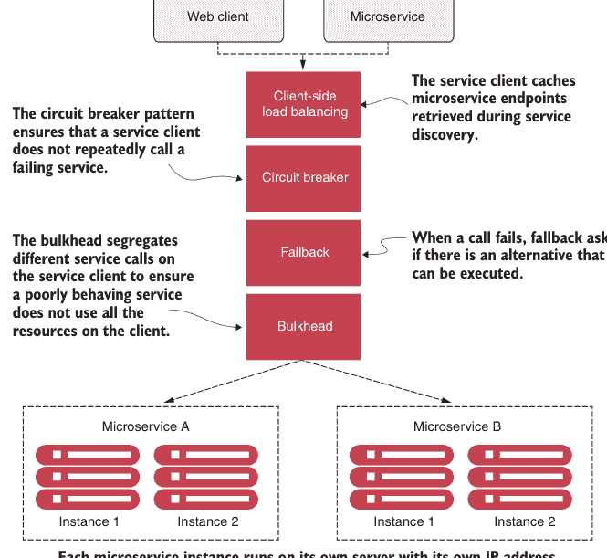
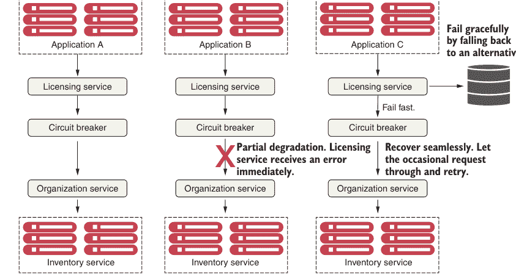
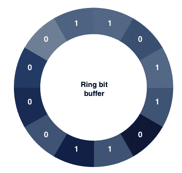
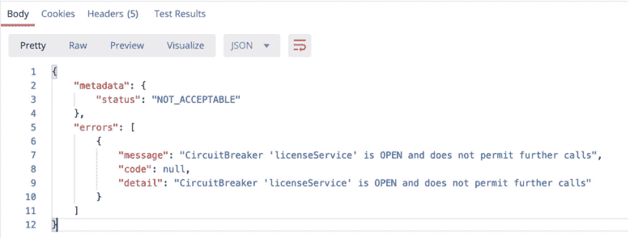
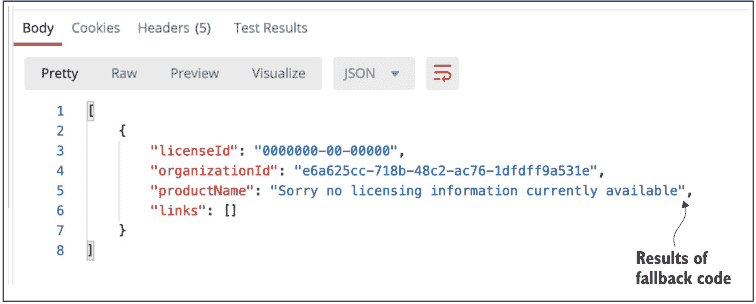
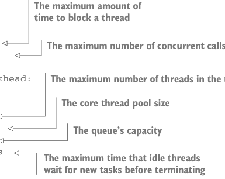
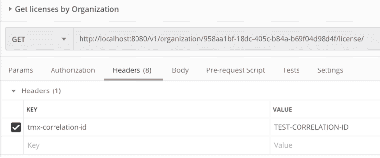

# 当坏事发生时：使用 Spring Cloud 和 Resilience4j 实现弹性模式


## 本章涵盖

-   实现断路器、回退和隔板模式
-   使用断路器模式来保护客户端资源
-   当远程服务失败时使用 Resilience4j
-   实现 Resilience4j 的隔板模式以隔离远程资源调用
-   调优 Resilience4j 断路器与隔板实现
-   自定义 Resilience4j 的并发策略

所有系统，尤其是分布式系统，都会经历失败。我们如何构建应用程序来应对这些失败，是每位软件开发人员工作中的关键部分。然而，在构建弹性系统时，大多数软件工程师只考虑了基础设施或关键服务的完全失效。他们专注于通过诸如集群关键服务器、在服务之间进行负载均衡以及将基础设施分散到多个位置等技术，为应用程序的每一层构建冗余。

虽然这些方法考虑了系统组件的彻底且往往相当严重的丢失，但它们只解决了构建弹性系统的一小部分问题。当服务崩溃时，很容易检测到它已经不存在，应用程序可以绕过它继续运行。然而，当服务运行缓慢时，检测这种糟糕的性能并绕过它是极其困难的。让我们看看其中的一些原因：

-   *服务降级可能先是间歇性的，然后逐渐加剧。* 服务降级也可能只以短促的爆发形式出现。失败的最初迹象可能只是一小群用户抱怨某个问题，直到突然之间，应用程序容器耗尽了它的线程池并彻底崩溃。
-   *对远程服务的调用通常是同步的，并且不会中止长时间运行的调用。* 应用程序开发人员通常会调用服务来执行操作，并等待服务返回。调用方没有超时概念来防止服务调用挂起。
-   *应用程序通常被设计为应对远程资源的完全失效，而非部分降级。* 通常，只要服务没有完全失败，应用程序就会继续调用行为不佳的服务，并且不会快速失败。在这种情况下，调用方的应用程序或服务可能会优雅地降级，或者更有可能因资源耗尽而崩溃。*资源耗尽*是指有限的资源（如线程池或数据库连接）达到上限，调用方客户端必须等待该资源再次变为可用。

性能不佳的远程服务所引发问题的阴险之处在于，它们不仅难以检测，而且可能触发级联效应，波及整个应用程序生态系统。如果没有适当的保护措施，一个性能不佳的服务就能迅速拖垮多个应用程序。基于云的微服务应用程序尤其容易受到这类中断的影响，因为这些应用程序由大量细粒度的分布式服务组成，并且完成用户事务需要涉及不同的基础设施组件。

弹性模式是微服务架构中最关键的方面之一。本章将解释四种弹性模式，以及如何使用 Spring Cloud 和 Resilience4j 在我们的许可服务中实现它们，使其能够在需要时快速失败。

## 7.1 什么是客户端弹性模式？

客户端弹性软件模式专注于保护远程资源（无论是另一个微服务调用还是数据库查询）的客户端，使其在远程资源因错误或性能不佳而失败时不会崩溃。这些模式允许客户端快速失败，不消耗宝贵的资源（如数据库连接和线程池）。它们还能防止性能不佳的远程服务问题“向上游”传播到客户端的消费者。在本章中，我们将介绍四种客户端弹性模式。图 7.1 展示了这些模式如何位于微服务消费者和微服务之间。



每个微服务实例都运行在自己的服务器上，拥有自己的 IP 地址。

图 7.1 四种客户端弹性模式充当服务消费者与服务之间的保护缓冲区。

这些模式——客户端负载均衡、断路器、回退和隔板——是在调用远程资源的客户端微服务中实现的。这些模式的实现在逻辑上位于消费远程资源的客户端与资源本身之间。让我们逐一深入探讨这些模式。

### 7.1.1 客户端负载均衡

我们在上一章讨论服务发现时介绍了客户端负载均衡模式。客户端负载均衡涉及让客户端从服务发现代理（如 Netflix Eureka）查找某个服务的所有单独实例，然后缓存这些服务实例的物理位置。

当服务消费者需要调用一个服务实例时，客户端负载均衡器会从它维护的服务位置池中返回一个位置。由于客户端负载均衡器位于服务客户端和服务消费者之间，负载均衡器能够检测某个服务实例是否正在抛出错误或行为不佳。如果客户端负载均衡器检测到问题，它可以将该服务实例从可用服务位置池中移除，并阻止任何未来的调用命中该服务实例。

这正是 Spring Cloud Load Balancer 库无需额外配置即可开箱即用提供的行为。因为我们在第 6 章已经用 Spring Cloud Load Balancer 讨论了客户端负载均衡，本章就不再赘述。

### 7.1.2 断路器

断路器模式模仿了电气断路器。在电气系统中，断路器检测流过电线的电流是否过大。如果断路器检测到问题，它就会断开与电气系统其余部分的连接，防止系统烧毁下游组件。

对于软件断路器，当调用远程服务时，断路器会监视该调用。如果调用耗时过长，断路器就会介入并终止该调用。断路器模式还会监视所有对远程资源的调用，如果失败调用足够多，断路器实现就会“跳闸”，快速失败并阻止未来对该失败远程资源的调用。

### 7.1.3 回退处理

使用回退模式时，当远程服务调用失败时，服务消费者不会生成异常，而是执行一条替代代码路径，尝试通过其他方式执行操作。这通常涉及从另一个数据源查找数据，或者将用户请求排队供以后处理。用户的调用不会看到指示问题的异常，但他们可能会收到通知，告知其请求必须稍后重试。

例如，假设你有一个电子商务网站，它监控用户行为并为用户推荐可能想购买的其他商品。通常，你会调用一个微服务来分析用户过去的行为，并返回针对该特定用户的推荐列表。然而，如果偏好服务失败，你的回退可能是检索一个基于所有用户购买行为的、更为通用的偏好列表。而且，这些数据可能来自完全不同的服务和数据源。

### 7.1.4 隔板

隔板模式基于造船中的一个概念。船被划分为称为隔板的舱室，这些舱室完全隔离且水密。即使船体被刺穿，一个隔板也能将水限制在船体被刺穿的区域内，防止整艘船充满水而下沉。


同样的概念可应用于必须与多个远程资源交互的服务。使用舱壁模式时，你将对远程资源的调用拆分到各自的线程池中，从而降低一个缓慢的远程资源调用导致整个应用程序崩溃的风险。

线程池充当服务的舱壁。每个远程资源被隔离并分配给一个线程池。如果某个服务响应缓慢，该类型服务调用的线程池可能会饱和并停止处理请求。将服务分配给线程池有助于绕过此类瓶颈，从而使其他服务不会饱和。

## 7.2 为什么客户端弹性很重要

虽然我们已在抽象层面讨论了这些不同的客户端弹性模式，但让我们深入到一个更具体的示例，看看这些模式可以应用在哪里。我们将走过一个典型场景，看看为什么客户端弹性模式对于实现运行在云端的基于微服务的架构至关重要。

图7.2展示了涉及数据库和远程服务等远程资源的典型场景。该场景不包含我们之前讨论过的任何弹性模式，因此它展示了一个完整的架构（生态系统）如何因单个服务故障而崩溃。让我们来看一下。

在图7.2的场景中，三个应用程序以某种形式与三个不同的服务通信。应用程序A和B直接与许可服务通信。许可服务从数据库检索数据，并调用组织服务为其完成某些工作。组织服务从完全不同的数据库平台检索数据，并调用第三方云提供商的另一个服务——库存服务，该服务严重依赖内部网络附加存储（NAS）设备将数据写入共享文件系统。应用程序C直接调用库存服务。

周末，网络管理员对NAS的配置做了一个他们自认为很小的调整。这一更改起初似乎一切正常，但周一早上，对某个特定磁盘子系统的读取开始变得异常缓慢。

编写组织服务的开发者从未预料到对库存服务的调用会出现缓慢。他们编写代码时，将对数据库的写入和从服务的读取放在同一事务中。当库存服务开始变慢时，不仅对库存服务请求的线程池开始积压，服务容器连接池中的数据库连接数量也会耗尽。这些连接一直保持打开，因为对库存服务的调用从未完成。

现在，许可服务开始资源耗尽，因为它调用的是组织服务，而组织服务因库存服务而运行缓慢。最终，所有三个应用程序都停止响应，因为它们在等待请求完成时耗尽了资源。如果在一个分布式资源被调用的每个点（无论是调用数据库还是调用服务）都实现了断路器模式，那么整个场景本可以避免。

图7.2 一个应用程序可以被看作是相互连接的依赖图。如果你不管理它们之间的远程调用，一个表现不佳的远程资源可以拖垮图中所有的服务。

在图7.3中，许可服务从不直接调用组织服务。相反，当发起调用时，许可服务将服务实际调用委托给断路器，断路器接管调用并将其包装在一个独立于原始调用方的线程（通常由线程池管理）中。通过将调用包装在线程中，客户端不再直接等待调用完成。相反，断路器监视该线程，如果线程运行时间过长，可以终止该调用。



图7.3 断路器跳闸，使行为异常的服务调用快速而优雅地失败。

图7.3展示了三种场景。第一种场景，“正常路径”，断路器维护一个计时器，如果对远程服务的调用在计时器到期前完成，那么一切正常；许可服务可以继续其工作。

第二种场景是部分降级：许可服务通过断路器调用组织服务。但这一次，组织服务运行缓慢，因此如果调用未能在断路器维护的线程计时器超时前完成，断路器就会终止与远程服务的连接。然后许可服务从调用中返回错误。许可服务的资源（其自身的线程或连接池）不会因等待组织服务完成而被占用。

如果对组织服务的调用超时，断路器开始跟踪已发生的失败次数。如果在特定时间段内服务上出现足够多的错误，断路器就会“跳闸”，所有对组织服务的调用都会失败，而不再实际发起调用。

在第三种场景中，许可服务立即知道出现了问题，无需等待断路器超时。然后它可以选择完全失败，或者使用一组备用代码（兜底方案）来采取行动。组织服务获得了恢复的机会，因为当断路器跳闸时，许可服务并没有调用它。这给了组织服务一点喘息空间，并有助于防止服务降级时发生的级联关闭。

断路器偶尔会让调用通过以访问一个降级的服务。如果这些调用连续成功足够多次，断路器就会重置自身。断路器模式提供的关键好处是，远程调用可以：

- 快速失败——当远程服务发生降级时，应用程序会快速失败，防止通常导致整个应用程序关闭的资源耗尽问题。在大多数中断情况下，部分宕机总比完全宕机要好。
- 优雅失败——通过超时和快速失败，断路器模式使我们可以优雅地失败，或寻找替代机制来实现用户的意图。例如，如果用户试图从某个数据源检索数据，而该数据源正在发生服务降级，那么我们的服务可以从另一个位置检索该数据。
- 无缝恢复——断路器模式作为中介，可以定期检查所请求的资源是否重新在线，并无需人工干预重新启用对它的访问。

在一个拥有数百个服务的大型云端应用程序中，这种优雅恢复至关重要，因为它可以显著缩短恢复服务所需的时间。它还显著降低了“疲惫”的操作员或应用工程师引发更多问题的风险，使断路器能够在服务恢复过程中直接干预（例如重启失败的服务）。

在Resilience4j之前，我们使用Hystrix，这是实现微服务弹性模式最常见的Java库之一。由于Hystrix现在处于维护模式，这意味着不再包含新功能，因此最推荐的替代库之一是Resilience4j。这就是我们选择在本章中进行演示的主要原因。通过Resilience4j，我们获得了类似（以及一些额外）的好处，我们将在本章中看到这些好处。


## 7.3 实现 Resilience4j

Resilience4j 是一个受 Hystrix 启发的容错库。它提供了以下模式来提高由于网络问题或我们多个服务中的任何一个服务故障而导致的容错能力：

- *断路器*—在调用的服务出现故障时停止发出请求
- *重试*—在服务暂时失败时重试
- *舱壁*—限制发出的并发服务请求数量以避免过载
- *速率限制*—限制服务在同一时间接收到的调用数量
- *回退*—为失败的请求设置替代路径

使用 Resilience4j，我们可以通过为该方法定义注解，将多个模式应用于同一个方法调用。例如，如果我们想使用舱壁和断路器模式来限制发出的调用数量，我们可以为该方法定义 @CircuitBreaker 和 @Bulkhead 注解。需要注意的是，Resilience4j 的重试顺序如下：

```
Retry ( CircuitBreaker ( RateLimiter ( TimeLimiter ( Bulkhead ( Function ) ) ) ) )
```

重试在调用结束时应用（如果需要）。在尝试组合模式时记住这一点很有价值，但我们也可以将模式作为单独的功能使用。

构建断路器、重试、速率限制、回退和舱壁模式的实现需要对线程和线程管理有深入的了解。要应用这些模式的高质量实现集需要大量的工作。幸运的是，我们可以使用 Spring Boot 和 Resilience4j 库来为我们提供一个经过实战检验的工具，该工具每天在多个微服务架构中使用。在接下来的几个部分中，我们将介绍如何

- 配置许可服务的 Maven 构建文件（pom.xml）以包含 Spring Boot/Resilience4j 包装器
- 使用 Spring Boot/Resilience4j 注解将远程调用包装为断路器、重试、速率限制和舱壁模式
- 自定义远程资源上的各个断路器以使用每个调用的自定义超时
- 实现回退策略，以防断路器必须中断调用或调用失败
- 在我们的服务中使用单独的线程池来隔离服务调用并在不同的远程资源之间构建舱壁



**图 7.5** Resilience4j 断路器环形位缓冲区包含 12 个结果。此环中所有成功请求均为 0，在无法从调用的服务接收到响应时为 1。

当断路器处于打开状态时，所有调用在可配置的时间内都被拒绝，并且断路器会抛出 CallNotPermittedException。一旦配置时间到期，断路器将变为半开状态并允许一定数量的请求以查看服务是否仍然不可用。

在半开状态下，断路器使用另一个可配置的环形位缓冲区来评估失败率。如果此新失败率高于配置的阈值，断路器将变回打开；如果低于或等于阈值，则变回关闭。这可能有点令人困惑，但只需记住，在打开状态下断路器会拒绝，在关闭状态下断路器会接受所有请求。

此外，在 Resilience4j 断路器模式中，您还可以定义以下附加状态。需要注意的是，退出以下状态的唯一方法是重置断路器或触发状态转换：

- DISABLED—始终允许访问
- FORCED_OPEN—始终拒绝访问

> **注意** 这两个附加状态的详细描述超出了本书的范围。如果您想了解有关这些状态的更多信息，我们建议您阅读 Resilience4j 官方文档 https://resilience4j.readme.io/v0.17.0/docs/circuitbreaker。

在本节中，我们将从两个大类来看 Resilience4j 的实现。在第一个类别中，我们将使用 Resilience4j 断路器包装许可和组织服务中对数据库的所有调用。然后我们将使用 Resilience4j 包装许可和组织服务之间的服务间调用。虽然这是两种不同类别的调用，但我们会看到，使用 Resilience4j，这些调用将完全相同。图 7.6 显示了我们将用 Resilience4j 断路器包装的远程资源。

打开 `src/main/java/com/optimagrowth/license/service/LicenseService.java` 类文件，如以下列表所示。

### 列表 7.2 使用断路器包装远程资源调用

```java
//Part of LicenseService.java omitted for conciseness
@CircuitBreaker(name = "licenseService")
public List<License> getLicensesByOrganization(String organizationId) {
    return licenseRepository.findByOrganizationId(organizationId);
}
```

@CircuitBreaker wrapper for getLicensesByOrganization() with a Resilience4j circuit breaker

> **注意** 如果您查看源代码存储库中的列表 7.2 中的代码，您会看到 @CircuitBreaker 注解上有几个更多参数。我们将在本章后面介绍这些参数，但列表 7.2 中的代码使用 @CircuitBreaker 并使用其所有默认值。

这看起来代码不多，而且确实不多，但这个注解内部包含了很多功能。使用 @CircuitBreaker 注解，每当调用 getLicensesByOrganization() 方法时，调用就会被 Resilience4j 断路器包装。断路器会中断对 getLicensesByOrganization() 方法的任何失败尝试。

如果数据库工作正常，这个代码示例会很无聊。让我们模拟 getLicensesByOrganization() 方法遇到缓慢或超时的数据库查询。以下列表演示了这一点。

### 列表 7.3 故意使对许可服务数据库的调用超时

```java
//Part of LicenseService.java omitted for conciseness
private void randomlyRunLong() {
    Random rand = new Random();
    int randomNum = rand.nextInt(3) + 1;
    if (randomNum==3) sleep();
}
private void sleep(){
    try {
        Thread.sleep(5000);
        throw new java.util.concurrent.TimeoutException();
    } catch (InterruptedException e) {
        logger.error(e.getMessage());
    }
}
@CircuitBreaker(name = "licenseService")
public List<License> getLicensesByOrganization(String organizationId) {
    randomlyRunLong();
    return licenseRepository.findByOrganizationId(organizationId);
}
```

给我们一次三分之一的机会使数据库调用运行过长

休眠 5000 毫秒（5 秒）然后抛出 TimeoutException

如果您在 Postman 中多次输入 `http://localhost:8080/v1/organization/e6a625cc-718b-48c2-ac76-1dfdff9a531e/license/` 端点，您将看到许可服务返回以下错误消息：

```json
{
  "timestamp": 1595178498383,
  "status": 500,
  "error": "Internal Server Error",
  "message": "No message available",
  "path": "/v1/organization/e6a625cc-718b-48c2-ac76-1dfdff9a531e/license/"
}
```

如果我们继续执行失败的服务，环形位缓冲区最终会填满，我们应该会收到图 7.7 所示的错误。



**图 7.7** 断路器错误表明断路器现在处于打开状态。

现在我们已经为许可服务实现了断路器，让我们继续为组织微服务设置断路器。

### 7.5.1 向组织服务添加断路器

使用方法级注解为调用标记断路器行为的美妙之处在于，无论我们访问数据库还是调用微服务，注解都是相同的。例如，在我们的许可服务中，我们需要查找与许可证关联的组织名称。如果我们想用断路器包装对组织服务的调用，只需将 RestTemplate 调用分解为一个方法并用 `@CircuitBreaker` 注解它，如下所示：

```java
@CircuitBreaker(name = "organizationService")
private Organization getOrganization(String organizationId) {
    return organizationRestClient.getOrganization(organizationId);
}
```


> 注意 尽管使用 @CircuitBreaker 很容易实现，但我们确实需要谨慎对待该注解的默认值。我们强烈建议你始终分析并设置最适合你需求的配置。

要查看断路器的默认值，可以在 Postman 中选择以下 URL：http://localhost:<service_port>/actuator/health。默认情况下，断路器会在 Spring Boot Actuator 健康服务中暴露配置。

## 7.5.2 自定义断路器

在本节中，我们将回答开发人员在使用 Resilience4j 时最常问的问题之一：如何自定义 Resilience4j 断路器？这很容易实现，只需向 application.yml、bootstrap.yml 或位于 Spring Config Server 仓库中的服务配置文件添加一些参数即可。下面的清单演示了如何在 licensing 服务和 organization 服务的 bootstrap.yml 中自定义断路器模式。

### 清单 7.4 自定义断路器

```
Licensing service instance configuration. (The name given to the circuit breaker in the annotation.)

//Part of bootstrap.yml omitted for conciseness

resilience4j.circuitbreaker:
  instances:
    licenseService:
      registerHealthIndicator: true
      ringBufferSizeInClosedState: 5
      ringBufferSizeInHalfOpenState: 3
      waitDurationInOpenState: 10s
      failureRateThreshold: 50
      recordExceptions:
        - org.springframework.web.client.HttpServerErrorException
        - java.io.IOException
        - java.util.concurrent.TimeoutException
        - org.springframework.web.client.ResourceAccessException

organizationService:
  registerHealthIndicator: true
  ringBufferSizeInClosedState: 6
  ringBufferSizeInHalfOpenState: 4
  waitDurationInOpenState: 20s
  failureRateThreshold: 60

Indicates whether to expose the configuration over the health endpoint
Sets the ring buffer size in the half-open state
Sets the wait duration for the open state
Sets the failure rate threshold percentage
Sets the ring buffer size at the closed state
Sets the exceptions that should be recorded as failures
Organization service instance configuration. (The name given to the circuit breaker in the annotation.)
```

Resilience4j 允许我们通过应用程序的属性来自定义断路器的行为。我们可以配置任意数量的实例，每个实例可以有不同的配置。清单 7.4 包含以下配置设置：

- `ringBufferSizeInClosedState`——设置断路器处于关闭状态时环形缓冲区的大小。默认值为 100。
- `ringBufferSizeInHalfOpenState`——设置断路器处于半开状态时环形缓冲区的大小。默认值为 10。
- `waitDurationInOpenState`——设置断路器在从打开状态变为半开状态之前应等待的时间。默认值为 60,000 毫秒。
- `failureRateThreshold`——配置失败率阈值的百分比。请记住，当失败率大于或等于该阈值时，断路器将变为打开状态并开始短路调用。默认值为 50。
- `recordExceptions`——列出将被视为失败的异常。默认情况下，所有异常都会记录为失败。

在本书中，我们不会介绍 Resilience4j 断路器的所有参数。如果你想了解更多可能的配置参数，建议你访问以下链接：https://resilience4j.readme.io/docs/circuitbreaker。

## 7.6 回退处理

断路器模式的美妙之处在于，因为远程资源的消费者与资源本身之间存在一个“中间人”，我们有机会拦截服务故障并选择可采取的替代行动方案。

在 Resilience4j 中，这被称为回退策略，而且很容易实现。让我们看看如何为 licensing 服务构建一个简单的回退策略，该策略返回一个许可证对象，表明当前没有可用的许可信息。下面的清单演示了这一点。

### 清单 7.5 在 Resilience4j 中实现回退

```
//Part of LicenseService.java omitted for conciseness
@CircuitBreaker(name= "licenseService",
    fallbackMethod= "buildFallbackLicenseList")
public List<License> getLicensesByOrganization(
    String organizationId) throws TimeoutException {

    logger.debug("getLicensesByOrganization Correlation id: {}",
        UserContextHolder.getContext().getCorrelationId());
    randomlyRunLong();
    return licenseRepository.findByOrganizationId(organizationId);
}

private List<License> buildFallbackLicenseList(String organizationId,
    Throwable t){
    List<License> fallbackList = new ArrayList<>();
    License license = new License();
```

```
license.setLicenseId("0000000-00-00000");
license.setOrganizationId(organizationId);
license.setProductName(
    "Sorry no licensing information currently available");
fallbackList.add(license);
return fallbackList;
}
```

要实现 Resilience4j 的回退策略，我们需要做两件事。首先，我们需要向 @CircuitBreaker 或任何其他注解添加 fallbackMethod 属性（我们将在后面解释）。该属性必须包含当 Resilience4j 因故障中断调用时要调用的方法名称。

第二件事是定义回退方法。此方法必须与受 @CircuitBreaker 保护的原始方法位于同一个类中。要在 Resilience4j 中创建回退方法，我们需要创建一个与原始函数具有相同签名的方法，并额外增加一个参数，即目标异常参数。由于签名相同，我们可以将原始方法的所有参数传递给回退方法。

在清单 7.5 的示例中，回退方法 buildFallbackLicenseList() 只是构造一个包含虚拟信息的 License 对象。我们本可以让回退方法从其他数据源读取此数据，但出于演示目的，我们将构造一个可以由原始函数调用返回的列表。

### 关于回退

在决定是否要实现回退策略时，需要记住以下几点：

- 当资源超时或失败时，回退提供了一种应对措施。如果你发现自己使用回退来捕获超时异常，但除了记录错误之外什么也不做，那么你应该在服务调用周围使用标准的 try...catch 块：捕获异常并将日志记录逻辑放在 try...catch 块中。
- 注意你在回退函数中采取的操作。如果你在回退服务中调用另一个分布式服务，你可能需要用 @CircuitBreaker 包装回退。请记住，你在主要应对措施中遇到的相同故障也可能影响你的次要回退选项。请进行防御性编码。

现在我们已经有了回退方法，接下来再次调用我们的端点。这次当我们在 Postman 中选择它并遇到超时错误时（请记住我们有三分之一的几率），我们不应该从服务调用中收到异常。相反，虚拟许可证值将像图 7.8 中那样返回。



**图 7.8** 使用 Resilience4j 回退的服务调用

## 7.7 实现舱壁模式

在基于微服务的应用中，我们通常需要调用多个微服务来完成特定任务。如果不使用舱壁模式，这些调用的默认行为是使用为整个 Java 容器处理请求而保留的相同线程来执行。在高并发情况下，众多服务中某一个出现性能问题，可能会导致 Java 容器的所有线程都被占满并等待处理工作，而新的工作请求不断堆积。Java 容器最终会崩溃。

舱壁模式将远程资源调用隔离到各自的线程池中，这样单个行为异常的服务可以被限制住，而不会导致容器崩溃。Resilience4j 提供了两种不同的舱壁模式实现。你可以使用这些实现来限制并发执行的数量：

- *信号量舱壁*——使用信号量隔离方法，限制对服务的并发请求数。一旦达到限制，它就会开始拒绝请求。
- *线程池舱壁*——使用有界队列和固定线程池。这种方法仅在池和队列都已满时才拒绝请求。

默认情况下，Resilience4j 使用信号量舱壁类型。图 7.9 说明了这种类型。

如果应用内访问的远程资源数量较少，并且各个服务的调用量（相对）均匀分布，那么这种模型工作良好。问题在于，如果某些服务的调用量远高于其他服务，或完成时间远长于其他服务，我们最终可能会在线程池中引入线程耗尽问题，因为一个服务最终会占满默认线程池中的所有线程。


Figure 7.9 Resilience4j 默认的 bulkhead 类型是信号量方法。

幸运的是，Resilience4j 提供了易于使用的机制，用于在不同的远程资源调用之间创建 bulkhead。Figure 7.10 显示了当它们被隔离到各自的 bulkhead 中时，受管资源的外观。

Figure 7.10 绑定到隔离线程池的 Resilience4j 命令

要在 Resilience4j 中实现 bulkhead 模式，我们需要使用额外的配置将其与 @CircuitBreaker 结合使用。让我们看一些执行此操作的示例代码：

- 为 `getLicensesByOrganization()` 调用设置单独的线程池
- 在 `bootstrap.yml` 文件中创建 bulkhead 配置
- 使用信号量方法时，设置 `maxConcurrentCalls` 和 `maxWaitDuration`
- 使用线程池方法时，设置 `maxThreadPoolSize`、`coreThreadPoolSize`、`queueCapacity` 和 `keepAliveDuration`

下面的列表显示了具有这些 bulkhead 配置参数的 licensing service 的 bootstrap.yml。

## Listing 7.6 为 licensing service 配置 bulkhead 模式

```
```yaml
# Part of bootstrap.yml omitted for conciseness

resilience4j.bulkhead:
  instances:
    bulkheadLicenseService:
      maxWaitDuration: 10ms
      maxConcurrentCalls: 20

resilience4j.thread-pool-bulkhead:
  instances:
    bulkheadLicenseService:
      maxThreadPoolSize: 1
      coreThreadPoolSize: 1
      queueCapacity: 1
      keepAliveDuration: 20ms
```
```



Resilience4j 还允许我们通过应用程序的属性来自定义 bulkhead 模式的行为。与断路器一样，我们可以创建任意多个实例，每个实例都可以有不同的配置。Listing 7.6 包含以下属性：

- `maxWaitDuration`—设置进入 bulkhead 时阻塞线程的最大时间。默认值是 0。
- `maxConcurrentCalls`—设置 bulkhead 允许的最大并发调用数。默认值是 25。
- `maxThreadPoolSize`—设置最大线程池大小。默认值是 `Runtime.getRuntime().availableProcessors()`。
- `coreThreadPoolSize`—设置核心线程池大小。默认值是 `Runtime.getRuntime().availableProcessors()`。
- `queueCapacity`—设置队列的容量。默认值是 100。
- `keepAliveDuration`—设置空闲线程在终止前等待新任务的最大时间。这发生在线程数高于核心线程数时。默认值是 20 ms。

与断路器一样，Resilience4j 允许我们指定要重试和不重试的异常。下面的列表显示了 licensing service 的 bootstrap.yml，其中包含重试配置参数。

## Listing 7.8 在 bootstrap.yml 中配置重试模式

```
```yaml
//Part of bootstrap.yml omitted for conciseness

resilience4j.retry:
  instances:
    retryLicenseService:
      maxRetryAttempts: 5
      waitDuration: 10000
      retry-exceptions:
        - java.util.concurrent.TimeoutException
```
```

第一个参数 maxRetryAttempts 允许我们定义服务的最大重试尝试次数。此参数的默认值是 3。第二个参数 waitDuration 允许我们定义重试尝试之间的等待时间。此参数的默认值是 500 ms。第三个参数 retry-exceptions 设置将被重试的错误类列表。默认值为空。对于本书，我们仅使用这三个参数，但你也可以设置以下内容：

- `intervalFunction`—设置在失败后更新等待间隔的函数。
- `retryOnResultPredicate`—配置一个谓词来评估是否应重试结果。如果我们想重试，该谓词应返回 true。
- `retryOnExceptionPredicate`—配置一个谓词来评估是否应重试异常。与前一个谓词相同；如果我们想重试，必须返回 true。
- `ignoreExceptions`—设置将被忽略且不会被重试的错误类列表。默认值为空。

下面的列表演示了如何围绕从 licensing service 查找许可数据的所有调用设置重试模式。

## Listing 7.9 在 getLicensesByOrganization() 方法周围创建 bulkhead

```
```java
//Part of LicenseService.java omitted for conciseness

@CircuitBreaker(name = "licenseService",
                fallbackMethod="buildFallbackLicenseList")
@Retry(name = "retryLicenseService",
       fallbackMethod=
           "buildFallbackLicenseList")
@Bulkhead(name="bulkheadLicenseService",
          fallbackMethod="buildFallbackLicenseList")

public List<License> getLicensesByOrganization(String organizationId)
        throws TimeoutException {
    logger.debug("getLicensesByOrganization Correlation id: {}",
```

对于此模式，我们必须指定超时时间、限制刷新和期间的限制。下面的列表显示了 licensing service 的 bootstrap.yml，其中包含重试配置参数。

## Listing 7.10 在 bootstrap.yml 中配置重试模式

```
//Part of bootstrap.yml omitted for conciseness

resilience4j.ratelimiter:
  instances:
    licenseService:
      timeoutDuration: 1000ms
      limitRefreshPeriod: 5000
      limitForPeriod: 5

Defines the time a thread waits for permission
Defines the number of permissions available during a limit refresh period
Defines the period of a limit refresh
```

第一个参数 timeoutDuration 让我们定义线程等待许可的时间；此参数的默认值是 5 s（秒）。第二个参数 limitRefreshPeriod 使我们能够设置限制刷新的周期。每个周期后，速率限制器会将权限计数重置回 limitForPeriod 值。limitRefreshPeriod 的默认值是 500 ns（纳秒）。

最后一个参数 limitForPeriod 让我们设置一个刷新周期内可用的权限数。limitForPeriod 的默认值是 50。下面的列表演示了如何围绕从 licensing service 查找许可数据的所有调用设置重试模式。

## Listing 7.11 在 getLicensesByOrganization() 周围创建 bulkhead

```
//Part of LicenseService.java omitted for conciseness

@CircuitBreaker(name= "licenseService",
    fallbackMethod= "buildFallbackLicenseList")
@RateLimiter(name = "licenseService",
    fallbackMethod = "buildFallbackLicenseList")
@Retry(name = "retryLicenseService",
    fallbackMethod = "buildFallbackLicenseList")
@Bulkhead(name= "bulkheadLicenseService",
    fallbackMethod= "buildFallbackLicenseList")
public List<License> getLicensesByOrganization(String organizationId)
    throws TimeoutException {
    logger.debug("getLicensesByOrganization Correlation id: {}",
        UserContextHolder.getContext().getCorrelationID());
    randomlyRunLong();
    return licenseRepository.findByOrganizationId(organizationId);
}

Sets the instance name and fallback method for the rate limiter pattern
```

bulkhead 与速率限制器模式之间的主要区别在于，bulkhead 模式负责限制并发调用的数量（例如，它一次只允许 X 个并发调用）。使用速率限制器，我们可以在给定时间范围内限制总调用数（例如，每 Y 秒允许 X 次调用）。

为了选择适合你的模式，请仔细检查你的需求。如果你想阻止并发时间，最好的选择是 bulkhead，但如果你想限制特定时间段内的总调用数，最佳选择是速率限制器。如果你同时考虑两种情况，也可以将它们结合起来。

## 7.10 ThreadLocal 和 Resilience4j

在本节中，我们将在 ThreadLocal 中定义一些值，以查看它们是否通过使用 Resilience4J 注解的方法传播。请记住，Java ThreadLocal 允许我们创建只能由同一线程读取和写入的变量。当我们使用线程时，特定对象的每个线程共享其变量，使这些线程不安全。在 Java 中使它们线程安全的最常见方法是使用同步。但如果我们想避免同步，也可以使用 ThreadLocal 变量。

让我们看一个具体的例子。通常在基于 REST 的环境中，我们希望将上下文信息传递给服务调用，以帮助我们运营管理服务。例如，我们可能会在 REST 调用的 HTTP 头中传递相关 ID 或身份验证令牌，然后可以将其传播到任何下游服务调用。相关 ID 允许我们在单个事务中的多个服务调用中进行跟踪的唯一标识符。

为了使此值在我们的服务调用中的任何位置都可用，我们可能会使用 Spring Filter 类来拦截 REST 服务中的每个调用。然后它可以从传入的 HTTP 请求中检索此信息并将此上下文信息存储在自定义 UserContext 对象中。然后，只要我们的代码需要在 REST 服务调用中访问此值，我们的代码就可以从 ThreadLocal 存储变量中检索 UserContext 并读取该值。Listing 7.12 显示了我们可以在 licensing service 中使用的 Spring 过滤器的示例。

> NOTE 你可以在源代码中找到此代码，位于 /licensing-service/src/main/java/com/optimagrowth/license/utils/UserContextFilter.java，章节 7 的源代码中。这里是仓库链接：https://github.com/ihuaylupo/manning-smia/tree/master/chapter7。

## Listing 7.12 UserContextFilter 解析 HTTP 头并检索数据

```
package com.optimagrowth.license.utils;
...
//Imports removed for conciseness

@Component
public class UserContextFilter implements Filter {
    private static final Logger logger =
        LoggerFactory.getLogger(UserContextFilter.class);
```


```java
@Override
public void doFilter(ServletRequest servletRequest, ServletResponse
        servletResponse, FilterChain filterChain) throws IOException,
        ServletException {

    HttpServletRequest httpServletRequest =
            (HttpServletRequest) servletRequest;

    UserContextHolder.getContext().setCorrelationId(
            httpServletRequest.getHeader(
                    UserContext.CORRELATION_ID));
    UserContextHolder.getContext().setUserId(
            httpServletRequest.getHeader(
                    UserContext.USER_ID));
    UserContextHolder.getContext().setAuthToken(
            httpServletRequest.getHeader(
                    UserContext.AUTH_TOKEN));
    UserContextHolder.getContext().setOrganizationId(
            httpServletRequest.getHeader(
                    UserContext.ORGANIZATION_ID));

    filterChain.doFilter(httpServletRequest, servletResponse);
}
...
//Rest of UserContextFilter.java omitted for conciseness
```

> 从调用请求的HTTP头中检索UserContext的值，然后将它们存储到UserContextHolder中。

UserContextHolder类将UserContext存储在一个ThreadLocal类中。一旦存储到ThreadLocal中，任何为请求执行的代码都将使用存储在UserContextHolder中的UserContext对象。

下面的清单展示了UserContextHolder类。你可以在 `/licensing-service/src/main/java/com/optimagrowth/license/utils/UserContextHolder.java` 类文件中找到这个类。

### 清单7.13 所有UserContext数据由UserContextHolder管理

```java
//Imports omitted for conciseness

public class UserContextHolder {
    private static final ThreadLocal<UserContext> userContext
            = new ThreadLocal<UserContext>();

    public static final UserContext getContext() {
        UserContext context = userContext.get();

        if (context == null) {
            context = createEmptyContext();
            userContext.set(context);
        }
        return userContext.get();
    }

    public static final void setContext(UserContext context) {
        userContext.set(context);
    }

    public static final UserContext createEmptyContext(){
        return new UserContext();
    }
}
```

> **注意：** 当我们直接使用ThreadLocal时必须小心。错误使用ThreadLocal可能导致应用程序中的内存泄漏。

UserContext是一个POJO类，包含我们想要存储在UserContextHolder中的所有特定数据。下面的清单展示了这个类的内容。你可以在 `/licensing-service/src/main/java/com/optimagrowth/license/utils/UserContext.java` 中找到这个类。

### 清单7.14 创建 UserContext

```java
...
//Imports omitted for conciseness

@Component
public class UserContext {
    public static final String CORRELATION_ID = "tmx-correlation-id";
    public static final String AUTH_TOKEN     = "tmx-auth-token";
    public static final String USER_ID        = "tmx-user-id";
    public static final String ORGANIZATION_ID = "tmx-organization-id";

    private String correlationId = new String();
    private String authToken = new String();
    private String userId = new String();
    private String organizationId = new String();

    public String getCorrelationId() { return correlationId;}
    public void setCorrelationId(String correlationId) {
        this.correlationId = correlationId;
    }

    public String getAuthToken() {
        return authToken;
    }

    public void setAuthToken(String authToken) {
        this.authToken = authToken;
    }

    public String getUserId() {
        return userId;
    }
}
```



**图7.11** 向许可服务的HTTP头添加关联ID

提交此调用后，我们应在控制台中看到三条日志消息，当传入的关联ID流经UserContext、LicenseController和LicenseService类时，会将其打印出来：

```
UserContextFilter Correlation id: TEST-CORRELATION-ID
LicenseServiceController Correlation id: TEST-CORRELATION-ID
LicenseService.getLicensesByOrganization Correlation id:
```

如果在控制台中看不到日志消息，请将下面清单中显示的代码行添加到许可服务的 `application.yml` 或 `application.properties` 文件中。

### 清单7.16 许可服务application.yml文件中的日志记录器配置

```yaml
# Some code omitted for conciseness
logging:
  level:
    org.springframework.web: WARN
    com.optimagrowth: DEBUG
```

然后重新构建并执行你的微服务。如果你使用Docker，可以在父`pom.xml`所在的根目录中执行以下命令：

```
mvn clean package dockerfile:build
docker-compose -f docker/docker-compose.yml up
```

你会看到，一旦调用到达受弹性保护的方法，我们仍然能得到关联ID的值。这意味着使用Resilience4j注解的方法上可以使用父线程的值。

Resilience4j是在我们的应用程序中实现弹性模式的绝佳选择。随着Hystrix进入维护模式，Resilience4j已成为Java生态系统中的首选。既然我们已经看到了Resilience4j可以实现的特性，我们可以继续下一个主题：Spring Cloud Gateway。

## 小结

- 在设计像微服务这样的高度分布式应用程序时，必须考虑客户端弹性。
- 服务的彻底故障（例如服务器崩溃）很容易检测和处理。
- 一个性能不佳的服务可能引发资源耗尽的级联效应，因为调用客户端中的线程在等待服务完成时会被阻塞。
- 三种核心客户端弹性模式是断路器模式、回退模式、隔板模式和速率限制器模式。
- 断路器模式旨在终止运行缓慢和性能下降的系统调用，使这些调用快速失败，并防止资源耗尽。
- 回退模式允许你在远程服务调用失败或调用的断路器失败时定义替代代码路径。
- 隔板模式将远程资源调用彼此隔离，将对远程服务的调用隔离到各自的线程池中。如果一组服务调用失败，其失败不应被允许“耗尽”应用程序容器中的所有资源。
- 速率限制器模式限制给定时间段内的总调用次数。
- Resilience4j允许我们同时叠加使用多种模式。
- 重试模式负责在服务暂时失败时进行重试尝试。
- 隔板模式与速率限制器模式的主要区别在于，隔板模式负责限制同一时间点的并发调用数，而速率限制器限制给定时间段内的总调用数。
- Spring Cloud和Resilience4j库提供了断路器、回退、重试、速率限制器和隔板模式的实现。
- Resilience4j库具有高度可配置性，可以在全局、类和线程池级别进行设置。
