## 使用Spring Cloud Gateway进行服务路由

**本章涵盖**

- 在微服务中使用服务网关
- 使用Spring Cloud Gateway实现服务网关
- 在网关中映射微服务路由
- 构建过滤器以使用关联ID和跟踪

在像微服务这样的分布式架构中，总有一天我们需要确保安全、日志记录以及跨多个服务调用跟踪用户等关键行为得以实现。为了实现这一功能，我们希望这些属性在所有服务中得到一致执行，而不需要每个开发团队各自构建自己的解决方案。虽然可以使用公共库或框架直接在单个服务中构建这些能力，但这样做会带来以下影响：

- *一致地在每个服务中实现这些能力具有挑战性。* 开发人员专注于交付功能，在日常活动的忙碌中，除非他们从事需要这些功能的受监管行业，否则很容易忘记实现服务日志记录或跟踪。


- *将实现安全、日志等横切关注点的责任推给各个开发团队，会大大增加某些人无法正确实现或忘记实现这些关注点的可能性。* 横切关注点是指程序设计中对整个应用都适用，并可能影响应用其他部分的功能或特性。
- *我们有可能在所有服务之间建立硬依赖。* 我们在所有服务共享的通用框架中构建的能力越多，就越难在不重新编译和重新部署所有服务的情况下更改或添加公共代码中的行为。突然之间，升级共享库中的核心能力就变成了一场漫长的迁移过程。

为了解决这个问题，我们需要将这些横切关注点抽象为一个可以独立部署的服务，并充当架构中所有微服务调用的过滤器和路由器。我们将此服务称为*网关*。我们的服务客户端不再直接调用微服务，而是将所有调用都路由到服务网关，该网关充当单一策略执行点（PEP），然后将请求路由到最终目的地。

在本章中，我们将了解如何使用 Spring Cloud Gateway 来实现服务网关。具体来说，我们将研究如何使用 Spring Cloud Gateway 来：

- 将所有服务调用放在单个 URL 后面，并使用服务发现将这些调用映射到实际的服务实例
- 为流经服务网关的每个服务调用注入关联 ID
- 从 HTTP 响应中提取返回的关联 ID，并将其发送回客户端

让我们更详细地探讨服务网关如何融入本书正在构建的整体微服务架构中。

## 8.1 什么是服务网关？

到目前为止，对于我们在前面章节中构建的微服务，我们要么通过 Web 客户端直接调用各个服务，要么通过 Eureka 等服务发现引擎以编程方式调用它们。图 8.1 展示了这种方法。

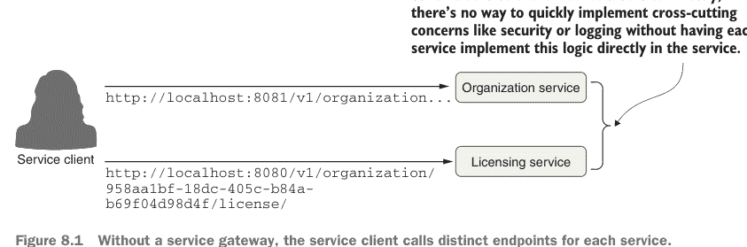

服务网关充当服务客户端与被调用服务之间的中介。服务客户端只与服务网关管理的单个 URL 通信。服务网关解析来自服务客户端调用的路径，并确定服务客户端试图调用哪个服务。图 8.2 展示了服务网关如何像交通警察指挥交通一样，将用户引导至目标微服务及相应实例。

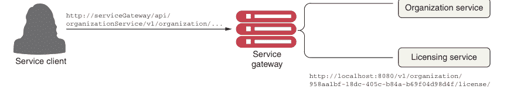

图 8.2 服务网关位于服务客户端和相应服务实例之间。所有服务调用（包括内部和外部）都应流经服务网关。

服务网关作为我们应用程序中所有微服务调用入站流量的守门人。有了服务网关，我们的服务客户端永远不会直接调用单个服务的 URL，而是将所有调用都发送到服务网关。

由于服务网关位于客户端与各个服务之间的所有调用之间，因此它也充当服务调用的中央 PEP。使用集中式 PEP 意味着可以在一个地方执行横切服务关注点，而无需各个开发团队实现这些关注点。可以在服务网关中实现的横切关注点示例包括：

- 静态路由——服务网关将所有服务调用放在单个 URL 和 API 路由后面。这简化了开发，因为我们只需知道所有服务的一个服务端点即可。
- 动态路由——服务网关可以检查传入的服务请求，并根据传入请求中的数据为服务调用者执行智能路由。例如，参与 Beta 计划的客户可能会将其对服务的所有调用路由到一组特定的服务集群，这些集群运行的代码版本与其他用户使用的不同。
- 身份验证和授权——由于所有服务调用都通过服务网关路由，因此服务网关是检查服务调用者是否已进行身份验证的自然位置。
- 指标收集和日志记录——服务网关可用于在服务调用通过时收集指标和记录信息。您还可以使用服务网关来确认用户请求中关键信息是否到位，从而确保日志记录的统一性。这并不意味着您不应该在单个服务中收集指标。相反，服务网关允许您集中收集许多基本指标，例如服务被调用的次数和服务响应时间。

## 等等——服务网关难道不是单点故障和潜在瓶颈吗？

在第 6 章中，当我们介绍 Eureka 时，我们讨论了集中式负载均衡器如何成为服务的单点故障和瓶颈。如果实现不当，服务网关也可能带来同样的风险。在构建服务网关实现时，请记住以下几点：

- *将负载均衡器放在单个服务组前面是有用的。* 在这种情况下，将负载均衡器放在多个服务网关实例前面是一种合适的设计，可确保您的服务网关实现能够按需扩展。但是，将负载均衡器放在所有服务实例前面并不是一个好主意，因为它会成为瓶颈。
- *保持您为服务网关编写的任何代码都是无状态的。* 不要在内存中为服务网关存储任何信息。如果不小心，您可能会限制网关的可扩展性。然后，您需要确保数据在所有服务网关实例之间复制。
- *保持您为服务网关编写的代码轻量。* 服务网关是服务调用的“瓶颈”。包含多个数据库调用的复杂代码可能会成为服务网关中难以追踪的性能问题的根源。

现在让我们看看如何使用 Spring Cloud Gateway 实现服务网关。我们选择 Spring Cloud Gateway，因为它是 Spring Cloud 团队首选的 API 网关。该实现基于 Spring 5 构建，是一个非阻塞网关，与我们全书使用的其他 Spring Cloud 项目集成起来更加容易。

## 8.2 介绍 Spring Cloud Gateway

Spring Cloud Gateway 是基于 Spring Framework 5、Project Reactor 和 Spring Boot 2.0 构建的 API 网关实现。该网关是非阻塞网关。非阻塞是什么意思？非阻塞应用程序的编写方式是主线程永远不会被阻塞。相反，这些线程始终可用于服务请求，并在后台异步处理它们，一旦处理完成就返回响应。Spring Cloud Gateway 提供了多种功能，包括：

- *将应用程序中所有服务的路由映射到单个 URL。* 然而，Spring Cloud Gateway 并不局限于单个 URL。实际上，使用它，我们可以定义多个路由入口点，使路由映射非常细粒度（每个服务端点都有自己的路由映射）。但第一个也是最常见的用例是构建一个单一入口点，所有服务客户端调用都将流经该入口点。
- *构建过滤器，可以检查和操作通过网关的请求和响应。* 这些过滤器允许我们在代码中注入策略执行点，并以一致的方式对所有服务调用执行大量操作。换句话说，这些过滤器允许我们修改传入和传出的 HTTP 请求和响应。
- *构建谓词，这些对象允许我们在执行或处理请求之前检查请求是否满足一组给定条件。* Spring Cloud Gateway 包含一组内置的路由谓词工厂。

要开始使用 Spring Cloud Gateway，让我们：

- 1. 为 Spring Cloud Gateway 设置一个 Spring Boot 项目，并配置适当的 Maven 依赖
- 2. 配置网关以与 Eureka 通信

### 8.2.1 设置 Spring Boot 网关项目

在本节中，我们将使用 Spring Boot 设置我们的 Spring Cloud Gateway 服务。与我们在前几章中已经创建的 Spring Cloud Config 服务和 Eureka 服务一样，设置 Spring Cloud Gateway 服务首先要构建一个新的 Spring Boot 项目，然后应用注解和配置。让我们首先使用 Spring Initializr (https://start.spring.io/) 创建该项目，如图 8.3 所示。

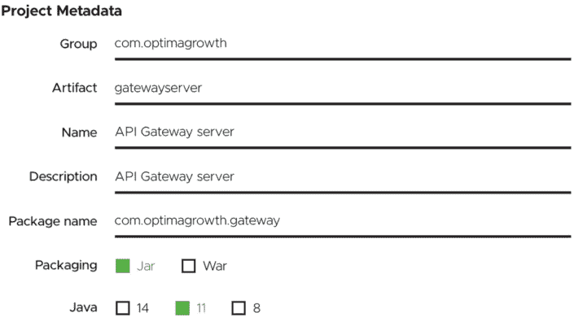

**图 8.3 包含我们的 Spring Cloud Gateway 信息的 Spring Initializr**

要实现此设置，您需要遵循以下步骤。清单 8.1 随后展示了 Gateway 服务器的 pom.xml 文件应如何呈现。

- 1. 选择 Maven 作为项目类型。
- 2. 选择 Java 作为语言。


+   3. 选择最新的或更稳定的 2.x.x 版 Spring。
+   4. 在 Group 中填写 `com.optimagrowth`，在 Artifact 中填写 `gatewayserver`。
+   5. 在 Name 中填写 `API Gateway server`，在 Description 中填写 `API Gateway server`，在 Package 中填写 `com.optimagrowth.gateway`。
+   6. 选择 JAR 打包方式。
+   7. 选择 Java 11 作为 Java 版本。
+   8. 添加 Eureka Client、Config Client、Gateway 和 Spring Boot Actuator 依赖，如图8.4所示。

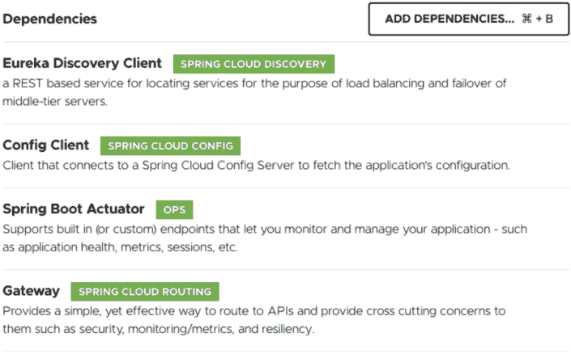

**图8.4**  我们在 Spring Initializr 中的网关服务器依赖

**清单8.1  Gateway 服务器的 Maven pom 文件**

```xml
//Part of pom.xml omitted for conciseness
...
<dependencies>
    <dependency>
        <groupId>org.springframework.boot</groupId>
        <artifactId>spring-boot-starter-actuator</artifactId>
    </dependency>
    <dependency>
        <groupId>org.springframework.cloud</groupId>
        <artifactId>spring-cloud-starter-config</artifactId>
    </dependency>
    <dependency>
        <groupId>
            org.springframework.cloud
        </groupId>
        <artifactId>spring-cloud-starter-gateway</artifactId>
```
```

该配置告诉 Maven 引入 Spring Cloud Gateway 库。

```
</dependency>
<dependency>
    <groupId>org.springframework.cloud</groupId>
    <artifactId>spring-cloud-starter-netflix-eureka-client</artifactId>
    <exclusions>
        <exclusion>
            <groupId>org.springframework.cloud</groupId>
            <artifactId>spring-cloud-starter-ribbon</artifactId>
        </exclusion>
        <exclusion>
            <groupId>com.netflix.ribbon</groupId>
            <artifactId>ribbon-eureka</artifactId>
        </exclusion>
    </exclusions>
</dependency>
<dependency>
    <groupId>org.springframework.boot</groupId>
    <artifactId>spring-boot-starter-test</artifactId>
    <scope>test</scope>
    <exclusions>
        <exclusion>
            <groupId>org.junit.vintage</groupId>
            <artifactId>junit-vintage-engine</artifactId>
        </exclusion>
    </exclusions>
</dependency>
</dependencies>

//Rest of pom.xml removed for conciseness
...
```

下一步是设置 src/main/resources/bootstrap.yml 文件，使其包含从我们在第5章创建的 Spring Config Server 获取设置所需的配置。以下清单展示了 bootstrap.yml 文件应如何编写。

# 清单8.2 设置 Gateway 的 bootstrap.yml 文件

```
spring:
  application:
    name: gateway-server
  cloud:
    config:
      uri: http://localhost:8071

Names the gateway service so that the Spring Cloud Config client knows which service is being looked up
Specifies the location of the Spring Cloud Config Server
```

注意：如果你没有按照上一章的代码清单操作，可以从以下链接下载第7章创建的代码：https://github.com/ihuaylupo/manning-smia/tree/master/chapter7。

实例。例如，如果我们想调用组织服务并通过 Spring Cloud Gateway 使用自动路由，则可以让客户端使用以下 URL 作为端点来调用网关服务实例：

```
http://localhost:8072/organization-service/v1/organization/958a1bf-18dc-405c-b84a-b69f04d98d4f
```

通过 http://localhost:8072 端点访问网关服务器。我们要调用的服务（组织服务）由服务中端点路径的第一部分表示。图8.5演示了这种映射的实际效果。

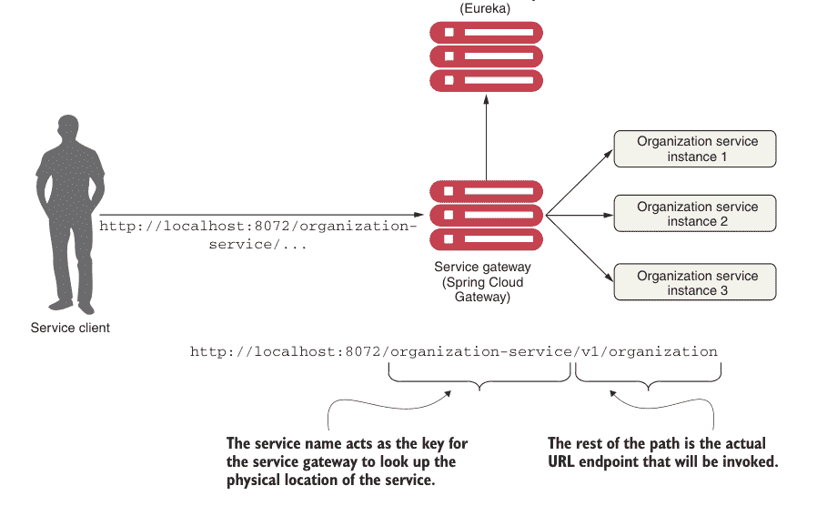

图8.5 Spring Cloud Gateway 使用 organization-service 应用名称将请求映射到组织服务的实例。

将 Spring Cloud Gateway 与 Eureka 结合使用的美妙之处在于，我们不仅拥有了一个可以进行调用的单一端点，而且可以在无需修改网关的情况下添加和移除服务实例。例如，我们可以向 Eureka 添加一个新服务，网关会自动将调用路由到该服务，因为它正在与 Eureka 通信，以了解实际的物理服务端点位于何处。

如果我们想查看由网关服务器管理的路由，可以通过网关服务器上的 actuator/gateway/routes 端点列出这些路由。这将返回一个

如果不想让我们的组织服务通过默认路由 /organization-service/v1/organization/{organization-id} 在网关中被访问，而是想使用自定义的组织名称，可以通过手动在位于 Spring Cloud Configuration Server 仓库中的配置文件 /configserver/src/main/resources/config/gateway-server.yml 中定义路由映射来实现。以下清单展示了具体方法。

# 清单8.6 在 gateway-server.yml 文件中手动映射路由

```
spring:
  cloud:
    gateway:
      discovery.locator:
        enabled: true
        lowerCaseServiceId: true
      routes:
      - id: organization-service
        uri: lb://organization-service
        predicates:
        - Path=/organization/**
        filters:
        - RewritePath=/organization/(?<path>.*), /${path}
```

通过添加这一配置，我们现在可以通过输入 /organization/v1/organization/{organization-id} 路由来访问组织服务。现在，如果我们重新检查网关服务器的端点，应该会看到图8.7所示的结果。

如果你仔细查看图8.7，会注意到组织服务有两个条目。一个服务条目是我们在 gateway-server.yml 文件中定义的映射，即 organization/**: organization-service。另一个服务条目是网关根据组织服务的 Eureka ID 自动创建的映射，即 /organization-service/**: organization-service。

注意：当我们使用自动路由映射，且网关仅根据 Eureka 服务 ID 暴露服务时，如果没有服务实例在运行，网关将不会暴露该服务的路由。但是，如果我们手动将路由映射到某个服务发现 ID，并且没有实例在 Eureka 中注册，网关仍然会显示该路由。如果尝试调用不存在服务的路由，将返回 500 HTTP 错误。

如果我们想要排除 Eureka 服务 ID 路由的自动映射，只保留我们定义的组织服务路由，可以移除我们在 gateway-server.yml 文件中添加的 spring.cloud.gateway.discovery.locator 条目，如清单8.7所示。

```json
[
  {
    "predicate": "Paths: [/licensing-service/**], match trailing slash: true",
    "metadata": {
      "management.port": "8080"
    },
    "route_id": "ReactiveCompositeDiscoveryClient_LICENSING-SERVICE",
    "filters": [
      "[RewritePath /licensing-service/(?<remaining>.*) = '/${remaining}'], order = 1]"
    ],
    "uri": "lb://LICENSING-SERVICE",
    "order": 0
  },
  {
    "predicate": "Paths: [/organization-service/**], match trailing slash: true",
    "metadata": {
      "management.port": "8081"
    },
    "route_id": "ReactiveCompositeDiscoveryClient_ORGANIZATION-SERVICE",
    "filters": [
      "[RewritePath /organization-service/(?<remaining>.*) = '/${remaining}'], order = 1]"
    ],
    "uri": "lb://ORGANIZATION-SERVICE",
    "order": 0
  },
  {
    "predicate": "Paths: [/gateway-server/**], match trailing slash: true",
    "metadata": {
      "management.port": "8072"
    },
    "route_id": "ReactiveCompositeDiscoveryClient_GATEWAY-SERVER",
    "filters": [
      "[RewritePath /gateway-server/(?<remaining>.*) = '/${remaining}'], order = 1]"
    ],
    "uri": "lb://GATEWAY-SERVER",
    "order": 0
  },
  {
    "predicate": "Paths: [/organization/**], match trailing slash: true",
    "route_id": "organization-service",
    "filters": [
      "[RewritePath /organization/(?<path>.*) = '/${path}'], order = 1]"
    ],
    "uri": "lb://organization-service",
    "order": 0
  }
]
```

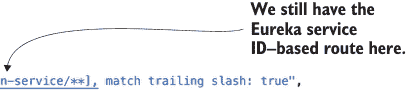

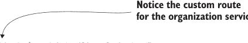

**图8.7**  手动映射组织服务时，网关调用 `/actuator/gateway/routes` 返回的结果

> **注意**  是否使用自动路由应该仔细考虑。在稳定且不会新增太多服务的环境中，手动添加路由是一项简单直接的任务。然而，在拥有许多新服务的大型环境中，这会有些繁琐。

# 清单8.7 移除 gateway-server.yml 文件中的 discovery locator 条目

```yaml
spring:
  cloud:
    gateway:
```


```
```yaml
routes:
- id: organization-service
  uri: lb://organization-service
  predicates:
  - Path=/organization/**
  filters:
  - RewritePath=/organization/, (?<path>.*), /${path}
```
```

现在，当我们在网关服务器上调用 actuator/gateway/routes 端点时，我们应该只能看到我们已定义的 organization 服务映射。图 8.8 显示了此映射的结果。

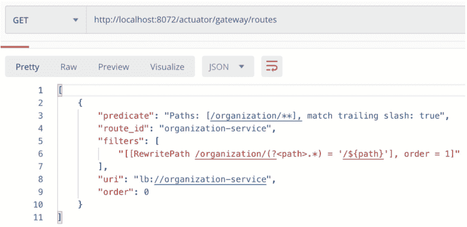

**图 8.8** 仅使用 organization 服务的手动映射调用 gateway/actuator/gateway/routes 的结果

## 8.3.3 动态重新加载路由配置

接下来我们将查看在 Spring Cloud Gateway 中配置路由时如何动态刷新路由。能够动态重新加载路由非常有用，因为它允许我们在无需重启网关服务器的情况下更改路由的映射。可以快速修改现有路由，并且新路由将需要经过我们环境中每个网关服务器的回收过程。

如果我们进入 actuator/gateway/routes 端点，我们应该在网关中看到目前的 organization 服务。现在，如果我们想即时添加新的路由映射，只需对配置文件进行更改并将这些更改提交回 Spring Cloud Config 从中提取配置数据的 Git 仓库。然后我们可以将更改提交到 GitHub。

Spring Actuator 暴露了一个基于 POST 的端点路由 actuator/gateway/refresh，它会使其重新加载路由配置。一旦访问了此 actuator/gateway/refresh，如果你随后进入 /routes 端点，你会看到

暴露了两个新的路由。actuator/gateway/refresh 的响应返回 HTTP 200 状态码且没有响应体。

## 8.4 Spring Cloud Gateway 的真正威力：Predicate 和 Filter 工厂

由于我们可以通过网关代理所有请求，这让我们可以简化服务调用。但 Spring Gateway 的真正威力在我们想要编写将应用于流经网关的所有服务调用的自定义逻辑时才会显现。最常见的是，我们会使用这种自定义逻辑来在所有服务中强制执行一致的应用策略，如安全、日志记录和跟踪。

这些应用策略被视为横切关注点，因为我们希望这些策略应用于应用程序中的所有服务，而无需修改每个服务来实现它们。以这种方式，Spring Cloud Gateway Predicate 和 Filter 工厂可以像 Spring 切面类一样使用。它们可以匹配或拦截大量行为，并在不让原始编码者意识到更改的情况下装饰或更改调用的行为。虽然 servlet 过滤器或 Spring 切面局限于特定服务，但使用网关及其 Predicate 和 Filter 工厂允许我们在流经网关的所有服务中实现横切关注点。记住，谓词允许我们在处理请求之前检查请求是否满足一组条件。图 8.9 显示了 Spring Cloud Gateway 在请求通过网关时应用谓词和过滤器时使用的架构。

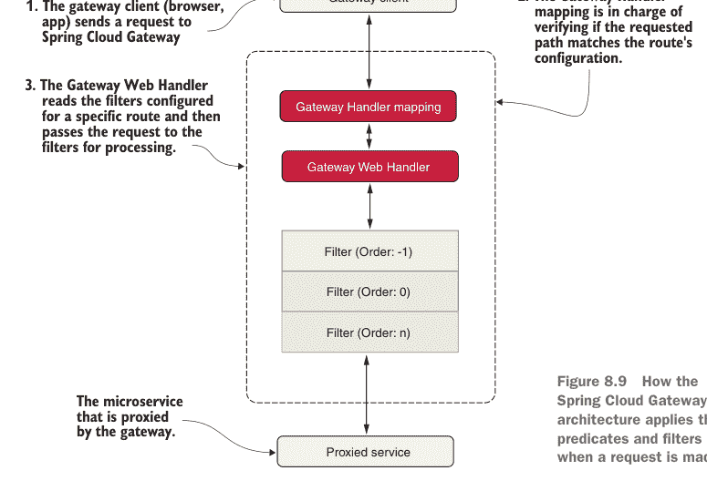

首先，网关客户端（浏览器、应用等）向 Spring Cloud Gateway 发送请求。一旦收到请求，它会直接进入负责验证请求的路径是否与它试图访问的特定路由的配置匹配的网关处理程序。如果一切匹配，它会进入网关 Web 处理程序，该处理程序负责读取过滤器并将请求发送给这些过滤器进行进一步处理。一旦请求通过所有过滤器，它将被转发到路由配置：一个微服务。

### 8.4.1 内置 Predicate 工厂

内置谓词是允许我们在执行或处理请求之前检查请求是否满足一组条件的对象。对于每个路由，我们可以设置多个 Predicate 工厂，它们通过逻辑 AND 使用并组合。表 8.1 列出了 Spring Cloud Gateway 中的所有内置 Predicate 工厂。

这些谓词可以通过代码以编程方式应用，也可以通过配置应用，就像我们在前几节中创建的那样。在本书中，我们仅通过配置文件下的 predicates 部分使用它们，如下所示：

```
predicates:
  - Path=/organization/**
```

| Predicate | Description | Example |
|---|---|---|
| Before | 接受一个日期时间参数并匹配所有在此之前发生的请求。 | `Before=2020-03-11T...` |
| After | 接受一个日期时间参数并匹配所有在此之后发生的请求。 | `After=2020-03-11T...` |
| Between | 接受两个日期时间参数并匹配它们之间的所有请求。第一个日期时间包含在内，第二个日期时间不包含在内。 | `Between=2020-03-11T..., 2020-04-11T...` |
| Header | 接收两个参数，头部名称和正则表达式，然后将头部值与提供的正则表达式匹配。 | `Header=X-Request-Id, \d+` |
| Host | 接收一个参数，即以“.”分隔的 Ant 风格模式主机名模式。然后它将 Host 头部与给定的模式匹配。 | `Host=**.example.com` |
| Method | 接收要匹配的 HTTP 方法。 | `Method=GET` |
| Path | 接收 Spring PathMatcher。 | `Path=/organization/{id}` |
| Query | 接收两个参数，一个必需参数和一个可选正则表达式，然后将它们与查询参数匹配。 | `Query=id, 1` |

| Predicate | Description | Example |
|---|---|---|
| Cookie | 接受两个参数，cookie 的名称和正则表达式，并在 HTTP 请求头中找到 cookie，然后将 cookie 的值与提供的正则表达式匹配。 | `Cookie=SessionID, abc` |
| RemoteAddr | 接收一组 IP 地址列表并将它们与请求的远程地址匹配。 | `RemoteAddr=192.168.3.5/24` |

### 8.4.2 内置 Filter 工厂

内置 Filter 工厂允许我们在代码中注入策略执行点，并在所有服务调用上以一致的方式执行大量操作。换句话说，这些过滤器让我们可以修改传入和传出的 HTTP 请求和响应。表 8.2 包含 Spring Cloud Gateway 中所有内置过滤器的列表。

| Predicate | Description | Example |
|---|---|---|
| AddRequestHeader | 使用作为参数接收的名称和值添加 HTTP 请求头。 | `AddRequestHeader=X-Organization-ID, F39s2` |
| AddResponseHeader | 使用作为参数接收的名称和值添加 HTTP 响应头。 | `AddResponseHeader=X-Organization-ID, F39s2` |
| AddRequestParameter | 使用作为参数接收的名称和值添加 HTTP 查询参数。 | `AddRequestParameter=Organizationid, F3θs2` |
| PrefixPath | 在 HTTP 请求路径前添加前缀。 | `PrefixPath=/api` |
| RequestRateLimiter | 接收三个参数：`replenishRate`，表示我们希望允许用户每秒进行的请求数；`capacity`，定义允许的突发容量；`keyResolverName`，定义实现 `KeyResolver` 接口的 bean 的名称。 | `RequestRateLimiter=10, 20, #{@userKeyResolver}` |
| RedirectTo | 接受两个参数，一个状态和一个 URL。状态应为 300 重定向 HTTP 代码。 | `RedirectTo=302, http://localhost:8072` |
| RemoveNonProxy | 删除某些头部，如 Keep-Alive、Proxy-Authenticate 或 Proxy-Authorization。 | `NA` |

| Predicate | Description | Example |
|---|---|---|
| `RemoveRequestHeader` | 从 HTTP 请求中删除与作为参数接收的名称匹配的头部。 | `RemoveRequestHeader=X-Request-Foo` |
| `RemoveResponseHeader` | 从 HTTP 响应中删除与作为参数接收的名称匹配的头部。 | `RemoveResponseHeader=X-Organization-ID` |
| `RewritePath` | 接受路径正则表达式参数和替换参数。 | `RewritePath=/organization/(?<path>.*), /${path}` |
| `SecureHeaders` | 向响应添加安全头部，并接收一个路径模板参数，该参数更改请求路径。 | `NA` |
| `SetPath` | 接收路径模板作为参数。它通过允许路径上的模板化段来操作请求路径。这使用 Spring 框架中的 URI 模板。允许多个匹配段。 | `SetPath=/{organization}` |
| `SetStatus` | 接收有效的 HTTP 状态并更改 HTTP 响应的状态。 | `SetStatus=500` |
| `SetResponseHeader` | 接受名称和值参数以在 HTTP 响应上设置头部。 | `SetResponseHeader=X-Response-ID,123` |

### 8.4.3 自定义过滤器

能够通过网关代理所有请求让我们可以简化服务调用。但 Spring Cloud Gateway 的真正威力在我们想要编写可应用于流经网关的所有服务调用的自定义逻辑时才会显现。最常见的是，这种自定义逻辑用于在所有服务中强制执行一致的应用策略，如安全、日志记录和跟踪。

Spring Cloud Gateway 允许我们使用网关中的过滤器构建自定义逻辑。记住，过滤器允许我们实现每个服务请求在实现时通过的一系列业务逻辑链。Spring Cloud Gateway 支持以下两种类型的过滤器。图 8.10 显示了在处理服务客户端请求时 pre- 和 post- 过滤器如何协同工作。

- *Pre-filters*—Pre-filter 在实际请求发送到目标目的地之前被调用。Pre-filter 通常执行确保服务具有一致消息格式的任务（例如，关键 HTTP 头部到位）或充当守门员以确保调用服务的用户已通过身份验证（他们就是他们声称的那个人）。


## 第8章 *使用 Spring Cloud Gateway 进行服务路由*

- *后置过滤器*—后置过滤器在目标服务被调用后、响应发送回客户端时被调用。通常，我们实现后置过滤器来记录来自目标服务的响应、处理错误，或对响应中的敏感信息进行审计。

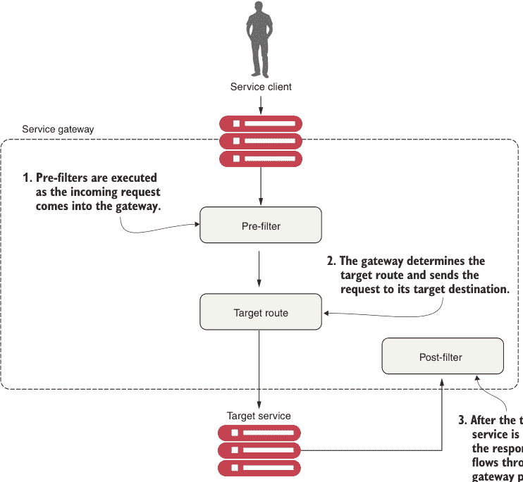

**图 8.10** 预过滤器、目标路由和后置过滤器形成一个管道，客户端请求在其中流动。当请求进入网关时，自定义过滤器可以操作传入的请求。

如果我们遵循图 8.10 中描述的流程，一切都始于服务客户端调用通过服务网关公开的服务。从那里开始，以下操作会发生：

1. 当请求进入网关时，网关中定义的任何预过滤器都会被调用。预过滤器在 HTTP 请求到达实际服务之前对其进行检查和修改。然而，预过滤器不能将用户重定向到不同的端点或服务。
2. 网关对传入请求执行预过滤器后，网关会确定目的地（服务将前往的位置）。
3. 在目标服务被调用后，网关后置过滤器会被调用。后置过滤器检查并修改被调用服务返回的响应。

了解如何实现网关过滤器的最佳方式是亲眼看到它们运行。为此，在接下来的几个部分中，我们将构建预过滤器和后置过滤器，然后运行客户端请求通过它们。图 8.11 显示了这些过滤器将如何协同处理我们的 O-stock 服务的请求。

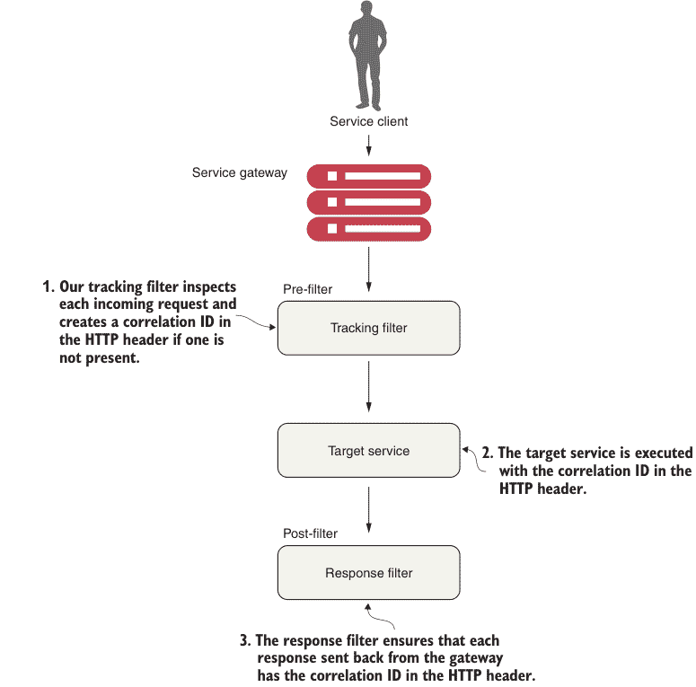

图 8.11 网关过滤器提供服务调用和日志记录的集中跟踪。这些过滤器允许我们对微服务调用执行自定义规则和策略。

按照图 8.11 中的流程，我们可以看到以下自定义过滤器在使用中：

- *跟踪过滤器*—跟踪过滤器是一个预过滤器，它确保从网关流出的每个请求都与其关联一个关联 ID。*关联 ID* 是在执行客户请求时在所有被执行的微服务中传递的唯一 ID。关联 ID 允许我们追踪调用经过一系列微服务调用时发生的事件链。
- *目标服务*—目标服务可以是组织服务或许可服务。两个服务都会在 HTTP 请求头中接收关联 ID。
- *响应过滤器*—响应过滤器是一个后置过滤器，它将与服务调用关联的关联 ID 注入到发送给客户端的 HTTP 响应头中。这样，客户端将能够访问与请求关联的关联 ID。

### 8.5 构建预过滤器

在 Spring Cloud Gateway 中构建过滤器非常简单。首先，我们将构建一个名为 `TrackingFilter` 的预过滤器，它将检查进入网关的所有请求，并确定请求中是否存在名为 `tmx-correlation-id` 的 HTTP 头。`tmx-correlation-id` 头将包含一个唯一的 GUID（全局唯一标识符），可用于跨多个微服务跟踪用户的请求：

- 如果 HTTP 头中不存在 `tmx-correlation-id`，我们的网关 `TrackingFilter` 将生成并设置关联 ID。
- 如果关联 ID 已存在，网关将不会执行任何操作。（关联 ID 的存在意味着此特定服务调用是执行用户请求的一系列服务调用的一部分。）

> **注意** 我们在第 7 章中讨论了关联 ID 的概念。在这里，我们将详细介绍如何使用 Spring Cloud Gateway 生成关联 ID。如果你跳着读这本书，我们强烈建议你查看第 7 章并阅读有关线程上下文的部分。我们的关联 ID 实现将使用 `ThreadLocal` 变量实现，并且需要额外的工作才能使你的 `ThreadLocal` 变量正常工作。

让我们继续查看 `TrackingFilter` 的实现，见清单 8.8。你也可以在本书示例目录的类文件 `/gatewayserver/src/main/java/com/optimagrowth/gateway/filters/TrackingFilter.java` 中找到此代码。

**清单 8.8 用于生成关联 ID 的预过滤器**

```java
package com.optimagrowth.gateway.filters;
//Other imports omitted for conciseness

import org.springframework.http.HttpHeaders;
import reactor.core.publisher.Mono;

@Order(1)
@Component
public class TrackingFilter
                implements GlobalFilter {

    private static final Logger logger =
                LoggerFactory.getLogger(TrackingFilter.class);

    @Autowired
    FilterUtils filterUtils;

    @Override
    public Mono<Void> filter(ServerWebExchange exchange,
                GatewayFilterChain chain) {
        HttpHeaders requestHeaders =
                exchange.getRequest().getHeaders();
        if (isCorrelationIdPresent(requestHeaders)) {
            logger.debug(
                "tmx-correlation-id found in tracking filter: {}.",
                filterUtils.getCorrelationId(requestHeaders));
        } else {
            String correlationID = generateCorrelationId();
            exchange = filterUtils.setCorrelationId(exchange,
                    correlationID);
            logger.debug(
                "tmx-correlation-id generated in tracking filter: {}.",
                correlationID);
        }
        return chain.filter(exchange);
    }

    private boolean isCorrelationIdPresent(HttpHeaders
                requestHeaders) {
        if (filterUtils.getCorrelationId(requestHeaders) != null) {
            return true;
        } else {
            return false;
        }
    }

    private String generateCorrelationId() {
        return java.util.UUID.randomUUID().toString();
    }
}
```

要在 Spring Cloud Gateway 中创建全局过滤器，我们需要实现 GlobalFilter 类，然后重写 filter() 方法。此方法包含过滤器实现业务逻辑。另一个需要从前面的代码中注意的关键点是我们如何从 ServerWebExchange 对象获取 HTTP 头：

```java
HttpHeaders requestHeaders = exchange.getRequest().getHeaders();
```

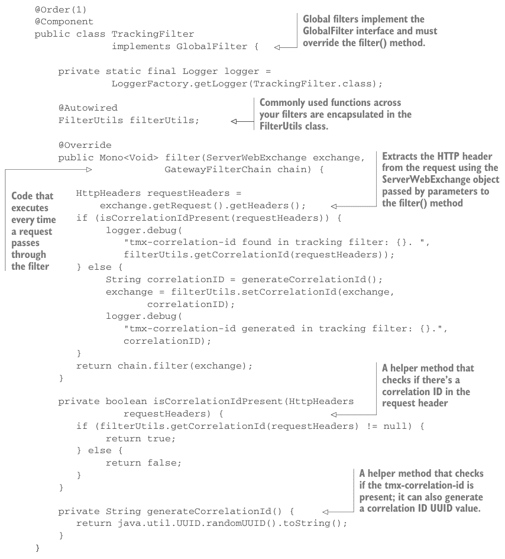

我们实现了一个名为 FilterUtils 的类，它封装了所有过滤器使用的通用功能。它位于 `/gatewayserver/src/main/java/com/optimagrowth/gateway/filters/FilterUtils.java` 文件中。我们不会详细介绍整个 FilterUtils 类，但我们将讨论几个关键方法：getCorrelationId() 和 setCorrelationId()。以下清单显示了 FilterUtils getCorrelationId() 方法的代码。

**清单 8.9 使用 getCorrelationId 检索 tmx-correlation-id**

```java
public String getCorrelationId(HttpHeaders requestHeaders){
    if (requestHeaders.get(CORRELATION_ID) !=null) {
        List<String> header = requestHeaders.get(CORRELATION_ID);
        return header.stream().findFirst().get();
    } else{
        return null;
    }
}
```

清单 8.9 中需要注意的关键点是，我们首先检查 tmx-correlation-ID 是否已设置在传入请求的 HTTP 头上。如果没有，我们的代码应该返回 null，以便稍后创建它。你可能记得在 TrackingFilter 类的 filter() 方法中，我们正是用以下代码执行了此操作：

```java
} else {
    String correlationID = generateCorrelationId();
    exchange = filterUtils.setCorrelationId(exchange, correlationID);
    logger.debug("tmx-correlation-id generated in tracking filter: {}",
                correlationID);
}
```

要设置 tmx-correlation-id，你将使用 FilterUtils setCorrelationId() 方法，如以下清单所示。

**清单 8.10 在 HTTP 头中设置 tmx-correlation-id**

```java
public ServerWebExchange setRequestHeader(ServerWebExchange exchange,
                                        String name, String value) {
    return exchange.mutate().request(
        exchange.getRequest().mutate()
            .header(name, value)
            .build())
        .build();
}

public ServerWebExchange setCorrelationId(ServerWebExchange exchange,
                           String correlationId) {
    return this.setRequestHeader(exchange,CORRELATION_ID,correlationId);
}
```


使用 `FilterUtils.setCorrelationId()` 方法时，当我们想向 HTTP 请求头中添加一个值，可以使用 `ServerWebExchange.Builder.mutate()` 方法。此方法返回一个构建器，通过 `ServerWebExchangeDecorator` 包装交换对象来修改其属性，并返回被修改的值或将其委派回此实例。要测试此调用，我们可以调用我们的组织或许可服务。一旦调用提交，我们应该在控制台中看到一条日志消息，记录传入的 correlation ID 随着过滤器的流动：

```text
gatewayserver_1      | 2020-04-14 22:31:23.835 DEBUG 1 --- [or-http-epoll-3]
c.o.gateway.filters.TracingFilter       : tmx-correlation-id generated in
tracking filter: 735d8a31-b4d1-4c13-816d-c31db20afb6a.
```

如果在控制台上看不到该消息，只需将以下清单中显示的代码行添加到网关服务器的 `bootstrap.yml` 配置文件中。然后重新构建并执行你的微服务。

**Listing 8.11  Logger configuration in the Gateway service bootstrap.yml file**

```yaml
//Some code removed for conciseness
logging:
  level:
    com.netflix: WARN
    org.springframework.web: WARN
    com.optimagrowth: DEBUG
```

如果使用 Docker，可以在父 `pom.xml` 所在的根目录中执行以下命令：

```bash
mvn clean package dockerfile:build
docker-compose -f docker/docker-compose.yml up
```

## 8.6  Using the correlation ID in the services

现在我们已经确保 correlation ID 已添加到流经网关的每个微服务调用中，我们希望确保

- Correlation ID 可供被调用的微服务轻松访问。
- 微服务可能进行的任何下游服务调用也会将 correlation ID 传播到下游调用。

为此，我们将为每个微服务构建三类类：`UserContextFilter`、`UserContext` 和 `UserContextInterceptor`。这些类将协同工作以读取传入 HTTP 请求的 correlation ID（以及我们稍后添加的其他信息），将其映射到可被应用程序业务逻辑轻松访问和使用的类，然后确保 correlation ID 被传播到任何下游服务调用。图 8.12 演示了我们将如何为许可服务构建这些不同组件。

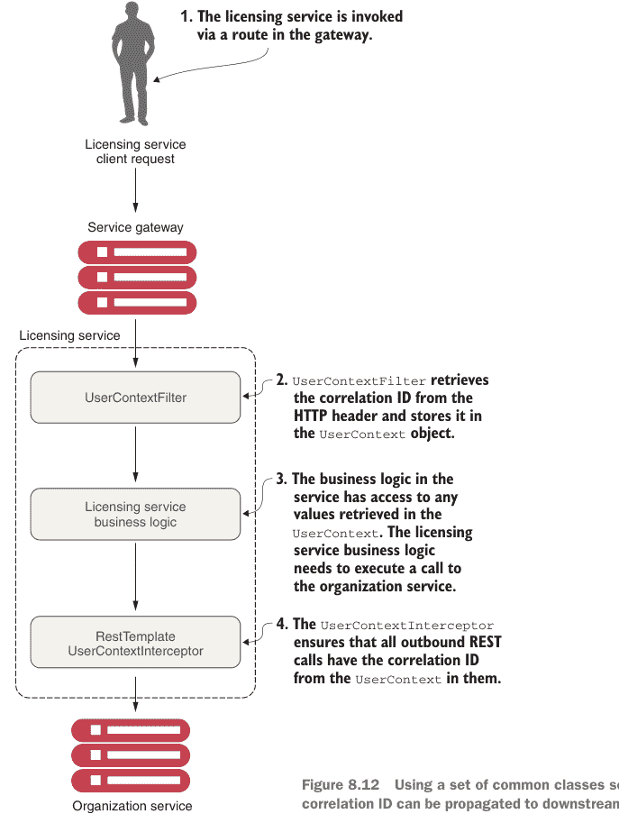

Figure 8.12 Using a set of common classes so that the correlation ID can be propagated to downstream service calls

让我们逐步了解图 8.12 中发生的情况：

- 1. 当通过网关向许可服务发出调用时，Tracking-Filter 会为进入网关的任何调用在传入的 HTTP 头中注入一个 correlation ID。
- 2. `UserContextFilter` 类，一个自定义 HTTP ServletFilter，将 correlation ID 映射到 `UserContext` 类。`UserContext` 类将值存储在线程中以供调用后期使用。

### 8.6.1 UserContextFilter

```java
throws IOException, ServletException {

HttpServletRequest httpServletRequest = (HttpServletRequest)
										servletRequest;

UserContextHolder.getContext()
	.setCorrelationId(
		httpServletRequest.getHeader(UserContext.CORRELATION_ID));
UserContextHolder.getContext().setUserId(
	httpServletRequest.getHeader(UserContext.USER_ID));
UserContextHolder.getContext().setAuthToken(
	httpServletRequest.getHeader(UserContext.AUTH_TOKEN));
UserContextHolder.getContext().setOrganizationId(
	httpServletRequest.getHeader(UserContext.ORGANIZATION_ID));

logger.debug("UserContextFilter Correlation id: {}",
	UserContextHolder.getContext().getCorrelationId());

filterChain.doFilter(httpServletRequest, servletResponse);
}
// Not showing the empty init and destroy methods
}
```

Retrieves the correlation ID from the header and sets the value in the `UserContext` class

最终，`UserContextFilter` 将把你感兴趣的 HTTP 头值映射到 Java `UserContext` 类。

### 8.6.2 UserContext: Making the HTTP headers easily accessible to the service

`UserContext` 类保存由我们的微服务处理的单个服务客户端请求的 HTTP 头值。它由 getter/setter 方法组成，用于从 `java.lang.ThreadLocal` 检索和存储值。以下清单显示了 `UserContext` 类的代码，你可以在 `/licensing-service/src/main/java/com/optimagrowth/license/utils/UserContext.java` 中找到它。

**Listing 8.13 Storing the HTTP header values inside the UserContext class**

```java
//Removed the imports for conciseness
@Component
public class UserContext {
    public static final String CORRELATION_ID = "tmx-correlation-id";
    public static final String AUTH_TOKEN     = "tmx-auth-token";
    public static final String USER_ID        = "tmx-user-id";
    public static final String ORGANIZATION_ID = "tmx-organization-id";

    private String correlationId = new String();
    private String authToken = new String();
    private String userId = new String();
    private String organizationId = new String();
}
```

### 8.6.3 UserContextInterceptor

```java
public ClientHttpResponse intercept(
        HttpRequest request, byte[] body,
        ClientHttpRequestExecution execution) throws IOException {
    HttpHeaders headers = request.getHeaders();
    headers.add(UserContext.CORRELATION_ID,
            UserContextHolder.getContext().
            getCorrelationId());
    headers.add(UserContext.AUTH_TOKEN,
            UserContextHolder.getContext().
            getAuthToken());

    return execution.execute(request, body);
}
```

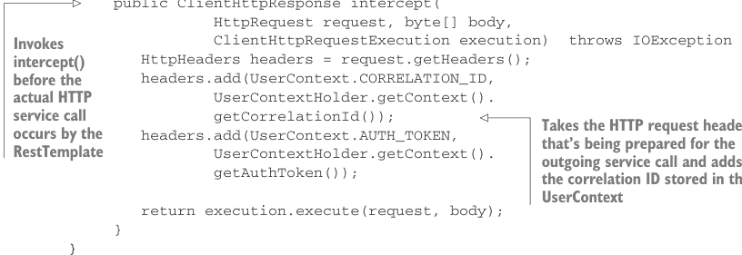

要使用 `UserContextInterceptor`，我们需要定义一个 `RestTemplate` bean，然后向其添加 `UserContextInterceptor`。为此，我们将在 `LicenseServiceApplication` 类中定义自己的 `RestTemplate` bean。你可以在 `/licensing-service/src/main/java/com/optimagrowth/license/` 中找到此类的源代码。以下清单显示了添加到此 `RestTemplate` 的方法。

**Listing 8.16  Adding the UserContextInterceptor to the RestTemplate class**

```java
@LoadBalanced
@Bean
public RestTemplate getRestTemplate(){
    RestTemplate template = new RestTemplate();
    List interceptors = template.getInterceptors();
    if (interceptors==null){
        template.setInterceptors(Collections.singletonList(
                new UserContextInterceptor()));
    }else{
        interceptors.add(new UserContextInterceptor());
        template.setInterceptors(interceptors);
    }

    return template;
}
```

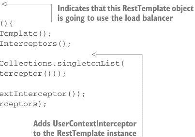

有了此 bean 定义，每当我们使用 `@Autowired` 注解并将 `RestTemplate` 注入到一个类中时，我们将使用清单 8.16 中创建的、附加了 `UserContextInterceptor` 的 `RestTemplate`。

## Log aggregation, authentication, and more

现在我们已经将 correlation ID 传递给每个服务，可以追踪事务在其流经调用所涉及的所有服务中的过程。为此，你需要确保每个服务都记录到一个中央日志聚合点，该点将来自所有服务的日志条目捕获到一个单一位置。日志聚合服务中捕获的每个日志条目都将与一个 correlation ID 相关联。

一旦我们实现了 ResponseFilter，我们就可以启动我们的服务并使用它调用许可或组织服务。服务完成后，你将在调用的 HTTP 响应头中看到一个 `tmx-correlation-id`，如图 8.13 所示。

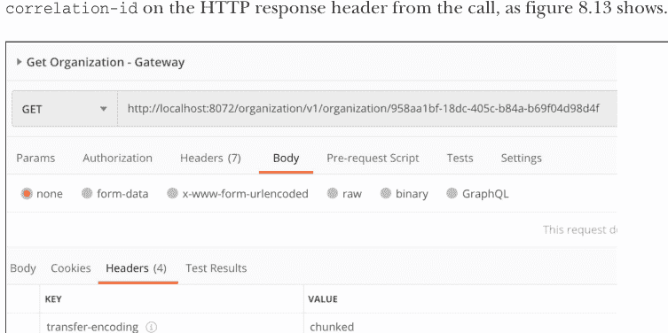

Figure 8.13 The tmx-correlation-id added to the response headers and sent back to the service client

你也可以在控制台中看到日志消息（图 8.14），其中记录了传入的 correlation ID，`e3f6a72b-7d6c-41da-ac12-fb30fcd1e547`，它在 pre- 和 post- 过滤器中流动。

到目前为止，我们所有的过滤器示例都处理在服务客户端调用被路由到目标目的地之前和之后对其进行操作。现在我们知道如何创建 Spring Cloud Gateway，让我们继续下一章，该章描述了如何使用 Keycloak 和 OAuth2 来保护我们的微服务。

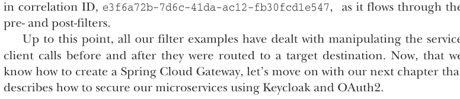

Figure 8.14 Logger output that shows the pre-filter data, the organization service processing data, and the post-filter data


