## 保护你的微服务


### 本章涵盖

- 了解为什么安全在微服务环境中很重要
- 理解 OAuth2 和 OpenID
- 安装并配置 Keycloak
- 使用 Keycloak 执行身份认证和授权
- 使用 Keycloak 保护你的 Spring 微服务
- 在服务之间传播访问令牌

既然我们已经有了一个健壮的微服务架构，那么解决安全漏洞的任务就变得越来越重要。在本章中，安全与漏洞密不可分。我们将漏洞定义为应用程序中存在的弱点或缺陷。当然，所有系统都有漏洞，但最大的区别在于这些漏洞是否被利用并造成危害。

提到安全，开发人员常常不由自主地发出抱怨。在开发人员中，我们常听到这样的评论：“它很晦涩，难以理解，更难调试。”然而，除了可能缺乏经验的开发人员外，我们不会找到哪个开发人员说自己不担心安全问题。保护微服务架构是一项复杂而繁重的任务，涉及多个保护层，包括：

- *应用程序层*——确保有适当的用户控制措施，以便我们能够验证用户确是其声称的身份，并拥有执行其尝试操作的权限
- *基础设施*——保持服务运行、打补丁和更新，以最大限度地降低漏洞风险
- *网络层*——实施网络访问控制，使服务只能通过明确定义的端口访问，并且只允许少数授权服务器访问

本章只涉及如何在应用层（列表中的第一项）对用户进行身份认证和授权。另外两项是极其广泛的安全主题，不在本书讨论范围内。此外，还有其他工具（如 OWASP Dependency-Check 项目）可以帮助识别漏洞。

> **注意** OWASP Dependency-Check 项目是一个 OWASP 软件成分分析（SCA）工具，允许我们识别公开披露的漏洞。如果你想了解更多，我们强烈建议你访问 https://owasp.org/www-project-dependency-check/。

为了实现授权和身份认证控制，我们将使用 Spring Cloud Security 模块和 Keycloak 来保护基于 Spring 的服务。Keycloak 是面向现代应用和服务的开源身份与访问管理软件。这款开源软件采用 Java 编写，支持 SAML（安全断言标记语言）v2 以及 OpenID Connect（OIDC）/OAuth2 联合身份协议。

### 9.1 什么是 OAuth2？

OAuth2 是一个基于令牌的安全框架，描述了授权授予的模式，但并未定义如何实际执行身份认证。相反，它允许用户通过称为*身份提供者*（IdP）的第三方认证服务进行身份认证。如果用户成功认证，他们会获得一个令牌，该令牌必须在每个请求中发送。然后，可以回到认证服务验证该令牌。

OAuth2 背后的主要目标是：当调用多个服务来满足用户请求时，每个服务都能对用户进行身份认证，而用户无需向处理其请求的每个服务出示凭据。OAuth2 允许我们通过称为*授权类型*（grants）的认证方案在各种场景下保护基于 REST 的服务。OAuth2 规范定义了四种授权类型：

- 密码
- 客户端凭据
- 授权码
- 隐式

我们不打算逐一讲解这些授权类型，也不打算为每种类型提供代码示例。一章内容实在涵盖不了这么多。相反，我们将做以下工作：

- 讨论我们的微服务如何通过一种更简单的 OAuth2 授权类型——密码授权类型——来使用 OAuth2
- 使用 JSON Web 令牌（JWT）来提供更健壮的 OAuth2 解决方案，并建立 OAuth2 令牌中信息编码的标准
- 逐步介绍构建微服务时需要考虑的其他安全因素

> **注意** 我们在附录 B 中提供了其他 OAuth2 授权类型的概述。如果你有兴趣深入了解 OAuth2 规范以及如何实现所有授权类型，我们强烈推荐 Justin Richer 和 Antonio Sanso 的著作 *OAuth2 实战*（Manning, 2017），该书对 OAuth2 进行了全面阐述。

OAuth2 的真正强大之处在于，它让应用程序开发人员能够轻松集成第三方云提供商，并使用这些服务对用户进行身份认证和授权，而无需不断将用户凭据传递给第三方服务。

OpenID Connect（OIDC）是 OAuth2 框架之上的一层，提供有关谁登录了应用程序的身份认证和配置文件信息（身份）。当授权服务器支持 OIDC 时，它有时被称为身份提供者。在深入探讨保护服务的技术细节之前，让我们先了解 Keycloak 的架构。

### 9.2 Keycloak 简介

Keycloak 是面向我们的服务和应用程序的开源身份与访问管理解决方案。Keycloak 的主要目标是让服务和应用程序的保护变得容易，几乎不需要编写代码。Keycloak 的一些特性包括：

- 集中身份认证，并实现单点登录（SSO）认证。
- 让开发人员专注于业务功能，而不是担心授权和身份认证等安全方面的问题。
- 支持双因素认证。
- 兼容 LDAP。
- 提供多个适配器，轻松保护应用程序和服务器。
- 允许自定义密码策略。

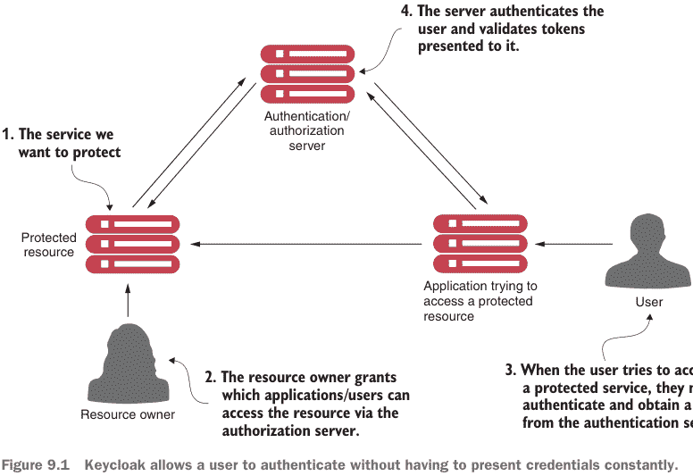

Keycloak 安全可以分解为四个组件：受保护资源、资源所有者、应用程序和认证/授权服务器。图 9.1 展示了这四个组件如何协同工作。

- *受保护资源*——你想要保护的资源（在我们的场景中即微服务），确保只有经过认证且具有适当授权的用户才能访问它。
- *资源所有者*——该所有者定义哪些应用程序被允许调用该服务、哪些用户被授予对该服务的访问权，以及用户可以使用该服务做什么。资源所有者注册的每个应用程序都会获得一个用于标识应用程序的应用程序名称，以及一个密钥。应用程序名称和密钥的组合是请求访问令牌时传递的凭据的一部分。
- *应用程序*——这是将代表用户调用该服务的应用程序。毕竟，用户很少直接调用服务。相反，他们依赖应用程序来为他们完成工作。
- *认证/授权服务器*——认证服务器是应用程序与被消费服务之间的中介。认证服务器允许用户进行身份认证，而无需将用户凭据传递给应用程序将代表他们调用的每一项服务。

如前所述，Keycloak 安全组件协同工作，对服务用户进行身份认证。用户通过提供凭据以及他们用来访问受保护资源（微服务）的应用程序/设备，向 Keycloak 服务器进行身份认证。如果用户的凭据有效，Keycloak 服务器会提供一个认证令牌，该令牌可在用户每次使用服务时从一个服务传递到另一个服务。

受保护资源随后可以联系 Keycloak 服务器，以确定令牌的有效性，并检索分配给用户的角色。角色用于将相关用户分组，并定义他们可以访问哪些资源。在本章中，我们将使用 Keycloak 角色来确定用户可以使用哪些 HTTP 方法调用哪些已授权的服务端点。

Web 服务安全是一个极其复杂的主题。我们需要了解谁会调用我们的服务（内部用户还是外部用户）、他们将如何调用我们的服务（内部基于 Web 的客户端、移动设备还是 Web 应用程序），以及他们将使用我们的代码执行哪些操作。

### 关于身份认证与授权

我们经常发现开发人员会将“身份认证”和“授权”这两个术语的含义“混为一谈”。身份认证是用户通过提供凭据来证明自己身份的行为。授权则是确定是否允许用户做他们想做的事情。例如，用户 Illary 可以通过提供用户 ID 和密码来证明自己的身份，但她可能未被授权查看敏感数据（例如薪资数据）。就我们的讨论而言，用户必须先完成身份认证，然后才能进行授权。

### 9.3 小处着手：使用 Spring 和 Keycloak 保护单个端点

为了理解如何设置身份认证和授权组件，我们将做以下工作：

- 将 Keycloak 服务添加到 Docker。
- 设置 Keycloak 服务，并将 O-stock 应用程序注册为可对用户身份进行认证和授权的授权应用程序。
- 使用 Spring Security 保护我们的 O-stock 服务。我们不打算为 O-stock 构建 UI，而是模拟用户登录 Postman，以为我们的 Keycloak 服务提供身份认证。
- 保护 licensing 和 organization 服务，使它们只能由已认证的用户调用。


## 9.3.1 将 Keycloak 添加到 Docker

本节介绍如何将 Keycloak 服务添加到我们的 Docker 环境中。为此，我们先从将下面的代码清单所示代码添加到 docker-compose.yml 文件开始。

> **注意** 如果你没有按照上一章的代码清单操作，你可以从以下链接下载第 8 章创建的代码：https://github.com/ihuaylupo/manning-smia/tree/master/chapter8。

**代码清单 9.1** 在 docker-compose.yml 中添加 Keycloak 服务

```
//Part of docker-compose.yml omitted for conciseness
...
keycloak:
  image: jboss/keycloak
  restart: always
  environment:
    KEYCLOAK_USER: admin
    KEYCLOAK_PASSWORD: admin
  ports:
    - "8080:8080"
  networks:
    backend:
      aliases:
        - "keycloak"
```

- Keycloak Docker 服务名称
- Keycloak 管理控制台的用户名
- Keycloak 管理控制台的密码

> **注意** 你可以将 Keycloak 与多种数据库一起使用，例如 H2、PostgreSQL、MySQL、Microsoft SQL Server、Oracle 和 MariaDB。对于本章中的示例，我们将使用默认的嵌入式 H2 数据库。如果你想使用其他数据库，我们强烈建议访问下面的链接：https://github.com/keycloak/keycloak-containers/tree/master/docker-compose-examples。

注意，在代码清单 9.1 的代码中，我们为 Keycloak 使用了 8080 端口。回顾几章之前的内容，我们也将许可服务暴露在该端口上。为了让一切正常工作，我们将 docker-compose.yml 文件中的许可服务映射到 8180 端口，而不是 8080 端口。与此同时，下面的代码展示了如何更改该端口号：

```
licensingservice:
  image: ostock/licensing-service:0.0.3-SNAPSHOT
  ports:
    - "8180:8080"
```

> **注意** 为了在本地环境中运行 Keycloak，我们需要在 hosts 文件中添加主机条目 127.0.0.1 Keycloak。如果你使用的是 Windows，需要在 C:\Windows\System32\drivers\etc\hosts 中添加主机条目；如果你使用的是 Linux，hosts 文件位于 /etc/hosts。为什么需要这个条目？容器之间可以使用网络别名或 MAC 地址进行通信，但我们的 Postman 需要使用 localhost 来调用服务。

## 9.3.2 设置 Keycloak

现在我们已经将 Keycloak 添加到 docker-compose.yml 中，接下来让我们在代码的根目录下运行以下命令：

```
docker-compose -f docker/docker-compose.yml up
```

服务启动后，让我们访问以下链接以打开 Keycloak 管理控制台：[http://keycloak:8080/auth/](http://keycloak:8080/auth/)。配置 Keycloak 是一个简单的过程。第一次访问 Keycloak 时，会显示一个欢迎页面。这个页面展示了不同的选项，例如访问管理控制台、文档、报告问题等等。在我们的案例中，我们要选择管理控制台。图 9.2 展示了欢迎页面。

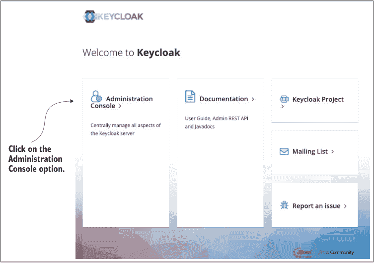

**图 9.2** Keycloak 欢迎页面

下一步是输入我们之前在 docker-compose.yml 文件中定义的用户名和密码。图 9.3 展示了这一步。

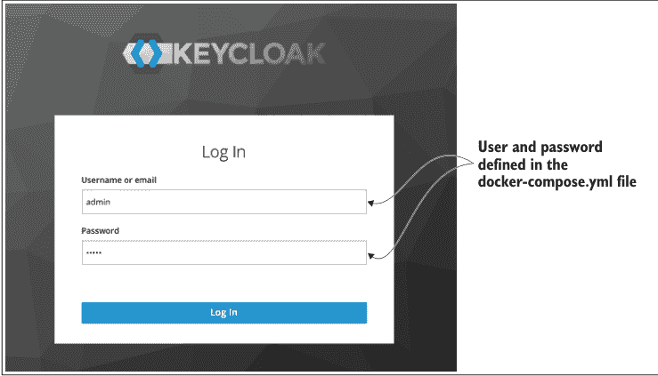

图 9.4 展示了如何在我们的 Keycloak 服务中创建 spmia-realm。

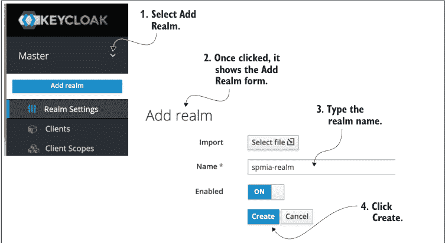

创建 realm 后，你将看到 spmia-realm 的主页面，其配置如图 9.5 所示。

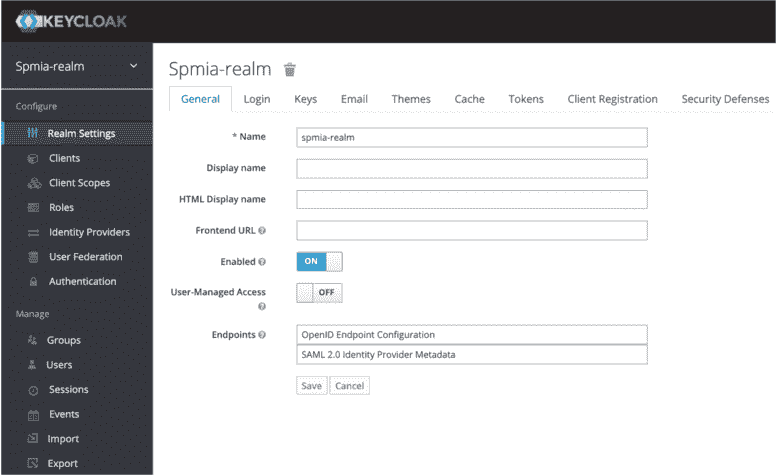

**图 9.5** 我们的 Keycloak Spmia-realm 配置页面

## 9.3.3 注册客户端应用程序

配置的下一步是创建客户端。在 Keycloak 中，客户端是可以请求用户认证的实体。这些客户端通常是我们希望通过提供单点登录（SSO）解决方案来保护的应用或服务。要创建客户端，让我们点击左侧菜单中的 Clients 选项。点击后，你将看到图 9.6 所示的页面。

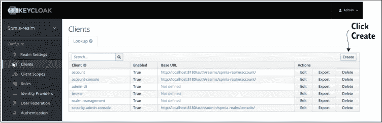

**图 9.6** O-stock 的 Spmia-realm Clients 页面

显示 Clients 列表后，点击 Create 按钮（如上一图所示，位于表格右上角）。点击后，你将看到一个 Add Client 表单，其中需要填写以下信息：

- 客户端 ID
- 客户端协议
- 根 URL

按照图 9.7 所示输入这些信息。

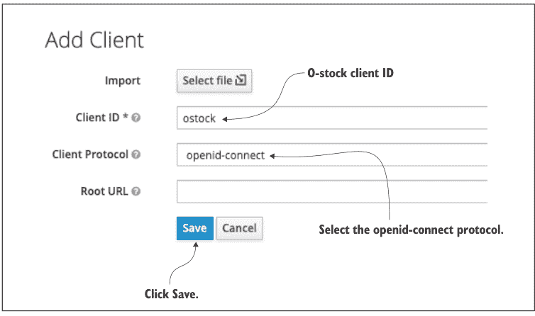

**图 9.7** O-stock 的 Keycloak 客户端信息

保存客户端后，你将看到如图 9.8 所示的 Client Configuration 页面。在该页面上，我们将输入以下数据：

- 访问类型：机密
- 服务账户启用：开
- 授权启用：开
- 有效重定向 URL：http://localhost:80*
- Web 来源：*

在本示例中，我们只创建了一个名为 ostock 的全局客户端，但你可以在这里根据需求配置任意数量的客户端。

下一步是设置客户端角色，所以让我们点击 Roles 标签页。为了更好地理解客户端角色，让我们假设我们的应用将有两类用户：管理员和普通用户。管理员用户可以执行所有应用服务，而普通用户只被允许执行部分服务。

Roles 页面加载后，你将看到一个预定义客户端角色的列表。让我们点击 Roles 表格右上角的 Add Role 按钮。点击后，你将看到如图 9.9 所示的 Add Role 表单。

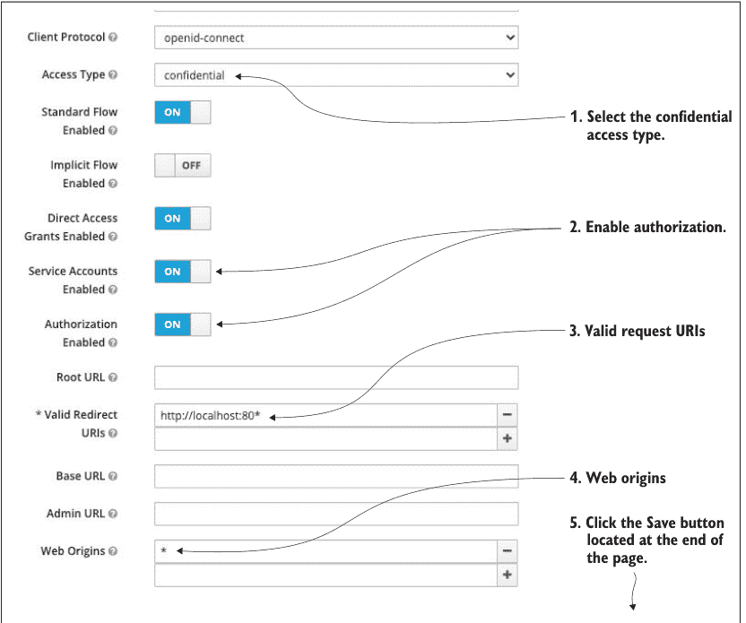

**图 9.8** O-stock 的 Keycloak 客户端的附加配置

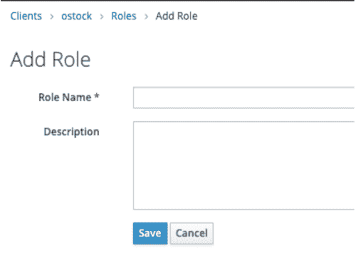

**图 9.9** O-stock 的 Keycloak Add Role 页面

在 Add Role 页面上，我们需要创建以下客户端角色。最终，你将得到一个类似于图 9.10 所示的列表。

- USER
- ADMIN

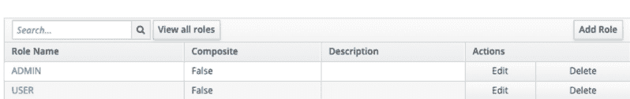

**图 9.10** O-stock 的 Keycloak 客户端角色：USER 和 ADMIN

现在我们已经完成了基本的客户端配置，接下来让我们访问 Credentials 页面。该页面会显示认证过程所需的客户端密钥。图 9.11 展示了 Credentials 页面的样子。

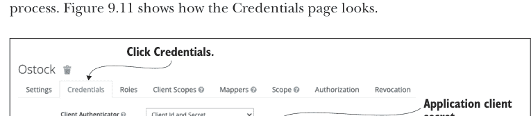

**图 9.11** Credentials 页面上的 O-stock Keycloak 客户端密钥

配置的下一步是创建领域角色（realm roles）。领域角色将让我们能够更好地控制为每个用户设置的角色。这是一个可选的步骤。如果你不想创建这些角色，也可以直接创建用户。但之后，识别和维护每个用户的角色可能会更加困难。

要创建领域角色，让我们点击左侧菜单中的 Roles 选项，然后点击表格右上角的 Add Role 按钮。与客户端角色一样，我们将创建两种类型的领域角色：ostock-user 和 ostock-admin。图 9.12 和图 9.13 展示了如何创建 ostock-admin 领域角色。

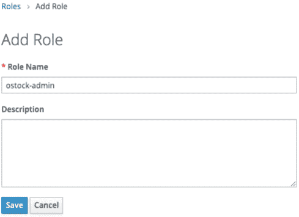

**图 9.12** 创建 ostock-admin 领域角色

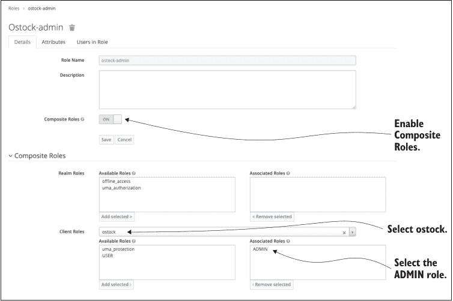

**图 9.13** 为 ostock-admin 领域角色指定其他配置

现在我们已经配置好了 ostock-admin 领域角色，让我们重复相同的步骤来创建 ostock-user 角色。完成后，你应该会得到一个类似于图 9.14 所示的列表。

### 角色

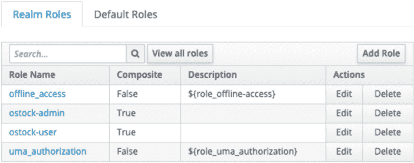

**图 9.14** O-stock 的 spmia-realm 角色列表

## 9.3.4 配置 O-stock 用户

现在我们已经定义了应用级和领域级的角色、名称和密钥，接下来可以准备设置各个用户的凭据和角色了。要创建用户，让我们点击 Keycloak 管理控制台左侧菜单中的 Users 选项。

对于本章中的示例，我们将定义两个用户账户：illary.huaylupo 和 john.carnell。john.carnell 账户将拥有 ostock-user 角色，illary.huaylupo 账户将拥有 ostock-admin 角色。图 9.15 展示了 Add User 页面。在该页面上，让我们输入用户名，并按照图中所示启用 user 和 email verified 选项。

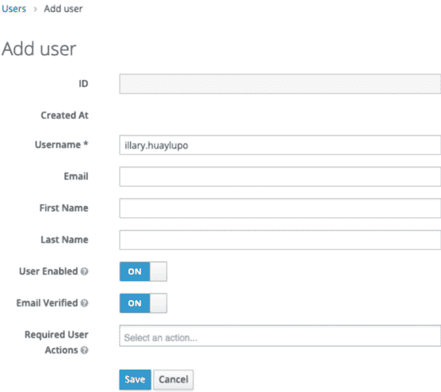

**图 9.15** Keycloak 中用于 O-stock spmia-realm 的 Add User 页面


> **注意** Keycloak 还允许我们向用户添加其他属性，例如名字、姓氏、电子邮件、地址、出生日期、电话号码等。但在这个例子中，我们只设置必需的属性。

保存此表单后，单击 Credentials（凭据）选项卡。你需要输入用户密码，禁用 Temporary（临时）选项，然后点击 Set Password（设置密码）按钮。图 9.16 展示了这一步。

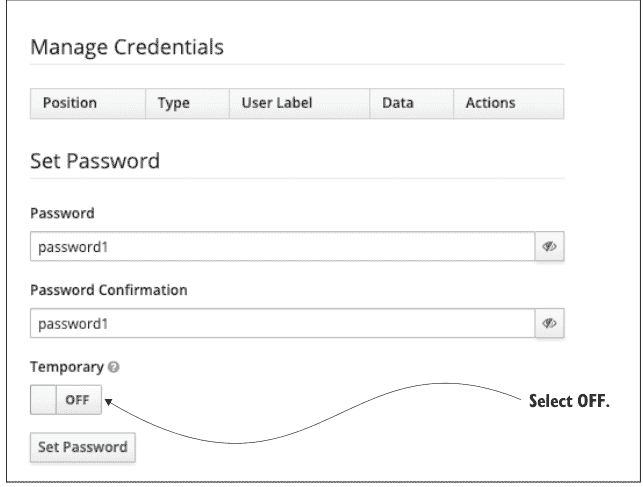

图 9.16 设置用户密码并为 O-stock 用户的凭据禁用 Temporary 选项

设置密码后，让我们单击 Role Mappings（角色映射）选项卡，并为用户分配一个特定角色。图 9.17 展示了这一步。

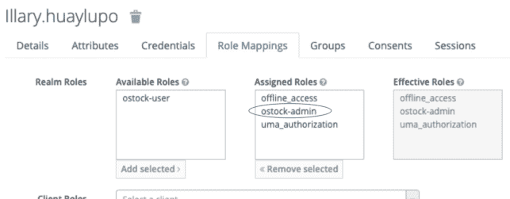

图 9.17 将 O-stock 的领域角色映射到已创建的用户

为了完成配置，让我们对另一个用户重复同样的步骤，在此例中是 john.carnell，并为 John 分配 ostock-user 角色。

## 9.3.5 认证我们的 O-stock 用户

此时，我们已经具备了足够的 Keycloak 基础服务器功能，可以为密码授权流程执行应用和用户认证。让我们启动认证服务。为此，请单击左侧菜单中的 Realm Settings（领域设置）选项，然后点击 OpenID Endpoint Configuration（OpenID 端点配置）链接，查看我们领域可用的端点列表。这些步骤如图 9.18 和图 9.19 所示。

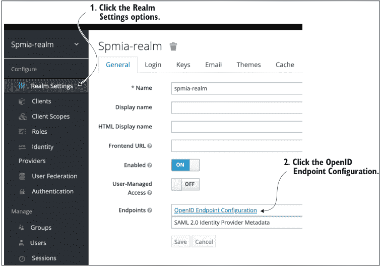

图 9.18 为 O-stock 的 Keycloak spmia-realm 选择 OpenID Endpoint Configuration 链接

```json
{
  "issuer": "http://keycloak:8080/auth/realms/spmia-realm",
  "authorization_endpoint": "http://keycloak:8080/auth/realms/spmia-realm/protocol/openid-connect/auth",
  "token_endpoint": "http://keycloak:8080/auth/realms/spmia-realm/protocol/openid-connect/token",
  "introspection_endpoint": "http://keycloak:8080/auth/realms/spmia-realm/protocol/openid-connect/token/introspect",
  "userinfo_endpoint": "http://keycloak:8080/auth/realms/spmia-realm/protocol/openid-connect/userinfo",
  "end_session_endpoint": "http://keycloak:8080/auth/realms/spmia-realm/protocol/openid-connect/logout",
  "jwks_uri": "http://keycloak:8080/auth/realms/spmia-realm/protocol/openid-connect/certs",
  "check_session_iframe": "http://keycloak:8080/auth/realms/spmia-realm/protocol/openid-connect/login-status-iframe.html",
  "grant_types_supported": [
    "authorization_code",
    "implicit",
    "refresh_token",
    "password",
    "client_credentials"
  ]
}
```

图 9.19 O-stock 领域的 OpenID 端点配置

现在，我们将模拟一个想要获取访问令牌的用户。我们将使用 Postman 向端点 `http://keycloak:8080/auth/realms/spmia-realm/protocol/openid-connect/token` 发送 POST 请求，然后提供应用程序、密钥、用户 ID 和密码。

> **注意** 请记住，在此示例中，我们使用 8080 端口，因为这是之前我们在 docker-compose.yml 文件中为 Keycloak 定义的端口。

为了模拟用户获取身份验证令牌，我们需要使用应用程序名称和密钥来设置 Postman。为此，我们将使用基本认证（basic authentication）将这些元素传递给身份验证服务器端点。图 9.20 展示了如何设置 Postman 以执行基本认证调用。请注意，我们将使用之前定义的应用程序名称和应用程序密钥作为密码：

```
Username: <CLIENT_APPLICATION_NAME>
Password: <CLIENT_APPLICATION_SECRET>
```

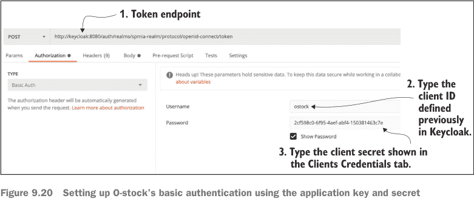

但是，我们还没有准备好调用以获取令牌。配置好应用程序名称和密钥后，我们需要将以下信息作为 HTTP 表单参数传递给服务：

- `grant_type`——要执行的授权类型。在此示例中，我们将使用密码授权（password grant）。
- `username`——登录用户的名称。
- `password`——登录用户的密码。

图 9.21 展示了如何为我们的身份验证调用配置这些 HTTP 表单参数。

图 9.21 在请求访问令牌时，用户的凭据以 HTTP 表单参数的形式传递给 /openid-connect/token 端点。

与本书中的其他 REST 调用不同，此列表中的参数不会作为 JSON 请求体传递。身份验证标准要求所有传递给令牌生成端点的参数都必须是 HTTP 表单参数。图 9.22 显示了从 /openid-connect/token 调用返回的 JSON 负载。

图 9.22 客户端凭据验证成功后返回的 JSON 负载

该 JSON 负载包含五个属性：

- access_token——用户每次调用受保护资源时需随请求提供的访问令牌。
- token_type——授权规范允许我们定义多种令牌类型。最常用的令牌类型是 Bearer Token（不记名令牌）。（本章不涉及其他令牌类型。）

## 9.4.2 配置服务以指向我们的 Keycloak 服务器

一旦我们将组织服务设置为受保护资源，每次调用该服务时，调用方必须在 HTTP 头中包含一个 Bearer 访问令牌。然后，我们的受保护资源必须回调 Keycloak 服务器以检查令牌是否有效。清单 9.3 显示了所需的 Keycloak 配置。你需要将此配置添加到组织服务的应用程序属性文件中，该文件位于配置服务器仓库中。

```properties
//Some properties omitted for conciseness

keycloak.realm = spmia-realm
keycloak.auth-server-url = http://localhost:8080/auth
keycloak.ssl-required = external
keycloak.resource = ostock
keycloak.credentials.secret = 5988f899-a5bf-4f76-b15f-f1cd0d2c81ba
keycloak.use-resource-role-mappings = true
keycloak.bearer-only = true
```

> **注意** 为了使本书中的示例更直接明了，我们使用类路径仓库。你可以在以下文件中找到配置文件：`/configserver/src/main/resources/config/organization-service.properties`。

## 9.4.3 定义谁和什么可以访问服务

我们现在可以开始定义服务的访问控制规则。为了定义访问控制规则，我们需要扩展 KeycloakWebSecurityConfigurerAdapter 类并重写以下方法：

- `configure()`
- `configureGlobal()`
- `sessionAuthenticationStrategy()`
- `keycloakConfigResolver()`

组织服务的 SecurityConfig 类位于 `/organizationservice/src/main/java/com/optimagrowth/organization/config/SecurityConfig.java` 文件中。下面的清单显示了该类的代码。

```java
//Some properties omitted for conciseness

@Configuration

@EnableWebSecurity
@EnableGlobalMethodSecurity(jsr250Enabled = true)
public class SecurityConfig extends
    KeycloakWebSecurityConfigurerAdapter {

    @Override
    protected void configure(HttpSecurity http)
        throws Exception {
        super.configure(http);
        http.authorizeRequests()
            .anyRequest()
            .permitAll();
        http.csrf().disable();
    }

    @Autowired
    public void configureGlobal(
        AuthenticationManagerBuilder auth)
        throws Exception {
        KeycloakAuthenticationProvider keycloakAuthenticationProvider =
            keycloakAuthenticationProvider();
        keycloakAuthenticationProvider.setGrantedAuthoritiesMapper(
            new SimpleAuthorityMapper());
        auth.authenticationProvider(keycloakAuthenticationProvider);
    }

    @Bean
    @Override
    protected SessionAuthenticationStrategy
        sessionAuthenticationStrategy() {
        return new RegisterSessionAuthenticationStrategy(
            new SessionRegistryImpl());
    }

    @Bean
    public KeycloakConfigResolver keycloakConfigResolver() {
        return new KeycloakSpringBootConfigResolver();
    }
}
```

- 扩展 KeycloakWebSecurityConfigurerAdapter
- 注册 Keycloak 身份验证提供程序
- 定义会话身份验证策略
- 定义 KeycloakConfigResolver

默认情况下，Spring Security 适配器会查找 keycloak.json 文件。

访问规则可以是从粗粒度（任何已认证用户都可以访问整个服务）到细粒度（只有具有此角色的应用程序才可以访问此 URL，且允许通过 DELETE 方法访问）的多种形式。我们无法讨论 Spring Security 访问控制规则的所有排列组合，但可以看看几个更常见的示例。这些示例包括保护资源，以便：

- 只有已认证用户才能访问服务 URL。
- 只有具有特定角色的用户才能访问服务 URL。

### 使用已认证用户保护服务

我们要做的第一件事是保护组织服务，使其只能由已认证用户访问。下面的清单展示了如何将此规则构建到 SecurityConfig.java 类中。


**清单 9.5 仅限制经过身份验证的用户访问**

```java
package com.optimagrowth.organization.security;
import org.springframework.context.annotation.Configuration;
import org.springframework.http.HttpMethod;
import org.springframework.security.config.annotation.web.builders.HttpSecurity;

@Configuration
@EnableWebSecurity
@EnableGlobalMethodSecurity(jsr250Enabled = true)
public class SecurityConfig extends KeycloakWebSecurityConfigurerAdapter {

    @Override
    protected void configure(HttpSecurity http)
            throws Exception {
        super.configure(http);
        http.authorizeRequests()
            .anyRequest().authenticated();
    }
}
```

传递给方法的 HttpSecurity 对象配置了所有访问规则。

所有访问规则都在 `configure()` 方法内部定义。我们将使用 Spring 传入的 `HttpSecurity` 类来定义我们的规则。在此示例中，我们将限制对组织服务中任何 URL 的访问，仅允许经过身份验证的用户。

假设我们在 HTTP 头中没有提供访问令牌的情况下访问组织服务。在这种情况下，我们会收到 401 HTTP 响应代码，并显示一条消息，指出需要对服务进行完整身份验证。图 9.24 显示了在没有身份验证 HTTP 头的情况下调用组织服务的输出。

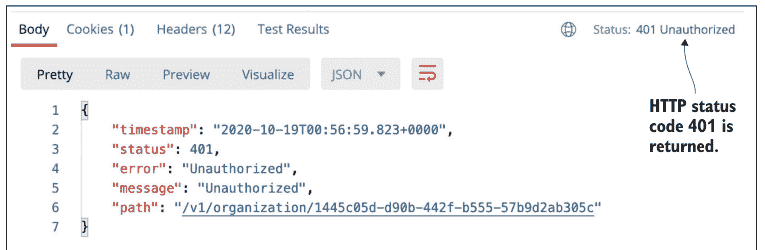

返回 HTTP 状态码 401。

**图 9.24 在没有访问令牌的情况下调用组织服务会导致调用失败。**

接下来，我们将使用访问令牌调用组织服务。 （要生成访问令牌，请参阅第 9.2.5 节。）我们希望从对 `/openid-connect/token` 端点的返回 JSON 调用中复制并粘贴 `access_token` 值，并在调用组织服务时使用它。记住，当我们调用组织服务时，我们需要将授权类型设置为 Bearer Token，并使用 `access_token` 值。图 9.25 显示了对组织服务的调用，但这次传递了访问令牌。

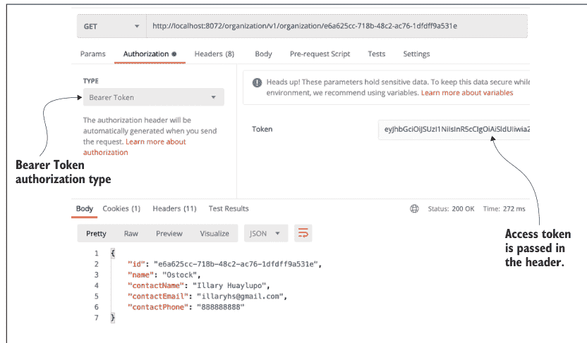

**图 9.25 在对组织服务的调用中传入访问令牌**

这可能是使用 JWT 保护端点最直接的用例之一。接下来，我们将在此示例的基础上进行扩展，并限制特定角色对特定端点的访问。

## 通过特定角色保护服务

在下一个示例中，我们将锁定组织服务上的 DELETE 调用，仅允许具有 ADMIN 访问权限的用户访问。正如你在第 9.2.4 节中记得的，我们创建了两个可以访问 O-stock 服务的用户账户：`illary.huaylupo` 和 `john.carnell`。`john.carnell` 账户分配了 USER 角色。`illary.huaylupo` 账户具有 USER 角色和 ADMIN 角色。我们可以通过在控制器中使用 `@RolesAllowed` 来允许特定角色执行某些方法。以下清单展示了如何操作。

**清单 9.6 在 OrganizationController.java 中使用 @RolesAllowed 注解**

```java
package com.optimagrowth.organization.security;
//Imports removed for conciseness

@RestController
@RequestMapping(value = "/v1/organization")
public class OrganizationController {

    @Autowired
    private OrganizationService service;

    @RolesAllowed({ "ADMIN", "USER" })
    @RequestMapping(value = "/{organizationId}", method = RequestMethod.GET)
    public ResponseEntity<Organization> getOrganization(
        @PathVariable("organizationId") String organizationId) {
        return ResponseEntity.ok(service.findById(organizationId));
    }

    @RolesAllowed({ "ADMIN", "USER" })
    @RequestMapping(value = "/{organizationId}", method = RequestMethod.PUT)
    public void updateOrganization(@PathVariable("organizationId")
        String id, @RequestBody Organization organization) {
        service.update(organization);
    }

    @RolesAllowed({ "ADMIN", "USER" })
    @PostMapping
    public ResponseEntity<Organization> saveOrganization(
        @RequestBody Organization organization) {
        return ResponseEntity.ok(service.create(organization));
    }

    @RolesAllowed("ADMIN")
    @DeleteMapping(value = "/{organizationId}")
    @ResponseStatus(HttpStatus.NO_CONTENT)
    public void deleteLicense(@PathVariable("organizationId")
        String organizationId) {
        service.delete(organizationId);
    }
}
```

- 表示只有具有 USER 和 ADMIN 角色的用户才能执行此操作
- 表示只有具有 ADMIN 角色的用户才能执行此操作

现在，为了获取 `john.carnell`（密码：`password1`）的令牌，我们需要再次执行 `/openid-connect/token` POST 请求。一旦我们获得了新的访问令牌，我们就需要调用组织服务的 DELETE 端点：`http://localhost:8072/organization/v1/organization/dfd13002-57c5-47ce-a4c2-a1fda2f51513`。我们将在调用中收到 403 Forbidden HTTP 状态码，并收到一条错误消息，指出对该服务的访问被拒绝。我们调用返回的 JSON 文本如下所示：

```json
{
  "timestamp": "2020-10-19T01:19:56.534+0000",
  "status": 403,
  "error": "Forbidden",
  "message": "Forbidden",
  "path": "/v1/organization/4d10ec24-141a-4980-be34-2ddb5e0458c7"
}
```

**注意：** 我们使用 8072 端口，因为这是我们在上一章中为 Spring Cloud Gateway 定义的端口（具体在 Spring Cloud Configuration 服务仓库中位于 `gateway-server.yml` 配置文件中）。

如果我们使用 `illary.huaylupo` 用户账户（密码：`password1`）及其访问令牌尝试相同的调用，我们会看到一次成功的调用，返回无内容和 HTTP 状态码 204，No Content。此时，我们已经了解了如何使用 Keycloak 调用和保护单个服务（组织服务）。然而，在微服务环境中，我们通常需要进行多次服务调用来完成一次事务。在这些情况下，我们需要确保访问令牌从一次服务调用传播到另一次服务调用。

## 9.4.4 传播访问令牌

为了演示在服务之间传播令牌，我们还将使用 Keycloak 保护我们的许可服务。记住，许可服务调用组织服务来查找信息。问题在于，我们如何将令牌从一个服务传播到另一个服务？

我们将设置一个简单的示例，在其中许可服务调用组织服务。如果你按照我们在前几章中构建的示例进行操作，你会看到两个服务都在网关后面运行。图 9.26 显示了经过身份验证用户的令牌如何通过网关、许可服务，然后传递到组织服务。

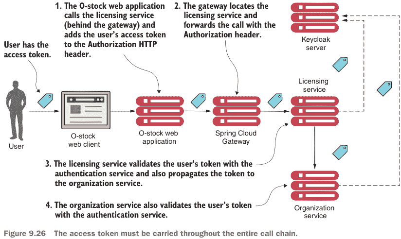

图 9.26 中发生的事情如下。图 9.26 中对应的数字在以下内容中用括号标出。

1. 用户已经使用 Keycloak 服务器进行身份验证，并对 O-stock Web 应用程序发出调用。用户的访问令牌存储在用户的会话中。O-stock Web 应用程序需要检索一些许可数据并调用许可服务 REST 端点（1）。作为对许可 REST 端点的调用的一部分，O-stock Web 应用程序通过 HTTP Authorization 头添加访问令牌。许可服务只能通过 Spring Cloud Gateway 访问。
2. 网关查找许可服务端点，然后将调用转发到许可服务的一个服务器（2）。服务网关复制传入调用中的授权 HTTP 头，并确保该 HTTP 头被转发到新的端点。
3. 许可服务接收传入调用。由于许可服务是一个受保护的资源，许可服务将使用 Keycloak 服务器验证令牌（3），然后检查用户的角色以获得适当的权限。作为其工作的一部分，许可服务调用组织服务。在执行此操作时，许可服务需要将用户的访问令牌传播到组织服务。
4. 当组织服务接收到调用时，它会取出 HTTP Authorization 头并使用 Keycloak 服务器验证令牌（4）。

要实现这些步骤，我们需要对代码进行多项更改。如果我们不这样做，在从许可服务检索组织信息时，我们将收到以下错误：

```text
"message": "401 : [{status:401,error: Unauthorized,message: Unauthorized,path: /v1/organization/d898a142-de44-466c-8c88-9ceb2c2429d3}]
```

第一步是修改网关，使其将访问令牌传播到许可服务。默认情况下，网关不会将诸如 `cookie`、`set-cookie` 和 `authorization` 之类的敏感 HTTP 头转发到下游服务。为了允许传播授权 HTTP 头，我们需要在 Spring Cloud Config 仓库中位于 `gateway-server.yml` 配置文件中的每个路由中添加以下过滤器：

```yaml
- RemoveRequestHeader=Cookie,Set-Cookie
```

此配置是网关将阻止传播到下游服务的敏感头黑名单。`RemoveRequestHeader` 列表中没有 Authorization 值意味着网关将允许该头通过。如果我们不设置此配置属性，网关会自动阻止所有三个值的传播（Cookie、Set-Cookie 和 Authorization）。

接下来，我们需要配置许可服务以包含 Keycloak 和 Spring Security 依赖项，并为服务设置我们想要的任何授权规则。最后，我们需要将 Keycloak 属性添加到配置服务器中的应用程序属性文件中。

### 配置许可服务

在传播访问令牌时，我们的第一步是向许可服务 `pom.xml` 文件添加 Maven 依赖项。以下清单显示了依赖项。


# Listing 9.7 配置 Keycloak 和 Spring Security 依赖项

```
//Part of pom.xml omitted for conciseness
    <dependency>
        <groupId>org.keycloak</groupId>
        <artifactId>keycloak-spring-boot-starter</artifactId>
    </dependency>
    <dependency>
        <groupId>org.springframework.boot</groupId>
        <artifactId>spring-boot-starter-security</artifactId>
    </dependency>
</dependencies>
<dependencyManagement>
    <dependencies>
        <dependency>
            <groupId>org.springframework.cloud</groupId>
            <artifactId>spring-cloud-dependencies</artifactId>
            <version>${spring-cloud.version}</version>
            <type>pom</type>
            <scope>import</scope>
        </dependency>
        <dependency>
            <groupId>org.keycloak.bom</groupId>
            <artifactId>keycloak-adapter-bom</artifactId>
            <version>11.0.2</version>
            <type>pom</type>
            <scope>import</scope>
        </dependency>
    </dependencies>
</dependencyManagement>
```

下一步是保护许可服务，使其只能由经过身份验证的用户访问。下面的列表显示了 SecurityConfig 类。您可以在 /licensing-service/src/main/java/com/optimagrowth/license/config/SecurityConfig.java 中找到此类的源代码。

# Listing 9.8 仅限制经过身份验证的用户访问

```
//Part of class declaration omitted for conciseness

@Configuration
@EnableWebSecurity
public class SecurityConfig extends KeycloakWebSecurityConfigurerAdapter {

    @Override
    protected void configure(HttpSecurity http) throws Exception {
        super.configure(http);
        http.authorizeRequests()
            .anyRequest().authenticated();
        http.csrf().disable();
    }
    @Override
    protected void configure(HttpSecurity http) throws Exception {
        super.configure(http);
        http.authorizeRequests()
```

```java
.anyRequest().authenticated();
http.csrf().disable();
}

@Autowired
public void configureGlobal(AuthenticationManagerBuilder auth)
        throws Exception {
    KeycloakAuthenticationProvider keycloakAuthenticationProvider =
            keycloakAuthenticationProvider();
    keycloakAuthenticationProvider.setGrantedAuthoritiesMapper(new
            SimpleAuthorityMapper());
    auth.authenticationProvider(keycloakAuthenticationProvider);
}

@Bean
@Override
protected SessionAuthenticationStrategy sessionAuthenticationStrategy() {
    return new RegisterSessionAuthenticationStrategy(
            new SessionRegistryImpl());
}

@Bean
public KeycloakConfigResolver KeycloakConfigResolver() {
    return new KeycloakSpringBootConfigResolver();
}
}
```

配置许可服务的最后一步是将 Keycloak 配置添加到我们的 licensing-service.properties 文件中。下面的列表显示了该文件应有的外观。

# Listing 9.9 在 licensing-service.properties 中配置 Keycloak

```properties
// Some properties omitted for conciseness

keycloak.realm = spmia-realm
keycloak.auth-server-url = http://keycloak:8080/auth
keycloak.ssl-required = external
keycloak.resource = ostock
keycloak.credentials.secret = 5988f899-a5bf-4f76-b15f-f1cd0d2c81ba
keycloak.use-resource-role-mappings = true
keycloak.bearer-only = true
```

现在我们已经对网关进行了更改以传播授权头，并且许可服务已设置好，我们可以继续进行最后一步，即传播访问令牌。对于此步骤，我们需要做的就是修改许可服务调用组织服务的方式。为此，我们需要确保 HTTP Authorization 头被注入到许可服务对组织服务的应用程序调用中。

如果没有 Spring Security，我们必须编写一个 servlet 过滤器来获取传入许可服务调用的 HTTP 头，然后手动将其添加到许可服务中的每个传出服务调用中。Keycloak 提供了一个新的 REST 模板类来支持这些调用。该类称为 KeycloakRestTemplate。要使用此

```
```xml
<dependency>
    <groupId>commons-codec</groupId>
    <artifactId>commons-codec</artifactId>
</dependency>
<dependency>
    <groupId>org.json</groupId>
    <artifactId>json</artifactId>
    <version>20190722</version>
</dependency>
```
```

添加库后，我们可以在跟踪过滤器中添加一个名为 getUsername() 的新方法。下面的列表显示了此新方法。您可以在类文件 /gatewayserver/src/main/java/com/optimagrowth/gateway/filters/TrackingFilter.java 中找到此方法的源代码。

# Listing 9.12 从我们的 JWT 中解析 preferred username

```java
//Part of this code omitted for conciseness
private String getUsername(HttpHeaders requestHeaders){
String username = "";
if (filterUtils.getAuthToken(requestHeaders)!=null){
        String authToken =
                filterUtils.getAuthToken(requestHeaders)
                .replace("Bearer ", "");
        JSONObject jsonObj = decodeJWT(authToken);
        try {
                username =
                        jsonObj.getString("preferred_username");
        }catch(Exception e) {logger.debug(e.getMessage());}
}
return username;
}

private JSONObject decodeJWT(String JWTToken) {
String[] split_string = JWTToken.split("\\.");
String base64EncodedBody = split_string[1];
Base64 base64Url = new Base64(true);
String body = new String(base64Url.decode(base64EncodedBody));
JSONObject jsonObj = new JSONObject(body);
return jsonObj;
}
```

> 从授权 HTTP 头中解析令牌

> 从 JWT 中提取 preferred_username

> 使用 Base64 编码解析令牌，传入签名令牌的密钥

> 将 JWT 主体解析为 JSON 对象以检索 preferred_username

为了使此示例正常工作，我们需要确保 Filter-Utils 中的 AUTH_TOKEN 变量设置为 Authorization，如以下代码片段所示。 （您可以在 /gatewayserver/src/main/java/com/optimagrowth/gateway/filters/Filter-Utils.java 中找到此源代码。）

```java
public static final String AUTH_TOKEN = "Authorization";
```

一旦我们实现 getUsername() 函数，我们就可以在跟踪过滤器的 filter() 方法上添加一个 System.out.println 来打印从流经网关的 JWT 中解析的 preferred_username。现在当我们调用网关时，我们将在控制台输出中看到 preferred_username。

> 注意 当您进行此调用时，您仍需要设置所有 HTTP 表单参数，包括 HTTP Authorization 头和 JWT。

如果一切成功，您应该在控制台日志中看到以下 System.out.println：

```
tmx-correlation-id found in tracking filter:
26f2b2b7-51f0-4574-9d84-07e563577641.
The authentication name from the token is : illary.huaylupo
```

## 9.5 关于微服务安全的一些结束语

虽然本章向您介绍了 OpenID、OAuth2 和 Keycloak 规范，以及如何使用 Spring Cloud 安全与 Keycloak 结合实现身份验证和授权服务，但 Keycloak 只是微服务安全难题中的一个部分。当您为生产使用塑造微服务时，您还应围绕以下实践构建微服务安全：

- 对所有服务通信使用 HTTPS/安全套接层（SSL）。
- 对所有服务调用使用 API 网关。
- 为您的服务提供区域（例如，公共 API 和私有 API）。
- 通过锁定不需要的网络端口来限制微服务的攻击面。

图 9.28 显示了这些不同部分如何协同工作。列表中的每个要点都映射到图 9.28 中的数字。我们将在接下来的各节中更详细地检查前一列表和图中列举的每个主题领域。

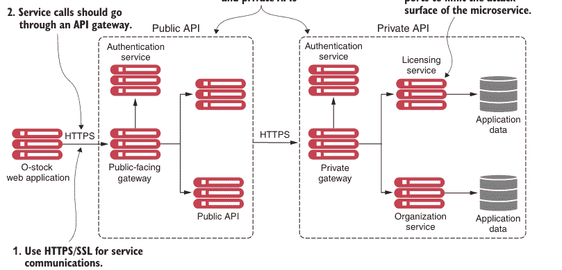

图 9.28 微服务安全架构不仅仅是实现身份验证和授权。


### 9.5.1 为所有服务通信使用 HTTPS 安全套接层（SSL）

本书中的所有代码示例都使用了 HTTP，因为 HTTP 是一种简单的协议，在开始使用服务之前不需要在每个服务上进行设置。然而，在生产环境中，你的微服务应仅通过 HTTPS 和 SSL 提供的加密通道进行通信。请注意，HTTPS 的配置和设置可以通过你的 DevOps 脚本进行自动化。

### 9.5.2 使用服务网关访问你的微服务

你的服务运行所在的各个服务器、服务端点和端口绝不应直接对客户端可访问。相反，使用服务网关作为服务调用的入口点和守门员。配置微服务运行的操作系统或容器的网络层，仅接受来自服务网关的流量。请记住，服务网关可以充当策略执行点（PEP），该点可以在所有服务中强制执行。

将服务调用通过服务网关进行，可以使你在使用安全和审计服务的方式上保持一致。服务网关还允许你锁定要向外部世界公开的端口和端点。

### 9.5.3 将服务划分为公共 API 和私有 API 区域

总体而言，安全就是建立访问层并强制执行*最小权限*的概念。最小权限意味着用户应仅拥有完成日常工作所需的最低限度的网络访问权限和权限。为此，你应通过将服务划分为两个不同的区域来实现最小权限：公共和私有。

公共区域包含将由你的客户端消费的所有公共 API（在本书记述的示例中为 O-stock 应用程序）。公共 API 微服务应执行面向工作流的狭窄任务。这些微服务往往是服务聚合器，汇集数据并在多个服务之间执行任务。公共微服务还应位于其自己的服务网关之后，并拥有自己的身份验证服务来执行身份验证和授权。客户端应用程序对公共服务的访问应通过服务网关保护的单一路由进行。此外，公共区域应拥有自己的身份验证服务。

私有区域充当保护你的核心应用程序功能和数据的屏障。它应仅通过单个众所周知的端口访问，并且应锁定为仅接受私有服务运行的网络子网的网络流量。私有区域应拥有自己的网关和身份验证服务。公共 API 服务应针对私有区域的身份验证服务进行身份验证。所有应用程序数据至少应位于私有区域的网络子网中，并且只能由驻留在私有区域中的微服务访问。

### 9.5.4 通过锁定不需要的网络端口来限制微服务的攻击面

许多开发人员没有仔细查看服务正常运行所需的绝对最少端口数量。配置服务运行的操作系统，仅允许对服务所需的基础设施的端口或部分进行入站和出站访问（监控、日志聚合）。

不要只关注入站访问端口。许多开发人员忘记锁定他们的出站端口。锁定出站端口可以防止在攻击者入侵服务本身时数据从服务中泄漏出去。此外，请确保你在公共和私有 API 区域中都查看网络端口访问情况。

## Summary

- OAuth2 是一种基于令牌的授权框架，提供不同的保护 Web 服务调用的机制。这些机制称为 *grants*。
- OpenID Connect（OIDC）是 OAuth2 框架之上的一个层，提供有关谁登录到应用程序的身份验证和配置文件信息（身份）。
- Keycloak 是一个用于微服务和应用程序的开源身份和访问管理解决方案。Keycloak 的主要目标是以最少或无需代码的方式促进对服务和应用程序的保护。
- 每个应用程序都可以拥有自己的 Keycloak 应用程序名称和密钥。
- 每个服务必须定义角色可以采取的操作。
- Spring Cloud Security 支持 JSON Web Token（JWT）规范。通过 JWT，我们可以将自定义字段注入到规范中。
- 保护我们的微服务不仅仅是使用身份验证和授权。
- 在生产环境中，我们应使用 HTTPS 来加密服务之间的所有调用。
- 使用服务网关来缩小服务可被访问的访问点数量。
- 通过限制服务运行的操作系统上的入站和出站端口数量来限制服务的攻击面。
