# Event-driven architecture
with Spring Cloud Stream

## This chapter covers

- 理解事件驱动架构处理及其相关性
- 使用 Spring Cloud Stream 简化事件处理
- 配置 Spring Cloud Stream
- 使用 Spring Cloud Stream 和 Kafka 发布消息
- 使用 Spring Cloud Stream 和 Kafka 消费消息
- 使用 Spring Cloud Stream、Kafka 和 Redis 实现分布式缓存

人类在与环境交互时始终处于运动状态。通常，他们的对话并非同步、线性或像请求-响应模型那样狭义定义。它更像是消息驱动的，我们不断地从周围的事物发送和接收消息。当我们接收到消息时，我们会对其做出反应，通常会中断我们正在进行的主要任务。

本章介绍如何设计和实现我们的 Spring 基础微服务，以使用异步消息与其他微服务进行通信。使用异步消息在应用程序之间进行通信并非新鲜事。新的概念是使用消息来传达表示状态变化的事件。这一概念称为事件驱动架构（EDA）。它也被称为消息驱动架构（MDA）。EDA 方法允许我们构建高度解耦的系统，这些系统可以对变化做出反应，而无需紧密耦合到特定的库或服务。当与微服务结合时，EDA 允许我们通过让服务仅监听应用程序发出的事件流（消息）来快速为应用程序添加新功能。

Spring Cloud 项目通过 Spring Cloud Stream 子项目使得构建基于消息的解决方案变得轻而易举。Spring Cloud Stream 允许我们轻松实现消息发布和消费，同时将服务与底层消息平台相关的实现细节隔离开来。

## 10.1 The case for messaging, EDA, and microservices

为什么在构建基于微服务的应用程序时消息传递很重要？为了回答这个问题，让我们从一个示例开始。对于此，我们将使用贯穿全书的两个服务：我们的许可和组织服务。

让我们设想在这些服务部署到生产环境后，我们发现许可服务调用在从组织服务查找信息时花费的时间异常长。当我们查看组织数据的使用模式时，我们发现组织数据很少更改，并且组织服务的大多数数据读取都是通过组织记录的主键进行的。如果我们能够缓存组织数据的读取，而无需承担访问数据库的成本，我们就可以显著改善许可服务调用的响应时间。为了实现缓存解决方案，我们需要考虑以下三个核心要求：

- 1. *缓存的数据需要在许可服务的所有实例中保持一致。* 这意味着我们不能在许可服务内部本地缓存数据，因为我们希望保证无论是哪个服务实例访问，都读取相同的组织数据。
- 2. *我们不能在托管许可服务的容器内存中缓存组织数据。* 托管我们服务的运行时容器通常在大小上受到限制，并且可以使用不同的访问模式获取数据。本地缓存会引入复杂性，因为我们必须保证本地缓存与集群中的所有其他服务保持同步。
- 3. *当组织记录通过更新或删除发生更改时，我们希望许可服务能够识别组织服务中发生了状态变化。* 然后许可服务应使该特定组织的任何缓存数据失效并将其从缓存中驱逐。


让我们来看两种实现这些需求的方法。第一种方法将使用同步请求-响应模型来实现之前所述的需求。当组织状态发生变化时，许可服务和组织服务将通过其 REST 端点来回通信。

对于第二种方法，组织服务将发出一个异步事件（消息）来传达其组织数据已更改。组织服务随后会将一条消息发布到队列中，该消息将指示组织记录已被更新或删除——即状态发生了变化。许可服务将通过中间件（消息代理或队列）监听，以确定是否发生了组织事件，如果发生了，则清除其缓存中的组织数据。

## 10.1.1 使用同步请求-响应方法来通信状态变更

对于我们的组织数据缓存，我们将使用 Redis（https://redis.io/），这是一种用作数据库、缓存或消息代理的分布式键值存储。图 10.1 提供了如何使用传统的同步请求-响应编程模型（如 Redis）构建缓存解决方案的高级概述。

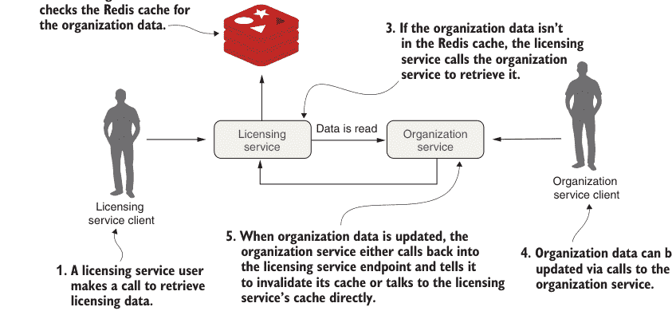

图 10.1 在同步请求-响应模型中，紧密耦合的服务会引入复杂性和脆弱性。

在图 10.1 中，当用户调用许可服务时，许可服务需要查找组织数据。为此，许可服务将首先通过其 ID 从 Redis 集群中检索所需的组织。如果许可服务找不到组织数据，它将使用基于 REST 的端点调用组织服务，在将组织数据返回给用户之前，将返回的数据存储在 Redis 中。

如果有人使用组织服务的 REST 端点更新或删除组织记录，组织服务需要调用许可服务上公开的端点，并告诉它使缓存中的组织数据失效。在图 10.1 中，如果我们查看组织服务回调许可服务以告诉它使 Redis 缓存失效的位置，我们可以看到至少存在三个问题：

- 组织服务和许可服务紧密耦合。这种耦合在服务之间引入了脆弱性。
- 如果许可服务用于使缓存失效的端点发生变化，组织服务必须随之更改。这种方法缺乏灵活性。
- 我们无法在不修改组织服务代码以验证它是否调用许可服务来通知其任何更改的情况下，增加组织数据的新的消费者。

### 服务之间的紧密耦合

为了检索数据，许可服务依赖于组织服务。然而，通过让组织服务在组织记录更新或删除时直接与许可服务通信，我们在组织服务到许可服务之间引入了耦合（图 10.1）。为了使 Redis 缓存中的数据失效，组织服务要么需要在许可服务上有一个可调用以使其 Redis 缓存失效的公开端点，要么组织服务需要直接与许可服务拥有的 Redis 服务器对话以清除其中的数据。

让组织服务与 Redis 通信也会带来问题，因为我们正在与另一个服务直接拥有的存储进行对话。在微服务环境中，这是一个大忌。虽然可以争辩说组织数据确实属于组织服务，但许可服务在特定上下文中使用它，并且可能对其进行转换或围绕它构建业务规则。如果组织服务直接与 Redis 服务对话，它可能会意外破坏许可服务团队实现的规则。

### 服务之间的脆弱性

许可服务与组织服务之间的紧密耦合也引入了服务之间的脆弱性。如果许可服务宕机或运行缓慢，组织服务可能会受到影响，因为组织服务现在直接与许可服务通信。同样，如果组织服务直接与许可服务的 Redis 数据存储对话，我们就在组织服务与 Redis 之间创建了依赖关系。在这种情况下，共享 Redis 服务器的任何问题都可能导致两个服务同时宕机。

### 在组织服务变更中添加新消费者的灵活性不足

使用图 10.1 中的模型，如果我们有另一个对组织数据变更感兴趣的服务，我们需要在组织服务中添加对该服务的另一个调用。这意味着组织服务的代码更改和重新部署，这可能在我们的代码中引入一种不灵活的状态。

如果我们使用同步请求-响应模型来通信状态变更，我们开始看到应用程序中核心服务与其他服务之间依赖关系的网状模式。这些网的中心成为我们应用程序中的主要故障点。

### 另一种耦合

虽然消息传递在服务之间增加了一层间接性，但我们可以在两个服务之间引入紧密耦合。本章后面，我们将在组织和许可服务之间发送消息。这些消息将使用 JSON 格式序列化并反序列化为 Java 对象。JSON 消息结构的更改可能会在相互转换到 Java 时引起问题，如果两个服务不能优雅地处理同一消息类型的不同版本。

JSON 本身并不原生支持版本控制。然而，如果我们需要的话，可以使用 Apache Avro（https://avro.apache.org/）。Avro 是一种内置版本控制的二进制协议。Spring Cloud Stream 支持 Apache Avro 作为消息传递协议。不幸的是，使用 Avro 超出了本书的范围，但我们希望让你意识到，如果你确实需要考虑消息版本控制，它会有所帮助。

## 10.1.2 使用消息传递在服务之间通信状态变更

我们将在许可和组织服务之间注入一个主题，采用消息传递方法。消息系统将不用于从组织服务读取数据，而是将由组织服务用于在组织服务管理的数据中发生状态变更时发布这些变更。图 10.2 演示了这种方法。

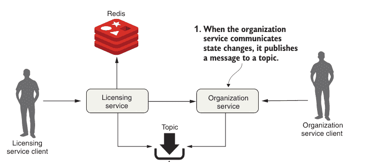

图 10.2 随着组织状态的变化，消息被写入位于许可和组织服务之间的消息队列。

在图 10.2 的模型中，当组织数据发生变化时，组织服务会向主题发布一条消息。许可服务监控主题的消息，并在消息到达时，从 Redis 缓存中清除相应的组织记录。当涉及到通信状态时，消息队列充当许可和组织服务之间的中间件。这种方法提供了四个好处：松耦合、持久性、可扩展性和灵活性。我们将在以下各节中分别介绍它们。

### 松耦合

微服务应用程序可以由数十个小型且分布式的服务组成，它们相互交互并管理彼此的数据。正如我们在前面提出的同步设计中所看到的，同步 HTTP 响应会在许可和组织服务之间创建硬依赖。我们无法完全消除这些依赖，但我们可以通过只公开直接管理服务所拥有的数据的端点来尽量减少依赖。

消息传递方法允许我们解耦这两个服务，因为就通信状态变更而言，两个服务彼此都不知道。当组织服务需要发布状态变更时，它会向队列写入一条消息。许可服务只知道它会收到一条消息；它不知道谁发布了该消息。

### 持久性

队列的存在使我们能够保证即使服务的消费者宕机，消息也会被传递。例如，即使许可服务不可用，组织服务也可以继续发布消息。消息存储在队列中，直到许可服务变得可用为止。相反，结合缓存和队列方法，如果组织服务宕机，许可服务可以优雅地降级，因为至少部分组织数据仍在其缓存中。有时旧数据比没有数据更好。

### 可扩展性

由于消息存储在队列中，消息发送者不必等待消息消费者响应。发送者可以继续前进并继续工作。同样，如果从队列读取消息的消费者处理消息的速度不够快，启动更多消费者来处理消息就是一项简单的任务。这种可扩展性方法非常适合微服务模型。

我们在本书中始终强调，启动微服务的新的实例应该是微不足道的。然后，额外的微服务就可以成为处理消息队列的另一个服务。这是水平扩展的一个例子。

读取队列中消息的传统扩展机制涉及增加消息消费者一次可以处理的消息线程数。不幸的是，使用这种方法，我们最终受限于 CPU 的数量


可供消息消费者使用。微服务模型没有这个限制，因为我们可以通过增加托管消息消费服务的机器数量来扩展。

## 灵活性

消息发送者并不知道谁会消费它。这意味着我们可以轻松地添加新的消息消费者（以及新功能），而不会影响原始发送服务。这是一个极其强大的概念，因为可以在不触及现有服务的情况下向应用程序添加新功能。相反，新代码可以监听发布的事件并相应地做出反应。

## 10.1.3 消息架构的缺点

像任何架构模型一样，基于消息的架构也有权衡。基于消息的架构可能很复杂，并且要求开发团队密切关注几件关键事项，包括消息处理语义、消息可见性和消息编排。让我们更详细地看一下这些。

## 消息处理语义

在基于微服务的应用程序中使用消息不仅仅需要了解如何发布和消费消息。它要求我们理解应用程序的行为将如何基于消息被消费的顺序，以及如果消息乱序处理会发生什么。例如，如果我们有严格的要求，即来自单个客户的所有订单必须按接收顺序处理，我们就需要以不同于每条消息都可以独立于彼此消费的情况来设置和构建我们的消息处理。

这也意味着如果我们使用消息来强制执行数据的严格状态转换，我们需要考虑设计我们的应用程序以应对消息抛出异常或错误乱序处理的情况。如果一条消息失败，我们是否重试处理错误还是让它失败？如果客户的一条消息失败，我们如何处理与该客户相关的后续消息？这些都是需要仔细思考的重要问题。

## 消息可见性

在我们的微服务中使用消息通常意味着同步服务调用和异步服务处理的混合。消息的异步特性意味着它们可能不会在消息发布或消费后不久就被接收或处理。此外，为跟踪用户在 Web 服务调用和消息中的事务而使用诸如关联 ID 之类的东西对于理解和调试应用程序中发生的事情至关重要。正如你在第 8 章中可能记得的那样，关联 ID 是在用户事务开始时生成的唯一数字，并随每次服务调用一起传递。它还应随发布的和消费的每条消息一起传递。

## 消息编排

正如在消息可见性部分所暗示的那样，基于消息的应用程序使得推理其业务逻辑变得更加困难，因为其代码不再以简单的块请求-响应模型以线性方式处理。相反，调试基于消息的应用程序可能涉及浏览多个不同服务的日志，其中用户事务可能乱序执行并且在不同时间执行。

> **NOTE** 消息可能很复杂但功能强大。在前面的章节中，我们并不是想吓唬你不要在应用程序中使用消息。相反，我们的目标是强调在服务中使用消息需要深思熟虑。消息的一个积极方面是，企业本身就是异步工作的，因此最终，我们更紧密地模拟了我们的业务。

## 10.2 介绍 Spring Cloud Stream

Spring Cloud 使将消息集成到我们的 Spring-based 微服务中变得容易。它通过 Spring Cloud Stream 项目（https://spring.io/projects/spring-cloud-stream）来实现这一点，该项目是一个基于注解的框架，允许我们在 Spring 应用程序中轻松构建消息发布者和消费者。

Spring Cloud Stream 还允许我们抽象掉我们使用的消息平台的实现细节。我们可以使用 Spring Cloud Stream 使用多个消息平台，包括 Apache Kafka 项目和 RabbitMQ，并且平台的特定于实现细节被排除在应用程序代码之外。应用程序中消息发布和消费的实现是通过平台中立的 Spring 接口完成的。

> **NOTE** 对于本章，我们将使用一个名为 Kafka（https://kafka.apache.org/）的消息总线。Kafka 是一个高性能的消息总线，允许我们从一个应用程序异步发送消息流到一个或多个其他应用程序。用 Java 编写的 Kafka 是许多基于云的应用程序的事实上的消息总线，因为它高度可靠且可扩展。Spring Cloud Stream 也支持使用 RabbitMQ 作为消息总线。

为了理解 Spring Cloud Stream，让我们从讨论其架构开始，并熟悉一些术语。新的术语如果您以前从未使用过基于消息的平台可能会有点令人不知所措，所以让我们通过两个通过消息通信的服务的视角来看 Spring Cloud Stream 架构。 一个服务是消息发布者，一个服务是消息消费者。图 10.3 显示了 Spring Cloud Stream 如何促进这种消息传递。

Service client

1. 服务客户端调用服务，并且服务更改其拥有的数据的状态。这是在服务的业务逻辑中完成的。

Service A

Business logic

Spring Cloud Stream

Source

2. 源是服务发布消息的 Spring 代码。

Channel

3. 消息发布到一个通道。

Binder

4. Binder 是 Spring Cloud Stream 的框架代码，用于与特定的消息系统通信。

Message broker

5. 消息代理可以使用包括 Apache Kafka 和 RabbitMQ 在内的任意数量的消息平台实现。

Message queue

Service B

Spring Cloud Stream

Binder

6. 当服务接收到消息时，消息处理的顺序（binder、channel、sink）会发生变化。

Channel

Sink

7. Sink 是监听通道并处理传入消息的服务特定代码。

Business logic

图 10.3 当消息被发布和消费时，它会流经一系列 Spring Cloud Stream 组件，这些组件抽象掉了底层消息平台。

使用 Spring Cloud，发布和消费消息涉及四个组件：

- Source
- Channel
- Binder
- Sink

当服务准备好发布消息时，它将使用源发布消息。源是一个 Spring 注解接口，它接受一个 Plain Old Java Object（POJO），表示要发布的消息。源接收消息，对其进行序列化（默认序列化为 JSON），并将消息发布到通道。

通道是对消息在被消息生产者发布或被消息消费者消费后将持有的队列的抽象。换句话说，我们可以将通道描述为发送和接收消息的队列。通道名称始终与目标队列名称相关联，但该队列名称永远不会直接暴露给代码。相反，通道名称在代码中使用，这意味着我们可以通过更改应用程序的配置而不是应用程序的代码来切换通道读取或写入的队列。

Binder 是 Spring Cloud Stream 框架的一部分。它是与特定消息平台对话的 Spring 代码。Spring Cloud Stream 框架的 Binder 部分允许我们在无需接触发布和消费消息的特定于平台的库和 API 的情况下处理消息。

在 Spring Cloud Stream 中，当服务从队列接收消息时，它是通过 sink 完成的。Sink 监听通道以获取传入消息并将消息反序列化回 POJO 对象。从那里，消息可以由 Spring 服务的业务逻辑处理。

## 10.3 编写简单的消息生产者和消费者

现在我们已经介绍了 Spring Cloud Stream 中的基本组件，让我们看一个简单的 Spring Cloud Stream 示例。对于第一个示例，我们将从组织服务向许可服务传递一条消息，后者将日志消息打印到控制台。此外，因为在这个示例中我们将只有一个 Spring Cloud Stream 源（消息生产者）和一个 sink（消息消费者），我们将从几个简单的 Spring Cloud 快捷方式开始示例。这将使在组织服务中设置源以及在许可服务中设置 sink 变得微不足道。图 10.4 突出了消息生产者并基于图 10.3 的通用 Spring Cloud Stream 架构构建。


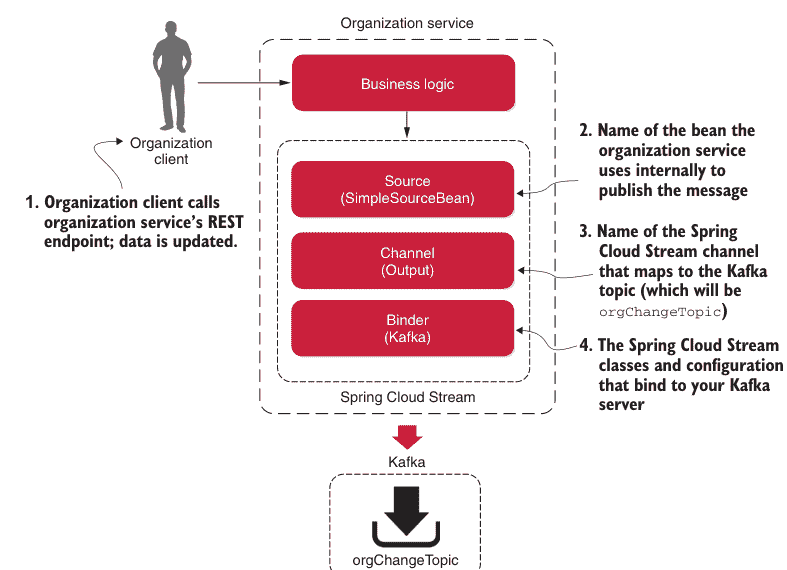

图 10.4 当组织服务数据发生变化时，它会向 orgChangeTopic 发布一条消息。

## 10.3.1 在 Docker 中配置 Apache Kafka 和 Redis

在本节中，我们将解释如何将 Kafka 和 Redis 服务添加到我们的 Docker 环境中，以用于我们的消息生产者。为此，让我们首先将以下清单中所示的代码添加到我们的 docker-compose.yml 文件中。

### 清单 10.1 向 docker-compose.yml 添加 Kafka 和 Redis 服务

```yaml
# Parts of docker-compose.yml removed for conciseness
...
zookeeper:
  image: wurstmeister/zookeeper:latest
  ports:
    - 2181:2181
  networks:
    backend:
      aliases:
        - "zookeeper"
kafkaserver:
  image: wurstmeister/kafka:latest
  ports:
    - 9092:9092
  environment:
    - KAFKA_ADVERTISED_HOST_NAME=kafka
    - KAFKA_ADVERTISED_PORT=9092
    - KAFKA_ZOOKEEPER_CONNECT=zookeeper:2181
    - KAFKA_CREATE_TOPICS=addresses:1:1,ratings:1:1
  volumes:
    - "/var/run/docker.sock:/var/run/docker.sock"
  depends_on:
    - zookeeper
  networks:
    backend:
      aliases:
        - "kafka"
redisserver:
  image: redis:alpine
  ports:
    - 6379:6379
  networks:
    backend:
      aliases:
        - "redis"
```

## 10.3.2 在组织服务中编写消息生产者

为了专注于如何在我们的架构中使用主题，我们将首先修改组织服务，以便每次添加、更新或删除组织数据时，组织服务都会向 Kafka 主题发布一条消息，表明发生了组织变更事件。发布的消息将包含与变更事件关联的组织 ID 以及发生了什么操作（添加、更新或删除）。

我们需要做的第一件事是在组织服务的 Maven pom.xml 文件中设置 Maven 依赖项。您可以在组织服务的根目录中找到 pom.xml 文件。在 pom.xml 中，我们需要添加两个依赖项，一个用于核心 Spring Cloud Stream 库，另一个用于 Spring Cloud Stream Kafka 库：

```xml
<dependency>
    <groupId>org.springframework.cloud</groupId>
    <artifactId>spring-cloud-stream</artifactId>
</dependency>

<dependency>
    <groupId>org.springframework.cloud</groupId>
    <artifactId>spring-cloud-starter-stream-kafka</artifactId>
</dependency>
```

> **注意** 我们使用 Docker 来运行所有示例。如果要在本地运行，需要在计算机上安装 Apache Kafka。如果使用 Docker，可以在此处找到包含 Kafka 和 Zookeeper 容器的最新 docker-compose.yml 文件：https://github.com/ihuaylupo/manning-smia/tree/master/chapter10/docker。

请记住，在父 pom.xml 所在的根目录中执行以下命令来启动服务：

```bash
mvn clean package dockerfile:build && docker-compose
    -f docker/docker-compose.yml up
```

一旦定义了 Maven 依赖项，我们就需要告诉应用程序它将绑定到 Spring Cloud Stream 消息代理。我们可以通过使用 @EnableBinding 注解组织服务的引导类 OrganizationServiceApplication 来实现这一点。您可以在 /organization-service/src/main/java/com/optimagrowth/organization/OrganizationServiceApplication.java 中找到此类的代码。为了方便起见，以下清单显示了 OrganizationServiceApplication.java 的源代码。

### 清单 10.2 带有注解的 OrganizationServiceApplication.java 类

```java
package com.optimagrowth.organization;

import org.springframework.boot.SpringApplication;
import org.springframework.boot.autoconfigure.SpringBootApplication;
import org.springframework.cloud.context.config.annotation.RefreshScope;
import org.springframework.cloud.stream.annotation.EnableBinding;
import org.springframework.cloud.stream.messaging.Source;
import org.springframework.security.oauth2.config.annotation.web.configuration.EnableResourceServer;

@SpringBootApplication
@RefreshScope
@EnableResourceServer
@EnableBinding(Source.class)
public class OrganizationServiceApplication {

    public static void main(String[] args) {
        SpringApplication.run(OrganizationServiceApplication.class, args);
    }
}
```

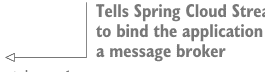

在清单 10.2 中，@EnableBinding 注解告诉 Spring Cloud Stream 我们希望将服务绑定到消息代理。在 @EnableBinding 中使用 Source.class 告诉 Spring Cloud Stream，该服务将通过 Source 类中定义的一组通道与消息代理通信。请记住，通道位于消息队列之上。Spring Cloud Stream 有一组默认通道，可以配置为与消息代理通信。

此时，我们还没有告诉 Spring Cloud Stream 我们希望组织服务绑定到哪个消息代理。我们很快就会讲到。现在，我们可以继续实现发布消息的代码。第一步是更改 `/organization-service/src/main/java/com/optimagrowth/organization/utils/UserContext.java` 中的 UserContext 类。此更改将使我们的变量成为线程本地变量。以下清单显示了 ThreadLocal 类的代码。

### 清单 10.3 使我们的 UserContext 变量成为 ThreadLocal

```java
package com.optimagrowth.organization.utils;
//Imports removed for conciseness

@Component
public class UserContext {
    public static final String CORRELATION_ID = "tmx-correlation-id";
    public static final String AUTH_TOKEN       = "Authorization";
    public static final String USER_ID          = "tmx-user-id";
    public static final String ORG_ID           = "tmx-org-id";

    private static final ThreadLocal<String> correlationId =
            new ThreadLocal<String>();
    private static final ThreadLocal<String> authToken =
            new ThreadLocal<String>();
    private static final ThreadLocal<String> userId =
            new ThreadLocal<String>();
    private static final ThreadLocal<String> orgId =
            new ThreadLocal<String>();

    public static HttpHeaders getHttpHeaders(){
        HttpHeaders httpHeaders = new HttpHeaders();
        httpHeaders.set(CORRELATION_ID, getCorrelationId());

        return httpHeaders;
    }
}
```

> 将变量定义为 ThreadLocal 可以让我们为当前线程单独存储数据。此处设置的信息只能由设置该值的线程读取。

下一步是创建发布消息的逻辑。您可以在 `/organization-service/src/main/java/com/optimagrowth/organization/events/source/SimpleSourceBean.java` 类文件中找到发布消息的代码。以下清单显示了此类的代码。

### 清单 10.4 向消息代理发布消息

```java
package com.optimagrowth.organization.events.source;

import org.slf4j.Logger;
import org.slf4j.LoggerFactory;
import org.springframework.beans.factory.annotation.Autowired;
import org.springframework.cloud.stream.messaging.Source;
import org.springframework.messaging.support.MessageBuilder;
import org.springframework.stereotype.Component;

import com.optimagrowth.organization.events.model.OrganizationChangeModel;
import com.optimagrowth.organization.utils.UserContext;

@Component
public class SimpleSourceBean {
    private Source source;

    private static final Logger logger =
        LoggerFactory.getLogger(SimpleSourceBean.class);

    public SimpleSourceBean(Source source){
        this.source = source;
    }

    public void publishOrganizationChange(ActionEnum action,
                                           String organizationId){
        logger.debug("Sending Kafka message {} for Organization Id: {}",
                     action, organizationId);
        OrganizationChangeModel change = new OrganizationChangeModel(
            OrganizationChangeModel.class.getTypeName(),
            action.toString(),
            organizationId,
            UserContext.getCorrelationId());

        source.output().send(MessageBuilder
                              .withPayload(change)
                              .build());
    }
}
```

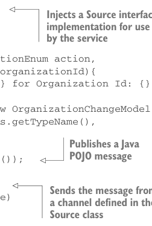

在清单 10.4 中，我们将 Spring Cloud Source 类注入到代码中。请记住，与特定消息主题的所有通信都通过称为通道的 Spring Cloud Stream 构造进行，该构造由 Java 接口类表示。在清单中，我们使用了 Source 接口，它暴露了一个名为 output() 的单一方法。

当我们的服务只需要发布到单个通道时，Source 接口使用起来很方便。output() 方法返回一个类型为 MessageChannel 的类。使用该类型，我们将向消息代理发送消息。（在本章后面，我们将展示如何使用自定义接口暴露多个消息通道。）output() 方法中参数传递的 ActionEnum 包含以下操作：

```java
public enum ActionEnum {
    GET,
    CREATED,
    UPDATED,
    DELETED
}
```

消息的实际发布发生在 publishOrganizationChange() 方法中。该方法构建一个名为 OrganizationChangeModel 的 Java POJO。以下清单显示了此 POJO 的代码。


## 清单 10.5 发布 OrganizationChangeModel 对象

```java
package com.optimagrowth.organization.events.model;

import lombok.Getter;
import lombok.Setter;
import lombok.ToString;

@Getter @Setter @ToString
public class OrganizationChangeModel {
    private String type;
    private String action;
    private String organizationId;
    private String correlationId;

    public OrganizationChangeModel(String type,
        String action, String organizationId,
        String correlationId) {
        this.type = type;
        this.action = action;
        this.organizationId = organizationId;
        this.correlationId = correlationId;
    }
}
```

OrganizationChangeModel 类声明了三个数据元素：

- action——这是触发事件的动作。我们在消息中包含了 action 元素，以便为消息消费者提供更多上下文，帮助其理解应如何处理事件。
- organizationId——这是与事件关联的组织 ID。
- correlationId——这是触发事件的服务调用的相关 ID。我们应该始终在事件中包含相关 ID，因为它极大地有助于跟踪和调试消息在服务间的流转。

回到 SimpleSourceBean 类，我们可以看到，当我们准备好发布消息时，可以使用 source.output() 方法返回的 MessageChannel 类上的 send() 方法，如下所示：

```java
source.output().send(MessageBuilder.withPayload(change).build());
```

send() 方法接受一个 Spring Message 类。我们使用一个名为 MessageBuilder 的 Spring 辅助类，将 OrganizationChangeModel 类的内容转换为 Spring Message 类。这就是发送消息所需的全部代码。然而，到目前为止，一切看起来都有些像魔术，因为我们还没有看到如何将组织服务绑定到特定的消息队列，更不用说实际的消息代理了。这一切都是通过配置完成的。

清单 10.6 显示了将我们的服务的 Spring Cloud Stream Source 映射到 Kafka 消息代理和消息主题的配置。此配置信息可以位于我们为组织服务创建的 Spring Cloud Config 条目中。

> **注意** 在本示例中，我们使用 Spring Cloud Config 上的 classpath 仓库。组织服务的配置位于 `/configserver/src/main/resources/config/organization-service.properties`。

## 清单 10.6 用于发布消息的 Spring Cloud Stream 配置

```properties
#为简洁起见，省略了部分内容

spring.cloud.stream.bindings.output.destination=orgChangeTopic
spring.cloud.stream.bindings.output.content-type=application/json
spring.cloud.stream.kafka.binder.zkNodes=localhost
spring.cloud.stream.kafka.binder.brokers=localhost
```

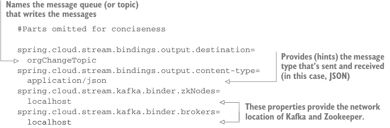

> **注意** Apache Zookeeper 用于维护配置和名称数据，并在分布式系统中提供灵活的同步机制。Apache Kafka 就像一个集中式服务，负责跟踪 Kafka 集群节点和主题配置。

清单 10.6 中的配置看起来密集，但相当直接。`spring.cloud.stream.bindings` 是我们的服务向 Spring Cloud Stream 消息代理发布消息所需配置的开头。清单中的配置属性 `spring.cloud.stream.bindings.output` 将清单 10.4 中的 source.output() 通道映射到我们要通信的消息代理上的 orgChangeTopic。它还告诉 Spring Cloud Stream，发送到该主题的消息应序列化为 JSON。Spring Cloud Stream 可以以多种格式序列化消息，包括 JSON、XML 和 Apache 基金会的 Avro 格式（https://avro.apache.org/）。

现在，我们已经有了通过 Spring Cloud Stream 发布消息的代码，以及告诉 Spring Cloud Stream 使用 Kafka 作为消息代理的配置，接下来让我们看看组织服务中消息发布的实际位置。类 `OrganizationService` 将为我们完成这项工作。你可以在 `/organization-service/src/main/java/com/optimagrowth/organization/service/OrganizationService.java` 中找到此类的代码。以下清单显示了此类的代码。

## 清单 10.7 在组织服务中发布消息

```java
package com.optimagrowth.organization.service;
//为简洁起见，省略了导入
@Service
public class OrganizationService {

    private static final Logger logger =
        LoggerFactory.getLogger(OrganizationService.class);

    @Autowired
    private OrganizationRepository repository;

    @Autowired
    SimpleSourceBean simpleSourceBean;

    public Organization create(Organization organization){
        organization.setId( UUID.randomUUID().toString());
        organization = repository.save(organization);
        simpleSourceBean.publishOrganizationChange(
            ActionEnum.CREATED,
            organization.getId());
        return organization;
    }

    //为简洁起见，省略了其余代码
}
```

使用自动装配将 SimpleSourceBean 注入组织服务。

对于服务中每个更改组织数据的方法，都调用 simpleSourceBean.publishOrgChange()。

## 消息中应包含哪些数据？

团队在初次踏上消息之旅时最常问我们的问题之一是：消息中到底应该包含多少数据？我们的答案是：这取决于你的应用程序。

你可能已经注意到，在所有的示例中，我们只返回发生变化组织记录的组织 ID。我们从不将数据变更的副本放入消息中。此外，我们使用基于系统事件的消息来告知其他服务数据状态已更改，并且总是强制其他服务返回主数据源（拥有数据的服务）重新获取一份新的数据。这种方法在执行时间上成本更高，但它保证了我们始终拥有最新版本的数据。但存在一种很小的可能性：我们使用的数据在从源系统读取后可能立即发生变化。然而，这种情况发生的可能性要比我们盲目地从队列中消费信息时小得多。

我们的建议是：仔细考虑你在消息中传递的数据量。迟早，你会遇到所传数据“过期”的情况。这可能是因为某个问题导致它在消息队列中停留太久，或者之前的一条包含数据的消息失败，导致你现在在消息中传递的数据处于不一致的状态。这可能是因为你的应用程序依赖于消息的状态，而不是底层数据存储中的真实状态。如果你要在消息中传递状态，请确保包含一个日期时间戳或版本号，以便消费数据的服务能够检查传递过来的数据，并确保它不会比它已有的数据副本更旧。

## 10.3.3 在许可服务中编写消息消费者

至此，我们已经修改了组织服务，使其在每次组织服务更改数据时向 Kafka 发布一条消息。任何有兴趣的服务都可以做出响应，而无需由组织服务显式调用。这也意味着，我们可以很容易地添加新功能，通过监听进入消息队列的消息来对组织服务中的变更做出响应。

现在让我们换个方向，看看服务如何使用 Spring Cloud Stream 消费消息。在本示例中，许可服务将消费组织服务发布的消息。首先，我们需要将 Spring Cloud Stream 依赖添加到许可服务的 pom.xml 文件中。你可以在本书源代码的 licensing-service 根目录下找到此文件。图 10.5 显示了许可服务在 Spring Cloud 架构中的位置（首次展示于图 10.3）。与你之前看到的 organization-service pom.xml 文件类似，我们将向 .pom 文件添加以下两个依赖项：

```xml
<dependency>
    <groupId>org.springframework.cloud</groupId>
    <artifactId>spring-cloud-stream</artifactId>
</dependency>
```

```xml
<dependency>
    <groupId>org.springframework.cloud</groupId>
    <artifactId>spring-cloud-starter-stream-kafka</artifactId>
</dependency>
```

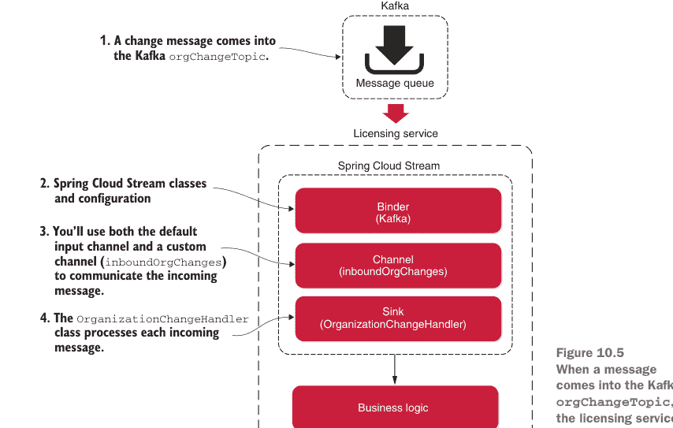


接下来，我们将告诉许可服务它需要使用 Spring Cloud Stream 绑定到消息代理。与组织服务一样，我们将使用 `@EnableBinding` 注解对许可服务的引导类 `LicenseServiceApplication` 进行注解。你可以在 `/licensing-service/src/main/java/com/optimagrowth/license/LicenseServiceApplication.java` 文件中找到该类的代码。许可服务与组织服务之间的区别在于我们传递给 `@EnableBinding` 的值，如以下清单所示。

```
### Listing 10.8  Consuming a message using Spring Cloud Stream

```java
package com.optimagrowth.license;
//Imports and some annotations removed for conciseness

@EnableBinding(Sink.class)
public class LicenseServiceApplication {

    @StreamListener(Sink.INPUT)
    public void loggerSink(OrganizationChangeModel orgChange) {
        logger.debug("Received an {} event for organization id {}",
            orgChange.getAction(), orgChange.getOrganizationId());
    }

    //Rest of the code omitted for conciseness
}
```
```

由于许可服务是消息消费者，我们将把 `@EnableBinding` 的值设为 `Sink.class`。这告诉 Spring Cloud Stream 使用默认的 Spring Sink 接口绑定到消息代理。与第 10.3.1 节中描述的 Source 接口类似，Spring Cloud Stream 在 Sink 接口上公开了一个默认通道。该 Sink 接口通道称为 `input`，用于监听传入消息。

一旦我们通过 `@EnableBinding` 注解定义了想要监听消息，我们就可以编写处理来自 Sink 输入通道的消息的代码。为此，我们将使用 Spring Cloud Stream 的 `@StreamListener` 注解。该注解告诉 Spring Cloud Stream 在从输入通道接收到消息时执行 `loggerSink()` 方法。Spring Cloud Stream 会自动将传入消息反序列化为名为 `OrganizationChangeModel` 的 Java POJO。

同样，许可服务的配置实现了消息代理主题到输入通道的映射。其配置如清单 10.9 所示，可在该示例的 Spring Cloud 配置仓库中的 `/configserver/src/main/resources/config/licensing-service.properties` 文件中找到。

```
### Listing 10.9  Mapping the licensing service to a message topic in Kafka

```properties
#Some properties removed for conciseness

spring.cloud.stream.bindings.input.destination=
    orgChangeTopic
```
```

```
spring.cloud.stream.bindings.input.content-type=
  application/json
spring.cloud.stream.bindings.input.group=
  licensingGroup
spring.cloud.stream.kafka.binder.zkNodes=
  localhost
spring.cloud.stream.kafka.binder.brokers=
  localhost

Process semantics once per service
```

此清单中的配置看起来与组织服务的配置相似。然而，它有两个关键区别。首先，我们现在使用 spring.cloud.stream.bindings 属性定义了一个输入通道。该值映射到清单 10.8 中代码中定义的 Sink.INPUT 通道。此属性将输入通道映射到 orgChangeTopic。其次，我们看到引入了一个名为 spring.cloud.stream.bindings.input.group 的新属性。group 属性定义了将消费消息的消费者组的名称。

消费者组的概念是这样的：我们可以有多个服务，每个服务有多个实例监听同一个消息队列。我们希望每个唯一的服务都能处理消息的副本，但我们只希望一个服务实例在一个服务实例组中消费并处理消息。group 属性标识服务所属的消费者组。

只要所有服务实例具有相同的组名，Spring Cloud Stream 和底层消息代理就会保证该组中的服务实例只消费消息的一个副本。在我们的许可服务中，我们将 group 属性值称为 licensingGroup。图 10.6 说明了该消费者组如何帮助在多个服务之间满足消费一次语义的情况下强制执行消费一次。

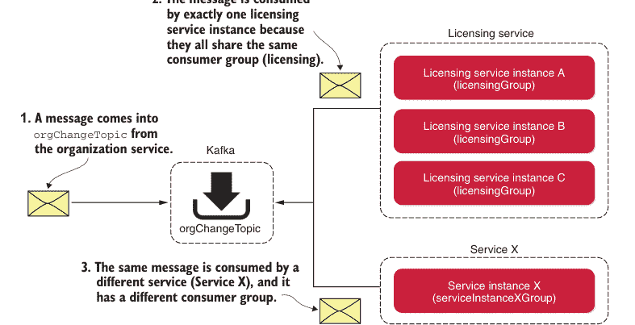

图 10.6 消费者组保证消息只被一组服务实例处理一次。

## 10.3.4 Seeing the message service in action

到目前为止，每当记录被添加、更新或删除时，组织服务都会向 orgChangeTopic 发布一条消息，而许可服务会使用相同的主题接收消息。接下来，我们将通过创建组织服务记录并观察控制台以查看许可服务的相应日志消息，来实际查看这段代码的运行情况。

要创建组织服务记录，我们将对组织服务发出一个 POST 请求。我们将使用 http://localhost:8072/organization/v1/organization/ 端点，并在 POST 调用中发送以下正文。图 10.7 显示了此 POST 调用的返回输出：

```
{
  "name":"Ostock",
  "contactName":"Illary Huaylupo",
  "contactEmail":"illaryhs@gmail.com",
  "contactPhone":"888888888"
}
```

NOTE 请记住，我们首先需要实现身份验证以检索令牌并通过授权头作为 Bearer Token 传递访问令牌。我们在上一章中讨论过这一点。如果你没有按照那里的代码示例操作，请从 http://github.com/ihuaylupo/manning-smia/tree/master/chapter9 下载代码。然后我们将代码指向 Spring Cloud Gateway。这就是为什么端点具有 8072 端口和 /organization/v1/organization 路径，而不是仅仅 /v1/organization。

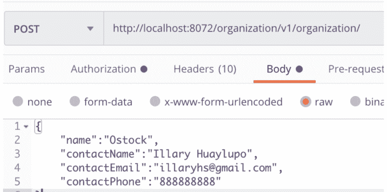

图 10.7 使用组织服务创建新的组织服务记录

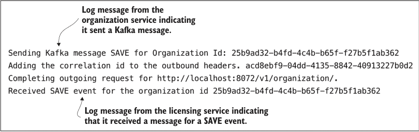

**Figure 10.8**  The console shows the message from the organization service being sent and then received.

一旦我们发出组织服务调用，就应该在运行服务的控制台窗口中看到图 10.8 所示的输出。

现在我们有两个服务使用消息相互通信。Spring Cloud Stream 充当这些服务的中间人。从消息传递的角度来看，服务彼此一无所知。它们使用消息代理作为中间人进行通信，并使用 Spring Cloud Stream 作为消息代理的抽象层。

## 10.4  A Spring Cloud Stream use case: Distributed caching

我们现在有两个服务使用消息进行通信，但我们实际上并没有对消息做任何处理。接下来，我们将构建本章前面讨论的分布式缓存示例。对于该示例，许可服务将始终检查分布式 Redis 缓存中与特定许可证关联的组织数据。如果缓存中存在组织数据，我们将从缓存返回数据。如果不存在，我们将调用组织服务并将调用结果缓存到 Redis hash 中。

当组织服务中的数据更新时，组织服务将向 Kafka 发布一条消息。许可服务将接收该消息并向 Redis 发出 DELETE 请求以清除缓存。

> ### Cloud caching and messaging
> 
> 使用 Redis 作为分布式缓存与云中的微服务开发相关。你可以使用 Redis 来：
> 
> - *Improve performance when looking up commonly held data.* Using a cache, you can significantly improve the performance of several key services by avoiding reads to the database.
> - *Reduce the load (and cost) on the database tables holding your data.* Accessing data in a database can be a costly undertaking. With every read, you make a chargeable event. Using a Redis server, you can implement reads by a primary key rather than by accessing a database, which is significantly more cost effective.


（续）

+   提高弹性，以便在你的主数据存储或数据库出现性能问题时，服务能够优雅地降级。根据你在缓存中保存的数据量，缓存解决方案有助于减少访问数据存储时可能遇到的错误数量。

Redis 远不止是一个缓存解决方案。不过，如果你需要分布式缓存，它完全可以胜任这个角色。

## 10.4.1 使用 Redis 缓存查找

在本节中，我们首先将许可服务设置为使用 Redis。幸运的是，Spring Data 让我们可以轻松地将 Redis 引入许可服务。要在许可服务中使用 Redis，我们需要执行以下操作：

+   1. 配置许可服务，使其包含 Spring Data Redis 依赖。
+   2. 构建到 Redis 的数据库连接。
+   3. 定义我们的代码将与 Redis 哈希交互所用的 Spring Data Redis 仓库。
+   4. 使用 Redis 和许可服务来存储和读取组织数据。

### 使用 Spring Data Redis 依赖配置许可服务

我们需要做的第一件事是将 spring-data-redis 依赖以及 jedis 包含到许可服务的 pom.xml 文件中。下一个清单展示了这些依赖。

### 清单 10.10 添加 Spring Redis 依赖

```
//Some code removed for conciseness
<dependency>
    <groupId>org.springframework.data</groupId>
    <artifactId>spring-data-redis</artifactId>
</dependency>

<dependency>
    <groupId>redis.clients</groupId>
    <artifactId>jedis</artifactId>
    <type>jar</type>
</dependency>
```

### 构建到 Redis 服务器的数据库连接

既然我们已经在 Maven 中添加了依赖，就需要建立到 Redis 服务器的连接。Spring 使用 Jedis 开源项目（https://github.com/xetorthio/jedis）与 Redis 服务器通信。为了与特定的 Redis 实例通信，我们将 JedisConnectionFactory 类作为 Spring bean 暴露出来。你可以在 /licensing-service/src/main/java/com/optimagrowth/license/LicenseServiceApplication.java 中找到该类的源码。

一旦我们建立了到 Redis 的连接，就会使用该连接创建一个 Spring `RedisTemplate` 对象。我们稍后实现的 Spring Data 仓库类将使用 `RedisTemplate` 对象来执行查询，并将组织服务数据保存到 Redis 服务中。下一个清单展示了这段代码。

### 清单 10.11 建立许可服务与 Redis 的通信方式

```
```java
package com.optimagrowth.license;

import org.springframework.data.redis.connection.RedisPassword;
import org.springframework.data.redis.connection.RedisStandaloneConfiguration;
import org.springframework.data.redis.connection.jedis.JedisConnectionFactory;
import org.springframework.data.redis.core.RedisTemplate;

//Most of the imports and annotations removed for conciseness

@SpringBootApplication
@EnableBinding(Sink.class)
public class LicenseServiceApplication {

    @Autowired
    private ServiceConfig serviceConfig;

    //All other methods in the class have been removed for conciseness

    @Bean
    JedisConnectionFactory jedisConnectionFactory() {
        String hostname = serviceConfig.getRedisServer();
        int port = Integer.parseInt(serviceConfig.getRedisPort());
        RedisStandaloneConfiguration redisStandaloneConfiguration
            = new RedisStandaloneConfiguration(hostname, port);
        return new JedisConnectionFactory(redisStandaloneConfiguration);
    }

    @Bean
    public RedisTemplate<String, Object> redisTemplate() {
        RedisTemplate<String, Object> template = new RedisTemplate<>();
        template.setConnectionFactory(jedisConnectionFactory());
        return template;
    }

    //Rest of the code removed for conciseness
}
```
```

设置许可服务与 Redis 通信的基础工作已经完成。现在让我们继续编写用于获取、添加、更新和删除数据的逻辑。

`ServiceConfig` 是一个简单的类，包含获取我们将在许可服务配置文件中定义的自定义参数的逻辑；在本次

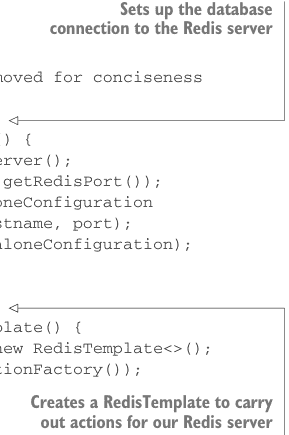

特定场景中，这些参数是 Redis 主机和端口。下一个清单展示了该类的代码。

### 清单 10.12 使用 Redis 数据设置 ServiceConfig 类

```
package com.optimagrowth.license.config;
//Imports removed for conciseness

@Component @Getter
public class ServiceConfig{

//Some code removed for conciseness

    @Value("${redis.server}")
    private String redisServer="";

    @Value("${redis.port}")
    private String redisPort="";
}
```

Spring Cloud Config 服务仓库在 /configserver/src/main/resources/config/licensing-service.properties 文件中为 Redis 服务器定义了以下主机和端口：

```
redis.server = localhost
redis.port = 6379
```

注意 我们使用 Docker 运行所有示例。如果你想在本地运行这个示例，需要在计算机上安装 Redis。但如果你使用 Docker，你可以在以下链接找到与 Redis 容器保持同步的 docker-compose.yml 文件：https://github.com/ihuaylupo/manning-smia/tree/master/chapter10/docker。

### 定义 Spring Data Redis 仓库

Redis 是一个键值数据存储，就像一个大型的、分布式的内存 HashMap。在最简单的情况下，它使用键来存储和查找数据。它没有复杂的查询语言来检索数据。它的简单性正是其优势所在，也是这么多开发者在项目中采用它的原因之一。

因为我们使用 Spring Data 来访问 Redis 存储，所以需要定义一个仓库类。你可能还记得前几章中，Spring Data 使用用户定义的仓库类，为 Java 类提供一种简单机制来访问 Postgres 数据库，而无需编写底层 SQL 查询。对于许可服务，我们将为 Redis 仓库定义两个文件。第一个文件是一个 Java 接口，将被注入到任何需要访问 Redis 的许可服务类中。下一个清单展示了 /licensing-service/src/main/java/com/optimagrowth/license/repository/OrganizationRedis-Repository.java 接口。

### 清单 10.13 OrganizationRedisRepository 定义了用于调用 Redis 的方法

```
package com.optimagrowth.license.repository;

import org.springframework.data.repository.CrudRepository;
import org.springframework.stereotype.Repository;
import com.optimagrowth.license.model.Organization;

@Repository
public interface OrganizationRedisRepository extends
    CrudRepository<Organization,String>{
}
```

通过继承 CrudRepository，OrganizationRedisRepository 包含了用于从 Redis 存储和检索数据的所有 CRUD（创建、读取、更新、删除）逻辑（在这种情况下）。第二个文件是我们将用于仓库的模型。这个类是一个 POJO，包含我们将存储在 Redis 缓存中的数据。/licensing-service/src/main/java/com/optimagrowth/license/model/Organization.java 类如以下清单所示。

### 清单 10.14 Redis 哈希的组织模型

```
package com.optimagrowth.license.model;

import org.springframework.data.redis.core.RedisHash;
import org.springframework.hateoas.RepresentationModel;
import javax.persistence.Id;

import lombok.Getter;
import lombok.Setter;
import lombok.ToString;

@Getter @Setter @ToString
@RedisHash("organization")
public class Organization extends RepresentationModel<Organization> {

    @Id
    String id;
    String name;
    String contactName;
    String contactEmail;
    String contactPhone;
}
```

设置 Redis 服务器中存储组织数据的哈希名称

从清单 10.14 的代码中需要注意的一个重要之处是，Redis 服务器中可以包含多个哈希和数据结构。因此，在与 Redis 的每次交互中，我们都需要告诉 Redis 我们要对其执行操作的数据结构的名称。


# 使用 Redis 和许可服务存储和读取组织数据

现在我们已经有了使用 Redis 执行操作的代码，我们可以修改许可服务，以便每次许可服务需要组织数据时，它都会在调用组织服务之前先检查 Redis 缓存。你可以在类文件 `/service/src/main/java/com/optimagrowth/license/service/client/OrganizationRestTemplateClient.java` 中的 OrganizationRestTemplateClient 类中找到执行此操作的逻辑。下一个列表显示了该类。

## Listing 10.15 使用 OrganizationRestTemplateClient 实现缓存逻辑

```
```java
package com.optimagrowth.license.service.client;
//Imports removed for conciseness

@Component
public class OrganizationRestTemplateClient {
    @Autowired
    RestTemplate restTemplate;
    @Autowired
    OrganizationRedisRepository redisRepository;
    private static final Logger logger =
        LoggerFactory.getLogger(OrganizationRestTemplateClient.class);

    private Organization checkRedisCache(String organizationId) {
        try {
            return redisRepository
                .findById(organizationId)
                .orElse(null);
        } catch (Exception ex) {
            logger.error("Error encountered while trying to retrieve organization{} check Redis Cache. Exception {}",
                organizationId, ex);
            return null;
        }
    }

    private void cacheOrganizationObject(Organization organization) {
        try {
            redisRepository.save(organization);
        } catch (Exception ex) {
            logger.error("Unable to cache organization {} in Redis. Exception {}",
                organization.getId(), ex);
        }
    }

    public Organization getOrganization(String organizationId){
        logger.debug("In Licensing Service.getOrganization: {}",
            UserContext.getCorrelationId());

        Organization organization = checkRedisCache(organizationId);
        if (organization != null) {
            logger.debug("I have successfully retrieved an organization {} from the redis cache: {}", organizationId,
                organization);
        }
```
```

> 在 OrganizationRestTemplateClient 中自动装配 OrganizationRedisRepository
> 尝试使用其组织 ID 从 Redis 中检索 Organization 类
> 将组织保存到 Redis 中
> 如果无法从 Redis 中检索数据，则调用组织服务从源数据库获取数据以便稍后保存到 Redis

```
return organization;
}
logger.debug("Unable to locate organization from the redis cache: {}",organizationId);
ResponseEntity<Organization> restExchange =
    restTemplate.exchange(
        "http://gateway:8072/organization/v1/organization/{organizationId}",HttpMethod.GET,
        null, Organization.class, organizationId);

organization = restExchange.getBody();
if (organization != null) {
    cacheOrganizationObject(organization);
}
return restExchange.getBody();
}
```

getOrganization() 方法是调用组织服务的地方。在我们进行实际的 REST 调用之前，我们需要使用 checkRedisCache() 方法从 Redis 中检索与调用关联的 Organization 对象。

如果相关组织对象不在 Redis 中，代码将返回 null 值。如果 checkRedisCache() 方法返回 null 值，代码将调用组织服务的 REST 端点以检索所需的组织记录。如果组织服务返回一个组织，则返回的组织对象将使用 cacheOrganizationObject() 方法进行缓存。

> NOTE 在与缓存交互时，请密切注意异常处理。为了提高弹性，我们绝不会在无法与 Redis 服务器通信时让整个调用失败。相反，我们记录异常并让调用继续进行到组织服务。在这种特定情况下，缓存旨在帮助提高性能，缓存服务器的缺失不应影响调用的成功。

有了 Redis 缓存代码后，使用 Postman，我们可以选择许可服务来查看日志消息。如果我们对许可服务端点 http://localhost:8072/license/v1/organization e839ee96-28de-4f67-bb79-870ca89743a0/license/279709ff-e6d5-4a54-8b55-a5c37542025b 进行两次连续的 GET 请求，我们将在日志中看到以下两个输出语句：

```
licensingservice_1 | DEBUG 1 --- [nio-8080-exec-4]
c.o.l.s.c.OrganizationRestTemplateClient : Unable to locate organization from the redis cache: e839ee96-28de-4f67-bb79-870ca89743a0.

licensingservice_1 | DEBUG 1 --- [nio-8080-exec-7]
c.o.l.s.c.OrganizationRestTemplateClient : I have successfully retrieved an organization e839ee96-28de-4f67-bb79-870ca89743a0 from the redis cache: Organization(id=e839ee96-28de-4f67-bb79-870ca89743a0, name=Ostock, contactName=Illary Huaylupo, contactEmail=illaryhs@gmail.com, contactPhone=88888888)
```

主题的自定义输入通道名称在许可配置文件中。以下列表显示了此更改。

## Listing 10.17 修改许可服务以使用我们的自定义输入通道

```
//Parts removed for conciseness
spring.cloud.stream.bindings.inboundOrgChanges.destination=
    orgChangeTopic
spring.cloud.stream.bindings.inboundOrgChanges.content-type=
    application/json
spring.cloud.stream.bindings.inboundOrgChanges.group=
    licensingGroup
spring.cloud.stream.kafka.binder.zkNodes=
    localhost
spring.cloud.stream.kafka.binder.brokers=
    localhost
```

接下来，我们需要将之前定义的 CustomChannels 接口注入到将使用它来处理消息的类中。对于分布式缓存示例，我们已将处理传入消息的代码移至 OrganizationChangeHandler 许可服务类。你可以在 /licensing-service/src/main/java/com/optima-growth/license/events/handler/OrganizationChangeHandler.java 中找到该类的源代码。

以下列表显示了我们将与刚刚定义的 inboundOrgChanges 通道一起使用的消息处理代码。

## Listing 10.18 使用新的自定义通道处理组织更改

```
package com.optimagrowth.license.events.handler;
//Imports removed for conciseness

@EnableBinding(CustomChannels.class)
public class OrganizationChangeHandler {

private static final Logger logger =
    LoggerFactory.getLogger(OrganizationChangeHandler.class);

private OrganizationRedisRepository
    organizationRedisRepository;

@StreamListener("inboundOrgChanges")
public void loggerSink(
    OrganizationChangeModel organization) {

    logger.debug("Received a message of type " +
        organization.getType());
    logger.debug("Received a message with an event {} from the
        organization service for the organization id {}",
        organization.getType(), organization.getType());
}
}
```

将 @EnableBindings 从 Application.java 移出并放入 OrganizationChangeHandler 中。这次我们不使用 Sink 类，而是使用 CustomChannels 作为参数传递。

将 OrganizationRedisRepository 注入 OrganizationChangeHandler 以允许进行 CRUD 操作

检查数据所执行的操作然后相应地做出反应

执行所有元数据提取工作的实用类

现在，让我们创建一个组织然后找到它。我们可以使用以下两个端点来完成此操作。图 10.9 显示了使用 Organization-ChangeHandler 类的这些调用的控制台输出。

```
http://localhost:8072/organization/v1/organization/
http://localhost:8072/organization/v1/organization/d989f37d-9a59-4b59-b276-2c79005ea0d9
```

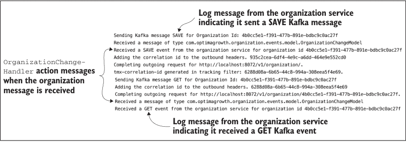

现在我们知道了如何使用 Spring Cloud Stream 和 Redis，让我们继续下一章，在那里我们将看到使用 Spring Cloud 创建分布式追踪的几种技术和技术。

# Summary

- 使用消息进行异步通信是微服务架构的关键部分。
- 在我们的应用程序中使用消息使我们的服务能够扩展并变得更具容错性。
- Spring Cloud Stream 通过使用简单的注解并抽象掉底层消息平台的平台特定细节，简化了消息的生产和消费。
- Spring Cloud Stream 消息源是用于向消息代理的队列发布消息的带注解的 Java 方法。
- Spring Cloud Stream 消息接收器是从消息代理的队列接收消息的带注解的 Java 方法。
- Redis 是一个键值存储，可用作数据库和缓存。


