# 分布式追踪
使用 Spring Cloud
Sleuth 和 Zipkin

**本章涵盖**

- 使用 Spring Cloud Sleuth 将追踪信息注入到服务调用中
- 使用日志聚合查看分布式事务的日志
- 实时转换、搜索、分析和可视化日志数据
- 理解用户事务如何在多个服务类中流动
- 使用 Spring Cloud Sleuth 和 Zipkin 自定义追踪信息

微服务架构是一种强大的设计范式，用于将复杂的单体软件系统分解为更小、更易管理的部分。这些部分可以彼此独立地构建和部署；然而，这种灵活性是有代价的——复杂性。

由于微服务本质上是分布式的，尝试调试问题发生的位置可能会令人抓狂。服务的分布式特性意味着我们需要在多个服务、物理机器和不同的数据存储中追踪一个或多个事务，然后尝试拼凑出到底发生了什么。本章概述了使用分布式调试的几种技术和工具。在本章中，我们将介绍以下内容：

- 使用关联 ID 将多个服务中的事务关联起来
- 将来自各个服务的日志数据聚合到单个可搜索的来源中
- 可视化用户事务在多个服务中的流动，以了解事务每个部分的性能特征
- 使用 ELK 栈实时分析、搜索和可视化日志数据

为此，我们将使用以下技术：

- *Spring Cloud Sleuth* (https://cloud.spring.io/spring-cloud-sleuth/reference/html/)——Spring Cloud Sleuth 项目为我们的传入 HTTP 请求注入追踪 ID（又称关联 ID）。它通过添加过滤器并与其他 Spring 组件交互来实现这一点，以便生成的关联 ID 传递到所有系统调用中。
- *Zipkin* (https://zipkin.io/)——Zipkin 是一个开源数据可视化工具，显示事务如何在多个服务中流动。Zipkin 允许我们将事务分解为其组成部分，并直观地识别可能存在性能热点的位置。
- *ELK 栈* (https://www.elastic.co/what-is/elk-stack)—ELK 栈结合了三个开源工具——Elasticsearch、Logstash 和 Kibana——允许我们实时分析、搜索和可视化日志。
  - Elasticsearch 是一种用于所有类型数据的分布式分析引擎（结构化和非结构化、数值、基于文本等）。
  - Logstash 是一个服务器端数据处理管道，允许我们同时从多个来源添加和摄取数据，并在其被索引到 Elasticsearch 之前对其进行转换。
  - Kibana 是 Elasticsearch 的可视化和数据管理工具。它提供图表、地图和实时直方图。

为了开始本章，我们将从最简单的追踪工具开始：关联 ID。我们将在下一节中介绍它。

> **NOTE** 本章的部分内容依赖于第 8 章的材料（主要是关于 Spring Gateway 响应、前置和后置过滤器的内容）。如果您尚未阅读第 8 章，我们建议您在阅读本章之前先阅读它。

## 11.1 Spring Cloud Sleuth 和关联 ID

我们在第 7 章和第 8 章中首次介绍了关联 ID 的概念。*关联 ID* 是在事务启动时分配给事务的随机生成的唯一数字或字符串。随着事务在多个服务中流动，关联 ID 会从一个服务调用传播到另一个服务调用。

在第 8 章的上下文中，我们使用了一个 Spring Cloud Gateway 过滤器来检查所有传入的 HTTP 请求，并在请求中不存在关联 ID 时将其注入请求中。一旦关联 ID 存在，我们就在每个服务上使用自定义 Spring HTTP 过滤器将传入变量映射到自定义 UserContext 对象。有了这个对象，我们就可以通过将关联 ID 附加到日志语句或，通过一些工作，将关联 ID 直接添加到 Spring 的映射诊断上下文（MDC）中，来手动将关联 ID 添加到我们的日志语句中。MDC 是一个存储应用程序提供的键值对集合的映射，这些键值对会被插入到日志消息中。

在该章中，我们还编写了一个 Spring 拦截器，以确保服务发出的所有 HTTP 调用都会通过将关联 ID 添加到传出调用的 HTTP 头中来传播关联 ID。幸运的是，Spring Cloud Sleuth 为我们管理了所有这些代码基础设施和复杂性。让我们继续将 Spring Cloud Sleuth 添加到我们的许可和组织服务中。我们将看到，通过将 Spring Cloud Sleuth 添加到我们的微服务，我们可以

- 透明地为我们的服务调用创建并注入关联 ID（如果不存在）
- 管理关联 ID 向传出服务调用的传播，以便事务的关联 ID 自动添加
- 将关联信息添加到 Spring 的 MDC 日志中，以便生成的关联 ID 会自动由 Spring Boot 默认的 SL4J 和 Logback 实现记录
- 可选地，将服务调用中的追踪信息发布到 Zipkin 分布式追踪平台

> **NOTE** 使用 Spring Cloud Sleuth，如果我们使用 Spring Boot 的日志实现，我们将自动在微服务中放置的日志语句中获得关联 ID。

### 11.1.1 向许可和组织添加 Spring Cloud Sleuth

要在我们的两个服务（许可和组织）中使用 Spring Cloud Sleuth，我们需要在两个服务的 pom.xml 文件中添加一个 Maven 依赖项。以下是如何操作的示例：

```
```xml
<dependency>
    <groupId>org.springframework.cloud</groupId>
    <artifactId>spring-cloud-starter-sleuth</artifactId>
</dependency>
```
```

这些依赖项会引入 Spring Cloud Sleuth 所需的所有核心库。就这样。一旦引入，我们的服务现在将

- 检查每个传入的 HTTP 服务并确定传入调用中是否存在 Spring Cloud Sleuth 追踪信息。如果存在 Spring Cloud Sleuth 追踪数据，则传递到我们微服务的追踪信息将被捕获并可用于我们的服务进行日志记录和处理。
- 将 Spring Cloud Sleuth 追踪信息添加到 Spring MDC，以便我们微服务创建的每条日志语句都会被添加到日志中。
- 将 Spring Cloud 追踪信息注入我们服务所做的每个传出 HTTP 调用和 Spring 消息通道消息中。

## 11.1.2 Spring Cloud Sleuth 追踪的解剖结构

如果一切设置正确，我们在服务应用程序代码中编写的任何日志语句现在都将包含 Spring Cloud Sleuth 追踪信息。例如，图 11.1 显示了如果我们对组织服务中的以下端点发出 HTTP GET 请求，服务的输出会是什么样子：

```
http://localhost:8072/organization/v1/organization/95c0dab4-0a7e-48f8-805a-0ba31c3687b8
```

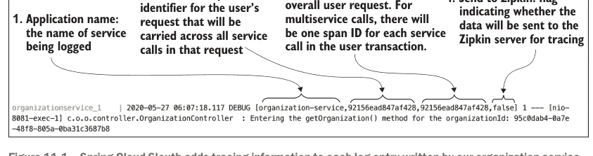

图 11.1 Spring Cloud Sleuth 为我们组织服务编写的每个日志条目添加追踪信息。此数据有助于将用户请求的服务调用联系起来。

Spring Cloud Sleuth 为每个日志条目添加四条信息。这四条信息（编号对应图 11.1 中的编号）如下：

- 1. 记录条目所在的服务的应用程序名称。默认情况下，Spring Cloud Sleuth 使用应用程序名称（spring.application.name）作为写入追踪中的名称。
- 2. 追踪 ID，即关联 ID 的等效术语。这是一个代表整个事务的唯一数字。


3 *跨度 ID，即代表整体事务一部分的唯一 ID。* 参与事务的每个服务都有自己的跨度 ID。跨度 ID 在你集成 Zipkin 以可视化事务时尤其相关。

4 *Export，一个 true/false 指示符，用于确定是否将跟踪数据发送到 Zipkin。* 在高流量服务中，生成的大量跟踪数据可能会让人不堪重负，并且不会增加显著的价值。Spring Cloud Sleuth 让我们能够确定何时以及如何将事务发送到 Zipkin。

> NOTE 默认情况下，任何应用程序流程都从相同的 trace 和 span ID 开始。

到目前为止，我们只查看了单个服务调用产生的日志数据。让我们看看当你还调用许可服务时会发生什么。图 11.2 显示了来自两个服务调用的日志输出。

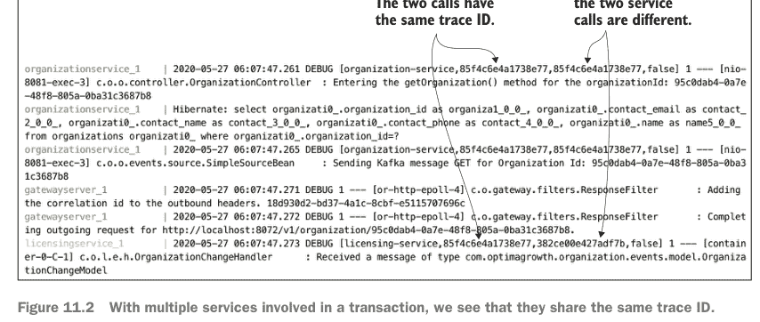

图 11.2 当多个服务参与事务时，我们可以看到它们共享相同的 trace ID。

在图 11.2 中，我们可以看到许可服务和组织服务具有相同的 trace ID，85f4c6e4a1738e77。然而，组织服务的 span ID 为 85f4c6e4a1738e77（与事务 ID 的值相同）。许可服务的 span ID 为 382ce00e427adf7b。通过添加不止几个 .pom 依赖项，我们已经替换了你在第 7 章和第 8 章中构建的所有相关 ID 基础设施。

## 11.2 日志聚合和 Spring Cloud Sleuth

在大型微服务环境中（尤其是在云中），日志数据是调试的关键工具。然而，由于微服务应用程序的功能被分解为小而细粒度的服务，并且我们可能为单个服务类型拥有多个服务实例，尝试将调试与来自多个服务的日志数据联系起来以解决用户问题可能极其困难。希望跨多个服务器调试问题的开发人员通常需要尝试以下操作：

## 表 11.1 与 Spring Boot 配合使用的日志聚合解决方案

| 产品名称 | 实现模型 | 备注 |
|---|---|---|
| Elasticsearch, Logstash, Kibana (ELK Stack) | Commercial<br>Open source | https://www.elastic.co/what-is/elk-stack<br>通用搜索引擎<br>通过 ELK 堆栈进行日志聚合<br>通常在本地部署 |
| Graylog | Commercial<br>Open source | https://www.graylog.org/<br>设计为在本地部署 |
| Splunk | Commercial | https://www.splunk.com/<br>日志管理和聚合工具中最老且最全面的<br>最初是在本地解决方案，现在提供云服务 |
| Sumo Logic | Commercial<br>Freemium/tiered | https://www.sumologic.com/<br>仅作为云服务运行<br>注册需要企业工作账户（不支持 Gmail 或 Yahoo 账户） |
| Papertrail | Commercial<br>Freemium/tiered | https://www.papertrail.com/<br>仅作为云服务运行 |

我们将以 ELK 为例，说明如何将 Spring Cloud Sleuth 支持的日志集成到统一的日志平台中。我们选择 ELK Stack 的原因是：

- ELK 是开源的。
- 它设置简单，使用简单，友好。
- 它是一个完整的工具，允许我们搜索、分析和可视化从不同服务生成的实时日志。
- 它允许我们集中所有日志以识别服务器和应用程序问题。

### 11.2.1 Spring Cloud Sleuth/ELK Stack 实现的实际应用

在图 11.3 中，我们看到了一个通用的统一日志架构。现在让我们看看如何使用 Spring Cloud Sleuth 和 ELK Stack 实现相同的架构。要设置 ELK 与我们的环境配合使用，我们需要采取以下操作：

- 1. 在我们的服务中配置 Logback
- 2. 在 Docker 容器中定义并运行 ELK Stack 应用程序
- 3. 配置 Kibana
- 4. 通过基于 Spring Cloud Sleuth 的相关 ID 发出查询来测试实现

图 11.4 显示了我们实现的最终状态。在图中，我们可以看到 Spring Cloud Sleuth 和 ELK 如何为我们的解决方案协同工作。

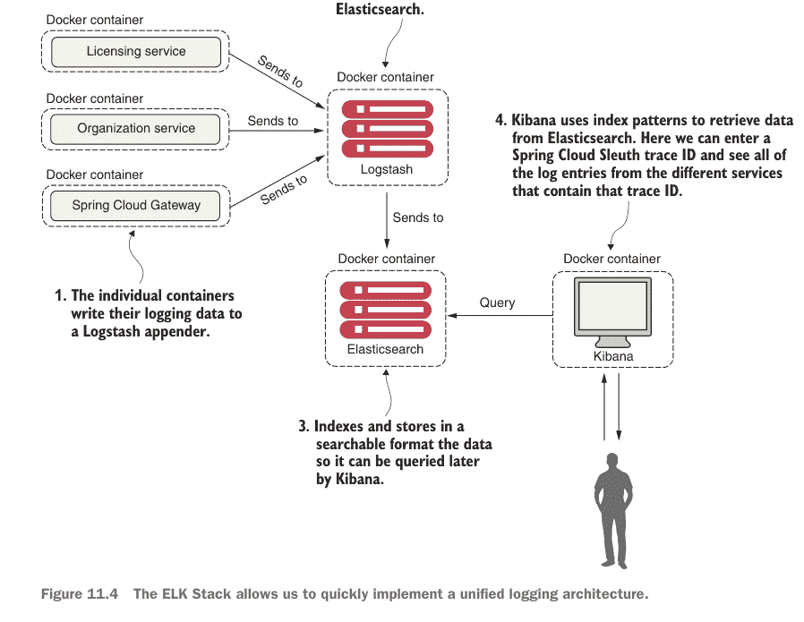

图 11.4 ELK Stack 允许我们快速实现统一的日志架构。

在图 11.4 中，许可、组织和网关服务通过 TCP 与 Logstash 通信以发送日志数据。Logstash 过滤、转换并将数据传递到中央数据存储（在本例中为 Elasticsearch）。Elasticsearch 对数据进行索引并以可搜索的格式存储，以便稍后由 Kibana 查询。一旦数据存储，Kibana 使用来自 Elasticsearch 的索引模式检索数据。

此时，我们可以创建一个特定的查询索引并输入 Spring Cloud Sleuth trace ID，以查看包含它的不同服务的日志条目。一旦数据存储，我们只需访问 Kibana 即可查看实时日志。

### 11.2.2 在我们的服务中配置 Logback

现在我们已经看到了 ELK 的日志架构，让我们开始为我们的服务配置 Logback。为此，我们需要执行以下操作：

- 1. 在我们服务的 pom.xml 中添加 `logstash-logback-encoder` 依赖项
- 2. 在 Logback 配置文件中创建 Logstash TCP appender

### 添加 Logstash 编码器

首先，我们需要在许可、组织和网关服务的 pom.xml 文件中添加 logstash-logback-encoder 依赖项。请记住，pom.xml 文件可以在源代码的根目录中找到。以下是添加依赖项的代码：

```
<dependency>
    <groupId>net.logstash.logback</groupId>
    <artifactId>logstash-logback-encoder</artifactId>
    <version>6.3</version>
</dependency>
```

### 创建 Logstash TCP Appender

一旦将依赖项添加到每个服务，我们需要告诉许可服务它需要与 Logstash 通信以发送应用程序日志，并以 JSON 格式格式化。 （Logback 默认以纯文本形式生成应用程序日志，但要使用 Elasticsearch 索引，我们需要确保以 JSON 格式发送日志数据。）有三种方法可以实现这一点：

- 使用 net.logstash.logback.encoder.LogstashEncoder 类
- 使用 net.logstash.logback.encoder.LoggingEventCompositeJsonEncoder 类
- 使用 Logstash 解析纯文本日志数据

对于本示例，我们将使用 LogstashEncoder。我们选择这个类是因为它是最容易和最快实现的，并且在这个示例中，我们不需要向记录器添加额外字段。使用 LoggingEventCompositeJsonEncoder，我们可以添加新模式或字段、禁用默认提供程序等。如果我们选择这两个类中的一个，负责将日志文件解析为 Logstash 格式的是 Logback。使用第三个选项，我们可以使用 JSON 过滤器完全将解析委托给 Logstash。所有三个选项都很好，但我们建议在需要添加或删除默认配置时使用 LoggingEventCompositeJsonEncoder。其他两个选项将完全取决于你的业务需求。

> NOTE 你可以选择是在应用程序中还是在 Logstash 中处理日志信息。

要配置此编码器，我们将创建一个名为 logback-spring.xml 的 Logback 配置文件。此配置文件应位于服务资源文件夹中。对于许可服务，Logback 配置如清单 11.1 所示，可以在许可服务的 /licensing-service/src/main/resources/logback-spring.xml 文件中找到。图 11.5 显示了此配置产生的日志输出。

# 清单 11.1 为许可服务配置 Logback 与 Logstash

```
<?xml version="1.0" encoding="UTF-8"?>
<configuration>
    <include resource="org/springframework/boot/logging/logback/base.xml"/>
```

```
```xml
<springProperty scope="context" name="application_name"
                source="spring.application.name"/>

<appender name="logstash" class="net.logstash.logback.appender.
                         LogstashTcpSocketAppender">
    <destination>logstash:5000</destination>
    <encoder class="net.logstash.logback.encoder.LogstashEncoder"/>
</appender>

<root level="INFO">
    <appender-ref ref="logstash"/>
    <appender-ref ref="CONSOLE"/>
</root>
<logger name="org.springframework" level="INFO"/>
<logger name="com.optimaigrowth" level="DEBUG"/>
</configuration>
```
```

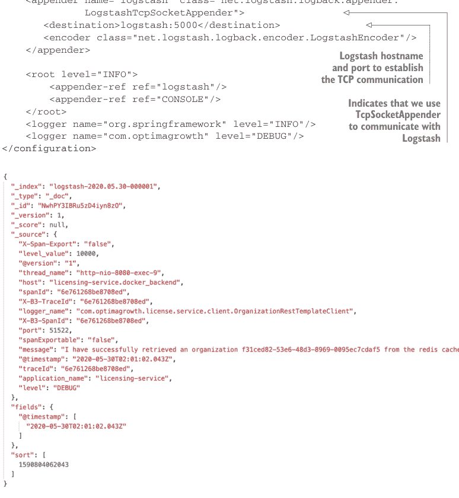

```
```json
{
  "_index": "logstash-2020.05.30-000001",
  "_type": "_doc",
  "_id": "NWhPY3lBRu5zD4ivn8zO",
  "_version": 1,
  "_score": null,
  "_source": {
    "X-Span-Export": "false",
    "level_value": 10000,
    "@version": "1",
    "thread_name": "http-nio-8080-exec-9",
    "host": "licensing-service.docker_backend",
    "spanId": "6e761268be8708ed",
    "logger_name": "com.optimaigrowth.license.service.client.OrganizationRestTemplateClient",
    "X-B3-SpanId": "6e761268be8708ed",
    "port": 51522,
    "spanExportable": "false",
    "message": "I have successfully retrieved an organization f31cedd2-536e-48d3-8969-0095ec7cdaf5 from the redis cache",
    "@timestamp": "2020-05-30T02:01:02.043Z",
    "traceId": "6e761268be8708ed",
    "application_name": "licensing-service",
    "level": "DEBUG"
  },
  "fields": {
    "@timestamp": [
      "2020-05-30T02:01:02.043Z"
    ]
  },
  "sort": [
    1590804062043
  ]
}
```
```

# 图 11.5 使用 LogstashEncoder 格式化的应用程序日志

在图 11.5 中，我们可以看到两个重要方面。第一个是 LogstashEncoder 默认包含 Spring 的 MDC 记录器中存储的所有值，第二个是由于我们向服务添加了 Spring Cloud Sleuth 依赖项，我们可以在日志数据中看到 TraceId、X-B3-TraceId、SpanId、X-B3-SpanId 和 spanExportable 字段。请注意，前缀 X-B3 传播了 Spring Cloud Sleuth 从服务到服务使用的默认标头。此名称由 X 组成，用于自定义


headers that are not part of the HTTP specification and **B3**, which stands for “Big-BrotherBird,” Zipkin’s previous name.

> **NOTE**  If you want to know more about the MDC fields, we highly recommend that you read the SL4J logger documentation at http://www.slf4j.org/manual.html#mdc and the Spring Cloud Sleuth documentation at https://cloud.spring.io/spring-cloud-static/spring-cloud-sleuth/2.1.0.RELEASE/single/spring-cloud-sleuth.html.

You can also configure the log data shown in figure 11.5 by using the Logging-EventCompositeJsonEncoder. Using this composite encoder, we can disable all the providers that were added by default to our configuration, add new patterns to display custom or existent MDC fields, and more. The following listing shows a brief example of the logback-spring.xml configuration that deletes some output fields and creates a new pattern with a custom field and other existent fields.

```
```xml
<encoder class="net.logstash.logback.encoder
                 .LoggingEventCompositeJsonEncoder">
  <providers>
    <mdc>
      <excludeMdcKeyName>X-B3-TraceId</excludeMdcKeyName>
      <excludeMdcKeyName>X-B3-SpanId</excludeMdcKeyName>
      <excludeMdcKeyName>X-B3-ParentSpanId</excludeMdcKeyName>
    </mdc>
    <context/>
    <version/>
    <logLevel/>
    <loggerName/>
    <pattern>
      <pattern>
        <omitEmptyFields>true</omitEmptyFields>
        {
          "application": {
            "version": "1.0"
          },
          "trace": {
            "trace_id": "%mdc{traceId}",
            "span_id": "%mdc{spanId}",
            "parent_span_id": "%mdc{X-B3-ParentSpanId}",
            "exportable": "%mdc{spanExportable}"
          }
        }
      </pattern>
    </pattern>
    <threadName/>
    <message/>
    <logstashMarkers/>
    <arguments/>
    <stackTrace/>
  </providers>
</encoder>
```
```

Although we chose the LogstashEncoder option for this example, you should select the option that best fits your needs. Now that we have our Logback configuration in the licensing service, let’s add the same configuration to our other services: configuration and gateway. We’ll define and run the ELK Stack applications in Docker containers.

## 11.2.3 Defining and running ELK Stack applications in Docker

To set up our ELK Stack containers, we need to follow two simple steps. The first is to create the Logstash configuration file, and the second is to define the ELK Stack applications in our Docker configuration. Before we start creating our configuration, though, it’s important to note that the Logstash pipeline has two required and one optional element. The required elements are the inputs and outputs:

- *The input enables a specific source of events to be read by Logstash.* Logstash supports a variety of input plugins such as GitHub, Http, TCP, Kafka, and others.
- *The output is in charge of sending the event data to a particular destination.* Elastic supports a variety of plugins such as CSV, Elasticsearch, email, file, MongoDB, Redis, stdout, and others.

The optional element in the Logstash configuration is the filter plugins. These filters are in charge of performing intermediary processing on an event such as translations, adding new information, parsing dates, truncating fields, and so forth. Remember, Logstash ingests and transforms the log data received. Figure 11.6 describes the Logstash process.

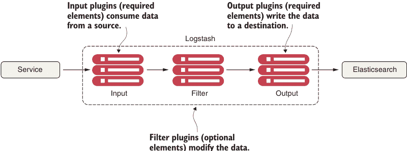

**Figure 11.6** The Logstash configuration process contains two required (input and output) and one optional element (filter).

For this example, we’ll use as the input plugin the Logback TCP appender that we previously configured and as the output plugin the Elasticsearch engine. The following listing shows the `/docker/config/logstash.conf` file.

### Listing 11.3  Adding the Logstash configuration file

```
input {
  tcp {
    port => 5000
    codec => json_lines
  }
}

filter {
  mutate {
    add_tag => [ "manningPublications" ]
  }
}

output {
  elasticsearch {
    hosts => "elasticsearch:9200"
  }
}
```

In listing 11.3, we can see five essential elements. The first is the input section. In this section, we specify the tcp plugin for consuming the log data. Next is the port number 5000; this is the port that we’ll specify for Logstash later in the docker-compose.yml file. (If you take another look at figure 11.4, you’ll notice that we are going to send the applications logs directly to Logstash.)

The third element is optional and corresponds to the filters; for this particular scenario, we added a mutate filter. This filter adds a manningPublications tag to the events. A real-world scenario of a possible tag for your services might be the environment where the application runs. Finally, the fourth and fifth elements specify the output plugin for our Logstash service and send the processed data to the Elasticsearch service running on port 9200. If you are interested in knowing more about all the input, output, and filter plugins Elastic offers, we highly recommend you visit the following pages:

- https://www.elastic.co/guide/en/logstash/current/input-plugins.html
- https://www.elastic.co/guide/en/logstash/current/output-plugins.html
- https://www.elastic.co/guide/en/logstash/current/filter-plugins.html

Now that we have the Logstash configuration, let’s add the three ELK Docker entries to the docker-compose.yml file. Remember, we are using this file to fire up all of the Docker containers used for the code examples in this and the previous chapters. The following listing shows the docker/docker-compose.yml file with the new entries.

### Listing 11.4  Configuring ELK Stack/Docker Compose

```
#Part of the docker-compose.yml removed for conciseness
#Some additional configuration also removed for conciseness

elasticsearch:
```

The first allows us to play with some sample data, and the second lets us explore the generated data from our services. Figure 11.7 shows Kibana’s Welcome page.

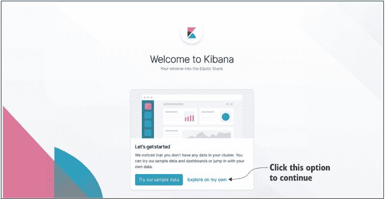

**Figure 11.7** The Kibana Welcome page with two options: trying out the application with sample data or exploring it on your own.

To explore our data, let’s click the Explore on My Own link. Once clicked, we will see an Add Data page like the one shown in figure 11.8. On this page, we need to click the Discover icon on the left side of the page.

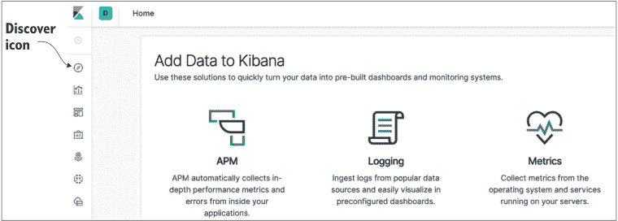

**Figure 11.8** The Kibana setup page. Here we will see a set of options we can use to configure our Kibana application. Notice the icon menu on the left.

In order to continue, we must create an index pattern. Kibana uses a set of index patterns to retrieve the data from an Elasticsearch engine. The index pattern is in charge of telling Kibana which Elasticsearch indexes we want to explore. For example, in our case, we will create an index pattern indicating that we want to retrieve all of

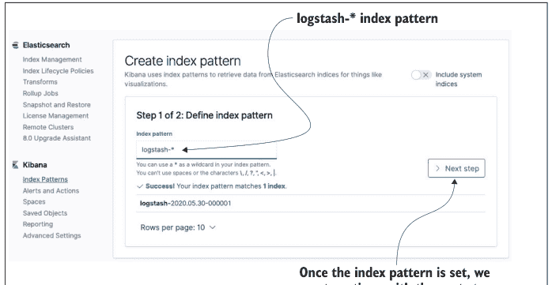

# Figure 11.9 Configuring the index pattern for the Elasticsearch engine

the Logstash information from Elasticsearch. To create our index pattern, click the Index Patterns link under the Kibana section at the left of the page. Figure 11.9 shows step 1 of this process.

On the Create Index Pattern page in figure 11.9, we can see that Logstash has already created an index as a first step. However, this index is not ready to use yet. To finish setting up the index, we must specify an index pattern for that index. To create it, we need to write the index pattern, logstash-*, and click the Next Step button.

For step 2, we’ll specify a time filter. To do this, we need to select the @timestamp option under the Time Filter Field Name drop-down list and then click the Create Index Pattern button. Figure 11.10 shows this process.

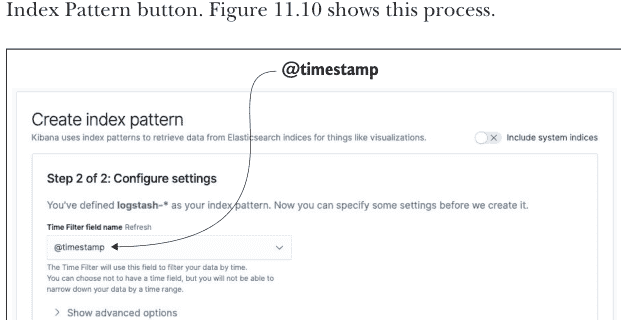

# Figure 11.10 Configuring the timestamp filter for our index pattern. This pattern allows us to filter events within a time range.


现在我们可以开始向服务发送请求，以查看 Kibana 中的实时日志。图 11.11 展示了发送到 ELK 的数据应呈现的样子。如果你没有看到图中显示的页面，请再次点击 Discover 图标。

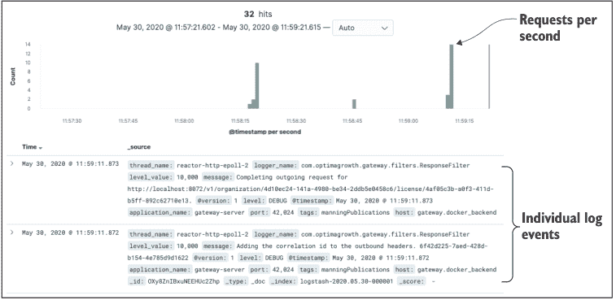

至此，我们已经完成了 Kibana 的全部设置。接下来继续最后一步。

## 11.2.5 在 Kibana 中搜索 Spring Cloud Sleuth 追踪 ID

现在日志已经流入 ELK，我们可以开始了解 Spring Cloud Sleuth 是如何为日志条目添加追踪 ID 的。要查询与单个事务相关的所有日志条目，我们需要获取一个追踪 ID，并在 Kibana 的 Discover 界面（图 11.12）中进行查询。默认情况下，Kibana 使用 Kibana 查询语言（KQL），这是一种简化的查询语法。在编写查询时，你会看到 Kibana 还提供了指南和自动补全选项，以简化创建自定义查询的过程。

> **注意** 要应用下一个过滤器，你需要选择一个有效的追踪 ID。下一个示例中使用的追踪 ID 在你的 Kibana 实例中将无法生效。

图 11.12 展示了如何使用 Spring Cloud Sleuth 追踪 ID 执行查询。这里我们使用追踪 ID `3ff985508b1b9365`。

如果需要查看更详细的信息，我们可以展开每条日志事件。这样，与特定事件关联的所有字段将以表格或 JSON 格式显示。我们还可以看到在 Logstash 处理期间添加或转换的所有附加信息。例如，在清单 11.3 中，我们使用 Logstash 中的 mutate 过滤器添加了一个标签。图 11.13 显示了这个事件的所有字段。

## 11.2.6 使用 Spring Cloud Gateway 将关联 ID 添加到 HTTP 响应中

如果我们检查由 Spring Cloud Sleuth 发起的任意服务调用的 HTTP 响应，就会发现调用中使用的追踪 ID 永远不会出现在 HTTP 响应头中。如果我们查阅 Spring Cloud Sleuth 的文档，会看到其开发团队认为返回任何追踪数据都可能带来潜在的安全问题（尽管他们并未明确说明他们这样认为的原因）。但我们发现，在调试问题时，在 HTTP 响应中返回关联 ID 或追踪 ID 的价值无可估量。

Spring Cloud Sleuth 允许我们使用其追踪 ID 和跨度 ID 来“装饰”HTTP 响应信息。然而，实现这一过程需要编写三个类并注入两个自定义 Spring Bean。如果你想采用这种方法，可以在 Spring Cloud Sleuth 文档中查看相关内容：

- https://cloud.spring.io/spring-cloud-static/spring-cloud-sleuth/1.0.12.RELEASE/

一个简单得多的解决方案是编写一个 Spring Cloud Gateway 过滤器，将追踪 ID 注入 HTTP 响应。在第 8 章中介绍 Spring Cloud Gateway 时，我们看到了如何构建一个网关响应过滤器，将生成的关联 ID 添加到调用方返回的 HTTP 响应中，供我们的服务使用。现在，我们将修改该过滤器，以添加 Spring Cloud Sleuth 响应头。为了设置网关响应过滤器，我们需要确保 pom.xml 文件中包含 Spring Cloud Sleuth 依赖，如下所示：

```xml
<dependency>
    <groupId>org.springframework.cloud</groupId>
    <artifactId>spring-cloud-starter-sleuth</artifactId>
</dependency>
```

我们将使用 spring-cloud-starter-sleuth 依赖来告知 Spring Cloud Sleuth，我们希望网关参与 Spring Cloud 追踪。在本章后面介绍 Zipkin 时，我们会看到网关服务将是任何服务调用中的第一个调用。一旦依赖就绪，实际的响应过滤器实现起来就非常简单了。

下面的清单展示了用于构建该过滤器的源代码。文件位于 `/gatewayserver/src/main/java/com/optimagrowth/gateway/filters/ResponseFilter.java`。

**清单 11.5** 通过响应过滤器添加 Spring Cloud Sleuth 追踪 ID

```java
package com.optimagrowth.gateway.filters;
// Imports removed for conciseness.
import brave.Tracer;
import reactor.core.publisher.Mono;

@Configuration
public class ResponseFilter {

    final Logger logger = LoggerFactory.getLogger(ResponseFilter.class);

    @Autowired
    Tracer tracer;

    @Autowired
    FilterUtils filterUtils;

    @Bean
    public GlobalFilter postGlobalFilter() {
        return (exchange, chain) -> {
            return chain.filter(exchange)
                .then(Mono.fromRunnable(() -> {
                    String traceId =
                        tracer.currentSpan()
                            .context()
                            .traceIdString();
                    logger.debug("Adding the correlation id to the outbound headers. {}", traceId);
                    exchange.getResponse().getHeaders()
                        .add(FilterUtils.CORRELATION_ID, traceId);
                    logger.debug("Completing outgoing request for {}.",
                        exchange.getRequest().getURI());
                }));
        };
    }
}
```

设置访问追踪和跨度 ID 信息的入口。

将 Spring Cloud Sleuth 追踪 ID 添加到 HTTP 响应头 `tmx-correlation-id` 中。

由于网关现在已启用 Spring Cloud Sleuth，我们可以通过自动装配 Tracer 类来访问 ResponseFilter 中的追踪信息。这个类允许我们访问当前已执行追踪的相关信息。`tracer.currentSpan().context().traceIdString()` 方法使我们能够以字符串形式检索当前事务的追踪 ID。将追踪 ID 添加到经网关返回的出站 HTTP 响应中非常简单。通过以下方法调用即可完成：

```java
exchange.getResponse().getHeaders()
    .add(FilterUtils.CORRELATION_ID, traceId);
```

有了这段代码后，如果通过网关调用一个 O-stock 微服务，我们应该会在 HTTP 响应头中看到一个名为 `tmx-correlation-id` 的响应头，其值为 Spring Cloud Sleuth 追踪 ID。图 11.14 展示了对以下端点发起 GET 请求以获取组织许可证的调用结果：

```
http://localhost:8072/license/v1/organization/4d10ec24-141a-4980-be34-2ddb5e0458c7/license/4af05c3b-a0f3-411d-b5ff-892c62710e14
```

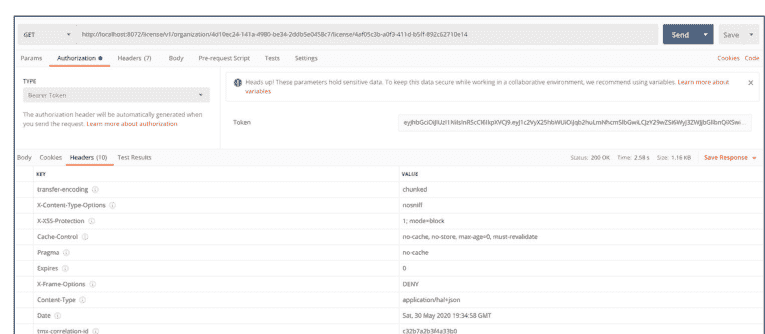

图 11.14 返回 Spring Cloud Sleuth 追踪 ID 后，我们可以轻松地在 Kibana 中查询日志。

## 11.3 使用 Zipkin 进行分布式追踪

拥有一个带关联 ID 的统一日志平台是一种强大的调试工具。然而，在本章余下的内容中，我们将不再追踪日志条目，而是着眼于如何将事务在不同微服务之间流动的过程可视化。一幅清晰简洁的图片胜过百万条日志记录。

分布式追踪涉及提供事务如何在我们不同的微服务之间流动的可视化图景。分布式追踪工具还可以大致估算单个微服务的响应时间。但是，不应将分布式追踪工具与完整的应用性能管理（APM）套件混淆。APM 套件不仅提供有关实际服务代码的即开即用的底层性能数据，还提供响应时间之外的内存、CPU 利用率和 I/O 利用率等性能数据。

这正是 Spring Cloud Sleuth 和 Zipkin（也称为 OpenZipkin）项目大显身手的地方。Zipkin (http://zipkin.io/) 是一个分布式追踪平台，允许我们在多个服务调用之间追踪事务。它可以让我们以图形方式查看事务所花费的时间，并将其分解为调用中涉及每个微服务的时间。Zipkin 是识别微服务架构中性能问题的宝贵工具。设置 Spring Cloud Sleuth 和 Zipkin 涉及：

- 将 Spring Cloud Sleuth 和 Zipkin JAR 文件添加到捕获追踪数据的服务中
- 在每个服务中配置一个 Spring 属性，以指向收集追踪数据的 Zipkin 服务器
- 安装并配置 Zipkin 服务器以收集数据
- 定义每个客户端用于将追踪信息发送到 Zipkin 的采样策略


## 11.3.1 设置 Spring Cloud Sleuth 和 Zipkin 依赖

我们已经在许可服务和组织服务中包含了 Spring Cloud Sleuth 依赖。这些 JAR 文件现在包含了必要的 Spring Cloud Sleuth 库，以便在服务中启用 Spring Cloud Sleuth。接下来，我们需要包含一个新依赖，即 `spring-cloud-sleuth-zipkin` 依赖，以便与 Zipkin 集成。下面的清单显示了 Spring Cloud Gateway、许可服务和组织服务中应该存在的 Maven 条目。

**清单 11.6 客户端 Spring Cloud Sleuth 和 Zipkin 依赖**

```
<dependency>
    <groupId>org.springframework.cloud</groupId>
    <artifactId>spring-cloud-sleuth-zipkin</artifactId>
</dependency>
```

## 11.3.2 配置服务以指向 Zipkin

JAR 文件就绪后，我们需要配置每个想要与 Zipkin 通信的服务。我们将通过设置一个 Spring 属性来定义用于与 Zipkin 通信的 URL。需要设置的属性是 `spring.zipkin.baseUrl` 属性。该属性在 Spring Cloud Config Server 仓库中每个服务的配置文件中设置（例如，许可服务的 `/configserver/src/main/resources/config/licensing-service.properties` 文件）。要在本地运行，请将 `baseUrl` 属性的值设置为 `localhost:9411`。但是，如果你想用 Docker 运行，则需要用 `zipkin:9411` 覆盖该值，如下所示：

```
zipkin.baseUrl: zipkin:9411
```

### Zipkin、RabbitMQ 和 Kafka

Zipkin 能够通过 RabbitMQ 或 Kafka 将其追踪数据发送到 Zipkin 服务器。从功能角度来看，如果我们使用 HTTP、RabbitMQ 或 Kafka，Zipkin 的行为没有区别。使用 HTTP 追踪时，Zipkin 使用异步线程发送性能数据。使用 RabbitMQ 或 Kafka 收集追踪数据的主要优点是，如果我们的 Zipkin 服务器宕机，发送到 Zipkin 的追踪消息会被“排队”，直到 Zipkin 能够获取数据。关于如何配置 Spring Cloud Sleuth 通过 RabbitMQ 和 Kafka 向 Zipkin 发送数据，Spring Cloud Sleuth 文档中已有介绍，因此我们在此不再赘述。

## 11.3.3 配置 Zipkin 服务器

有几种设置 Zipkin 的方法，但我们将使用带有 Zipkin 服务器的 Docker 容器。这个选项将使我们避免在架构中创建新项目。为了设置 Zipkin，我们将在项目的 Docker 文件夹中的 `docker-compose.yml` 文件中添加以下注册条目：

```
zipkin:
  image: openzipkin/zipkin
  container_name: zipkin
  ports:
    - 9411:9411
  networks:
    backend:
      aliases:
        - "zipkin"
```

运行 Zipkin 服务器几乎不需要什么配置。我们在运行 Zipkin 时需要配置的少数事项之一是 Zipkin 用于存储追踪数据的后端数据存储。Zipkin 支持四种不同的后端数据存储：

- 内存数据
- MySQL (http://mysql.com/)
- Cassandra (https://cassandra.apache.org/)
- Elasticsearch (http://elastic.co/)

默认情况下，Zipkin 使用内存数据存储。然而，Zipkin 团队建议不要在生产环境中使用内存数据库。内存数据库保存的数据量有限，并且当 Zipkin 服务器关闭或发生故障时，数据会丢失。

在本示例中，我们将演示如何使用 Elasticsearch 作为数据存储，因为我们已经配置了 Elasticsearch。我们需要添加的唯一额外设置是配置文件 environment 部分中的 `STORAGE_TYPE` 和 `ES_HOSTS` 变量。以下代码显示了完整的 Docker Compose 注册：

```
zipkin:
  image: openzipkin/zipkin
  container_name: zipkin
  depends_on:
    - elasticsearch
  environment:
    - STORAGE_TYPE=elasticsearch
    - "ES_HOSTS=elasticsearch:9300"
  ports:
    - "9411:9411"
  networks:
    backend:
      aliases:
        - "zipkin"
```

## 11.3.4 设置追踪级别

现在我们已经配置了客户端与 Zipkin 服务器通信，并且已经准备好了可运行的服务器。但在开始使用 Zipkin 之前，我们还需要执行一步，即定义每个服务应多久向 Zipkin 写入一次数据。

默认情况下，Zipkin 只将 10% 的事务写入 Zipkin 服务器。这个默认值确保了 Zipkin 不会压垮我们的日志和分析基础设施。

事务采样可以通过在每个向 Zipkin 发送数据的服务上设置 Spring 属性来控制：`spring.sleuth.sampler.percentage` 属性。该属性的取值在 0 到 1 之间，如下所示：

- 值为 0 表示 Spring Cloud Sleuth 不会向 Zipkin 发送任何事务。
- 值为 0.5 表示 Spring Cloud Sleuth 发送 50% 的事务。
- 值为 1 表示 Spring Cloud Sleuth 发送所有事务（100%）。

出于我们的目的，我们将为所有服务发送所有追踪信息（100%）和所有事务。为此，我们可以设置 `spring.sleuth.sampler.percentage` 的值，或者用 `AlwaysSampler` 替换 Spring Cloud Sleuth 中使用的默认 Sampler 类。`AlwaysSampler` 类可以作为 Spring bean 注入到应用程序中。但在这个示例中，我们将在许可服务、组织服务和网关服务的配置文件中使用 `spring.sleuth.sampler.percentage`，如下所示：

```
zipkin.baseUrl: zipkin:9411
spring.sleuth.sampler.percentage: 1
```

## 11.3.5 使用 Zipkin 追踪事务

让我们从一个场景开始本节。假设你是 O-stock 应用程序的开发人员之一，并且本周由你值班。你收到一个客户的工单，抱怨应用程序中的某个屏幕运行缓慢。你怀疑该屏幕使用的许可服务是罪魁祸首。但为什么？在哪里？

在我们的场景中，许可服务依赖于组织服务，并且这两个服务都会调用不同的数据库。哪个服务性能不佳？另外，你知道这些服务正在不断被修改，所以可能有人向其中添加了新的服务调用。

> 注意：理解用户事务中涉及的所有服务及其各自的性能时间，对于支持微服务架构等分布式架构至关重要。

为了解决这个难题，我们将使用 Zipkin 来观察来自组织服务的两个事务，由 Zipkin 服务对其进行追踪。组织服务是一个简单的服务，只调用一个数据库。我们要做的是使用 Postman 通过以下端点向组织服务发送两个调用。组织服务的调用在请求被定向到下游的组织服务实例之前，会先经过网关：

```
GET http://localhost:8072/organization/v1/organization/4d10ec24-141a-4980-be34-2ddb5e0458c6
```

如果我们查看图 11.15 中的截图，我们会看到 Zipkin 捕获了两个事务，并且每个事务被分解为一个或多个跨度（span）。在 Zipkin 中，跨度（span）表示捕获定时信息的特定服务或调用。图 11.15 中的每个事务都有五个跨度：网关中有两个跨度，组织服务有两个，许可服务有一个。

请记住，网关不会盲目转发 HTTP 调用。它接收传入的 HTTP 调用，将其终止，然后构建一个新的调用发送到目标服务（在本例中是组织服务）。原始调用的终止是网关能够为进入网关的每个调用添加响应、前置和后置过滤器的方式。这也是我们在图 11.15 中看到网关服务中有两个跨度的原因。

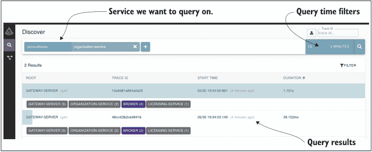

**图 11.15** Zipkin 查询屏幕，我们可以在其中选择要追踪的服务，以及一些基本查询过滤器。

通过网关对组织服务的两次调用分别耗时 1.151 秒和 39.152 毫秒。让我们深入研究耗时最长的调用（1.151 秒）的细节。我们可以通过点击事务并下钻来查看更多细节。图 11.16 显示了我们对组织服务调用的详细信息。

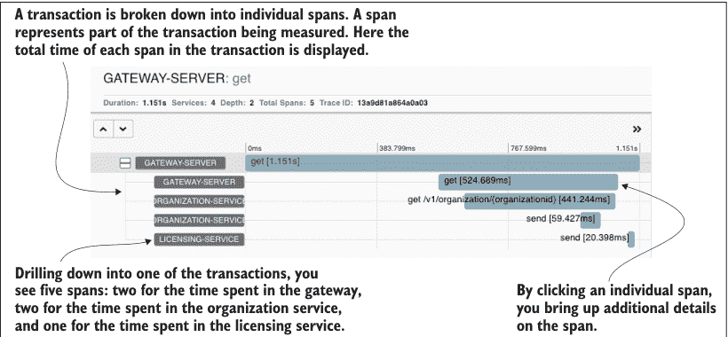

**图 11.16** Zipkin 允许我们下钻并查看每个跨度在事务中花费的时间。


在图 11.16 中，我们可以看到从网关的角度来看，整个事务大约花费了 1.151 秒。然而，网关所做的组织服务调用占用了整体调用中 1.151 秒中的 524.689 毫秒。让我们进一步深入每个 span 以获得更多细节。点击 organization-service span 并注意调用的额外细节（图 11.17）。

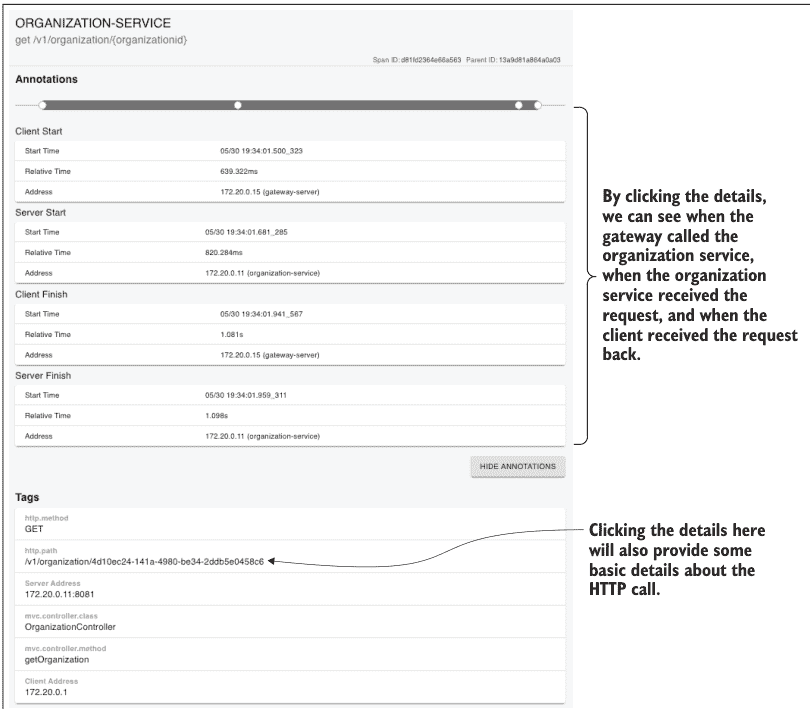

图 11.17 点击单个 span 可提供有关 HTTP 调用和时序的进一步详细信息。

图 11.17 中最有价值的信息之一是客户端（网关）调用组织服务时的分解、组织服务接收调用的时间以及组织服务响应的时间。这种类型的时序信息对于检测和识别网络延迟问题非常宝贵。为了向许可服务的 Redis 调用添加自定义 span，我们将使用以下类：

```
/licensing-service/src/main/java/com/optimagrowth/license/service/client/
OrganizationRestTemplateClient.java
```

使用 OrganizationRestTemplateClient，我们将实现 checkRedisCache() 方法。以下列表显示了此代码。

## Listing 11.7 Adding checkRedisCache() to OrganizationRestTemplate

```
package com.optimagrowth.license.service.client;
//Rest of imports omitted for conciseness

@Component
public class OrganizationRestTemplateClient {
    @Autowired
    RestTemplate restTemplate;

    @Autowired
    Tracer tracer;

    @Autowired
    OrganizationRedisRepository redisRepository;

    private static final Logger logger =
        LoggerFactory.getLogger(OrganizationRestTemplateClient.class);

    private Organization checkRedisCache
        (String organizationId) {
        try {
            return redisRepository.findById(organizationId).orElse(null);
        } catch (Exception ex){
            logger.error("Error encountered while trying to retrieve organization {} check Redis Cache. Exception {}",
                organizationId, ex);
            return null;
        }
    }

    //Rest of class omitted for conciseness
}
```

Tracer 访问 Spring Cloud Sleuth 跟踪信息。

实现 CheckRedisCache 方法

## 11.3.6 Visualizing a more complex transaction

如果我们想精确了解服务调用之间存在哪些服务依赖关系怎么办？我们可以通过网关调用许可服务，然后使用 GET 调用查询 Zipkin 获取许可服务的跟踪，使用以下端点。图 11.18 显示了此调用的详细跟踪。

```
http://localhost:8072/license/v1/organization/4d10ec24-141a-4980-be34-2ddb5e0458c8/license/4af05c3b-a0f3-411d-b5ff-892c62710e15
```

在图 11.18 中，我们可以看到对许可服务的调用涉及八次 HTTP 调用。我们看到对网关的调用，然后从网关到许可服务；许可服务到网关以及网关到组织；最后，组织使用 Apache Kafka 通过许可服务更新 Redis 缓存。

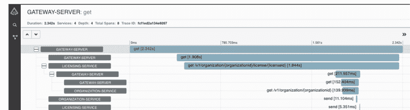

图 11.18 查看跟踪的详细信息，显示许可服务调用如何从网关流向许可服务，然后流向组织服务。

## 11.3.7 Capturing messaging traces

消息传递会在应用程序内部引入其自身性能和延迟问题。一个服务可能无法足够快地处理队列中的消息。或者可能存在网络延迟问题。在构建基于微服务的应用程序时，我们遇到了这些场景。

Spring Cloud Sleuth 在服务中注册的任何入站或出站消息通道上发送 Zipkin 跟踪数据。使用 Spring Cloud Sleuth 和 Zipkin，我们可以识别消息何时从队列发布以及何时接收。我们还可以看到消息在队列上接收并处理时发生的行为。而且，你会记得在第 10 章中，当添加、更新或删除组织记录时，会通过 Spring Cloud Stream 生产并发布 Kafka 消息。许可服务接收消息并更新其用于缓存数据的 Redis 键值存储。

接下来我们将删除一个组织记录并观察 Spring Cloud Sleuth 和 Zipkin 跟踪事务。我们将通过 Postman 向组织服务的以下端点发出 DELETE 请求：

```
http://localhost:8072/organization/v1/organization/4d10ec24-141a-4980-be34-2ddb5e0458c7
```

本章前面，我们看到了如何将 trace ID 添加为 HTTP 响应头，添加一个名为 tmx-correlation-id 的新 HTTP 响应头。我们在调用中获得了 tmx-correlation-id，值为 054accff01c9ba6b。我们可以通过在 Zipkin 查询屏幕右上角的搜索框中输入调用返回的 trace ID 来在 Zipkin 中搜索此特定跟踪。图 11.19 显示了我们可以在哪里输入 trace ID。

有了特定的跟踪，我们可以查询 Zipkin 获取事务并查看 DELETE 消息的发布。图 11.20 中的第二个 span 是来自 channel output 的输出消息，用于发布到名为 orgChangeTopic 的 Kafka 主题。图 11.20 显示了输出消息通道及其在 Zipkin 跟踪中的外观。

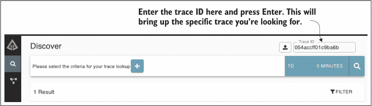

**Figure 11.19** 通过 HTTP `tmx-correlation-id` 响应头返回的 trace ID，我们可以通过在特定 trace ID 上搜索轻松找到事务。

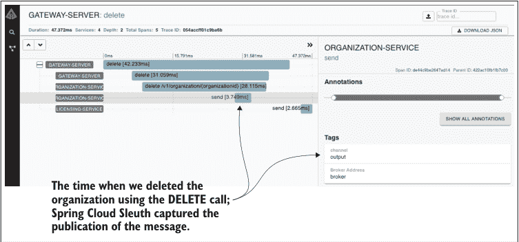

**Figure 11.20** Spring Cloud Sleuth 自动跟踪 Spring 消息通道上消息的发布和接收。我们可以使用 Zipkin 查看跟踪的详细信息。

你可以通过点击许可服务 span 来查看许可服务接收消息。图 11.21 显示了此数据。

到目前为止，我们一直使用 Zipkin 来跟踪服务内部的 HTTP 和消息传递调用。但是，如果我们想对未被 Zipkin 监控的第三方服务进行跟踪怎么办？例如，如果我们想获取特定 Redis 或 Postgres SQL 调用的跟踪和时序信息怎么办？幸运的是，Spring Cloud Sleuth 和 Zipkin 允许我们向事务添加自定义 span，以便我们可以跟踪与第三方调用相关的执行时间。

## 11.3.8 Adding custom spans

使用 Zipkin 添加自定义 span 非常容易。我们将首先向许可服务添加一个自定义 span，以便我们可以跟踪从 Redis 获取数据所需的时间。然后我们将向组织服务添加一个自定义 span，以查看从组织数据库检索数据所需的时间。以下列表为许可服务创建了一个名为 readLicensingDataFromRedis 的自定义 span。

## Listing 11.8 Adding the Spring Cloud Sleuth trace ID via a response filter

```
package com.optimagrowth.license.service.client;
//Rest of code removed for conciseness

    private Organization checkRedisCache(String organizationId) {
        ScopedSpan newSpan =
            tracer.startScopedSpan
            ("readLicensingDataFromRedis");
        try {
            return redisRepository.findById(organizationId).orElse(null);
        } catch (Exception ex){
            logger.error("Error encountered while trying to retrieve organization {} check Redis Cache. Exception {}",
                organizationId, ex);
            return null;
        } finally {
            newSpan.tag("peer.service", "redis");
            newSpan.annotate("Client received");
            newSpan.finish();
        }
    }
```

创建名为 readLicensingDataFromRedis 的自定义 span

向 span 添加标签信息并命名 Zipkin 将捕获的服务

关闭并完成 span。如果未执行此操作，我们将在日志中收到 span 未关闭的错误消息。

图 11.21 Zipkin 让我们看到组织服务发布的 Kafka 消息。

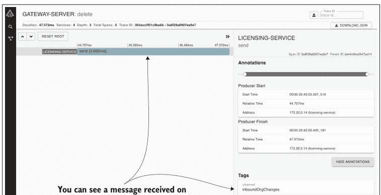


接下来我们将为组织服务添加一个名为 getOrgDbCall 的自定义 span，以监控从 Postgres 数据库检索组织数据所需的时间。组织服务数据库调用的 trace 可以在 OrganizationService 类中看到，该类位于文件 /organization-service/src/main/java/com/optimagrowth/organization/service/OrganizationService.java 中。findById() 方法调用包含自定义 trace。以下列表显示了此方法的源代码。

### Listing 11.9 Implementing the findById() method

```
package com.optimagrowth.organization.service;
//Some imports omitted for conciseness
import brave.ScopedSpan;
import brave.Tracer;

@Service
public class OrganizationService {
    //Some code omitted for conciseness
    @Autowired
    Tracer tracer;

    public OrganizationService findById(String organizationId) {
        Optional<Organization> opt = null;
        ScopedSpan newSpan = tracer.startScopedSpan("getOrgDBCall");
        try {
            opt = repository.findById(organizationId);
            simpleSourceBean.publishOrganizationChange("GET", organizationId);
            if (!opt.isPresent()) {
                String message = String.format("Unable to find an organization with the organization id %s", organizationId);
                logger.error(message);
                throw new IllegalArgumentException(message);
            }
            logger.debug("Retrieving Organization Info: " + opt.get().toString());
        } finally {
            newSpan.tag("peer.service", "postgres");
            newSpan.annotate("Client received");
            newSpan.finish();
        }

        return opt.get();
    }
    //Rest of class removed for conciseness
}
```

有了这两个自定义 span，重新启动服务。然后选择以下 GET 端点：

```
http://localhost:8072/license/v1/organization/4d10ec24-141a-4980-be34-2ddb5e0458c9/license/4af05c3b-a0f3-411d-b5ff-892c62710e16
```

如果我们在 Zipkin 中查看该事务，我们应该会看到在调用许可服务端点检索许可信息时添加了两个新的 span。图 11.22 显示了自定义 span。

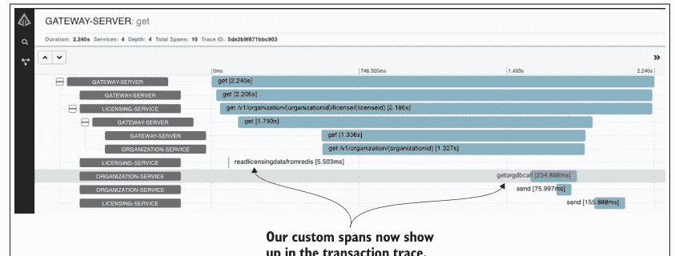

Figure 11.22 The custom spans for our services show up in the transaction trace.

图 11.22 还显示了与我们的 Redis 和数据库查找相关的额外跟踪和计时信息。深入查看，我们可以看到对 Redis 的读取调用耗时 5.503 ms。由于调用未在 Redis 缓存中找到项目，因此对 Postgres 数据库的 SQL 调用耗时 234.888 ms。

现在我们知道了如何设置分布式跟踪、API 网关、发现服务和自定义 span，让我们继续下一章。在下一章中，我们将解释如何部署我们在整本书中构建的所有内容。

## Summary

- Spring Cloud Sleuth 允许我们无缝地为微服务调用添加跟踪信息（关联 ID）。
- 关联 ID 可用于跨多个服务关联日志条目。这使我们能够观察单个事务涉及的所有服务中的事务行为。
- 虽然关联 ID 功能强大，但我们需要将此概念与日志聚合平台配对，该平台允许我们从多个来源摄取日志，然后搜索和查询其内容。
- 我们可以将 Docker 容器与日志聚合平台集成，以捕获所有应用程序日志数据。
- 我们将 Docker 容器与 ELK（Elasticsearch、Logstash、Kibana）堆栈集成。这使我们能够转换、存储、可视化和查询服务的日志数据。
- 虽然统一的日志平台至关重要，但能够在微服务中可视化跟踪事务也是一种有价值的工具。
- Zipkin 允许我们查看服务之间存在的依赖关系和事务的流程，并了解用户事务中涉及的每个微服务的性能特征。
- Spring Cloud Sleuth 可轻松与 Zipkin 集成。Zipkin 会自动从 HTTP 调用捕获跟踪数据，该数据成为在 Spring Cloud Sleuth 启用的服务中使用的入站/出站消息通道。
- Spring Cloud Sleuth 将每个服务调用映射到 span 的概念。Zipkin 然后允许我们查看 span 的性能。
- Spring Cloud Sleuth 和 Zipkin 还允许我们定义自己的自定义 span，以便我们了解非 Spring 基于资源的性能（例如 Postgres 或 Redis 等数据库服务器）。

## Deploying your microservices

### This chapter covers

- 理解 DevOps 对微服务至关重要
- 为 O-stock 服务配置核心 Amazon 基础设施
- 手动将 O-stock 服务部署到 Amazon
- 为您的服务设计构建/部署管道
- 将您的基础设施视为代码
- 将您的应用程序部署到云端

我们几乎到了本书的结尾，但不是微服务之旅的终点。虽然本书的大部分内容都集中在设计、构建和使用 Spring Cloud 技术将基于 Spring 的微服务投入运行，但我们尚未涉及如何构建和部署微服务。创建构建/部署管道可能看起来像是一项平凡的任务，但实际上它是微服务架构中最关键的部分之一。

为什么？请记住，微服务架构的关键优势之一是微服务是可以独立于彼此快速构建、修改并部署到生产环境的代码的小单元。服务的规模小意味着新功能（和关键错误修复）可以以很高的速度交付。速度是这里的关键词，因为速度意味着在创建新功能或修复错误与重新部署服务之间几乎不存在摩擦。部署的领先时间应该是几分钟，而不是几天。为了实现这一点，您用来构建和部署代码的机制需要

- *Automated*—当我们构建代码时，构建/部署过程中不应有人工干预。构建软件、配置机器映像和部署服务的流程应是自动化的，并由将代码提交到源存储库的操作触发。
- *Repeatable*—我们用来构建和部署软件的流程应该是可重复的；每次构建和部署启动时都会发生同样的事情。流程中的可变性通常是难以追踪和解决的微妙错误的来源。
- *Complete*—我们部署的工件的结果应该是整个虚拟机或容器映像（例如 Docker），其中包含服务的“完整”运行环境。这是我们思考基础设施方式的重要转变。
- *Immutable*—一旦包含服务的机器映像构建完成，映像的运行配置在部署映像后不应被触及或更改。如果需要进行更改，则需要在置于源代码控制下的脚本中进行，并且服务和基础设施必须再次经过构建过程。

机器映像的配置必须通过脚本完全自动化，并与服务源代码一起置于源代码控制之下。在微服务环境中，这一责任通常从运营团队转移到拥有该服务的开发团队。微服务开发的核心原则之一是推动开发人员对服务的运营责任负责。

运行配置更改（垃圾回收设置、使用的 Spring 配置文件等）应作为环境变量传递给映像，而应用程序配置应与容器分离（Spring Cloud Config）。

构建一个健壮且通用的构建部署管道是一项大量的工作，并且通常明确针对运行环境设计。它通常涉及一支专门的 DevOps（开发/运营）工程师团队，其唯一工作是将构建过程通用化，以便每个团队都可以构建其微服务，而无需重新发明整个构建过程。不幸的是，Spring 是一个开发框架，并不提供大量实现构建/部署管道的功能。但这并不意味着这样的管道无法构建。


## 12.1 构建/部署流水线的架构

本章的目标是为你提供构建/部署流水线的各个工作部件，以便你可以将这些部件拿过来，并根据自己的环境进行调整。让我们先从整体架构入手，看看构建/部署流水线及其所代表的几个通用模式和主题。为了让示例顺畅展开，我们做了一些在自己环境中通常不会做的事情，并且会相应地指出这些部分。

我们关于部署微服务的讨论，要从你在第1章中早已见过的图片开始。图12.1是你在第1章中见过的图表的副本，展示了创建微服务构建/部署流水线所涉及的组件和步骤。

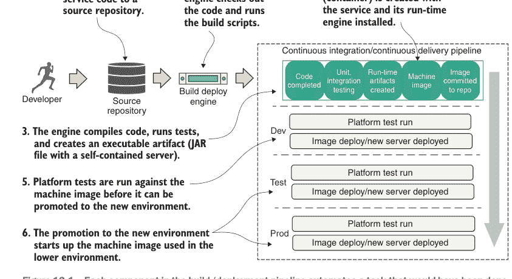

图12.1 构建/部署流水线中的每个组件都将原本需要手动完成的任务自动化。

图12.1看起来应该有点眼熟，因为它基于实现持续集成（CI）时使用的通用构建/部署模式：

1. 开发人员将其代码提交到源代码仓库。
2. 构建工具监视源代码控制仓库中的变更，并在检测到变更时触发构建。
3. 在构建过程中，会运行应用程序的单元测试和集成测试；如果一切通过，就会创建一个可部署的软件工件（JAR、WAR或EAR）。
4. 然后，该JAR、WAR或EAR可能会被部署到运行在另一台服务器（通常是开发服务器）上的应用服务器中。

构建/部署流水线会遵循类似的过程，直到代码准备好部署为止。我们将把持续交付（CD）附加到图12.1所示的构建/部署流程中，具体步骤如下：

1. 开发人员将其服务代码提交到源代码仓库。
2. 构建/部署引擎监视源代码仓库中的变更。如果代码被提交，构建/部署引擎会检出代码并运行构建脚本。
3. 构建脚本编译代码并运行其单元测试和集成测试之后，服务会被编译成一个可执行工件。由于我们的微服务是使用Spring Boot构建的，我们的构建过程会创建一个可执行的JAR文件，其中既包含服务代码，也包含一个自包含的Tomcat服务器。
   请注意，下一步就是我们的构建/部署流水线开始偏离传统Java CI构建过程的地方。
4. 可执行JAR构建完成后，我们会将微服务“烘焙”到一个机器映像中。这个烘焙过程会创建一个虚拟机映像或容器（Docker），并将我们的服务安装到其中。
   当虚拟机映像启动时，我们的服务也会启动，并准备好接收请求。与传统的CI构建过程不同——在传统CI构建中，你可能将编译后的JAR或WAR部署到一个独立于应用程序（且通常由另一个团队）管理的应用服务器上——而在CI/CD流程中，我们将微服务、服务的运行时引擎和机器映像作为一个相互依赖的整体来部署，由编写该软件的开发团队统一管理。
5. 在正式部署到新环境之前，机器映像会启动，并针对该环境在映像上运行一系列平台测试，以判断一切是否正常进行。如果平台测试通过，机器映像就会被提升到新环境并可供使用。
6. 将服务提升到新环境涉及启动与较低环境中所用完全相同的机器映像。这正是整个流程的秘诀。整个机器映像都会被部署。

借助CD，服务器创建后，任何已安装的软件（包括操作系统）都不会再被修改。通过提升和使用同一个机器映像，你可以保证服务器在从一个环境迁移到下一个环境时具有不可变性。

### 单元测试、集成测试与平台测试

图12.1展示了在服务构建和部署过程中会进行的几种类型的测试（单元、集成和平台）。这种流水线中通常有三类测试：

- *单元测试*——这些测试在服务代码编译之前、在部署到环境之前立即运行。这些测试旨在完全隔离的条件下运行，每个单元测试都小而聚焦。单元测试不应依赖任何第三方基础设施、数据库、服务等。通常，单元测试的范围涵盖对单个方法或函数的测试。
- *集成测试*——这些测试在服务代码打包后立即运行。它们旨在测试整个工作流、代码路径，并对需要与第三方服务一起调用的主要服务或组件进行桩化或模拟。在集成测试期间，你可能会运行内存数据库来保存数据、模拟第三方服务调用等等。通过集成测试，第三方依赖会被模拟或桩化，因此任何会触发远程服务的请求同样会被模拟或桩化。这些调用永远不会离开构建服务器。
- *平台测试*——这些测试在服务部署到环境之前立即运行。这些测试通常会测试完整的业务流，并调用生产系统中通常会调用的所有第三方依赖。平台测试在特定环境中实时运行，不涉及任何被模拟的服务。运行这类测试是为了确定与第三方服务的集成问题，这类问题在集成测试中桩化第三方服务时通常无法被发现。

如果你想深入了解如何编写单元、集成和平台测试，我们强烈推荐 Alex Soto Bueno、Andy Gumbrecht 和 Jason Porter 所著的 *《Java微服务测试》*（Manning，2018）。

构建/部署流程建立在四个核心模式之上。这些模式源于开发团队构建微服务和基于云的应用程序的集体经验。这些模式包括：

- *持续集成/持续交付（CI/CD）*——借助CI/CD，你的应用程序代码不仅仅在提交和部署时才被构建和测试。你的代码部署过程大致应该是这样的：如果代码通过了单元、集成和平台测试，它就会立即被提升到下一个环境。在大多数组织中，唯一的停顿点就是推送到生产环境。
- *基础设施即代码*——最终被推送到开发环境及后续环境的软件工件是一个机器映像。在微服务的源代码编译和测试完成后，会立即配置出安装了微服务的机器映像。机器映像的配置通过一系列随每次构建运行的脚本完成。服务器构建完成后，绝不应再有人工干预。配置脚本应纳入源代码控制，并像任何其他代码一样进行管理。
- *不可变服务器*——一旦服务器映像构建完成，在配置过程之后，服务器的配置和微服务就绝不会再被改动。这可以保证你的环境不会遭受“配置漂移”——即开发人员或系统管理员做了“一个小改动”，后来却导致停机。如果需要更改，请修改服务器的配置脚本，并启动一次新的构建。

> **关于不可变性与凤凰服务器的崛起**
> 
> 有了不可变服务器的概念，我们应该始终能够保证服务器的配置与其机器映像所声明的配置精确一致。服务器应该可以选择从机器映像中被杀死并重启，而服务或微服务的行为不会发生任何变化。马丁·福勒将这种杀死并复活新服务器的过程称为“凤凰服务器”，因为当旧服务器被杀死时，新服务器应从灰烬中重生。更多信息，请参见以下链接：
> 
> - http://martinfowler.com/bliki/PhoenixServer.html
> 
> 凤凰服务器模式有两个根本性的好处。首先，它会暴露配置漂移，并将其从你的环境中驱除出去。如果你不断地拆解和重建新服务器，你就更有可能及早暴露配置漂移。这对于确保一致性有着巨大的帮助。
> 
> 其次，凤凰服务器模式有助于提升韧性，让你能够发现服务器或服务在被杀死并重启后无法干净恢复的情况。请记住，在微服务架构中，你的服务应该是无状态的，服务器的死亡应该只是一个小波澜。随机杀死并重启服务器，能快速暴露出你的服务或基础设施中存在状态的情况。最好是在部署流水线早期就发现这些情况和依赖，而不是在电话里面对愤怒的客户或公司时才意识到。

在本章中，我们将看到如何使用几种非Spring工具来实现构建/部署流水线。我们将使用为本书构建的微服务套件，并执行以下步骤：

1. 将我们的Maven构建脚本集成到一个名为Jenkins的基于云的CI/部署工具中
2. 为每个服务构建不可变的Docker映像，并将这些映像推送到集中式仓库
3. 使用Amazon的容器服务（称为Elastic Kubernetes Service，EKS）将整个微服务套件部署到Amazon的云上

**注意** 在本书中，我们不会详细解释Kubernetes的工作原理。如果你初次接触它，或者想进一步了解它的工作原理，我们强烈推荐你阅读Marko Lukša的优秀著作 *《Kubernetes实战》*（Manning，2017），该书对此主题进行了详细阐述。


在开始我们的管道之前，让我们先在云中设置核心基础设施。

## 12.2 在云中设置 O-stock 的核心基础设施

在本书所有的代码示例中，我们都在单个虚拟机镜像内运行应用程序，每个单独的服务都作为 Docker 容器运行。我们现在将改变这一点，把数据库服务器（PostgreSQL）和缓存服务器（Redis）从 Docker 中分离出来，迁移到 Amazon 云中。所有其他服务仍将作为 Docker 容器在单节点 Amazon EKS 集群内运行。图 12.2 显示了 O-stock 服务部署到 Amazon 云的情况。

2. 数据库和 Redis 集群将被迁移到 Amazon 的服务中。
1. 所有核心 O-stock 服务将在单节点 EKS 集群内运行。
3. ECS 容器的安全组设置限制了所有入站端口流量，使得只有端口 8072 对公共流量开放。这意味着所有 O-stock 服务只能通过监听端口 8072 的 API Gateway 服务器访问。
5. 所有其他服务将只能从 EKS 容器内部访问。
4. 组织和许可服务由 OAuth2 身份验证服务保护。

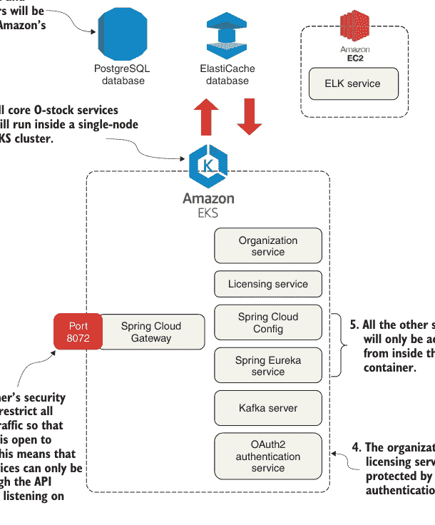

图 12.2 使用 Docker，我们可以将所有服务部署到 Amazon EKS 等云提供商。

让我们逐步介绍图 12.2 中的细节。请注意，数字与图中的编号相对应：

- 1. 我们所有的 O-stock 服务（减去数据库和 Redis 集群）将作为 Docker 容器部署在单节点 EKS 集群内。EKS 配置并设置运行 Docker 集群所需的服务器。EKS 还可以监控 Docker 中运行的容器的健康状况，并在服务崩溃时重启我们的服务。
- 2. 部署到 Amazon 云后，我们将不再使用 PostgreSQL 数据库和 Redis 服务器，而是改用 Amazon 关系数据库服务（Amazon RDS）和 Amazon ElastiCache 服务。我们本可以继续在 Docker 中运行 Postgres 和 Redis 数据存储，但我们想突出展示从一种基础设施迁移到完全由云提供商管理的另一种基础设施是多么容易。
- 3. 与桌面部署不同，我们希望服务器的所有流量都通过我们的 API 网关。我们将使用 Amazon 安全组，仅允许部署的 EKS 集群上的端口 8072 可供外界访问。
- 4. 我们仍将使用 Spring 的 OAuth2 服务器来保护我们的服务。在可以访问组织和许可服务之前，用户需要使用我们的身份验证服务进行身份验证（有关此内容的详细信息请参见第 9 章），并在每次服务调用时出示有效的 OAuth2 令牌。
- 5. 我们所有的服务器，包括我们的 Kafka 服务器，都不会通过其公开的 Docker 端口对外部世界公开可访问。它们将只能从 EKS 容器内部访问。

## 使用 AWS 的一些先决条件

要设置您的 Amazon 基础设施，您需要以下内容：

- *您自己的 Amazon Web Services（AWS）账户*——您应该对 AWS 控制台以及在此环境中工作的概念有基本了解。
- *一个网络浏览器*
- *AWS CLI（命令行界面）*——此统一工具管理 AWS 服务。参见 https://docs.aws.amazon.com/cli/latest/userguide/install-cliv2.html。
- *Kubectl*——此工具允许我们与 Kubernetes 集群通信和交互。参见 https://kubernetes.io/docs/tasks/tools/install-kubectl/#install-kubectl。
- *IAM Authenticator*——此工具为我们的 Kubernetes 集群提供身份验证。参见 https://docs.aws.amazon.com/eks/latest/userguide/install-aws-iam-authenticator.html。
- *Eksctl*——用于在我们的 AWS 账户中管理和创建 AWS EKS 集群的简单命令行实用程序。参见 https://docs.aws.amazon.com/eks/latest/userguide/getting-started-eksctl.html。

如果您完全是 AWS 新手，我们强烈建议您购买 Michael 和 Andreas Wittig 的书籍 *Amazon Web Services in Action*（Manning，2018）。本书的第一章在章节末尾包含了一篇写得很好的教程，介绍如何注册和配置您的 AWS 账户。该章节可在此处下载：

https://www.manning.com/books/amazon-web-services-in-action-second-edition

在本章中，我们尽可能使用了 Amazon 提供的免费套餐服务。唯一无法做到这一点的地方是在设置 EKS 集群时。我们使用了一台 M4 large 服务器，运行成本约为每小时 $0.10。如果您不想承担运行此服务器的高成本，请确保在完成后关闭您的服务。如果您想了解更多关于 AWS EC2 实例定价的信息，请访问以下链接的官方 Amazon 文档：https://aws.amazon.com/ec2/pricing/on-demand/。

最后，不能保证我们在本章中使用的 Amazon 资源（Postgres、Redis 和 EKS）在您想自行运行此代码时仍然可用。如果您要运行本章的代码，您需要设置自己的 GitHub 仓库（用于应用程序配置）、自己的 Jenkins 环境、Docker Hub（用于 Docker 镜像）和 Amazon 账户。然后您需要修改应用程序配置以指向您的账户和凭据。

### 12.2.1 使用 Amazon RDS 创建 PostgreSQL 数据库

首先，我们需要设置和配置我们的 Amazon AWS 账户。完成此操作后，我们将创建用于 O-stock 服务的 PostgreSQL 数据库。为此，我们首先需要登录 Amazon AWS 管理控制台（https://aws.amazon.com/console/）。您首次登录控制台时，会看到 Amazon Web 服务的列表。

- 1. 找到名为 RDS 的链接。点击该链接，它会带您进入 RDS 仪表板。
- 2. 在 RDS 仪表板上，点击大大的 Create Database 按钮。
- 3. 您应该会看到数据库列表。尽管 Amazon RDS 支持不同的数据库引擎，但请选择 PostgreSQL 并点击 Option。这会显示数据库字段。

您现在应该会看到一个包含三个模板选项的屏幕：生产数据库、开发/测试数据库和免费套餐。选择 Free Tier 选项。接下来，在 Settings 下，添加有关我们 PostgreSQL 数据库的必要信息，设置我们将用于登录数据库的主用户 ID 和密码。图 12.3 显示了此屏幕。

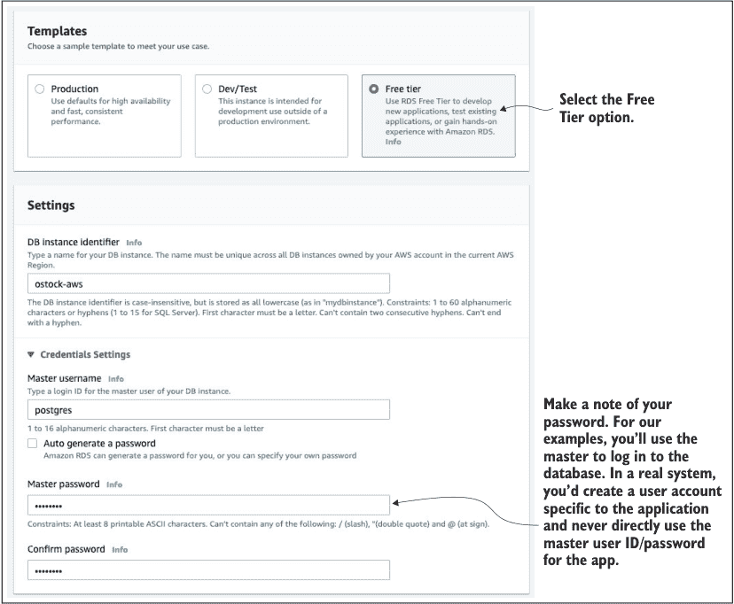

接下来，我们将保留这些部分的默认配置：DB Instance Size、Storage、Availability & Durability 和 Database Authentication。最后一步是设置以下选项。您可以在任何时候点击 Info 来获取有关您选择的帮助。图 12.4 显示了此屏幕。

- *Virtual Private Cloud（VPC）—*选择 Default VPC。
- *Publicly Accessible—*选择 Yes。
- *VPC Security Group—*选择 Create New，并为该组添加一个名称。例如，我们将安全组命名为 ost​ock-sg。
- *Database Port—*输入 5432 作为 TCP/IP 端口。

此时，我们的数据库创建过程开始（可能需要几分钟）。完成后，我们需要配置 O-stock 服务属性以使用数据库，

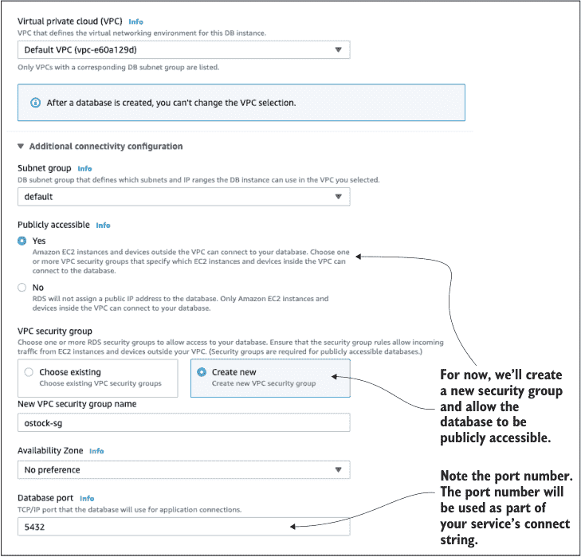

位于 Spring 配置服务器的服务配置文件中。为此，我们将返回 RDS 仪表板以查看有关我们数据库的信息。图 12.5 显示了此屏幕。

对于本章，您可以为每个需要访问基于 Amazon 的 PostgreSQL 数据库的微服务创建一个名为 aws-dev 的新应用程序配置文件。应用程序配置文件将包含 Amazon 数据库连接信息。

此时，我们的数据库已准备就绪（对于大约五次点击的设置来说相当不错）。让我们继续下一个应用程序基础设施部分，看看如何创建我们的 O-stock 许可服务将使用的 Redis 集群。


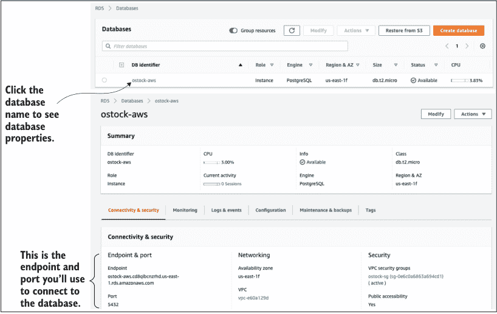

**图 12.5** 查看新创建的 Amazon RDS/PostgreSQL 数据库及其属性

## 12.2.2 在 Amazon 中创建 Redis 集群

对于 O-stock 服务，我们希望把之前在 Docker 中运行的 Redis 服务器迁移到 Amazon ElastiCache。借助 ElastiCache（https://aws.amazon.com/elasticache/），我们可以使用 Redis 或 memcached（https://memcached.org/）数据存储构建内存数据缓存。

首先，让我们返回 AWS 管理控制台主页，搜索 ElastiCache 服务，然后点击 ElastiCache 链接。在 ElastiCache 控制台中，选择 Redis 链接（屏幕左侧），然后点击屏幕顶部的蓝色“创建”按钮。这将打开 ElastiCache/Redis 创建向导（图 12.6）。

至于此页面上的高级 Redis 设置，我们选择为 PostgreSQL 数据库创建的同一个安全组，然后取消选中“启用自动备份”选项。按你的偏好填写完表单后，点击“创建”按钮即可。Amazon 将开始 Redis 集群创建过程（这需要几分钟时间）。Amazon 会在可用的最小 Amazon 服务器实例上构建一个单节点 Redis 服务器。

## 12.3 基础设施之外：部署 O-stock 与 ELK

在本章的第二部分中，你要将 Elasticsearch、Logstash 和 Kibana（ELK）服务部署到 EC2 实例上，并将 O-stock 服务部署到 Amazon EKS 容器中。请记住，EC2 实例是 Amazon 弹性计算云（Amazon EC2）中的虚拟服务器，我们可以在上面运行应用程序。我们也会把 O-stock 的部署过程分为两部分。

你的第一部分工作是针对极度缺乏耐心的人（比如我们）的，演示如何将 O-stock 手动部署到你的 Amazon EKS 集群。这将帮助你理解部署服务的机制，并看到部署的服务在你的容器中运行。虽然亲自动手手动部署服务很有趣，但这种方式不可持续，也不被推荐。

在第二部分中，你将自动化整个构建/部署流程，并将人工从其中解放出来。这是你的目标最终状态，并通过演示如何设计、构建和部署微服务到云端，真正为你在本书中完成的工作画上点睛之笔。

### 12.3.1 创建带有 ELK 的 EC2 实例

要设置 ELK 服务，我们将使用一个 Amazon EC2 实例。将这个服务与我们稍后部署到 EKS 集群的服务分开，可以让你看到我们可以采用不同实例，但仍然使用这些服务。要创建 EC2 实例，我们将执行以下步骤：

- **1.** 选择 Amazon 系统映像（AMI）
- **2.** 选择实例类型
- **3.** 为配置详细信息、存储和标签设置默认配置
- **4.** 创建新的安全组
- **5.** 启动 EC2 实例

首先，返回 AWS 管理控制台主页，搜索 EC2 服务，然后点击相应链接。接下来，点击蓝色的“启动实例”按钮。这将打开 EC2 启动实例向导。该向导包含七个不同的步骤，我们将引导你一一完成。图 12.8 展示了 EC2 创建过程的第一步。

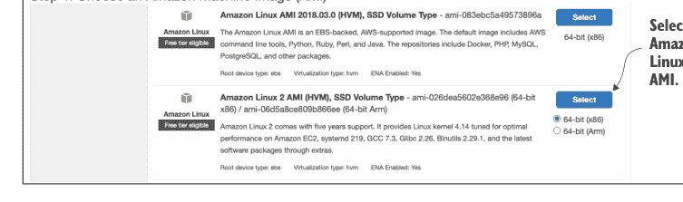

**图 12.8** 选择 Amazon Linux 2 AMI 选项以设置 ELK 服务实例。

接下来，我们要选择实例类型。在本例中，选择 m4.large 服务器，这样我们就有 8 GB 内存，而且每小时费用很低（0.10 美元/小时）。图 12.9 展示了我们的第二步。

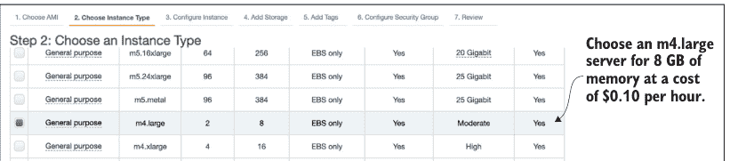

**图 12.9** 选择 ELK 服务的实例类型

选择实例后，点击“下一步：配置实例”链接。在第三、第四和第五个步骤中，你无需更改任何内容，只需依次点击“下一步”，接受所有默认配置即可。

在第六个步骤中，我们需要选择创建新的安全组（如果你已经创建过安全组，也可以选择现有的 Amazon 安全组）并将其应用于新的 EC2 实例。在本例中，我们将允许所有入站流量（0.0.0.0/0 是整个万维网的网络掩码）。在实际场景中，你需要谨慎对待此设置，因此我们建议你花些时间分析最适合你需求的入站规则。图 12.10 展示了这个步骤。

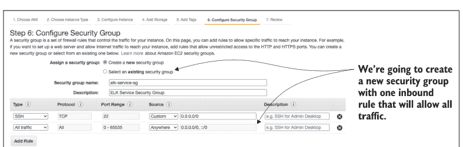

**图 12.10** 为 EC2 实例创建安全组

安全组设置完成后，点击“审核并启动”按钮以检查 EC2 实例配置。当你确认配置正确无误后，点击“启动实例”以执行最后一步。最后一步涉及创建用于连接 EC2 实例的密钥对。图 12.11 展示了这一过程。

> **注意** 在继续下一部分之前，我们强烈建议你从此处第 12 章的仓库下载 AWS 文件夹：https://github.com/ihuaylupo/manning-smia/tree/master/chapter12/AWS。在该仓库中，我们已经创建了 .yaml 和 docker-compose 文件中的服务脚本，用于部署 EC2 和 EKS 容器。

要继续，请在下载密钥对文件的路径下打开终端控制台，然后执行以下命令：

```
chmod 400 <pemKey>.pem
scp -r -i <pemKey>.pem ~/project/folder/from/root ec2-user@<IPv4>:~/
```

需要特别强调的是，我们将使用一个包含部署服务所需的所有配置文件的项目文件夹。如果你从 GitHub 下载了 AWS 文件夹，可以将其用作项目文件夹。执行完上述命令后，你应该会看到如图 12.13 所示的输出。

```
Last login: Sat Jun 20 06:35:47 2020 from 186.176.131.131

     __|  __|_  )
     _|  (     /   Amazon Linux AMI
    ___|\___|___|

https://aws.amazon.com/amazon-linux-ami/2018.03-release-notes/
-bash: warning: setlocale: LC_CTYPE: cannot change locale (UTF-8): No such file or directory
[ec2-user@ip-172-31-42-196 ~]$ ls -l
total 4
drwxr-xr-x 3 ec2-user ec2-user 4096 Jun 18 16:55 AWS
```

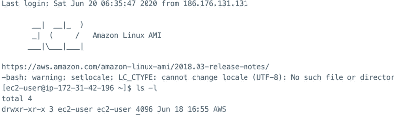

**图 12.13** 现在我们可以使用先前创建的 SSH 和密钥对登录 EC2 实例。

如果我们列出 EC2 实例根目录下的文件和目录，就会看到整个项目文件夹已被推送到实例中。一切设置就绪，让我们继续 ELK 部署。

### 12.3.2 在 EC2 实例中部署 ELK 技术栈

现在，我们已经创建了实例并成功登录，下面继续部署 ELK 服务。为了实现这一目标，我们必须完成以下步骤：

- **1.** 更新 EC2 实例
- **2.** 安装 Docker
- **3.** 安装 Docker Compose
- **4.** 运行 Docker
- **5.** 运行包含 ELK 服务的 docker-compose 文件

要执行上述所有步骤，请运行以下清单中显示的命令。

**清单 12.1** 在 EC2 实例中部署 ELK

```
# Updates the applications installed on a system (in our scenario, the EC2 instance)
sudo yum update
# Installs Docker
sudo yum install docker
# Installs Docker Compose
sudo curl -L https://github.com/docker/compose/releases/download/1.21.0/docker-compose-`uname -s`_`uname -m` | sudo tee /usr/local/bin/docker-compose > /dev/null
sudo chmod +x /usr/local/bin/docker-compose
sudo ln -s /usr/local/bin/docker-compose /usr/bin/docker-compose
# Runs Docker in the EC2 instance
sudo service docker start
# Runs the docker-compose file. The -d option runs the process in the background.
sudo docker-compose -f AWS/EC2/docker-compose.yml up -d
```

现在所有 ELK 服务都在运行。为了验证一切是否正常运行，你可以输入 `http://<IPv4>:5601/` 这个 URL。你会看到 Kibana 仪表板。现在 ELK 服务已经在运行，让我们创建一个 Amazon EKS 集群来部署微服务。

### 12.3.3 创建 EKS 集群

在部署 O-stock 服务之前的最后一步是设置一个 Amazon EKS 集群。EKS 是一项 Amazon 服务，允许我们在 AWS 上运行 Kubernetes。Kubernetes 是一个开源系统，可自动化容器的部署、调度以及创建和删除。如前所述，管理大量容器和微服务可能成为一项具有挑战性的任务。借助 Kubernetes 这类工具，我们可以更快、更高效地处理所有容器。例如，让我们设想以下场景。

我们需要更新一个微服务及其镜像，该镜像会被传播到数十个甚至数百个容器中。你能想象自己手动删除并重新创建这些容器吗？使用 Kubernetes，你只需执行一条简短命令即可销毁并重新创建它们。这只是 Kubernetes 带来的众多优势之一。现在我们对 Kubernetes 是什么以及它能做什么有了简要的了解，让我们继续。

创建 EKS 集群的过程可以使用 AWS 管理控制台或 AWS CLI 完成。在本例中，我们将展示如何使用 AWS CLI。

> **注意** 要继续本部分，请确保你已具备前面标题为“使用 AWS 的一些前提条件”的侧边栏中提到的所有工具，并且已经配置好 AWS CLI。如果尚未配置，我们强烈建议你查看此处的文档：https://docs.aws.amazon.com/cli/latest/userguide/cli-configure-quickstart.html。


在我们配置并安装了所有必要的工具后，我们就可以开始创建和配置 Kubernetes 集群了。为此，我们需要

- 部署一个 Kubernetes 集群
- 将微服务镜像推送到仓库
- 手动将我们的微服务部署到 Kubernetes 集群

## PROVISIONING A KUBERNETES CLUSTER

要使用 AWS CLI 创建我们的集群，我们需要使用 eksctl。这是通过使用以下命令实现的：

```bash
eksctl create cluster --name=ostock-dev-cluster
    --nodes=1 --node-type=m4.large
```

之前的 eksctl 命令行允许我们创建一个 Kubernetes 集群（名为 `ostock-dev-cluster`），它使用单个 `m4.large` EC2 实例作为工作节点。在此场景中，我们使用与之前在 EC2 ELK 服务创建向导中选择的相同实例类型。此命令的执行需要几分钟时间。在处理过程中，您会看到不同的行输出，但您会在看到以下输出时知道它已完成：

```text
[✓] EKS cluster "ostock-dev-cluster" in "region-code" region is ready
```

执行后，您现在可以运行 `kubectl get svc` 命令来验证 `kubectl` 配置是否正确。此命令应显示以下输出：

| NAME | TYPE | CLUSTER-IP | EXTERNAL-IP | PORT(S) | AGE |
| --- | --- | --- | --- | --- | --- |
| kubernetes | ClusterIP | 10.100.0.1 | `<none>` | 443/TCP | 1m |

## PUSHING THE MICROSERVICE IMAGES INTO REPOSITORIES

到目前为止，我们已在本地机器上构建了我们的服务。为了在 EKS 集群中使用这些镜像，我们需要将 Docker 容器镜像推送到容器仓库。*容器仓库* 就像您创建的 Docker 镜像的 Maven 仓库。Docker 镜像可以被标记并上传到其中，然后其他项目可以下载并使用这些镜像。

有多个仓库，例如 Docker Hub，但对于本示例，让我们继续使用 AWS 基础设施并使用 Amazon Elastic Container Registry（ECR）。要了解有关 ECR 的更多信息，请参阅 https://docs.aws.amazon.com/AmazonECR/latest/userguide/what-is-ecr.html。

要将镜像推送到容器仓库，我们必须确保 Docker 镜像位于我们的本地 Docker 目录中。如果它们不在那里，请在父 `pom.xml` 文件上执行以下命令：

```bash
mvn clean package dockerfile:build
```

一旦命令执行，我们现在应该能在 Docker 镜像列表中看到这些镜像。要验证这一点，请发出 `docker images` 命令。您应该会看到以下输出：

| REPOSITORY | TAG | IMAGE ID | SIZE |
| --- | --- | --- | --- |
| ostock/organization-service | chapter12 | b1c7b262926e | 485MB |
| ostock/gatewayserver | chapter12 | 61c6fc020dcf | 450MB |
| ostock/configserver | chapter12 | 877c9d855d91 | 432MB |
| ostock/licensing-service | chapter12 | 6a76bee3e40c | 490MB |
| ostock/authentication-service | chapter12 | f5e5e74f29c2 | 452MB |
| ostock/eurekaserver | chapter12 | e6bc59ae1d87 | 451MB |

下一步是使用我们的 ECR 仓库对 Docker 客户端进行身份验证。为此，我们需要通过执行以下命令获取密码和我们的 AWS 账户 ID：

```bash
aws ecr get-login-password
aws sts get-caller-identity --output text --query "Account"
```

第一个命令检索密码，第二个命令返回我们的 AWS 账户。我们将使用这两个值来对我们的 Docker 客户端进行身份验证。现在我们有了凭据，让我们通过执行以下命令进行身份验证：

```bash
docker login -u AWS -p [password] https://[aws_account_id].dkr.ecr.[region].amazonaws.com
```

身份验证后，下一步是创建我们将存储镜像的仓库。要创建这些仓库，让我们执行以下命令：

```bash
aws ecr create-repository --repository-name ostock/configserver
aws ecr create-repository --repository-name ostock/gatewayserver
aws ecr create-repository --repository-name ostock/eurekaserver
aws ecr create-repository --repository-name ostock/authentication-service
aws ecr create-repository --repository-name ostock/licensing-service
aws ecr create-repository --repository-name ostock/organization-service
```

当每个命令执行时，您应该会看到类似于以下内容的输出：

```json
{
    "repository": {
        "repositoryArn": "arn:aws:ecr:us-east-2:8193XXXXXXX43:repository/ostock/configserver",
        "registryId": "8193XXXXXXX43",
        "repositoryName": "ostock/configserver",
        "repositoryUri": "8193XXXXXXX43.dkr.ecr.us-east-2.amazonaws.com/ostock/configserver",
        "createdAt": "2020-06-18T11:53:06-06:00",
        "imageTagMutability": "MUTABLE",
        "imageScanningConfiguration": {
            "scanOnPush": false
        }
    }
}
```

请务必记下所有仓库 URI，因为我们将需要它们来创建标签并推送镜像。要为我们的镜像创建标签，让我们执行以下命令：

```bash
docker tag ostock/configserver:chapter12 [configserver-repository-uri]:chapter12
docker tag ostock/gatewayserver:chapter12 [gatewayserver-repository-uri]:chapter12
docker tag ostock/eurekaserver:chapter12 [eurekaserver-repository-uri]:chapter12
docker tag ostock/authentication-service:chapter12 [authentication-service-repository-uri]:chapter12
docker tag ostock/licensing-service:chapter12 [licensing-service-repository-uri]:chapter12
docker tag ostock/organization-service:chapter12 [organization-service-repository-uri]:chapter12
```

`docker tag` 命令为我们的镜像创建新的标签。如果您执行此命令，您应该会看到类似于图 12.14 所示的输出。

| REPOSITORY | TAG | IMAGE ID | CREATED | SIZE |
| --- | --- | --- | --- | --- |
| 819322222443.dkr.ecr.us-east-2.amazonaws.com/ostock/organization-service | chapter12 | b1c7b262926e | 45 hours ago | 485MB |
| ostock/organization-service | chapter12 | b1c7b262926e | 45 hours ago | 485MB |
| 819322222443.dkr.ecr.us-east-2.amazonaws.com/ostock/gatewayserver | chapter12 | 61c6fc020dcf | 45 hours ago | 458MB |
| ostock/gatewayserver | chapter12 | 61c6fc020dcf | 45 hours ago | 458MB |
| 819322222443.dkr.ecr.us-east-2.amazonaws.com/ostock/configserver | chapter12 | 877c9d855d91 | 45 hours ago | 432MB |
| ostock/configserver | chapter12 | 877c9d855d91 | 45 hours ago | 432MB |
| 819322222443.dkr.ecr.us-east-2.amazonaws.com/ostock/licensing-service | chapter12 | 6a76bee3e40c | 46 hours ago | 490MB |
| ostock/licensing-service | chapter12 | 6a76bee3e40c | 46 hours ago | 490MB |
| 819322222443.dkr.ecr.us-east-2.amazonaws.com/ostock/authentication-service | chapter12 | f5e5e74f29c2 | 5 days ago | 452MB |
| ostock/authentication-service | chapter12 | f5e5e74f29c2 | 5 days ago | 452MB |
| 819322222443.dkr.ecr.us-east-2.amazonaws.com/ostock/eurekaserver | chapter12 | e6bc59ae1d87 | 5 days ago | 451MB |
| ostock/eurekaserver | chapter12 | e6bc59ae1d87 | 5 days ago | 451MB |

图 12.14 带有 Amazon Elastic Container Registry（ECR）仓库 URI 标签的 Docker 镜像

最后，我们可以将微服务镜像推送到 ECR 仓库。为此，我们将执行以下命令：

```bash
docker push [configserver-repository-uri]:chapter12
docker push [gatewayserver-repository-uri]:chapter12
docker push [eurekaserver-repository-uri]:chapter12
docker push [authentication-service-repository-uri]:chapter12
docker push [licensing-service-repository-uri]:chapter12
docker push [organization-service-repository-uri]:chapter12
```

一旦所有命令运行完毕，您可以访问 AWS 管理控制台中的 ECR 服务。您应该会看到类似于图 12.15 所示的列表。

一旦 Helm 安装完成，让我们执行以下命令来创建我们的 Kafka 和 Zookeeper 服务：

```bash
helm install zookeeper bitnami/zookeeper \
  --set replicaCount=1 \
  --set auth.enabled=false \
  --set allowAnonymousLogin=true
```

```bash
helm install kafka bitnami/kafka \
  --set zookeeper.enabled=false \
  --set replicaCount=1 \
  --set externalZookeeper.servers=zookeeper
```

一旦这些命令执行，您应该会看到包含服务详细信息的输出。为了确保一切成功运行，请执行 `kubectl get pods` 命令以查看正在运行的服务。

| NAME | READY | STATUS | RESTARTS | AGE |
| --- | --- | --- | --- | --- |
| kafka-0 | 1/1 | Running | 0 | 77s |
| zookeeper-0 | 1/1 | Running | 0 | 101s |

部署服务的下一步是将我们的 docker-compose 文件转换为兼容的 Kubernetes 格式。为什么？Kubernetes 不支持 Docker Compose 文件，因此为了执行这些文件，我们需要使用一个名为 Kompose 的工具。

Kompose 将 Docker Compose 文件转换为诸如 Kubernetes 之类的容器实现。使用此工具允许我们使用 `kompose convert <file>` 命令转换所有 docker-compose.yaml 文件配置，使用 `kompose up` 命令运行 docker-compose 文件等等。如果您想了解有关 Kompose 的更多信息，我们强烈建议您查看此链接的文档：https://kompose.io/。

对于本示例，您将在以下 GitHub 仓库的 AWS/EKS 文件夹中找到这些文件：https://github.com/ihuaylupo/manning-smia/tree/master/chapter12/AWS/EKS。但在继续之前，让我们回顾一下 Kubernetes 服务类型，它允许我们将服务公开到外部 IP 地址。Kubernetes 有以下四种类型的服务：

- ClusterIP—在集群内部 IP 上公开服务。如果我们选择此选项，我们的服务将仅在我们的集群内可见。
- NodePort—在静态端口（NodePort 值）上公开服务。Kubernetes 从 3000 到 32767 分配默认端口范围。您可以通过在 `service.yaml` 文件的 `spec.containers.commands` 部分使用 `--service-node-port-range` 标志来更改此范围。
- LoadBalancer—使用云负载均衡器在外部公开服务。
- ExternalName—将服务映射到外部名称的内容。

如果您查看文件，您会看到一些 `<service>.yml` 文件具有 `type=NodePort` 和 `nodePort` 属性。在 Kubernetes 中，如果我们不定义服务类型，Kubernetes 使用默认的 ClusterIP 服务类型。


现在我们进一步了解了 Kubernetes 服务类型，让我们继续。要使用这些转换后的文件创建服务，请在 AWS/ELK 文件夹的根目录下执行以下命令：

```
kubectl apply -f <service>.yaml <deployment>.yaml
```

我们倾向于逐个执行该命令，以确保所有内容都成功创建，但你也可以同时创建所有服务。要做到这一点，你需要像前面的命令一样，用 `-f` 参数把所有 YAML 文件拼接在一起。例如，要创建配置服务器并查看 Pod 状态和日志，我们需要执行以下命令：

```
kubectl apply -f configserver-service.yaml,configserver-deployment.yaml
kubectl get pods
kubectl logs <POD_NAME> --follow
```

要测试我们的服务是否已启动并运行，我们需要在安全组中添加几条规则，以允许来自节点端口的所有入站流量。为此，让我们执行以下命令来获取安全组 ID：

```
aws ec2 describe-security-groups --filters Name=group-name,Values="*eksctl-ostock-dev-cluster-nodegroup*" --query "SecurityGroups[*].{Name:GroupName,ID:GroupId}"
```

获得安全组 ID 后，让我们执行以下命令来创建入站规则。你也可以在 AWS 管理控制台中，通过进入安全组并创建新的入站流量规则来完成，如下所示：

```
aws ec2 authorize-security-group-ingress --protocol tcp --port 31000 --group-id [security-group-id] --cidr 0.0.0.0/0
```

要获取外部 IP，可以执行 kubectl get nodes -o wide 命令。该命令会显示与图 12.16 类似的输出。

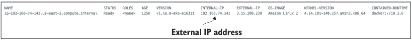

现在，你可以在浏览器中打开以下 URL：`http://<node-external-ip>:<NodePort>/actuator`。如果你需要删除 Pod、Service 或 Deployment，可以执行下面列出的命令之一：

```
kubectl delete -f <service>.yaml
kubectl delete -f <deployment>.yaml
kubectl delete <POD_NAME>
```

我们已经快完成了。如果你查看过 YAML 文件，可能会注意到 postgres.yaml 文件有些不同。在这个文件中，我们将指定数据库服务使用外部地址。为了使连接正常工作，你应该为 RDS Postgres 服务指定端点。下面的清单展示了具体做法。

### 清单 12.2 为数据库服务添加外部引用

```
apiVersion: v1
kind: Service
metadata:
  labels:
    app: postgres-service
  name: postgres-service
spec:
  externalName: ostock-aws.cjugpwnyahhy.us-east-2.rds.amazonaws.com
  selector:
    app: postgres-service
  type: ExternalName
status:
  loadBalancer: {}
```

设置 RDS PostgreSQL 端点

请确保添加你的 RDS PostgreSQL 实例的 externalName 端点。完成此更改后，你可以执行以下命令。一旦所有服务都创建并运行起来，你现在就可以继续运行所有其他服务了。

```
kubectl apply -f postgres.yaml
```

在编写本章时，我们注意到需要创建 VPC 对等连接，并更新 RDS 和 EKS 集群的路由表，以允许它们之间进行通信。我们不打算介绍如何执行此操作，但我们强烈建议你阅读《从 AWS EKS 访问 Amazon RDS》一文（https://dev.to/bensooraj/accessing-amazon-rds-from-aws-eks-2pc3），其中包含所有步骤，和/或参阅官方 AWS 文档，以进一步了解 VPC 对等连接：https://docs.aws.amazon.com/vpc/latest/peering/create-vpc-peering-connection.html。

至此，你已经成功地将你的第一批服务部署到了 Amazon EKS 集群。现在，让我们在此基础上，看看如何设计一个自动化编译、打包并将服务部署到 Amazon 的构建/部署流水线。

## 12.4 构建/部署流水线实操

从 12.1 节中列出的总体架构可以看出，一个构建/部署流水线背后涉及许多组成部分。由于本书旨在向你展示“实际运行”中的情况，我们将详细介绍为 O-stock 服务实现构建/部署流水线的具体细节。图 12.17 列出了我们将用来实现流水线的不同技术。

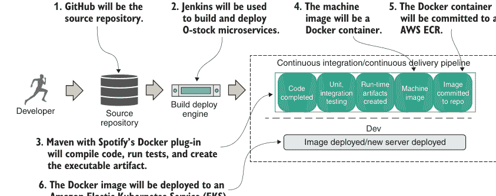

### 图 12.17 O-stock 构建/部署流水线中使用的技术

我们先来了解一下构建/部署流水线所需的技术：

- GitHub (http://github.com)——GitHub 是我们源代码的源代码控制仓库。本书中的所有应用程序代码都托管在 GitHub 上。我们选择 GitHub 作为源代码控制仓库，是因为它提供了各种各样的 Webhook 和强大的基于 REST 的 API，便于将 GitHub 集成到你的构建过程中。

- Jenkins (https://www.jenkins.io/)——Jenkins 是我们用来构建和部署 O-stock 微服务，以及预置将要部署的 Docker 镜像的持续集成引擎。Jenkins 可以通过其 Web 界面轻松配置，并且内置了几个插件，这些插件会让我们的工作更轻松。

- Maven/Spotify Docker plugin (https://github.com/spotify/dockerfile-maven) or Spring Boot with Docker (https://spring.io/guides/gs/spring-boot-docker/)——虽然我们使用原版 Maven 来编译、测试和打包 Java 代码，但这些重要的 Maven 插件将允许我们直接在 Maven 中启动 Docker 构建的创建。

- Docker (https://www.docker.com/)——我们选择 Docker 作为容器平台有两个原因。首先，Docker 可跨多个云提供商移植。我们可以使用同一个 Docker 容器，并以最少的工作量将其部署到 AWS、Azure 或 Cloud Foundry。其次，Docker 非常轻量。

  到本书结束时，你大约构建并部署了 10 个 Docker 容器（包括一个数据库服务器、消息平台和一个搜索引擎）。由于每个镜像庞大的体积和运行速度，在本地桌面上部署同样数量的虚拟机将非常困难。

- Amazon Elastic Container Registry (ECR) (https://aws.amazon.com/ecr/)——在构建服务并创建 Docker 镜像后，它会使用唯一标识符进行标记，并推送到中央仓库。对于这个 Docker 镜像仓库，我们选择使用 ECR。

- Amazon 的 EKS 容器服务 (https://aws.amazon.com/eks/)——我们微服务的最终目的地将是部署在 Amazon Docker 平台上的 Docker 实例。我们选择 Amazon 作为云平台，因为它目前是最成熟的云提供商，并且可以轻松部署 Docker 服务。

## 12.5 创建我们的构建/部署流水线

有数十种源代码控制引擎和构建/部署引擎（包括本地部署和云部署）可以实现你的构建/部署流水线。在本书的示例中，我们特意选择 GitHub 作为源代码控制仓库，Jenkins 作为构建引擎。Git 源代码控制仓库非常流行，而 GitHub 是目前最大的基于云的源代码控制仓库之一。Jenkins 是一个与 GitHub 紧密集成的构建引擎，而且使用起来也很简单。它的简洁性和强约定特性使你可以轻松地搭建并启动一个简单的构建流水线。

到目前为止，本书中的所有代码示例都可以仅在你的桌面上运行（除了需要连接 GitHub 之外）。对于本章，如果你想完全跟随这些代码示例，你需要设置自己的 GitHub、Jenkins 和 AWS 账户。我们不打算逐步介绍如何设置 Jenkins；但是，如果你不熟悉 Jenkins，可以查看我们准备的文件，它会一步步地引导你如何在 EC2 实例中从零开始设置 Jenkins 环境。该文件位于第 12 章的仓库中，链接如下：https://github.com/ihuaylupo/manning-smia/blob/master/chapter12/AWS/jenkins_Setup.md。

### 12.5.1 设置 GitHub

为了构建流水线，我们必须创建一个 GitHub Webhook。什么是 Webhook？Webhook 也被称为 Web HTTP 回调。这些 HTTP 回调会向其他应用程序提供实时信息。通常，当包含 Webhook 的应用程序执行某个进程或操作时，回调就会被触发。

如果你从未听说过 Webhook，你可能会想知道为什么我们需要它。就我们的目的而言，我们将在 GitHub 中创建一个 Webhook，以便在代码推送时让 Jenkins 得知。这样 Jenkins 就可以启动特定的构建流程。要在 GitHub 中创建 Webhook，我们需要执行以下步骤。图 12.18 展示了这个过程。

- 1. 进入包含你的流水线项目的仓库
- 2. 点击“设置”（Settings）选项
- 3. 选择“Webhooks”
- 4. 点击“添加 Webhook”（Add Webhook）按钮
- 5. 提供特定的负载 URL（payload URL）
- 6. 点击“仅推送事件”（Just the Push Event）选项
- 7. 点击“添加 Webhook”（Add Webhook）按钮


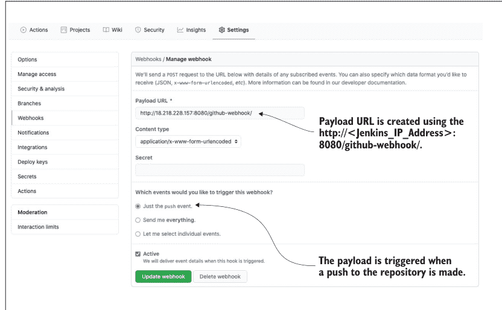

**图 12.18 为 Jenkins 生成 webhook**

需要特别注意的是，payload URL 是使用 Jenkins 的 IP 地址创建的。这样，每当仓库发生推送时，GitHub 就可以调用 Jenkins。现在我们有了 webhook，接下来让我们使用 Jenkins 配置流水线。

### 12.5.2 让我们的服务能够在 Jenkins 中构建

本书中构建的每个服务的核心都是一个 Maven pom.xml 文件，用于构建 Spring Boot 服务、将其打包为可执行的 JAR，并构建一个可用于启动服务的 Docker 镜像。直到本章之前，服务的编译和启动都是通过以下方式完成的：

- 1. 在本地机器上打开命令行窗口。
- 2. 运行本章的 Maven 脚本。这会构建本章的所有服务，然后将它们打包成一个 Docker 镜像，并推送到本地运行的 Docker 仓库。
- 3. 使用 docker-compose 和 docker-machine 命令，从本地 Docker 仓库启动新创建的 Docker 镜像，以启动本章的所有服务。

问题来了：我们如何在 Jenkins 中重复这个过程？这一切都始于一个名为 Jenkinsfile 的文件。Jenkinsfile 是一个脚本，描述了当 Jenkins 执行构建时我们想要运行的操作。该文件存储在我们的微服务 GitHub 仓库的根目录中。

当 GitHub 仓库发生推送时，webhook 会使用 payload URL 调用 Jenkins，Jenkins 任务会查找 Jenkinsfile 以启动构建过程。图 12.19 展示了这一过程的步骤。

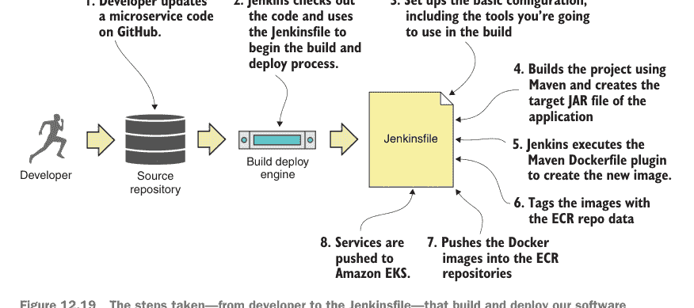

**图 12.19 从开发者到 Jenkinsfile 所采取的步骤——构建和部署我们的软件**

如图 12.19 所示：

- 1. 开发者对 GitHub 仓库中的某个微服务进行更改。
- 2. GitHub 通知 Jenkins 发生了推送。该通知由 GitHub webhook 发出。Jenkins 启动一个用于执行构建的进程。然后 Jenkins 从 GitHub 检出源代码，并使用 Jenkinsfile 开始整体的构建和部署过程。
- 3. Jenkins 为构建设置基本配置，并安装任何依赖项。
- 4. Jenkins 构建项目，执行单元测试和集成测试，并为应用程序生成目标 JAR 文件。
- 5. Jenkins 执行 Maven Dockerfile 插件以创建新的 Docker 镜像。
- 6. 然后 Jenkins 使用 ECR 仓库数据为新镜像打标签。
- 7. 构建过程使用你在步骤 6 中使用的相同标签名称将镜像推送到 ECR。
- 8. 构建过程连接到 EKS 集群，并使用 service.yaml 和 deployment.yaml 文件部署服务。

### 快速说明

在本书中，我们在同一个 GitHub 仓库中为每一章设置了单独的文件夹。该章的所有源代码可以作为一个整体进行构建和部署。然而，对于你的项目，我们强烈建议你在环境中为每个微服务设置独立的仓库和独立的构建过程。这样，每个服务都可以彼此独立部署。

以构建过程为例，我们仅将配置服务器作为单个单元部署，这只是因为我们希望将项目分别推送到 Amazon 云，并为每个单独的服务管理构建脚本。在这个示例中，我们只部署配置服务器，但之后你可以使用相同的步骤创建其他部署。

现在我们已经了解了使用 Jenkins 进行构建/部署过程的一般步骤，接下来看看如何创建 Jenkins 流水线。

> **注意** 要使流水线正常工作，你需要安装几个 Jenkins 插件，例如 GitHub Integration、GitHub、Maven Invoker、Maven Integration、Docker Pipeline、ECR、Kubernetes Continuous Deploy 和 Kubernetes CLI。要了解有关这些插件的更多信息，我们建议你阅读每个插件的官方 Jenkins 文档（例如，关于 Kubernetes CLI，请参阅 https://plugins.jenkins.io/kubernetes-cli/）。

安装了所有插件后，我们需要创建 Kubernetes 和 ECR 的凭据。首先，让我们从 Kubernetes 凭据开始。要创建这些凭据，我们需要进入“管理 Jenkins”、“管理凭据”、Jenkins、“全局凭据”，然后点击“添加凭据”。选择“Kubernetes 配置 (kubeconfig)”选项，并填写你的 Kubernetes 集群信息表单。

要从 Kubernetes 集群检索信息，请按照我们之前手动部署服务时的说明连接到 Kubernetes 集群，然后执行以下命令：

```bash
kubectl config view
```

将返回的内容复制并粘贴到 Jenkins 中的“Content”文本框。图 12.20 展示了这一步。

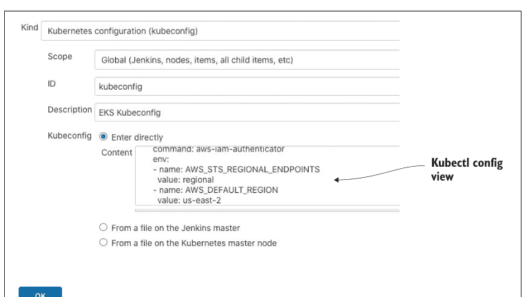

**图 12.20 配置 kubeconfig 凭据以连接到 EKS 集群**

现在，让我们创建 ECR 凭据。为此，我们首先需要转到 AWS 控制台中的 IAM 页面，然后转到“用户”并点击“添加用户”选项。在“添加用户”页面中，你需要指定用户名、访问类型和策略。接下来，下载包含用户凭据的 .CSV 文件，最后保存用户。我们将在创建凭据时一步步指导你。首先，在 IAM 页面中添加以下数据：

```text
User name: ecr-user
Access type: Programmatic access
```

在第二页（“权限”页面）中，选择“直接附加现有策略”选项，搜索“AmazonEC2ContainerRegistryFullAccess”，然后选择它。最后，在最后一页上，点击“Download .csv”。下载步骤非常重要，因为稍后我们会需要这些凭据。最后，点击“保存”按钮。

下一步是将凭据添加到 Jenkins，但在此之前，请确保你已在 Jenkins 中安装 ECR 插件。安装完成后，进入“管理 Jenkins”、“管理凭据”、Jenkins、“全局凭据”页面，然后点击“添加凭据”选项。在此页面中，添加以下数据：

```
ID: ecr-user
Description: ECR User
Access Key ID: <Access_key_id_from_csv>
Secret Access Key: <Secret_access_key_from_csv>
```

凭据创建完成后，你可以继续创建流水线。图 12.21 展示了流水线设置过程。要访问图 12.21 所示的页面，请转到 Jenkins 仪表板，然后点击屏幕左上角的“新建项目”选项。

**图 12.21 创建 Jenkins 流水线以构建配置服务器**

输入项目名称
configserver
» 必填字段
自由风格项目
这是 Jenkins 的核心功能。Jenkins 将构建你的项目，将任何 SCM 与任何构建系统相结合，甚至可以用于软件构建以外的其他用途。
Maven 项目
构建一个 Maven 项目。Jenkins 利用你的 POM 文件，并大幅减少配置。
流水线
编排可跨越多个构建代理的长时间运行活动。适用于构建流水线（以前称为工作流）和/或组织不容易适合自由风格作业类型的复杂活动。
多配置项目
适用于需要大量不同配置的项目，例如在多个平台上进行测试、特定于平台的构建等。
确定
文件夹
选择一个项目名称
选择“流水线”选项

**图 12.22 在 Jenkins 流水线中配置 GitHub webhook 和仓库 URL，第 1 步**

常规
构建触发器
高级项目选项
流水线
GitHub 项目
项目 URL https://github.com/lhuaylupo/manning-smia/
项目仓库 URL
流水线速度/持久性覆盖
保留已完成构建中的 stash
此项目已参数化
节流构建
构建触发器
在其他项目构建后构建
定期构建
GitHub 分支
GitHub 拉取请求
GitHub hook 触发器，用于 GITScm 轮询
GitHub hook 触发器，用于 GITScm 轮询


最后，最后一步是从SCM中选择Pipeline Script（流水线脚本），它位于Definition（定义）下拉列表中的Pipeline（流水线）部分下。这最后一步允许我们在与应用程序相同的源代码仓库中查找Jenkinsfile。图12.23展示了这一过程。

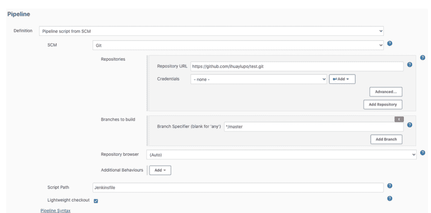

图12.23 在Jenkins流水线中配置GitHub webhook和仓库URL，第2步

在图12.23中，我们从SCM下拉列表中选择Git，然后添加我们流水线特定的信息，例如仓库URL、分支以及脚本路径（在我们的案例中为根目录），以及文件名Jenkinsfile。最后，点击保存（Save）以进入流水线主页。

> 注意：如果您的仓库需要凭据，您将看到一个错误。

## 12.5.3 理解并生成流水线脚本

Jenkinsfile负责配置构建的核心运行时配置。通常，此文件分为几个部分。请注意，您可以根据需要拥有任意数量的部分或阶段。下一个代码清单展示了我们的配置服务器的Jenkinsfile。

### 清单12.3 配置Jenkinsfile

```
node {
    def mvnHome
    stage('Preparation') {  // Defines the preparation stage
        // Sets the GIT repository
        git 'https://github.com/ihuaylupo/spmia.git'
        mvnHome = tool 'M2_HOME'  // Exposes the Maven configuration from the Jenkins server
    }
}
```

看一下带有dockerfile:build的行，您会注意到我们向Maven发送了一些参数。让我们来看一看：

```
sh "${mvnHome}/bin/mvn" -Ddocker.image.prefix=8193XXXXXX43.dkr.ecr.us-east-2.amazonaws.com/ostock -Dproject.artifactId=configserver -Ddocker.image.version=latest dockerfile:build
```

在此命令中，我们传递Docker镜像前缀、镜像版本和构件ID。但在这里，您可以按需发送任意数量的参数。此外，这里也是设置部署中要使用的profile（例如：dev、stage或production）的好地方。同时，在此阶段，您可以使用ECR仓库数据为新镜像创建并分配特定标签。在这种特定场景中，我们使用latest版本，但您也可以在这里指定不同的变量来创建不同的Docker镜像。

第五阶段将镜像推送到ECR仓库。在这种情况下，我们将刚创建的配置服务器添加到8193XXXXXX43.dkr.ecr.us-east-2.amazonaws.com/ostock仓库中的Docker镜像中。最后一个阶段，即Kubernetes部署阶段，将部署到我们的EKS集群。此命令可能因您的配置而有所不同，因此我们将为您提供有关如何自动创建此阶段的流水线脚本的提示。

## 12.5.4 创建Kubernetes流水线脚本

Jenkins提供了一个Pipeline Syntax（流水线语法）选项，使我们能够自动生成可以在Jenkinsfile中使用的不同流水线片段。图12.24展示了这一过程。

要使用此选项，我们需要执行以下步骤：

- 1. 转到Jenkins仪表板页面并选择您的流水线。
- 2. 单击仪表板页面左栏中显示的Pipeline Syntax（流水线语法）选项。
- 3. 在Snippet Generator（片段生成器）页面上，单击Sample Step（示例步骤）下拉列表，然后选择kubernetesDeploy: Deploy to Kubernetes选项。
- 4. 在Kubeconfig下拉列表中，选择我们在上一节中创建的Kubernetes凭据。
- 5. 在Config Files（配置文件）选项中，选择deployment.yaml文件。此文件位于GitHub项目的根目录中。
- 6. 将其余值保留为默认值。
- 7. 单击Generate Pipeline Script（生成流水线脚本）按钮。

> 注意：请记住，在本书中，我们在同一个GitHub仓库中为每一章设置了单独的文件夹。本章的所有源代码都可以作为一个整体进行构建和部署。但是，我们强烈建议您在环境中为每个微服务设置独立的仓库和独立的构建过程。

一旦一切设置完毕，您就可以更改代码了。您的Jenkins流水线将自动触发。

### 图12.24 使用Pipeline Syntax（流水线语法）选项生成kubernetesDeploy命令

## 12.6 关于构建/部署流水线的总结思考

随着本章（和本书）的结束，我们希望您已经深刻认识到构建一条构建/部署流水线所需要投入的工作量。一个运行良好的构建/部署流水线对服务的部署至关重要。而微服务架构的成功不仅仅取决于代码：

- 请理解，此构建/部署流水线中的代码是为了本书的演示目的而简化的。一个好的构建/部署流水线要通用得多。它由DevOps团队支持，并分解为一系列独立的步骤（编译 > 打包 > 部署 > 测试），开发团队可以将他们的微服务构建脚本“挂接”到这些步骤中。

- 本章使用的虚拟机镜像制作过程较为简单。每个微服务都使用一个Dockerfile来定义将要安装在Docker容器上的软件。许多公司使用如Ansible (https://github.com/ansible/ansible)、Puppet (https://github.com/puppetlabs/puppet) 或 Chef (https://github.com/chef/chef) 这样的供应工具，在虚拟机或容器镜像上安装和配置操作系统。

```
kubernetesDeploy configs: 'configserver-deployment.yaml', kubeConfig: [path: ''], kubeconfigId: 'kubeconfig', secretName: '', ssh: [sshCredentialsId: '', sshServer: ''], textCredentials: [certificateAuthorityData: '', clientCertificateData: '', clientKeyData: '', serverUrl: 'https://']
```

- 您的应用程序的云部署拓扑已合并到单个服务器。在真实的构建/部署流水线中，每个微服务都将有自己的构建脚本，并且会独立于其他微服务部署到EKS容器集群中。

编写微服务是一项具有挑战性的任务。使用微服务，创建应用程序的复杂性并没有消失；它只是发生了转变。构建单个微服务的概念很容易理解，但运行和支持一个健壮的微服务架构所涉及的远不止编写代码。请记住，微服务架构为我们提供了很多关于如何创建应用程序的选项和决策。在做出这些决策时，我们需要考虑到微服务是松耦合、抽象、独立且受约束的。

希望到目前为止，我们已经为您提供了足够的信息（和经验）来创建您自己的微服务架构。在本书中，您了解了什么是微服务，以及将其投入运营所需的关键设计决策。您还学习了如何遵循十二要素最佳实践（配置管理、服务发现、消息传递、日志记录、追踪、安全），使用多种可以与Spring完美结合的工具和技术，来创建一个健壮的微服务环境。最后，您还学习了如何实现构建/部署流水线。

前面提到的所有要素共同构成了开发成功微服务的完美秘诀。最后，正如Martin Fowler所说：“如果我们不能创建良好的架构，那么最终我们就是在欺骗我们的客户，因为我们在削弱他们竞争的能力。”

## 总结

- 构建/部署流水线是交付微服务的关键组成部分。一个运行良好的构建/部署流水线应该让新功能和错误修复能够在几分钟内部署。
- 构建/部署流水线应该实现自动化，无需人工直接交互即可交付服务。过程中任何手动部分都代表着变异和失败的可能。
- 构建/部署流水线的自动化需要大量的脚本编写和配置才能做好。构建它所需的工作量不应被低估。
- 构建/部署流水线应该交付不可变的虚拟机或容器镜像。一旦服务器镜像被创建，就不应该再修改它。
- 特定于环境的服务器配置应在服务器设置时作为参数传入。


