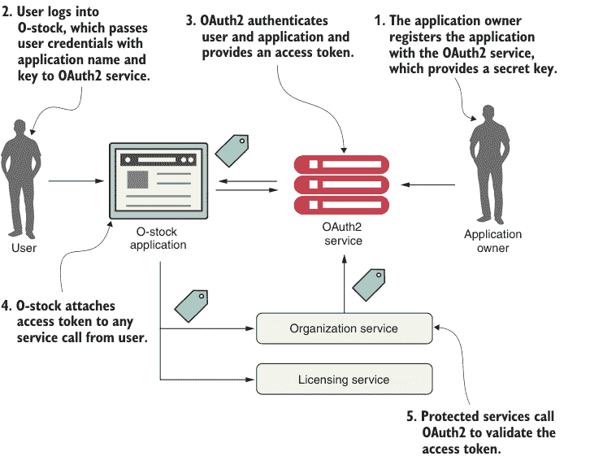
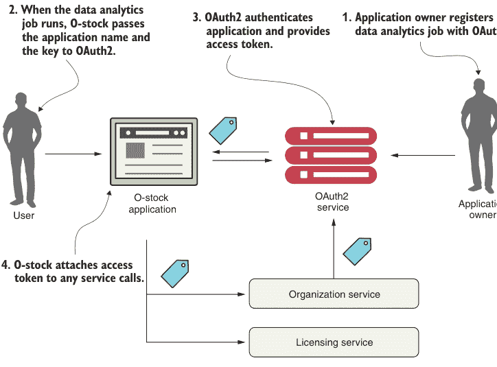
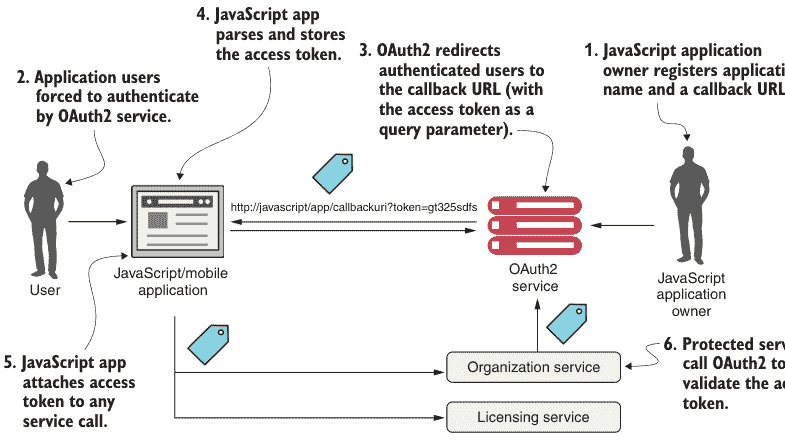

# 附录 B
OAuth2 授权类型

读完第 9 章后，你可能会觉得 OAuth2 看起来并不太复杂。毕竟，你有一个身份验证服务，它检查用户凭据并向用户返回令牌。反过来，每当用户想要调用受 OAuth2 服务器保护的服务时，都可以出示该令牌。

由于 Web 和基于云的应用程序具有互联的特性，用户开始期望能够在不同服务拥有的各种应用程序之间安全地共享数据并集成功能。这从安全角度来看是一个独特的挑战，因为你希望在不同应用程序之间进行集成，同时又不会强迫用户向每个想要集成的应用程序分享他们的凭据。

OAuth2 是一个灵活授权框架，它提供了多种机制，让应用程序无需强迫用户分享凭据即可对用户进行身份验证和授权。不幸的是，这也是 OAuth2 被认为复杂的原因之一。这些身份验证机制被称为*身份验证授权*。OAuth2 有四种形式的身份验证授权，客户端应用程序可以使用它们对用户进行身份验证、接收访问令牌，然后验证该令牌。这些授权类型是

- 密码模式
- 客户端凭证模式
- 授权码模式
- 隐式模式

在接下来的小节中，我们将详细介绍这每种 OAuth2 授权流程执行期间发生的行为。我们还会讨论何时使用某一种授权类型而不是另一种。

## 密码授权类型

OAuth2密码授权可能是最直接的授权类型。当应用程序和服务之间明确地相互信任时，您将使用此授权类型。例如，O-stock Web应用程序以及许可和组织服务都由同一家公司（Optima Growth）拥有，因此它们之间存在着自然的信任关系。

> **注意** 明确地说，当我们提到“自然信任关系”时，我们指的是同一组织完全拥有这些应用程序和服务。它们按照相同的政策和流程进行管理。

当存在自然信任关系时，将OAuth2访问令牌暴露给调用应用程序几乎无需担忧。例如，O-stock Web应用程序可以使用授权的OAuth2密码来获取用户凭据，并直接向OAuth2服务进行身份验证。图B.1展示了O-stock与下游服务之间的密码授权类型运作过程。

**图B.1** OAuth2服务确定访问服务的用户是否为已认证用户。

在图B.1中，会发生以下操作。编号与图中的编号相对应：

- 1. 在O-stock应用程序能够使用受保护资源之前，它需要在OAuth2服务中被唯一标识。通常，应用程序的所有者向OAuth2应用程序服务注册，并为其应用程序提供唯一的名称。然后，OAuth2服务返回一个密钥以注册该应用程序。应用程序的名称和OAuth2服务提供的密钥唯一标识了试图访问任何受保护资源的应用程序。
- 2. 用户登录O-stock并向应用程序提供其登录凭据。O-stock将用户凭据以及应用程序名称/应用程序密钥直接传递给OAuth2服务。
- 3. O-stock OAuth2服务对应用程序和用户进行身份验证，然后向用户提供OAuth2访问令牌。
- 4. 每次O-stock应用程序代表用户调用服务时，它都会传递OAuth2服务器提供的访问令牌。
- 5. 当调用受保护的服务（此例中为许可服务或组织服务之一）时，该服务会回调O-stock OAuth2服务以验证令牌。如果令牌有效，被调用的服务将允许用户继续操作。如果令牌无效，OAuth2服务将返回HTTP状态码403，表示令牌无效。

## 客户端凭据授权类型

当应用程序需要访问OAuth2受保护资源，但交易中没有用户参与时，您将使用客户端凭据授权类型。使用客户端凭据授权类型时，OAuth2服务器仅根据应用程序名称和资源所有者提供的密钥进行身份验证。这种授权类型通常用于同一家公司拥有这两个应用程序的情况。密码授权类型和客户端凭据授权类型之间的区别在于，客户端凭据授权仅使用注册的应用程序名称和密钥进行身份验证。

例如，假设O-stock应用程序有一个每小时运行一次的数据分析任务。作为其工作的一部分，它需要调用O-stock服务。然而，O-stock的开发人员仍然希望该应用程序在访问这些服务中的数据之前进行身份验证和授权。这就是可以使用客户端凭据授权类型的地方。图B.2展示了这一流程。

在图B.2中，会发生以下操作。编号与图中的编号相对应：

- 1. 资源所有者向OAuth2服务注册O-stock数据分析应用程序。资源所有者提供应用程序名称并收到一个密钥。
- 2. 当O-stock数据分析任务运行时，它会提供其应用程序名称和资源所有者提供的密钥。
- 3. O-stock OAuth2服务使用提供的应用程序名称和密钥对应用程序进行身份验证，然后返回OAuth2访问令牌。
- 4. 每次应用程序调用O-stock服务之一时，它都会在服务调用中出示收到的OAuth2访问令牌。

**图B.2** 客户端凭据授权适用于“无用户参与”的应用程序身份验证和授权。

## 授权码授权类型

授权码授权是迄今为止OAuth2授权类型中最复杂的一种，但它也是最常见的，因为它允许来自不同供应商的不同应用程序共享数据和服务，而无需在多个应用程序中暴露用户的凭据。它还通过不允许调用应用程序立即获得OAuth2访问令牌来实施额外的检查层，而是接收一个“预检”授权码。

理解授权码授权类型最容易的方式是看一个示例。假设您有一个O-stock用户，同时使用Salesforce.com。O-stock客户的IT部门构建了一个需要从O-stock服务（组织服务）获取数据的Salesforce应用程序。让我们看图B.3，了解授权码授权类型如何允许Salesforce访问组织服务中的数据，而O-stock客户无需将其O-stock凭据暴露给Salesforce。

现在，当用户尝试使用Salesforce应用程序并通过组织服务访问O-stock数据时，他们会被重定向到通过步骤1中描述的URL访问的O-stock登录页面。用户提供其O-stock凭据。如果凭据有效，O-stock OAuth2服务器会生成一个授权码，并通过步骤1中提供的URL将用户重定向到Salesforce。OAuth2服务器将授权码作为回调URL上的查询参数发送。

- 3. 自定义的Salesforce应用程序会持久化该授权码。请注意，此授权码不是OAuth2访问令牌。
- 4. 一旦授权码被存储，Salesforce应用程序会将注册过程中生成的密钥和授权码一起提交回O-stock OAuth2服务器。O-stock OAuth2服务器验证授权码，然后返回一个OAuth2令牌给自定义Salesforce应用程序，该令牌在Salesforce每次需要认证用户并获取OAuth2访问令牌时使用。
- 5. Salesforce应用程序调用O-stock组织服务，并在请求头中传递OAuth2令牌。
- 6. 组织服务验证在O-stock服务调用中传入的OAuth2访问令牌。如果令牌有效，组织服务将处理用户的请求。

哇！我们需要喘口气。应用程序间的集成是复杂的。整个过程中的关键要点是，即使用户已登录Salesforce并访问O-stock数据，用户的O-stock凭据也从未直接暴露给Salesforce。在OAuth2服务生成初始授权码后，用户再也不用向O-stock服务提供其凭据。

## 隐式授权类型

当您通过传统的服务器端Web编程环境（如Java或.NET）运行Web应用程序时，您会使用隐式授权类型。如果您的客户端应用程序是纯粹的JavaScript应用程序或完全在Web浏览器中运行的移动应用程序，并且不依赖服务器端调用来调用第三方服务，那该怎么办？这就是隐式授权类型的用武之地。图B.4展示了隐式授权类型发生的一般流程。

对于隐式授权，您通常使用的纯JavaScript应用程序完全在浏览器内运行。对于其他授权类型，客户端与执行用户请求的应用程序服务器通信，应用程序服务器与任何下游服务交互。对于隐式授权类型，所有服务交互

**图 B.4** 隐式授权类型用于基于浏览器的单页应用（SPA）JavaScript 应用。

直接从用户的客户端（通常是 Web 浏览器）发起。在图 B.4 中，会发生以下活动。请注意，编号与图中的编号对应：

1. JavaScript 应用程序的所有者向 O-stock OAuth2 服务器注册应用程序。所有者提供一个应用程序名称和一个回调 URL，OAuth2 访问令牌将经由该回调 URL 重定向给用户。
2. JavaScript 应用程序调用 OAuth2 服务。JavaScript 应用程序必须提供预先注册的应用程序名称。然后，OAuth2 服务器强制用户进行身份验证。
3. 如果用户成功通过身份验证，O-stock OAuth2 服务不会返回令牌，而是将用户重定向回 JavaScript 应用程序所有者在步骤 1 中注册的页面。在重定向回用户的 URL 中，OAuth2 身份验证服务会将 OAuth2 访问令牌作为查询参数传递。
4. 应用程序接收传入的请求，并运行一个 JavaScript 脚本，该脚本解析 OAuth2 访问令牌并将其存储（通常作为 cookie 存储）。
5. 每次调用受保护资源时，OAuth2 访问令牌都会被提交给被调用的服务。
6. 被调用的服务验证 OAuth2 令牌，并检查用户是否有权执行其尝试执行的活动。

关于 OAuth2 隐式授权类型，需要记住几点。首先，隐式授权是唯一一种将 OAuth2 访问令牌直接暴露给公共客户端（Web 浏览器）的授权类型。

对于授权码授权类型，客户端应用程序接收由托管该应用程序的应用程序服务器返回的授权码，然后用户通过出示该授权码获得 OAuth2 访问令牌。返回的 OAuth2 令牌永远不会直接暴露给用户的浏览器。对于客户端凭证授权类型，授权发生在两个基于服务器的应用程序之间；而对于密码授权类型，请求服务的应用程序和服务都由同一组织拥有且受信任。

隐式授权类型生成的 OAuth2 令牌更容易受到攻击和滥用，因为这些令牌可供浏览器访问。浏览器中运行的任何恶意 JavaScript 都可以访问 OAuth2 访问令牌，并代表你调用你为其获取 OAuth2 令牌的服务，本质上是在冒充你。因此，隐式授权类型的 OAuth2 令牌应是短期有效的（1–2 小时）。由于 OAuth2 访问令牌存储在浏览器中，OAuth2 规范（以及 Spring Cloud Security）不支持刷新令牌的概念，即令牌可以自动续期。

## 令牌如何刷新

当 OAuth2 访问令牌签发后，它在有限时间内有效，最终会过期。当令牌过期时，调用应用程序（和用户）需要与 OAuth2 服务重新进行身份验证。但在大多数 OAuth2 授权流程中，OAuth2 服务器会同时签发访问令牌和刷新令牌。客户端可以将刷新令牌提交给 OAuth2 身份验证服务，该服务会验证刷新令牌，然后签发新的 OAuth2 访问令牌。我们来看图 B.5，并逐步了解令牌刷新流程。

在图 B.5 中，会发生以下操作。编号与图中的编号对应：

1. 用户登录 O-stock，此时已经通过 OAuth2 服务完成身份验证。用户正在愉快地工作，但不幸的是，他们的令牌过期了。
2. 下一次用户尝试调用服务（例如组织服务）时，O-stock 应用程序会将过期令牌传递给组织服务。
3. 组织服务尝试通过 OAuth2 服务验证令牌，OAuth2 服务返回 HTTP 状态码 401（未授权）和 JSON 负载，指示该令牌不再有效。组织服务向调用服务返回 HTTP 401 状态码。
4. O-stock 应用程序从组织服务收到 401 HTTP 状态码和 JSON 负载。然后，O-stock 应用程序使用刷新令牌调用 OAuth2 身份验证服务。OAuth2 身份验证服务验证刷新令牌，然后发回新的访问令牌。
