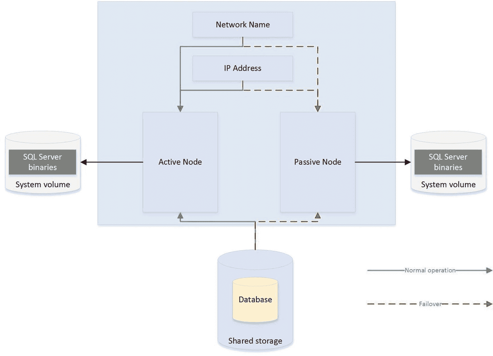
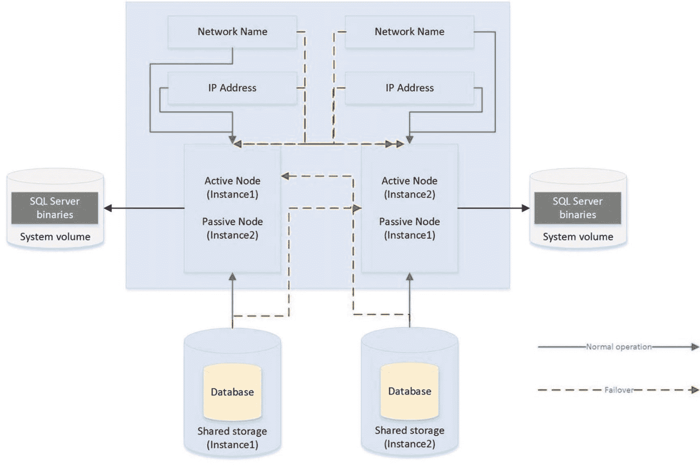
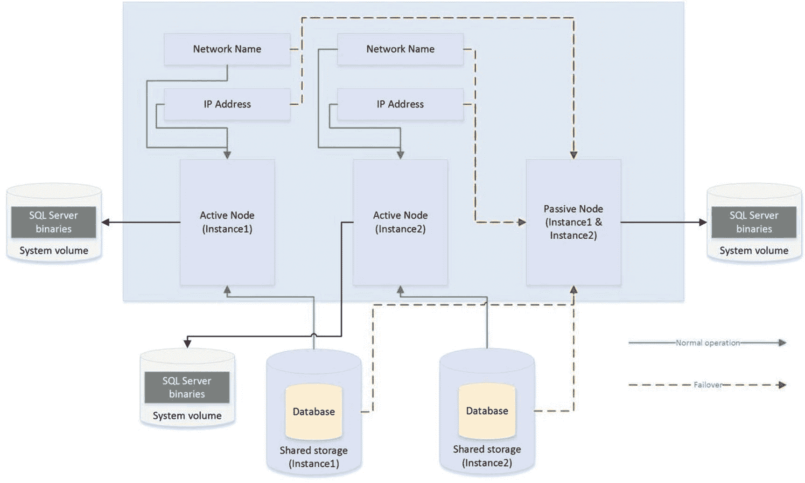
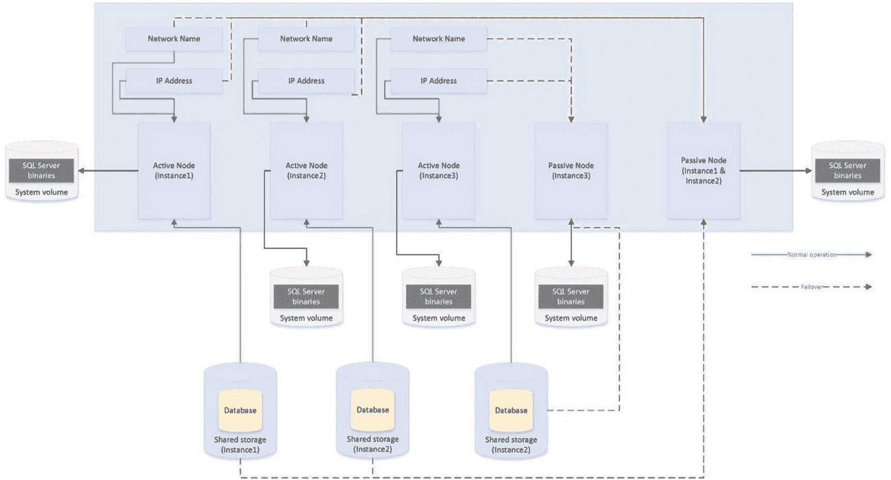
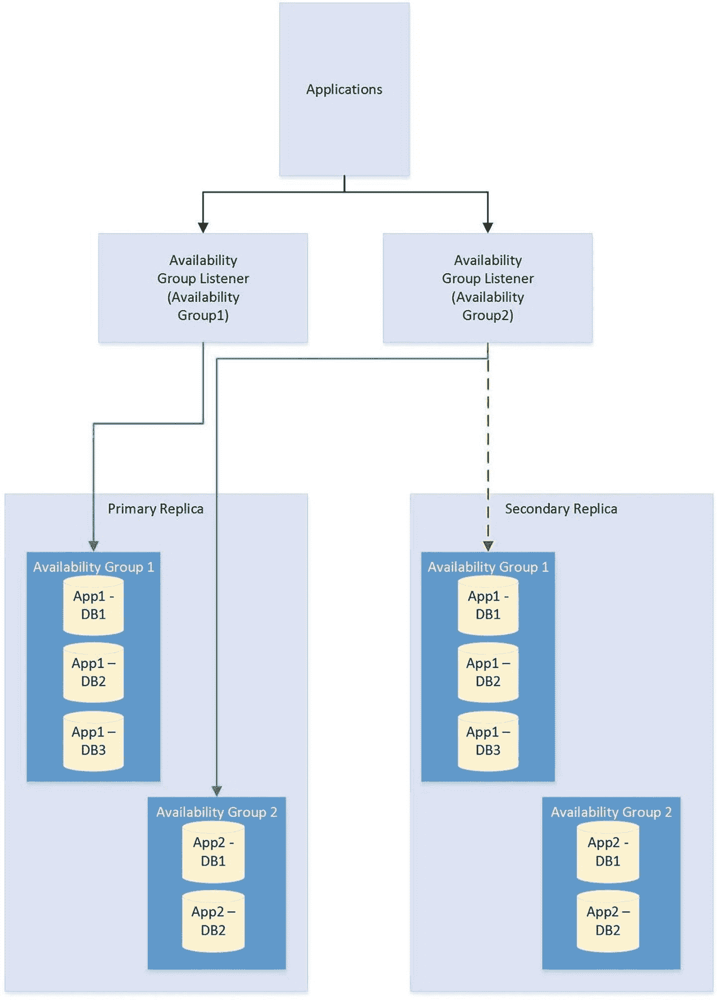
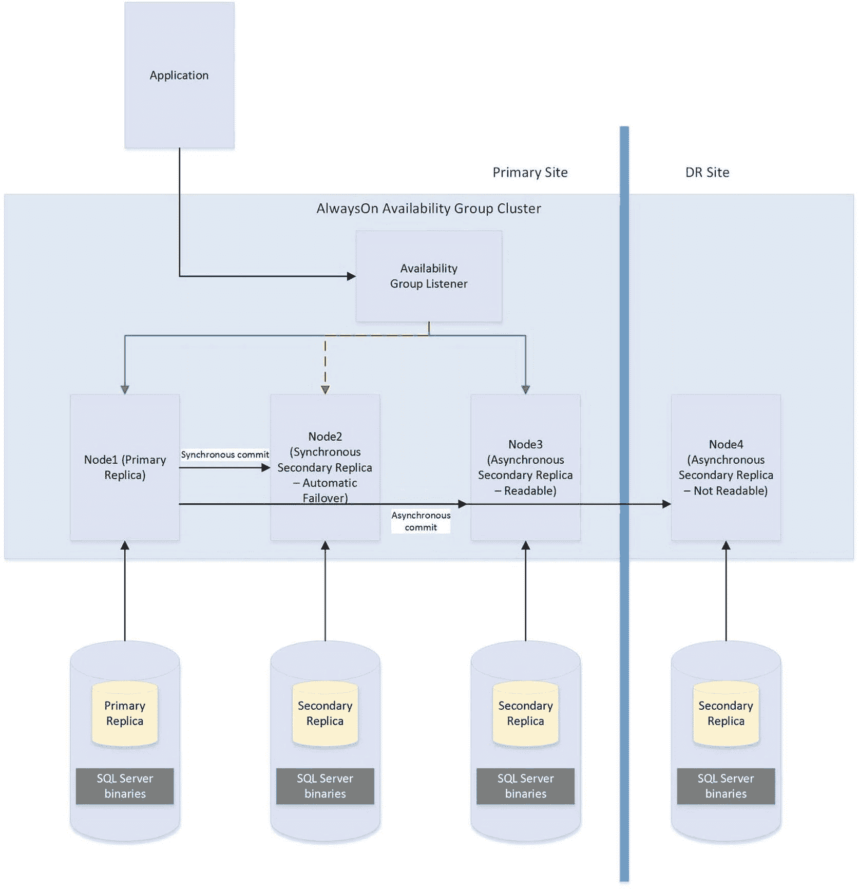
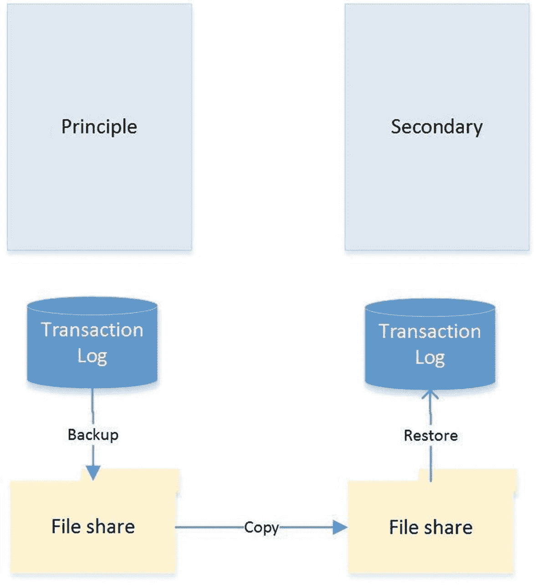
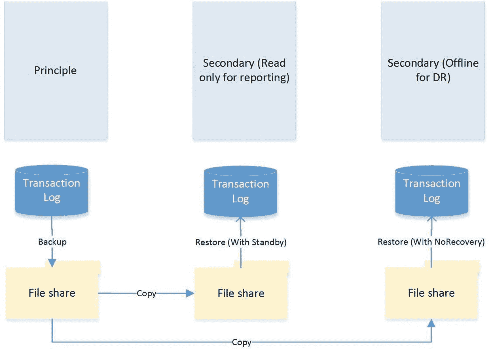
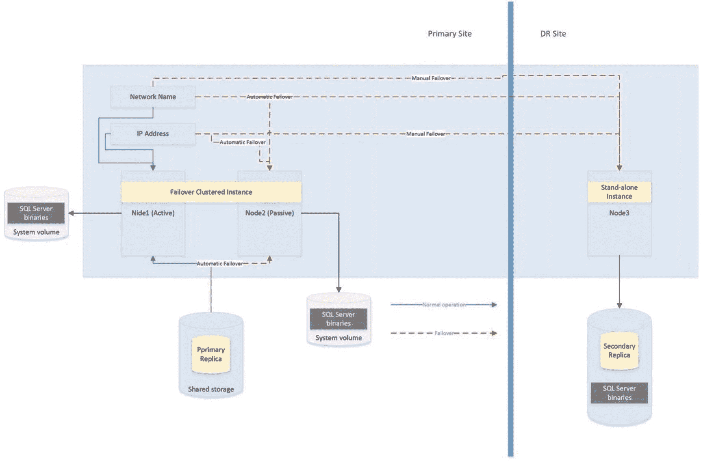
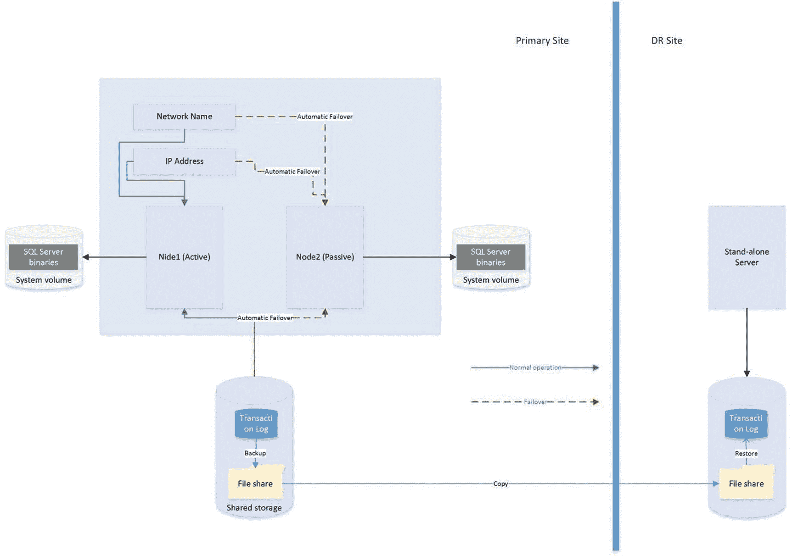

# 2. 了解高可用性和灾难恢复技术

Peter A. Carter^( 1 ) (1) Botley, UK 结束摘要

SQL Server 提供了一整套用于实现高可用性和灾难恢复的技术。以下各节提供了这些技术的概述并讨论了它们最合适的用途。

## AlwaysOn 故障转移群集

Windows 群集是一种提供高可用的技术，其中最多 64 台服务器协同工作以提供冗余。AlwaysOn 故障转移群集实例 (`FCI`) 是跨越该组服务器的 SQL Server 实例。如果该组中的其中一台服务器发生故障，另一台服务器将接管该实例。其最合适的用途是在数据库较大或写入负载较高的高可用性场景中。这是因为群集依赖于共享存储，这意味着数据只需写入磁盘一次。使用 SQL Server 级别的高可用性技术，写入操作会在主数据库上发生，然后在提交在主数据库完成之前再次在所有辅助数据库上发生。这可能会导致性能问题。尽管可以将群集跨多个站点扩展，但这涉及 SAN 复制，这意味着群集通常配置在单个站点内。

集群中的每台服务器称为 `node`。因此，如果一个集群由三台服务器组成，则称为三节点集群。集群中的每个节点都安装了 SQL Server 二进制文件，但 SQL Server 服务仅在一台节点上启动，该节点称为 `active node`。集群中的每个节点还共享用于 SQL Server 数据和日志文件的相同存储。然而，存储仅附加到活动节点。

提示

在地理分散的集群（称为地理集群或伸缩集群）中，每台服务器都连接到不同的存储。卷由 SAN 复制或 Windows Storage Replica（一种在 Windows Server 2016 中引入的 Windows Server 技术，可执行存储复制）进行更新。集群将这两个卷视为单个共享卷，该卷一次只能附加到一个节点。

如果活动节点发生故障，则 SQL Server 服务将停止并且存储将被分离。然后将存储重新附加到集群中的其他节点之一，并在该节点上启动 SQL Server 服务，该节点现在成为活动节点。实例还分配有自己的网络名称和 IP 地址，它们也绑定到活动节点。这意味着应用程序可以无缝连接到实例，而不管哪个节点拥有它。

图 2-1 中的图表说明了两节点集群。它显示尽管数据库存储在共享存储阵列上，但每个节点仍具有专用的系统卷。该卷包含 SQL Server 二进制文件。它还说明了在故障转移事件中共享存储、IP 地址和网络名称如何重新绑定到被动节点。

图 2-1 ¶ 两节点集群

### 活动/被动配置

尽管图 2-1 中的图表说明了活动/被动配置，但也可以具有活动/活动配置。虽然一次不可能有多个节点拥有单个实例，因此无法实现负载平衡，但可以在集群上安装多个实例，并且不同的节点可能拥有每个实例。在此场景中，每个节点都有自己的唯一网络名称和 IP 地址。每个实例的共享存储也由一组唯一的卷组成。

因此，在活动/活动配置中，在正常操作期间，`Node1` 可能托管 `Instance1`，而 `Node2` 可能托管 `Instance2`。如果 `Node1` 发生故障，则两个实例都将由 `Node2` 托管，反之亦然。图 2-2 中的图表说明了两节点活动/活动集群。

图 2-2 ¶ 活动/活动集群

警告

在活动/活动集群中，在故障转移时考虑资源非常重要。例如，如果每个节点有 128GB RAM，并且每个节点上托管的实例使用 96GB RAM 并锁定内存中的页面，那么当一个节点故障转移到另一个节点时，该节点也会失败，因为它没有足够的内存分配给两个实例。确保您像规划单个服务器一样规划内存和处理器需求。因此，活动/活动集群通常不推荐用于 SQL Server。

### 三节点及以上配置

如前所述，集群中最多可以有 64 个节点。当你有三个或更多节点时，由于相关成本，你可能不希望有一个活动节点和两个冗余节点。相反，你可以选择实现 `N+1` 或 `N+M` 配置。

在 `N+1` 配置中，你有多个活动节点和一个被动节点。如果任何活动节点发生故障，它们将故障转移到被动节点。图 2-3 中的图表描绘了三节点 `N+1` 集群。

图 2-3 ¶ 三节点 N+1 配置

在 `N+1` 配置中，在多故障场景中，多个节点可能会故障转移到被动节点。因此，在规划资源时必须非常小心，以确保被动节点能够支持多个实例。然而，你可以通过使用 `N+M` 配置来缓解此问题。

## N+M 配置
与 N+1 配置具有多个活动节点和单个被动节点不同，N+M 集群具有多个活动节点和多个被动节点，尽管通常被动节点的数量少于活动节点。图 2-4 显示了一个五节点 N+M 配置。该图显示 `Instance3` 配置为始终故障转移到其中一个被动节点，而 `Instance1` 和 `Instance2` 配置为始终故障转移到另一个被动节点。这使您能够灵活控制被动节点上的资源，但您也可以配置集群以允许任何活动节点故障转移到任一被动节点，如果这是更适合您环境的方案。

图 2-4 ¶ 五节点 N+M 配置

## 仲裁
为了使自动故障转移能够发生，集群服务需要知道节点是否宕机。为此，您必须形成仲裁。仲裁的定义是“开展业务所需的最低成员数。”在高可用性方面，这意味着集群中的每个节点，以及可选的见证设备（可能是集群磁盘、集群外部的文件共享或 Azure BLOB 存储），都会获得一票。如果超过一半的投票成员无法与某个节点通信，则集群服务知道该节点已宕机，并且服务器上任何集群感知应用程序都会故障转移到另一个节点。超过一半的投票成员需要无法与节点通信的原因是为了避免一种被称为 `split brain` 的情况。

为了说明脑裂场景，假设您在数据中心 1 中有三个节点，在数据中心 2 中有三个节点。现在假设您在两个数据中心之间丢失了网络连接，但所有六个节点仍然在线。数据中心 1 中的三个节点认为数据中心 2 中的所有节点都不可用。相反，数据中心 2 中的节点认为数据中心 1 的节点不可用。这导致集群的两侧（称为分区）都认为自己应该接管控制权。这可能对成功连接到任一分区的任何应用程序产生不可预测且不期望的后果。`Quorum = (Voting Members / 2) + 1` 公式可防止此场景发生。

**提示**
如果您的集群失去仲裁，则可以通过使用 `/fq` 开关启动集群服务来强制一个分区上线。如果您使用的是 Windows Server 2012 R2 或更高版本，则您强制上线的分区被视为 `authoritative partition`。这意味着当连接重新建立时，其他分区可以自动重新加入集群。

各种仲裁模型可用，最合适的模型取决于您的环境。表 2-1 列出了您可以使用的模型，并详细说明了最合适的用法。表 2-1

仲裁模型

| 仲裁模型 | 适用用法 |
|---|---|
| `Node Majority` | 当集群中的节点数为奇数时 |
| `Node + Disk Witness Majority` | 当集群中的节点数为偶数时 |
| `Node + File Share Witness Majority` | 当节点分布在多个站点或节点数为偶数且需要避免共享磁盘*时 |

*由于虚拟化需要避免共享磁盘的原因将在本章后面讨论。

尽管默认选项是一个节点一票，但可以通过将 `NodeWeight` 属性更改为零来手动移除节点的投票权。如果您拥有 `multi-subnet cluster`（节点分布在多个站点的集群），则此方法很有用。在这种情况下，建议您在第三个站点使用文件共享见证。这有助于您避免因数据中心之间网络故障而导致的集群中断。但是，如果仲裁中的节点数为奇数，则添加文件共享见证会使投票数变为偶数，这很危险。从二级数据中心的一个节点中移除投票权可以消除此问题。从 Windows Server 2019 开始，文件共享见证可以是支持 `SMB`（Server Message Block）2.0 或更高版本的文件共享。这包括连接到网络路由器的 USB 密钥、NAS（网络附加存储设备）以及加入工作组的运行 Windows 的计算机。

**警告**
文件共享见证不会存储仲裁数据库的完整副本。这意味着使用文件共享见证的两节点集群容易受到一种被称为 `partition in time` 的场景的影响。在此场景中，如果在您对第二个节点上的集群服务进行修补或更改的过程中一个节点发生故障，则没有仲裁数据库的最新副本。这使您处于需要销毁并重建集群的境地。

Windows Server 的现代版本还支持 `Dynamic Quorum` 和 `Tie Breaker for 50% Node Split` 概念。当启用 `Dynamic Quorum` 时，集群服务会根据集群中的节点数量自动决定是否给予仲裁见证投票权。如果节点数为偶数，则会分配投票权。如果节点数为奇数，则不会分配投票权。`Tie Breaker for 50% Node Split` 在此概念上进行了扩展。如果您有偶数个节点和一个见证，并且见证发生故障，则集群服务会自动从集群中的一个随机节点移除投票权。这保持了仲裁中投票数为奇数，并降低了因见证故障导致集群离线的风险。

**提示**
如果您的集群在 Windows Server 2016 或更高版本、Datacenter Edition 上运行，则支持 `Storage Spaces Direct`。这允许使用本地附加的物理存储，并在其上使用软件定义存储层来实现高可用性。关于 `Storage Spaces Direct` 的完整讨论超出了本书范围，但更多详细信息可在 [docs.microsoft.com/en-us/windows-server/storage/storage-spaces/storage-spaces-direct-overview](http://docs.microsoft.com/en-us/windows-server/storage/storage-spaces/storage-spaces-direct-overview) 找到。

## AlwaysOn 可用性组
`AlwaysOn Availability Groups` (`AOAG`) 取代了数据库镜像，本质上是数据库镜像和集群技术的合并。SQL Server 作为独立实例（而不是 AlwaysOn 故障转移群集实例）在集群的每个节点上安装。然后在集群上安装一个集群感知的应用程序，称为 `Availability Group Listener`；它用于将流量定向到正确的节点。然而，与其依赖共享磁盘，`AOAG` 会压缩日志流并将其发送到其他节点，方式类似于数据库镜像。

`AOAG` 是在具有小型数据库和低写入负载的场景中实现高可用性的最合适技术。这是因为在使用同步模式时，它要求数据在主数据库上提交之前必须先在所有同步副本上提交。您可以拥有多达八个副本，其中包括三个同步副本。`AOAG` 也可能是实现虚拟化环境高可用的最合适技术。这是因为集群所需的共享磁盘可能与虚拟环境的一些功能不兼容。例如，当 `VMs` 使用通过光纤通道提供的共享磁盘时，VMware 不支持使用 `vMotion`（用于在物理服务器之间手动移动虚拟机（`VMs`））和 `Distributed Resource Scheduler`（`DRS`）（用于根据资源利用率在物理服务器之间自动移动 `VMs`）。

**提示**

### AlwaysOn 可用性组概述

## 共享磁盘限制与 iSCSI 变通方法

`VMware` 功能中与共享磁盘相关的限制可以通过将存储直接通过 `iSCSI` 连接呈现给客户机操作系统来规避，但会以性能下降为代价。

## 用于灾难恢复的 AOAG

`AOAG` 是在您有主动故障转移需求但不需要实现负载延迟时用于 DR 的最合适的技术。`AOAG` 在您希望利用 DR 服务器卸载报表的情况下也适用于灾难恢复。这允许冗余服务器得到利用。当用于灾难恢复时，`AOAG` 以异步模式工作。这意味着在故障转移事件中可能会丢失数据。`RPO` 是非确定性的，并且基于最后一次未提交事务的时间。

## 数据库镜像与可用性组

在数据库镜像的旧时代，辅助数据库始终处于脱机状态。这意味着您无法使用辅助数据库卸载任何报表或其他只读活动。可以通过针对辅助数据库创建数据库快照并将只读活动指向该快照来规避此问题。然而，这仍然可能很复杂，因为您必须配置应用程序针对不同的网络名称和 IP 地址发出只读语句。另一方面，`Availability Groups` 允许您将一个或多个副本配置为可读。唯一的限制是可读副本和自动故障转移不能配置在同一辅助副本上。然而，通常的做法是将可读辅助副本配置为异步提交模式，以便它们不会影响性能。

## 可读副本和连接路由

为了进一步简化，`Availability Group Replica` 会检查应用程序连接字符串中的只读或只读意图属性，并将应用程序指向适当的节点。这意味着您可以用很少的开发工作轻松地水平扩展报表和数据库维护例程，并且应用程序可以使用单个连接字符串。

## 组合副本功能

因为 `AOAG` 允许您组合同步副本（带或不带自动故障转移）、异步副本以及用于只读访问的副本，所以它允许您使用单一技术满足高可用性、灾难恢复和报表扩展需求。如果您的唯一需求是读取扩展，而不是 `HA` 或 `DR`，那么从 `SQL Server 2017` 开始，实际上可以不使用群集配置 `Availability Groups`。在这种情况下，没有群集服务，因此没有自动重定向。`Availability Groups` 中的副本在相互通信时使用证书。如果您在工作组或跨域中不使用 `AD` 配置 `Availability Groups`，情况也是如此。

## 故障转移范围

当您使用 `AOAG` 时，故障转移不会发生在数据库级别，也不会发生在实例级别。相反，故障转移发生在可用性组级别。可用性组是一个概念，允许您将相关的数据库组合在一起，以便它们作为一个原子单元进行故障转移。这在合并环境中特别有用，因为它允许您将映射到单个应用程序的数据库组合在一起。然后，您可以出于 `DR` 测试等目的将此应用程序故障转移到另一个副本，而不会影响托管在实例上的其他数据层应用程序。

## 扩展限制

对于可以在实例上配置的可用性组数量没有硬性限制，对于可以参与 `AOAG` 的实例上的数据库数量也没有硬性限制。然而，Microsoft 已测试并正式建议每个实例最多 100 个数据库和 10 个可用性组。扩展数据库数量的主要限制因素是 `AOAG` 使用数据库镜像端点，每个实例只能有一个。这意味着所有数据修改的日志流都通过同一个端点发送。

## 可用性组故障转移映射

图 2-5 描述了如何将数据层应用程序映射到可用性组以实现独立故障转移。在此示例中，单个实例托管两个数据层应用程序。每个应用程序都已添加到单独的可用性组中。第一个可用性组已故障转移到 `Node2`。因此，可用性组侦听器将 `Application1` 的流量指向 `Node2`，将 `Application2` 的流量指向 `Node1`。由于每个可用性组都有自己的网络名称和 IP 地址，并且由于这些资源随 `AOAG` 一起故障转移，因此应用程序能够在故障转移后无缝重新连接到数据库。

图 2-5 ¶ 可用性组故障转移

## AlwaysOn 可用性组拓扑

图 2-6 中的图表描述了 `AlwaysOn Availability Group` 拓扑。在此示例中，群集中有四个节点和一个磁盘见证。`Node1` 托管数据库的主副本，`Node2` 用于自动故障转移，`Node3` 用于卸载报表，`Node4` 用于 `DR`。由于群集跨越两个数据中心，因此已实施多子网群集。然而，由于没有共享存储，因此站点之间不需要 `SAN` 复制。

图 2-6 ¶ AlwaysOn 可用性组拓扑

### 自动页面修复

如果在 `AlwaysOn Availability Group` 拓扑中配置为副本的数据库中的页面损坏，则 `SQL Server` 会尝试通过从其中一个辅助副本获取页面的副本来修复损坏。这意味着可以在无需执行还原或运行 `DBCC CHECKDB` 并使用修复选项的情况下解决逻辑损坏。然而，自动页面修复不适用于以下页面类型：

* 文件页眉页
* 数据库引导页
* 分配页
  * `GAM`（全局分配映射）
  * `SGAM`（共享全局分配映射）
  * `PFS`（页面空闲空间）

如果主副本因页面损坏而无法读取页面，它首先在 `MSDB.dbo.suspect_pages` 表中记录该页面。然后它检查至少有一个副本处于 `SYNCHRONIZED` 状态，并且事务仍在发送到该副本。如果满足这些条件，则主副本向所有副本发送广播，指定刷新日志末尾的 `PageID` 和 `LSN`（日志序列号）。然后页面被标记为待还原，这意味着任何访问尝试都将失败，错误代码为 `829`。

收到广播后，辅助副本会等待，直到它们重做事务到广播消息中指定的 `LSN`。此时，它们尝试访问该页面。如果无法访问，则返回错误。如果它们*可以*访问该页面，则将页面发送回主副本。主副本接受第一个响应的辅助副本发送的页面。

然后主副本将用从辅助副本收到的版本替换页面的损坏副本。当此过程完成后，它会更新 `MSDB.dbo.suspect_pages` 表中的页面，将 `event_type` 列设置为 5（已修复）的值，以反映其已被修复。

如果辅助副本在重做日志时因页面损坏而无法读取页面，它会将辅助副本置于 `SUSPENDED` 状态。然后它在 `MSDB.dbo.suspect_pages` 表中记录该页面，并请求主副本提供页面的副本。主副本尝试访问该页面。如果无法访问，则返回错误，辅助副本保持在 `SUSPENDED` 状态。

如果它可以访问该页面，则将其发送给请求它的辅助副本。辅助副本用从主副本获取的版本替换损坏的页面。然后它使用 `event_id` 为 5 更新 `MSDB.dbo.suspect_pages` 表。最后，它尝试恢复 `AOAG` 会话。

**Note**
可以手动恢复会话，但如果这样做，在同步期间仍会再次遇到损坏的页面。请确保首先在主副本上修复或还原该页面。

## Log Shipping
日志传送是一种可用于实现灾难恢复的技术。它通过在主服务器上备份事务日志，将其复制到辅助服务器，然后进行还原来工作。在需要延迟加载的 `DR` 场景中使用日志传送最为合适，因为使用 `AOAG` 时无法实现这一点。例如，假设用户意外删除了表中所有数据。如果在 `DR` 服务器上的数据库更新之前存在延迟，则可以从 `DR` 服务器恢复该表的数据，然后重新填充生产服务器。这意味着您无需还原备份即可恢复数据。由于没有自动故障转移功能，日志传送不适用于高可用性。图 2-7 中的图表说明了日志传送拓扑。 
图 2-7 ¶ 日志传送拓扑

### Recovery Modes
恢复模式
在日志传送拓扑中，始终只有一个主服务器，即生产服务器。然而，可以拥有多个辅助服务器，这些服务器可以是 `DR` 服务器和用于卸载报告的服务器的混合。
当您还原事务日志时，可以指定三种恢复模式：`Recovery`、`NoRecovery` 和 `Standby`。`Recovery` 模式会将数据库联机，这在日志传送中不受支持。`NoRecovery` 模式会将数据库保持脱机状态，以便可以还原更多备份。这是日志传送的正常配置，也是 `DR` 场景下的适当选择。
`Standby` 选项会将数据库联机，但在只读状态下，以便您可以还原进一步的备份。此功能通过维护 `TUF`（事务撤消文件）来实现。`TUF` 文件记录事务日志中任何未提交的事务。这意味着您可以回滚事务日志中的这些未提交事务，从而使数据库更易访问（尽管是只读的）。下一次需要应用还原时，可以在下一次日志还原的 redo 阶段开始之前，将 `TUF` 文件中的未提交事务重新应用到日志中。
图 2-8 说明了使用 `DR` 服务器和报告服务器的日志传送拓扑。 
图 2-8 ¶ 使用 DR 和报告服务器的日志传送

### Remote Monitor Server
远程监视服务器
可选地，您可以在日志传送拓扑中配置监视服务器。这有助于您集中监控和警报。当您实现监视服务器时，所有备份、复制和还原操作的历史记录和状态都存储在监视服务器上。监视服务器还允许您拥有一个单一的警报作业，该作业配置为监控拓扑中所有服务器上的备份、复制和还原操作，而无需在拓扑中的每个服务器上分别设置警报。
**Caution**
如果您希望使用监视服务器，重要的是在设置日志传送时进行配置。日志传送配置完成后，添加监视服务器的唯一方法是拆除并重新配置日志传送。

### Failover
故障转移
与其它高可用性和灾难恢复技术不同，日志传送的故障转移涉及一定程度的管理员工作。要执行日志传送故障转移，您必须备份事务日志的尾部并将其复制到辅助服务器，以及任何其他未复制的备份文件。
您现在需要按顺序将剩余的事务日志备份应用到辅助服务器，以尾部日志备份结尾。所有还原都使用 `WITH NORECOVERY` 应用，除最终还原外，最终还原使用 `WITH RECOVERY` 选项应用，以将数据库以一致的状态重新联机。如果您不计划故障回，可以使用辅助服务器作为新的主服务器重新配置日志传送。

## Combining Technologies
组合技术
为了满足您的业务目标和非功能性需求（`NFRs`），您需要将多个高可用性和灾难恢复技术组合在一起，以创建可靠、可扩展的平台。这方面的经典示例是需要将 `AlwaysOn Failover Cluster` 与 `AlwaysOn Availability Groups` 结合起来的要求。
您可能需要组合这些技术的原因是，当您以同步模式使用 `AlwaysOn Availability Groups` 时，必须这样做才能实现自动故障转移，这可能会导致性能受阻。如本章前面所述，性能问题是由事务在主服务器上提交之前先在辅助服务器上提交引起的。然而，集群不会受到此问题的影响，因为它依赖于共享磁盘资源，因此事务只提交一次。
因此，常见的做法是首先使用集群来实现高可用性，然后使用 `AlwaysOn Availability Groups` 执行 `DR` 和/或卸载报告。图 2-9 中的图表说明了将集群和 `AOAG` 结合起来分别实现高可用性和灾难恢复的 `HA/DR` 拓扑。 
图 2-9 ¶ 集群和 AlwaysOn 可用性组组合
图 2-9 中的图表显示，数据库的主副本托管在双节点活动/被动集群上。如果活动节点发生故障，则集群规则适用，共享存储、网络名称和 IP 地址会重新附加到被动节点，后者随后成为活动节点。然而，如果两个节点都无法访问，可用性组侦听器会将流量指向位于 `DR` 站点并使用日志流复制进行同步的集群的第三个节点。当然，当使用异步模式时，数据库必须由 `DBA` 手动故障转移。
另一个常见场景是将集群与日志传送组合以分别实现高可用性和灾难恢复。这种组合的工作方式与集群结合 `AlwaysOn Availability Groups` 非常相似，并在图 2-10 中说明。 
图 2-10 ¶ 集群与日志传送组合
该图表显示，在主数据中心配置了双节点活动/被动集群。然后将托管在此实例上的数据库的事务日志发送到 `DR` 数据中心中的独立服务器。由于集群使用共享存储，您还应为备份卷使用共享存储，并将备份卷作为角色中的资源添加。这意味着当实例故障转移到另一个节点时，备份共享也会故障转移，并且日志传送会继续无中断地同步。
**Caution**

如果在日志传送备份或复制作业正在进行时发生故障转移，则日志传送可能会不同步并需要人工干预。这意味着在故障转移后，您应检查日志传送作业的健康状况。

## 摘要
理解可用性的概念是为需要高可用性和灾难恢复的应用程序做出正确实施选择的关键。您应计算停机成本并将其与实施 `HA/DR` 解决方案选择的成本进行比较，以帮助企业了解每个选项的成本/效益概况（如第 1 章所述）。在选择技术实施时，您还应注意 `SLAs`，因为如果未满足 `SLAs`，可能会产生财务处罚。

`SQL Server` 提供了一整套高可用性和灾难恢复技术，使您能够实施最适合数据层应用程序需求的解决方案。对于高可用性，您可以实施集群或 AlwaysOn 可用性组（`AOAG`）。集群使用共享磁盘资源，故障转移发生在实例级别。`AOAG` 另一方面，通过维护数据库的冗余副本以及同步日志流，在数据库级别同步数据。

要实现灾难恢复，您可以选择实施 `AOAG` 或日志传送。日志传送通过备份、复制和还原数据库的事务日志来工作，而 `AOAG` 使用异步日志流同步数据。

还可以将多个 HA 和 DR 技术组合在一起，以实施最合适的可用性策略。其常见示例是为高可用性组合集群，并与 `AOAG` 或日志传送结合以提供 DR。
