# 3. 实施集群
Peter A. Carter^(1 ) (1) Botley, UK 结束摘要

工程师可能会发现构建和配置集群的过程很复杂，并且可以实施该模式的许多变体。虽然 DBA 可能并不总是需要自己构建集群，但他们确实需要熟悉该技术，并且通常需要为该过程提供意见。他们还可能参与排查集群中发现的问题。

因此，本章讨论如何在 Windows 级别构建集群并讨论一些可能的配置。本章中的演示使用预建环境，由两台服务器组成；`ClusterNode1` 和 `ClusterNode2`。两台服务器都位于名为 `AlwaysOn.com` 的域中。五个卷已从 `SAN` 呈现给节点，并在 `ClusterNode1` 上联机并格式化，其配置在表 3-1 中详细说明。表 3-1

磁盘配置

| 驱动器号 || 卷标 || 大小 || 注释 |
| --- | --- | --- | --- |
| F || 数据 || 10GB || 托管 SQL Server 数据文件 |
| --- | --- | --- | --- |
| L || 日志 || 3GB || 托管 SQL Server 日志文件 |
| T || TempDB || 3GB || 托管 TempDB 数据和日志文件 |
| M || MSDTC || 1GB || 托管与 MSDTC 角色关联的文件 |
| H || Quorum || 1GB || 托管基于磁盘的仲裁见证 |

提示
您可能会惊讶于数据和日志文件分配了单个卷，因为 DBA 的自然本能是将这些文件分离到单独的驱动器。这里需要记住的重要一点是，我们正在使用 `SAN`，并且即使我们使用单独的卷，这些卷也很有可能位于相同的物理磁盘上，这意味着分离仅是逻辑上的。此外，如果要使用 SAN 快照，一些 SAN 可能要求数据和日志文件存储在同一卷上以确保数据一致性。

本章的场景要求我们构建一个具有磁盘见证的两节点故障转移集群。在此之前，我们需要配置 Windows 集群服务（`WCS`）。我们还需要配置一个 `MSDTC`（Microsoft Distributed Transaction Coordinator）集群角色，该角色将为 `SSIS`（`SQL Server Integration Services`）提供分布式事务协调。此外，我们需要配置：
* 将 `MSDTC` 角色配置为以高优先级故障转移（与同一集群上的其他角色相比）。
* 任何 24 小时期间允许三次故障转移。
* 允许立即回退。

因此，我们将执行的任务完整列表如下：
* 安装故障转移群集功能。
* 构建名为 `ALWAYSON-C` 的 Windows 集群。
* 正确配置仲裁。
* 为 `MSDTC` 创建集群角色，名为 `ALWAYSON-MSDTC-C`。
* 配置 `MSDTC` 角色的属性。
* 配置 `MSDTC` 角色的故障转移属性。

提示
如果您希望出于学习目的构建集群，但没有访问域或 `SAN`，那么集群的新功能允许您模拟非常相似的拓扑。可以使用两台虚拟机作为集群节点。第三台虚拟机运行 Windows 的 `iSCSI Target` 功能，可用于向这些节点中的每一个提供共享存储。甚至更好的是，`Windows Server 2016` 及更高版本允许在工作组上创建集群，这意味着无需创建额外的虚拟机用作域控制器。但是请注意，在工作组中创建集群仅在 `PowerShell` 中受支持，而不通过 `Failover Cluster Manager`。还需要注意的是，从 `SQL Server` 角度来看，可用性组在工作组集群上受支持，但故障转移群集实例不受支持。

## 构建集群
在安装 `SQL Server` AlwaysOn 故障转移群集实例之前，您必须准备构成集群的服务器（称为节点）并在它们之间构建 Windows 集群。以下各节演示如何执行这些活动。

### 安装故障转移群集功能
为了构建集群，我们需要做的第一件事是在每个节点的上安装故障转移群集功能。为此，我们需要在 `Server Manager` 中选择 `Add Roles and Features` 选项。这将显示添加角色和功能向导。此向导的第一页提供先决条件指导，如图 3-1 所示。 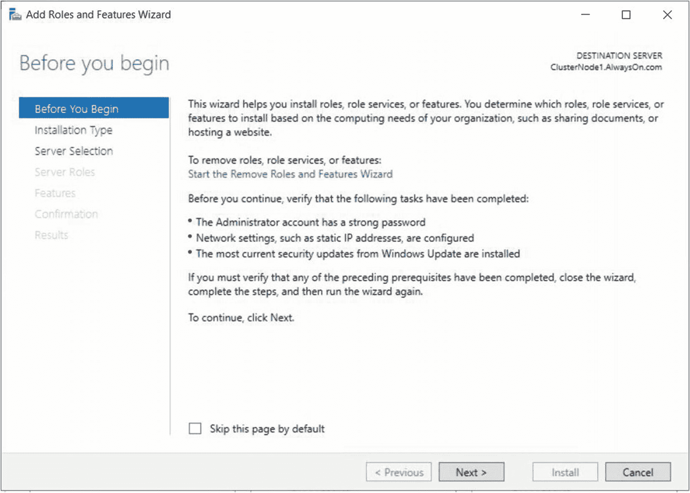

图 3-1 ¶ 开始之前页面

在安装类型页面上，确保选择基于角色或基于功能的安装，如图 3-2 所示。 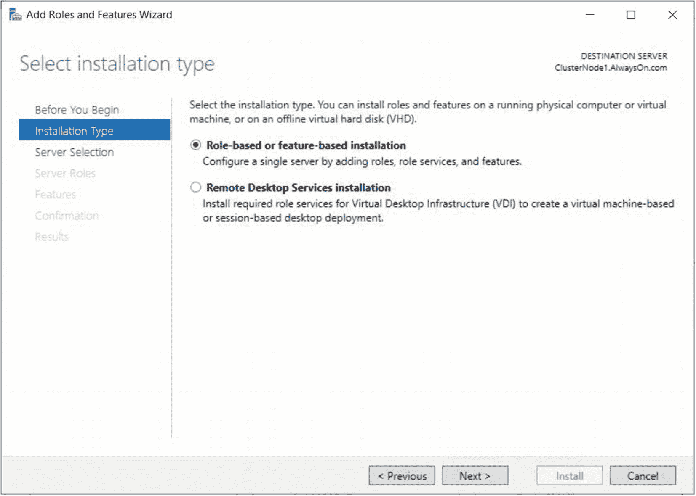

图 3-2 ¶ 安装类型页面

在服务器选择页面上，确保选择您当前正在配置的集群节点。这在图 3-3 中进行了说明。 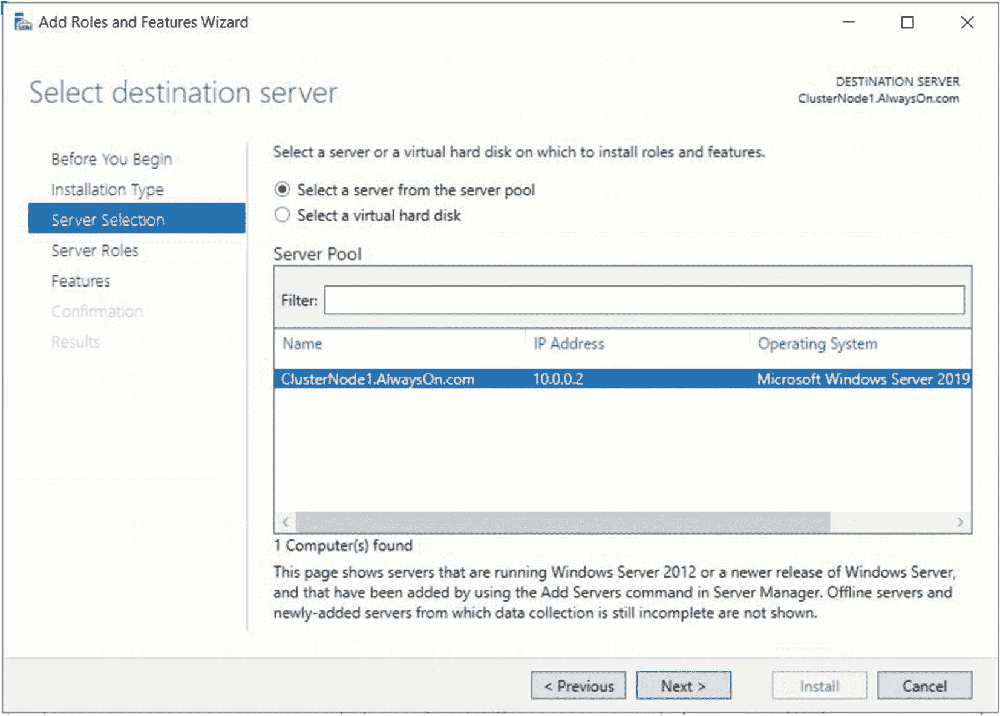

图 3-3 ¶ 服务器选择页面

向导的服务器角色页面允许您选择要配置的任何服务器角色。如图 3-4 所示，这可以包括 Application Server 或 DNS Server 等角色，但在我们的情况下，这是不合适的，因此我们直接进入下一屏幕。 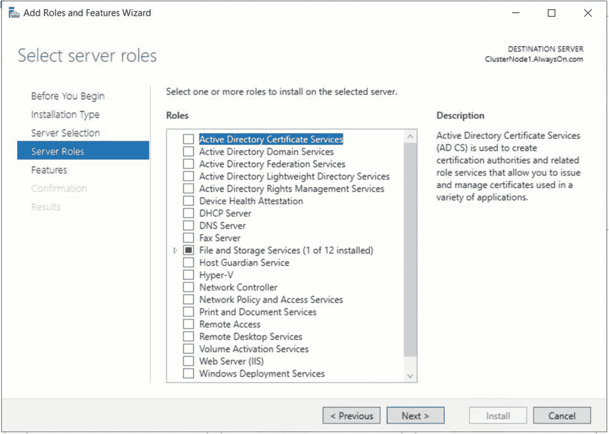

图 3-4 ¶ 服务器角色页面


## 安装故障转移群集

在向导的功能页上，我们需要选择 `Failover Clustering`，如图 3-5 所示。这满足了构建 Windows 群集的先决条件。 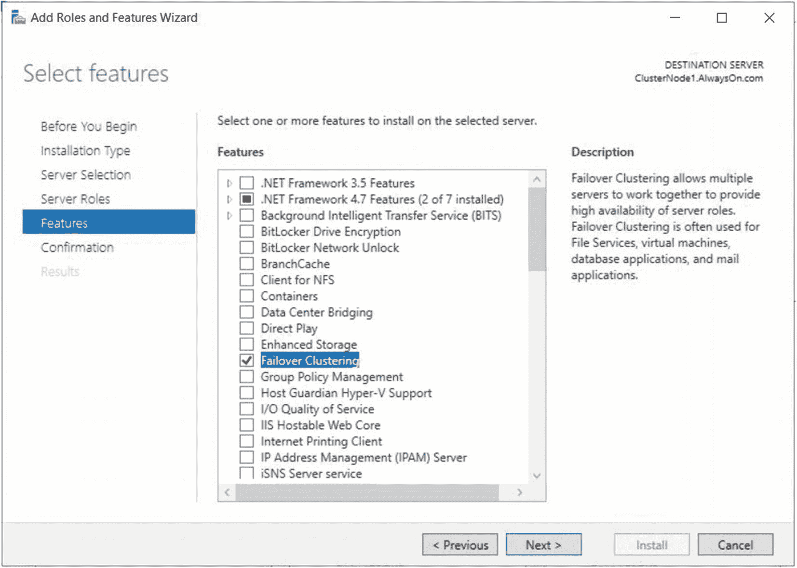
图 3-5 ¶ 功能页

当您选择 `Failover Clustering` 时，向导会显示一个屏幕（图 3-6），询问您是否以复选框的形式安装管理工具。如果您计划直接从节点管理群集，请选中此选项。 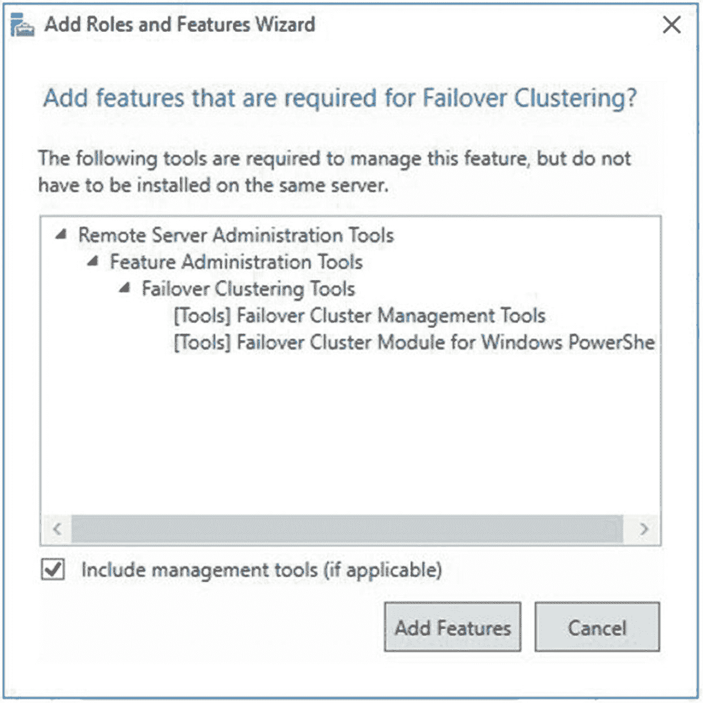
图 3-6 ¶ 选择管理工具

在向导的最后一页，您会看到将要安装的功能摘要，如图 3-7 所示。在这里，如果需要，您可以指定 Windows 介质的位置。您还可以选择服务器是否应自动重启（如果需要）。如果您正在构建新服务器，选中此框是有意义的。但是，如果在添加功能时服务器已在生产环境中运行，请确保考虑当前在该服务器上运行的内容，以及是否应等待维护窗口来执行重启（如果需要）。 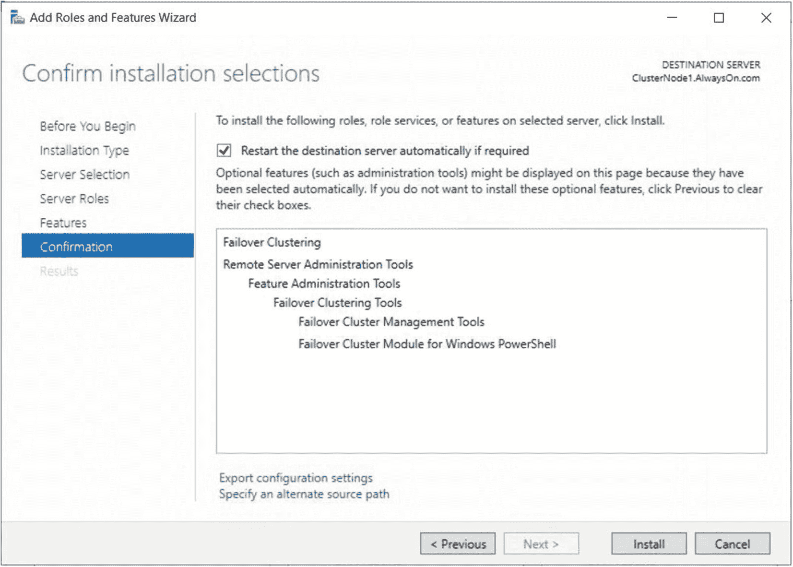
图 3-7 ¶ 确认页

除了通过 `Server Manager` 安装之外，群集服务也可以从 `PowerShell` 安装。列表 3-1 中的 PowerShell 命令可实现与前面步骤相同的结果。
```
Install-WindowsFeature -Name Failover-Clustering –IncludeManagementTools -Verbose
```
列表 3-1
安装群集服务

### 创建群集

一旦在两个节点上安装了群集，您就可以开始构建群集。为此，连接到您打算作为活动节点的服务器，并从 `Administrative Tools` 运行 `Failover Cluster Manager`。

`Create Cluster Wizard` 的“开始之前”页警告说，Microsoft 仅支持通过所有验证测试的群集，如图 3-8 所示。该消息还警告您必须是群集中每个节点的本地管理员。在以前版本的 Windows Server 中，这意味着您必须使用在将参与群集的每台服务器上具有本地管理员权限的域帐户。然而，从 Windows Server 2016 开始，对域身份验证的依赖已被移除，唯一的要求是在每个节点上存在具有一致名称和密码的本地管理员权限帐户。这允许在工作组上或跨多个域创建群集。在以前版本的 Windows Server 中，这两种选项都不可用。 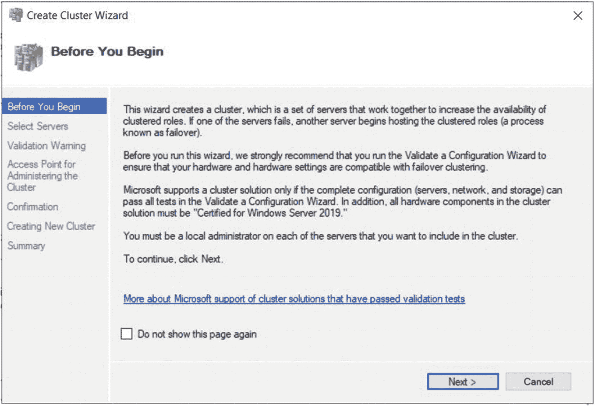
图 3-8 ¶ 开始之前页

在向导的“选择服务器”屏幕上，您需要输入群集节点名称。如图 3-9 所示。在我们的例子中，我们的群集节点分别命名为 `ClusterNode1` 和 `ClusterNode2`。如果它们是域的一部分，则域名称和后缀将附加到服务器名称。 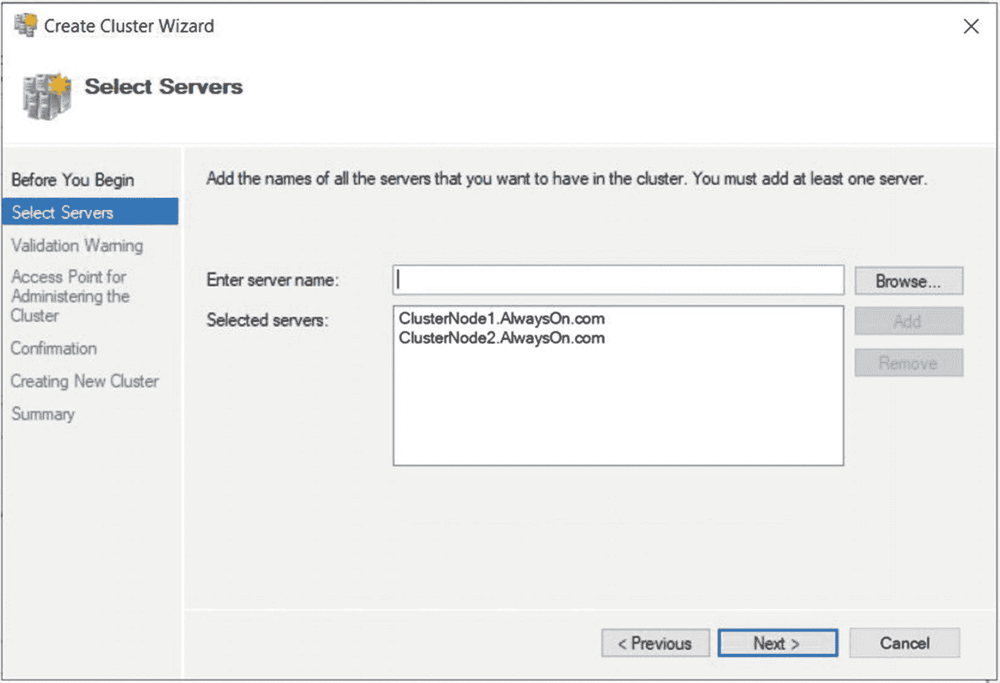
图 3-9 ¶ 选择服务器页

在“验证警告”页上，会询问您是否希望对群集运行验证测试。对于生产服务器，您应始终选择运行此验证，因为除非群集经过验证，否则 Microsoft 不会提供支持。选择运行验证测试会调用 `Validate a Configuration Wizard`。您也可以从 `Failover Cluster Manager` 的“管理”窗格独立运行此向导。“验证警告”页如图 3-10 所示。 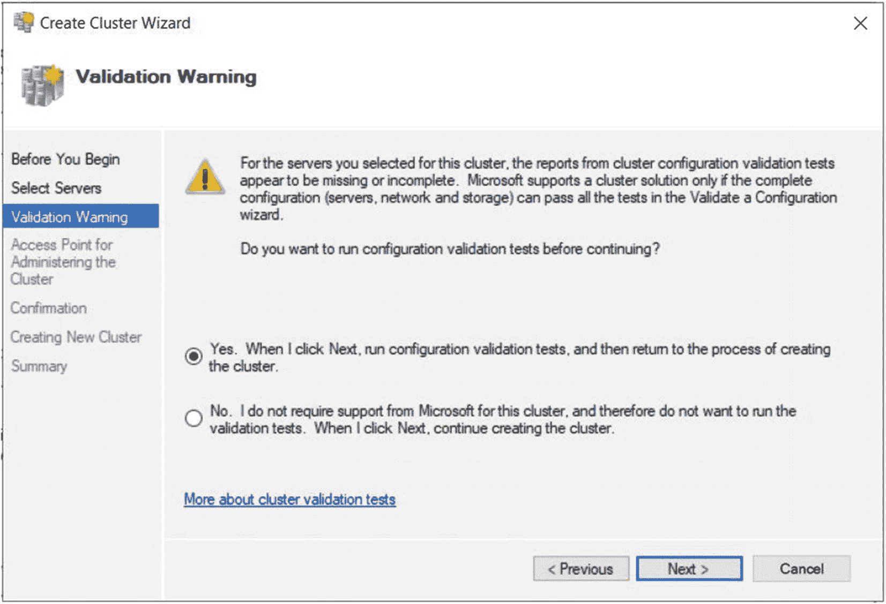
图 3-10 ¶ 验证警告页

### 提示

在某些情况下无法进行验证，在这些情况下，您需要选择“否，我不需要支持…”选项。例如，一些 DBA 选择安装单节点群集而不是独立实例，以便在将来需要时可以扩展为完整群集。然而，这种方法可能会给 Windows 管理员带来操作挑战，因此请务必极其谨慎使用。

在通过 `Validate a Configuration Wizard` 的“开始之前”页后，您会看到“测试选项”页。在这里，您可以选择运行所有验证测试或选择要运行的测试子集，如图 3-11 所示。通常在安装新群集时，您希望运行所有验证测试，但在对群集进行配置更改后，如果您独立调用 `Validate a Configuration Wizard`，能够选择测试子集会很有用。 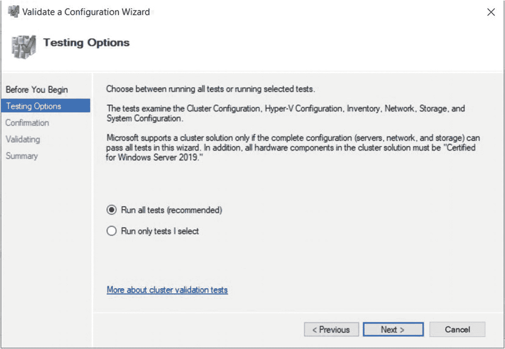
图 3-11 ¶ 测试选项页

在向导的“确认”页上，如图 3-12 所示，您会看到将要运行的测试摘要以及它们将针对的群集节点。测试列表非常全面，包括以下类别：
* 清单（例如识别任何未签名的驱动程序）
* 网络（例如检查有效的 IP 配置）
* 存储（例如验证在节点之间故障转移磁盘的能力）
* 系统配置（例如验证 Active Directory 的配置）
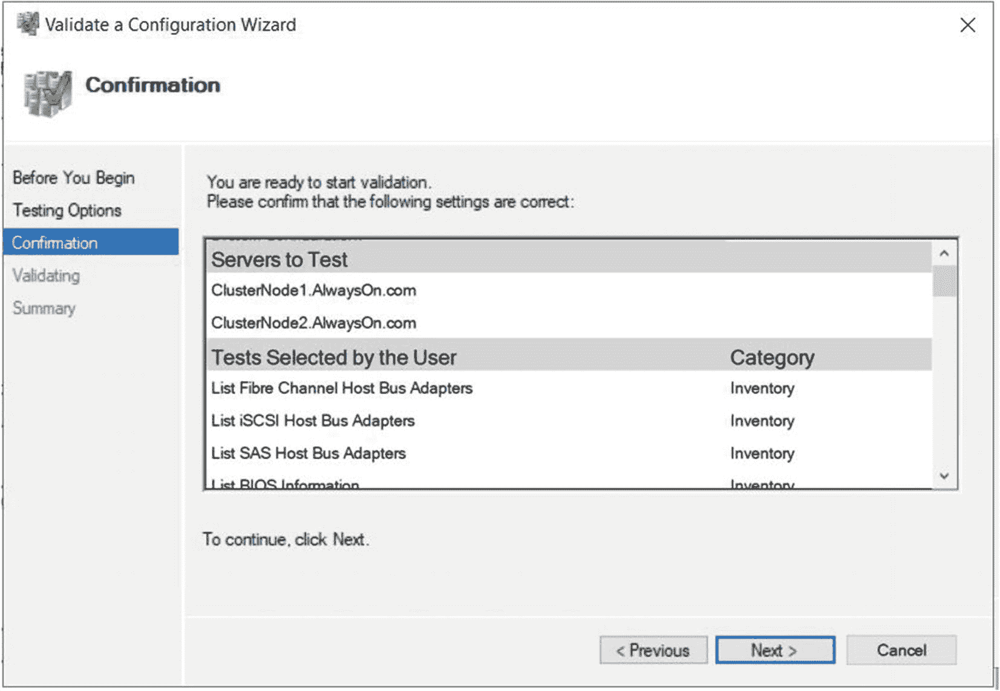
图 3-12 ¶ 确认页

“摘要”页，如图 3-13 所示，提供测试结果以及指向报告 HTML 版本的链接。请务必检查结果中的任何错误或警告。您应始终在继续之前解决错误，但某些警告可能是可以接受的。例如，如果您正在构建群集以托管 `AlwaysOn Availability Groups`，您可能没有任何共享存储。这会生成警告，但在这种情况下不是问题。在 Windows 上配置 `AlwaysOn Availability Groups` 将在第 5 章中进一步详细讨论。 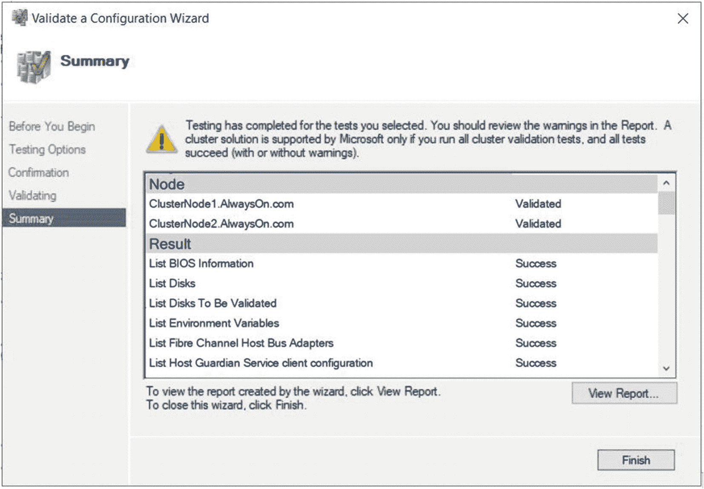
图 3-13 ¶ 摘要页

“查看报告”按钮显示验证报告的完整版本，如图 3-14 所示。超链接会带您进入报告中的特定类别，其中每个测试都有进一步的超链接。这些允许您深入到特定测试生成的消息，使识别错误变得容易。 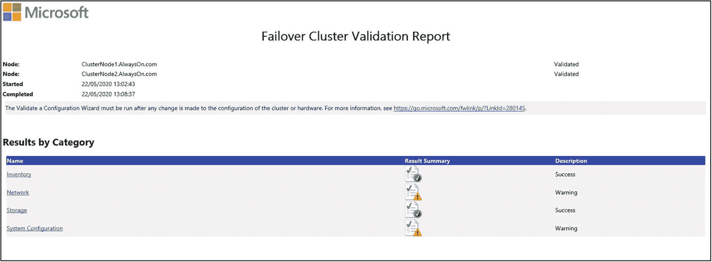
图 3-14 ¶ 故障转移群集验证报告


在摘要页面上单击“完成”会返回到创建群集向导，在那里您会看到“用于管理群集的访问点”页面。此屏幕在图 3-15 中示意。在此页面上，您需要输入群集的虚拟名称。我们将把群集命名为 `ALWAYSON-C`。如果网络卡配置为自动获取 IP 地址，则 IP 地址将通过 DHCP 分配。否则，您需要手动输入 IP 地址。这称为静态 IP，因为它会保持不变，而通过 DHCP 分配的 IP 地址可能会更改。我强烈建议为群集访问点使用静态 IP 以避免动态路由问题，但在群集创建后也可以更改。

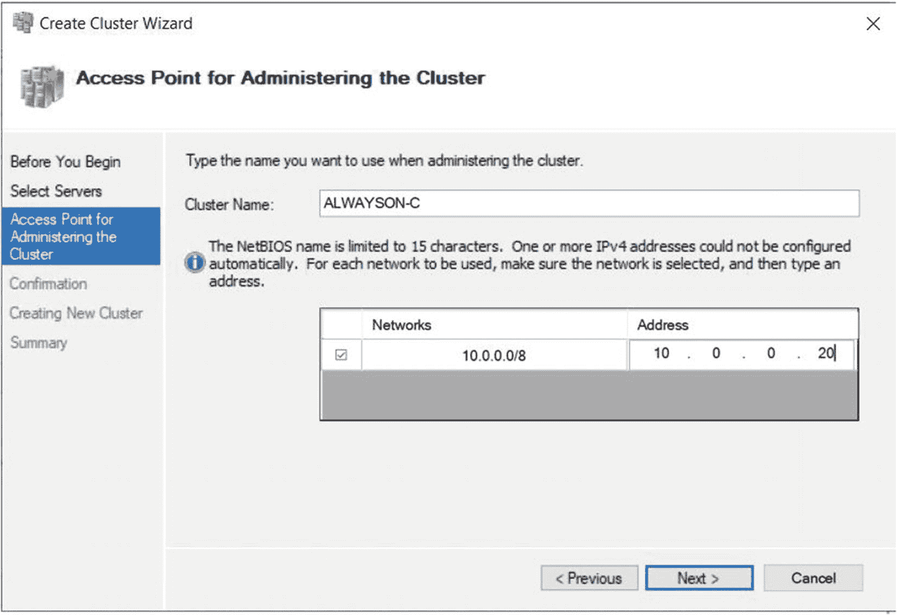

图 3-15 ¶ 用于管理群集的访问点页面

注意
虚拟名称和 IP 地址绑定到当前活动的节点，这意味着在故障转移情况下群集始终可访问。

在我们的例子中，群集位于一个简单的域、一个站点和一个子网内。但是，如果您正在配置多子网群集，则向导会检测到这一点，并且每个子网都需要 IP 地址。在这种情况下，您需要为每个子网输入一个 IP 地址。

注意
节点内的两块 NIC 配置在不同的子网上，以便节点之间的心跳与公共网络隔离。但是，只有当群集节点的数据 NIC 位于不同的子网中时，群集才被视为多子网。

提示
如果您的群集将位于域中，并且您没有权限在包含群集的 OU（组织单位）中创建 AD（Active Directory）对象，则群集的 VCO（虚拟计算机对象）必须已存在，并且您必须已分配“完全控制”权限。

确认页面显示已创建群集的摘要。您还可以使用此屏幕指定是否应将所有符合条件的存储添加到群集，这通常是一个有用的功能。此屏幕在图 3-16 中显示。

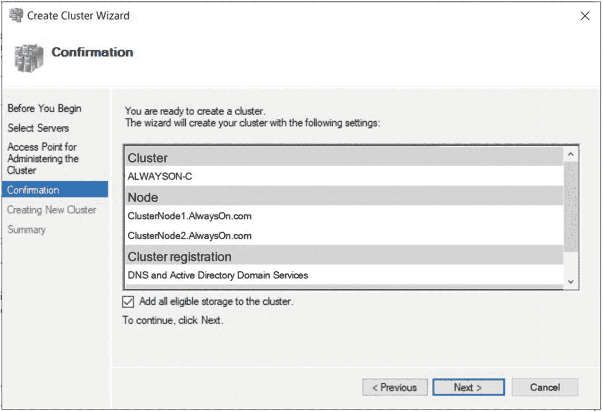

图 3-16 ¶ 确认页面

群集构建完成后，图 3-17 所示的摘要页面会显示。此屏幕汇总了群集名称、IP 地址、节点、已配置的仲裁模型以及有关群集的任何警告的详细信息。它还提供指向报告的 HTML（超文本标记语言）版本的链接。

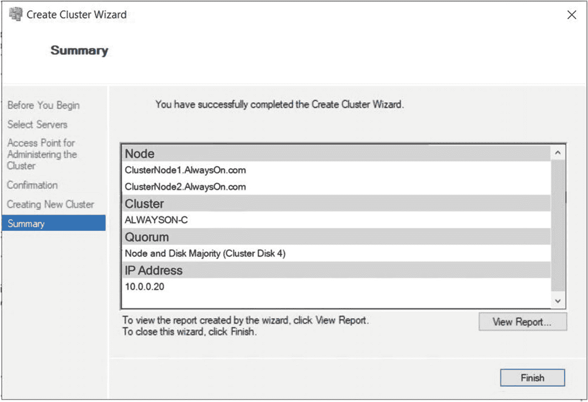

图 3-17 ¶ 摘要页面

创建群集报告显示在群集构建期间已完成的任务的完整列表。

我们也可以使用 PowerShell 创建群集。清单 3-2 中的脚本使用 `Test-Cluster` cmdlet 运行群集验证测试，然后使用 `New-Cluster` cmdlet 配置群集。

```
#Run the validation tests
Test-Cluster -Node Clusternode1,Clusternode2
#Create the cluster
New-Cluster -Node ClusterNode1,ClusterNode2 -Name ALWAYSON-C
```

清单 3-2
验证并创建群集

## 配置群集

许多群集配置可以根据您环境的需求进行更改。本节演示如何更改一些更常见的配置。

### 更改仲裁

如果我们在故障转移群集管理器中检查群集存储，通过钻取 `ALWAYSON-C` ➤ 存储 ➤ 磁盘并突出显示分配给仲裁的磁盘，我们可以看到见证已正确配置为使用仲裁卷。这在图 3-18 中示意。

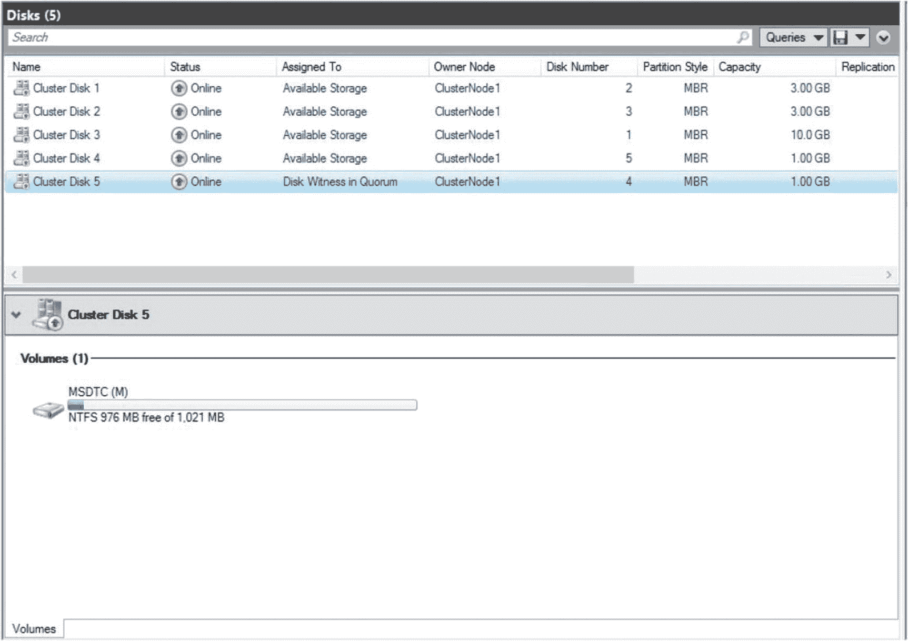

图 3-18 ¶ 群集卷

我们可以通过进入群集的上下文菜单并选择“更多操作” ➤ “配置群集仲裁设置”来修改此设置，这将调用“配置群集仲裁向导”。在图 3-19 所示的“选择仲裁配置选项”页面上，我们选择“选择仲裁见证”选项。

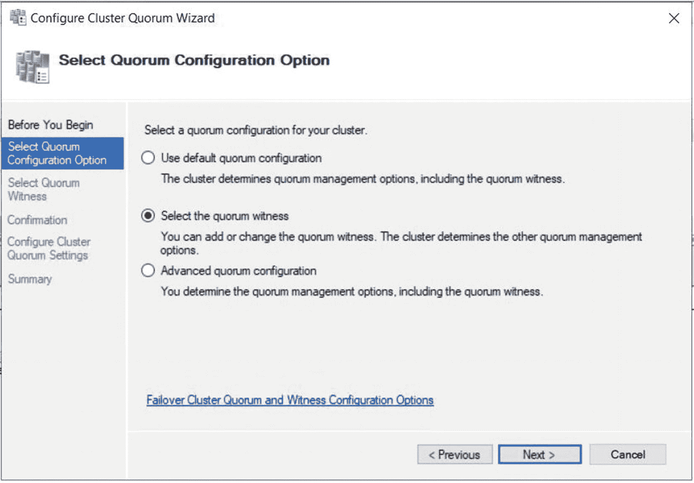

图 3-19 ¶ 选择仲裁配置选项页面

在“选择仲裁见证”页面上，我们选择要配置的仲裁类型。当群集中有偶数个节点并且所有节点都位于同一数据中心时，或当主数据中心中有偶数个节点且在辅助数据中心中还有另一个节点时，磁盘见证最为合适。

当节点分布在两个数据中心，并且您有权访问第三个数据中心，在那里可以提供文件共享作为仲裁时，文件共享见证最为合适。Windows Server 2019 支持在任何支持 SMB 2.0 或更高版本的设备上的文件共享。这包括可以连接到网络路由器的 USB 密钥。

当节点分布在两个数据中心，并且没有第三个数据中心可用于设置文件共享见证时，云见证最为合适。要使用云见证，您必须拥有 Azure 存储帐户，因为见证将创建在 Azure BLOB 存储中。

当单个数据中心中有奇数个节点时，最合适的做法是不配置见证。

对于我们的场景，我们将选择配置磁盘见证的选项。这在图 3-20 中示意。

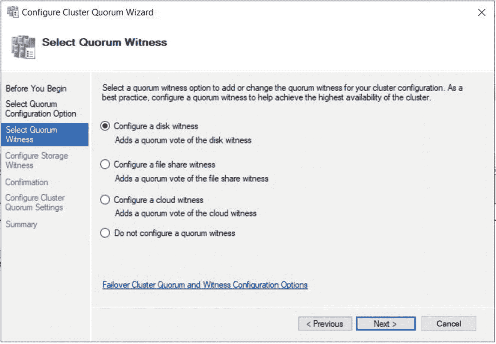

图 3-20 ¶ 选择仲裁见证页面

在向导的“配置存储见证”页面上，我们可以选择用作仲裁的正确磁盘。在我们的例子中，这是磁盘 4，如图 3-21 所示。

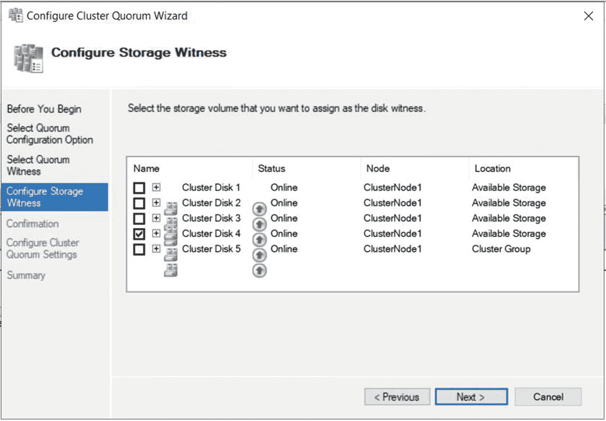

图 3-21 ¶ 配置存储见证页面

向导的摘要页面详细说明将对群集进行的配置更改。它还强调动态仲裁管理已启用，并且所有节点加上仲裁磁盘在仲裁中都有投票权。

我们还可以使用清单 3-3 中的 PowerShell 命令从命令行执行此配置。在这里，我们使用 `Set-ClusterQuorum` cmdlet 并传入群集的名称，然后是希望配置的仲裁类型。因为磁盘包含在此仲裁类型中，所以我们还可以传入计划使用的群集磁盘的名称，正是这一方面使我们能够更改仲裁磁盘。

提示
如果使用 PowerShell 按照演示操作，请记住更改磁盘编号以匹配您自己的配置。

```
Set-ClusterQuorum -Cluster ALWAYSON-C -NodeAndDiskMajority "Cluster Disk 4"
```

清单 3-3
配置仲裁磁盘

### 高级仲裁配置

Windows Server 的最新版本允许您配置高级仲裁配置，例如投票权重和群集见证。在本节中，我们将探讨如何配置节点的投票权重。


## 节点权重和仲裁配置

节点权重通常在您拥有 *多子网集群* 时很有用。在此场景中，建议您在第三个站点使用文件共享见证。这有助于避免由于数据中心之间网络故障而导致的群集中断。然而，如果仲裁中的节点数为奇数，则添加文件共享见证会使您拥有偶数票，这很危险。从辅助数据中心的一个节点中移除投票可以消除此问题。

您还可以使用节点权重暂时从失败的节点中移除投票，以避免其影响仲裁。我也见过一些人将所有节点配置为无投票，只保留磁盘见证的唯一投票。这里的想法是避免在不同时间不同节点发生故障时需要动态更改投票配置。然而，我会避免这种方法，因为它会将对仲裁磁盘的连接引入为单点故障。如果您的仲裁磁盘与群集失去连接，群集将变得不可用。

每个节点的投票权重都可以通过使用配置群集仲裁向导并在选择仲裁配置选项页上选择高级仲裁配置选项来修改。这会导致显示选择投票配置页，如图 3-22 所示。 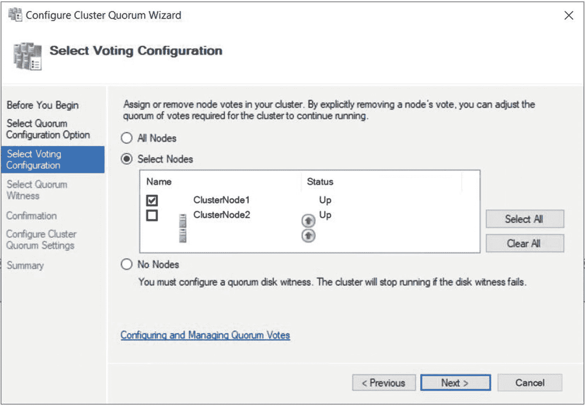

图 3-22 ¶ 选择投票配置页

在此示例中，我们已从 `ClusterNode2` 中移除了投票，假设该节点已失败，我们不希望它影响我们的仲裁。

**注意**
要继续本示例的其余部分，您必须拥有一个 Azure 存储帐户。该帐户的类型必须是“General Purpose”，并且应配置为标准性能层并具有本地冗余存储。

要将我们的磁盘见证更改为云见证，我们然后将从向导的配置群集仲裁页中选择配置云见证选项，如图 3-23 所示。 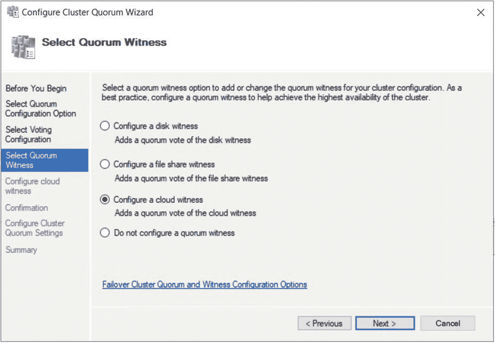

图 3-23 ¶ 选择仲裁见证页

由于我们的选择，接下来将显示向导的配置云见证页，如图 3-24 所示。在这里，我们需要输入 Azure 存储帐户的名称和存储帐户的主访问密钥。访问密钥可以在 Azure 门户中找到，通过 Storage Accounts ➤ <存储帐户名称> ➤ Access keys 导航并复制 Key 1。通常，服务终结点将保持默认值；然而，在某些情况下您可能需要更改它。例如，中国的 Azure 存储帐户使用不同的终结点。 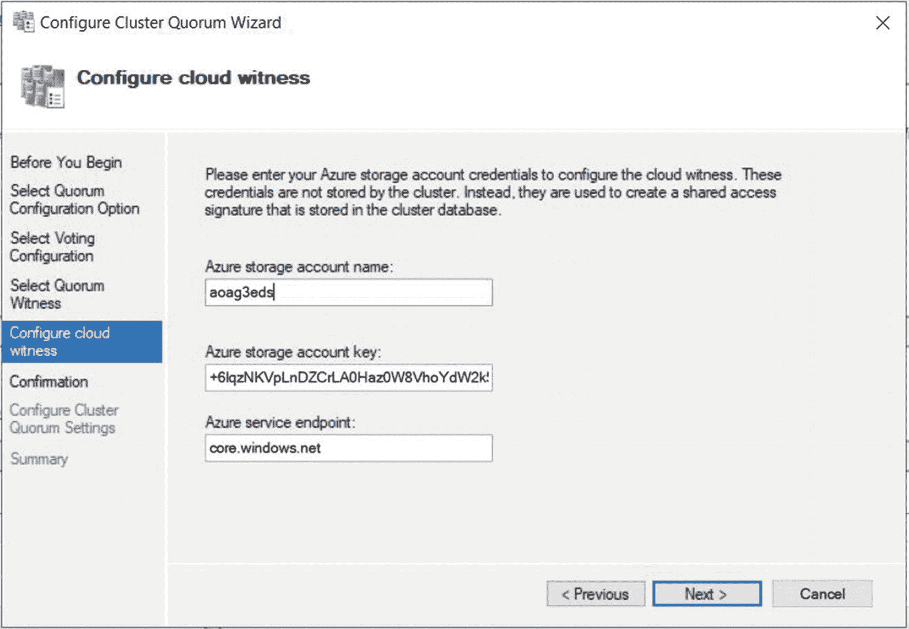

图 3-24 ¶ 配置云见证页

**注意**
访问密钥不会保存在群集配置中。相反，会生成一个 `SAS`（共享访问签名）。

向导的最后一页（图 3-25）显示确认页。在这里，您应在选择下一步以应用设置之前检查详细信息。 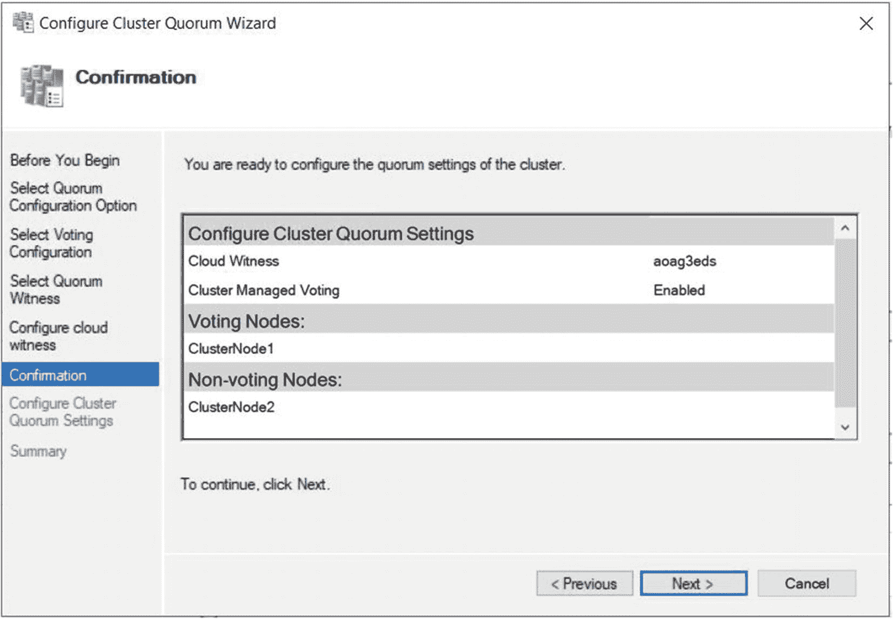

图 3-25 ¶ 确认页

**提示**
如果您收到一条通用错误，要求您确认存储帐户详细信息和通过 HTTPS 的连接性，我发现最常见的原因是连接性。云见证要求从所有群集节点到 Azure 存储帐户的端口 `443` 保持开放。

要配置节点的节点权重，您可以使用列表 3-4 中的脚本。

```
Import-Module FailoverClusters
(Get-ClusterNode CLUSTERNODE2).NodeWeight = 0
```

列表 3-4
设置节点权重

要使用 PowerShell 配置云见证，请使用列表 3-5 中的脚本。

**提示**
请确保将帐户名称和访问密钥更改为与您自己的相匹配。

```
Import-Module FailoverClusters
Set-ClusterQuorum -CloudWitness -AccountName aoag3eds -AccessKey +6lqzNKVpLnDZCrLA0Haz0W8VhoYdW2k==
```

列表 3-5
使用 PowerShell 配置云见证

**注意**
本书其余部分的示例假定两个节点均具有投票权并且使用磁盘见证。

### 配置 MSDTC

如果您的 SQL Server 实例使用分布式事务，或者如果您正在安装 SQL Server Integration Services (`SSIS`)，则它依赖于 `MSDTC`（Microsoft 分布式事务协调程序）。如果您的实例将使用 `MSDTC`，则需要确保其已正确配置。如果没有，安装将成功，但依赖于它的事务可能会失败。

当安装在群集上时，SQL Server 会自动使用安装在同一角色中的 `MSDTC` 实例（如果存在）。如果不存在，则它使用已映射到的 `MSDTC` 实例（如果已执行此映射）。如果没有映射，它将使用群集的默认 `MSDTC` 实例，如果没有，则使用本地计算机的 `MSDTC` 实例。

许多 DBA 选择在与 SQL Server 相同的角色中安装 `MSDTC`；然而，这会引入一个问题。如果 `MSDTC` 失败，它也可能导致 SQL Server 实例宕机。当然，群集会尝试将两个应用程序都启动到不同的节点上，但这仍然涉及停机时间，包括在新节点上恢复数据库所需的时间，而该时间是非确定性的。因此，我建议将 `MSDTC` 安装在单独的角色中。如果您这样做，SQL Server 实例仍会使用 `MSDTC`，因为它是群集的默认实例，并且它消除了 `MSDTC` 导致 SQL Server 中断的可能性。这也比使用映射实例或本地计算机实例更可取，因为它避免了不必要的配置，并且当群集 SQL Server 实例使用它时，`MSDTC` 实例应为群集。

要创建 `MSDTC` 角色，请先在故障转移群集管理器中从角色上下文菜单中选择配置角色选项。这会调用高可用性向导。在向导的 选择角色页 上，选择分布式事务协调程序 (DTC) 角色类型，如图 3-26 所示。 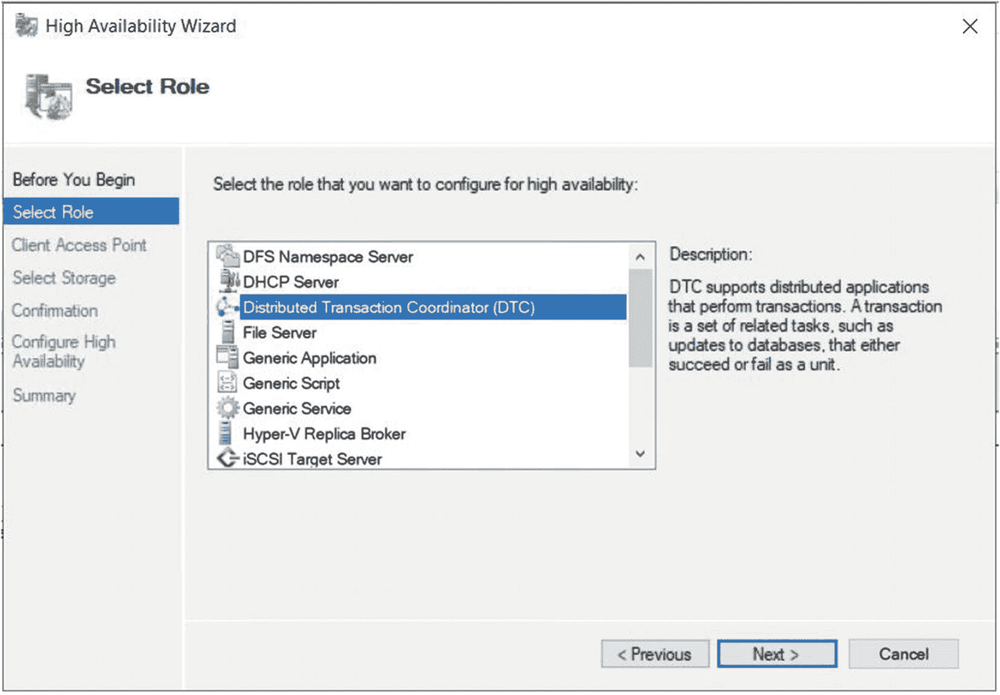

图 3-26 ¶ 选择角色页

在图 3-27 所示的客户端访问点页上，您需要为 `MSDTC` 输入虚拟名称和 IP 地址。在我们的例子中，我们将其命名为 `ALWAYSON-MSDTC-C` 并分配 `10.0.0.21` 作为 IP 地址。在多子网群集中，您需要为每个网络提供一个 IP 地址。 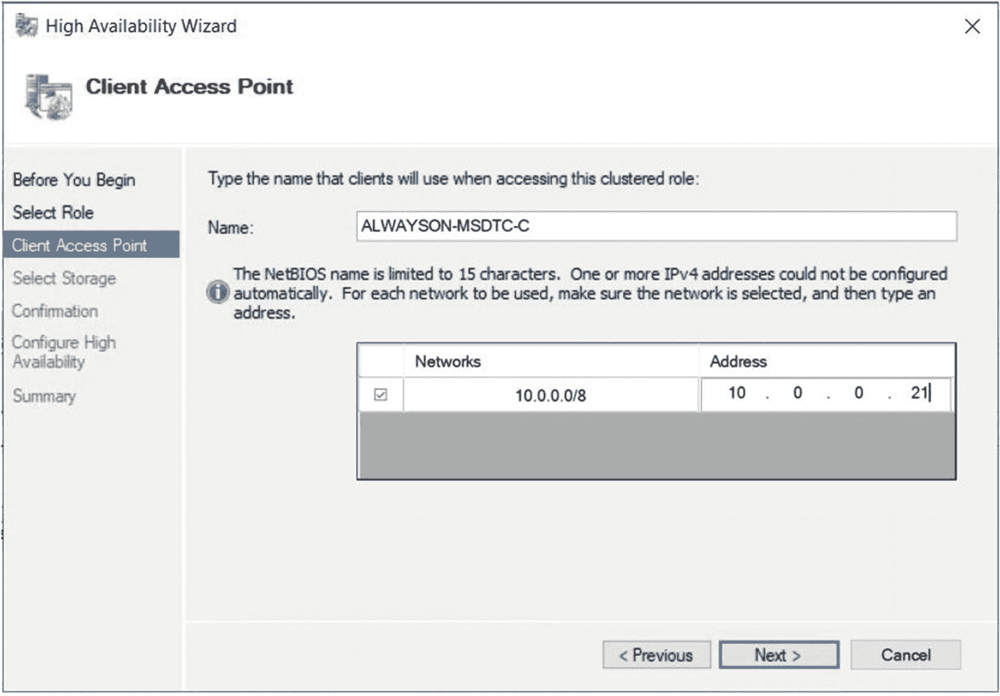

图 3-27 ¶ 客户端访问点页

在向导的 选择存储页 上，选择您计划存储 `MSDTC` 文件的群集磁盘，如图 3-28 所示。在我们的例子中，这是磁盘 4。 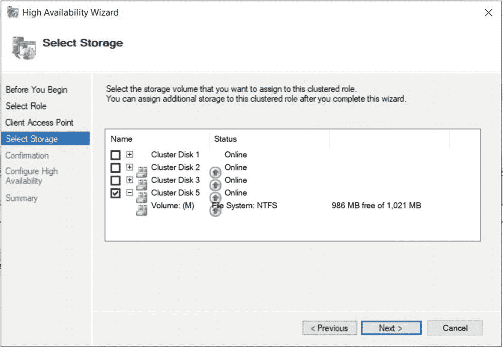

图 3-28 ¶ 选择存储页

确认页显示了即将创建的角色的概述。

或者，我们可以在 PowerShell 中创建此角色。列表 3-6 中的脚本首先使用 `Add-ClusterServerRole` cmdlet 创建角色。我们将用于角色的虚拟名称传递给 `Name` 参数，将用于的群集磁盘名称传递给 `Storage` 参数，并将角色的 IP 地址传递给 `StaticAddress` 参数。


我们然后使用 `Add-ClusterResource` cmdlet 来添加 DTC 资源。Name 参数为资源命名，而 ResourceType 参数指定其为 DTC 资源。然后我们需要在角色内的资源之间创建依赖关系。使用 GUI 时我们无需执行此操作，因为依赖关系会自动为我们创建。资源依赖关系指定其他资源所依赖的资源或资源。资源故障会沿着链条传播，并可能导致角色脱机。例如，在我们的 ALWAYSON-MSDTC-C 角色中，如果磁盘或虚拟名称变得不可用，DTC 资源将脱机。Windows Server 支持具有 AND 和 OR 约束的多个依赖关系。正是 OR 约束使得多子网集群成为可能，因为资源可以依赖于 IP 地址 A 或 IP 地址 B。最后，我们需要使用 `Start-ClusterGroup` cmdlet 将角色联机。

## 创建 MSDTC 角色
```
#Create the Role
Add-ClusterServerRole -Name ALWAYSON-MSDTC-C -Storage "Cluster Disk 3" -StaticAddress 192.168.0.50
#Create the DTC Resource
Add-ClusterResource -Name MSDTC-ALWAYSON-MSDTC-C -ResourceType "Distributed Transaction Coordinator" -Group ALWAYSON-MSDTC-C
#Create the dependencies
Add-ClusterResourceDependency MSDTC-ALWAYSON-MSDTC-C ALWAYSON-MSDTC-C
Add-ClusterResourceDependency MSDTC-ALWAYSON-MSDTC-C "Cluster Disk 3"
#Bring the Role online
Start-ClusterGroup ALWAYSON-MSDTC-C
```
清单 3-6

创建 MSDTC 角色

### 配置角色
创建角色后，您可能希望配置它以更改故障转移策略或将节点配置为首选所有者。要配置角色，请从角色的上下文菜单中选择“属性”。在“属性”对话框的“常规”选项卡中，如图 3-29 所示，您可以配置节点作为角色的首选所有者。您还可以通过在“首选所有者”窗口中将节点移至其他节点之上或之下，来更改节点首选项的优先级顺序。
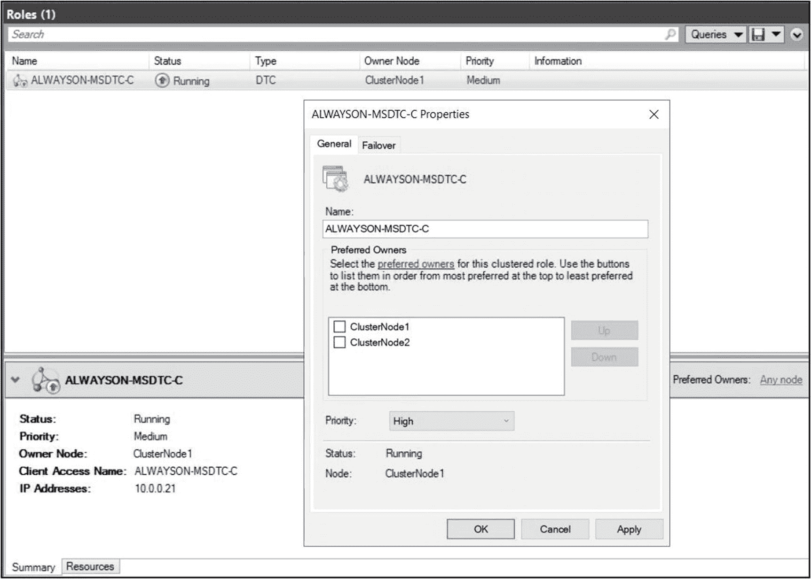
图 3-29 ¶ 通用选项卡

您还可以选择在多个角色同时故障转移到另一个节点时角色的优先级。此设置的选项如下：
* 高
* 中
* 低
* 不自动启动

我们将配置 ALWAYSON-MSDTC-C 角色以高优先级进行故障转移。

在“属性”对话框的“故障转移”选项卡中，您可以配置角色在给定时间内可以故障转移的次数，然后角色将被置于脱机状态。此默认值是一次故障，时间为 6 小时。此问题在于，如果角色发生故障转移，并且在原始节点上修复问题后，您将角色故障转移回来，则在 6 小时窗口内不再允许进行故障转移。这显然是一个风险，我通常建议您更改此设置。在我们的例子中，我们已配置角色在 24 小时时间窗口内最多允许三次故障转移，如图 3-30 所示。我们还配置了角色在再次可用时故障转移回最首选的所有者。请记住，在设置自动故障恢复时，故障恢复也会像故障转移一样导致停机。如果您追求非常高的可用性，例如五个 9，那么此选项可能不合适。我们将配置 ALWAYSON-MSDTC-C 角色允许三次故障转移，时间为 24 小时。我们还将配置角色允许立即故障恢复。
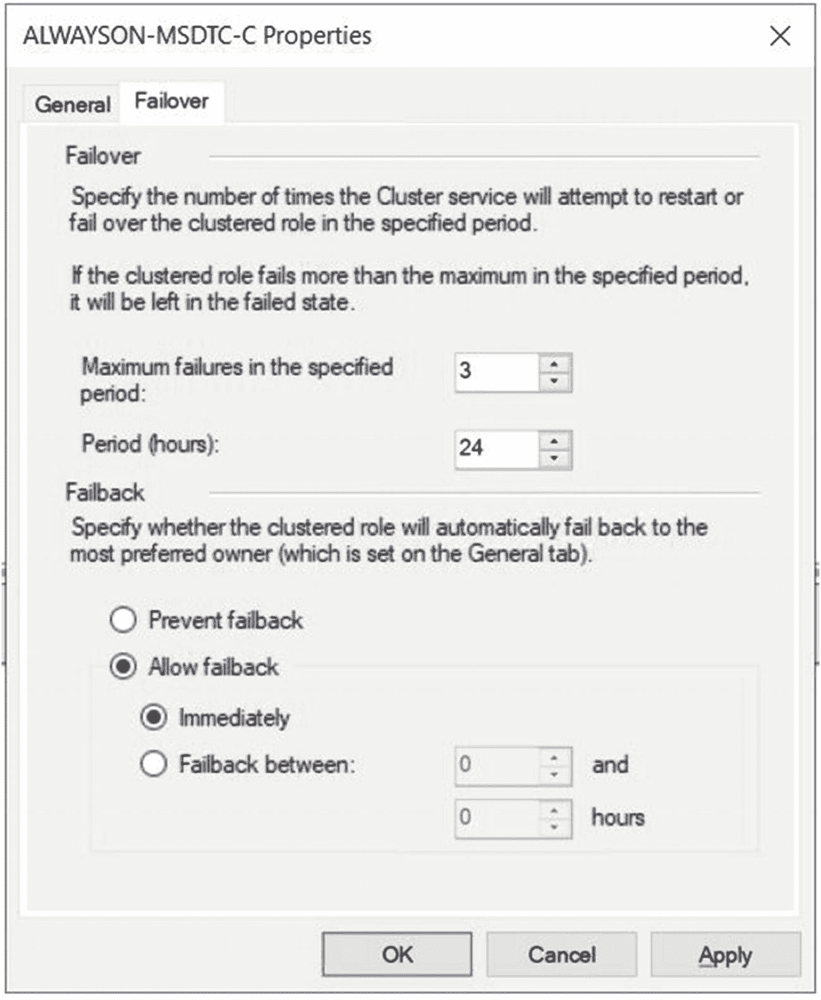
图 3-30 ¶ 故障转移选项卡

## 摘要
在创建群集之前，必须在所有节点上安装 Microsoft 群集服务 (MCS)。这可以通过使用“添加角色和功能向导”安装群集功能来实现。

一旦安装了群集功能，就可以使用“创建群集向导”在每个节点上配置群集。在构建群集之前，此向导会提示您运行群集验证向导。群集验证向导将验证环境是否满足群集的要求。如果发现环境不满足要求，您可以继续构建群集，但安装将不会得到 Microsoft 的支持。

一旦群集构建完成，还需要对其进行配置。这将包括配置仲裁模式，也可能包括配置 MSDTC。在群集上创建角色后，您可能还希望使用故障转移策略或首选所有者来配置角色。
