# 4. 实现 AlwaysOn 故障转移群集实例
Peter A. Carter^(1 ) (1) Botley, UK
结束摘要 一旦群集构建并配置完成，就该安装 SQL Server AlwaysOn 故障转移群集实例了。在我们的场景中，我们希望构建一个群集实例，该实例跨越我们在第 3 章构建的 Windows 群集的两个节点。我们还将讨论如何使用 PowerShell 构建故障转移群集实例。为此，我们需要在群集的主节点上使用“安装 SQL Server 故障转移群集”向导。然后我们需要运行“添加节点”向导，以允许被动节点在故障转移时托管实例。因此，在本章中，我们将执行以下任务：
* 在活动群集节点上安装 SQL Server 故障转移群集实例。
* 配置向导的被动节点以支持故障转移群集实例。

## 构建实例
AlwaysOn 故障转移群集实例可以使用“安装 SQL Server 故障转移群集”向导构建，可通过在托管群集核心资源的节点上打开 SQL Server 安装中心，并从“安装”中选择“新建 SQL Server 故障转移群集安装”选项来调用。SQL Server 安装中心的“安装”选项卡如图 4-1 所示。
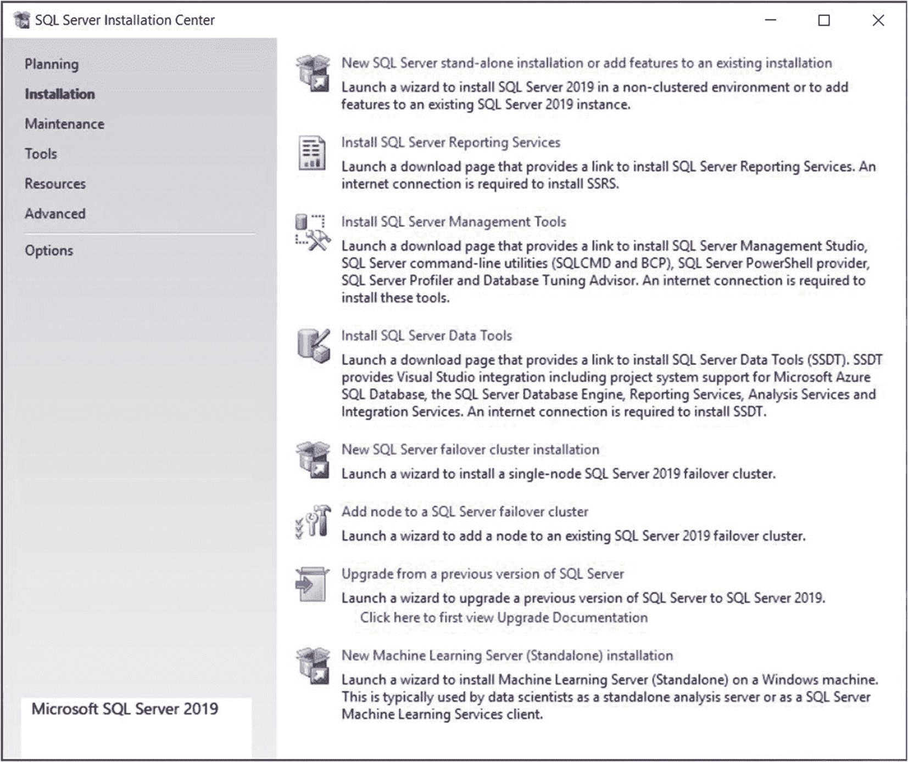
图 4-1 ¶ SQL Server 安装中心 – 安装选项卡

向导的产品密钥页是首先显示的，如图 4-2 所示。在向导的此页面上，您可以选择要安装的 SQL Server 的其中一个免费版本，或输入产品密钥或批量许可密钥，这将自动确定要安装的正确 SQL Server 版本。
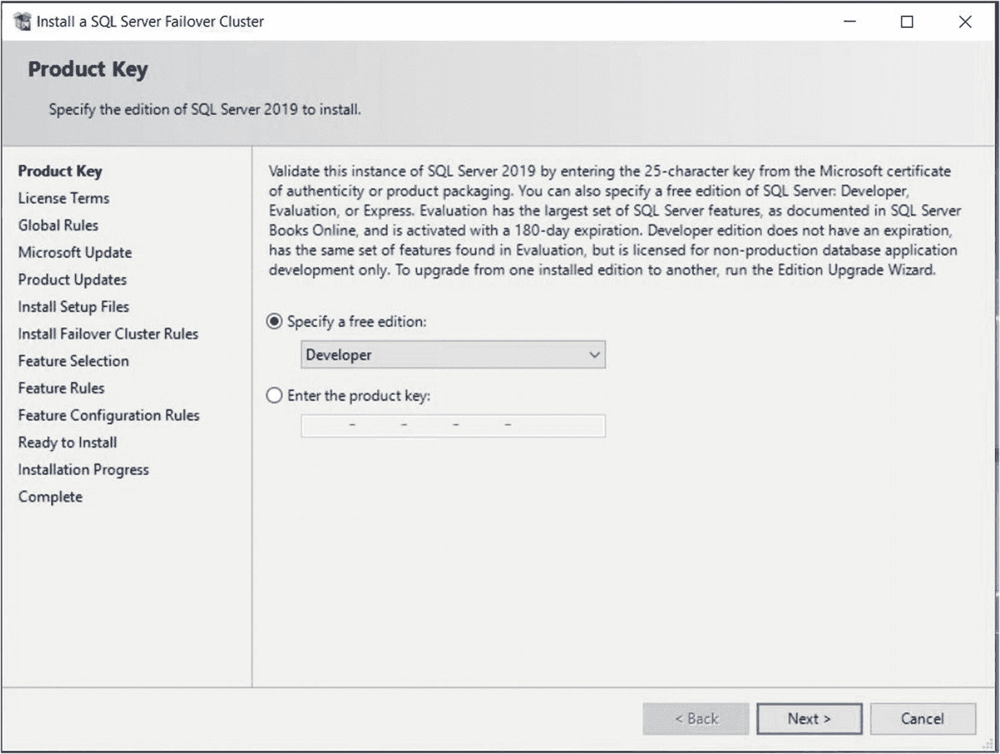
图 4-2 ¶ 安装 SQL Server 故障转移群集向导 – 产品密钥页

提示
在 SQL Server 2019 中，功能上等同于企业版的 Developer Edition 是免费的。在 SQL Server 2016 之前，此非商业许可证会收取少量费用。

在向导的“许可条款”页（图 4-3）上，您将被邀请通过复选框接受 Microsoft 的许可条款。未经同意，安装无法继续。
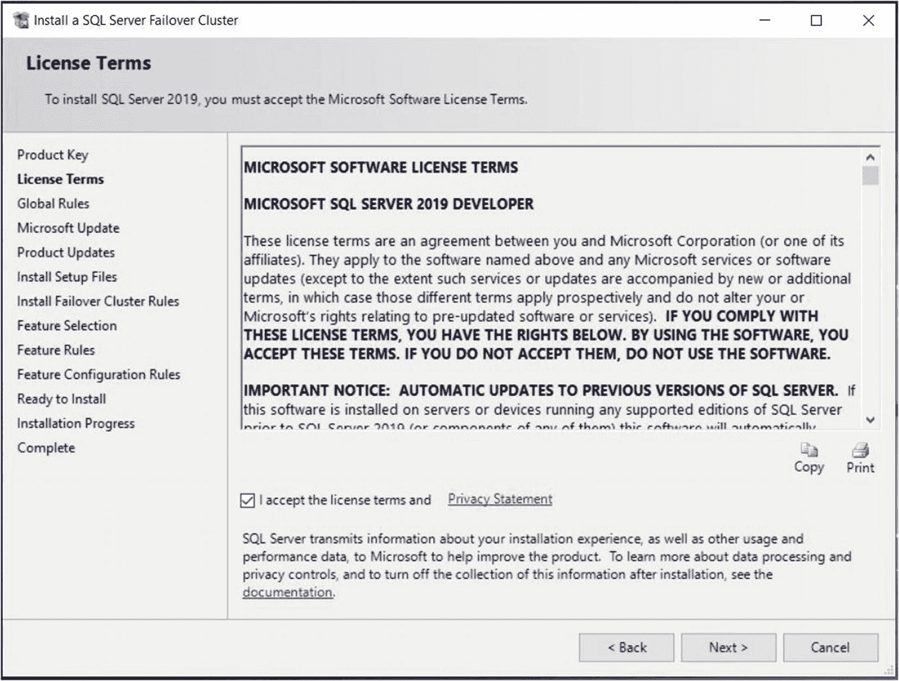
图 4-3 ¶ 安装 SQL Server 故障转移群集向导 – 许可条款页


## SQL Server 故障转移群集向导安装

## Microsoft Update 页面

全局规则现在将被检查，以确保设置支持文件可以成功安装。当所有检查通过后，如图 4-4 所示的向导的 Microsoft Update 页面，将提示您选择是否希望 Windows Update 检查 SQL Server 补丁和热修复。此处的选择将取决于您组织的补丁策略。一些组织实施严格的补丁制度用于补丁的测试和验收，然后是补丁周期，这通常由 `WSUS`（Windows Server Update Services）等软件支持。如果您组织中存在此类制度，则不应选择此选项。 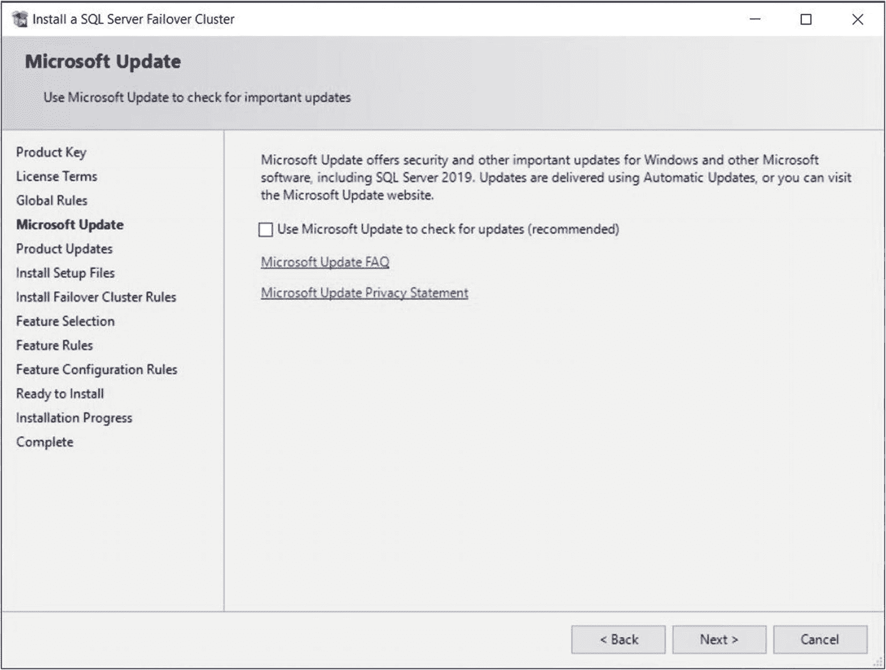

图 4-4 ¶ 安装 SQL Server 故障转移群集向导 – Microsoft Update 页面

## 产品更新页面

如果您选择检查更新，并且发现任何可用更新，则向导的产品更新页面将列出找到的任何可用更新。您应使用复选框确认是否应安装它们。

在设置支持文件和任何产品更新（如果适用）下载、提取并安装后，将检查故障转移群集实例的安装规则，并将结果显示在向导的安装故障转移群集规则页面上，如图 4-5 所示。 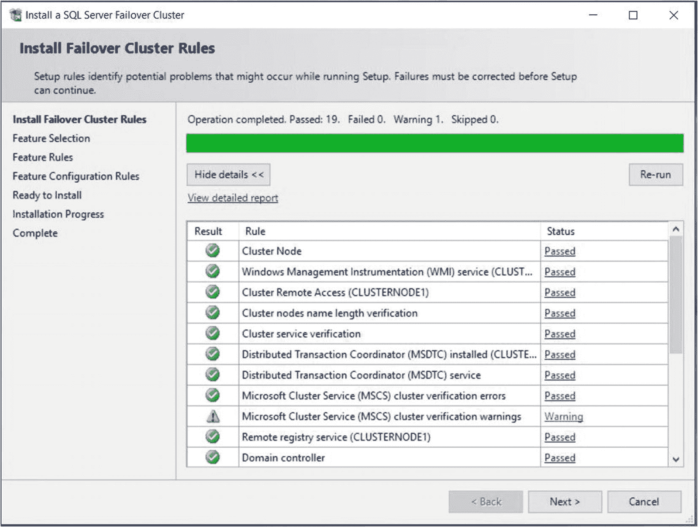

图 4-5 ¶ 安装 SQL Server 故障转移群集向导 – 安装故障转移群集规则

如果您看到 Windows 防火墙的警告，这可能只是因为防火墙已打开。它并不表示所需的端口未打开。有关为 SQL Server 配置防火墙的更多信息，我推荐 Apress 出版的书籍 *Securing SQL Server 2nd Edition: DBAs Defending the Database*，该书可从 [`www.apress.com/gb/book/9781484241608`](http://www.apress.com/gb/book/9781484241608) 获取。

在此实例中，我们看到群集验证的警告。这是在群集验证通过但带有警告时造成的。在我们的例子中，这是因为群集节点上的修补程序未更新。理想情况下，应在继续之前解决此问题。

## 功能选择页面

在向导的功能选择页面上，如图 4-6 所示，您将选择要安装的 SQL Server 2019 产品套件的功能。为本书的目的，我们将选择安装数据库引擎和 SQL Server Integration Services (`SSIS`)。 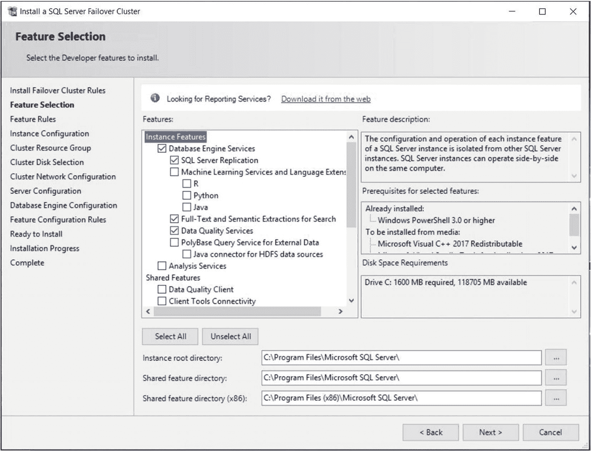

图 4-6 ¶ 安装 SQL Server 故障转移群集向导 – 功能选择页面

值得注意的是，`SSIS` 不具备群集感知功能，也不是为群集而设计的。在某些情况下，您可能会决定对 Integration Services 服务进行群集，如果是这种情况，则可以通过创建类型为 `Generic` 的群集角色并将 Integration Services 服务添加为依赖项来解决此限制。然而，在大多数情况下，管理群集实例上的 `SSIS` 的最合适方法是在群集的每个节点上将 Integration Services 服务作为独立服务安装。

此外，向导的功能选择页面要求您指定实例根文件夹和共享功能文件夹的位置。您可能希望将它们移动到不同的驱动器，以便将 `C:\\` 驱动器留给操作系统。这可能是出于空间原因的考虑，或者只是为了将 SQL Server 二进制文件与其他应用程序隔离。

实例根目录通常包含您在服务器上创建的每个实例的文件夹，并且数据库引擎、`SSAS` 和 `SSRS` 安装将有单独的文件夹。与数据库引擎关联的文件夹将称为 `MSSQL15.[InstanceName]`，其中实例名称是实例的名称，或对于默认实例为 `MSSQLSERVER`。文件夹名称中的数字 15 与 SQL Server 的版本相关，对于 SQL Server 2019 为 15。

该文件夹将包含一个名为 `MSSQL` 的子文件夹，其中反过来将包含存储与实例关联的文件的文件夹，包括一个名为 `Binn` 的文件夹，其中包含与实例关联的应用程序文件、应用程序扩展和 XML 配置；一个名为 `Backup` 的文件夹，将是数据库备份的默认位置；以及一个名为 `Data` 的文件夹，将是系统数据库的默认位置。

`TempDB`、用户数据库和备份的默认文件夹可以在安装过程中稍后修改，将这些数据库拆分到单独的卷中通常是一个良好的实践，但如果您的数据位于 SAN 上（如第 3 章所述），则可能不是必要的（甚至不可能）。这里还将创建其他文件夹，包括一个名为 `LOGS` 的文件夹，将是错误日志和默认扩展事件运行状况跟踪文件的默认位置。

如果您在 64 位环境中安装 SQL Server，您将被要求输入共享功能目录的 32 位和 64 位版本的文件夹。这是因为某些 SQL Server 组件始终作为 32 位进程安装。32 位和 64 位组件不能共享目录，因此要继续安装，您必须为这些选项中的每一个指定不同的文件夹。共享功能目录成为所有 SQL Server 实例共享的功能的根级目录，例如 `SDKs` 和管理工具。

## 实例配置页面

检查所选功能的安装规则，如果所有规则都通过，则将显示实例配置页面，如图 4-7 所示。在向导的此页面上，您将指定实例的名称。由于实例将被群集，此页面还要求您指定实例的网络名称。在此场景中，我们将安装 SQL Server 的默认实例，这意味着我们无需指定实例名称。我们将分配 `ALWAYSON-SQL-C` 作为网络名称。 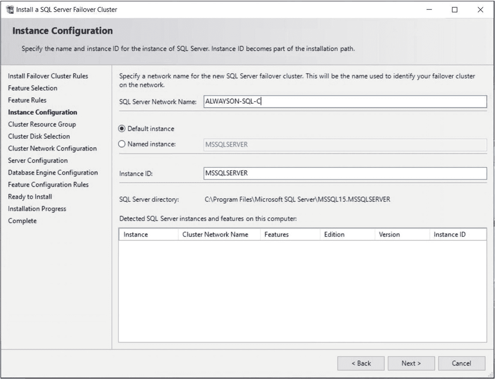

图 4-7 ¶ 安装 SQL Server 故障转移群集向导 – 实例配置页面

### 提示

SQL Server 使用术语群集资源组来描述群集角色。群集角色是 Microsoft 的较新术语，在本章中，这两个术语应视为同义。

## 群集资源组页面

在向导的群集资源组页面上，我们可以选择现有群集资源组（这提供了 Windows 管理员预先创建资源组的选项）或输入新资源组的名称，然后由设置创建。在我们的例子中，我们将指定 `ALWAYSON-SQL-C` 作为新资源组的名称。这如图 4-8 所示。 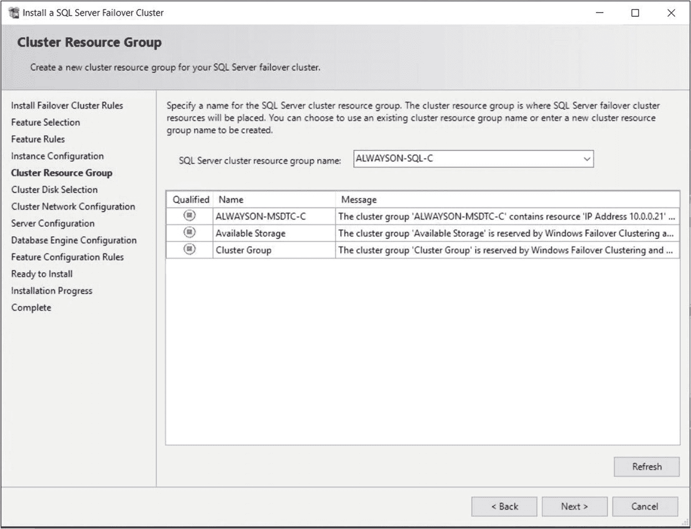

图 4-8 ¶ 安装 SQL Server 故障转移群集向导 – 群集资源组页面

### 提示

现有资源组将在 Qualified 列中用红色或绿色指示器标记。如果标记为红色，则意味着无法将该资源组用于 SQL Server 实例。在这种情况下，Message 列将指示原因。


## 集群磁盘选择页

在集群磁盘选择页上，如图 4-9 所示，您可以选择应与资源组关联的磁盘资源。页面将列出与群集关联的所有磁盘，并在 `Qualified` 列中用红色或绿色指示器标明哪些磁盘可以被选中。已关联到其他资源组的磁盘无法被选中，因为一个磁盘只能关联到单个资源组。我们将指定所有可用磁盘（`Data`、`Logs` 和 `TempDB`）都应与 `ALWAYSON-SQL-C` 资源组关联。
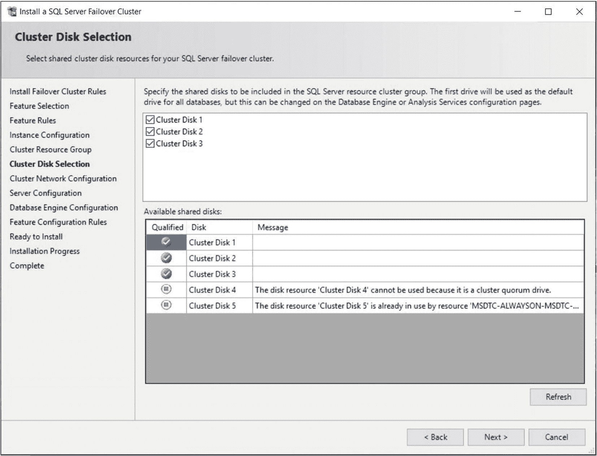
图 4-9 ¶ 安装 SQL Server 故障转移群集向导 – 集群磁盘选择页

## 集群网络配置页

在集群网络配置页上（图 4-10），我们可以配置群集角色的 IP 地址。我们可以选择 `DHCP`，这意味着 IP 地址将自动获取，或者我们可以指定静态 IP 地址。在我们的案例中，我们将指定静态 IP 地址。如果我们的群集是跨伸展群集（分布在多个子网中），我们需要为每个子网指定一个 IP 地址。
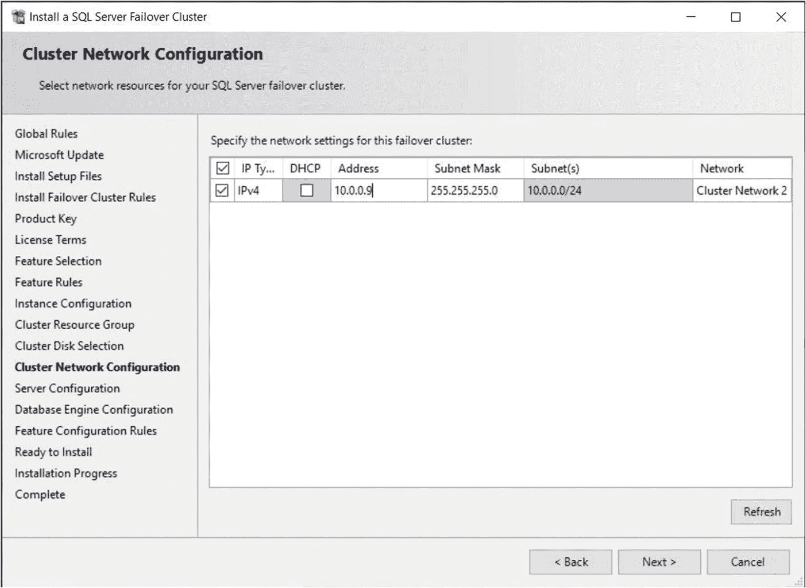
图 4-10 ¶ 安装 SQL Server 故障转移群集 – 集群网络配置页

## 服务器配置页

### 服务帐户选项卡

服务器配置页有两个选项卡。第一个选项卡是服务帐户。在此选项卡中，如图 4-11 所示，我们将指定将用作每个 SQL Server 服务安全上下文的服务帐户，并指定每个服务的启动模式。这值得注意，因为在安装独立实例时，通常会将每个服务设置为自动启动。然而，在安装群集时，群集感知服务应配置为手动启动。这是因为它们将由群集服务管理。
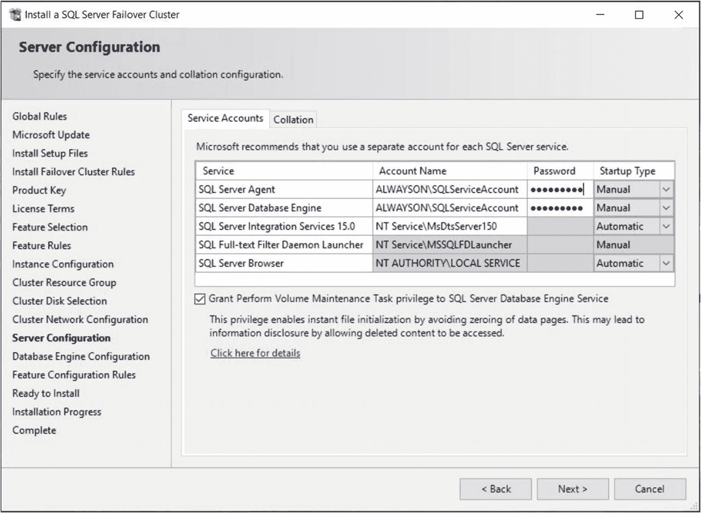
图 4-11 ¶ 安装 SQL Server 故障转移群集 – 服务帐户选项卡

在 SQL Server 的最新版本中，可以在设置期间启用 `Perform Volume Maintenance Tasks`，并且这在服务帐户选项卡上实现为一个简单的复选框。这里的考虑是安全性与性能之间的权衡。如果选择执行卷维护任务，则在创建或扩展数据文件时不会将其清零；然而，拥有专业软件的攻击者可能检索到先前存储在已分配磁盘块上的数据。`Perform Volume Maintenance Tasks` 不适用于事务日志文件。

### 提示

对于 SQL Server 安全考虑的全面讨论，我推荐 Apress 出版的 *《Securing SQL Server 第二版：DBAs 防御数据库》*，可从 [www.apress.com/gb/book/9781484241608](http://www.apress.com/gb/book/9781484241608) 购买。

### 排序规则选项卡

在排序规则选项卡上，如图 4-12 所示，您可以指定将为实例配置的排序规则。在可能的情况下，在整个企业中使用一致的排序规则是个好主意，或者至少在构成数据层应用程序的实例中使用一致的排序规则。
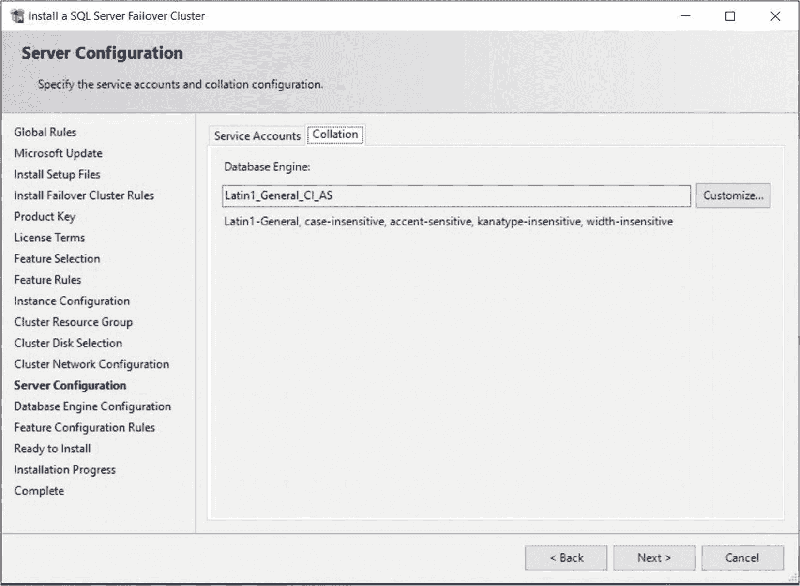
图 4-12 ¶ 安装 SQL Server 故障转移群集 – 排序规则选项卡

## 数据库引擎配置页

### 服务器配置选项卡

数据库引擎配置页包含六个选项卡。其中第一个是服务器配置选项卡，如图 4-13 所示。在这里，我们指定实例将使用的身份验证模式。
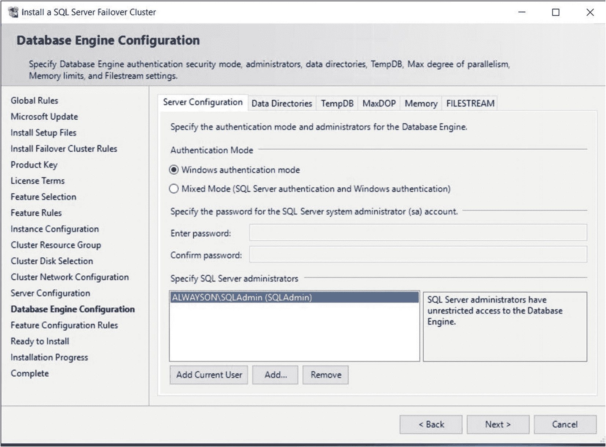
图 4-13 ¶ 安装 SQL Server 故障转移群集 – 服务器配置选项卡

`Windows Authentication Mode` 意味着用户在登录 Windows 时提供的凭据将被传递给 SQL Server，用户无需提供其他凭据即可访问实例。使用 `mixed mode`，尽管仍可使用 Windows 凭据访问实例，但用户也可以获得第二层凭据。如果选择此选项，则 SQL Server 将保存实例内部创建的登录名和密码，用户可以提供这些凭据以获得访问权限，即使其 Windows 身份没有权限。

出于安全最佳实践，只允许对实例使用 Windows 身份验证是个好主意。这有两个原因。首先，仅使用 Windows 身份验证，如果攻击者获得了对网络的访问权限，他们仍然无法访问 SQL Server，因为他们没有具有正确权限的有效 Windows 帐户。然而，使用混合模式身份验证，一旦进入网络，攻击者就可以使用暴力攻击或其他黑客方法尝试通过第二层 SQL Server 登录名获得访问权限。其次，如果您指定混合模式身份验证，则需要创建 `SA` 帐户。`SA` 帐户是具有对实例管理权限的 SQL Server 用户帐户。如果该帐户的密码被泄露，攻击者可能会获得对 SQL Server 的管理控制权。如果必须使用混合模式身份验证，最好禁用 `SA` 帐户。

然而，在某些情况下混合模式身份验证是必要的。例如，您可能有一个不支持 Windows 身份验证的旧版应用程序，或一个具有硬编码连接且使用第二层身份验证的第三方应用程序。这将是混合模式身份验证可能需要的两个有效原因。另一个有效原因是如果您有需要从不受信任的域访问实例的用户。

此外，在服务器配置选项卡上，您可以指定将添加到 `sysadmin` 固定服务器角色的 Windows 用户，从而授予他们对实例的无限制访问权限。在我们的场景中，我们将添加 `AlwaysOn\\SQLAdmin` 用户作为实例管理员，并仅使用 Windows 身份验证。

### 数据目录选项卡

在数据目录选项卡上，如图 4-14 所示，您可以更改数据根目录的默认位置。在此屏幕上，您还可以更改用户数据库及其日志文件的默认位置。最后，此选项卡允许您指定将进行的数据库备份的默认位置。在我们的场景中，我们必须确保数据根指向 `Data` 卷，日志文件指向 `Logs` 卷。
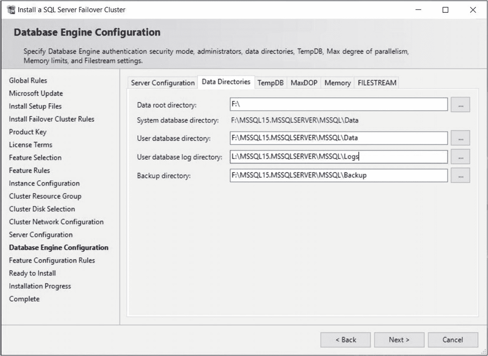
图 4-14 ¶ 安装 SQL Server 故障转移群集 – 数据目录选项卡


## SQL Server 故障转移群集配置

### TempDB 选项卡
`TempDB` 选项卡显示在图 4-15 中。此选项卡允许您配置 `TempDB` 数据库的属性。这很重要，因为 `TempDB` 需要正确的大小和处理器设置以避免成为实例的瓶颈。设置将默认为推荐配置，即每个处理器核心一个文件，最多八个。这被认为是最理想的文件数量，以避免对系统页面（如 `GAM`、`SGAM` 和 `PFS` 页面）的争用。`TempDB` 的正确大小应通过容量规划练习来估算。我们将配置 `TempDB` 的初始大小为每个文件 60MB（总计 240MB）。我们还将 `TempDB` 配置为驻留在 `TempDB` 卷上。在我们的场景中，我们还将设置文件位置指向我们的 `TempDB` 卷。
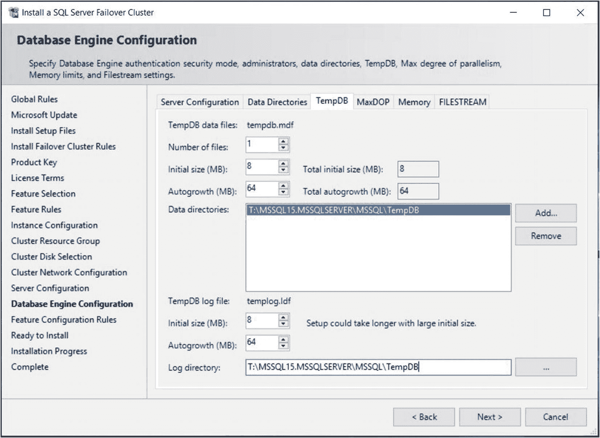
图 4-15 ¶ 安装 SQL Server 故障转移群集 – TempDB 选项卡

### MaxDOP 选项卡
`MaxDOP` 选项卡显示在图 4-16 中，允许您配置实例内运行查询的默认最大并行度。默认值是根据可用核心数计算得出，最多为八个。然而，如果需要，可以覆盖此设置。例如，对于托管小型数据库且工作负载配置文件为 `OLTP`（联机事务处理）的实例，其中同时运行许多小型查询，有时最好降低 `MaxDOP` 值。
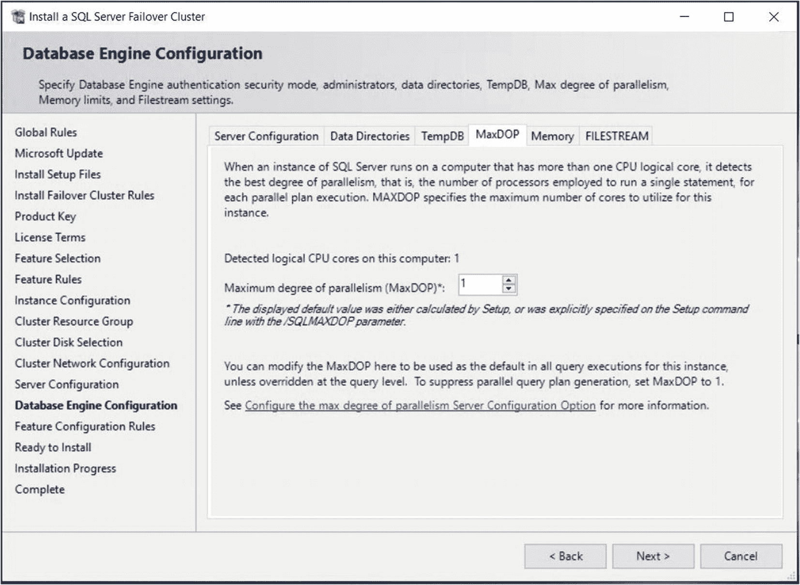
图 4-16 ¶ 安装 SQL Server 故障转移群集 – MaxDOP 选项卡

**提示**
将 `MaxDOP` 设置为 0 允许使用所有可用处理器来处理使用并行查询计划运行的查询。

### Memory 选项卡
图 4-17 说明了 Memory 选项卡。在这里，您可以指定是否希望使用默认配置，用于可分配给实例的最小和最大内存量；使用安装向导计算的推荐值；或指定您自己的值。要指定您自己的首选值，请选择推荐选项，输入您的值，并选中“单击此处接受 `SQL Server` 数据库引擎的推荐内存配置”复选框。如果您希望遵循安装程序的建议，也必须使用此复选框。
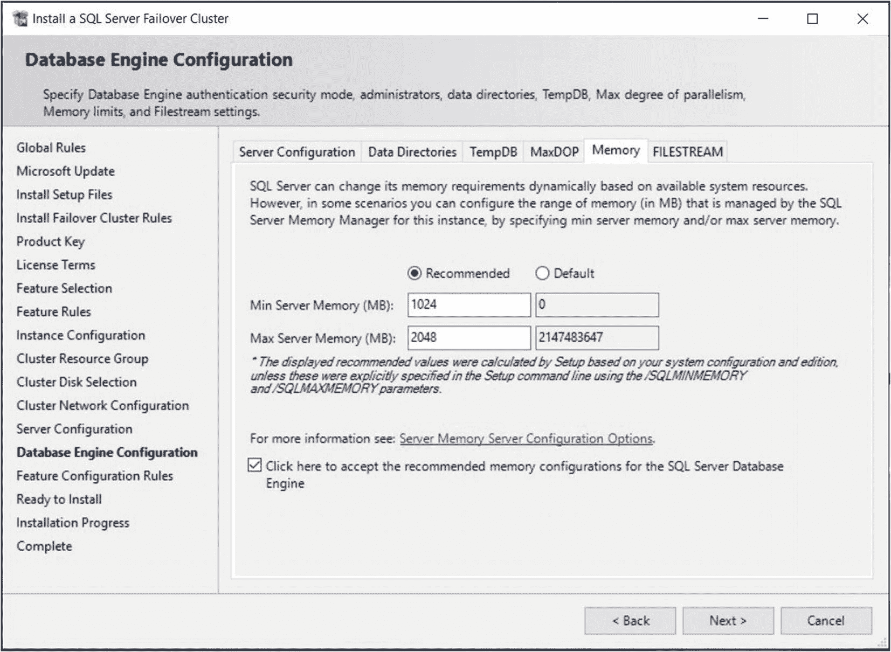
图 4-17 ¶ 安装 SQL Server 故障转移群集 – Memory 选项卡

**提示**
关于 `MaxDOP` 和 Memory 配置方法的完整讨论可在 Apress 出版的 *Pro SQL Server 2019 管理* 中找到，可在 [www.apress.com/gb/book/9781484250884#otherversion=9781484250891](http://www.apress.com/gb/book/9781484250884%2523otherversion%253D9781484250891) 购买。

### FILESTREAM 选项卡
`Database Engine Configuration` 页面上的 `FILESTREAM` 选项卡允许您启用并配置 `SQL Server` `FILESTREAM` 功能的访问级别，如图 4-18 所示。如果您希望使用 `SQL Server` 的 `FileTable` 功能，则还必须启用 `FILESTREAM`。`FILESTREAM` 和 `FileTable` 提供了以非结构化方式在 Windows 文件夹结构中存储数据的能力，同时仍能从 `SQL Server` 管理和查询此数据。
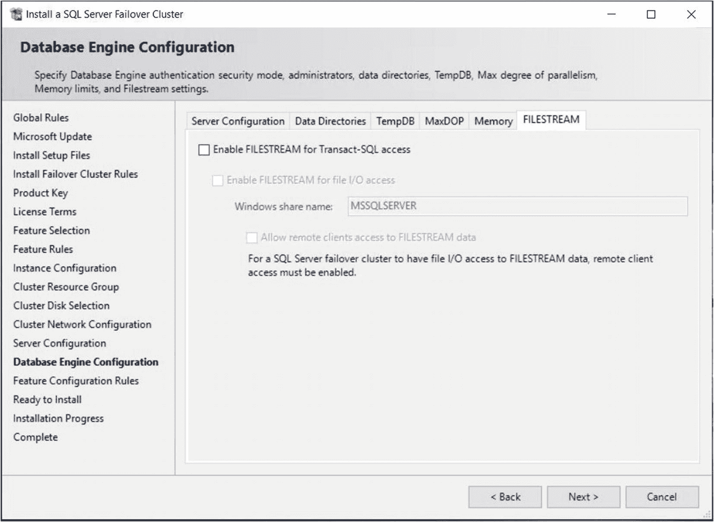
图 4-18 ¶ 安装 SQL Server 故障转移群集实例 – FILESTREAM 选项卡

在检查完 `Feature Configuration Rules` 后，向导的 `Ready to Install` 页面将显示。此向导页面提供了安装实用程序将执行的操作摘要。在此页面上选择 Install 将开始实例安装。安装完成后，应查看 `Complete` 页面。

## 使用 PowerShell 安装实例
当然，我们可以使用 `PowerShell` 而不是使用 GUI 来安装 `AlwaysOn` 故障转移群集实例。要从 `PowerShell` 安装 `AlwaysOn` 故障转移群集实例，我们可以使用 `SQL Server` 的 `setup.exe` 应用程序，并指定 `InstallFailoverCluster` 操作。

当您执行群集实例的命令行安装时，除了安装 `SQL Server` 单机实例时强制要求的参数外，还需要表 4-1 中的参数。表 4-1

群集实例安装所需的参数

| 参数 || 用法 |
| --- | --- |
| `/FAILOVERCLUSTERIPADDRESSES` || 指定实例要使用的 IP 地址，格式为 *<IP Type>;<address>;<network name>;<subnet mask>.* 对于多子网群集，IP 地址以空格分隔。 |
| --- | --- |
| `/FAILOVERCLUSTERNETWORKNAME` || 群集实例的虚拟名称。 |
| `/INSTALLSQLDATADIR` || 放置 `SQL Server` 数据文件的文件夹。这必须是群集磁盘。 |

在安装介质的根目录下运行它时，列表 4-1 中的脚本会执行刚刚演示的相同安装。
```
.\SETUP.EXE /IACCEPTSQLSERVERLICENSETERMS /ACTION="InstallFailoverCluster" /FEATURES=SQL,IS /INSTANCENAME="MSSQLSERVER" /SQLSVCACCOUNT="ALWAYSON\\SQLServiceAccount" /SQLSVCPASSWORD="Pa$$w0rd" /AGTSVCACCOUNT="ALWAYSON\\SQLServiceAccount" /AGTSVCPASSWORD="Pa$$w0rd" /SQLSYSADMINACCOUNTS="ALWAYSO\\SQLAdmin" /SQLMAXDOP="1" /FAILOVERCLUSTERIPADDRESSES="IPv4;10.0.0.9;Cluster Network 2;255.255.255.0" /FAILOVERCLUSTERDISKS="Cluster Disk 1" "Cluster Disk 2" "Cluster Disk 3" /FAILOVERCLUSTERNETWORKNAME="ALWAYSON-SQL-C" /INSTALLSQLDATADIR="F:\\" /SQLUSERDBLOGDIR="L:\\MSSQL15.MSSQLSERVER\\MSSQL\\Logs" /SQLTEMPDBDIR="T:\\MSSQL15.MSSQLSERVER\\MSSQL\\TempDB" /SQLTEMPDBLOGDIR="T:\\MSSQL15.MSSQLSERVER\\MSSQL\\TempDB" /SQLMAXMEMORY="2048" /SQLMINMEMORY="1024" /qs
```
列表 4-1
使用 PowerShell 安装 AlwaysOn 故障转移群集实例

## 添加节点
安装群集时下一步应执行的操作是添加第二个节点。未能添加第二个节点会导致实例保持在线，但没有高可用性，因为第二个节点无法接管角色的所有权。要配置第二个节点，您需要登录到被动群集节点并从 `SQL Server Installation Center` 的 Installation 选项卡中选择 `Add Node to SQL Server Failover Cluster` 选项。这会调用 `Add a Failover Cluster Node Wizard`。此向导的第一页是 `Product Key` 页面。就像安装实例时一样，您需要使用此屏幕为 `SQL Server` 提供产品密钥。不指定产品密钥只会让您选择安装 `Evaluation Edition`，并且由于它在 180 天后过期，因此对于高可用性来说可能不是最明智的选择。

向导接下来的 `License Terms` 页面要求您阅读并接受 `SQL Server` 的许可条款。此外，您需要指定是否希望参与 `Microsoft` 的 `Customer Experience Improvement Program`。如果您选择此选项，则错误报告将被捕获并发送到 `Microsoft`。

在您接受许可条款后，会运行规则检查以确保满足所有条件，以便您可以继续安装。在向导检查 `Microsoft` 更新并安装安装所需设置文件后，会进行另一次规则检查，以确保将节点添加到群集的规则得到满足。


## 使用向导添加节点

在“群集节点配置”页上，如图 4-19 所示，您将被要求确认要添加节点的实例名称。如果群集上有多个实例，则可以使用下拉框选择适当的实例。
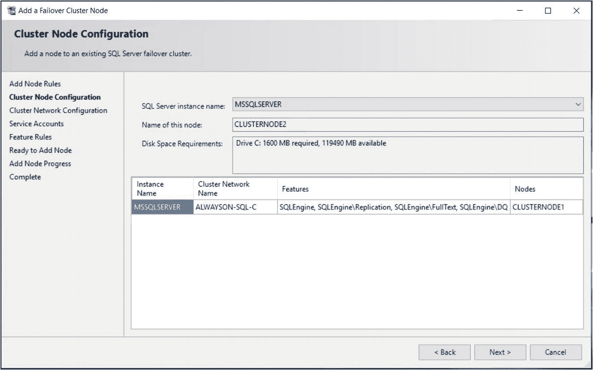

图 4-19 ¶ 添加故障转移群集节点向导 – 群集节点配置页

在“群集网络配置”页上，如图 4-20 所示，您确认网络详细信息。这些应与群集中第一个节点相同，包括相同的 IP 地址，因为它当然是在两个节点之间共享的。
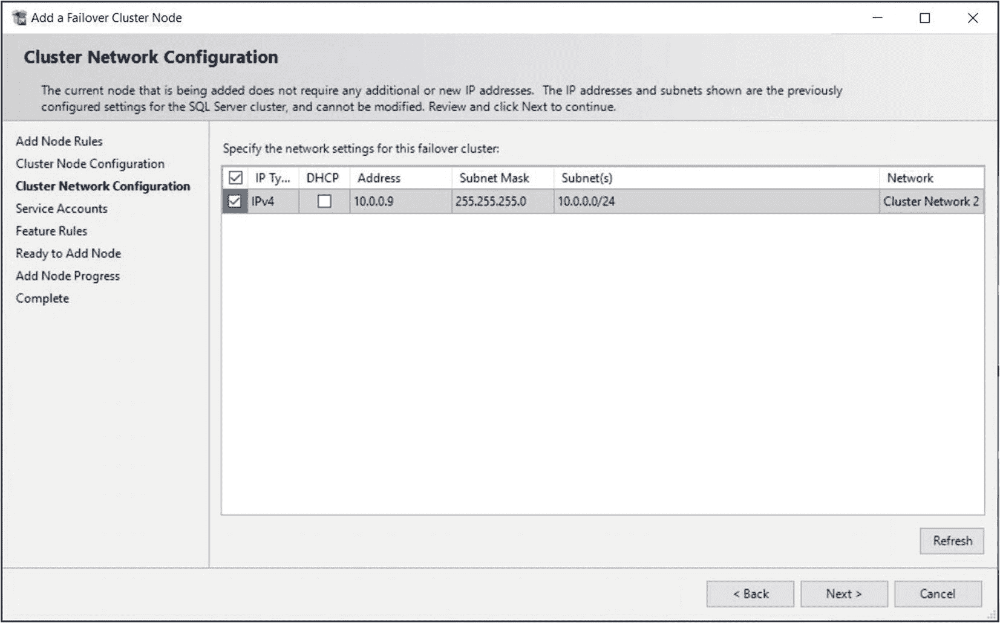

图 4-20 ¶ 群集网络配置页

在向导的“服务帐户”页上，大部分信息处于只读模式，您无法修改它。这是因为您使用的服务帐户必须对群集的每个节点都相同。不过，您需要重新输入服务帐户密码。此页如图 4-21 所示。
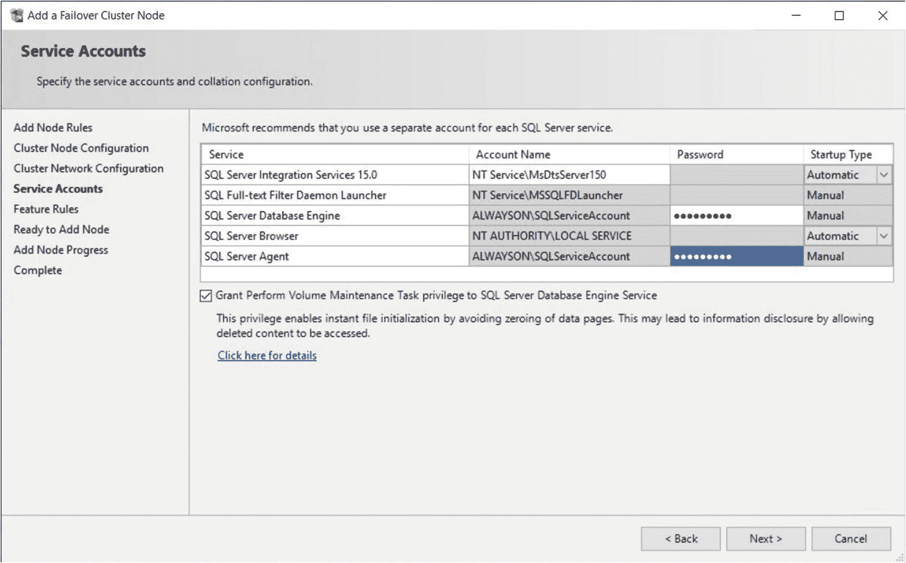

图 4-21 ¶ 服务帐户页

现在向导已拥有所有所需信息，在摘要页显示之前会进行额外的规则检查。摘要页称为“准备添加节点”页，提供安装期间进行的活动摘要。

## 使用 PowerShell 添加节点

要使用 `PowerShell` 而不是 GUI 添加节点，您可以运行 SQL Server 的 `setup.exe` 应用程序并使用 `AddNode` 操作。从命令行添加节点时，表 4-2 中详细说明的参数是强制性的。

表 4-2
`AddNode` 操作的强制参数

| 参数 | 用途 |
| --- | --- |
| `/ACTION` | 必须配置为 `AddNode`。 |
| `/IACCEPTSQLSERVERLICENSETERMS` | 在 Windows Server Core 上安装时为强制性，因为在 Windows Server Core 上必须指定 `/qs` 开关。 |
| `/INSTANCENAME` | 您要添加额外节点以支持的实例。 |
| `/CONFIRMIPDEPENDENCYCHANGE` | 允许为多子网群集指定多个 IP 地址。传入 1 表示 True，0 表示 False。 |
| `/FAILOVERCLUSTERIPADDRESSES` | 指定实例要使用的 IP 地址（es），格式为 ` <IP Type>;<address>;<network name>;<subnet mask>`。对于多子网群集，IP 地址以空格分隔。 |
| `/FAILOVERCLUSTERNETWORKNAME` | 群集实例的虚拟名称。 |
| `/INSTALLSQLDATADIR` | 放置 SQL Server 数据文件的文件夹。这必须是群集磁盘。 |
| `/SQLSVCACCOUNT` | 用于运行数据库引擎的服务帐户。 |
| `/SQLSVCPASSWORD` | 用于运行数据库引擎的服务帐户的密码。 |
| `/AGTSVCACCOUNT` | 用于运行 SQL Server Agent 的服务帐户。 |
| `/AGTSVCPASSWORD` | 用于运行 SQL Server Agent 的服务帐户的密码。 |

从安装介质的根文件夹运行它时，列表 4-2 中的脚本会将 `ClusterNode2` 添加到角色中。

```
.\setup.exe /IACCEPTSQLSERVERLICENSETERMS /ACTION="AddNode" /INSTANCENAME="MSSQLSERVER" /SQLSVCACCOUNT="ALWAYSON\SQLServiceAccount" /SQLSVCPASSWORD="Pa$$w0rd" /AGTSVCACCOUNT="ALWAYSON\SQLServiceAccount" /AGTSVCPASSWORD="Pa$$w0rd" /FAILOVERCLUSTERIPADDRESSES="IPv4;10.0.0.9;Cluster Network 2;255.255.255.0" /CONFIRMIPDEPENDENCYCHANGE=0 /qs
```

列表 4-2
使用 PowerShell 添加节点

## 摘要

AlwaysOn 故障转移群集实例可以使用 SQL Server 安装中心或通过 `PowerShell` 安装。使用 SQL Server 安装中心时，流程与独立实例的安装非常相似；但是，您需要指定其他详细信息，例如网络名称、IP 地址和资源组配置。

使用 `PowerShell` 安装实例时，您将使用 `InstallFailoverCluster` 操作，指定 `/FAILOVERCLUSTERIPADDRESSES`、`/FAILOVERCLUSTERNETWORKNAME` 和 `/INSTALLSQLDATADIR` 参数，此外还需指定独立实例构建所需的参数。

© Peter A. Carter 2020 P. A. Carter SQL Server 2019 AlwaysOn [`doi.org/10.1007/978-1-4842-6479-9_5`](https://doi.org/10.1007/978-1-4842-6479-9_5)

Begin Abstract
