# 5. 在 Windows 上实现 AlwaysOn 可用性组

Peter A. Carter (1) (1) Botley, UK
End Abstract

AlwaysOn 可用性组提供了一种灵活的选项，用于实现高可用性、从灾难中恢复以及扩展只读工作负载。该技术在数据库级别同步数据，健康监控和仲裁通常由 Windows 群集提供，尽管 Windows 群集不是强制性的。

AlwaysOn 可用性组有不同的变体。传统版本位于 Windows 故障转移群集上，但如果 SQL Server 安装在 Linux 上，则可以使用 Pacemaker。AlwaysOn 可用性组也可以在没有群集的情况下配置。这对于卸载报表是可以接受的，但不是有效的高可用性（HA）或灾难恢复（DR）配置。使用 SQL Server 2019 与 Windows Server 2019 时，可用性组甚至可以为容器化 SQL 配置，使用 Kubernetes。

本章重点介绍在 Windows 故障转移群集上配置可用性组，以提供 HA 和 DR 以及扩展只读工作负载。Linux 上的可用性组将在第 6 章中探讨。

### 注

对于本章中的演示，我们将使用第 3 章中构建的群集，但已向群集添加了两个额外节点：`CLUSTERNODE3` 和 `CLUSTERNODE4`。我们将不使用第 4 章中配置的故障转移群集实例。相反，每个节点上都安装了 SQL Server 的独立实例，名称如下：`CLUSTERNODE1\PROD`、`CLUSTERNODE2\SYNCHA`、`CLUSTERNODE3\ASYNCDR` 和 `CLUSTERNODE4\READSCALE`。群集节点 1 和 2 位于名为 Site1 的子网内，群集节点 3 和 4 位于名为 Site2 的不同子网内。实例将数据库数据和日志文件存储在 `C:\` 卷上。群集内的共享存储未用于这些实例。

在本章中，我们将执行以下活动：

* 创建 Sales、Customers、Accounts 和 HR 数据库。
* 在我们的实例上启用可用性组。
* 使用新建可用性组向导为 HR 数据库创建可用性组。此可用性组将仅配置为 HA。
* 使用新建可用性组对话框为 Sales 和 Customers 数据库创建可用性组。这将配置为 HA、DR 和只读扩展。
* 使用 `T-SQL` 为 Accounts 数据库创建可用性组。此可用性组将配置为 HA 和 DR，而不进行任何只读扩展。
* 我们还将讨论如何使用 `PowerShell` 创建可用性组。

## 准备实现 AlwaysOn 可用性组


在实施 `AlwaysOn Availability Groups` 之前，我们首先创建四个数据库，这些数据库将在本章的演示中使用。每个数据库包含一个表，我们用数据填充它。每个数据库都配置为恢复模式设置为 `FULL`。这是数据库使用 `AlwaysOn Availability Groups` 的硬性要求，因为数据是通过日志流同步的。列表 5-1 中的脚本创建了这些数据库。

### Listing 5-1 创建数据库

```sql
--Create Sales Database
CREATE DATABASE Sales;
GO
USE Sales;
GO
CREATE TABLE [dbo].Orders NOT NULL PRIMARY KEY CLUSTERED,
    [OrderDate] [date] NOT NULL,
    [CustomerID] [int] NOT NULL,
    [ProductID] [int] NOT NULL,
    [Quantity] [int] NOT NULL,
    [NetAmount] [money] NOT NULL,
    [TaxAmount] [money] NOT NULL,
    [InvoiceAddressID] [int] NOT NULL,
    [DeliveryAddressID] [int] NOT NULL,
    [DeliveryDate] [date] NULL,
);
DECLARE @Numbers TABLE (
    Number INT
)
--Populate ExistingOrders with data
;WITH CTE(Number) AS (
    SELECT 1 Number
    UNION ALL
    SELECT Number + 1
    FROM CTE
    WHERE Number < 100
)
INSERT INTO @Numbers SELECT Number FROM CTE
INSERT INTO Orders
SELECT
    (SELECT CAST(DATEADD(dd,(SELECT TOP 1 Number FROM @Numbers ORDER BY NEWID()),getdate())as DATE)),
    (SELECT TOP 1 Number -10 FROM @Numbers ORDER BY NEWID()),
    (SELECT TOP 1 Number FROM @Numbers ORDER BY NEWID()),
    (SELECT TOP 1 Number FROM @Numbers ORDER BY NEWID()),
    500,
    100,
    (SELECT TOP 1 Number FROM @Numbers ORDER BY NEWID()),
    (SELECT TOP 1 Number FROM @Numbers ORDER BY NEWID()),
    (SELECT CAST(DATEADD(dd,(SELECT TOP 1 Number - 10 FROM @Numbers ORDER BY NEWID()),getdate()) as DATE))
FROM @Numbers a CROSS JOIN @Numbers b;
--SET FULL recovery mode on the database - required for Availability Groups
ALTER DATABASE Sales SET RECOVERY FULL;
GO
--Create Customers Database
CREATE DATABASE Customers;
GO
USE Customers;
GO
CREATE TABLE dbo.Customers (
    ID INT PRIMARY KEY IDENTITY,
    FirstName NVARCHAR(30),
    LastName NVARCHAR(30),
    CreditCardNumber VARBINARY(8000)
);
GO
--Populate the table
DECLARE @Numbers TABLE (
    Number INT
);
WITH CTE(Number) AS (
    SELECT 1 Number
    UNION ALL
    SELECT Number + 1
    FROM CTE
    WHERE Number < 100
)
INSERT INTO @Numbers SELECT Number FROM CTE
DECLARE @Names TABLE (
    FirstName VARCHAR(30),
    LastName VARCHAR(30)
);
INSERT INTO @Names VALUES('Peter', 'Carter'),
    ('Michael', 'Smith'),
    ('Danielle', 'Mead'),
    ('Reuben', 'Roberts'),
    ('Iris', 'Jones'),
    ('Sylvia', 'Davies'),
    ('Finola', 'Wright'),
    ('Edward', 'James'),
    ('Marie', 'Andrews'),
    ('Jennifer', 'Abraham'),
    ('Margaret', 'Jones')
INSERT INTO Customers(Firstname, LastName, CreditCardNumber)
SELECT
    FirstName
    , LastName
    , CreditCardNumber
FROM (
    SELECT
        (SELECT TOP 1 FirstName FROM @Names ORDER BY NEWID()) FirstName
        , (SELECT TOP 1 LastName FROM @Names ORDER BY NEWID()) LastName
        , (SELECT TOP 1 CONVERT(VARBINARY(8000), (
            (SELECT TOP 1 CAST(Number * 100 AS CHAR(4)) FROM @Numbers WHERE Number BETWEEN 10 AND 99 ORDER BY NEWID())
            + '-' +
            (SELECT TOP 1 CAST(Number * 100 AS CHAR(4)) FROM @Numbers WHERE Number BETWEEN 10 AND 99 ORDER BY NEWID())
            + '-' +
            (SELECT TOP 1 CAST(Number * 100 AS CHAR(4)) FROM @Numbers WHERE Number BETWEEN 10 AND 99 ORDER BY NEWID())
            + '-' +
            (SELECT TOP 1 CAST(Number * 100 AS CHAR(4)) FROM @Numbers WHERE Number BETWEEN 10 AND 99 ORDER BY NEWID())
        )) FROM @Numbers a
    ) CreditCardNumber
) d CROSS JOIN @Numbers b CROSS JOIN @Numbers c;
--SET FULL recovery mode on the database - required for Availability Groups
ALTER DATABASE Customers SET RECOVERY FULL;
GO
--Create Accounts Database
CREATE DATABASE Accounts;
GO
USE Accounts;
GO
CREATE TABLE [dbo].PurchaseOrders NOT NULL PRIMARY KEY CLUSTERED,
    [OrderDate] [date] NOT NULL,
    [CustomerID] [int] NOT NULL,
    [ProductID] [int] NOT NULL,
    [Quantity] [int] NOT NULL,
    [NetAmount] [money] NOT NULL,
    [TaxAmount] [money] NOT NULL,
    [InvoiceAddressID] [int] NOT NULL,
    [DeliveryAddressID] [int] NOT NULL,
    [DeliveryDate] [date] NULL,
);
DECLARE @Numbers TABLE (
    Number INT
)
--Populate ExistingPurchaseOrders with data
;WITH CTE(Number) AS (
    SELECT 1 Number
    UNION ALL
    SELECT Number + 1
    FROM CTE
    WHERE Number < 100
)
INSERT INTO @Numbers SELECT Number FROM CTE
INSERT INTO PurchaseOrders
SELECT
    (SELECT CAST(DATEADD(dd,(SELECT TOP 1 Number FROM @Numbers ORDER BY NEWID()),getdate())as DATE)),
    (SELECT TOP 1 Number -10 FROM @Numbers ORDER BY NEWID()),
    (SELECT TOP 1 Number FROM @Numbers ORDER BY NEWID()),
    (SELECT TOP 1 Number FROM @Numbers ORDER BY NEWID()),
    500,
    100,
    (SELECT TOP 1 Number FROM @Numbers ORDER BY NEWID()),
    (SELECT TOP 1 Number FROM @Numbers ORDER BY NEWID()),
    (SELECT CAST(DATEADD(dd,(SELECT TOP 1 Number - 10 FROM @Numbers ORDER BY NEWID()),getdate()) as DATE))
FROM @Numbers a CROSS JOIN @Numbers b;
--SET FULL recovery mode on the database - required for Availability Groups
ALTER DATABASE Accounts SET RECOVERY FULL;
GO
CREATE DATABASE HR;
GO
USE HR;
GO
CREATE TABLE dbo.Employees (
    ID INT PRIMARY KEY IDENTITY,
    FirstName NVARCHAR(30),
    LastName NVARCHAR(30),
    EmployeeNumber INT
);
GO
--Populate the table
DECLARE @Numbers TABLE (
    Number INT
);
WITH CTE(Number) AS (
    SELECT 1 Number
    UNION ALL
    SELECT Number + 1
    FROM CTE
    WHERE Number < 100
)
INSERT INTO @Numbers SELECT Number FROM CTE
DECLARE @Names TABLE (
    FirstName VARCHAR(30),
    LastName VARCHAR(30)
);
INSERT INTO @Names VALUES('Peter', 'Carter'),
    ('Michael', 'Smith'),
    ('Danielle', 'Mead'),
    ('Reuben', 'Roberts'),
    ('Iris', 'Jones'),
    ('Sylvia', 'Davies'),
    ('Finola', 'Wright'),
    ('Edward', 'James'),
    ('Marie', 'Andrews'),
    ('Jennifer', 'Abraham'),
    ('Margaret', 'Jones')
INSERT INTO Employees(Firstname, LastName, EmployeeNumber)
SELECT
    (SELECT TOP 1 FirstName FROM @Names ORDER BY NEWID()) FirstName
    , (SELECT TOP 1 LastName FROM @Names ORDER BY NEWID()) LastName
    , a.Number EmployeeNumber
FROM @Numbers a;
--SET FULL recovery mode on the database - required for Availability Groups
ALTER DATABASE HR SET RECOVERY FULL;
GO
```

### 配置 SQL Server


## 启用 AlwaysOn 可用性组

配置 AlwaysOn 可用性组的首要步骤是在 SQL Server 服务上启用此功能。要从 GUI 启用该功能，我们打开 SQL Server 配置管理器，依次展开 SQL Server 服务，并从 SQL Server 服务的上下文菜单中选择属性。这样操作后，服务属性会显示出来，我们导航到 Always On 可用性组 选项卡，如图 5-1 所示。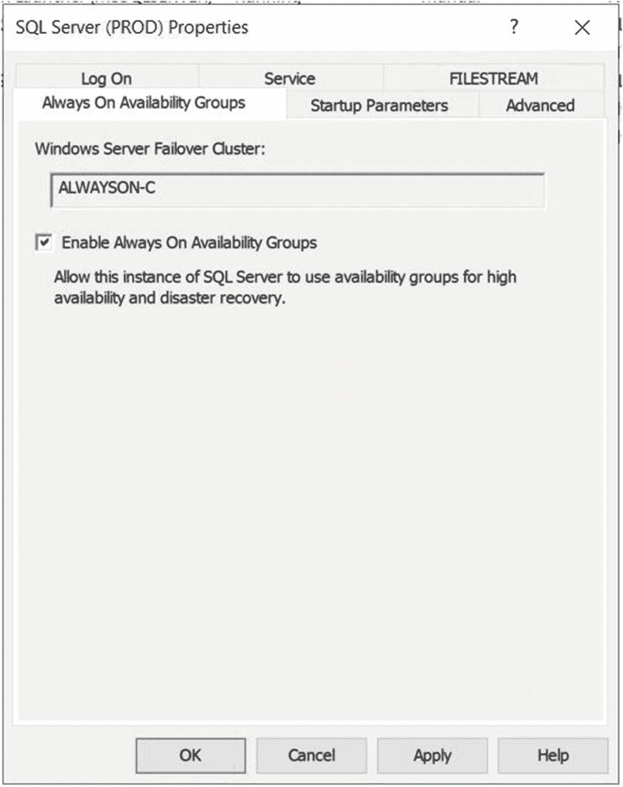

图 5-1 ¶ Always On 可用性组选项卡

在此选项卡中，我们勾选“启用 AlwaysOn 可用性组”复选框，并确保 Windows 故障转移群集名称 框中显示的群集名称正确。然后我们需要重启 SQL Server 服务。因为 AlwaysOn 可用性组使用的是独立实例，这些实例安装在每个群集节点上，而非跨多个节点的故障转移群集实例，因此我们需要对群集上托管的每个独立实例重复这些步骤。

我们也可以使用 PowerShell 来启用 AlwaysOn 可用性组。为此，我们使用列表 5-2 中的 PowerShell 命令。该脚本假定 `CLUSTERNODE1` 为服务器名称，`PROD` 为 SQL Server 实例名称。

```
Enable-SqlAlwaysOn -Path SQLSERVER:\\SQL\\CLUSTERNODE1\\PROD
```

列表 5-2

启用 AlwaysOn 可用性组

下一步是对将成为可用性组一部分的所有数据库进行完整备份。在完成此操作之前，我们无法将它们添加到可用性组。在本章中，我们将创建三个独立的可用性组。然而在第一个示例中，我们将创建一个名为 `HR` 的可用性组，为 `HR` 数据库提供高可用性。因此，我们需要备份 `HR` 数据库。我们通过运行列表 5-3 中的脚本来完成此操作。

```
BACKUP DATABASE HR TO DISK = N'C:\\Backups\\HR.bak' WITH NAME = N'HR-Full Database Backup' ; GO
```

列表 5-3

备份数据库

## 使用新的可用性组向导

当备份成功完成后，我们通过在 SSMS 中的对象资源管理器中依次展开 AlwaysOn 高可用性，并从可用性组文件夹的上下文菜单中选择“新建可用性组向导”来调用新建可用性组向导。向导的“介绍”页会显示出来，为我们概述需要执行的操作步骤。

在“指定名称”页（见图 5-2）中，我们会被提示输入可用性组的名称。我们还将选择 Windows Server 故障转移群集 作为群集类型。群集类型的其他选项包括 external，它支持 Linux 上的 Pacemaker，以及 None，用于无群集可用性组。数据库级运行状况检测 选项将在组内任何数据库脱机时导致可用性组故障转移。每数据库 DTC 支持 选项将指定是否使用 MSDTC（Microsoft 分布式事务协调程序）支持跨数据库事务。关于配置 DTC 的完整讨论超出了本书范围，但更多详细信息可在 [`docs.microsoft.com/en-us/previous-versions/windows/desktop/ms681291(v=vs.85)`](https://docs.microsoft.com/en-us/previous-versions/windows/desktop/ms681291%2528v%253Dvs.85%2529) 找到。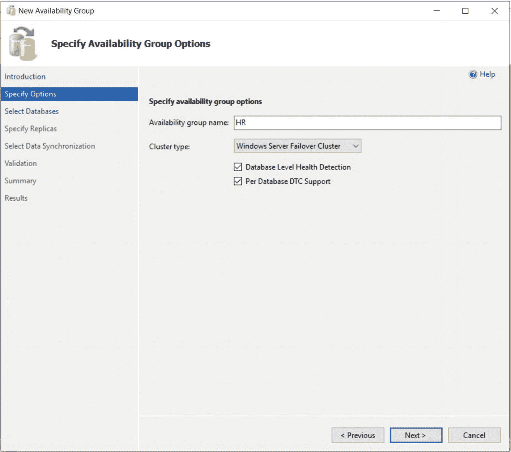

图 5-2 ¶ 指定名称页

在“选择数据库”页中，我们会被提示选择希望参与可用性组的数据库，如图 5-3 所示。在此屏幕上请注意，我们无法选择 Sales、Customers 或 Accounts 数据库，因为我们尚未对这些数据库进行完整备份。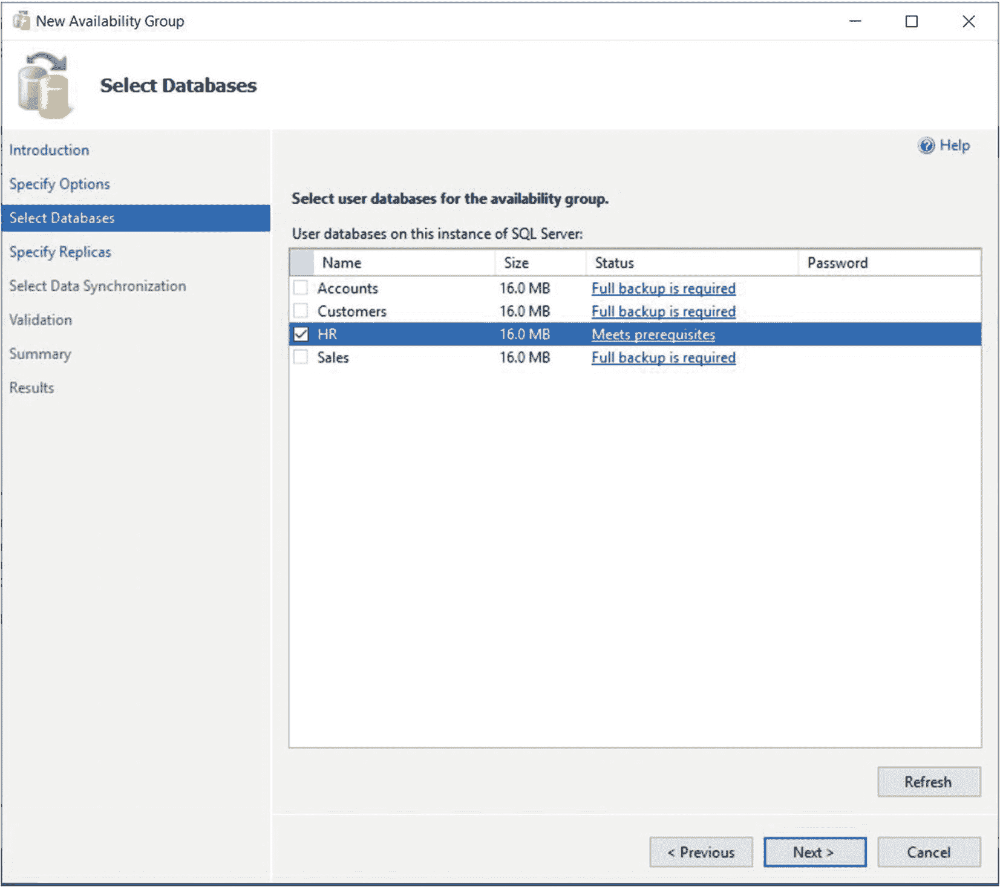

图 5-3 ¶ 选择数据库页

“指定副本”页包含五个选项卡。我们使用第一个选项卡“副本”将辅助副本添加到拓扑中。勾选“同步提交”选项会使数据在主副本上提交之前先在辅助副本上提交。（这也被称为在主副本之前对辅助副本 *硬化日志*。）这意味着在发生故障转移时不会发生数据丢失，即我们可以满足 RPO（恢复点目标）为零的 SLA（服务级别协议）。然而，这也意味着性能会下降。如果我们选择异步提交，则副本以异步提交模式运行。这意味着数据在辅助副本上提交之前先在主副本上提交。这可以避免性能下降，但也意味着在发生故障转移时，RPO 是不确定的。

当我们勾选“自动故障转移”选项时，如果尚未选择，则“同步提交”选项也会自动被选中。这是因为自动故障转移仅在同步提交模式下才可能实现。我们可以将“可读辅助副本”下拉菜单设置为 No、Yes 或 Read-intent。当设置为 No 时，数据库在处于辅助角色的副本上不可访问。当设置为 Read-intent 时，可用性组侦听器可以将只读工作负载重定向到此辅助副本，但前提是应用程序在连接字符串中指定了 `Application Intent=Read-only`。将其设置为 Yes 可使侦听器重定向只读流量，而不管应用程序的连接字符串中是否存在 Application Intent 参数。尽管我们可以在配置副本进行自动故障转移的同时通过 GUI 更改 Readable Secondary 的值而不会报错，但这只是向导的一个怪癖。实际上，副本不可访问，因为在配置为自动故障转移时不支持活动辅助副本。副本选项卡如图 5-4 所示。为了满足对 `HR` 数据库实现高可用的要求，我们已将同一站点内的辅助服务器配置为同步副本。这意味着数据中心之间的延迟不会加剧与同步提交相关的性能下降。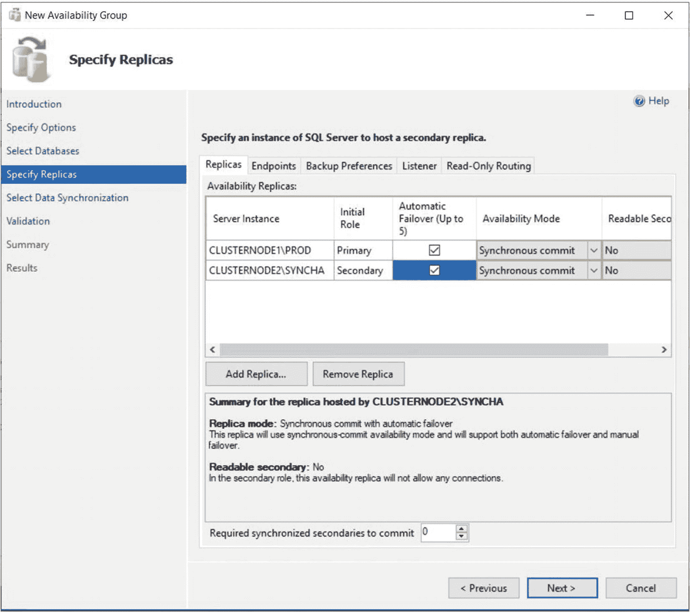

图 5-4 ¶ 副本选项卡

在“指定副本”页的“端点”选项卡中，如图 5-5 所示，我们为每个端点指定端口号。默认端口为 5022，但如果需要，我们可以指定不同的端口。在此选项卡中，我们还指定在端点之间传输数据时是否应加密。通常最好勾选此选项，如果勾选，则使用 AES（高级加密标准）作为加密算法。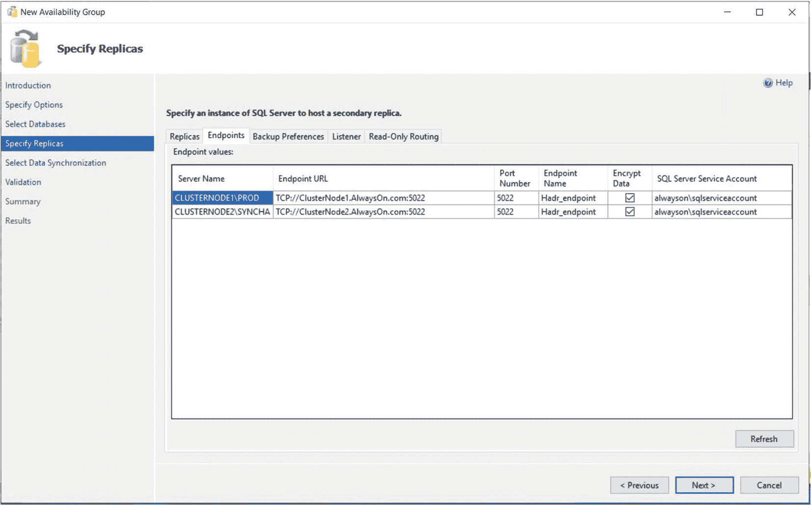

图 5-5 ¶ 端点选项卡

可选地，您还可以更改所创建端点的名称。然而，由于每个实例只允许一个数据库镜像端点，并且默认名称相当具有描述性，因此不总是需要更改它。一些 DBA 选择重命名它以包含实例名称，因为这可以简化多个服务器的管理。如果您的企业在同一群集上的多个实例中拆分了多个可用性组，这是一个好主意。


## 可用性组配置

## 服务帐户和安全占用
`service account` 每个实例使用的 显示仅供参考。 如果确保两个实例都使用相同的 `service account`，则可以简化安全管理。 如果未这样做，则需要为每个实例授予对每个 `service account` 的权限。 这意味着，与仅将 `service account` 用于一个实例来减少每个 `service account` 的安全占用相比，您只是将占用范围从操作系统级别提升到 `SQL Server` 级别。

## 端点 URL
端点 URL 指定 `availability groups` 用于通信的端点的 URL。 URL 的格式为 `\[Transport Protocol\]://\[Path\]:\[Port\]`。 `database mirroring endpoint` 的传输协议始终为 `TCP`（传输控制协议）。 路径可以是服务器的完全限定域名（`FQDN`）、服务器名称本身或在网络中唯一的 `IP address`。 我建议使用服务器的 `FQDN`，因为它总能保证正常工作。 它也是填充的默认值。 端口应与为端点指定的端口号匹配。

### 注
`Availability groups` 通过 `database mirroring endpoint` 进行通信。 尽管数据库镜像已被弃用，但端点并未被弃用。

## 备份首选项选项卡
在 `Backup Preferences` 选项卡上（见图 5-6），我们可以指定将执行自动备份的副本。 `AlwaysOn Availability Groups` 的一大优势是，使用它们时，您可以将维护任务（如备份）扩展到辅助服务器。 因此，自动备份可以无缝地定向到活动辅助副本。 可选选项为 `Prefer Secondary`、`Secondary Only`、`Primary` 或 `Any Replica`。 也可以为每个副本设置优先级。 在确定针对哪个副本运行备份作业时，`SQL Server` 会评估每个节点的备份优先级，更有可能选择优先级最高的副本。
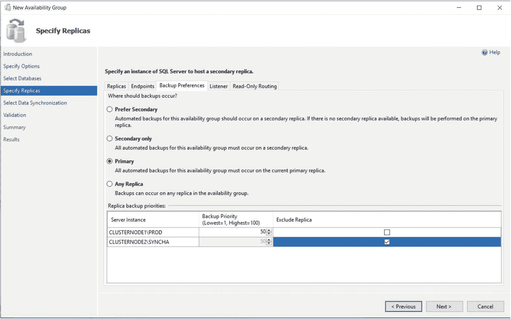
图 5-6 ¶ 备份首选项选项卡

尽管在主副本上减少 IO 的优势显而易见，但我颇具争议地建议在许多情况下不要将自动备份扩展到辅助副本。 当 `RTO`（恢复时间目标）对应用程序而言是优先事项时，尤其如此，因为存在操作支持性问题。 想象一下这样的场景：备份正在针对辅助副本进行，而用户来电称他们意外删除了关键表中的所有数据。 您现在需要恢复数据库的副本并重新填充该表。 然而，备份文件位于辅助副本上。 因此，您需要在开始恢复数据库之前将备份文件复制到主副本（或通过网络执行恢复）。 这会立即增加您的 `RTO`。

此外，当配置为允许针对多台服务器进行备份时，`SQL Server` 仍仅在执行备份的实例上维护备份历史记录。 这意味着您可能需要在服务器之间手忙脚乱，尝试检索所有备份文件，却不知道每个文件的位置。 如果其中一台服务器发生完全系统故障，情况会变得更糟。 您可能会发现自己处于日志链断裂的场景中。

我刚刚提到的大多数问题的解决方法是使用文件服务器上的共享，并配置每个实例备份到同一共享。 这可能产生中性、正向或负向的后果。 负面后果出现在您使用本地附加存储时。 以这种方式设置备份后，您现在将所有备份通过网络发送，而不是本地备份。 这可能会增加备份的持续时间并增加网络流量。 正面后果是如果您处于云 `IaaS`（基础设施即服务）环境中。 附加到您的 `VM` 的存储很可能比用于创建文件共享的存储更昂贵。 然而，在许多现代本地部署场景中，后果是中性的。 这是因为文件共享和服务器的存储很可能位于同一个 `SAN` 或 `NAS` 设备上。 这意味着以这种方式配置备份时，网络流量或延迟没有区别。

## 侦听器选项卡
在 `Listener` 选项卡上，如图 5-7 所示，我们选择是否要创建可用性组侦听器，或将此任务推迟到以后。 如果我们选择创建侦听器，则需要指定侦听器的名称、其应监听的端口以及应使用的 `IP address(es)`。 在多子网集群中，我们为每个 `subnet` 指定一个地址。 此处提供的信息用于在可用性组的群集角色中创建客户端访问点资源。 您可能会注意到，我们为侦听器指定了端口 `1433`，尽管我们的实例也在端口 `1433` 上运行。 这是一个有效的配置，因为侦听器配置在与 `SQL Server` 实例不同的 `IP address` 上。 使用相同的端口号并非强制要求，但在现有实例上实施 `AlwaysOn Availability Groups` 时可能有益，因为指定连接端口号的应用程序可能需要更少的应用程序更改。 请记住，服务器名称仍会不同，因为应用程序将连接到侦听器的虚拟名称，而不是物理服务器\\实例的名称。 在我们的示例中，应用程序连接到 `HR` 而不是 `CLUSTERNODE1\\PROD`。 尽管通过 `CLUSTERNODE1` 的连接仍然允许，但它们无法受益于高可用性或扩展我们的报告。
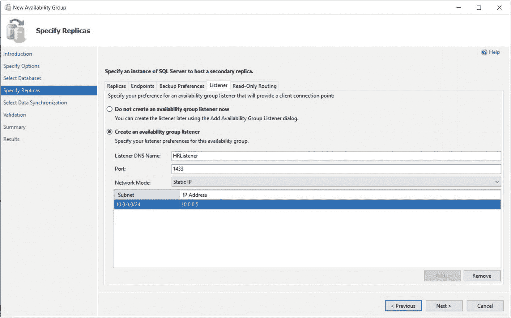
图 5-7 ¶ 侦听器选项卡

### 提示
`subnet` 是包含来自更大网络的 `IP Addresses` 分区的网络段。
由于我们的 `HR Availability Group` 不跨越多个子网，因此我们的 `Listener` 只有一个 `IP Address`。

### 提示
如果您在组织单位（`OU`）中没有 `Create Computer Objects` 权限，则侦听器的 `VCO`（虚拟计算机对象）必须存在于 `AD` 中，并且您必须被分配该对象的完全控制权限。

### 提示
由于 `HR Availability Group` 不会配置为可读辅助副本，因此我们无需配置 `Read-Only Routing` 选项卡；然而，我们将在本章的“使用新的可用性组对话框”部分探讨只读路由。

## 选择初始数据同步
在 `Select Initial Data Synchronization` 屏幕上，如图 5-8 所示，我们选择副本的初始数据同步如何执行。 如果选择 `Full`，则参与可用性组的每个数据库都会进行完整备份，然后进行日志备份。 备份文件在恢复到辅助服务器之前会备份到您指定的共享中。 共享路径可以使用 `Windows` 或 `Linux` 格式指定，具体取决于您的要求。 恢复完成后，通过日志流进行数据同步。
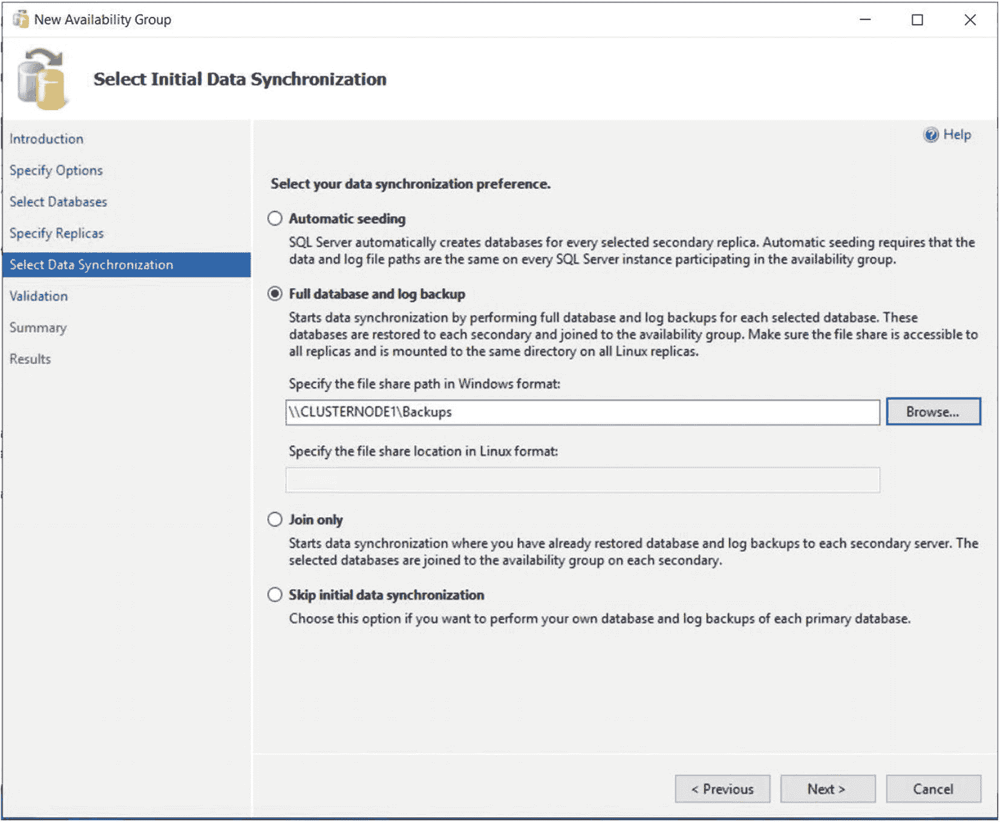
图 5-8 ¶ 选择数据同步页面

如果您已备份数据库并将其恢复到辅助服务器上，则可以选择 `Join Only` 选项。 这会通过日志流启动可用性组内数据库的数据同步。 选择 `Skip Initial Data Synchronization` 允许您在完成设置后自行备份和恢复数据库。


如果您选择 `Automatic Seeding` 选项，则会在每个 `Replica` 上最初创建空数据库。然后数据会使用 `VDI` (`Virtual Device Interface`) 通过日志流传输进行播种。此选项比使用备份初始化慢，但可避免在共享之间传输大型备份文件。

**Tip**
如果您的 `availability group` 将包含许多数据库，则最好自行执行备份/还原。这是因为内置实用程序将按顺序执行操作，因此可能需要很长时间才能完成。

在 `Validation page` 上，会检查可能导致设置失败的规则。如果任何结果返回为 `Failed`，则需要在继续尝试之前先解决它们。

**Tip**
在验证过程中，当您使用命名实例时，会发现一个常见的陷阱。`availability groups` 的要求是数据库必须位于所有副本上的同一文件路径中。然而，`SQL Server` 数据文件的默认文件位置包含实例的名称。对于默认实例而言，这无关紧要，因为文件路径中的实例名称始终为 `MSSQLSERVER`。对于命名实例，请确保数据库文件存储在所有服务器上都存在的文件路径中。

完成验证测试并转到 `Summary page` 后，我们会看到在设置期间要执行的任务列表。

随着设置的进行，每个配置任务的结果会显示在 `Results page` 上。如果此页面出现任何错误，请务必调查它们，但这并不一定意味着整个 `availability group` 需要重新配置。例如，如果由于 `VCO` 未在 `AD` 中呈现而导致 `availability group listener` 的创建失败，则可以重新创建侦听器，而无需重新创建整个 `availability group`。

作为使用 `New Availability Group wizard` 的替代方案，您可以使用 `New Availability Group dialog box`，然后使用 `Add Listener dialog box` 来执行 `availability group` 的配置。创建 `availability group` 的这种方法将在下一节中进行探讨。

## 使用新建可用性组对话框

现在我们已成功创建了第一个 `availability group`，让我们为 `Sales` 创建第二个 `availability group`。此 `availability group` 将包含 `Sales` 和 `Customer` 数据库。这次，我们使用 `New Availability Group` 和 `Add Listener` 对话框。我们通过备份这两个数据库开始此过程。就像创建 `HR` `availability group` 时一样，在执行备份之前数据库不可选择。然而，与使用向导时不同，我们无法使 `SQL Server` 使用备份/还原选项执行初始数据库同步。因此，我们必须将数据库备份到先前演示中创建的共享中，然后将备份以及事务日志备份还原到辅助实例，或者使用 `Automatic Seeding`。在本示例中，我们将使用 `Automatic Seeding`，因此无需预先将数据库还原到辅助 `Replicas`。`Listing 5-4` 中的脚本将执行数据库的完整备份。

**Tip**
要使 `Automatic Seeding` 正常工作，必须在辅助服务器上授予 `Availability Group` `CREATE ANY DATABASE` 权限。

```
--Back Up Sales Database
BACKUP DATABASE Sales TO DISK = N'C:\\Backups\\Sales.bak' WITH NAME = N'Sales-Full Database Backup';
GO
--Back Up Customers Database
BACKUP DATABASE Customers TO DISK = N'C:\\Backups\\Customers.bak' WITH NAME = N'Customers-Full Database Backup';
GO
```
`Listing 5-4`
备份和还原数据库

如果我们尚未创建 `availability group`，那么下一步工作将是创建 `TCP` 端点，以便实例可以通信。然后我们需要在每个实例上为服务帐户创建登录名并授予其在端点上的连接权限。然而，由于每个实例只能有一个数据库镜像端点，因此我们无需创建新的端点，并且显然也没有理由授予服务帐户额外的权限。因此，我们继续创建 `availability group`。为此，我们在 `Object Explorer` 中通过 `AlwaysOn High Availability` 钻取，然后从 `availability groups` 的上下文菜单中选择 `New Availability Group`。

这将导致 `New Availability Group dialog box` 的 `General tab` 显示，如 `Figure 5-9` 所示。在此屏幕上，我们在第一个字段中输入 `availability group` 的名称。然后，我们在 `Availability Databases` 窗口下单击 Add 按钮，然后输入我们希望添加到组的数据库名称。然后我们需要在 `Availability Replicas` 窗口下单击 Add 按钮，然后在新行中输入辅助副本的 `server\\instance name`。然而，我们已将 `Required Synchronized Secondaries to Commit` 设置为 `1`。此设置是在 `SQL Server 2017` 中引入的，保证在主副本提交每个事务之前，指定数量的辅助副本会将事务数据写入日志。在我们的场景中，我们只有一个同步辅助副本，因此在 `Primary Replica` 发生故障时，故障转移将自动发生，但 `Secondary Replica` 不会在原始 `Primary Replica` 重新上线之前允许将用户事务写入数据库。这绝对保证在任何情况下都不会发生数据丢失。如果我们将此设置保留为 `0`（正如本章第一个示例中所做的那样），那么在 `Primary Replica` 失败且用户在该 `Replica` 也失败之前将事务写入 `Secondary Replica` 的情况下，就可能发生数据丢失，因为其他 `Replicas` 配置为 `asynchronous commit` 模式。

`Figure 5-9 ¶ The New Availability Group Dialog Box`

现在我们可以开始设置副本属性。我们在创建 `HR` `availability group` 时讨论了 `Role`、`Availability Mode`、`Failover Mode`、`Readable Secondary` 和 `Endpoint URL` 属性。`Connection in Primary Role` 属性定义了如果副本处于主角色时可以建立到该副本的连接。您可以将其配置为 `Allow All Connections` 或 `Allow Read/Write connections`。当指定 `Read/Write` 时，使用连接字符串中的 `Application Intent = Read only` 参数的应用程序将无法连接到副本。

`Session Timeout` 属性设置副本在进入 `DISCONNECTED` 状态并会话结束之前可以多久不接收彼此的 ping。虽然可以将此值设置为低至 `5` 秒，但通常最好将设置保持在 `60` 秒；否则，您可能会遇到误报，导致不必要的故障转移。如果副本超时，则需要重新同步，因为主服务器上的事务将不再等待辅助服务器，即使辅助服务器以 `Synchronous Commit` 模式运行也是如此。

在对话框的 `Backup Preferences tab` 上，我们定义用于自动备份作业的首选副本，如 `Figure 5-10` 所示。就像使用向导时一样，我们可以指定 `Primary`，也可以选择强制或偏好在辅助副本上执行备份。我们还可以为每个副本配置 `0` 到 `100` 之间的权重，并使用 `Exclude Replica` 复选框避免在特定节点上执行备份。

`Figure 5-10 ¶ The Backup Preferences Tab`


## 仅读路由

在 `Read-Only Routing tab` 上，如 Figure 5-11 所示，我们将 `CLUSTERNODE4\READSCALE` 实例配置为可读的次要副本。发送到 `listener` 的只读请求将被重定向到此实例，而不是发送到 `primary replica`，后者将驻留在其他三个实例之一上。此配置的第一步是为可读次要副本添加 `Read-Only Routing URL`。这与我们为每个节点配置的 `Endpoint URL` 类似，不同之处在于它将处理只读请求。`Read-Only URL` 可以是 `IP address` 或 `FQDN`，并且必须包含实例正在监听的 `port`。这意味着在执行此配置之前，您必须确保实例正在静态 `port` 上监听。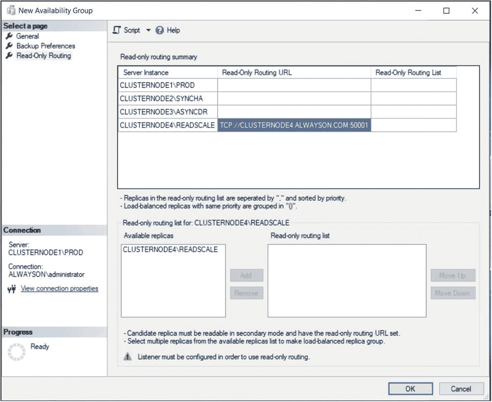

图 5-11 ¶ 仅读路由选项卡 – 配置仅读路由 URL

一旦 `Read-Only routing URL` 已添加到您计划配置的每个可读次要副本中，可读次要副本将出现在选项卡下半部分的 `Available Replicas` 窗口中。您现在可以为希望能够路由到可读次要副本的每个副本选择 `Read-Only Routing List` 单元格，并单击选项卡下半部分的 `Add` 按钮，以将其添加到 `Read-Only Routing List` 中，如 Figure 5-12 所示。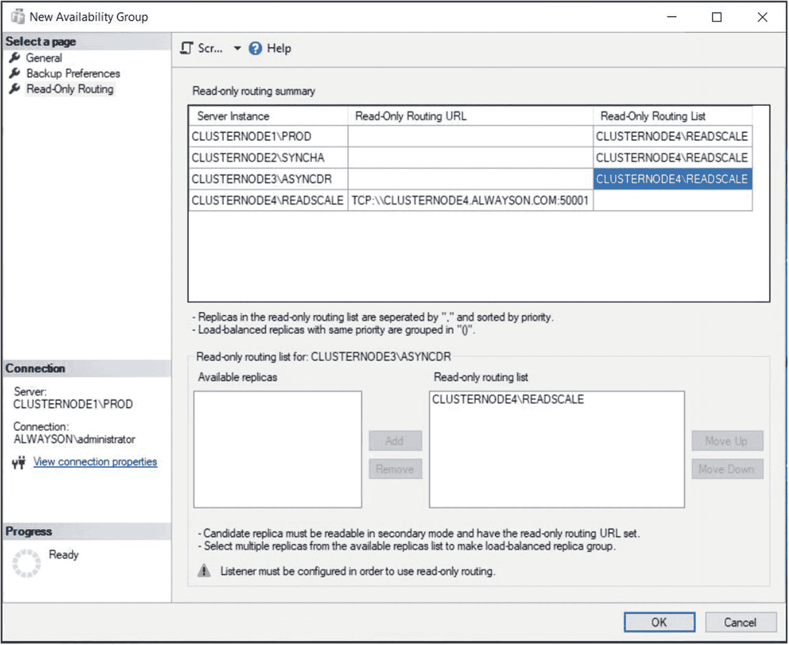

图 5-12 ¶ 仅读路由选项卡 – 配置仅读路由列表

此示例显示了一个简单的配置，其中所有节点（在托管 `primary replica` 时）都可以将读请求卸载到单个可读次要副本。但是更复杂的排列也是可能的。例如，您可以配置每个节点路由到单独的可读次要副本。如果您的可用性组分布在多个站点中，并且您希望确保每个节点将只读请求路由到同一站点的副本中，这将非常有用，从而提高读扩展的冗余性。

另外，您可以允许每个节点将只读请求路由到多个可读次要副本。在此场景中，您有两个选项。默认实现将始终将读请求发送到第一个可用的副本，因此您只是为可读次要副本添加了冗余。如果这是意图，则路由列表中的每个可读次要副本将用逗号分隔。更高级的实现是配置可读次要副本以进行只读请求的负载均衡。在此场景中，只读请求将使用轮询方式在负载均衡的集合中进行路由。负载均衡集合内的节点将用逗号分隔，集合用括号括起来。

您还可以在同一路由列表中配置多个负载均衡集合。在这里，请求将轮询第一个负载均衡集合，除非该集合中的节点变得不可用，在这种情况下，请求将轮询下一个集合。

例如，假设您希望只读请求在 `ServerA` 和 `ServerB` 之间进行负载均衡，但如果这些服务器变得不可用，您希望请求在 `ServerC` 和 `ServerD` 之间进行负载均衡。您的只读路由列表将采用以下形式：`((ServerA,ServerB),(ServerC,ServerD))`。

一旦我们创建了可用性组，我们需要创建可用性组侦听器。为此，我们从 `Sales Availability Group` 的上下文菜单中选择 `New Listener`，它现在应该在 `Object Explorer` 中可见。这会调用 `New Availability Group Listener dialog box`，可在 Figure 5-13 中看到。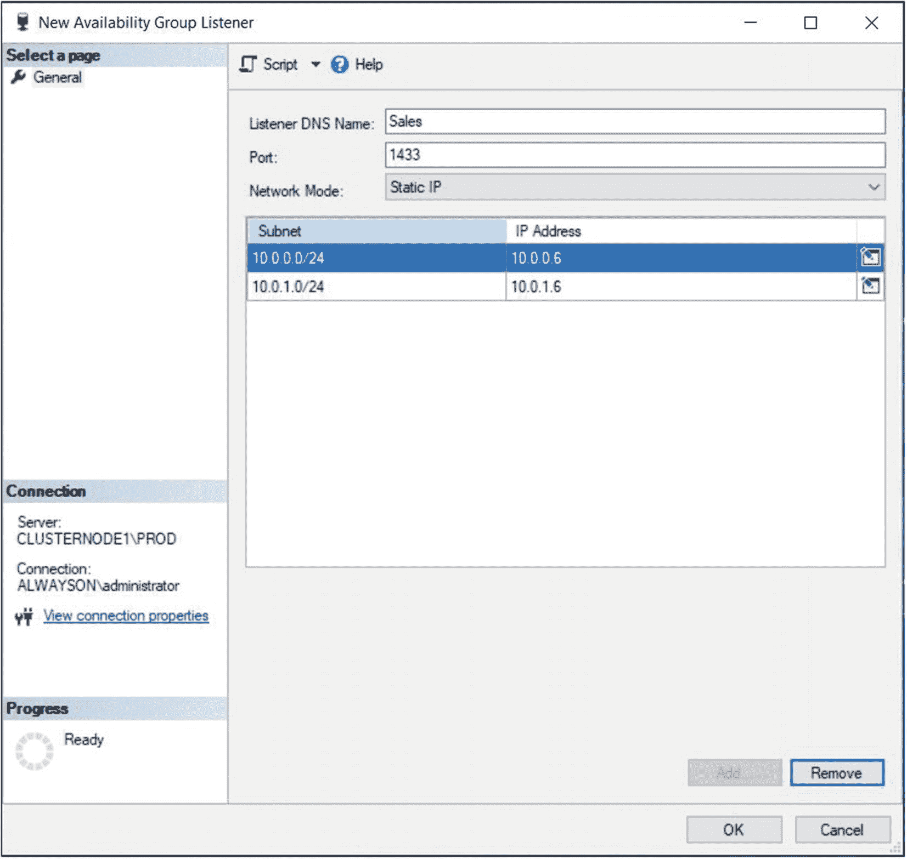

图 5-13 ¶ 新建可用性组侦听器对话框

在此对话框中，我们首先输入侦听器的 `virtual name`。然后我们定义它将监听的 `port` 和将分配给它的 `IP address`。

### 提示

我们能够为两个侦听器以及 SQL Server 实例使用相同的 `port`，因为所有三个都使用不同的 `IP addresses`。

## 使用 T-SQL

现在我们已使用 `SSMS` 中的 GUI 方法创建了可用性组，让我们看看如何使用 T-SQL 创建可用性组。在本节中，我们将创建一个名为 `Accounts` 的可用性组，它将为 `Accounts` 数据库提供 HA 和 DR。如往常一样，我们需要做的第一件事是对数据库进行完整备份。我们可以使用 Listing 5-5 中的脚本来实现。

```
BACKUP DATABASE HR TO DISK = N'C:\\Backups\\HR.bak' WITH NAME = N'HR-Full Database Backup' ;
GO
```

Listing 5-5

备份 `Accounts` 数据库

要创建可用性组，我们将使用 `CREATE AVAILABILITY GROUP` T-SQL 命令。此命令支持的 `WITH` 选项在 Table 5-1 中详细说明。

Table 5-1

`CREATE AVAILABILITY GROUP` with Options

| 选项 | 描述 |
| --- | --- |
| `AUTOMATED_BACKUP_PREFERENCE` | 指定应为备份使用哪个副本。可选选项为 `PRIMARY`，表示将始终使用主要副本；`SECONDARY_ONLY`，表示不应在主要副本上执行备份；`SECONDARY`，表示除非主要副本是唯一在线的副本，否则不应在主要副本上获取备份；以及 `NONE`，表示在选择要从中获取备份的副本时，将忽略每个副本的角色。 |
| `FAILURE_CONDITION_LEVEL` | 指定应导致可用性组自动故障转移的事件。可接受的级别为 1–5*。 |
| `HEALTH_CHECK_TIMEOUT` | 以毫秒为单位指定，集群在假设节点无响应并进行故障转移之前，将等待健康检查过程响应的持续时间。 |
| `DB_FAILOVER` | 当可用性组具有多个数据库时，确定可用性组中单个数据库移出 ONLINE 状态是否会触发故障转移。 |
| `DTC_SUPPORT` | 指定是否使用 DTC（分布式事务协调器）在可用性组内支持跨数据库事务。可接受的值为 `PER_DB` 或 `NONE`。 |
| `BASIC` | 用于创建基本可用性组。基本可用性组在第 7 章中讨论。 |
| `DISTRIBUTED` | 用于创建分布式可用性组。这在第 7 章中讨论。 |
| `REQUIRED_SYNCHRONIZED_SECONDARIES_TO_COMMIT` | 可用于通过在继续之前强制在次要副本上提交来确保零 RPO。0 表示事务将被标记为 NOT SYNCHRONIZED，但副本将继续处理事务。 |
| `CLUSTER_TYPE` | 指定可用性组所在的集群类型。可能的值为 `WSFC`，表示 Windows 故障转移集群；`EXTERNAL`，表示非 Windows 集群，例如 Linux Pacemaker；或 `NONE`，表示无集群可用性组。 |

*请参阅表 *5-2* 了解每个故障级别的详细信息*。

Table 5-2 详细说明了根据指定的故障条件级别将触发自动故障转移的事件。

Table 5-2

故障条件级别

| 级别 | 触发故障转移的事件 |
| --- | --- |
| 1 | • SQL Server 服务已停止。• SQL Server 实例在集群中的租约已过期，因为未收到确认。 |
| --- | --- |


## 严重程度级别

| 级别 | 描述 |
|---|---|
| 2 | • 任何级别 1 条件。 • SQL 实例未连接到集群且健康检查阈值已超出。 • 可用性副本处于 FAILED 状态。 |
| 3 (默认) | • 任何级别 1–2 条件。 • SQL Server 实例内部出现关键错误。 |
| 4 | • 任何级别 1–3 条件。 • SQL Server 实例内部出现中等错误。 |
| 5 | • 任何级别 1–4 条件。 • SQL Server 实例内部出现任何故障。 |

当使用 `REPLICA ON` 子句添加副本时，还可以使用额外的 `WITH OPTIONS`。这些内容在表 5-3 中有详细说明。

## ON REPLICA WITH 选项

表 5-3

| 选项 | 描述 |
|---|---|
| `ENDPOINT_URL` | 主机副本的 SQL Server 实例上端点的 URL。 |
| `FAILOVER_MODE` | 指定副本是否应支持自动或手动故障转移。 |
| `AVAILABILITY_MODE` | 指定副本上的事务应同步或异步提交。可用性模式也可以设置为 `CONFIGURATION_ONLY` 模式，以支持外部集群模式。这将在第 6 章中讨论。 |
| `SESSION_TIMEOUT` | 指定会话超时时间（以秒为单位）。 |
| `BACKUP_PRIORITY` | 为副本提供权重，用于决定应从哪个副本获取备份。0 表示无法从副本获取备份。 |
| `SEEDING_MODE` | 指定副本的播种方式。可接受的值为 `AUTOMATIC` 和 `MANUAL`。 |
| `PRIMARY_ROLE` | 用于指定 `ALLOW_CONNECTIONS` 设置并传递 `READ_ONLY_ROUTING_LIST`。 |
| `SECONDARY_ROLE` | 用于指定 `ALLOW_CONNECTIONS` 的值并传递 `READ_ONLY_ROUTING_URL`。 |

因此，清单 5-6 中的脚本将创建 `Accounts` 可用性组。请注意，我们选择手动播种副本。

### Listing 5-6 创建 Accounts 可用性组
```sql
CREATE AVAILABILITY GROUP Accounts WITH (
      AUTOMATED_BACKUP_PREFERENCE = PRIMARY,
      DB_FAILOVER = OFF,
      DTC_SUPPORT = NONE,
      REQUIRED_SYNCHRONIZED_SECONDARIES_TO_COMMIT = 0
) FOR REPLICA ON
      'CLUSTERNODE1\PROD' WITH (
            ENDPOINT_URL = N'TCP://CLUSTERNODE1.AlwaysOn.com:5022',
            FAILOVER_MODE = AUTOMATIC,
            AVAILABILITY_MODE = SYNCHRONOUS_COMMIT,
            SESSION_TIMEOUT = 10,
            BACKUP_PRIORITY = 50,
            SEEDING_MODE = MANUAL,
            PRIMARY_ROLE(ALLOW_CONNECTIONS = ALL),
            SECONDARY_ROLE(ALLOW_CONNECTIONS = NO)
      ),
      'CLUSTERNODE2\SYNCHA' WITH (
            ENDPOINT_URL = N'TCP://CLUSTERNODE2.AlwaysOn.com:5022',
            FAILOVER_MODE = AUTOMATIC,
            AVAILABILITY_MODE = SYNCHRONOUS_COMMIT,
            SESSION_TIMEOUT = 10,
            BACKUP_PRIORITY = 50,
            SEEDING_MODE = MANUAL,
            PRIMARY_ROLE(ALLOW_CONNECTIONS = ALL),
            SECONDARY_ROLE(ALLOW_CONNECTIONS = NO)
      ),
      'CLUSTERNODE3\ASYNCDR' WITH (
            ENDPOINT_URL = N'TCP://CLUSTERNODE3.AlwaysOn.com:5022',
            FAILOVER_MODE = MANUAL,
            AVAILABILITY_MODE = ASYNCHRONOUS_COMMIT,
            SESSION_TIMEOUT = 10,
            BACKUP_PRIORITY = 50,
            SEEDING_MODE = MANUAL,
            PRIMARY_ROLE(ALLOW_CONNECTIONS = ALL),
            SECONDARY_ROLE(ALLOW_CONNECTIONS = NO)
      );
GO
```

现在我们已经创建了 `Accounts` 可用性组，我们需要创建一个可用性组侦听器，以便集群知道将请求定向到何处。我们将使用带有 `ADD LISTENER` 子句的 `ALTER AVAILABILITY GROUP` 命令来完成此操作。`ADD LISTENER` 子句的 `WITH` 选项在表 5-4 中指定。

## ADD LISTENER WITH 选项

表 5-4

| 选项 | 描述 |
|---|---|
| `IP` | 指定侦听器将监听的 IP 地址（们），以及与每个 IP 地址相关的网络的子网掩码 |
| `PORT` | 侦听器将监听的端口 |

因为我们的 `CLUSTERNODE3\ASYNCDR` 实例与 `CLUSTERNODE1\PROD` 和 `CLUSTERNODE2\SYNCHA` 位于不同的子网中，所以我们需要指定两个 IP 地址，每个子网一个。因此，清单 5-7 中的脚本将为 `Accounts` 可用性组创建可用性组侦听器。

### Listing 5-7 创建可用性组侦听器
```sql
ALTER AVAILABILITY GROUP Accounts
      ADD LISTENER 'Accounts' (
            WITH IP
                  (
                        (N'10.0.0.8', N'255.255.255.0'),
                        (N'10.0.1.8', N'255.255.255.0')
                  ),
            PORT=1433
      );
GO
```

## 使用 PowerShell 实现可用性组

正如您所料，Microsoft 提供了 PowerShell cmdlet，可用于创建和管理 SQL Server 可用性组和可用性组侦听器。随着世界向 DevOps 文化转变，PowerShell 成为许多希望实现构建自动化的组织的首选语言，这一点变得越来越重要。

`sqlserver` PowerShell 模块随 SQL Server Management Studio 一起安装，但也可以通过清单 5-8 中的命令进行安装。

### Listing 5-8 安装 sqlserver PowerShell 模块
```powershell
Install-Module sqlserver
```

注意
如果这是您在服务器上首次安装 PowerShell 模块，则会提示您安装 NuGet 提供程序。

安装 `sqlserver` 模块后，您将可以使用 cmdlet 通过 PowerShell 创建和管理可用性组。`New-AvailabilityReplica` cmdlet 允许您创建指定每个副本属性的对象。然后可以将这些对象传递给 `New-SqlAvailabilityGroup` cmdlet，后者将创建可用性组。

例如，假设我们想要创建一个名为 `Foo` 的可用性组，其中包含 `Foo` 数据库，`CLUSTERNODE1\PROD` 主机初始主副本，`CLUSTERNODE2\SYNCHA` 主机辅助副本以实现高可用性。我们可以使用清单 5-9 中的脚本来实现这一点。

### Listing 5-9 创建 Foo 可用性组
```powershell
#Create connection to CLSUETERNODE1\PROD
$PrimaryServer = Get-Item "SQLSERVER:\\SQL\\CLUSTERNODE1\\PROD" -Verbose
#Create connection to CLUSTERNODE2\SYNCHA
$SecondaryServer = Get-Item "SQLSERVER:\\SQL\\CLUSTERNODE2\\SYNCHA"
#Set the properties of the primary Replica
$PrimaryReplicaOptions = @{
    Name             = "CLUSTERNODE1\PROD"
    EndpointUrl      = "TCP://CLUSTERNODE1.ALWAYSON.COM:5022"
    FailoverMode     = "Automatic"
    AvailabilityMode = "SynchronousCommit"
    Version          = ($PrimaryServer.Version)
}
#Create the primary Replica Object
$PrimaryReplica = New-SqlAvailabilityReplica @PrimaryReplicaOptions  -AsTemplate
#Set the properties of the secondary Replica
$SecondaryReplicaOptions = @{
    Name             = "CLUSTERNODE2\SYNCHA"
    EndpointUrl      = "TCP://CLUSTERNODE2.ALWAYSON.COM:5022"
    FailoverMode     = "Automatic"
    AvailabilityMode = "SynchronousCommit"
    Version          = ($SecondaryServer.Version)
}
#Create the secondary replica object
$SecondaryReplica = New-SqlAvailabilityReplica @SecondaryReplicaOption -AsTemplate
$AvailabilityGroupOptions = @{
    InputObject         = $PrimaryServer
    Name =              = "Foo"
    AvailabilityReplica = ($PrimaryReplica, $SecondaryReplica)
    Database            = @("Foo")
}
New-SqlAvailabilityGroup @AvailabilityGroupOptions
```


然后我们可以使用 `New-SqlAvailabilityGroupListener` cmdlet 创建一个可用性组侦听器。这在列表 5-10 中进行了演示。

```powershell
#Specify the options for the Listener
$ListenerOptions = @{
    Name = "Foo"
    StaticIp = "10.0.0.14/255.255.255.0"
    Path = "SQLSERVER:\\Sql\\CLUSTERNODE1\\PROD\\AvailabilityGroups\\Foo"
}
#Create the Listener
New-SqlAvailabilityGroupListener @ListenerOptions
```

列表 5-10

创建可用性组侦听器

## 摘要
AlwaysOn 可用性组最多可使用八个辅助副本实现，结合同步和异步提交模式。在使用可用性组实现高可用性时，您始终使用同步提交模式，因为异步提交模式不支持自动故障转移。然而，在实施同步提交模式时，您必须意识到相关的性能损失，因为在主副本上提交之前，事务必须先在辅助副本上提交。对于灾难恢复，您通常会选择实施异步提交模式。

可用性组可以通过新建可用性组向导、通过对话框、通过 `T-SQL` 或甚至通过 `PowerShell` 创建。如果您使用对话框创建可用性组，则某些方面，例如端点和相关权限，必须使用 `T-SQL` 或 `PowerShell` 进行脚本编写。

如果您使用可用性组实施灾难恢复，则需要配置多子网集群。这并不意味着您必须在站点之间具有 SAN 复制，因为可用性组不依赖于共享存储。您需要做的是为管理集群访问点以及可用性组侦听器添加额外的 IP 地址。您还需要关注支持客户端重连的集群属性，以确保客户端不会出现大量超时。

© Peter A. Carter 2020 P. A. CarterSQL Server 2019 AlwaysOn[`doi.org/10.1007/978-1-4842-6479-9\_6`](https://doi.org/10.1007/978-1-4842-6479-9_6) 开始摘要
