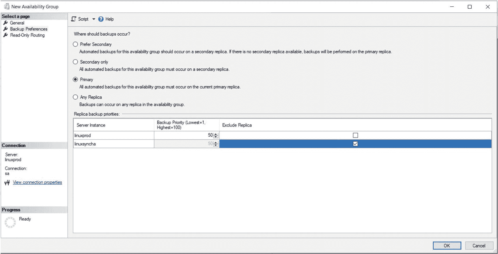

# 6. 在 Linux 上实施 AlwaysOn 可用性组

Peter A. Carter^(1 ) (1) Botley, UK 结束摘要

自 SQL Server 2017 以来，可以在 Linux 以及 Windows 上安装 SQL Server。AlwaysOn 可用性组可以在 Linux 上进行配置，具有与实例托管在 Windows 上时的大部分相同功能。SQL Server 在 Linux 上的安装和配置超出了本书的范围，但完整细节可以在 Apress 出版的 *Pro SQL Server 2019 管理* 中找到，可在 [www.apress.com/gb/book/9781484250884#otherversion=9781484250891](http://www.apress.com/gb/book/9781484250884%2523otherversion%253D9781484250891) 找到。

本章重点介绍在 Linux 上配置可用性组，以提供高可用性 (HA)。我们将首先简要概述实施 pacemaker 集群所涉及的技术（Pacemaker 是一种基于 Linux 的集群技术），然后配置具有自动故障转移的双节点可用性组。

### 注
在本章的演示中，我们将使用三台服务器，即 LinuxProd、LinuxSyncHA 和 LinuxConfig。每台服务器上都安装了默认实例的 SQL Server 2019。服务器使用 Ubuntu 18.04 操作系统构建，并且未加入域。

在本章中，我们将执行以下活动：
* 创建 Sales 数据库。
* 在我们的实例上启用可用性组并准备实例以支持可用性组。
* 为 Sales 数据库创建可用性组。
* 创建集群。
* 配置集群。

## Linux 集群技术
以下各节将提供用于在 Linux 上配置集群的技术的高级概述。在开始之前，了解以下内容很重要：与在 Windows 集群上构建可用性组不同，在 Linux pacemaker 集群上构建可用性组时，可用性组与集群的集成程度不如 Windows。特别是，可用性组不知道集群的状态，甚至不知道集群的存在。因此，故障转移操作必须在集群级别执行。此外，虽然仍然可以创建侦听器，但功能有限。您需要手动在 DNS 中注册侦听器的名称，并且不支持只读路由。

### Pcs
当您安装 `pcs` 时，该包也会安装 Pacemaker 和 Corosync。然而，`pcs` 组件本身是一个命令行实用程序，用于管理 Pacemaker 集群。

### Pacemaker
Pacemaker 是集群的核心。它负责管理集群维护事件，例如节点添加和删除。它还负责管理集群事件并在节点上移动资源，以确保在节点上发生故障后资源仍然可用。

Pacemaker 支持所有标准集群配置，包括 active/active、active/passive、N+1 和 N+M。对高级 Pacemaker 配置的讨论超出了本书的范围；然而，进一步的细节可以在 Apress 出版的 *Pro Linux 高可用性集群* 中找到，可在 [www.apress.com/gp/book/9781484200803](http://www.apress.com/gp/book/9781484200803) 找到。

### Corosync
Corosync 为集群提供消息层。它通过在节点之间发送消息来实现仲裁系统以检查健康状态，并在仲裁丢失时通知 Pacemaker。

### STONITH
受支持的 Pacemaker 集群配置必须使用 fencing，这有助于在节点或资源状态未知时将集群带到已知良好状态。有两种类型的 fencing：资源 fencing 和节点 fencing。资源 fencing 用于防止资源在节点上启动。这可以避免在配置资源期间发生中断时数据损坏。节点 fencing 防止节点运行任何资源。如果节点无响应，通常需要此操作。节点 fencing 需要 fencing 设备和 fencing 代理。fencing 设备可能是不间断电源、电源分配单元或管理接口，例如灯光外设备或刀片电源控制设备。与这些设备交互的代理是 STONITH（shoot the other node in the head）。由于 STONITH 的实现非常特定于您使用的 fencing 设备，我们在本章中不会配置它。对于开发或测试目的来说这是可以的，但生产集群应始终配置 STONITH。

## 准备实施 AlwaysOn 可用性组
在创建可用性组之前，需要执行几个先决条件任务。也就是说，我们在 SQL Server 实例上启用可用性组并创建和备份我们想要实现高可用的数据库，并且由于 Linux 服务器无法相互进行身份验证，我们需要创建可用于身份验证的证书。以下各节演示如何执行这些任务。

### 启用可用性组
正如在 Windows 环境中所需的那样，在 Linux 上配置可用性组的第一个步骤是在服务级别启用该功能。列表 6-1 中的脚本演示了如何启用可用性组然后重新启动服务。此脚本需要在将托管副本的每台服务器上执行。

### 提示
`sudo` 用于在运行命令时提升您的权限。

```bash
sudo /opt/mssql/bin/mssql-conf set hadr.hadrenabled 1
sudo systemctl restart mssql-server
```

列表 6-1

启用可用性组

### 创建 Sales 数据库


下一步是创建我们希望实现高可用的数据库，并备份该数据库以用于初始化辅助副本。这可以通过清单 6-2 中的脚本实现。

## 创建 Sales 数据库

```
--Create Sales Database
CREATE DATABASE Sales;
GO
USE Sales;
GO
CREATE TABLE [dbo].Orders NOT NULL PRIMARY KEY CLUSTERED,
    [OrderDate] [date] NOT NULL,
    [CustomerID] [int] NOT NULL,
    [ProductID] [int] NOT NULL,
    [Quantity] [int] NOT NULL,
    [NetAmount] [money] NOT NULL,
    [TaxAmount] [money] NOT NULL,
    [InvoiceAddressID] [int] NOT NULL,
    [DeliveryAddressID] [int] NOT NULL,
    [DeliveryDate] [date] NULL
);
DECLARE @Numbers TABLE (
    Number INT
);
--Populate ExistingOrders with data
WITH CTE(Number) AS (
    SELECT 1 Number
    UNION ALL
    SELECT Number + 1
    FROM CTE
    WHERE Number < 100
)
INSERT INTO @Numbers SELECT Number FROM CTE
INSERT INTO Orders
SELECT
    (SELECT CAST(DATEADD(dd,(SELECT TOP 1 Number FROM @Numbers ORDER BY NEWID()),getdate()) as DATE)),
    (SELECT TOP 1 Number -10 FROM @Numbers ORDER BY NEWID()),
    (SELECT TOP 1 Number FROM @Numbers ORDER BY NEWID()),
    (SELECT TOP 1 Number FROM @Numbers ORDER BY NEWID()),
    500,
    100,
    (SELECT TOP 1 Number FROM @Numbers ORDER BY NEWID()),
    (SELECT TOP 1 Number FROM @Numbers ORDER BY NEWID()),
    (SELECT CAST(DATEADD(dd,(SELECT TOP 1 Number - 10 FROM @Numbers ORDER BY NEWID()),getdate()) as DATE))
FROM @Numbers a CROSS JOIN @Numbers b;
--SET FULL recovery mode on the database - required for Availability Groups
ALTER DATABASE Sales SET RECOVERY FULL;
GO
--Backup the Sales Database
BACKUP DATABASE Sales TO DISK = N'/var/opt/mssql/data/Sales.bak' WITH NAME = N'Sales-Full Database Backup';
GO
```

清单 6-2

创建 Sales 数据库

### 创建证书

由于我们的 Linux 服务器不属于域，无法使用 AD 身份验证相互认证，下一步是创建证书，可用于实例身份验证。你可以通过连接到主服务器并运行清单 6-3 中的脚本来创建证书。该脚本在 SQL Server 实例中创建证书，然后将其备份到操作系统，以便我们可以将其复制到辅助服务器。请记住，你可以通过使用 `sqlcmd` 连接到在 Linux 上运行的 SQL Server 实例，或从安装在基于 Windows 的机器上的 `SSMS` 连接。

```
USE Master
GO
CREATE MASTER KEY ENCRYPTION BY PASSWORD = 'Pa$$w0rd';
GO
CREATE CERTIFICATE aoag_certificate WITH SUBJECT = 'AvailabilityGroups';
GO
BACKUP CERTIFICATE aoag_certificate
    TO FILE = '/var/opt/mssql/data/aoag_certificate.cer'
    WITH PRIVATE KEY (
        FILE = '/var/opt/mssql/data/aoag_certificate.pvk',
        ENCRYPTION BY PASSWORD = 'Pa$$w0rd'
    );
GO
```

清单 6-3

创建证书

### 授予权限

我们现在需要将密钥复制到辅助服务器。为此，首先需要授予用户对 `/var/opt/mssql/data` 文件夹的权限。我们可以使用清单 6-4 中的命令来实现，该命令需要在将参与可用性组的服务器上运行。

```
sudo chmod -R 777 /var/opt/mssql
```

清单 6-4

授予权限

### 复制密钥

如果在主服务器上运行清单 6-5 中的命令，将使用 `scp`，一种远程文件复制程序，将证书的公钥和私钥复制到辅助服务器。要使此命令正常工作，每个服务器上都应安装并配置 SSH。SSH 可提供对另一台机器的安全访问，但完整的讨论超出了本书的范围。不过，可以在 `http://ubuntuhandbook.org/index.php/2014/09/enable-ssh-in-ubuntu-14-10-server-desktop/` 找到指南。

提示

你应更改用户名和服务器名称以匹配自己的配置。

```
scp /var/opt/mssql/data/aoag_certificate.* pete@linuxsyncha:/var/opt/mssql/data
scp /var/opt/mssql/data/aoag_certificate.* pete@linuxconfig:/var/opt/mssql/data
```

清单 6-5

复制密钥

提示

如果未配置名称服务器，则需要指定 IP 地址，而不是服务器名称。

### 在辅助服务器上创建证书

我们现在需要通过从文件系统导入证书和密钥在辅助服务器上创建证书。这可以使用清单 6-6 中的脚本实现。

```
CREATE MASTER KEY ENCRYPTION BY PASSWORD = 'Pa$$w0rd';
GO
CREATE CERTIFICATE aoag_certificate
    FROM FILE = '/var/opt/mssql/data/aoag_certificate.cer'
    WITH PRIVATE KEY (
        FILE = '/var/opt/mssql/data/aoag_certificate.pvk',
        DECRYPTION BY PASSWORD = 'Pa$$w0rd'
    );
GO
```

清单 6-6

在辅助服务器上创建证书

## 配置可用性组

现在证书已就位，我们需要创建将用于连接的端点。清单 6-7 中的脚本将创建一个名为 `AOAG_Endpoint` 的端点，该端点侦听端口 `5022` 并使用我们的证书进行身份验证。此脚本应在将参与可用性组的所有实例上运行。

### 创建端点

```
CREATE ENDPOINT AOAG_Endpoint STATE = STARTED AS TCP (LISTENER_PORT = 5022)
FOR DATABASE_MIRRORING (
    ROLE = ALL,
    AUTHENTICATION = CERTIFICATE aoag_certificate,
    ENCRYPTION = REQUIRED ALGORITHM AES
);
```

清单 6-7

创建端点

现在我们已准备好创建可用性组。我们将在 `linuxprod` 服务器上执行这些操作。我们可以在服务器上使用 `sqlcmd`，或在管理节点上使用 `SSMS` 连接到服务器，以便使用 GUI。图 6-1 说明了在管理节点上运行的新可用性组对话框的“常规”页。

图 6-1 ¶ 新可用性组对话框 – 通用页

与我们在第 5 章中配置的可用性组相比，配置中有两个主要区别需要注意。首先，群集类型和故障转移模式设置为 `EXTERNAL`。这表明可用性组将驻留在非 Windows 故障转移群集的群集上。具体来说，它将驻留在 Pacemaker 群集上。在 Linux 上构建可用性组时，我们可以选择将群集类型设置为 `EXTERNAL` 或 `NONE`。但是，如果选择 `NONE`，则不适合高可用性。

第二个需要注意的点是 `linuxconfig` 节点配置为仅配置。由于我们的可用性组不会在 Windows 故障转移群集上运行，因此故障转移需要由可用性组仲裁，而不是由群集仲裁。

如果我们有三个或更多节点，则不需要仅配置节点，因为主节点的故障仍可由两个（或更多）辅助节点仲裁。然而，由于我们只有两个节点的群集，因此需要第三个节点充当见证，并在节点故障时维护法定人数。


## 可用性组配置

仅配置节点不包含用户数据库的副本，但可用性组元数据会使用同步提交模式进行同步。仅配置节点可以使用任何版本的 `SQL Server`，包括 `SQL Server Express edition`，以避免额外成本。单个实例也可以作为多个可用性组的见证者。然而，单个可用性组永远只能有一个仅配置节点。

图 6-2 显示了新建可用性组对话框的备份首选项页面。在这里，我们已配置从主节点获取备份。 

图 6-2 ¶ 新可用性组对话框 – 备份首选项选项卡

由于我们仅配置高可用性，因此无需配置只读路由。关于只读路由以及本文未讨论的其他配置选项的讨论，可在第 5 章找到。

另外，我们也可以通过 T-SQL 创建可用性组，使用列表 6-8 中的脚本。

```
USE master
GO
CREATE AVAILABILITY GROUP LinuxAOAG WITH (
      AUTOMATED_BACKUP_PREFERENCE = PRIMARY,
      DB_FAILOVER = OFF,
      DTC_SUPPORT = NONE,
      CLUSTER_TYPE = EXTERNAL,
      REQUIRED_SYNCHRONIZED_SECONDARIES_TO_COMMIT = 0
) FOR DATABASE Sales
REPLICA ON
      'linuxconfig' WITH (
            ENDPOINT_URL = 'TCP://linuxconfig.AlwaysOn.com:5022',
            AVAILABILITY_MODE = CONFIGURATION_ONLY
      ),
      'linuxprod' WITH (
            ENDPOINT_URL = 'TCP://linuxprod.AlwaysOn.com:5022',
            FAILOVER_MODE = EXTERNAL,
            AVAILABILITY_MODE = SYNCHRONOUS_COMMIT,
            SESSION_TIMEOUT = 10,
            BACKUP_PRIORITY = 50,
            SEEDING_MODE = MANUAL,
            PRIMARY_ROLE(ALLOW_CONNECTIONS = ALL),
            SECONDARY_ROLE(ALLOW_CONNECTIONS = NO)
      ),
      'linuxsyncha' WITH (
            ENDPOINT_URL = 'TCP://linuxsyncha.AlwaysOn.com:5022',
            FAILOVER_MODE = EXTERNAL,
            AVAILABILITY_MODE = SYNCHRONOUS_COMMIT,
            SESSION_TIMEOUT = 10,
            BACKUP_PRIORITY = 0,
            SEEDING_MODE = MANUAL,
            PRIMARY_ROLE(ALLOW_CONNECTIONS = ALL),
            SECONDARY_ROLE(ALLOW_CONNECTIONS = NO)
      )
;
GO
```

列表 6-8

创建可用性组

要手动使用备份播种 Sales 数据库，可以从主服务器运行列表 6-9 中的命令，将备份文件复制到辅助服务器。

```
Scp /var/opt/mssql/data/sales.bak pete@linuxprod:/var/opt/mssql/data
```

列表 6-9

复制 Sales 数据库的备份

可以使用列表 6-10 中的命令还原数据库。

```
USE master
GO
RESTORE DATABASE Sales FROM DISK = '/var/opt/mssql/data/Sales.bak' WITH
      FILE = 1,
      MOVE N'Sales' TO N'/var/opt/mssql/data/Sales.mdf',
      MOVE N'Sales_log' TO N'/var/opt/mssql/data/Sales_log.ldf',
      NORECOVERY ;
GO
```

列表 6-10

还原 Sales 数据库

运行列表 6-11 中的脚本将把我们的辅助副本加入可用性组，并确保其具有适当的权限。此脚本需要在将参与可用性组的所有实例上运行。

```
ALTER AVAILABILITY GROUP LinuxAOAG JOIN WITH (CLUSTER_TYPE = EXTERNAL) ;
GO
ALTER AVAILABILITY GROUP LinuxAOAG GRANT CREATE ANY DATABASE ;
GO
```

列表 6-11

将辅助副本加入可用性组

## 配置集群

在创建集群之前，我们需要在将参与可用性组的每个 SQL Server 实例中创建一个将由 Pacemaker 账户使用的登录名，并为其分配所需的权限。这可以通过使用列表 6-12 中的脚本来实现。

```
CREATE LOGIN Pacemaker WITH PASSWORD = 'Pa$$w0rd'
GO
GRANT ALTER, CONTROL, VIEW DEFINITION ON AVAILABILITY GROUP::LinuxAOAG TO Pacemaker ;
GRANT VIEW SERVER STATE TO Pacemaker
```

列表 6-12

配置 Pacemaker 登录

接下来，我们需要配置防火墙。集群所需的端口在表 6-1 中详细说明。

表 6-1

集群所需的端口

| 端口 || 描述 |
| --- | --- |
| TCP 2224 || 所有节点均需。`pcsd` Web UI 和节点间通信 |
| --- | --- |
| TCP 3121 || 如果 Pacemaker 具有远程节点，则所有节点均需。用于 `crmd` 与 `pacemaker_remoted` 守护进程之间的通信 |
| TCP 21064 || 所有节点均需。由需要 DLM 的资源使用 |
| UDP 5405 || 所有节点均需。由 Corosync 使用 |
| TCP 1433 || 所有节点均需。本章中的示例将 SQL 实例监听在 1433 上；然而，您应将其更改为与您自己的环境相匹配 |
| TCP 5022 || 所有节点均需。本章中的示例将 AlwaysOn 端点设在 5022 上；然而，您应将其更改为与您自己的环境相匹配 |

列表 6-13 提供了在 Ubuntu 中配置防火墙规则的示例。

```
sudo ufw allow 2224/tcp
sudo ufw allow 3121/tcp
sudo ufw allow 21064/tcp
sudo ufw allow 5405/udp
sudo ufw allow 1433/tcp
sudo ufw allow 5022/tcp
sudo ufw reload
```

列表 6-13

配置防火墙规则

接下来，我们将安装 Pacemaker 组件。我们可以使用列表 6-14 中的命令来完成。此命令应在参与可用性组的所有服务器上运行。

```
sudo apt-get install pacemaker pcs resource-agents
```

列表 6-14

安装 Pacemaker 组件

**警告**

对于生产系统，请确保还安装 `fence-agents` 用于节点隔离。

在安装 `pcs` 组件期间，会创建 `hacluster`。您应使用 `passwd` 命令为此用户设置密码，如列表 6-15 所示。运行命令后，您将被提示输入并确认新密码。

**注意**

重要的是在每个节点上设置相同的密码。

```
Sudo passwd hacluster
```

列表 6-15

设置 hacluster 密码

我们现在可以使用列表 6-16 中的脚本启用 `pcsd` 和 `pacemarker` 服务。您会注意到在启用 pacemaker 之前，我们会发出销毁任何现有集群的命令。这是因为在安装 `pcs` 时创建了名为 `/etc/cluster/corosync.conf` 的文件，然而，启用 pacemaker 会尝试创建此文件。使用 `cluster destroy` 命令会删除此文件，以避免在启用 pacemaker 时出现失败。

```
sudo systemctl enable pcsd
sudo systemctl start pcsd
sudo pcs cluster destroy
sudo systemctl enable pacemaker
```

列表 6-16

启用 pcs 和 pacemarker

现在 pacemaker 已启用，我们可以构建集群。此过程包括运行五个 `pcs cluster` 命令。第一个是 `auth`。它用于将 `pcs` 身份验证到所有节点上的 `pcs` 守护进程。该命令期望一个节点列表，后跟在安装期间创建的 `pcs` 用户的用户名和密码。列表 6-17 演示了在我们的场景中如何使用该命令。

```
sudo pcs cluster auth LinuxProd LinuxSyncHA LinuxConfig –u hacluster
```

列表 6-17

对 pcs 守护进程进行身份验证

由于您运行此命令时未指定 `–p` 参数，您将被提示输入 `hacluster` 的密码。


### 设置集群
第二个命令是 setup。该命令用于注册集群名称以及集群中的每个节点。集群名称使用 `--name` 参数指定，后跟节点列表。清单 6-18 说明了在我们的场景中如何使用 setup 命令。

**提示**
也可以指定 `--start` 参数来启动集群服务，但我们将选择使用单独的命令启动集群，以帮助说明完整流程。

```
sudo pcs cluster setup --name LinuxCluster LinuxProd LinuxSyncHA LinuxConfig
```
清单 6-18

### 启动集群服务
下一个命令是 start。正如您所期望的，它用于启动集群服务。该命令要么接受 `--all` 参数以在所有节点上启动服务（清单 6-19 中演示），要么接受节点列表，指定应在其中启动集群服务的节点。

```
sudo pcs cluster start --all
```
清单 6-19

### 检查集群状态
运行此命令后，服务启动前可能会有延迟。因此，在继续操作之前，您应运行 status 命令以确保集群已启动，如清单 6-20 所示。

```
sudo pcs cluster status
```
清单 6-20

### 启用集群服务
最后，我们将为每个节点配置集群服务在启动时运行。这可以通过使用 enable 命令实现，如清单 6-21 所示。该命令接受 `--all` 参数或节点列表。

```
sudo pcs cluster enable --all
```
清单 6-21

### 安装资源代理
现在集群已经创建，我们可以安装 SQL Server 资源代理。这允许 Pacemaker 与可用性组松散集成。具体来说，每当发生配置更改，例如故障转移或添加新副本时，它都会在 `sys.available_groups` 目录视图中递增一个序列号。然后在故障转移时查询该序列号，以在故障转移发生前确定节点是否是最新的。这允许在序列号不是最高时拒绝故障转移。清单 6-22 演示了如何安装资源代理。

```
sudo apt-get install mssql-server-ha
```
清单 6-22

### 保存 Pacemaker 凭据
接下来，我们需要为 Pacemaker 授予对可用性组的权限。我们在清单 6-12 中为 Pacemaker 创建了一个登录名。现在我们需要在集群中的所有节点上运行清单 6-23 中的脚本，将凭据保存在操作系统中。

```
echo 'pacemakerLogin' >> ~/pacemaker-passwd
echo 'Pa$$w0rd' >> ~/pacemaker-passwd
sudo mv ~/pacemaker-passwd /var/opt/mssql/secrets/passwd
sudo chown root:root /var/opt/mssql/secrets/passwd
sudo chmod 400 /var/opt/mssql/secrets/passwd
```
清单 6-23

### 创建集群资源
我们现在需要创建集群资源，既用于可用性组，也用于虚拟 IP 地址。这可以通过运行清单 6-24 中的脚本来实现。脚本中的第一个命令为 `LinuxAOAG` 可用性组创建可用性组资源。
脚本中的第二个命令为我们希望使用的 IP 地址创建资源。请注意，我们同时指定了 IP 地址和网络的网络掩码。网络掩码使用 CIDR 表示法指定。CIDR 表示法超出了本书的范围，但可以在 [www.controltechnology.com/Files/common-documents/application_notes/CIDR-Notation-Tutorial](http://www.controltechnology.com/Files/common-documents/application_notes/CIDR-Notation-Tutorial) 找到 CIDR 教程。

```
sudo pcs resource create LinuxAOAG ocf:mssql:ag ag_name=LinuxAOAG meta failure-timeout=60s master meta notify=true
sudo pcs resource create VirtualIP ocf:heartbeat:IPaddr2 ip=10.0.0.25 cidr_netmask=24
```
清单 6-24

**警告**
由于 Pacemaker 没有网络名称的概念，因此 IP 地址和所需名称必须手动在 DNS 中注册。

### 创建同位置约束
资源应在哪个节点上运行的决策基于分数，这些分数在资源级别计算。这意味着虚拟 IP 地址可能被移动到与可用性组资源不同的节点存在风险。为了降低此风险，我们需要添加一个同位置约束，以确保资源始终位于同一节点上。约束也有分数，低于无穷大的任何数字都是偏好，无穷大则是绑定要求。清单 6-25 中的命令将创建所需的约束。

```
sudo pcs constraint colocation add VirtualIP LimuxAOAG INFINITY with-rsc-role=Master
```
清单 6-25

### 创建排序约束
由于此命令将虚拟 IP 地址资源列在可用性组资源之前，当资源移动时，虚拟 IP 地址将被移动并上线，然后才移动并上线可用性组资源。这意味着虚拟 IP 地址可能暂时指向错误的节点。此风险可以通过添加排序约束来缓解，该约束强制在虚拟 IP 地址上线之前先移动可用性组资源。清单 6-26 演示了如何配置此约束。

```
sudo pcs constraint order promote LinuxAOAG then start VirtualIP
```
清单 6-26

### 创建可用性组侦听器
最后，我们可以创建可用性组侦听器。侦听器将使用我们在 Pacemaker 集群中创建的虚拟 IP 地址资源的 IP 地址。重要的是要记住，当可用性组配置在 Pacemaker 集群上时，可用性组侦听器的唯一目的是提供一个抽象，为副本提供单一入口点。它不会掩盖中断，因为在故障转移期间，在虚拟 IP 地址资源在另一个集群节点上启动时，它将暂时不可用。我们可以通过使用清单 6-27 中的脚本创建可用性组侦听器。

```
USE master
GO
ALTER AVAILABILITY GROUP LinuxAOAG ADD LISTENER 'LinuxAOListener'
(
    WITH IP (
        (N'10.0.0.25', N'255.255.255.0')
    )
    , PORT=1433
);
GO
```
清单 6-27

## 摘要
可用性组可以在基于 Linux 的实例上以与在基于 Windows 的实例上配置可用性组类似的方式进行配置。它们可以在没有底层集群的情况下配置，也可以使用基于 Linux 的集群技术。
如果需要高可用性或灾难恢复，则必须使用 Pacemaker 等 Linux 集群技术。Pacemaker 集群由多个组件组成，包括 `pcs`，用于管理 Pacemaker 集群的命令行实用程序；`Corosync`，提供节点之间的心跳；用于 fencing 的 `STONITH`；以及 `Pacemaker`，核心集群管理器。
Pacemaker 集群支持可用性组侦听器，但其功能有限。IP 地址资源在移动到新节点时暂时离线。因此，可用性组侦听器提供了一个抽象，但不会掩盖故障，因为它在一段时间内将无法访问。

© Peter A. Carter 2020 P. A. Carter SQL Server 2019 AlwaysOn [`doi.org/10.1007/978-1-4842-6479-9_7`](https://doi.org/10.1007/978-1-4842-6479-9_7)
