# 7. 非常规可用性组实现
Peter A. Carter ([1]) (1) Botley, UK


到目前为止，我们已经讨论了 `AlwaysOn Availability Groups` 和 `AlwaysOn Failover Clustered Instances` 的典型、本地企业工作负载场景。然而，AlwaysOn 是一个如此灵活的技术套件，以至于存在许多你可以利用的变体。因此，本章将概述一些不太典型的 AlwaysOn 场景，你可能需要支持。这些包括 `Basic Availability Groups`、`Availability Groups` 在 Azure 中、`Distributed Availability Groups`，以及在没有集群或域的情况下创建 `Availability Groups`。

在本章中，我们将执行以下活动：
* 在 Azure IaaS 中创建可用性组。
* 创建无集群可用性组。
* 创建域无关可用性组。
* 创建分布式可用性组。

## 基本可用性组

本书迄今为止的所有可用性组演示都需要 `SQL Server Enterprise Edition`，但可用性组在 `SQL Server Standard Edition` 中也可用。然而在标准版中，可用性组的功能是有限的，因此它们被称为 `Basic Availability Groups`。

最明显限制是基本可用性组仅支持两个副本。然而，副本可以配置为同步或异步提交模式。这意味着你仍然可以实现高可用性或灾难恢复。

**注意**
Linux 上的基本可用性组支持第三个仅配置的副本，这是实现高可用的必要条件。请参阅第 6 章了解更多详细信息。

次要副本不支持只读连接。这意味着基本可用性组不仅不支持读取扩展，也不支持在次要副本上执行备份或完整性检查。

另一个限制是基本可用性组只能包含单个数据库。这意味着无法一起故障转移多个数据库，使得大型实例的管理变得更加困难。

其他高级可用性组功能，例如分布式可用性组，也不受支持，并且一旦构建了基本可用性组，就无法将其升级为完整可用性组。相反，必须将其销毁并重新创建。

要实现基本可用性组，你可以使用本书前面讨论过的相同语法，显而易见的例外是不能实现不受支持的功能。基本可用性组独有的唯一语法是在 `WITH` 子句中添加 `BASIC` 标记，这会降低可用功能。例如，列表 7-1 中的脚本将在两个服务器之间创建可用性组，服务器名为 `SQLStdProd` 和 `SQLStdSyncHA`，并且两台服务器都安装了 SQL Server Standard Edition 的默认实例。

```
CREATE AVAILABILITY GROUP BasicAGAG WITH (
    AUTOMATED_BACKUP_PREFERENCE = PRIMARY,
    BASIC,
    REQUIRED_SYNCHRONIZED_SECONDARIES_TO_COMMIT = 0
)
FOR DATABASE Sales
REPLICA ON 'SQLSTDPROD' WITH (
    ENDPOINT_URL = 'TCP://SQLSTDPROD.AlwaysOn.com:5022',
    FAILOVER_MODE = AUTOMATIC,
    AVAILABILITY_MODE = SYNCHRONOUS_COMMIT,
    SEEDING_MODE = AUTOMATIC
),
'SQLSTDSYNCHA' WITH (
    ENDPOINT_URL = N'TCP://SQLSTDSYNCHA.AlwaysOn.com:5022',
    FAILOVER_MODE = AUTOMATIC,
    AVAILABILITY_MODE = SYNCHRONOUS_COMMIT,
    SEEDING_MODE = AUTOMATIC
);
GO
```
Listing 7-1
创建基本可用性组

## Azure IaaS 上的可用性组

当将数据库迁移到云时，你有多种目标选项。Azure SQL Database 和弹性数据库池提供数据库即服务，而 Azure 托管实例提供 SQL Server 即服务。这两种服务都基于可用性组提供高可用性。然而，如果你的应用程序需要访问操作系统，则必须使用 Azure 虚拟机。使用此解决方案，你必须手动配置可用性组，就像在本地一样。在以下各节中，我们将在设计可用性组拓扑之前查看一些你应该了解的 Azure 可用性选项，然后再探讨如何在 Azure 中配置可用性组。

### Azure 可用性概念

云的关键原则是为故障设计应用程序。因此，在云中为 SQL Server 实现可用性组是一个非常重要的主题。在讨论实现之前，你应该熟悉可用性集、可用性区域和区域的概念。以下各节将概述这些主题。

#### 可用性集

可用性集是一种构造，它将同一数据中心内的虚拟机放置在不同的故障域和更新域中。故障域表示共享公共电源和网络交换机的硬件。可用性集可以配置为跨越三个故障域。因此，如果你将三个虚拟机放置在同一个可用性集中，你就知道每个虚拟机与其他虚拟机在可用性集中具有唯一的电源和网络交换机。

更新域表示为计划或非计划维护而重新启动的物理硬件。默认情况下，可用性集分为五个更新域，这可以增加到最多 20 个。如果你在同一个可用性集中放置虚拟机，你就知道它们彼此位于不同的硬件上，并且不会同时重新启动。

**提示**
在使用可用性集时，你还应确保使用托管磁盘。使用托管磁盘时，物理磁盘会跨与附加虚拟机对齐的故障域进行拆分，避免单点故障。

#### 可用性区域

虽然可用性集可防止数据中心内的硬件问题和停机，但它无法防止数据中心故障。为了防止数据中心故障，你必须将虚拟机放置在单独的可用性区域中。每个可用性区域位于不同的建筑物中，具有独立的电力、网络和冷却系统。

#### 区域

区域提供了一种地理分散服务器的手段，以防止整个区域离线的规模性灾难。Azure 中的区域在地理位置内配对，其中地理位置是政治区域。例如，美国的区域与物理上位于美国的其他区域配对。其他地区，如欧洲和英国也适用。这使你能够在保持数据主权的同时防止灾难。

虽然我知道有些公司认为对于灾难恢复，他们只需要防止数据中心丢失，因此决定避免在多个区域拥有足迹的复杂性和成本开销，但在云术语中，只有当你的灾难恢复服务器位于与生产服务器不同的区域时，你才拥有灾难恢复。

### 在 Azure 中实现可用性组

在本节中，我们将探讨如何在 Azure 虚拟机上配置可用性组。在本节中，我们将在同一区域的两个可用性区域之间为 Sales 数据库构建一个可用性组，以提供高可用性。我们将在同一虚拟网络中的不同子网上构建每个虚拟机。在此之前，我们将简要讨论可用性集。

#### 创建可用性集


## 从 Azure 门户创建可用性集

要从 Azure 门户创建可用性集，请导航到“可用性集”刀片并使用“添加”按钮启动“创建可用性集”页面，该页面如图 7-1 所示。您会注意到，我们已选择要创建可用性集的订阅，并选择了应创建它的资源组。我们还为其指定了名称并选择了应创建的区域。因为我们计划在可用性集中拥有两台服务器，所以更新域和故障域都配置为两个。两台服务器中的每一台都将位于不同的故障域和更新域中。如果我们向可用性集添加更多服务器，则它们将以轮询方式分配到故障域和更新域。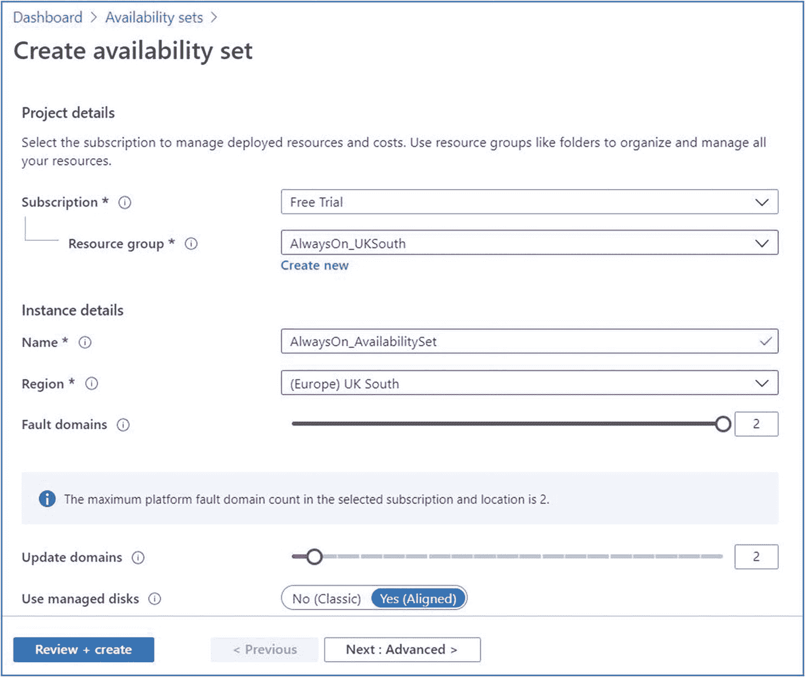

图 7-1 ¶ 创建可用性集

在如图 7-2 所示的高级页面上，我们可以选择将邻近放置组分配给可用性组。邻近放置组通过使用位于数据中心内物理位置接近的硬件来帮助确保最低可能的延迟。要使用此选项，您必须在创建可用性集之前创建邻近组。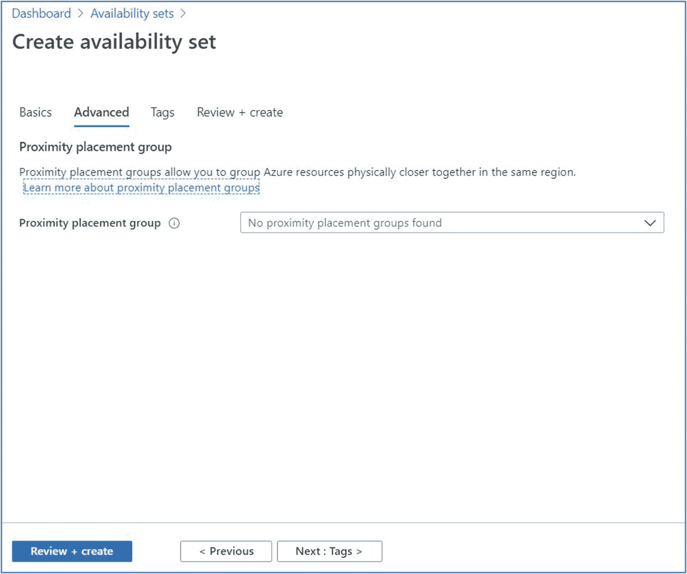

图 7-2 ¶ 创建可用性集高级页面

标签页面允许您分配键/值对标签。使用标签对于云来说始终是良好的实践，因为它不仅有助于资源管理，还能帮助成本控制，例如为消耗云资源的业务部门生成回溯或分摊机制。如图 7-3 所示，我们已为环境和应用程序配置了标签。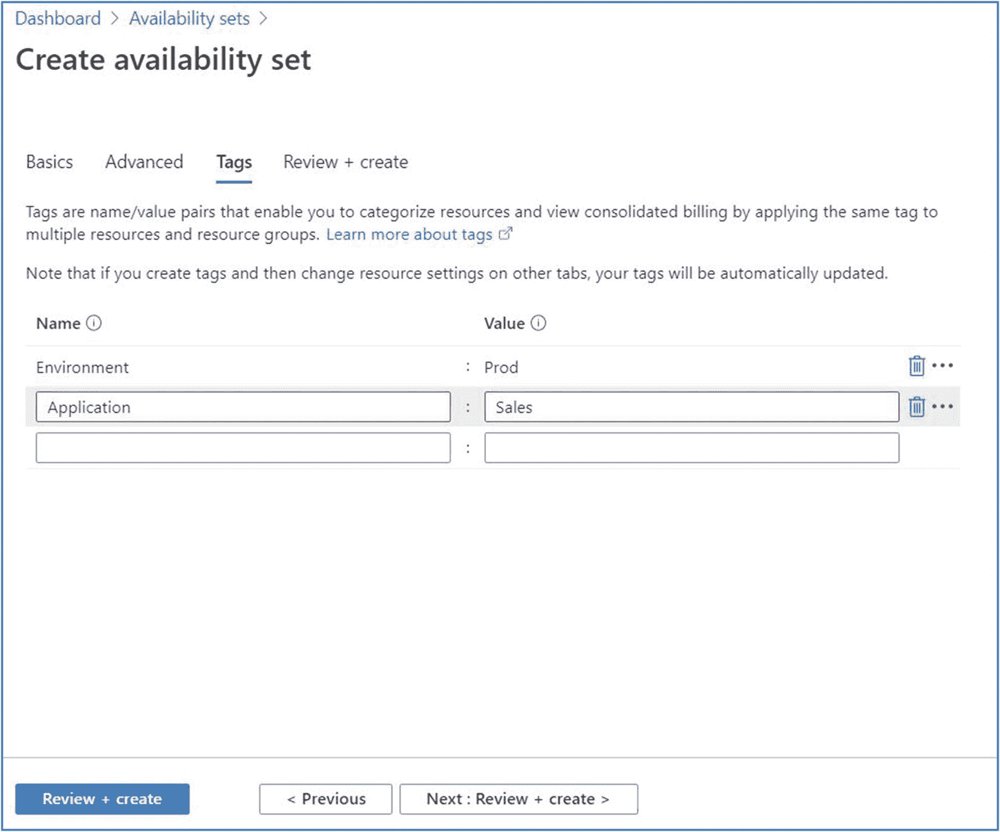

图 7-3 ¶ 创建可用性集 – 标签页面

提示

您可以使用 Azure 策略强制在创建资源时使用特定标签。

在“审核”页面上，您有机会在创建资源之前审核已配置的设置。

## 在 Azure VM 上创建可用性组

在以下各节中，我们将讨论在 Azure 上构建和配置可用性组解决方案。

注意

要跟随以下各节中的演示，您需要一个 Azure 订阅。这必须是至少按使用付费的订阅，因为免费试用订阅无法提供足够的内核来构建两台服务器。您还需要一个 vnet，其中包含两个子网。本章还假设 vnet 包含域控制器，或者您已配置 Azure 域服务。

### 创建 VM

我们首先需要的是三台 VM，其中将安装 SQL Server。在 Azure 中实现此目的有多种方式，具体取决于您的需求。第一个选项是前往 Azure Marketplace 并查找已安装 SQL Server 的机器映像。如果您采用这种方法，那么了解有两种不同的许可条款非常重要。第一种是 SPLA（服务提供商许可协议）。使用 SPLA 许可，VM 的成本包括 SQL Server 许可的成本。这意味着您的许可按使用付费，避免了许可采购的前期成本，但如果 VM 使用时间长，长期来看成本会更高。

第二种选项类型是 BYOL（自带许可）。在此许可模式下，SQL Server 许可不包含在 VM 的成本中。相反，您必须使用已采购的现有许可。当您选择此选项时，您必须在 10 天内向 Microsoft 报告您的许可使用情况。

当您构建已预装 SQL Server 的 VM 时，它将附带完整的 SQL Server 安装，包括所有功能。（除非您选择标记为“仅数据库引擎”的映像。）这在大多数用例中并不理想，因为它比仅安装所需的功能具有更大的安全足迹和资源利用率。因此，如果您使用预装 SQL Server 的 VM 映像（无论许可模式如何），都应花时间对其进行自定义以满足您的需求。

或者，您可以简单地从原版 Windows Server 映像构建 VM 并自行安装 SQL Server。这是最灵活的选项，但如果您采用这种方法，则必须自带许可。不会提供 SPLA 选项。

在本示例中，我们将使用带 SPLA 许可的 SQL Server 2019 on Windows Server 2019 映像。图 7-4 显示了此 VM 映像的 Marketplace 图标。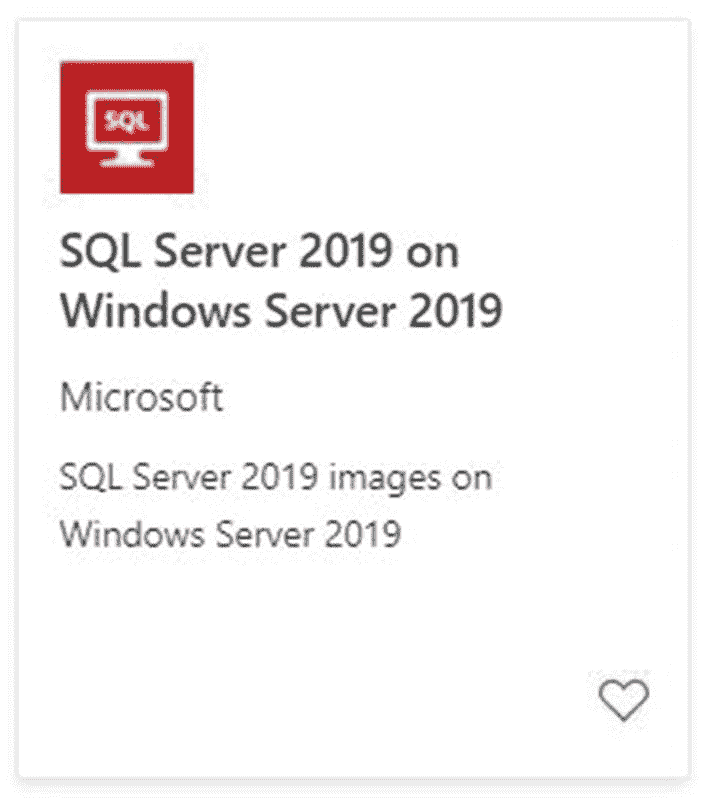

图 7-4 ¶ SQL Server 2019 on Windows Server 2019 VM 映像

在如图 7-5 所示的“创建虚拟机”页面的第一部分中，我们将指定 VM 应创建的订阅和资源组，然后指定服务器的名称和应创建的区域。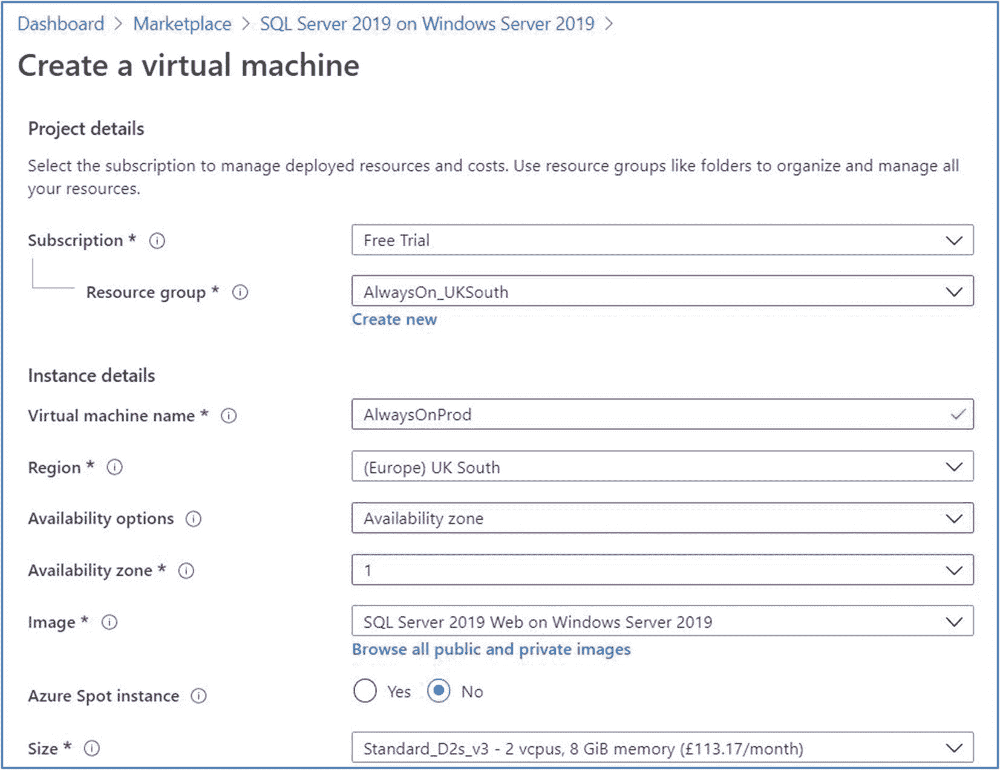

图 7-5 ¶ 创建虚拟机（第 1 部分）

然后我们继续指定 VM 的可用性选项。在规划可用性组时，这一点至关重要。在“可用性选项”对话框中，我们可以在“无需基础结构冗余”、“可用性集”或“可用性区域”之间进行选择。如果我们选择了可用性集，那么我们就可以选择使用之前创建的可用性集或创建新的可用性集。然而，我们选择了可用性区域，因此我们可以指定服务器应创建在哪个可用性区域。每个区域至少有三个可用性区域。

警告

然而，需要注意的是，创建 VM 后无法更改可用性选项。例如，您不能先创建没有可用性选项的 VM，然后再将其添加到可用性集中。

然后我们可以选择更改构建映像并指定是否要使用 Spot 实例。Spot 实例很少适合 SQL Server，且绝不适用于生产环境。Spot 实例由 Azure 内的空闲容量构建，成本非常有效。然而，如果需要容量，Azure 可能会在很短的通知时间内终止它们。因此，Spot 实例通常最适用于无状态应用程序、规模集中的无状态应用程序，或测试环境中的无状态应用程序。

我们还指定要构建的 VM 大小。月成本（基于服务器 24x7 运行）将显示在 VM 大小配置文件的右侧。

我们现在可以继续填充表单的后半部分，如图 7-6 所示。在这里，我们指定 VM 的管理员用户的用户名和密码，以及是否应在服务器的公共 IP 地址上打开端口。如果是这样，我们可以指定应打开哪些端口。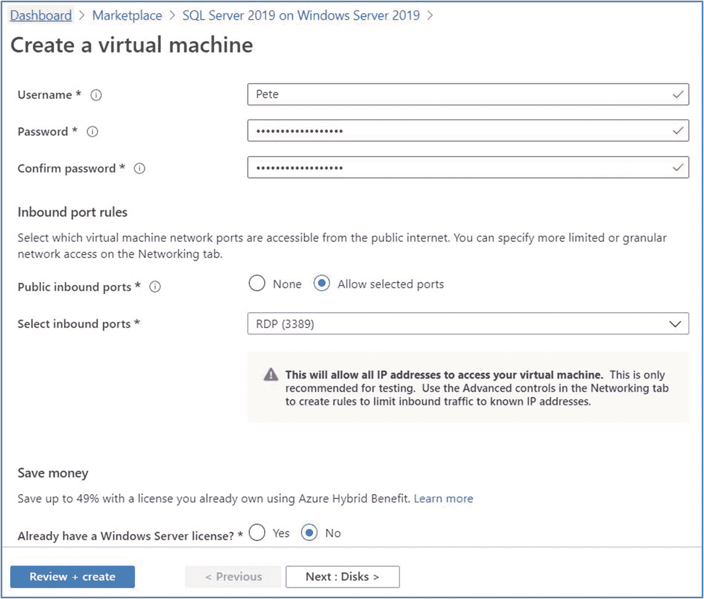

图 7-6 ¶ 创建虚拟机（第 2 部分）

警告

公共端口只应出于开发/测试目的而打开，即使如此，强烈建议创建 VPN 或改用 Bastion。

最后，我们指定要使用的许可模式。请注意，这仅适用于操作系统，不适用于 SQL Server，但我们仍然有相同的两个选项。我们可以按需支付 Windows 许可费用或自带许可。


## 磁盘页

在磁盘页上，如图 7-7 所示，我们可以配置 VM 的存储选项。页面第一部分中，我们可以指定要使用的存储层级，可在 Standard HDD、Standard SSD . 或 Premium SSD 中选择。我推荐为托管 SQL Server 的 VM 使用 Premium SSD，这可能不会令人意外，尽管您的选择可能还有其他因素，例如公司政策或预算限制。 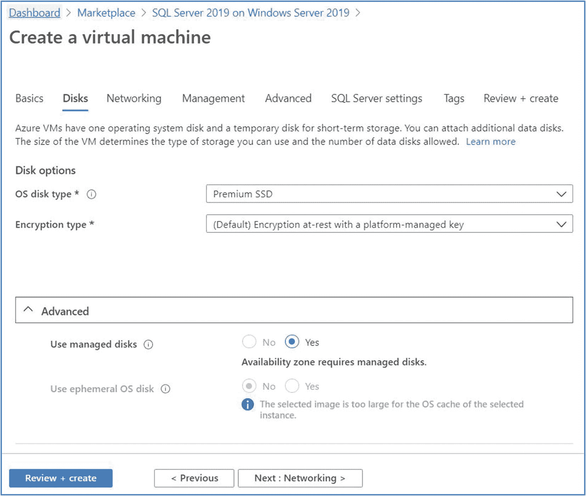

图 7-7 ¶ 创建虚拟机 – 磁盘页

页面“高级”部分中，我们可以指定是否要使用托管磁盘或非托管磁盘，以及是否要使操作系统磁盘为临时磁盘。通常推荐使用托管磁盘，因为它们带来诸如自动跨故障域和更新域拆分等优势。如果 VM 是在可用性集中构建的，这些域也可以与可用性集的域保持一致。在我们的案例中，必须使用托管磁盘，因为当可用性选项配置为可用性区域时，这是唯一的选择。

临时磁盘使用非常快的存储，且不具备终止抗性。因此，它们适用于无状态应用程序，但不适用于运行 SQL Server 的 VM。在我们的案例中，我们甚至无法为操作系统选择临时磁盘，因为我们的映像太大而无法支持它。

## 网络页

在网络页（图 7-8）上，我们可以指定 VM 应附加到的 vnet 和子网，以及配置应使用的公共 IP 地址和安全组。在此页面上，还有一些未说明的选项，允许您配置加速网络，这是一项功能，可实现对 VM NIC（网络接口卡）的低延迟和高吞吐量，但仅适用于较大 VM，并且还允许您将 VM 置于预配置的负载均衡器之后。此选项不适用于 SQL Server。 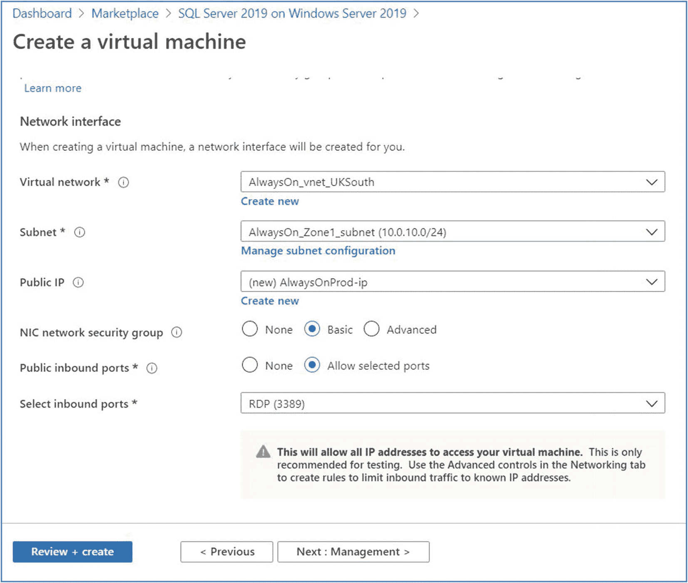

图 7-8 ¶ 创建虚拟机 – 网络

## 管理页

在管理页上，如图 7-9 所示，我们可以配置 VM 的诊断设置。具体而言，我们可以选择是否捕获启动诊断和来自来宾操作系统的诊断，以及诊断应保存到的存储帐户。 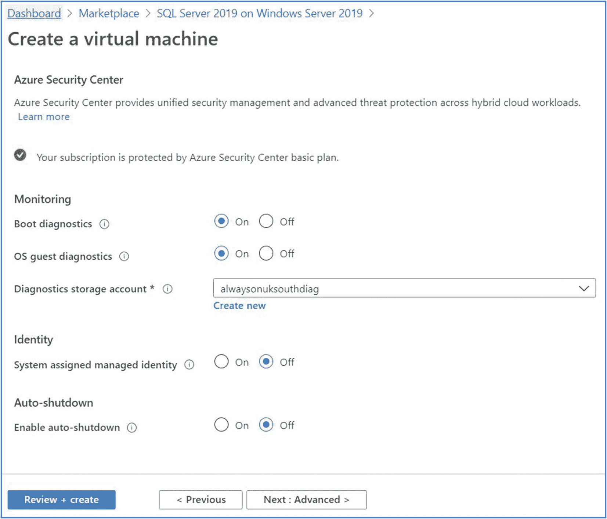

图 7-9 ¶ 创建虚拟机 – 管理页

我们还可以指定是否要使用系统分配的托管标识。如果选择此选项，则 VM 可以在无需在代码中存储服务凭据的情况下对原生 Azure 服务（如 Key Vault）进行身份验证。最后，我们可以指定是否要在特定时间关闭 VM。如果选择此选项，则会出现额外的对话框，允许我们指定关闭计划以及是否希望收到关闭通知。

### 提示

创建 VM 时，只能添加关闭计划，但没有创建启动计划的选项。这可以通过使用 Azure Automation 帐户来实现。

## 高级页

就我们的目的而言，在高级页上没有需要配置的内容。但是，此页面可用于将配置文件传递到 VM 内的已知位置，安装 VM 的扩展，例如 Puppet Agent，以实现 VM 的配置管理。如果您希望 VM 位于就近组上，或希望它驻留在现有的专用主机上，则这些选项也可以在此页面上配置。

## SQL Server 设置

由于我们正在构建 SQL Server VM，因此我们有一个 SQL Server 设置页，如果我们从标准 Windows Server 映像构建 VM，则该页不会出现。在此页的第一部分（图 7-10）中，我们可以配置 SQL 连接。这将为我们提供使 SQL Server 实例仅在 VM 内、在我们的 vnet 内或在 Internet 上公开可用的选项。毋庸置疑，将实例公开给 Internet 是不可取的，通常即使在开发/测试场景中也是如此。 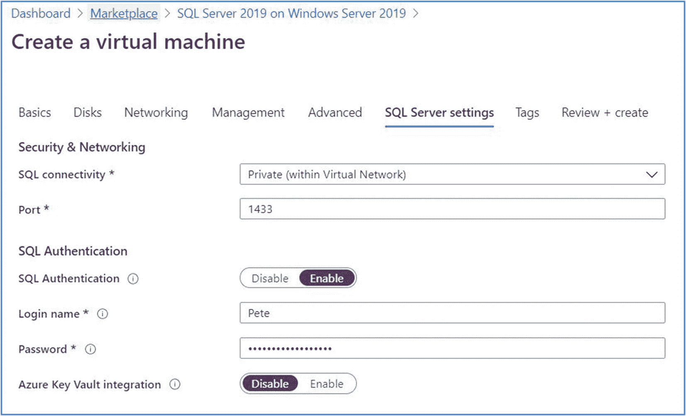

图 7-10 ¶ 创建虚拟机 – SQL Server 设置（第 1 部分）

我们还可以指定实例应监听的端口以及是否要启用 SQL Server 身份验证（而不仅仅是 Windows 身份验证）。如果选择此选项，我们可以指定所需管理员帐户的用户名和密码。

我们还可以选择是否要将实例与 Azure Key Vault 集成。如果选择此选项，则必须提供 Key Vault 服务的 URL 和凭据信息。

在页面的下一部分中，我们会看到 SQL Server 的默认存储选项。使用“更改配置”链接将调用“配置存储”页，如图 7-11 所示。在此页上，有针对通用、OLTP 和数据仓库工作负载配置文件的预设，可以根据您的要求进行自定义。您可以指定 TempDB 和日志文件是否应使用同一驱动器或共享数据驱动器。您还可以指定每个磁盘的大小和存储类型。 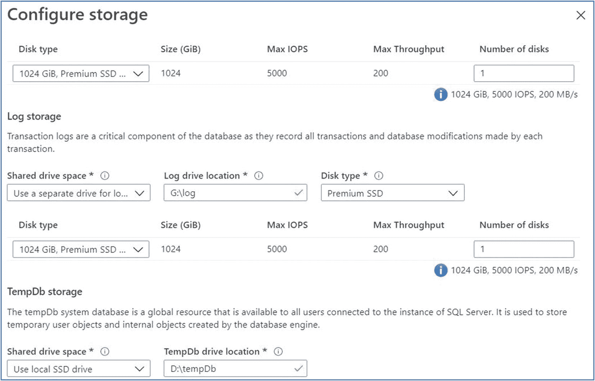

图 7-11 ¶ 创建虚拟机 – SQL Server 设置（第 2 部分）

在页面的最后一部分中，如图 7-12 所示，我们可以指定要为 SQL Server 使用的许可模型（BYOL 或 SPLA），以及指定修补窗口并选择是否要启用自动备份。最后，我们可以指定是否要安装 R Services，该服务提供自 SQL Server 2017 起可用的数据库内机器学习功能。 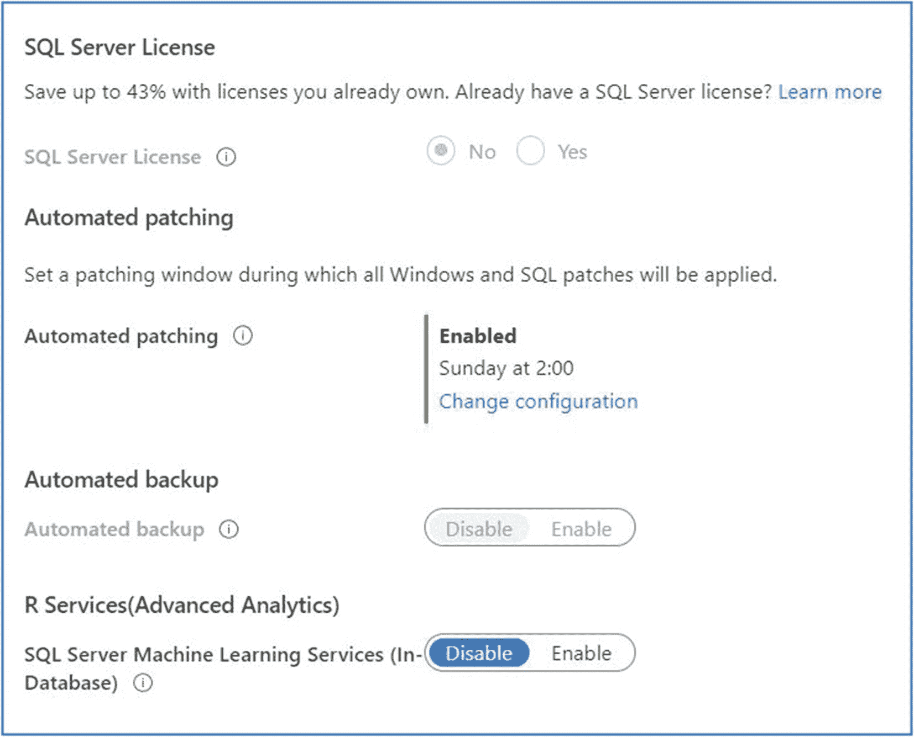

图 7-12 ¶ 创建虚拟机 – SQL Server 设置（第 3 部分）

## 标签和审核页

在标签页上，我们可以按键/值对添加标签，如本章“创建可用性集”部分所述。在审核页上，我们可以在创建虚拟机之前审核所选配置。

就我们的目的而言，我们应重复此过程以创建第二个 VM，这次在可用性区域 2 中并驻留在 vnet 内的另一个子网上。

## 配置可用性组

一旦两个服务器构建完成，您需要将服务器加入域并配置防火墙规则等设置。然后，您可以使用本书第 3 章中演示的方法创建群集。由于我们正在实施可用性组而不是故障转移群集实例，因此群集中不需要任何共享存储。

群集配置完成后，我们可以通过创建 Sales 数据库来构建可用性组，然后使用本书第 5 章中讨论的方法配置可用性组。为本次练习的目的，节点应配置为同步复制和自动故障转移。请注意，您此时不应创建可用性组侦听器。

在 Azure 中，可用性组侦听器将需要 Azure 负载均衡器，以保存可用性组侦听器和故障转移群集的 IP 地址。我们应在创建可用性组侦听器之前创建负载均衡器。


## Azure 负载均衡器配置

## 概述和层级选择

Azure 负载均衡器有两个层级，功能各不相同。Basic 是较便宜的层级，功能更有限，而 Standard 是较高的层级。由于我们的服务器位于可用区，因此必须使用标准负载均衡器。

## 创建负载均衡器

要创建负载均衡器，请在 Azure 中导航到“负载均衡器”刀片并选择“添加”按钮，以创建新的负载均衡器。在“创建负载均衡器”页面的第一部分中，如图 7-13 所示，我们指定要创建负载均衡器的订阅和资源组。这应与您的 VM 所在的资源组相匹配。 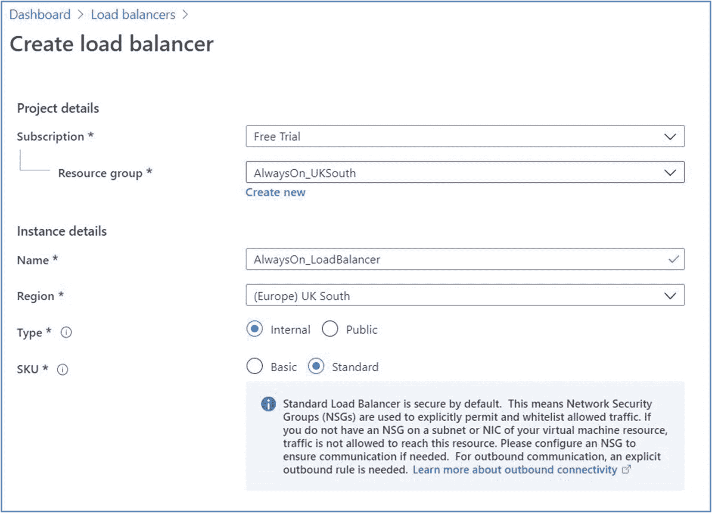

图 7-13 ¶ 创建负载均衡器（第 1 部分）

然后我们为负载均衡器提供名称并指定其应创建的区域。这应与您的 VM 的位置相匹配。我们还选择要创建的负载均衡器的层级。

## 网络配置

在页面的下一部分（图 7-14），我们指定负载均衡器的网络详细信息。具体来说，我们指定其应驻留的虚拟网络，这应与您的 VM 的虚拟网络相匹配。我们还指定应使用静态还是动态 IP 地址。对于我们的目的，我们需要静态 IP 地址，因此需要指定该地址应为哪个地址。最后，我们指定负载均衡器的公共 IP 地址是否应创建在可用区中，或是否应使用区域冗余路径。 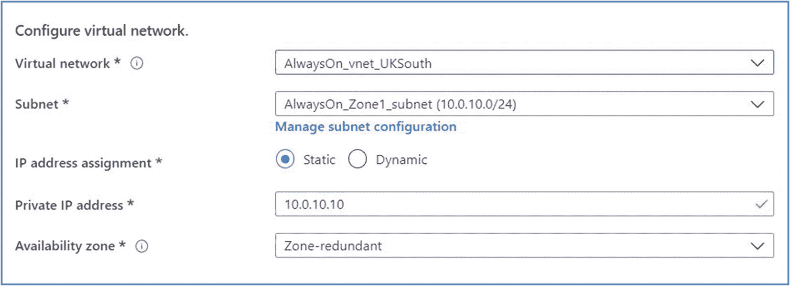

图 7-14 ¶ 创建负载均衡器（第 2 部分）

在“标签”页面，我们可以根据公司政策指定键/值对，然后在“查看”页面上查看我们的配置。

## 后端池

现在我们需要为负载均衡器创建一个后端池。这可以通过在 Azure 门户中导航到负载均衡器刀片的“后端池”选项卡并使用“添加”按钮来实现，以调用如图 7-15 所示的“添加后端池”页面。 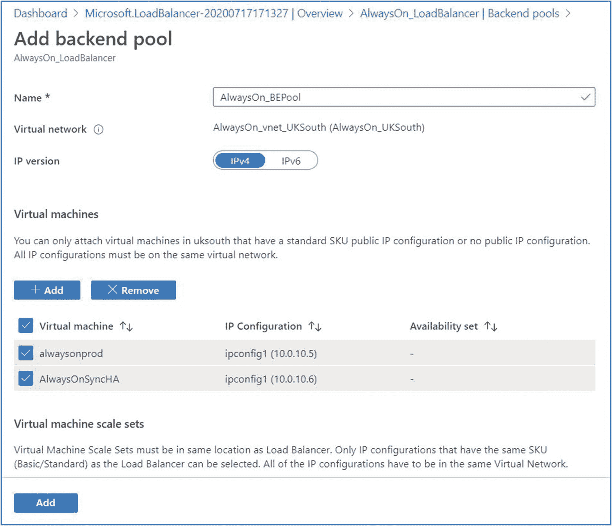

图 7-15 ¶ 添加后端池

## 健康探测

现在我们可以创建一个健康探测，它将对每个节点执行连接检查。我们可以通过导航到负载均衡器刀片上如图 7-16 所示的“健康探测”选项卡来完成此操作。在这里，我们为探测指定名称并提供协议和未使用的端口，健康检查将使用该端口连接到节点。然后我们指定健康检查应运行的频率以及导致节点被标记为不健康的同时失败次数。如果节点被标记为不健康，负载均衡器将不会向其发送任何请求。 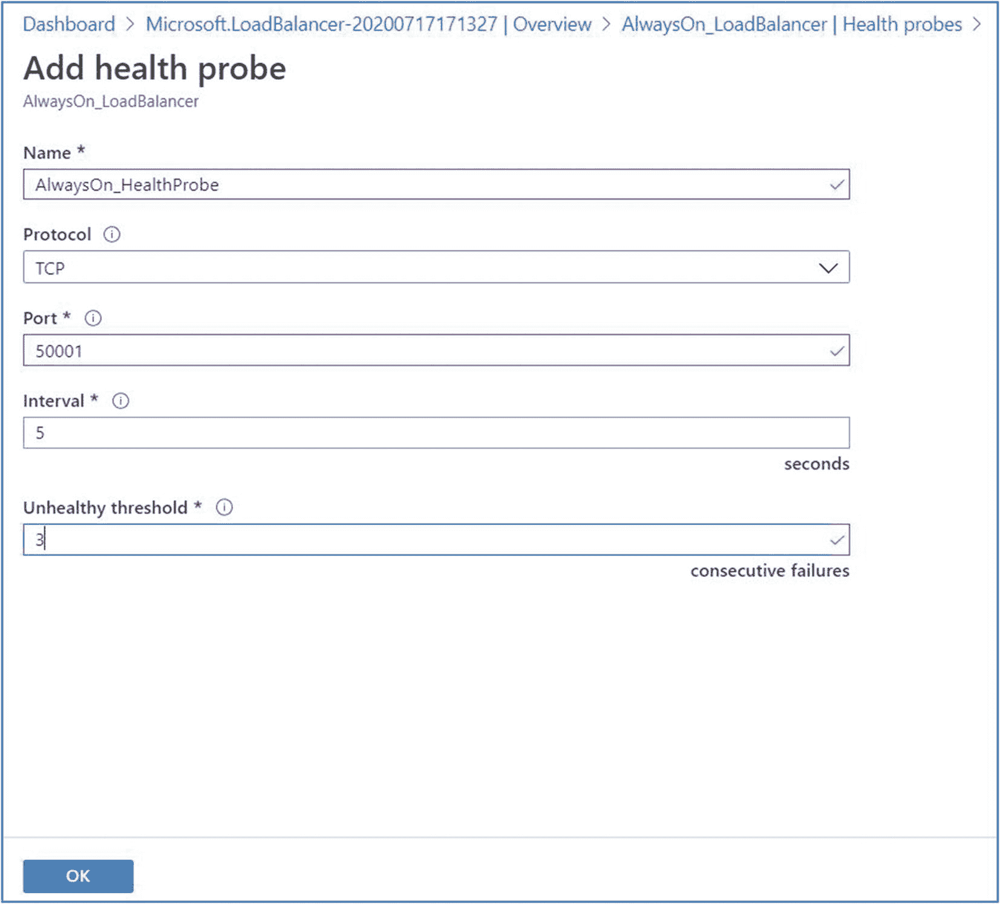

图 7-16 ¶ 添加健康探测

## 负载均衡规则

接下来，我们将使用负载均衡器刀片的“负载均衡器规则”选项卡上的“添加”按钮配置新的负载均衡规则。在此刀片的第一部分（图 7-17）中，我们将为规则指定名称，以及负载均衡器应使用 IPv4 还是 IPv6。前端 IP 地址是我们之前配置的负载均衡器的 IP 地址。HA 端口允许后端池的所有端口进行负载均衡，但我们不想这样做，因此我们将保持该框未选中并选择 TCP 作为协议。 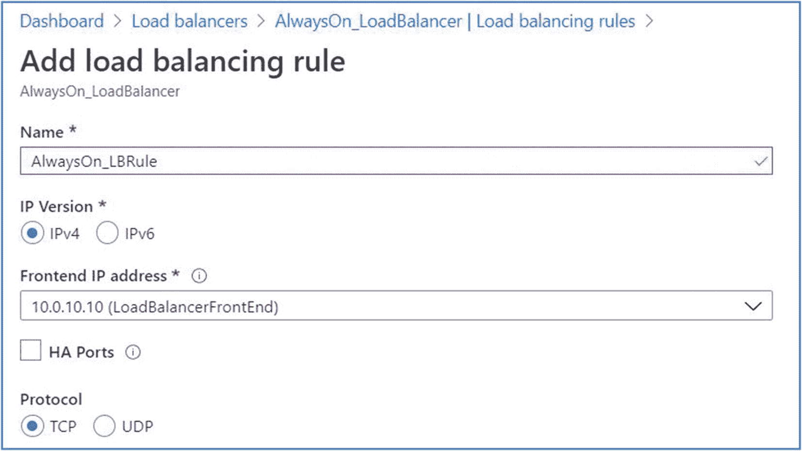

图 7-17 ¶ 配置负载均衡规则（第 1 部分）

在此页面的第二部分，如图 7-18 所示，我们将配置负载均衡器将监听的端口，然后是后端池中服务器将监听的端口。在我们的例子中，这两者都将是端口 1433。我们将选择我们刚刚创建的服务器后端池和健康探测。 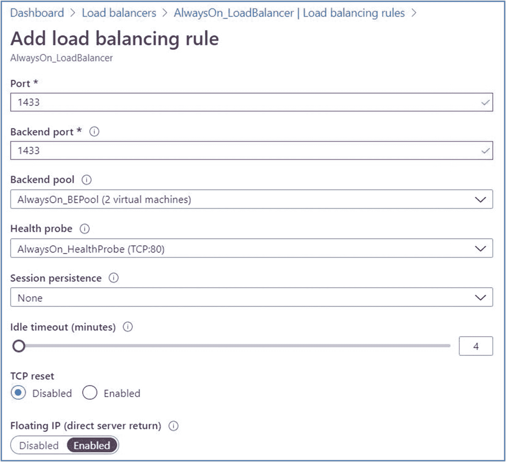

图 7-18 ¶ 配置负载均衡规则（第 2 部分）

会话持久性指定应如何处理来自客户端的连续请求。如果我们选择客户端 IP，则来自同一 IP 地址的连续请求将由同一服务器处理。如果我们选择客户端 IP 和协议，则来自同一客户端的连续请求将由同一服务器处理，但前提是使用相同的协议进行连接。对于可用性组而言，会话持久性不是必需的，因此我们将选择“无”。这表示同一客户端的连续请求可以由后端池中的任何服务器处理。

空闲超时表示在客户端未发送消息的情况下连接将被保持打开的最小时间长度，我们将保持 TCP 重置处于禁用状态。最后，我们将选择浮动 IP，这会更改 IP 地址映射模式，允许多个侦听器，这对于可用性组侦听器是必需的。

您应重复此过程为核心集群添加前端端口和负载均衡规则。

## 可用性组侦听器

然后我们将处于可以配置可用性组侦听器的位置。我们将从集群管理器中执行此操作。从“销售角色”的上下文菜单中，钻取“添加资源”并选择“客户端访问点”。这将导致显示“新建资源客户端访问点”向导。在此向导的第一页上，为客户端访问点提供名称并分配 IP 地址。由于我们为每个 VM 创建了不同的子网，因此我们需要为每个子网提供 IP 地址，如图 7-19 所示。 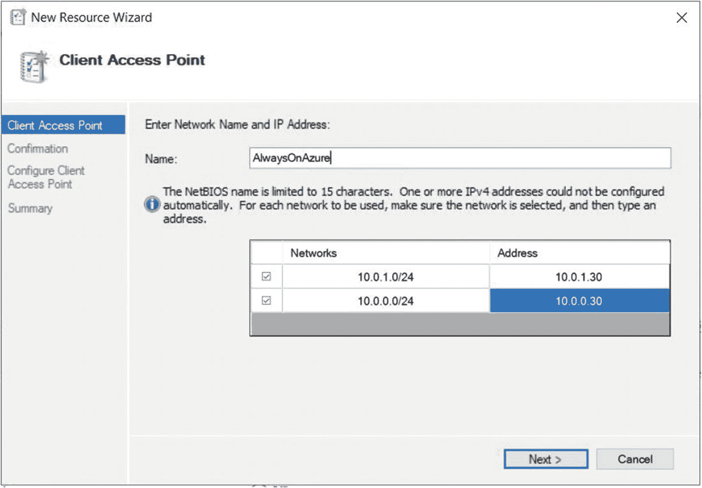

图 7-19 ¶ 创建新的客户端访问点 – 客户端访问点页面

当我们进入向导的确认页面时，我们的网络设置将被验证。确认页面显示我们将要配置的摘要。

一旦创建了客户端访问点，我们应使用角色的资源选项卡下“其他资源”中显示的可用性组资源的属性对话框的“依赖项”选项卡来添加对客户端访问点的依赖项，如图 7-20 所示。 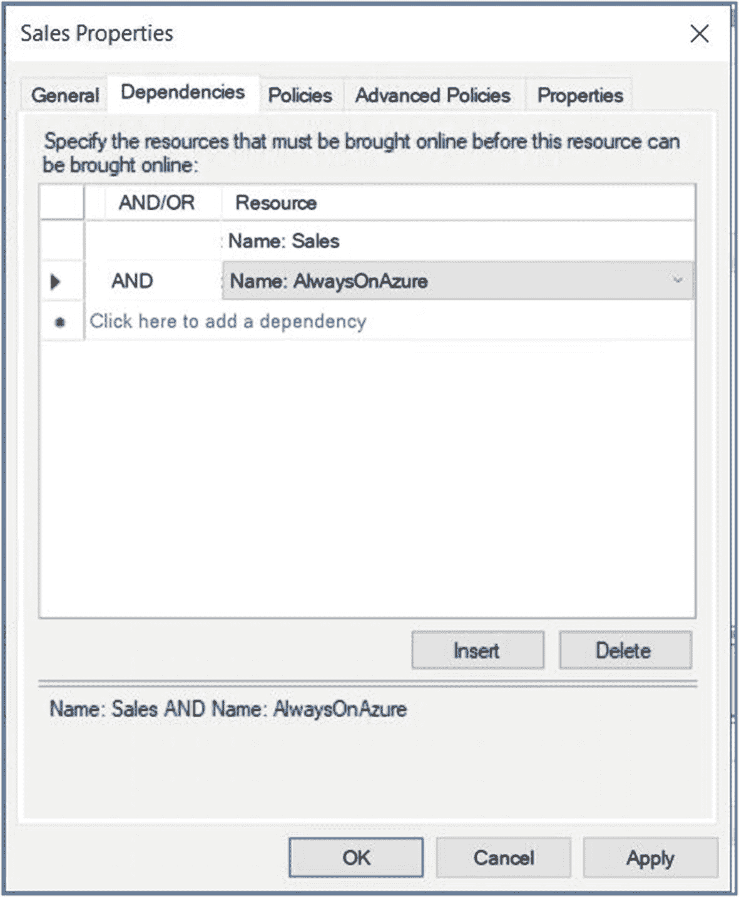

图 7-20 ¶ 添加依赖项

您还应重复此过程使客户端访问点依赖于 IP 地址资源。

## 集群与负载均衡器的集成

接下来，我们需要配置集群以与 Azure 负载均衡器配合使用。我们可以使用列表 7-2 中的脚本来完成此操作。此脚本使用负载均衡器 IP 和健康探测端口更新每个 IP 地址资源。

**注意**
请务必在运行脚本之前将其更新以匹配您自己的配置。

```powershell
$ClusterNetworkName = 'AlwaysOnAzure'
$LoadBalancerIP = '10.0.10.10'
[int]$LoadBalancerProbePort = 50001
Get-ClusterResource 'IP Address 10.0.0.35' | Set-ClusterParameter -Multiple @{"Address"="$LoadBalancerIP";"ProbePort"=$LoadBalancerProbePort;"SubnetMask"="255.255.255.0";"Network"="$ClusterNetworkName";"EnableDhcp"=0}
Get-ClusterResource 'IP Address 10.0.0.35' | Set-ClusterParameter -Multiple @{"Address"="$LoadBalancerIP";"ProbePort"=$LoadBalancerProbePort;"SubnetMask"="255.255.255.0";"Network"="$ClusterNetworkName";"EnableDhcp"=0}
```

列表 7-2
将集群与负载均衡器集成

**提示**


创建 `Client Access Point` 后，`Availability Group` 中将添加一个 `Availability Group Listener`，默认端口为 `1433`。如果计划使用不同的端口，可以在 `SQL Server Management Studio` 中的侦听器中进行更新。

## 无群集可用性组

无群集可用性组出现在 `SQL Server 2017` 中，是 `Linux` 支持的副产品，但对于支持 `Windows` 环境上实例的 SQL Server DBA 来说也可能很有价值。

无群集实现不适用于高可用性场景。这有几个原因。首先，因为没有群集，所以没有运行状况检查。这意味着无法自动仲裁故障转移。其次，虽然可以在副本之间使用 `synchronous commit` 实现无数据丢失的故障转移，但您需要通过将 `Availability Group` 在主副本上脱机来准备故障转移。这意味着故障转移期间会出现中断。最后，因为没有群集，所以无法拥有侦听器。这意味着连接到主副本的应用程序在故障转移事件中需要切换连接字符串以指向辅助副本。

**提示**
可以在 `DNS` 中创建指向主副本的 `C-NAME` 记录。然后可以在故障转移时将 `C-NAME` 记录更新为指向辅助副本。虽然这是一个手动过程，通常涉及 DBA 职能之外的团队，但它可以避免客户端更改其连接字符串的需求。

无群集可用性组在读扩展场景中获益最大。因此，它们也被称为读扩展可用性组。设想一个场景，您有一个 SQL Server 工作负载，来自多个应用程序的读取吞吐量很高，但没有 HA 要求。您可以消除群集的复杂性，同时仍保持数据库同步。某些客户端应用程序可以配置为指向主副本，而其他客户端应用程序可以配置为指向辅助副本。

在本节中，我们将处理一个场景，其中有两个名为 `Prod` 和 `ReadScale` 的服务器。每个服务器都安装了默认实例的 `SQL Server 2019 Enterprise Edition`。两个服务器都在站点 1，并且都是 `AlwaysOn.com` 域的成员，但没有群集。我们将配置一个 `Availability Group` 为 `Customers` 数据库提供读扩展，该数据库由两个应用程序访问，但其中一个应用程序仅执行只读操作。

### 准备实例

与所有可用性组场景一样，在配置可用性组之前，我们需要完成一些准备任务。以下各节描述如何准备实例。

#### 启用可用性组

通常情况下，为实例准备可用性组的首要步骤是在数据库引擎服务上启用可用性组。我们可以使用 `PowerShell` 或 `SQL Server Configuration Manager` 执行此任务，如 第 5 章所示。在本例中，我们将使用 Configuration Manager，如 图 7-21 所示。您会注意到，因为没有底层群集，对话框会告知我们这一点，而不是显示底层群集名称。此任务需要在将参与可用性组的所有实例上执行。 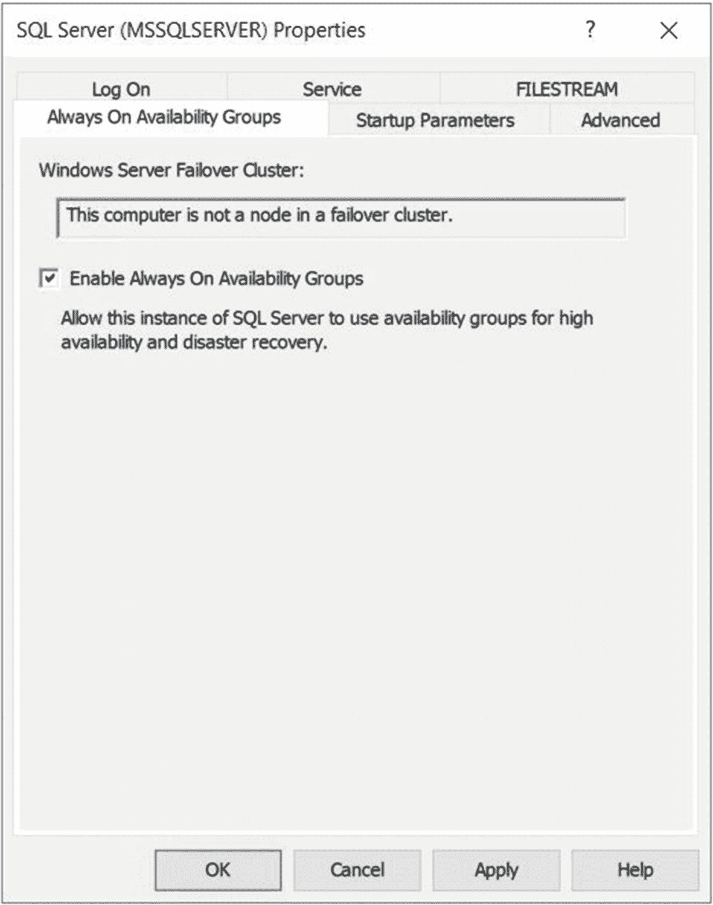

图 7-21 ¶ 启用可用性组

启用可用性组后，需要重新启动服务才能使更改生效。

#### 创建 Customers 数据库

本场景的目标是为 `Customers` 数据库提供读扩展。因此，我们可以使用 清单 7-3 中的脚本创建 `Customers` 数据库。

```sql
--Create Customers Database
CREATE DATABASE Customers;
GO
USE Customers;
GO
CREATE TABLE dbo.Customers (
      ID                INT                PRIMARY KEY        IDENTITY,
      FirstName         NVARCHAR(30),
      LastName          NVARCHAR(30),
      CreditCardNumber  VARBINARY(8000)
);
GO
--Populate the table
DECLARE @Numbers TABLE (
        Number        INT
);
WITH CTE(Number) AS (
        SELECT 1 Number
        UNION ALL
        SELECT Number + 1
        FROM CTE
        WHERE Number < 100
)
INSERT INTO @Numbers SELECT Number FROM CTE
DECLARE @Names TABLE (
        FirstName        VARCHAR(30),
        LastName         VARCHAR(30)
);
INSERT INTO @Names VALUES('Peter', 'Carter'),
      ('Michael', 'Smith'),
      ('Danielle', 'Mead'),
      ('Reuben', 'Roberts'),
      ('Iris', 'Jones'),
      ('Sylvia', 'Davies'),
      ('Finola', 'Wright'),
      ('Edward', 'James'),
      ('Marie', 'Andrews'),
      ('Jennifer', 'Abraham'),
      ('Margaret', 'Jones')
INSERT INTO Customers(Firstname, LastName, CreditCardNumber)
      SELECT
                FirstName
              , LastName
              , CreditCardNumber
      FROM (
            SELECT
                   (SELECT TOP 1 FirstName FROM @Names ORDER BY NEWID()) FirstName
           , (SELECT TOP 1 LastName FROM @Names ORDER BY NEWID()) LastName
           , (SELECT TOP 1 CONVERT(VARBINARY(8000), (
                  (SELECT TOP 1 CAST(Number * 100 AS CHAR(4))
                        FROM @Numbers
                        WHERE Number BETWEEN 10 AND 99
                        ORDER BY NEWID()
                   ) + '-' +
                   (SELECT TOP 1 CAST(Number * 100 AS CHAR(4))
                        FROM @Numbers
                        WHERE Number BETWEEN 10 AND 99 ORDER BY NEWID()
                    ) + '-' +
                    (SELECT TOP 1 CAST(Number * 100 AS CHAR(4))
                        FROM @Numbers
                        WHERE Number BETWEEN 10 AND 99 ORDER BY NEWID()
                     ) + '-' +
                     (SELECT TOP 1 CAST(Number * 100 AS CHAR(4))
                        FROM @Numbers
                        WHERE Number BETWEEN 10 AND 99 ORDER BY NEWID())))
            FROM @Numbers a
      ) CreditCardNumber) d
CROSS JOIN @Numbers b
CROSS JOIN @Numbers c;
--SET FULL recovery mode on the database - required for Availability Groups
ALTER DATABASE Customers SET RECOVERY FULL;
GO
```

清单 7-3

创建 Customers 数据库

我们还需要在数据库添加到可用性组之前对其进行完整备份。我们可以使用 清单 7-4 中的脚本实现此操作。

```sql
--Back Up Customers Database
BACKUP DATABASE Customers TO DISK = 'C:\Program Files\Microsoft SQL Server\MSSQL15.MSSQLSERVER\MSSQL\Backup\Customers.bak' WITH NAME = 'Customers-Full Database Backup';
GO
```

清单 7-4

备份 Customers 数据库

#### 创建登录名

数据同步将由运行数据库引擎服务的服务帐户执行。因此，服务帐户将在成为可用性组中副本的所有实例上需要登录名。在我们的场景中，两个实例都在 `ALWAYSON\SqlServiceAccount` 域帐户下运行。因此，在所有参与实例上运行 清单 7-5 中的脚本将创建所需的登录名。

```sql
CREATE LOGIN [ALWAYSON\SQLServiceAccount] FROM WINDOWS;
GO
```

清单 7-5

创建登录名

**提示**
如果服务器不是域的成员，则可以使用 SQL 登录名和证书配置身份验证。

#### 创建和配置可用性组


## 创建终结点

创建 `Availability Group` 的第一步是创建 `endpoint`，`Availability Group` 将使用它在 `Replicas` 之间发送消息。我们还需要授予服务帐户连接到 `Endpoint` 的权限。这可以通过清单 7-6 中的脚本实现。

```sql
--Create the Endpoint
CREATE ENDPOINT ClusterlessEndpoint
    AS TCP (LISTENER_PORT = 5022)
    FOR DATA_MIRRORING (
          ROLE = ALL,
          ENCRYPTION = REQUIRED ALGORITHM AES
    ) ;
GO
--Start the Endpoint
ALTER ENDPOINT ClusterlessEndpoint STATE = STARTED ;
GO
--Grant Permissions to the Service Account
GRANT CONNECT ON ENDPOINT::ClusterlessEndpoint TO [ALWAYSON\SQLServiceAccount];
GO
```

清单 7-6

创建终结点

## 创建可用性组

`Endpoint` 就位后，我们现在可以继续创建 `Availability Group`。与往常一样，我们可以选择使用 `T-SQL`、`New Availability Group` 向导或 `New Availability Group` 对话框。在本例中，我们将通过运行清单 7-7 中的脚本使用 `T-SQL`。请注意，`CLUSTER_TYPE` 选项设置为 `NONE`。

```sql
USE master
GO
CREATE AVAILABILITY GROUP Customers_Clusterless WITH (
      AUTOMATED_BACKUP_PREFERENCE = SECONDARY,
      CLUSTER_TYPE = NONE
) FOR DATABASE Customers
REPLICA ON 'PROD' WITH (
      ENDPOINT_URL = 'TCP://PROD.AlwaysOn.com:5022',
      FAILOVER_MODE = MANUAL,
      AVAILABILITY_MODE = ASYNCHRONOUS_COMMIT,
      SEEDING_MODE = AUTOMATIC,
      SECONDARY_ROLE(ALLOW_CONNECTIONS = ALL)
), 'READSCALE' WITH (
      ENDPOINT_URL = 'TCP://READSCALE.AlwaysOn.com:5022',
      FAILOVER_MODE = MANUAL,
      AVAILABILITY_MODE = ASYNCHRONOUS_COMMIT,
      SEEDING_MODE = AUTOMATIC,
      SECONDARY_ROLE(ALLOW_CONNECTIONS = ALL)
) ;
GO
```

清单 7-7

创建可用性组

## 将辅助副本加入可用性组

最后，我们可以通过在辅助实例上运行清单 7-8 中的脚本，将辅助 `Replica` 加入 `Availability Group`。

```sql
ALTER AVAILABILITY GROUP Customers_Clusterless JOIN WITH (CLUSTER_TYPE = NONE) ;
GO
ALTER AVAILABILITY GROUP Customers_Clusterless GRANT CREATE ANY DATABASE ;
GO
```

清单 7-8

将辅助副本加入可用性组

`Availability Groups` 的无群集用例之一是迁移。如果您有一个需要迁移到新服务器的数据库，您可以轻松配置一个无群集 `Availability Group` 来支持并行迁移。

一旦 `Availability Group` 配置完成，用户就可以在继续使用现有数据库的同时，对新实例执行只读操作进行应用程序检查。一旦他们满意，`Availability Group` 可以进行故障转移，旧实例将被退役。

## 与域无关的可用性组

表面上看，与域无关的群集，也称为工作组群集和可用性组，似乎有点奇怪。如果一家公司大到需要运行 SQL Server Enterprise（甚至是 Standard），那么它肯定足够大，也很可能拥有域和创建标准群集的能力。但如果思考得更深入，企业从与域无关的高可用性和灾难恢复中受益的用例还有很多。例如，想象一下您拥有一个混合云环境。您的公司没有将域扩展到 Azure 或 AWS，而是决定在云中创建一个新域并在两者之间建立信任关系。然后您决定想要使用 `Availability Groups` 在本地和云之间同步数据库，以便支持在线销售应用程序的数据库位于云中以获得最低延迟，但您也希望 DR 回到本地。没有与域无关的群集或 `Availability Groups`，这只能使用无群集 `Availability Groups` 实现，这意味着您无法使用侦听器。

在本节中，我们将探讨如何创建与域无关的群集和 `Availability Group`。为了网络的简单性，我们将在 `Site1` 子网内的一个工作组中的两台服务器之间配置它。在此场景中，不存在域。但是值得注意的是，此方法也可以用于在两个独立域之间，或在域和工作组之间创建群集（和 `Availability Group`）。

我们将在同一工作组中的两个节点上构建群集和 `Availability Group`，节点名为 `ClusterNode1` 和 `ClusterNode2`，目的是卸载只读报表。每个节点上都安装了默认实例的 `SQL Server`。

### 为群集做准备

群集中所有节点都需要添加一个共同的主 DNS 后缀是必需的。这可以通过导航到 控制面板 ➤ 系统和安全 ➤ 系统 并在屏幕的 计算机名称、域和工作组设置 区域中选择更改设置来实现，从而调用系统属性对话框，其中可以使用更改按钮调用计算机名称/域更改对话框。现在，您可以使用更多按钮调用 DNS 后缀和 NetBIOS 计算机名称对话框，如图 7-22 所示。在这里，我们将输入我们的公共 DNS 后缀。

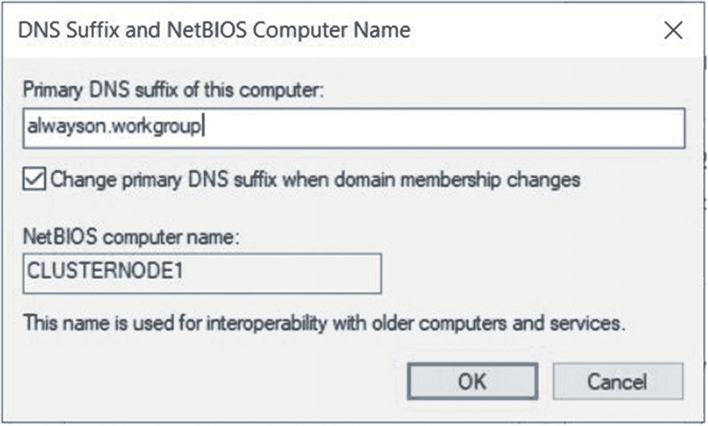

图 7-22 ¶ DNS 后缀和 NetBIOS 计算机名称

我们还需要确保在所有群集节点上存在一个帐户，该帐户具有相同的用户名、相同的密码并且具有本地管理员权限。在我们的场景中，我们将使用内置的 `Administrator`，但如果我们使用任何其他帐户，则还必须在注册表中将 `LocalAccountTokenFilterPolicy` 的值设置为 `1`。这可以通过使用清单 7-9 中的 `PowerShell` 命令来实现。

```powershell
New-ItemProperty -path HKLM:\SOFTWARE\Microsoft\Windows\CurrentVersion\Policies\System -Name LocalAccountTokenFilterPolicy -Value 1
```

清单 7-9

设置 LocalAccountTokenFilterPolicy

### 创建群集

我们现在可以使用清单 7-10 中的脚本创建群集。这里有两个有趣的点需要注意。首先，我们正在使用 `AdministrativeAccessPoint` 参数，配置值为 `DNS`。这将创建群集名称对象，但不会尝试在 Active Directory 中创建计算机对象，而这当然在与域无关的群集中不受支持。

第二个有趣的点是我们选择使用群集磁盘作为见证。这是因为文件共享见证在与域无关的群集中不受支持。

```powershell
New-Cluster -Name AOAGWorkGroupCluster -Node ClusterNode1,ClusterNode2 -StaticAddress 10.0.0.52 -AdministrativeAccessPoint DNS
Set-ClusterQuorum -DiskWitness "Cluster Disk 1"
```

清单 7-10

创建群集

### 为可用性组做准备

为 `Availability Group` 做准备的第一步是在所有将参与的节点的 `SQL Server` 服务上启用 `Availability Groups`。有关如何执行此操作的说明可在本章的“无群集可用性组”部分找到。


由于在此拓扑中无法使用 Active Directory 身份验证，`database_mirroring` 端点需要使用证书相互通信。我们还需要 SQL 登录名，这些登录名将被授予连接到端点的权限。因此，我们首先需要创建证书。这可以通过清单 7-11 中的脚本实现。在这里，我们首先在 `master` 数据库中创建数据库主密钥。然后我们创建证书并将该证书备份到操作系统中。这应在将参与可用性组的每个节点上重复执行，为每个实例使用不同的证书名称。

### 创建证书

```
USE master
GO
--Create the Database Master key
CREATE MASTER KEY ENCRYPTION BY PASSWORD = 'Pa$$w0rd';
GO
-- Create the certificate
CREATE CERTIFICATE Node1Cert WITH SUBJECT = 'ClusterNode1 Certificate';
GO
--Back up the certificate
BACKUP CERTIFICATE Node1Cert TO FILE = 'c:\\Certificates\\Node1Cert.cer';
GO
```

我们现在需要为每个节点创建一个登录名，该登录名将被授予连接到端点的权限。我们可以使用清单 7-12 中的脚本实现。这些登录名应在将参与可用性组的所有实例上创建。因此，应针对所有实例运行该脚本。

### 创建登录名

```
CREATE LOGIN ClusterNode1_AOAG WITH PASSWORD = 'Pa$$w0rd';
GO
CREATE USER ClusterNode1_AOAG FOR LOGIN ClusterNode1_AOAG;
GO
CREATE LOGIN ClusterNode2_AOAG WITH PASSWORD = 'Pa$$w0rd';
GO
CREATE USER ClusterNode2_AOAG FOR LOGIN ClusterNode2_AOAG;
GO
```

我们现在可以将每个实例的证书复制到所有其他实例，并使用清单 7-13 中的命令将其恢复。对于每个实例，您应适当更改证书和用户名。此清单显示了在我们的拓扑中应在 `CLUSTERNODE1` 上运行的命令。

### 恢复证书

```
CREATE CERTIFICATE Node2Cert AUTHORIZATION ClusterNode2_AOAG FROM FILE = 'C:\\Certificates\\Node2Cert.cer'
```

最后，现在证书已存在于每个节点上，我们可以继续在每个节点上创建 `database_mirroring` 端点。这可以通过清单 7-14 中的脚本实现。此脚本需要在每个节点上运行，并将证书更改为与节点匹配。

### 创建端点

```
--Create the endpoint
CREATE ENDPOINT AOAG_Endpoint STATE = STARTED AS TCP (
      LISTENER_PORT = 5022,
      LISTENER_IP = ALL
) FOR DATABASE_MIRRORING (
      AUTHENTICATION = CERTIFICATE Node1Cert,
      ROLE = ALL
)
--Grant each user permissions to connect to the endpoint
GRANT CONNECT ON ENDPOINT::AOAG_Endpoint TO ClusterNode1_AOAG;
GO
GRANT CONNECT ON ENDPOINT::AOAG_Endpoint TO ClusterNode2_AOAG;
GO
```

您现在可以使用本书第 5 章中讨论的技术创建可用性组。

## 分布式可用性组

分布式可用性组 (`DAG`) 是可用性组的扩展，允许在两个独立的可用性组之间同步数据。这是一项令人兴奋的技术，具有许多不同的用例。例如，它允许在基于 Windows 和 Linux 的可用性组之间进行数据同步，它允许可读的辅助副本数量扩展到 8 之外（这是标准可用性组的限制），并且允许跨站点复制，而无需伸展集群的复杂性。分布式可用性组还可以通过在就地升级不可行且需要并行迁移时提供数据同步来帮助服务器迁移。它们也可以用作域独立可用性组的替代方案，当您在不同域中拥有服务器时。

虽然分布式可用性组的每一侧可以是 Windows 故障转移群集，但这不是必需的，因为重点非常集中在维护数据库上，并且不会进行群集配置。

在本节中，我们将通过为我们在第 5 章中创建的 HR 可用性组配置 DAG 来说明该技术，该组位于我们的 `ALWAYSON-C` 集群和一个名为 `Linux_AOAG` 的基于 Linux 的可用性组之间，后者托管在两个参与 Pacemaker 集群的 Linux 服务器上。

第一步是在 Linux 集群上创建分布式可用性组。这可以通过使用清单 7-15 中的脚本实现。请注意 `WITH (DISTRIBUTED)` 语法，后跟每个可用性组的规范。

> **注意**
> 开始之前，您应从 HR 可用性组中删除现有数据库；否则，它将无法加入分布式可用性组，因为辅助可用性组必须为空。

```
CREATE AVAILABILITY GROUP DistributedAG
   WITH (DISTRIBUTED)
   AVAILABILITY GROUP ON
      'HR' WITH
      (
         LISTENER_URL = 'tcp://HRListener.alwayson.com:1433',
         AVAILABILITY_MODE = ASYNCHRONOUS_COMMIT,
         FAILOVER_MODE = MANUAL,
         SEEDING_MODE = AUTOMATIC
      ),
      'Linux_AOAG' WITH
      (
         LISTENER_URL = 'tcp://LinuxListener:5022',
         AVAILABILITY_MODE = ASYNCHRONOUS_COMMIT,
         FAILOVER_MODE = MANUAL,
         SEEDING_MODE = AUTOMATIC
      );
GO
```

我们现在可以针对 `PROSQLADMIN-C` 集群运行清单 7-16 中的命令，以将其加入分布式可用性组。

```
ALTER AVAILABILITY GROUP DistributedAG
   JOIN
   AVAILABILITY GROUP ON
      'HR' WITH
      (
         LISTENER_URL = 'tcp://HRListener.alwayson.com:1433',
         AVAILABILITY_MODE = ASYNCHRONOUS_COMMIT,
         FAILOVER_MODE = MANUAL,
         SEEDING_MODE = AUTOMATIC
      ),
      'Linux_AOAG' WITH
      (
         LISTENER_URL = 'tcp://LinuxListener:5022',
         AVAILABILITY_MODE = ASYNCHRONOUS_COMMIT,
         FAILOVER_MODE = MANUAL,
         SEEDING_MODE = AUTOMATIC
      )
;
GO
```

> **提示**
> 数据库需要手动加入到辅助可用性组内的辅助副本中。

## 摘要

可用性组提供大量灵活性，使 DBA 能够在几乎任何情况下配置高可用性、灾难恢复或读扩展。非典型可用性组拓扑的示例包括在 `Azure VMs` 跨越配置可用性组、在没有底层集群的情况下配置可用性组，以及跨域或完全没有域的情况下配置可用性组。

在 `Azure VMs` 中创建可用性组时，高可用性最好通过将虚拟机拆分到 `Availability Sets` 和 `Availability Zones` 来实现，而灾难恢复最好通过将 DR 节点放置在不同的 `Azure Region` 中来实现。在此场景中，可以通过使用 `Azure paired regions` 来维护数据主权，这些区域位于相同的政治地理范围内，同时仍在地理上分散解决方案。

`Clusterless Availability Groups` 不能用于实现高可用性。这是因为没有集群来执行节点健康检查。然而，它们非常适合读扩展场景，在这些场景中可以避免集群组件的复杂性。

域独立可用性组（也称为 `workgroup availability groups`）允许在多个域之间或完全没有域的情况下配置可用性组。它们特别适合混合云场景，在这些场景中，您的组织选择在云中创建单独的域，而不是扩展其本地域。


分布式可用性组可用作混合云场景中域无关可用性组的替代方案。此外，它们还提供了跨平台分发数据的灵活性。例如，数据可以在基于 Windows 的可用性组和基于 Linux 的可用性组之间复制。

基础可用性组提供了在运行 SQL Server Standard Edition 的实例上配置可用性组的选项。然而，如果你选择使用此功能，则功能有限。仅支持两个副本，并且每个可用性组只能有一个数据库。此外，没有使用只读路由的选项。

© Peter A. Carter 2020 P. A. CarterSQL Server 2019 AlwaysOn[`doi.org/10.1007/978-1-4842-6479-9_8`](https://doi.org/10.1007/978-1-4842-6479-9_8) 开始摘要 
